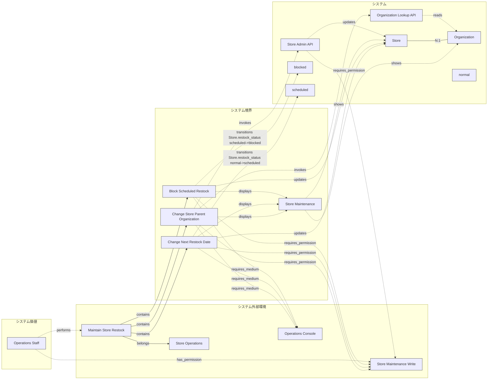
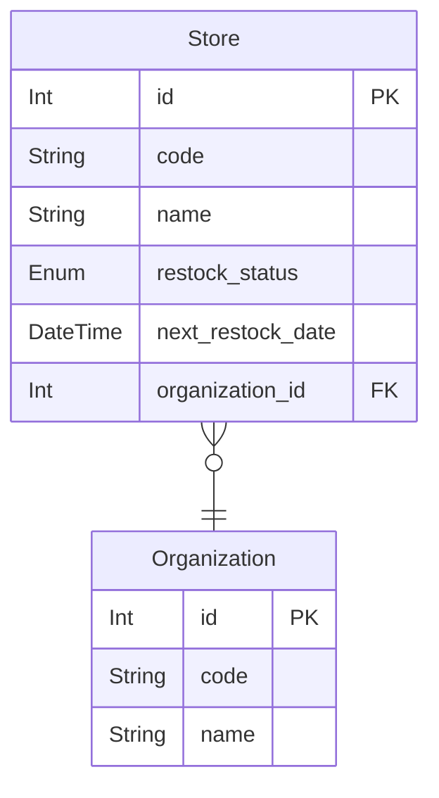
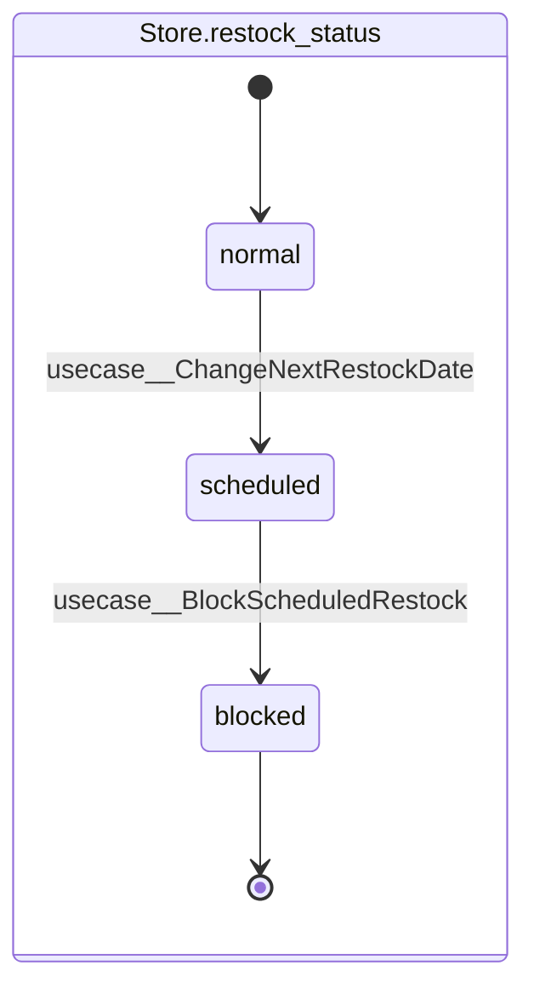

# Diagram Sample Review Guide

<!-- constrained-by ./cli-reference.md#diagram -->
<!-- constrained-by ./incremental-modeling.md -->
<!-- derived-from ../samples/incremental-order/step-6-business-rules/design.md -->

This guide embeds representative generated diagrams from the incremental order sample
and explains how to read each one during review. The examples use
`samples/incremental-order/step-6-business-rules`, a small model that still includes
business scope, permissions, UI, APIs, entities, lifecycle events, and state rules.

Regenerate the artifacts with:

```sh
bash scripts/check-sample-artifacts.sh
```

The same command runs in CI, so intentional emitter or DSL changes should appear as a
normal diff under `samples/incremental-order/step-6-business-rules/out/`.

CI snapshots the Mermaid text (`.mmd`), the only diagram format `rdra-ish` writes.
An image is a rendering of that text by an external tool such as Mermaid CLI (`mmdc`);
keep rendered images as local review conveniences.

## RDRA Layered Graph

<!-- derived-from #diagram-sample-review-guide -->

Generated from:

```sh
rdra-ish diagram samples/incremental-order/step-6-business-rules/src \
  --kind rdra \
  --format mermaid \
  --buc BucStoreRestock \
  --out samples/incremental-order/step-6-business-rules/out/object_graph_buc_store_restock
```



How to read it:

- The `%%` header names the kind, the BUC scope, and the node kinds drawn. Each node id
  is `<kind>__<DSL id>`, so `usecase__ChangeNextRestockDate` is the same element in
  every diagram that draws it.
- Read the four subgraphs left to right as the RDRA layers システム価値, システム外部環境,
  システム境界, and システム.
- Start from the actor and BUC, then follow `contains` (a solid arrow, as every
  hierarchy edge is) into concrete use cases.
- Treat permissions and media as review constraints on the use-case/API path, not as
  decorative labels.
- A `transitions` edge runs from the use case to the state it enters and names the
  column and the from/to values, so the lifecycle each use case drives reads off this
  graph before the state diagram.
- `%% desc` lines carry each element's description; a review that needs the prose
  reads them, and a renderer ignores them.

Review points:

- Does every use case in the BUC still explain the BUC's business value?
- Are direct entity writes intentional, or should they move behind an API boundary?
- Does every required permission have a matching actor-side grant?
- Are event-raising use cases paired with downstream flow or state review?

## ER Diagram

<!-- derived-from #rdra-layered-graph -->

Generated from:

```sh
rdra-ish diagram samples/incremental-order/step-6-business-rules/src \
  --kind er \
  --format mermaid \
  --out samples/incremental-order/step-6-business-rules/out/er
```



How to read it:

- Treat `entity` as the logical data model, not the conceptual model.
- Cardinality comes from `relate`; generated FK columns show where the ownership of a
  reference lands.
- State axes such as `restock_status` are data columns and lifecycle review inputs.

Review points:

- Is `Store -> Organization` optionality correct for business operations?
- Are state columns explicit enough for state derivation and rule review?
- Do entity names still match the business vocabulary used in BUCs and use cases?
- Are indexes, uniqueness, tenant scope, history, or soft-delete annotations needed
  before this becomes a migration design?

## State Diagram

<!-- derived-from #er-diagram -->

Generated from:

```sh
rdra-ish diagram samples/incremental-order/step-6-business-rules/src \
  --kind state \
  --format mermaid \
  --out samples/incremental-order/step-6-business-rules/out/state
```



How to read it:

- Each state model (a lifecycle column) is one composite state,
  `statemodel__Store_restock_status` labelled `Store.restock_status`.
- `[*] -->` marks the start state, the value the lifecycle gives the column on creation
  (or its default for an entity that starts present). `--> [*]` marks an end state, one
  with no transition to another state.
- Each edge is labelled with the id of the use case that drives the transition, as the
  遷移UC column of an RDRA state sheet is; `usecase__BlockScheduledRestock` is the same
  node in the layered graph.
- This diagram shows lifecycle topology. Use `rdra-ish states` for rule satisfaction,
  reachable combinations, and diagnostics.

Review points:

- `blocked` is an end state: is it terminal by design, or is a way out missing?
- Are business rules such as `scheduled` requiring `next_restock_date` covered by
  state-pattern diagnostics?
- Do events represent domain facts rather than UI button clicks?
- Are event-triggered downstream BUCs or use cases missing from the model?

## Summary

<!-- derived-from #rdra-layered-graph -->
<!-- derived-from #er-diagram -->
<!-- derived-from #state-diagram -->

Use the layered graph to confirm coverage and interaction boundaries, the ER diagram
to review logical data structure, and the state diagram to review lifecycle topology.
A useful review usually walks them in that order: business value first, then data
shape, then lifecycle rules. The transaction and API-boundary warnings come from
`rdra-ish check`.
