# Diagram Sample Review Guide

<!-- constrained-by ./cli-reference.md#diagram -->
<!-- constrained-by ./incremental-modeling.md -->
<!-- derived-from ../samples/incremental-order/step-6-business-rules/design.md -->

This guide embeds one generated diagram of each `diagram --kind` and explains how to read
it during review. The kinds follow the RDRA 3.0 diagrams, in the order a review usually
walks them: system context and requirements, business, use cases and flows, information
and conditions, lifecycle and events, then the data model and the whole graph.

Most examples use `samples/incremental-order/step-6-business-rules`, a small model with
business scope, permissions, UI, APIs, entities, lifecycle, and two systems. It declares
no requirement, flow, condition, or event, so those sections use `samples/clinic-ops`
and `samples/ec-site`.

Regenerate the artifacts with:

```sh
bash scripts/check-sample-artifacts.sh
```

The same command runs in CI, so intentional emitter or DSL changes appear as a normal
diff of the `out/` files and of the blocks below.

`rdra-ish` writes Mermaid text (`.mmd`) only, for a reader that redraws it: a person
with Mermaid CLI (`mmdc`), or a tool such as an AI that draws SVG from the text. The
text carries the meaning, so shapes, colours, and direction are free to change.

## Reading Any Diagram

<!-- derived-from #diagram-sample-review-guide -->
<!-- constrained-by ./cli-reference.md#encoding-contract -->

Every kind follows the [encoding contract](./cli-reference.md#encoding-contract):

- The `%%` header comes first: `%% rdra-ish diagram=<kind> scope=<scope> model=<paths>`,
  then `%% layers:` (in the layered kinds), `%% kinds:` (the node kinds the body draws),
  and `%% omitted:` (the linked kinds the diagram leaves out).
- Each node id is `<kind>__<DSL id>`, the same in every kind, so
  `usecase__ChangeNextRestockDate` in one diagram is that use case in all of them. Each
  node carries `:::<kind>`.
- Each edge label is the DSL predicate name. `-->` is hierarchy or flow order, `---` is a
  `relate`, and `-.->` is every other association.
- An edge followed by `%% derived <from> -> <to> via <ids>` was derived through the nodes
  named; any other edge is declared. `%% desc <id>: <text>` carries a description.

## System Context

<!-- derived-from #reading-any-diagram -->

Generated from:

```sh
rdra-ish diagram samples/incremental-order/step-6-business-rules/src \
  --kind context \
  --format mermaid \
  --out samples/incremental-order/step-6-business-rules/out/context
```

<!-- embed: ../samples/incremental-order/step-6-business-rules/out/context.mmd -->
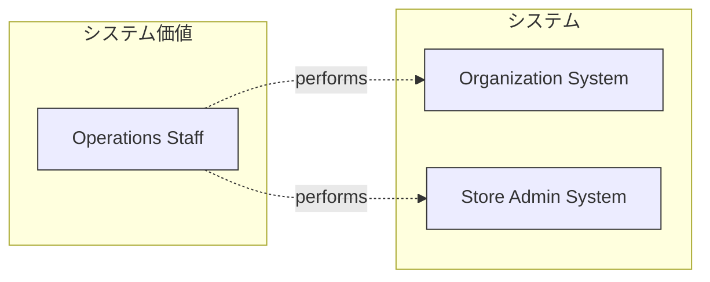

How to read it:

- Actors and external systems sit in システム価値, the systems in システム.
- Every edge is derived. `OpsStaff` performs `BucStoreRestock`, whose use cases invoke an
  API of each system, so the actor reaches both systems, each edge `via` the BUC.
- An external system edge reads `raises <Event>` or `triggers <Event>`. When no system
  is declared, or none contains an API the use cases invoke, the edge ends at
  `system__Model`, with a `%% synthesized` line that says why.

Review points:

- Is every actor who uses the system drawn with an edge? An actor without one performs
  nothing yet.
- Does each system an actor reaches match the system that owns the work?

## Requirement Model

<!-- derived-from #reading-any-diagram -->

Generated from:

```sh
rdra-ish diagram samples/clinic-ops \
  --kind requirement \
  --format mermaid \
  --out samples/clinic-ops/out/requirement
```

<!-- embed: ../samples/clinic-ops/out/requirement.mmd -->
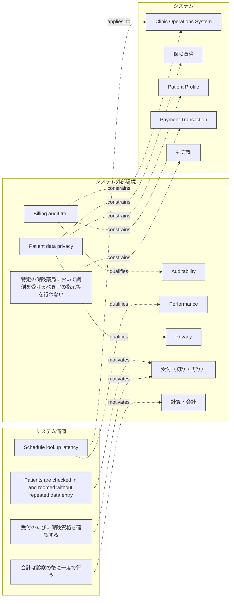

How to read it:

- Requirements and NFRs sit in システム価値, qualities and constraints in
  システム外部環境, with what they bind in its own layer.
- `motivates` runs from a requirement to a BUC; `applies_to` from an NFR to a use case,
  API, or system; `constrains` from a constraint to what it limits; and `qualifies` from
  an NFR or constraint to its quality.
- The DSL has no link from a requirement to the actor who holds it, so none is drawn.

Review points:

- Does every requirement motivate a BUC?
- Does every NFR and constraint name what it applies to and the quality it serves?

## Business Context and BUCs

<!-- derived-from #reading-any-diagram -->

Generated from:

```sh
rdra-ish diagram samples/incremental-order/step-6-business-rules/src \
  --kind business \
  --format mermaid \
  --out samples/incremental-order/step-6-business-rules/out/business
```

<!-- embed: ../samples/incremental-order/step-6-business-rules/out/business.mmd -->
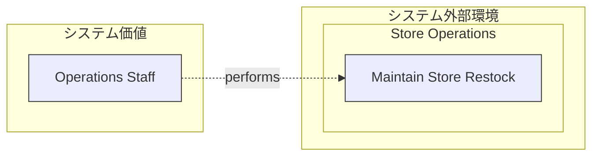

How to read it:

- Each business is `subgraph business__<id>` holding its BUCs, in システム外部環境.
- `performs(Actor, Buc)` is declared. An actor of one of the BUC's use cases or steps, and
  an external system whose event starts or leaves the BUC, are derived, each with its
  `%% derived` line. `--buc` narrows the diagram to the RDRA BUC diagram.

Review points:

- Does every BUC belong to the business that owns its value?
- Is every actor of the BUC drawn, directly or through its use cases?

## UC複合図

<!-- derived-from #business-context-and-bucs -->

Generated from:

```sh
rdra-ish diagram samples/incremental-order/step-6-business-rules/src \
  --kind usecase \
  --format mermaid \
  --buc BucStoreRestock \
  --out samples/incremental-order/step-6-business-rules/out/usecase_buc_store_restock
```

<!-- embed: ../samples/incremental-order/step-6-business-rules/out/usecase_buc_store_restock.mmd -->
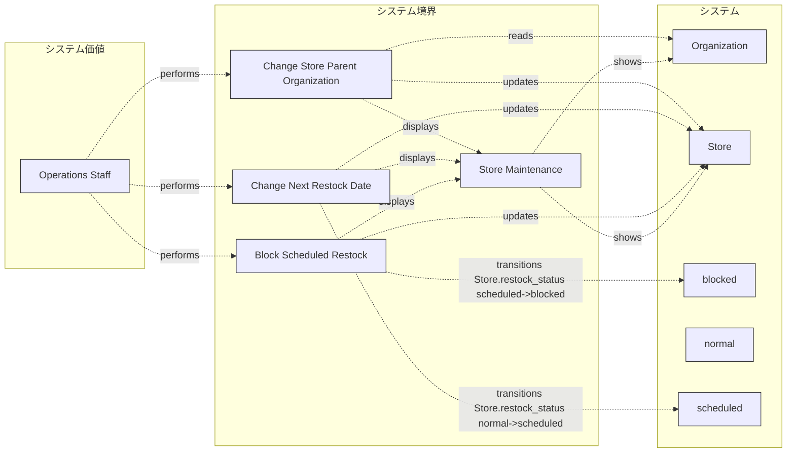

How to read it:

- Each use case of the BUC sits in システム境界 with the screens it displays; the
  entities they show and the use case reads and writes, and the states it moves, sit in
  システム.
- The APIs are folded into their use cases: `ChangeStoreParentOrganization` updates
  `Store` and reads `Organization` through `StoreAdminApi` and `OrganizationLookupApi`,
  which the `%% derived ... via api__...` lines name. `omitted:` lists the API,
  permission, and medium kinds left out.
- A `transitions` edge runs from the use case to the state it enters.

Review points:

- Does each use case display a screen and touch the information its business step
  needs?
- Are direct entity writes intentional, or should they move behind an API?

## Business Flow

<!-- derived-from #uc複合図 -->

Generated from:

```sh
rdra-ish diagram samples/clinic-ops \
  --kind flow \
  --format mermaid \
  --buc BucVisitCheckIn \
  --out samples/clinic-ops/out/buc/flow_visit_check_in
```

<!-- embed: ../samples/clinic-ops/out/buc/flow_visit_check_in.mmd -->
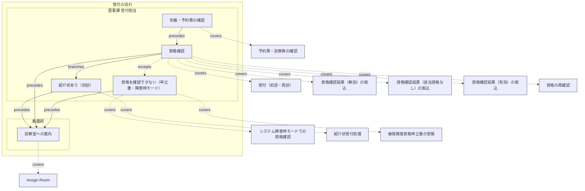

How to read it:

- Each flow is `subgraph flow__<id>` holding its steps. `precedes` and `branches` are
  `-->`, `excepts` is `-.->`, and `repeats` is `-->` back to an earlier step.
- `covers` runs from a step to the use cases (and APIs, events, or timers) that carry it.
- A step that one actor performs (`performs(Actor, Step)`) sits in that actor's lane,
  `subgraph lane__<Flow>__<Actor>`, whose first line names the actor. Here the receptionist
  carries the arrival, eligibility, and referral steps, and the nurse rooms the patient.

Review points:

- Does every step cover a use case, and every exception rejoin the flow?
- Is each step in the lane of the person who does it, and does the hand-off between lanes
  match the work?
- Is the business order in the flow the order the use cases can run in?

## Information Model

<!-- derived-from #reading-any-diagram -->

Generated from:

```sh
rdra-ish diagram samples/incremental-order/step-6-business-rules/src \
  --kind information \
  --format mermaid \
  --out samples/incremental-order/step-6-business-rules/out/information
```

<!-- embed: ../samples/incremental-order/step-6-business-rules/out/information.mmd -->
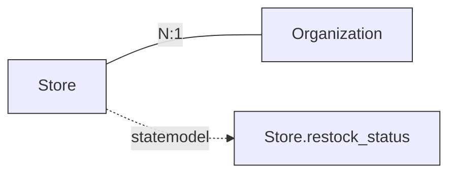

How to read it:

- Each entity is drawn without columns. `---|N:1|` is a `relate` with its cardinality,
  from its left end.
- `-.->|statemodel|` links an entity to each column that `transitions` drive, the
  `statemodel__<Entity>_<column>` id `--kind state` uses. An `Enum` column without
  transitions is no state model.
- `-.->|variation <column>|` links an entity to the variation that column takes.

Review points:

- Do the entities and their relations match the business vocabulary of the BUCs?
- Does each entity with a lifecycle have the state model the use cases move?

## Variations and Conditions

<!-- derived-from #information-model -->

Generated from:

```sh
rdra-ish diagram samples/clinic-ops \
  --kind condition \
  --format mermaid \
  --buc BucVisitPayment \
  --out samples/clinic-ops/out/buc/condition_visit_payment
```

<!-- embed: ../samples/clinic-ops/out/buc/condition_visit_payment.mmd -->
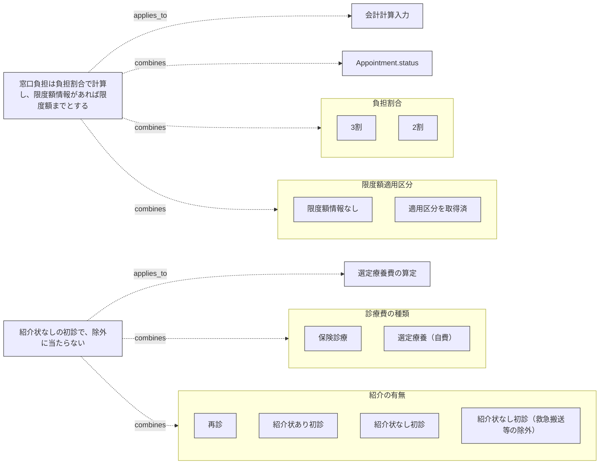

How to read it:

- Each condition links `-.->|combines|` to the variations and state models it combines,
  and `-.->|applies_to|` to the use cases it guards.
- `CopayCappedAtLimit` declares its links with `combines`. `UnreferredFirstVisit` has a
  `holds` body, printed on its `%% holds` line, so its links are read from the body and
  each is followed by `%% derived ... from holds`.
- Each variation is a subgraph holding its values as `:::value` nodes. The whole model
  also draws the variations no condition uses.

Review points:

- Does every condition apply to the use case whose rule it selects?
- Does every value of a combined variation have a rule, or is one missing?

## State Model

<!-- derived-from #information-model -->

Generated from:

```sh
rdra-ish diagram samples/incremental-order/step-6-business-rules/src \
  --kind state \
  --format mermaid \
  --out samples/incremental-order/step-6-business-rules/out/state
```

<!-- embed: ../samples/incremental-order/step-6-business-rules/out/state.mmd -->
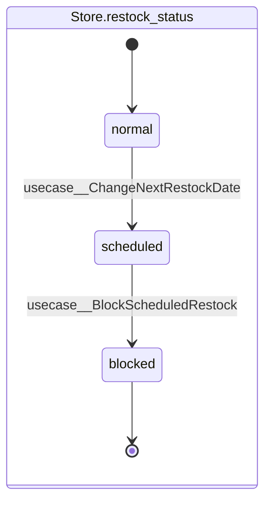

How to read it:

- Each state model (a lifecycle column) is one composite state,
  `statemodel__Store_restock_status` labelled `Store.restock_status`.
- `[*] -->` marks the start state, the value the lifecycle gives the column on creation
  (or its default for an entity that starts present). `--> [*]` marks an end state, one
  with no transition to another state.
- Each edge is labelled with the id of the use case that drives the transition, as the
  遷移UC column of an RDRA state sheet is; `usecase__BlockScheduledRestock` is the same
  node in the UC複合図.
- This diagram shows lifecycle topology. Use `rdra-ish states` for rule satisfaction,
  reachable combinations, and diagnostics. `state` is the one kind that refuses to write
  while `check` reports a lifecycle error.

Review points:

- `blocked` is an end state: is it terminal by design, or is a way out missing?
- Are business rules such as `scheduled` requiring `next_restock_date` covered by
  state-pattern diagnostics?

## System-to-System Events

<!-- derived-from #reading-any-diagram -->

Generated from:

```sh
rdra-ish diagram samples/ec-site \
  --kind event \
  --format mermaid \
  --out samples/ec-site/out/event
```

<!-- embed: ../samples/ec-site/out/event.mmd -->
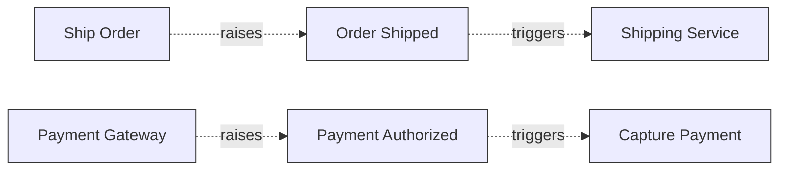

How to read it:

- `raises` runs from a use case or an external system to an event, and `triggers` from
  an event (or a timer) to the use case, BUC, or external system it starts.
- States are left to `--kind state`; `%% omitted: state transitions` says a drawn use
  case drives one.
- The command also prints a warning for an event never raised or never consumed.

Review points:

- Does every event that crosses the system boundary have both ends?
- Do events represent domain facts rather than UI button clicks?

## ER Diagram

<!-- derived-from #information-model -->

Generated from:

```sh
rdra-ish diagram samples/incremental-order/step-6-business-rules/src \
  --kind er \
  --format mermaid \
  --out samples/incremental-order/step-6-business-rules/out/er
```

<!-- embed: ../samples/incremental-order/step-6-business-rules/out/er.mmd -->
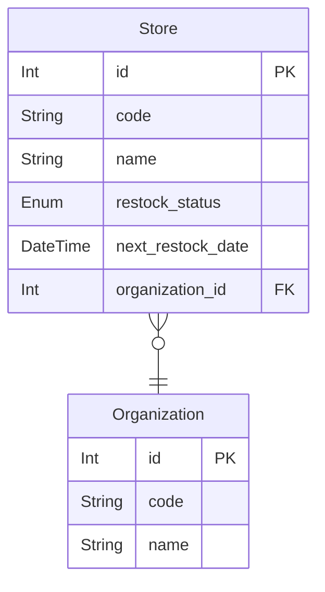

How to read it:

- Treat `entity` as the logical data model, not the conceptual model the information
  model draws. Entity names in the `erDiagram` body are the DSL ids.
- Cardinality comes from `relate`; generated FK columns show where the ownership of a
  reference lands.
- State axes such as `restock_status` are data columns and lifecycle review inputs.

Review points:

- Is `Store -> Organization` optionality correct for business operations?
- Are indexes, uniqueness, tenant scope, history, or soft-delete annotations needed
  before this becomes a migration design?

## RDRA Graph

<!-- derived-from #reading-any-diagram -->

Generated from:

```sh
rdra-ish diagram samples/incremental-order/step-6-business-rules/src \
  --kind rdra \
  --format mermaid \
  --buc BucStoreRestock \
  --out samples/incremental-order/step-6-business-rules/out/object_graph_buc_store_restock
```

<!-- embed: ../samples/incremental-order/step-6-business-rules/out/object_graph_buc_store_restock.mmd -->
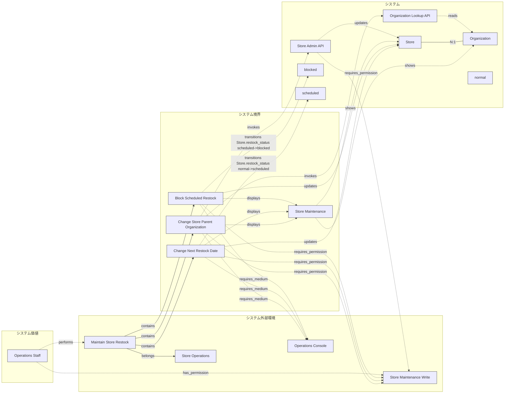

How to read it:

- `rdra` is the base graph: every element in its RDRA layer and every relation, the
  APIs, permissions, and media included. The other kinds are views of it, and a node or
  declared edge they draw is the one drawn here.
- Read the four subgraphs as the RDRA layers システム価値, システム外部環境,
  システム境界, and システム.
- Narrow a dense graph with `--node-kind` and `--edge-kind`; `omitted:` names what they
  hid.

Review points:

- Does every required permission have a matching actor-side grant?
- Are the API paths of each use case the ones the UC複合図 folded?

## Summary

<!-- derived-from #system-context -->
<!-- derived-from #uc複合図 -->
<!-- derived-from #information-model -->
<!-- derived-from #state-model -->

Walk the kinds in the order above: the system context and requirements say who and why,
the business, UC複合図, and flow say what happens, the information model and conditions
say what it acts on, and the state model and events say how it changes. `er` and `rdra`
hold the detail behind each. The transaction and API-boundary warnings come from
`rdra-ish check`.
