# Diagram Sample Review Guide

<!-- constrained-by ./cli-reference.md#diagram -->
<!-- constrained-by ./incremental-modeling.md -->
<!-- derived-from ../samples/incremental-order/step-7-business-rules/design.md -->

This guide is for reviewers of a model's diagrams. It shows one generated diagram of each
[`diagram --kind`](./cli-reference.md#kinds), and for `state` both the index and one
entity's state model, and says how to read each and what to ask. The kinds follow the RDRA
3.0 diagrams in the order a review usually walks them: context and requirements, business,
use cases with their robustness and sequence views, flows and screens, information and
conditions, lifecycle and events, then the data model and the whole graph.

Most examples use `samples/incremental-order/step-7-business-rules`, a small model with
permissions, screens, APIs, entities, a lifecycle, and two systems. It has no requirement,
flow, condition, or event, and only one screen, so those sections use `samples/clinic-ops`
and `samples/ec-site`. The diagrams below are generated; regenerate them with:

```sh
bash scripts/check-sample-artifacts.sh
```

CI runs the same command, so an emitter or DSL change shows as a diff of the `out/` files
and of the blocks below. `rdra-ish` writes Mermaid text (`.mmd`) only, for a person with
Mermaid CLI (`mmdc`) or a tool that draws from the text. The text carries the meaning, so
shapes, colours, and direction are free to change.

## Reading Any Diagram

<!-- derived-from #diagram-sample-review-guide -->
<!-- constrained-by ./cli-reference.md#encoding-contract -->

Every kind follows the [encoding contract](./cli-reference.md#encoding-contract):

- The `%%` header comes first (after the Mermaid `title` that `--title` adds):
  `%% rdra-ish diagram=<kind> scope=<scope> model=<paths>`,
  then `%% layers:` (in the layered kinds), `%% kinds:` (the node kinds the body draws),
  and `%% omitted:` (the linked kinds the diagram leaves out).
- Each node id is `<kind>__<DSL id>`, the same in every kind, so
  `usecase__ChangeNextRestockDate` in one diagram is that use case in all of them. Each
  node carries `:::<kind>` and is drawn in its kind's shape (actor `([..])`, use case
  `(..)`, API `{{..}}`, entity `[(..)]`, event `>..]`, ...).
- An edge label is the DSL predicate name, left off when the two end kinds have only one
  relation in that kind (an actor to a use case is `performs`). `-->` is hierarchy or flow
  order, `---` is a `relate`, and `-.->` is every other association.
- An edge followed by `%% derived <from> -> <to> via <ids>` was derived through the nodes
  named; any other edge is declared. `%% desc <id>: <text>` carries a description.

## System Context

<!-- derived-from #reading-any-diagram -->

Generated from:

```sh
rdra-ish diagram samples/incremental-order/step-7-business-rules/src \
  --kind context \
  --format mermaid \
  --out samples/incremental-order/step-7-business-rules/out/context
```

<!-- embed: ../samples/incremental-order/step-7-business-rules/out/context.mmd -->
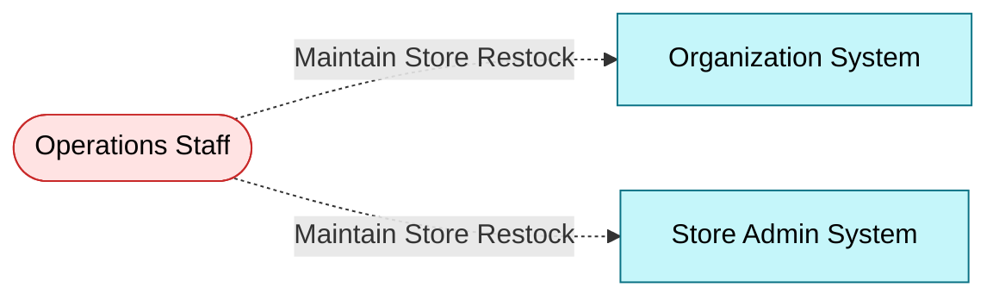

How to read it:

- The nodes sit in no layer subgraph: only the actors, external systems, and systems are
  drawn, and every edge crosses the system boundary.
- Every edge is derived. `OpsStaff` performs `BucStoreRestock`, whose use cases invoke an
  API of each system, so the actor reaches both systems, each edge labelled with the BUC
  and `via` it.
- An external system edge is labelled with the events it exchanges: toward the system for
  an event it raises, from the system for an event a use case raises to it. When no system
  is declared, or none contains an API the use cases invoke, the edge ends at
  `system__Model`, with a `%% synthesized` line that says why.

Review points:

- Is every actor who uses the system drawn with an edge? An actor without one performs
  nothing yet.
- Does each system an actor reaches match the system that owns the work?

## Requirement Model

<!-- derived-from #reading-any-diagram -->

Generated from:

```sh
rdra-ish diagram samples/clinic-ops \
  --kind requirement \
  --format mermaid \
  --out samples/clinic-ops/out/requirement
```

<!-- embed: ../samples/clinic-ops/out/requirement.mmd -->
```mermaid
%% rdra-ish diagram=requirement scope=whole model=samples/clinic-ops
%% kinds: requirement goal buc
%% omitted: actor nfr quality constraint business flow usecase event system entity
flowchart LR
  requirement__ReqChangeAppointmentAtDesk[/"予約の変更・取消を電話と窓口で受け付ける"\]:::requirement
  requirement__ReqEligibilityEveryVisit[/"受付のたびに保険資格を確認する"\]:::requirement
  requirement__ReqFollowUpAfterVisit[/"診察後の連絡と再診予約をケアプランで追う"\]:::requirement
  requirement__ReqHandOffAfterConsultation[/"診察終了で受診を会計計算へ引き渡す"\]:::requirement
  requirement__ReqInquiryBeforeDispense[/"疑わしい処方は医師への照会が済むまで調剤しない"\]:::requirement
  requirement__ReqMonthlyClaimByTenth[/"前月分のレセプトを翌月10日までに請求する"\]:::requirement
  requirement__ReqPayAfterConsultation[/"会計は診察の後に一度で行う"\]:::requirement
  requirement__ReqProxyOrderNeedsPhysician[/"代行入力されたオーダは医師が確定するまで実施しない"\]:::requirement
  requirement__ReqRegisterEPrescription[/"院外処方箋を電子処方箋管理サービスへ登録し、保険薬局を指定しない"\]:::requirement
  requirement__ReqRegisterWithEligibility[/"新患登録で保険情報と限度額情報をオンライン資格確認から取り込む"\]:::requirement
  requirement__ReqResolveAuditFindings[/"監査で見つかった問題を管理者が解決するまで追う"\]:::requirement
  requirement__ReqResubmitReturned[/"返戻レセプトを訂正して再請求する"\]:::requirement
  requirement__ReqSwiftCheckIn[/"再来患者は情報を入力し直さずに受付・案内される"\]:::requirement
  goal__SafeCare[/"診療の抜けと誤りを実施前に止める<br/>処方・オーダの確認漏れと診察後の連絡漏れの件数: 月20件 → 月5件以下"/]:::goal
  %% desc goal__SafeCare: 処方やオーダの確認漏れ、診察後の連絡漏れは、患者の安全と継続した治療を損なう。
  goal__ShortWait[/"受付から診察までの待ち時間を短くする<br/>受付から診察開始までの中央値: 45分 → 30分"/]:::goal
  %% desc goal__ShortWait: 受付後に診察室へ案内されるまでの待ちが長いと、患者が帰ってしまう。
  goal__TimelyClaims[/"会計から請求までの遅れと返戻を減らす<br/>請求したレセプトのうち返戻になった割合: 3% → 1%"/]:::goal
  %% desc goal__TimelyClaims: 診察後の会計や請求に漏れや遅れがあると、収入が遅れ、返戻の訂正に事務の手間がかかる。
  buc__BucAppointmentScheduling["予約"]:::buc
  %% desc buc__BucAppointmentScheduling: 予約検索、仮押さえ、予約確定、変更、取消、通知を扱う。予約枠と予約レコードを同時に更新する UC は専用 API を持ち、予約通知は AppointmentNoticeApi に分ける。予約済みの患者は、来院前に `BucVisitCheckIn` の一括照会の対象になる。
  buc__BucBillingClaims["レセプト作成・請求"]:::buc
  %% desc buc__BucBillingClaims: レセプト（患者 × 診療月 × 保険者）の作成・院内点検・請求と、審査支払機関（支払基金・国保連）からの受付不能・返戻・査定・支払への対応を扱う。前月分は翌月10日までに請求し、受付不能・要確認は11日・12日に再送する。返戻は訂正して当月分と併せて再請求できるが、査定は再請求できず再審査請求で争う。資格が変わったレセプトは審査支払機関が振替・分割するので返戻にならないが、負担割合が異なる変更や公費の分割はできず返戻になる。支払は診療の翌々月。期間のうち DSL で表せないもの（10日、11・12日、5日〜月末、3か月、翌々月）はタイマーとコメントで示す。
  buc__BucClinicalEncounter["診察"]:::buc
  %% desc buc__BucClinicalEncounter: 診療記録を開き、バイタル、診断、署名、診察終了までを扱う。診察終了 `CompleteConsultation` で予約は「計算待ち」になり、会計は計算受付へ移る。他院紹介では医師が診療情報提供書を作成・送信する。検査オーダは診察中に医師が出し、署名の後に診察終了とする。署名イベント `EvEncounterSigned` はカルテのコスト情報の登録とケアプラン作成を、診察終了イベント `EvConsultationCompleted` は計算・会計を起動する。
  buc__BucFollowupCare["フォローアップ"]:::buc
  %% desc buc__BucFollowupCare: 診療後のケアプラン作成、患者連絡、患者応答確認、再診予約、ケアプラン終了を扱う。
  buc__BucOrdersResults["検体検査"]:::buc
  %% desc buc__BucOrdersResults: 検査オーダーから結果確認、重要結果通知までを扱う。医師事務作業補助者や看護師がオーダを代行入力した場合、医師が確定するまで看護師は採血しない（保助看法 第37条）。この規則は `OrderConfirmedByPhysician` 条件と `forbidden(ClinicalOrder, status == collected, physician_confirmed == false)` で検証する。外注検査の結果は外注検査システムから届く。採血管ラベルの発行と実施内容（コスト）の登録が会計計算の入力になる。実施入力のコストは `Charge.origin` が `performed` で、カルテ由来（`chart`）や選定療養費（`selectedfee`）のコストと発生元で区別される。
  buc__BucPatientOnboarding["新患登録・患者情報管理"]:::buc
  %% desc buc__BucPatientOnboarding: 新患登録から問診送付までを扱う。新患登録では、オンライン資格確認で得た保険情報と、患者が同意した場合の限度額情報（適用区分）を `InsurancePolicy` に登録する。負担割合 `burden_ratio` と限度額適用区分 `limit_category` は actor が選ぶ値ではなく保険者が決める値なので、variation 型の属性として持つ。
  buc__BucPrescriptionFulfillment["処方"]:::buc
  %% desc buc__BucPrescriptionFulfillment: 処方オーダから院外処方箋の発行、院内処方の調剤・監査・服薬指導・交付、疑義照会までを扱う。院外処方箋は電子処方箋管理サービスへ登録し、患者が選ぶ保険薬局で調剤される。病院は特定の保険薬局を指示しない（療担規則 第2条の5）ので、`Prescription` は薬局を持たない。使用期間は交付日を含めて4日以内で、日数は DSL で数えられないためタイマーで期限切れにする。薬剤師は疑わしい点があれば医師に問い合わせ、回答までは調剤しない。
  buc__BucStaffAdministration["病院管理"]:::buc
  %% desc buc__BucStaffAdministration: 病院運営のマスタ（診療枠・診察室）と監査の業務を扱う。
  buc__BucVisitCheckIn["受付（初診・再診）"]:::buc
  %% desc buc__BucVisitCheckIn: 到着確認、資格確認、紹介状の受付、診察室への案内を扱う。療養担当規則 第3条により受付のたびに資格を確認するので、`CheckInPatient` は必ずオンライン資格確認を伴い `EligibilityCheck` を作る。結果は 有効・無効・該当資格なし の 3 通りで、無効と該当資格なしは再確認へ戻る。システムが答えられない場合は被保険者資格申立書かシステム障害時モードで確認する。来院前には予約済み患者の一括照会を行う。受付では支払を受けない（会計は `BucVisitPayment`）。
  buc__BucVisitPayment["計算・会計"]:::buc
  %% desc buc__BucVisitPayment: 診察の後の会計計算入力、患者の呼出、会計窓口または自動精算機での精算、領収証・明細書の交付を扱う。一部負担金は負担割合で計算し、限度額情報があれば窓口での支払は自己負担限度額までになる（`CopayCappedAtLimit`）。紹介状なしの初診で除外に当たらない場合は選定療養費を自費の Charge として算定する（`UnreferredFirstVisit`）。金額は病院の設定 `SelectedTreatmentFeeSetting` に置き、モデルは数値を持たない。
  subgraph group_out_of_scope["やらないこと"]
    requirement__ReqNoOnlineConsultation[/"オンライン診療は対象外とする"\]:::requirement
  end
  goal__SafeCare --> requirement__ReqFollowUpAfterVisit
  %% derived goal__SafeCare -> requirement__ReqFollowUpAfterVisit via requirement__ReqFollowUpAfterVisit
  goal__SafeCare --> requirement__ReqInquiryBeforeDispense
  %% derived goal__SafeCare -> requirement__ReqInquiryBeforeDispense via requirement__ReqInquiryBeforeDispense
  goal__SafeCare --> requirement__ReqProxyOrderNeedsPhysician
  %% derived goal__SafeCare -> requirement__ReqProxyOrderNeedsPhysician via requirement__ReqProxyOrderNeedsPhysician
  goal__SafeCare --> requirement__ReqRegisterEPrescription
  %% derived goal__SafeCare -> requirement__ReqRegisterEPrescription via requirement__ReqRegisterEPrescription
  goal__ShortWait --> requirement__ReqChangeAppointmentAtDesk
  %% derived goal__ShortWait -> requirement__ReqChangeAppointmentAtDesk via requirement__ReqChangeAppointmentAtDesk
  goal__ShortWait --> requirement__ReqEligibilityEveryVisit
  %% derived goal__ShortWait -> requirement__ReqEligibilityEveryVisit via requirement__ReqEligibilityEveryVisit
  goal__ShortWait --> requirement__ReqRegisterWithEligibility
  %% derived goal__ShortWait -> requirement__ReqRegisterWithEligibility via requirement__ReqRegisterWithEligibility
  goal__ShortWait --> requirement__ReqSwiftCheckIn
  %% derived goal__ShortWait -> requirement__ReqSwiftCheckIn via requirement__ReqSwiftCheckIn
  goal__TimelyClaims --> requirement__ReqHandOffAfterConsultation
  %% derived goal__TimelyClaims -> requirement__ReqHandOffAfterConsultation via requirement__ReqHandOffAfterConsultation
  goal__TimelyClaims --> requirement__ReqMonthlyClaimByTenth
  %% derived goal__TimelyClaims -> requirement__ReqMonthlyClaimByTenth via requirement__ReqMonthlyClaimByTenth
  goal__TimelyClaims --> requirement__ReqPayAfterConsultation
  %% derived goal__TimelyClaims -> requirement__ReqPayAfterConsultation via requirement__ReqPayAfterConsultation
  goal__TimelyClaims --> requirement__ReqResolveAuditFindings
  %% derived goal__TimelyClaims -> requirement__ReqResolveAuditFindings via requirement__ReqResolveAuditFindings
  goal__TimelyClaims --> requirement__ReqResubmitReturned
  %% derived goal__TimelyClaims -> requirement__ReqResubmitReturned via requirement__ReqResubmitReturned
  requirement__ReqChangeAppointmentAtDesk --> buc__BucAppointmentScheduling
  requirement__ReqEligibilityEveryVisit --> buc__BucVisitCheckIn
  requirement__ReqFollowUpAfterVisit --> buc__BucFollowupCare
  requirement__ReqHandOffAfterConsultation --> buc__BucClinicalEncounter
  requirement__ReqInquiryBeforeDispense --> buc__BucPrescriptionFulfillment
  requirement__ReqMonthlyClaimByTenth --> buc__BucBillingClaims
  requirement__ReqNoOnlineConsultation -.-> buc__BucClinicalEncounter
  requirement__ReqPayAfterConsultation --> buc__BucVisitPayment
  requirement__ReqProxyOrderNeedsPhysician --> buc__BucOrdersResults
  requirement__ReqRegisterEPrescription --> buc__BucPrescriptionFulfillment
  requirement__ReqRegisterWithEligibility --> buc__BucPatientOnboarding
  requirement__ReqResolveAuditFindings --> buc__BucStaffAdministration
  requirement__ReqResubmitReturned --> buc__BucBillingClaims
  requirement__ReqSwiftCheckIn --> buc__BucVisitCheckIn
  classDef requirement fill:#fff3bf,stroke:#e67700,color:#000;
  classDef goal fill:#fff3bf,stroke:#e67700,color:#000;
  classDef buc fill:#d3f9d8,stroke:#2b8a3e,color:#000;
```

How to read it:

- The nodes sit in no layer subgraph. The tree reads left to right: each goal, with its
  metric and `baseline → target`, to the requirements that achieve it (`achieves`, drawn
  from the goal with a `%% derived` line), and each requirement to the BUCs it
  `motivates`.
- A requirement with `status "out-of-scope"` sits apart in `やらないこと`, its edges
  dashed.
- NFRs, constraints, and qualities are not drawn; `omitted:` names them, and
  `list --kind nfr` and `list --kind constraint` write them as tables.
- The DSL has no link from a requirement to the actor who holds it, so none is drawn.

Review points:

- Does every requirement motivate a BUC?
- Does every requirement achieve a goal, and does every goal have a measure?

## Business Context and BUCs

<!-- derived-from #reading-any-diagram -->

Generated from:

```sh
rdra-ish diagram samples/incremental-order/step-7-business-rules/src \
  --kind business \
  --format mermaid \
  --out samples/incremental-order/step-7-business-rules/out/business
```

<!-- embed: ../samples/incremental-order/step-7-business-rules/out/business.mmd -->
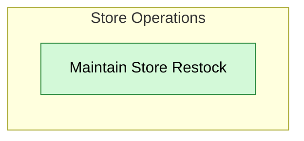

How to read it:

- Each business is `subgraph business__<id>` holding its BUCs; there are no layer
  subgraphs.
- An edge `buc__A -->|<event label>| buc__B` is a hand-off: a use case of A raises the
  event, and it starts B or one of B's use cases. This model has one BUC, so it has none.
- Actors and external systems are not drawn: `list --kind buc-roles` is the table of who
  takes part. `--buc` draws the named BUCs and the BUCs they hand off to or from.

Review points:

- Does every BUC belong to the business that owns its value?
- Is a BUC left without a hand-off edge really standalone, or is an event missing?

## UC複合図

<!-- derived-from #business-context-and-bucs -->

Generated from:

```sh
rdra-ish diagram samples/incremental-order/step-7-business-rules/src \
  --kind usecase \
  --format mermaid \
  --buc BucStoreRestock \
  --out samples/incremental-order/step-7-business-rules/out/usecase_buc_store_restock
```

<!-- embed: ../samples/incremental-order/step-7-business-rules/out/usecase_buc_store_restock.mmd -->
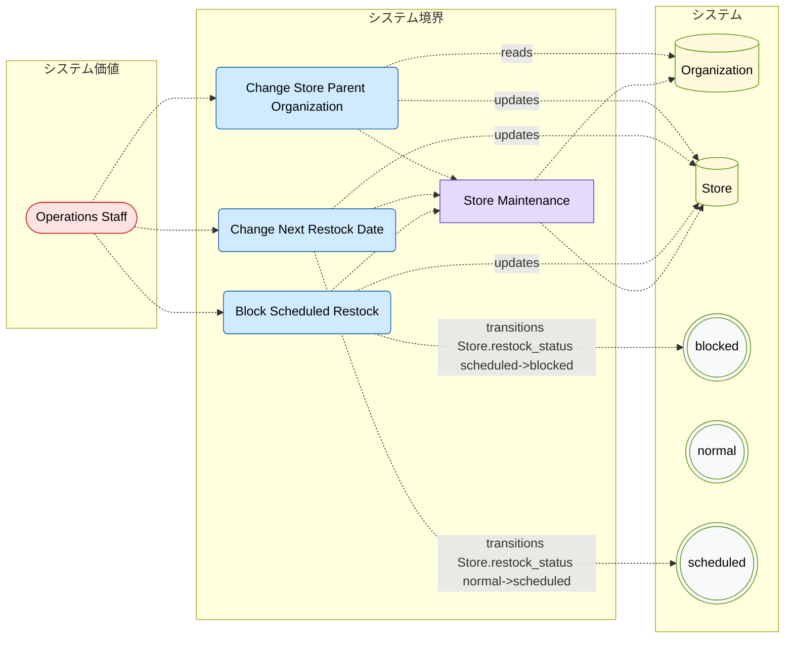

How to read it:

- Each use case of the BUC sits in システム境界 with the screens it displays; the
  entities they show and the use case reads and writes, and the states it moves, sit in
  システム.
- The APIs are folded into their use cases: `ChangeStoreParentOrganization` updates
  `Store` and reads `Organization` through `StoreAdminApi` and `OrganizationLookupApi`,
  which the `%% derived ... via api__...` lines name. `omitted:` lists the API,
  permission, and medium kinds left out.
- A `transitions` edge runs from the use case to the state it enters.

Review points:

- Does each use case display a screen and touch the information its business step
  needs?
- Are direct entity writes intentional, or should they move behind an API?

## Robustness Diagram

<!-- derived-from #uc複合図 -->

Generated from:

```sh
rdra-ish diagram samples/incremental-order/step-7-business-rules/src \
  --kind robustness \
  --format mermaid \
  --buc BucStoreRestock \
  --out samples/incremental-order/step-7-business-rules/out/robustness_buc_store_restock
```

<!-- embed: ../samples/incremental-order/step-7-business-rules/out/robustness_buc_store_restock.mmd -->
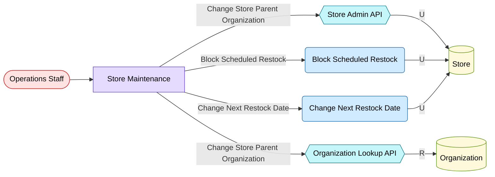

How to read it:

- This is the same BUC as the UC複合図 above, redrawn as an ICONIX robustness diagram.
  The nodes sit in one flat list in the order actor, boundary (screens, external
  systems, timers), control, entity. There are no layer subgraphs.
- The edges follow one grammar: an actor reaches a screen, a screen reaches a control,
  and a control reaches an entity. No edge skips a step, so an actor never touches a
  control and a screen never touches an entity.
- A control is an API the use case `invokes`, or the use case itself when it reads or
  writes an entity directly or invokes no API. `ChangeStoreParentOrganization` has no node
  of its own: it is the label on the two screen edges to `StoreAdminApi` and
  `OrganizationLookupApi`. `ChangeNextRestockDate` and `BlockScheduledRestock` invoke no
  API, so each is its own control.
- A control-to-entity edge is labelled with the CRUD letters of what the control does to
  the entity, so `StoreAdminApi -->|U| Store` is an update and
  `OrganizationLookupApi -->|R| Organization` a read.
- Events show only as labels on dotted control-to-control or external-system edges. This
  BUC raises none, so it has none. States and conditions are left to their own kinds.

Review points:

- Does every screen reach a control, and every control the entities its use case needs?
- Two use cases here update `Store` directly while the third goes through
  `StoreAdminApi`. Is that split intentional, or should every `Store` write go through
  the API?
- Is an actor missing from the diagram? An actor whose use cases display no screen has
  no edge and is left out.

## Sequence Diagram

<!-- derived-from #robustness-diagram -->

Generated from:

```sh
rdra-ish diagram samples/incremental-order/step-7-business-rules/src \
  --kind sequence \
  --format mermaid \
  --usecase ChangeNextRestockDate \
  --out samples/incremental-order/step-7-business-rules/out/sequence_change_next_restock_date
```

<!-- embed: ../samples/incremental-order/step-7-business-rules/out/sequence_change_next_restock_date.mmd -->
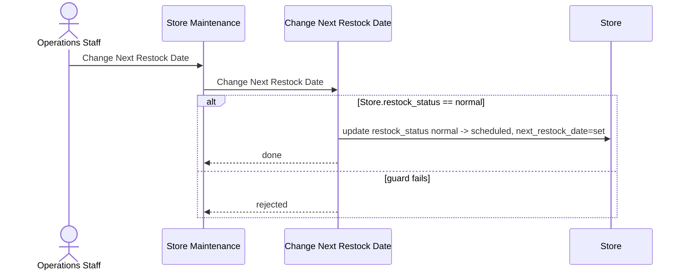

How to read it:

- The diagram plays one use case, so `--usecase` names exactly one. `--buc` plays each
  use case of the BUC in turn, each under a numbered `Note`.
- The participants are those of the use case's robustness slice, in the order actor,
  screen, control, entity. The use case invokes no API, so it is its own control.
- The actor calls the screen and the screen calls the control, both labelled with the use
  case.
- The `transitions` arm leaves `normal`, so the write sits in `alt Store.restock_status ==
  normal`. `else guard fails` ends with the control replying `rejected` to the screen.
- The write message names the lifecycle move, `restock_status normal -> scheduled`, and
  the columns `sets` fixes, `next_restock_date=set`. A transaction with more than one
  write opens with a `Note over <control>: transaction (...)`. An event the use case
  raises is a `-)` message to the control or external system it triggers.

Review points:

- Is the guard the business precondition? A restock date can be changed only for a store
  in `normal`. Is that the rule, or should a `scheduled` store accept a new date too?
- Does the write leave the entity in a state the business rules accept? Here
  `scheduled` requires `next_restock_date`, and the same message sets it.
- Does each write belong to the use case, or should another use case or an API own it?

## Business Flow

<!-- derived-from #uc複合図 -->

Generated from:

```sh
rdra-ish diagram samples/clinic-ops \
  --kind flow \
  --format mermaid \
  --buc BucVisitCheckIn \
  --out samples/clinic-ops/out/buc/flow_visit_check_in
```

<!-- embed: ../samples/clinic-ops/out/buc/flow_visit_check_in.mmd -->
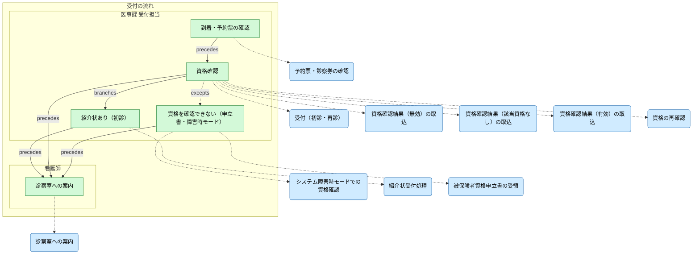

How to read it:

- Each flow is `subgraph flow__<id>` holding its steps. `precedes` and `branches` are
  `-->`, `excepts` is `-.->`, and `repeats` is `-->` back to an earlier step.
- `covers` runs from a step to the use cases (and APIs, events, or timers) that carry it.
- A step that one actor performs (`performs(Actor, Step)`) sits in that actor's lane,
  `subgraph lane__<Flow>__<Actor>`, whose first line names the actor. Here the receptionist
  carries the arrival, eligibility, and referral steps, and the nurse rooms the patient.

Review points:

- Does every step cover a use case, and every exception rejoin the flow?
- Is each step in the lane of the person who does it, and does the hand-off between lanes
  match the work?
- Is the business order in the flow the order the use cases can run in?

## Screen Transitions

<!-- derived-from #business-flow -->

Generated from:

```sh
rdra-ish diagram samples/clinic-ops \
  --kind screen \
  --format mermaid \
  --buc BucVisitCheckIn \
  --out samples/clinic-ops/out/buc/screen_visit_check_in
```

<!-- embed: ../samples/clinic-ops/out/buc/screen_visit_check_in.mmd -->
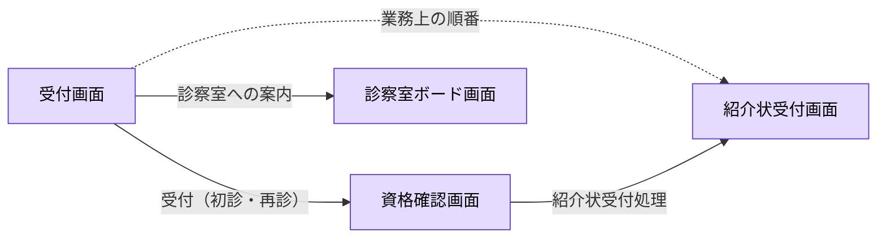

How to read it:

- The BUC is the one the business flow above draws. Each screen its use cases display is
  a node, connected or not. Use cases, fields, and entities are not nodes, and
  `omitted:` names them.
- A solid edge is a declared `navigates(A, B).via(UseCase)`, labelled with the use case.
  The `%% via screen__A -> screen__B usecase__<id>` lines after the edges name the same
  use case by id, so `受付（初診・再診）` is `CheckInPatient`.
- A dashed `業務上の順番` edge is derived from the flow, where no `navigates` is declared.
  `EligibilityStep` branches to `ReferralStep`, the receptionist performs both, and
  `CheckInPatient` covers the first step while `ReceiveReferralLetter` covers the second.
  So the work goes from `CheckInScreen` to `ReferralScreen`, and the `%% derived` line
  names the flow and the steps. `EligibilityScreen` to `ReferralScreen` already has a
  `navigates`, so it has only the solid edge.
- A dashed edge is the order the work visits the screens, not a transition the UI offers.

Review points:

- Should a dashed edge be a real transition? If the receptionist moves from
  `CheckInScreen` to `ReferralScreen` in the UI, declare the `navigates` with its use
  case.
- Can every screen be reached? A screen with no edge is the `screen-no-transition`
  finding of `rdra-ish check`.
- Is each `.via` use case the one that moves the user between the two screens?

## Information Model

<!-- derived-from #reading-any-diagram -->

Generated from:

```sh
rdra-ish diagram samples/incremental-order/step-7-business-rules/src \
  --kind information \
  --format mermaid \
  --out samples/incremental-order/step-7-business-rules/out/information
```

<!-- embed: ../samples/incremental-order/step-7-business-rules/out/information.mmd -->
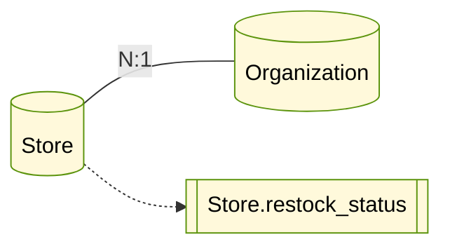

How to read it:

- Each entity is drawn without columns. `---|N:1|` is a `relate` with its cardinality,
  from its left end.
- An unlabelled `-.->` (`statemodel`) links an entity to each column that `transitions`
  drive, the `statemodel__<Entity>_<column>` id `--kind state` uses. An `Enum` column
  without transitions is no state model.
- `-.->|variation <column>|` links an entity to the variation that column takes.

Review points:

- Do the entities and their relations match the business vocabulary of the BUCs?
- Does each entity with a lifecycle have the state model the use cases move?

## Variations and Conditions

<!-- derived-from #information-model -->

Generated from:

```sh
rdra-ish diagram samples/clinic-ops \
  --kind condition \
  --format mermaid \
  --buc BucVisitPayment \
  --out samples/clinic-ops/out/buc/condition_visit_payment
```

<!-- embed: ../samples/clinic-ops/out/buc/condition_visit_payment.mmd -->
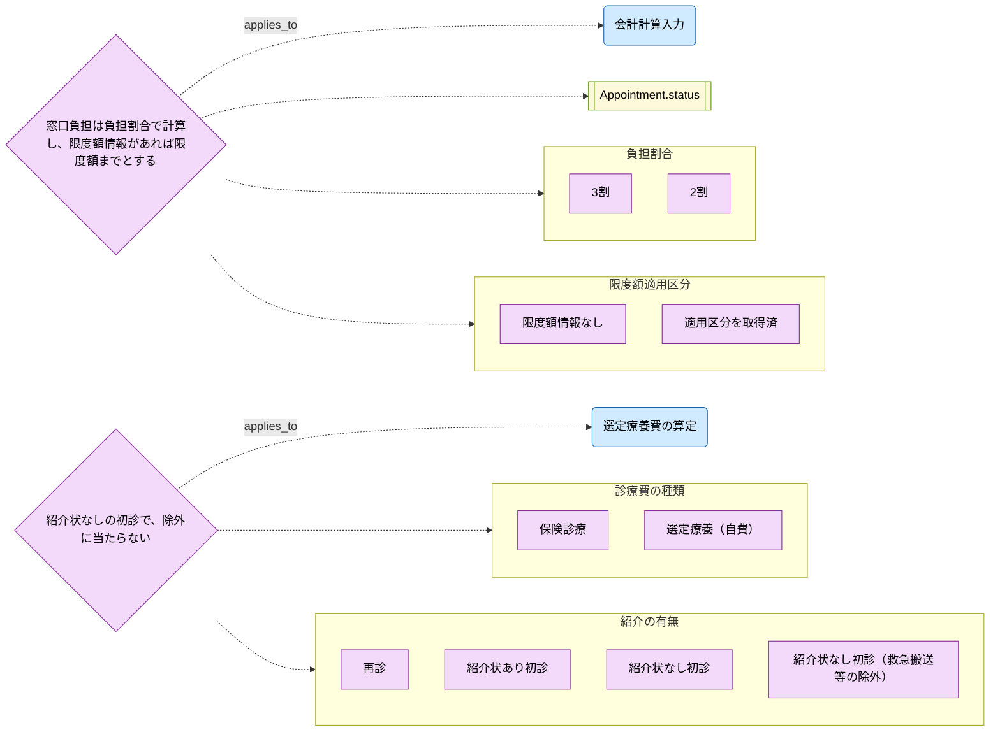

How to read it:

- Each condition links with an unlabelled `-.->` (`combines`) to the variations and state
  models it combines, and with `-.->|applies_to|` to the use cases it guards.
- `CopayCappedAtLimit` declares its links with `combines`. `UnreferredFirstVisit` has a
  `holds` body, printed on its `%% holds` line, so its links are read from the body and
  each is followed by `%% derived ... from holds`.
- Each variation is a subgraph holding its values as `:::value` nodes. The whole model
  also draws the variations no condition uses.

Review points:

- Does every condition apply to the use case whose rule it selects?
- Does every value of a combined variation have a rule, or is one missing?

## State Model

<!-- derived-from #information-model -->

Generated from:

```sh
rdra-ish diagram samples/incremental-order/step-7-business-rules/src \
  --kind state \
  --format mermaid \
  --out samples/incremental-order/step-7-business-rules/out/state
```

<!-- embed: ../samples/incremental-order/step-7-business-rules/out/state.mmd -->
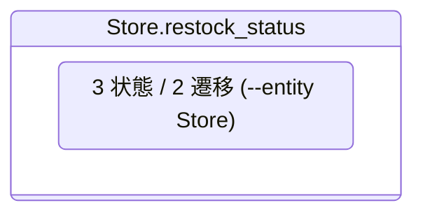

Without a scope, the diagram is an index: each state model (a lifecycle column) is one
composite state, `statemodel__Store_restock_status` labelled `Store.restock_status`,
holding a note with its counts and the `--entity` option that draws it whole. Run that
option to draw one entity's state models:

```sh
rdra-ish diagram samples/incremental-order/step-7-business-rules/src \
  --kind state \
  --format mermaid \
  --entity Store \
  --out samples/incremental-order/step-7-business-rules/out/state_store
```

<!-- embed: ../samples/incremental-order/step-7-business-rules/out/state_store.mmd -->
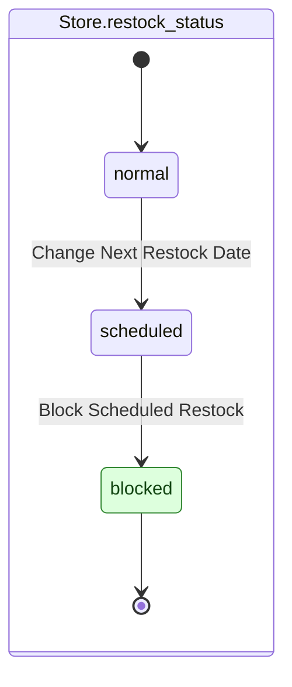

How to read it:

- With `--entity Store`, every state model of `Store` is drawn whole, inside the same
  composite state the index draws. `--buc BucStoreRestock` draws the state models the
  BUC's use cases move, here the same one.
- `[*] -->` marks the start state, the value the lifecycle gives the column on creation
  (or its default for an entity that starts present), here `normal`. `--> [*]` marks an
  end state, one with no transition to another state, here `blocked`.
- Each edge is labelled with the use case that drives the transition, as the 遷移UC
  column of an RDRA state sheet is. The `%% transition usecase__BlockScheduledRestock`
  line before it names the same node as in the UC複合図 and the sequence diagram.
- States are coloured by what the lifecycle check found, and the `%% legend:` line says
  what each class means. `blocked` is `stateend`. An unreachable or deadlocked state
  would carry `stateunreachable` or `statedeadlock`.
- This diagram shows lifecycle topology. Use `rdra-ish states` for rule satisfaction,
  reachable combinations, and diagnostics. `state` is the one kind that refuses to write
  while the lifecycle has an error other than a deadlock, which it colours.

Review points:

- `blocked` is an end state: is it terminal by design, or is a way out missing?
- Does each state have the use cases that should leave it? `scheduled` leaves only for
  `blocked`, and no use case returns a store to `normal` after a restock.
- Are business rules such as `scheduled` requiring `next_restock_date` covered by
  state-pattern diagnostics?

## System-to-System Events

<!-- derived-from #reading-any-diagram -->

Generated from:

```sh
rdra-ish diagram samples/ec-site \
  --kind event \
  --format mermaid \
  --out samples/ec-site/out/event
```

<!-- embed: ../samples/ec-site/out/event.mmd -->
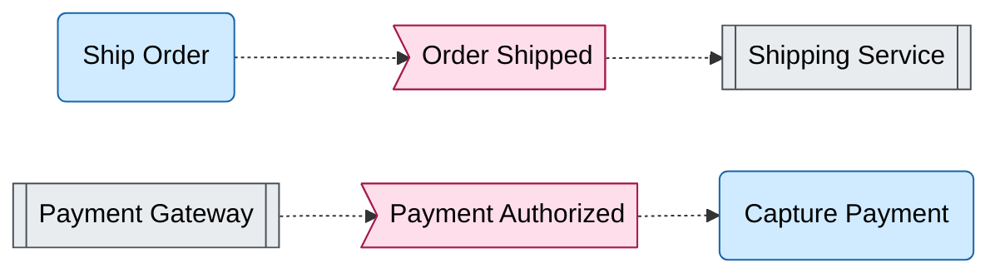

How to read it:

- `raises` runs from a use case or an external system to an event, and `triggers` from
  an event (or a timer) to the use case, BUC, or external system it starts.
- States are left to `--kind state`; `%% omitted: state transitions` says a drawn use
  case drives one.
- The command also prints a warning for an event never raised or never consumed.

Review points:

- Does every event that crosses the system boundary have both ends?
- Do events represent domain facts rather than UI button clicks?

## ER Diagram

<!-- derived-from #information-model -->

Generated from:

```sh
rdra-ish diagram samples/incremental-order/step-7-business-rules/src \
  --kind er \
  --format mermaid \
  --out samples/incremental-order/step-7-business-rules/out/er
```

<!-- embed: ../samples/incremental-order/step-7-business-rules/out/er.mmd -->
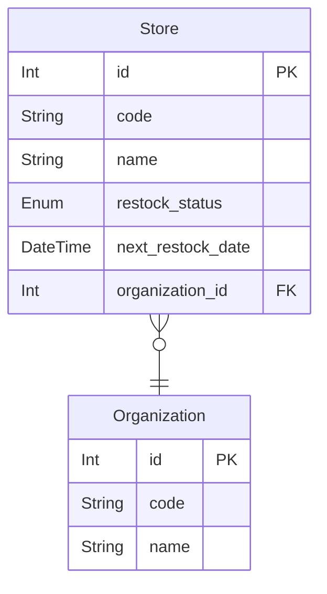

How to read it:

- Treat `entity` as the logical data model, not the conceptual model the information
  model draws. Entity names in the `erDiagram` body are the DSL ids.
- Cardinality comes from `relate`; generated FK columns show where the ownership of a
  reference lands.
- State axes such as `restock_status` are data columns and lifecycle review inputs.

Review points:

- Is `Store -> Organization` optionality correct for business operations?
- Are indexes, uniqueness, tenant scope, history, or soft-delete annotations needed
  before this becomes a migration design?

## RDRA Graph

<!-- derived-from #reading-any-diagram -->

Generated from:

```sh
rdra-ish diagram samples/incremental-order/step-7-business-rules/src \
  --kind rdra \
  --format mermaid \
  --buc BucStoreRestock \
  --out samples/incremental-order/step-7-business-rules/out/object_graph_buc_store_restock
```

<!-- embed: ../samples/incremental-order/step-7-business-rules/out/object_graph_buc_store_restock.mmd -->
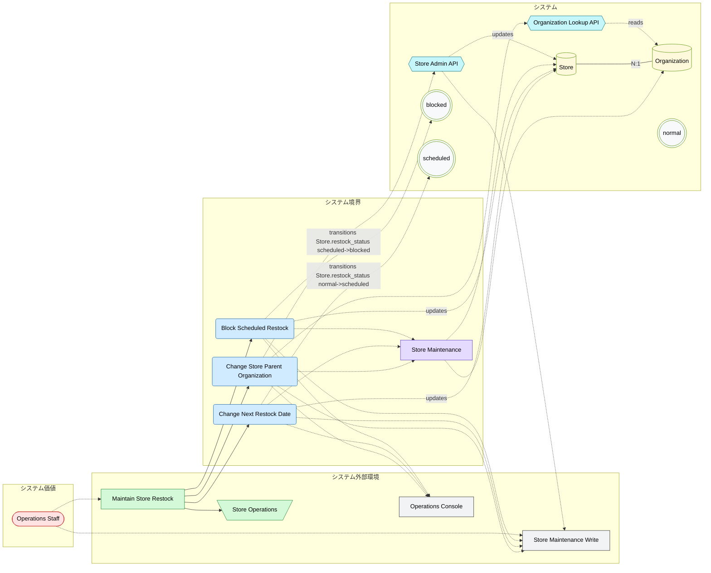

How to read it:

- `rdra` is the base graph: every element in its RDRA layer and every relation, the
  APIs, permissions, and media included. The other kinds are views of it, and a node or
  declared edge they draw is the one drawn here.
- Read the four subgraphs as the RDRA layers システム価値, システム外部環境,
  システム境界, and システム.
- Narrow a dense graph with `--node-kind` and `--edge-kind`; `omitted:` names what they
  hid.

Review points:

- Does every required permission have a matching actor-side grant?
- Are the API paths of each use case the ones the UC複合図 folded?

## Summary

<!-- derived-from #system-context -->
<!-- derived-from #uc複合図 -->
<!-- derived-from #information-model -->
<!-- derived-from #state-model -->

Walk the kinds in the order above: the system context and requirements say who and why,
the business, UC複合図, and flow say what happens, the robustness and sequence diagrams
say which screens, controls, and entities carry each use case, the screen transitions
say where the user moves, the information model and conditions
say what it acts on, and the state model and events say how it changes. `er` and `rdra`
hold the detail behind each. The transaction and API-boundary warnings come from
`rdra-ish check`.
