# Clinic Ops 設計書

<!-- derived-from ../../docs/language-reference.md -->
<!-- derived-from ../../docs/cli-reference.md -->

`scripts/gen-clinic-ops-docs.py` が `samples/clinic-ops/` のモデルから CLI を通して生成する。図・表・説明文を手で直さず、`.rdra` を直して `scripts/check-sample-artifacts.sh` を実行する。題材は日本の病院の外来業務（受付、資格確認、診察、検査、処方、計算・会計、レセプト請求）で、入院は対象外。業務規則は `.rdra` の `//` コメントに一次資料の出典（ファイル名:行）を付けている。

この文書は実装するエンジニア向けである。構造、処理、仕様の順に読む。

1. BUC ごとのロバストネス図で、画面・制御・エンティティの構造をつかむ。
2. UC ごとのシーケンス図で、ガードと書き込みの順序をつかむ。
3. 状態モデル、データモデル、規則、CRUD と権限で仕様を確かめる。

要求と成功指標は [PRD](prd.md) にある。

## 1. 概要

対象は病院の外来業務である。業務を 10 の BUC に分け、内部システムは `ClinicOpsSystem` 1 つにまとめている。院外の仕組み（オンライン資格確認、精算機、外注検査、電子処方箋、保険薬局、審査支払機関、患者への通知）は外部システムとしてイベントでつなぐ。

米国型の診療所モデルとの主な違いは次のとおりである。

| 論点 | このモデル |
|---|---|
| 支払の時点 | 受付では支払わない。診察の後に計算受付・会計受付で精算する |
| 窓口負担 | 負担割合（3割・2割）で計算し、限度額情報があれば自己負担限度額までを窓口で受け取る |
| 資格確認 | 受付のたびにオンライン資格確認等システムで確認する。来院前の一括照会、申立書、システム障害時モードがある |
| 請求 | レセプトを月ごとに審査支払機関（支払基金・国保連）へ請求する。返戻は再請求でき、査定は再審査請求で争う |
| 処方 | 院外処方箋は電子処方箋管理サービスへ登録し、患者が選ぶ保険薬局で調剤する。院内処方は薬剤師が調剤・監査する |
| 紹介 | 紹介状なしの初診は選定療養費（自費）の対象。救急搬送などは除外 |

### システムコンテキスト図

システムを使う actor と、イベントでつながる外部システムを示す。actor からシステムへの線は、actor が担う BUC の UC が呼ぶ API から導出される。

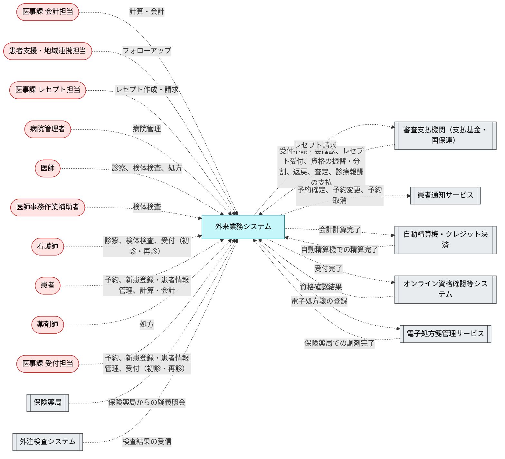

## 2. BUC ごとの構造と処理

各節は BUC の説明、ロバストネス図、画面遷移図、UC の表、UC ごとのシーケンス図の順に並ぶ。ロバストネス図では actor が画面を使い、画面が制御（UC が呼ぶ API、API がなければ UC 自身）を呼び、制御がエンティティを読み書きする。画面遷移図（`diagram --kind screen --buc <Buc>`）の実線は `navigates` で宣言した遷移で、ラベルは遷移を起こす UC である。点線の「業務上の順番」は宣言がない所を業務フローから補ったもので、同じ担当者のレーンで続く手順が表示する画面の順を示し、実際の画面遷移ではない。遷移も業務上の順番もない BUC では画面遷移図を省く。表の「ガード」は UC に効く条件で、式は [5. 規則](#5-規則) にある。

### 2.1 新患登録・患者情報管理

新患登録から問診送付までを扱う。新患登録では、オンライン資格確認で得た保険情報と、患者が同意した場合の限度額情報（適用区分）を `InsurancePolicy` に登録する。負担割合 `burden_ratio` と限度額適用区分 `limit_category` は actor が選ぶ値ではなく保険者が決める値なので、variation 型の属性として持つ。

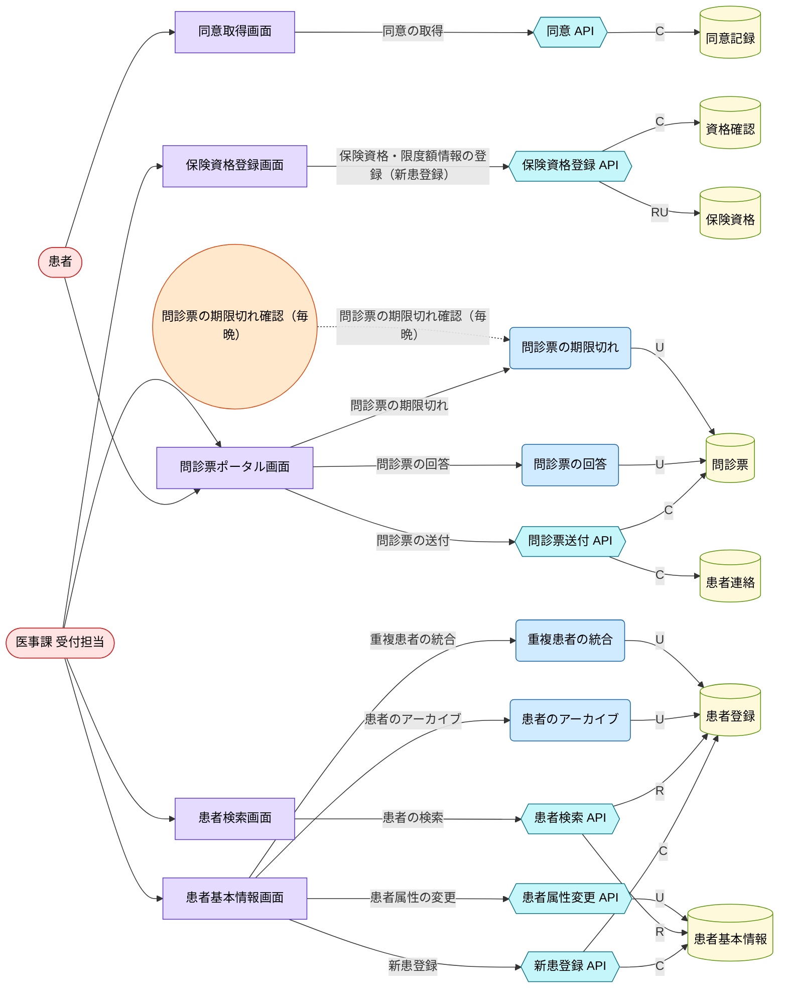

#### 画面遷移図

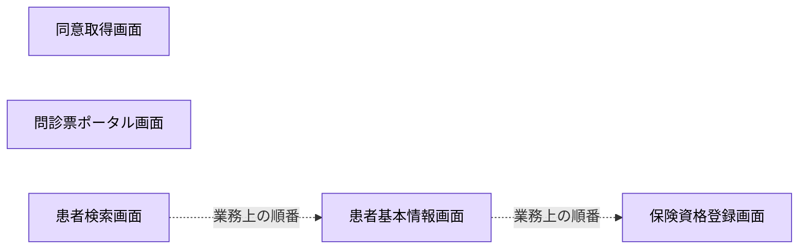

| UC | 説明 | 画面 | 制御 | ガード |
|---|---|---|---|---|
| 患者の検索<br>`SearchPatient` | 患者を検索する。参照だけの API で、患者の作成とは分ける。 | `PatientSearchScreen` | `SearchPatientApi` | （なし） |
| 新患登録<br>`RegisterPatient` | 新患の PatientAccount と PatientProfile を 1 つの API で同時に作る。 | `PatientProfileScreen` | `RegisterPatientApi` | （なし） |
| 患者属性の変更<br>`UpdateDemographics` | 患者の属性を API で更新する。 | `PatientProfileScreen` | `UpdateDemographicsApi` | （なし） |
| 保険資格・限度額情報の登録（新患登録）<br>`VerifyInsurance` | 保険資格の登録と限度額情報（適用区分）の取得。 | `InsuranceScreen` | `EligibilityApi` | （なし） |
| 同意の取得<br>`CaptureConsent` | 同意記録を作る。同意の有無は Bool、未回答は null で持つ。 | `ConsentScreen` | `ConsentApi` | （なし） |
| 問診票の送付<br>`SendIntakeForms` | 問診パケットとメッセージ作成。 | `IntakePortalScreen` | `IntakeMessagingApi` | （なし） |
| 問診票の回答<br>`CompleteIntakeForms` | 問診完了イベント。 | `IntakePortalScreen` | `CompleteIntakeForms` | （なし） |
| 問診票の期限切れ<br>`ExpireIntakeForms` | 問診期限切れイベント。 | `IntakePortalScreen` | `ExpireIntakeForms` | （なし） |
| 重複患者の統合<br>`MergeDuplicatePatient` | 患者統合状態。 | `PatientProfileScreen` | `MergeDuplicatePatient` | （なし） |
| 患者のアーカイブ<br>`ArchivePatient` | 患者アーカイブ状態。 | `PatientProfileScreen` | `ArchivePatient` | （なし） |

<details><summary>患者の検索（SearchPatient）のシーケンス図</summary>

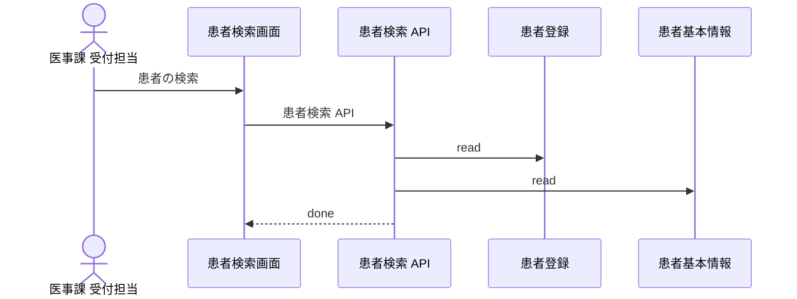

</details>

<details><summary>新患登録（RegisterPatient）のシーケンス図</summary>

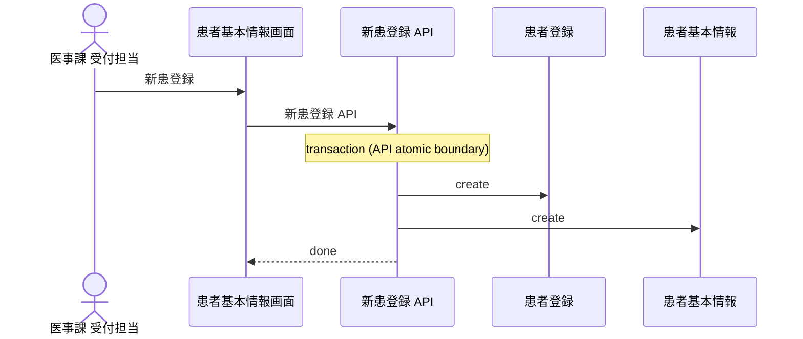

</details>

<details><summary>患者属性の変更（UpdateDemographics）のシーケンス図</summary>

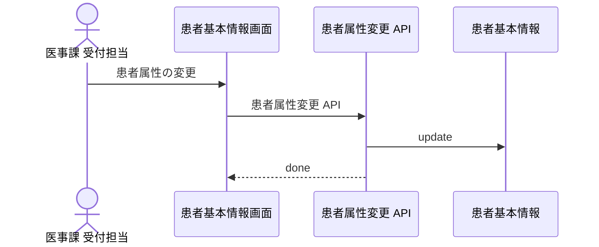

</details>

<details><summary>保険資格・限度額情報の登録（新患登録）（VerifyInsurance）のシーケンス図</summary>

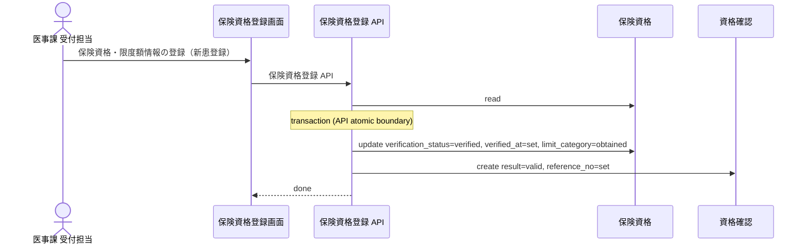

</details>

<details><summary>同意の取得（CaptureConsent）のシーケンス図</summary>

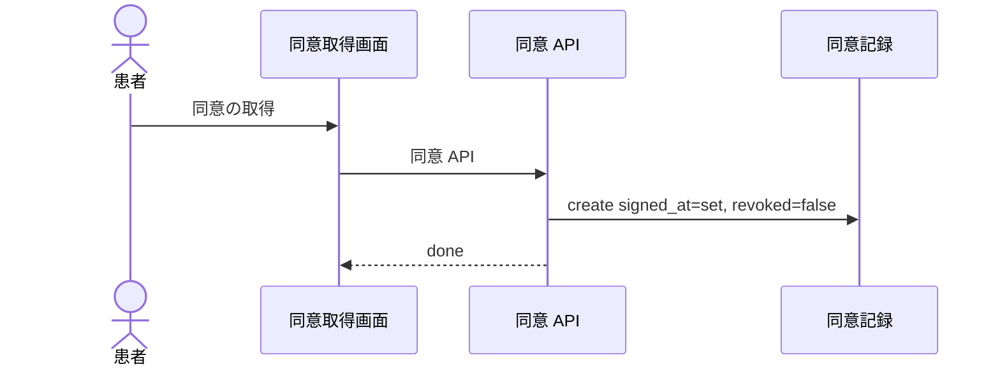

</details>

<details><summary>問診票の送付（SendIntakeForms）のシーケンス図</summary>

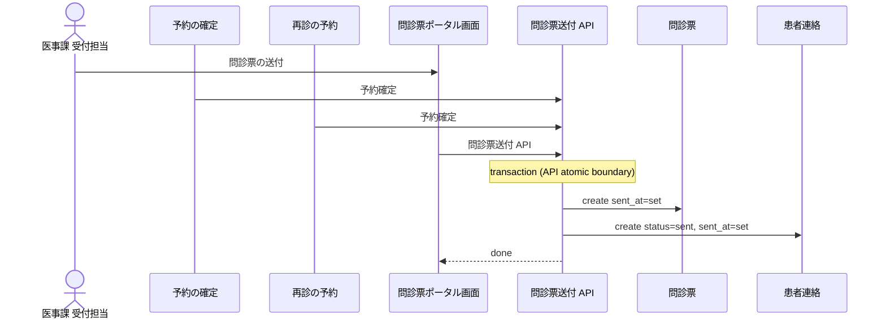

</details>

<details><summary>問診票の回答（CompleteIntakeForms）のシーケンス図</summary>

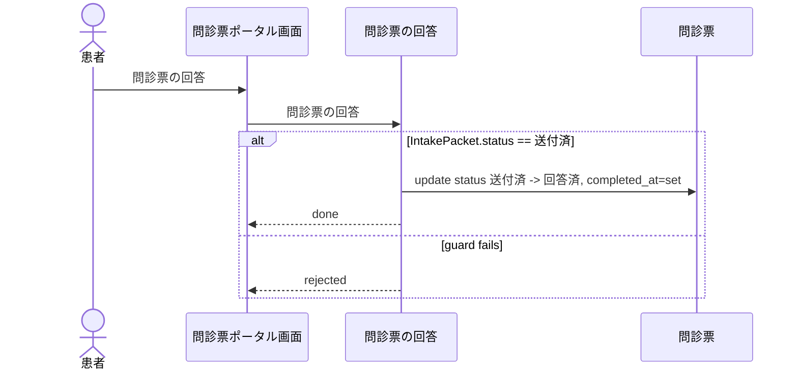

</details>

<details><summary>問診票の期限切れ（ExpireIntakeForms）のシーケンス図</summary>

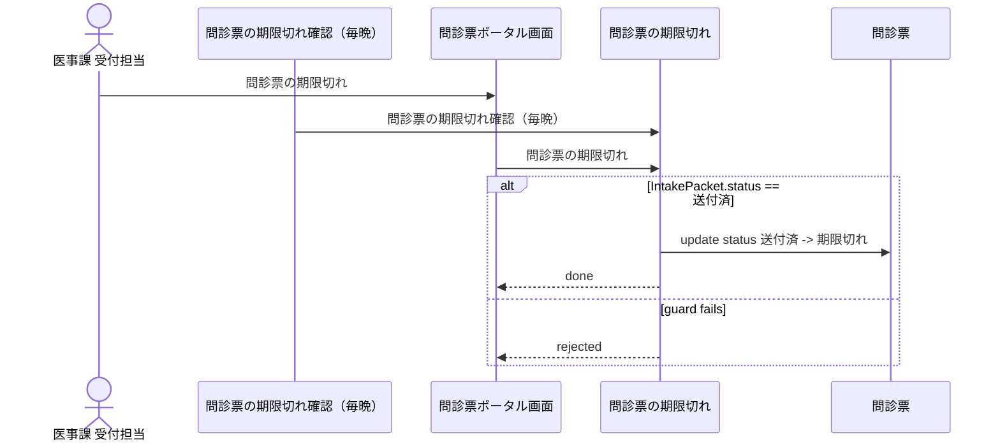

</details>

<details><summary>重複患者の統合（MergeDuplicatePatient）のシーケンス図</summary>

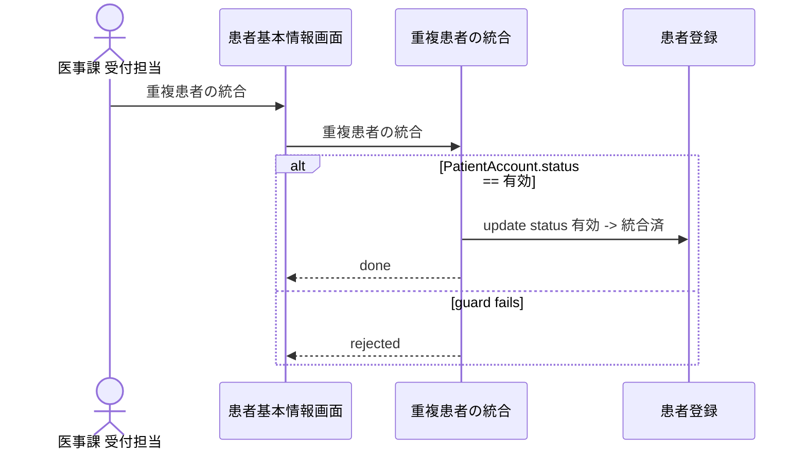

</details>

<details><summary>患者のアーカイブ（ArchivePatient）のシーケンス図</summary>

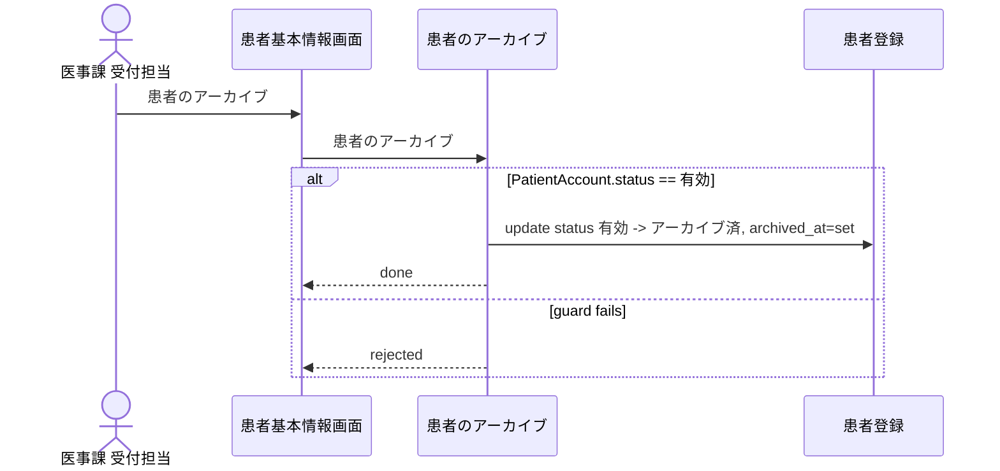

</details>

### 2.2 予約

予約検索、仮押さえ、予約確定、変更、取消、通知を扱う。予約枠と予約レコードを同時に更新する UC は専用 API を持ち、予約通知は AppointmentNoticeApi に分ける。予約済みの患者は、来院前に `BucVisitCheckIn` の一括照会の対象になる。

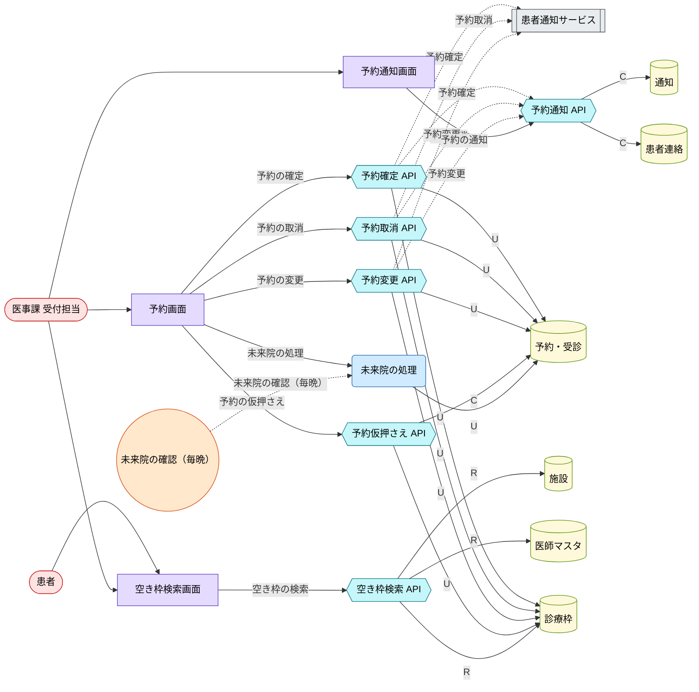

#### 画面遷移図

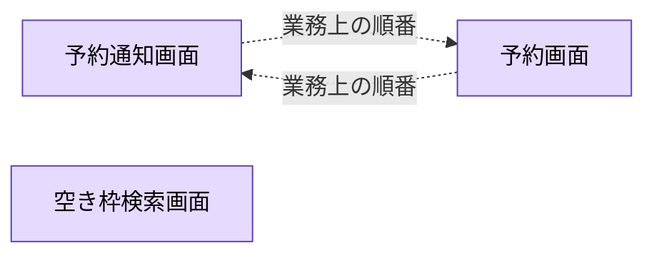

| UC | 説明 | 画面 | 制御 | ガード |
|---|---|---|---|---|
| 空き枠の検索<br>`SearchAvailability` | 予約枠を検索する。参照だけの API。 | `ScheduleSearchScreen` | `SearchAvailabilityApi` | （なし） |
| 予約の仮押さえ<br>`ReserveAppointment` | 仮押さえで Appointment を作る。 | `AppointmentScreen` | `ReserveAppointmentApi` | （なし） |
| 予約の確定<br>`BookAppointment` | 予約確定と予約枠更新。 | `AppointmentScreen` | `BookAppointmentApi` | （なし） |
| 予約の変更<br>`RescheduleAppointment` | 予約を変更する。予約の状態は変わらない。 | `AppointmentScreen` | `RescheduleAppointmentApi` | （なし） |
| 予約の取消<br>`CancelAppointment` | 取消理由と予約枠更新。 | `AppointmentScreen` | `CancelAppointmentApi` | （なし） |
| 未来院の処理<br>`MarkNoShow` | タイマー起動の未来院処理。 | `AppointmentScreen` | `MarkNoShow` | （なし） |
| 予約の通知<br>`SendAppointmentNotice` | 予約イベントからの通知作成。 | `AppointmentNoticeScreen` | `AppointmentNoticeApi` | （なし） |

<details><summary>空き枠の検索（SearchAvailability）のシーケンス図</summary>

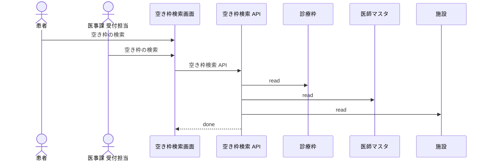

</details>

<details><summary>予約の仮押さえ（ReserveAppointment）のシーケンス図</summary>

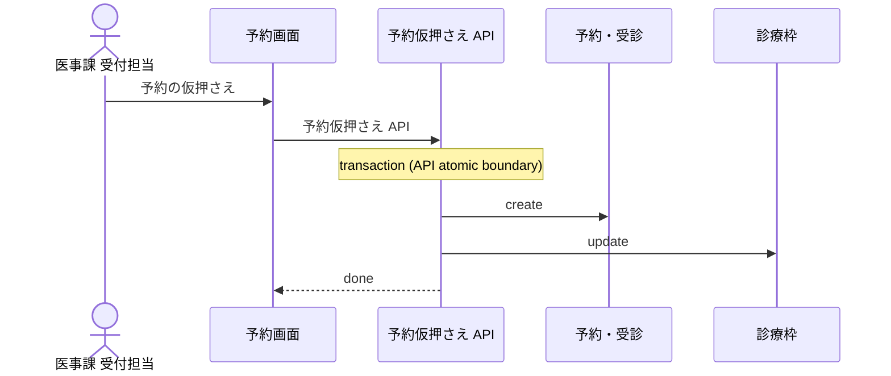

</details>

<details><summary>予約の確定（BookAppointment）のシーケンス図</summary>

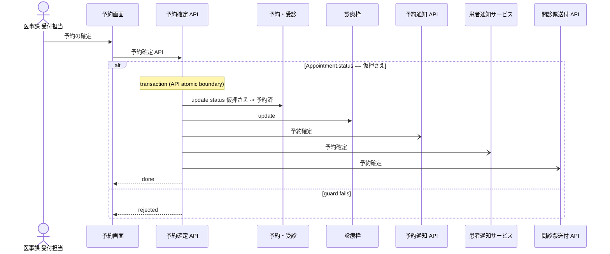

</details>

<details><summary>予約の変更（RescheduleAppointment）のシーケンス図</summary>

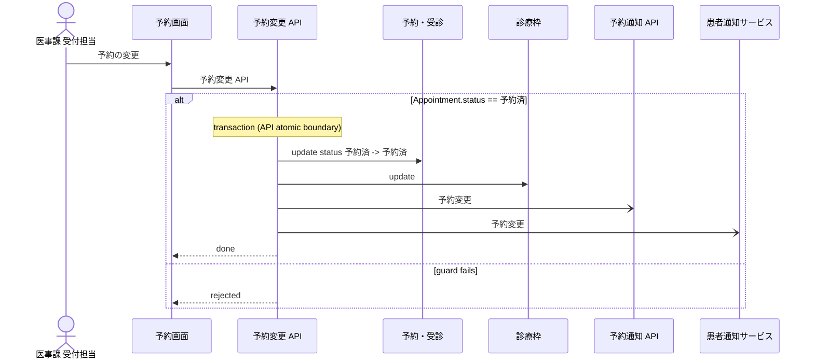

</details>

<details><summary>予約の取消（CancelAppointment）のシーケンス図</summary>

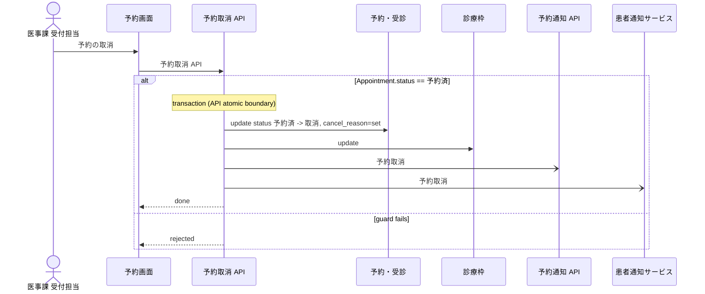

</details>

<details><summary>未来院の処理（MarkNoShow）のシーケンス図</summary>

```mermaid
%% rdra-ish diagram=sequence scope=usecase:MarkNoShow model=samples/clinic-ops
%% kinds: actor timer screen usecase entity
%% omitted: buc step medium permission
sequenceDiagram
  actor actor__ReceptionClerk as 医事課 受付担当
  participant timer__NoShowSweep as 未来院の確認（毎晩）
  participant screen__AppointmentScreen as 予約画面
  participant usecase__MarkNoShow as 未来院の処理
  participant entity__Appointment as 予約・受診
  actor__ReceptionClerk ->> screen__AppointmentScreen: 未来院の処理
  timer__NoShowSweep ->> usecase__MarkNoShow: 未来院の確認（毎晩）
  screen__AppointmentScreen ->> usecase__MarkNoShow: 未来院の処理
  alt Appointment.status == 予約済
    usecase__MarkNoShow ->> entity__Appointment: update status 予約済 -> 未来院
    usecase__MarkNoShow -->> screen__AppointmentScreen: done
  else guard fails
    usecase__MarkNoShow -->> screen__AppointmentScreen: rejected
  end
```

</details>

<details><summary>予約の通知（SendAppointmentNotice）のシーケンス図</summary>

```mermaid
%% rdra-ish diagram=sequence scope=usecase:SendAppointmentNotice model=samples/clinic-ops
%% kinds: actor usecase screen api entity
%% omitted: buc step medium permission event
sequenceDiagram
  actor actor__ReceptionClerk as 医事課 受付担当
  participant usecase__BookAppointment as 予約の確定
  participant usecase__CancelAppointment as 予約の取消
  participant usecase__RescheduleAppointment as 予約の変更
  participant usecase__ScheduleFollowUpVisit as 再診の予約
  participant screen__AppointmentNoticeScreen as 予約通知画面
  participant api__AppointmentNoticeApi as 予約通知 API
  participant entity__Notification as 通知
  participant entity__PatientMessage as 患者連絡
  actor__ReceptionClerk ->> screen__AppointmentNoticeScreen: 予約の通知
  usecase__BookAppointment ->> api__AppointmentNoticeApi: 予約確定
  usecase__CancelAppointment ->> api__AppointmentNoticeApi: 予約取消
  usecase__RescheduleAppointment ->> api__AppointmentNoticeApi: 予約変更
  usecase__ScheduleFollowUpVisit ->> api__AppointmentNoticeApi: 予約確定
  screen__AppointmentNoticeScreen ->> api__AppointmentNoticeApi: 予約通知 API
  Note over api__AppointmentNoticeApi: transaction (API atomic boundary)
  api__AppointmentNoticeApi ->> entity__Notification: create delivered_at=set
  api__AppointmentNoticeApi ->> entity__PatientMessage: create status=sent, sent_at=set
  api__AppointmentNoticeApi -->> screen__AppointmentNoticeScreen: done
```

</details>

### 2.3 受付（初診・再診）

到着確認、資格確認、紹介状の受付、診察室への案内を扱う。療養担当規則 第3条により受付のたびに資格を確認するので、`CheckInPatient` は必ずオンライン資格確認を伴い `EligibilityCheck` を作る。結果は 有効・無効・該当資格なし の 3 通りで、無効と該当資格なしは再確認へ戻る。システムが答えられない場合は被保険者資格申立書かシステム障害時モードで確認する。来院前には予約済み患者の一括照会を行う。受付では支払を受けない（会計は `BucVisitPayment`）。

```mermaid
%% rdra-ish diagram=robustness scope=buc:BucVisitCheckIn model=samples/clinic-ops
%% kinds: actor extsystem screen timer api entity
%% omitted: buc step medium permission event condition
flowchart LR
  actor__Nurse(["看護師"]):::actor
  actor__ReceptionClerk(["医事課 受付担当"]):::actor
  extsystem__OnlineEligibilitySystem[["オンライン資格確認等システム"]]:::extsystem
  screen__CheckInScreen["受付画面"]:::screen
  screen__EligibilityScreen["資格確認画面"]:::screen
  screen__ReferralScreen["紹介状受付画面"]:::screen
  screen__RoomBoardScreen["診察室ボード画面"]:::screen
  timer__EligibilityBatchInquiry(("予約患者の資格の一括照会（来院前）")):::timer
  api__AssignRoomApi{{"診察室案内 API"}}:::api
  api__CheckInPatientApi{{"受付 API"}}:::api
  api__EligibilityResultApi{{"資格確認結果 API"}}:::api
  api__OnlineEligibilityApi{{"オンライン資格確認 API"}}:::api
  api__PrepareEncounterApi{{"診療準備 API"}}:::api
  api__ReferralLetterApi{{"紹介状 API"}}:::api
  api__VerifyArrivalApi{{"到着確認 API"}}:::api
  entity__Appointment[("予約・受診")]:::entity
  entity__EligibilityCheck[("資格確認")]:::entity
  entity__InsurancePolicy[("保険資格")]:::entity
  entity__PatientAccount[("患者登録")]:::entity
  entity__PatientProfile[("患者基本情報")]:::entity
  entity__ReferralLetter[("紹介状・診療情報提供書")]:::entity
  entity__Room[("診察室")]:::entity
  actor__Nurse --> screen__CheckInScreen
  actor__Nurse --> screen__RoomBoardScreen
  actor__ReceptionClerk --> screen__CheckInScreen
  actor__ReceptionClerk --> screen__EligibilityScreen
  actor__ReceptionClerk --> screen__ReferralScreen
  api__AssignRoomApi -->|U| entity__Appointment
  api__AssignRoomApi -->|U| entity__Room
  api__CheckInPatientApi -->|U| entity__Appointment
  api__CheckInPatientApi -->|U| entity__PatientAccount
  api__CheckInPatientApi -.->|受付完了| api__PrepareEncounterApi
  api__CheckInPatientApi -.->|受付完了| extsystem__OnlineEligibilitySystem
  api__EligibilityResultApi -->|U| entity__EligibilityCheck
  api__OnlineEligibilityApi -->|C| entity__EligibilityCheck
  api__OnlineEligibilityApi -->|R| entity__InsurancePolicy
  api__OnlineEligibilityApi -.->|受付完了| api__PrepareEncounterApi
  api__OnlineEligibilityApi -.->|受付完了| extsystem__OnlineEligibilitySystem
  api__PrepareEncounterApi -->|R| entity__Appointment
  api__PrepareEncounterApi -->|R| entity__PatientProfile
  api__ReferralLetterApi -->|C| entity__ReferralLetter
  api__VerifyArrivalApi -->|R| entity__Appointment
  api__VerifyArrivalApi -->|R| entity__InsurancePolicy
  api__VerifyArrivalApi -->|R| entity__PatientAccount
  extsystem__OnlineEligibilitySystem -.->|資格確認結果| api__EligibilityResultApi
  screen__CheckInScreen -->|予約票・診察券の確認| api__VerifyArrivalApi
  screen__CheckInScreen -->|受付（初診・再診）| api__CheckInPatientApi
  screen__CheckInScreen -->|受付（初診・再診）| api__OnlineEligibilityApi
  screen__CheckInScreen -->|診療の準備| api__PrepareEncounterApi
  screen__EligibilityScreen -->|システム障害時モードでの資格確認| api__EligibilityResultApi
  screen__EligibilityScreen -->|被保険者資格申立書の受領| api__EligibilityResultApi
  screen__EligibilityScreen -->|資格の一括照会| api__OnlineEligibilityApi
  screen__EligibilityScreen -->|資格の再確認| api__EligibilityResultApi
  screen__EligibilityScreen -->|資格確認結果（有効）の取込| api__EligibilityResultApi
  screen__EligibilityScreen -->|資格確認結果（無効）の取込| api__EligibilityResultApi
  screen__EligibilityScreen -->|資格確認結果（該当資格なし）の取込| api__EligibilityResultApi
  screen__ReferralScreen -->|紹介状受付処理| api__ReferralLetterApi
  screen__RoomBoardScreen -->|診察室への案内| api__AssignRoomApi
  timer__EligibilityBatchInquiry -.->|予約患者の資格の一括照会（来院前）| api__OnlineEligibilityApi
  classDef actor fill:#ffe3e3,stroke:#c92a2a,color:#000;
  classDef extsystem fill:#e9ecef,stroke:#495057,color:#000;
  classDef screen fill:#e5dbff,stroke:#5f3dc4,color:#000;
  classDef timer fill:#ffe8cc,stroke:#d9480f,color:#000;
  classDef api fill:#c5f6fa,stroke:#0b7285,color:#000;
  classDef entity fill:#fff9db,stroke:#5c940d,color:#000;
```

#### 画面遷移図

```mermaid
%% rdra-ish diagram=screen scope=buc:BucVisitCheckIn model=samples/clinic-ops
%% kinds: screen
%% omitted: usecase field entity
flowchart LR
  screen__CheckInScreen["受付画面"]:::screen
  screen__EligibilityScreen["資格確認画面"]:::screen
  screen__ReferralScreen["紹介状受付画面"]:::screen
  screen__RoomBoardScreen["診察室ボード画面"]:::screen
  screen__CheckInScreen -->|受付（初診・再診）| screen__EligibilityScreen
  screen__CheckInScreen -.->|業務上の順番| screen__ReferralScreen
  %% derived screen__CheckInScreen -> screen__ReferralScreen via flow__VisitCheckInFlow,step__EligibilityStep,step__ReferralStep
  screen__CheckInScreen -->|診察室への案内| screen__RoomBoardScreen
  screen__EligibilityScreen -->|紹介状受付処理| screen__ReferralScreen
  %% via screen__CheckInScreen -> screen__EligibilityScreen usecase__CheckInPatient
  %% via screen__CheckInScreen -> screen__RoomBoardScreen usecase__AssignRoom
  %% via screen__EligibilityScreen -> screen__ReferralScreen usecase__ReceiveReferralLetter
  classDef screen fill:#e5dbff,stroke:#5f3dc4,color:#000;
```

| UC | 説明 | 画面 | 制御 | ガード |
|---|---|---|---|---|
| 予約票・診察券の確認<br>`VerifyArrival` | 予約票・診察券を確認する（参照のみ）。 | `CheckInScreen` | `VerifyArrivalApi` | （なし） |
| 受付（初診・再診）<br>`CheckInPatient` | 受付で予約を受付済にし、同時にオンライン資格確認を作る。 | `CheckInScreen` | `CheckInPatientApi`, `OnlineEligibilityApi` | （なし） |
| 資格の一括照会<br>`BatchVerifyEligibility` | 予約済み患者（BookedPatient 条件）だけを一括照会する。 | `EligibilityScreen` | `OnlineEligibilityApi` | 予約済みの患者 |
| 資格確認結果（有効）の取込<br>`ReceiveEligibilityValid` | 資格確認結果「有効」の取込。 | `EligibilityScreen` | `EligibilityResultApi` | （なし） |
| 資格確認結果（無効）の取込<br>`ReceiveEligibilityInvalid` | 資格確認結果「無効」の取込。 | `EligibilityScreen` | `EligibilityResultApi` | （なし） |
| 資格確認結果（該当資格なし）の取込<br>`ReceiveEligibilityNoInfo` | 資格確認結果「該当資格なし」の取込。 | `EligibilityScreen` | `EligibilityResultApi` | （なし） |
| 資格の再確認<br>`RecheckEligibility` | 無効・該当資格なしからの再確認。 | `EligibilityScreen` | `EligibilityResultApi` | （なし） |
| 被保険者資格申立書の受領<br>`RecordEligibilityDeclaration` | 被保険者資格申立書による確認。 | `EligibilityScreen` | `EligibilityResultApi` | （なし） |
| システム障害時モードでの資格確認<br>`ConfirmEligibilityInOutageMode` | システム障害時モードによる確認。 | `EligibilityScreen` | `EligibilityResultApi` | （なし） |
| 紹介状受付処理<br>`ReceiveReferralLetter` | 紹介状の受領と受付処理。 | `ReferralScreen` | `ReferralLetterApi` | （なし） |
| 診察室への案内<br>`AssignRoom` | 受付済の受診だけを診察室へ案内する。予約の状態は変わらない。 | `RoomBoardScreen` | `AssignRoomApi` | （なし） |
| 診療の準備<br>`PrepareEncounter` | 診療準備の参照情報。 | `CheckInScreen` | `PrepareEncounterApi` | （なし） |

<details><summary>予約票・診察券の確認（VerifyArrival）のシーケンス図</summary>

```mermaid
%% rdra-ish diagram=sequence scope=usecase:VerifyArrival model=samples/clinic-ops
%% kinds: actor screen api entity
%% omitted: buc step medium permission
sequenceDiagram
  actor actor__ReceptionClerk as 医事課 受付担当
  participant screen__CheckInScreen as 受付画面
  participant api__VerifyArrivalApi as 到着確認 API
  participant entity__Appointment as 予約・受診
  participant entity__PatientAccount as 患者登録
  participant entity__InsurancePolicy as 保険資格
  actor__ReceptionClerk ->> screen__CheckInScreen: 予約票・診察券の確認
  screen__CheckInScreen ->> api__VerifyArrivalApi: 到着確認 API
  api__VerifyArrivalApi ->> entity__Appointment: read
  api__VerifyArrivalApi ->> entity__PatientAccount: read
  api__VerifyArrivalApi ->> entity__InsurancePolicy: read
  api__VerifyArrivalApi -->> screen__CheckInScreen: done
```

</details>

<details><summary>受付（初診・再診）（CheckInPatient）のシーケンス図</summary>

```mermaid
%% rdra-ish diagram=sequence scope=usecase:CheckInPatient model=samples/clinic-ops
%% kinds: actor screen api entity extsystem
%% omitted: buc step medium permission event
sequenceDiagram
  actor actor__ReceptionClerk as 医事課 受付担当
  participant screen__CheckInScreen as 受付画面
  participant api__CheckInPatientApi as 受付 API
  participant api__OnlineEligibilityApi as オンライン資格確認 API
  participant entity__PatientAccount as 患者登録
  participant entity__Appointment as 予約・受診
  participant entity__InsurancePolicy as 保険資格
  participant entity__EligibilityCheck as 資格確認
  participant api__OpenEncounterApi as 診療記録作成 API
  participant extsystem__OnlineEligibilitySystem as オンライン資格確認等システム
  participant api__PrepareEncounterApi as 診療準備 API
  actor__ReceptionClerk ->> screen__CheckInScreen: 受付（初診・再診）
  screen__CheckInScreen ->> api__CheckInPatientApi: 受付 API
  alt Appointment.status == 予約済
    screen__CheckInScreen ->> api__OnlineEligibilityApi: オンライン資格確認 API
    Note over api__CheckInPatientApi: transaction (API atomic boundary)
    api__CheckInPatientApi ->> entity__PatientAccount: update
    api__CheckInPatientApi ->> entity__Appointment: update status 予約済 -> 受付済, checked_in_at=set
    api__OnlineEligibilityApi ->> entity__InsurancePolicy: read
    api__OnlineEligibilityApi ->> entity__EligibilityCheck: create
    api__CheckInPatientApi -) api__OpenEncounterApi: 受付完了
    api__CheckInPatientApi -) extsystem__OnlineEligibilitySystem: 受付完了
    api__CheckInPatientApi -) api__PrepareEncounterApi: 受付完了
    api__CheckInPatientApi -->> screen__CheckInScreen: done
  else guard fails
    api__CheckInPatientApi -->> screen__CheckInScreen: rejected
  end
```

</details>

<details><summary>資格の一括照会（BatchVerifyEligibility）のシーケンス図</summary>

```mermaid
%% rdra-ish diagram=sequence scope=usecase:BatchVerifyEligibility model=samples/clinic-ops
%% kinds: actor timer screen api entity
%% omitted: buc condition
sequenceDiagram
  actor actor__ReceptionClerk as 医事課 受付担当
  participant timer__EligibilityBatchInquiry as 予約患者の資格の一括照会（来院前）
  participant screen__EligibilityScreen as 資格確認画面
  participant api__OnlineEligibilityApi as オンライン資格確認 API
  participant entity__InsurancePolicy as 保険資格
  participant entity__EligibilityCheck as 資格確認
  actor__ReceptionClerk ->> screen__EligibilityScreen: 資格の一括照会
  timer__EligibilityBatchInquiry ->> api__OnlineEligibilityApi: 予約患者の資格の一括照会（来院前）
  screen__EligibilityScreen ->> api__OnlineEligibilityApi: オンライン資格確認 API
  alt 予約済みの患者: Appointment.status == 予約済
    api__OnlineEligibilityApi ->> entity__InsurancePolicy: read
    api__OnlineEligibilityApi ->> entity__EligibilityCheck: create
    api__OnlineEligibilityApi -->> screen__EligibilityScreen: done
  else guard fails
    api__OnlineEligibilityApi -->> screen__EligibilityScreen: rejected
  end
```

</details>

<details><summary>資格確認結果（有効）の取込（ReceiveEligibilityValid）のシーケンス図</summary>

```mermaid
%% rdra-ish diagram=sequence scope=usecase:ReceiveEligibilityValid model=samples/clinic-ops
%% kinds: extsystem screen api entity
%% omitted: buc step event
sequenceDiagram
  participant extsystem__OnlineEligibilitySystem as オンライン資格確認等システム
  participant screen__EligibilityScreen as 資格確認画面
  participant api__EligibilityResultApi as 資格確認結果 API
  participant entity__EligibilityCheck as 資格確認
  extsystem__OnlineEligibilitySystem ->> api__EligibilityResultApi: 資格確認結果
  screen__EligibilityScreen ->> api__EligibilityResultApi: 資格確認結果 API
  alt EligibilityCheck.result == 照会中
    api__EligibilityResultApi ->> entity__EligibilityCheck: update result 照会中 -> 有効, reference_no=set
    api__EligibilityResultApi -->> screen__EligibilityScreen: done
  else guard fails
    api__EligibilityResultApi -->> screen__EligibilityScreen: rejected
  end
```

</details>

<details><summary>資格確認結果（無効）の取込（ReceiveEligibilityInvalid）のシーケンス図</summary>

```mermaid
%% rdra-ish diagram=sequence scope=usecase:ReceiveEligibilityInvalid model=samples/clinic-ops
%% kinds: extsystem screen api entity
%% omitted: buc step event
sequenceDiagram
  participant extsystem__OnlineEligibilitySystem as オンライン資格確認等システム
  participant screen__EligibilityScreen as 資格確認画面
  participant api__EligibilityResultApi as 資格確認結果 API
  participant entity__EligibilityCheck as 資格確認
  extsystem__OnlineEligibilitySystem ->> api__EligibilityResultApi: 資格確認結果
  screen__EligibilityScreen ->> api__EligibilityResultApi: 資格確認結果 API
  alt EligibilityCheck.result == 照会中
    api__EligibilityResultApi ->> entity__EligibilityCheck: update result 照会中 -> 無効
    api__EligibilityResultApi -->> screen__EligibilityScreen: done
  else guard fails
    api__EligibilityResultApi -->> screen__EligibilityScreen: rejected
  end
```

</details>

<details><summary>資格確認結果（該当資格なし）の取込（ReceiveEligibilityNoInfo）のシーケンス図</summary>

```mermaid
%% rdra-ish diagram=sequence scope=usecase:ReceiveEligibilityNoInfo model=samples/clinic-ops
%% kinds: extsystem screen api entity
%% omitted: buc step event
sequenceDiagram
  participant extsystem__OnlineEligibilitySystem as オンライン資格確認等システム
  participant screen__EligibilityScreen as 資格確認画面
  participant api__EligibilityResultApi as 資格確認結果 API
  participant entity__EligibilityCheck as 資格確認
  extsystem__OnlineEligibilitySystem ->> api__EligibilityResultApi: 資格確認結果
  screen__EligibilityScreen ->> api__EligibilityResultApi: 資格確認結果 API
  alt EligibilityCheck.result == 照会中
    api__EligibilityResultApi ->> entity__EligibilityCheck: update result 照会中 -> 該当資格なし
    api__EligibilityResultApi -->> screen__EligibilityScreen: done
  else guard fails
    api__EligibilityResultApi -->> screen__EligibilityScreen: rejected
  end
```

</details>

<details><summary>資格の再確認（RecheckEligibility）のシーケンス図</summary>

```mermaid
%% rdra-ish diagram=sequence scope=usecase:RecheckEligibility model=samples/clinic-ops
%% kinds: actor screen api entity
%% omitted: buc step medium permission
sequenceDiagram
  actor actor__ReceptionClerk as 医事課 受付担当
  participant screen__EligibilityScreen as 資格確認画面
  participant api__EligibilityResultApi as 資格確認結果 API
  participant entity__EligibilityCheck as 資格確認
  actor__ReceptionClerk ->> screen__EligibilityScreen: 資格の再確認
  screen__EligibilityScreen ->> api__EligibilityResultApi: 資格確認結果 API
  alt EligibilityCheck.result == 無効 and EligibilityCheck.result == 該当資格なし
    api__EligibilityResultApi ->> entity__EligibilityCheck: update result 無効 -> 照会中, result 該当資格なし -> 照会中
    api__EligibilityResultApi -->> screen__EligibilityScreen: done
  else guard fails
    api__EligibilityResultApi -->> screen__EligibilityScreen: rejected
  end
```

</details>

<details><summary>被保険者資格申立書の受領（RecordEligibilityDeclaration）のシーケンス図</summary>

```mermaid
%% rdra-ish diagram=sequence scope=usecase:RecordEligibilityDeclaration model=samples/clinic-ops
%% kinds: actor screen api entity
%% omitted: buc step medium permission
sequenceDiagram
  actor actor__ReceptionClerk as 医事課 受付担当
  participant screen__EligibilityScreen as 資格確認画面
  participant api__EligibilityResultApi as 資格確認結果 API
  participant entity__EligibilityCheck as 資格確認
  actor__ReceptionClerk ->> screen__EligibilityScreen: 被保険者資格申立書の受領
  screen__EligibilityScreen ->> api__EligibilityResultApi: 資格確認結果 API
  alt EligibilityCheck.result == 照会中
    api__EligibilityResultApi ->> entity__EligibilityCheck: update result 照会中 -> 申立書で確認
    api__EligibilityResultApi -->> screen__EligibilityScreen: done
  else guard fails
    api__EligibilityResultApi -->> screen__EligibilityScreen: rejected
  end
```

</details>

<details><summary>システム障害時モードでの資格確認（ConfirmEligibilityInOutageMode）のシーケンス図</summary>

```mermaid
%% rdra-ish diagram=sequence scope=usecase:ConfirmEligibilityInOutageMode model=samples/clinic-ops
%% kinds: actor screen api entity
%% omitted: buc step medium permission
sequenceDiagram
  actor actor__ReceptionClerk as 医事課 受付担当
  participant screen__EligibilityScreen as 資格確認画面
  participant api__EligibilityResultApi as 資格確認結果 API
  participant entity__EligibilityCheck as 資格確認
  actor__ReceptionClerk ->> screen__EligibilityScreen: システム障害時モードでの資格確認
  screen__EligibilityScreen ->> api__EligibilityResultApi: 資格確認結果 API
  alt EligibilityCheck.result == 照会中
    api__EligibilityResultApi ->> entity__EligibilityCheck: update result 照会中 -> 有効
    api__EligibilityResultApi -->> screen__EligibilityScreen: done
  else guard fails
    api__EligibilityResultApi -->> screen__EligibilityScreen: rejected
  end
```

</details>

<details><summary>紹介状受付処理（ReceiveReferralLetter）のシーケンス図</summary>

```mermaid
%% rdra-ish diagram=sequence scope=usecase:ReceiveReferralLetter model=samples/clinic-ops
%% kinds: actor screen api entity
%% omitted: buc step medium permission
sequenceDiagram
  actor actor__ReceptionClerk as 医事課 受付担当
  participant screen__ReferralScreen as 紹介状受付画面
  participant api__ReferralLetterApi as 紹介状 API
  participant entity__ReferralLetter as 紹介状・診療情報提供書
  actor__ReceptionClerk ->> screen__ReferralScreen: 紹介状受付処理
  screen__ReferralScreen ->> api__ReferralLetterApi: 紹介状 API
  api__ReferralLetterApi ->> entity__ReferralLetter: create direction=inbound, received_at=set
  api__ReferralLetterApi -->> screen__ReferralScreen: done
```

</details>

<details><summary>診察室への案内（AssignRoom）のシーケンス図</summary>

```mermaid
%% rdra-ish diagram=sequence scope=usecase:AssignRoom model=samples/clinic-ops
%% kinds: actor screen api entity
%% omitted: buc step medium permission
sequenceDiagram
  actor actor__Nurse as 看護師
  participant screen__RoomBoardScreen as 診察室ボード画面
  participant api__AssignRoomApi as 診察室案内 API
  participant entity__Room as 診察室
  participant entity__Appointment as 予約・受診
  actor__Nurse ->> screen__RoomBoardScreen: 診察室への案内
  screen__RoomBoardScreen ->> api__AssignRoomApi: 診察室案内 API
  alt Appointment.status == 受付済
    Note over api__AssignRoomApi: transaction (API atomic boundary)
    api__AssignRoomApi ->> entity__Room: update occupancy_status=occupied
    api__AssignRoomApi ->> entity__Appointment: update status 受付済 -> 受付済
    api__AssignRoomApi -->> screen__RoomBoardScreen: done
  else guard fails
    api__AssignRoomApi -->> screen__RoomBoardScreen: rejected
  end
```

</details>

<details><summary>診療の準備（PrepareEncounter）のシーケンス図</summary>

```mermaid
%% rdra-ish diagram=sequence scope=usecase:PrepareEncounter model=samples/clinic-ops
%% kinds: actor usecase screen api entity
%% omitted: buc medium permission event
sequenceDiagram
  actor actor__Nurse as 看護師
  participant usecase__CheckInPatient as 受付（初診・再診）
  participant screen__CheckInScreen as 受付画面
  participant api__PrepareEncounterApi as 診療準備 API
  participant entity__Appointment as 予約・受診
  participant entity__PatientProfile as 患者基本情報
  actor__Nurse ->> screen__CheckInScreen: 診療の準備
  usecase__CheckInPatient ->> api__PrepareEncounterApi: 受付完了
  screen__CheckInScreen ->> api__PrepareEncounterApi: 診療準備 API
  api__PrepareEncounterApi ->> entity__Appointment: read
  api__PrepareEncounterApi ->> entity__PatientProfile: read
  api__PrepareEncounterApi -->> screen__CheckInScreen: done
```

</details>

### 2.4 診察

診療記録を開き、バイタル、診断、署名、診察終了までを扱う。診察終了 `CompleteConsultation` で予約は「計算待ち」になり、会計は計算受付へ移る。他院紹介では医師が診療情報提供書を作成・送信する。検査オーダは診察中に医師が出し、署名の後に診察終了とする。署名イベント `EvEncounterSigned` はカルテのコスト情報の登録とケアプラン作成を、診察終了イベント `EvConsultationCompleted` は計算・会計を起動する。

```mermaid
%% rdra-ish diagram=robustness scope=buc:BucClinicalEncounter model=samples/clinic-ops
%% kinds: actor screen api entity
%% omitted: buc step medium permission event
flowchart LR
  actor__Clinician(["医師"]):::actor
  actor__Nurse(["看護師"]):::actor
  screen__DiagnosisScreen["診断入力画面"]:::screen
  screen__EncounterWorkspaceScreen["診療記録画面"]:::screen
  screen__ReferralLetterScreen["診療情報提供書画面"]:::screen
  screen__VitalsScreen["バイタル入力画面"]:::screen
  api__AmendEncounterApi{{"記録修正 API"}}:::api
  api__CompleteConsultationApi{{"診察終了 API"}}:::api
  api__DocumentAssessmentApi{{"診察記録 API"}}:::api
  api__IssueReferralLetterApi{{"診療情報提供書 API"}}:::api
  api__OpenEncounterApi{{"診療記録作成 API"}}:::api
  api__RecordVitalsApi{{"バイタル記録 API"}}:::api
  api__SignEncounterApi{{"署名 API"}}:::api
  entity__Appointment[("予約・受診")]:::entity
  entity__Diagnosis[("診断")]:::entity
  entity__Encounter[("診療記録")]:::entity
  entity__ReferralLetter[("紹介状・診療情報提供書")]:::entity
  entity__Room[("診察室")]:::entity
  entity__VitalSign[("バイタル")]:::entity
  actor__Clinician --> screen__DiagnosisScreen
  actor__Clinician --> screen__EncounterWorkspaceScreen
  actor__Clinician --> screen__ReferralLetterScreen
  actor__Nurse --> screen__EncounterWorkspaceScreen
  actor__Nurse --> screen__VitalsScreen
  api__AmendEncounterApi -->|U| entity__Encounter
  api__CompleteConsultationApi -->|U| entity__Appointment
  api__CompleteConsultationApi -->|U| entity__Room
  api__DocumentAssessmentApi -->|C| entity__Diagnosis
  api__DocumentAssessmentApi -->|U| entity__Encounter
  api__IssueReferralLetterApi -->|C| entity__ReferralLetter
  api__IssueReferralLetterApi -->|R| entity__Encounter
  api__OpenEncounterApi -->|C| entity__Encounter
  api__OpenEncounterApi -->|U| entity__Appointment
  api__RecordVitalsApi -->|C| entity__VitalSign
  api__RecordVitalsApi -->|U| entity__Encounter
  api__SignEncounterApi -->|U| entity__Encounter
  screen__DiagnosisScreen -->|診察・診断の記録| api__DocumentAssessmentApi
  screen__EncounterWorkspaceScreen -->|署名済み記録の修正| api__AmendEncounterApi
  screen__EncounterWorkspaceScreen -->|診察終了| api__CompleteConsultationApi
  screen__EncounterWorkspaceScreen -->|診療記録の署名| api__SignEncounterApi
  screen__EncounterWorkspaceScreen -->|診療記録を開く| api__OpenEncounterApi
  screen__ReferralLetterScreen -->|診療情報提供書の作成・送信| api__IssueReferralLetterApi
  screen__VitalsScreen -->|バイタルの記録| api__RecordVitalsApi
  classDef actor fill:#ffe3e3,stroke:#c92a2a,color:#000;
  classDef screen fill:#e5dbff,stroke:#5f3dc4,color:#000;
  classDef api fill:#c5f6fa,stroke:#0b7285,color:#000;
  classDef entity fill:#fff9db,stroke:#5c940d,color:#000;
```

#### 画面遷移図

```mermaid
%% rdra-ish diagram=screen scope=buc:BucClinicalEncounter model=samples/clinic-ops
%% kinds: screen
%% omitted: usecase field
flowchart LR
  screen__DiagnosisScreen["診断入力画面"]:::screen
  screen__EncounterWorkspaceScreen["診療記録画面"]:::screen
  screen__ReferralLetterScreen["診療情報提供書画面"]:::screen
  screen__VitalsScreen["バイタル入力画面"]:::screen
  screen__DiagnosisScreen -->|診療情報提供書の作成・送信| screen__ReferralLetterScreen
  screen__DiagnosisScreen -->|診療記録の署名| screen__EncounterWorkspaceScreen
  screen__EncounterWorkspaceScreen -->|バイタルの記録| screen__VitalsScreen
  screen__EncounterWorkspaceScreen -->|診察・診断の記録| screen__DiagnosisScreen
  screen__ReferralLetterScreen -.->|業務上の順番| screen__EncounterWorkspaceScreen
  %% derived screen__ReferralLetterScreen -> screen__EncounterWorkspaceScreen via flow__EncounterFlow,step__ReferralOutStep,step__SignStep
  %% via screen__DiagnosisScreen -> screen__EncounterWorkspaceScreen usecase__SignEncounter
  %% via screen__DiagnosisScreen -> screen__ReferralLetterScreen usecase__IssueReferralLetter
  %% via screen__EncounterWorkspaceScreen -> screen__DiagnosisScreen usecase__DocumentAssessment
  %% via screen__EncounterWorkspaceScreen -> screen__VitalsScreen usecase__RecordVitals
  classDef screen fill:#e5dbff,stroke:#5f3dc4,color:#000;
```

| UC | 説明 | 画面 | 制御 | ガード |
|---|---|---|---|---|
| 診療記録を開く<br>`OpenEncounter` | 受付済の予約から診療記録を開く。 | `EncounterWorkspaceScreen` | `OpenEncounterApi` | （なし） |
| バイタルの記録<br>`RecordVitals` | バイタル記録。 | `VitalsScreen` | `RecordVitalsApi` | （なし） |
| 診察・診断の記録<br>`DocumentAssessment` | 診断記録と記録状態。 | `DiagnosisScreen` | `DocumentAssessmentApi` | （なし） |
| 診療記録の署名<br>`SignEncounter` | 署名でコスト情報登録とケアプラン作成を起動する。 | `EncounterWorkspaceScreen` | `SignEncounterApi` | （なし） |
| 署名済み記録の修正<br>`AmendEncounter` | 署名済み記録の修正。 | `EncounterWorkspaceScreen` | `AmendEncounterApi` | （なし） |
| 診療情報提供書の作成・送信<br>`IssueReferralLetter` | 診療情報提供書の作成・送信。 | `ReferralLetterScreen` | `IssueReferralLetterApi` | （なし） |
| 診察終了<br>`CompleteConsultation` | 診察終了で予約を計算待ちにし、部屋を清掃中にし、会計を起動する。 | `EncounterWorkspaceScreen` | `CompleteConsultationApi` | （なし） |

<details><summary>診療記録を開く（OpenEncounter）のシーケンス図</summary>

```mermaid
%% rdra-ish diagram=sequence scope=usecase:OpenEncounter model=samples/clinic-ops
%% kinds: actor usecase screen api entity
%% omitted: buc step medium permission event
sequenceDiagram
  actor actor__Nurse as 看護師
  participant usecase__CheckInPatient as 受付（初診・再診）
  participant screen__EncounterWorkspaceScreen as 診療記録画面
  participant api__OpenEncounterApi as 診療記録作成 API
  participant entity__Appointment as 予約・受診
  participant entity__Encounter as 診療記録
  actor__Nurse ->> screen__EncounterWorkspaceScreen: 診療記録を開く
  usecase__CheckInPatient ->> api__OpenEncounterApi: 受付完了
  screen__EncounterWorkspaceScreen ->> api__OpenEncounterApi: 診療記録作成 API
  alt Appointment.status == 受付済
    Note over api__OpenEncounterApi: transaction (API atomic boundary)
    api__OpenEncounterApi ->> entity__Appointment: update status 受付済 -> 診察中
    api__OpenEncounterApi ->> entity__Encounter: create
    api__OpenEncounterApi -->> screen__EncounterWorkspaceScreen: done
  else guard fails
    api__OpenEncounterApi -->> screen__EncounterWorkspaceScreen: rejected
  end
```

</details>

<details><summary>バイタルの記録（RecordVitals）のシーケンス図</summary>

```mermaid
%% rdra-ish diagram=sequence scope=usecase:RecordVitals model=samples/clinic-ops
%% kinds: actor screen api entity
%% omitted: buc step medium permission
sequenceDiagram
  actor actor__Nurse as 看護師
  participant screen__VitalsScreen as バイタル入力画面
  participant api__RecordVitalsApi as バイタル記録 API
  participant entity__Encounter as 診療記録
  participant entity__VitalSign as バイタル
  actor__Nurse ->> screen__VitalsScreen: バイタルの記録
  screen__VitalsScreen ->> api__RecordVitalsApi: バイタル記録 API
  Note over api__RecordVitalsApi: transaction (API atomic boundary)
  api__RecordVitalsApi ->> entity__Encounter: update
  api__RecordVitalsApi ->> entity__VitalSign: create
  api__RecordVitalsApi -->> screen__VitalsScreen: done
```

</details>

<details><summary>診察・診断の記録（DocumentAssessment）のシーケンス図</summary>

```mermaid
%% rdra-ish diagram=sequence scope=usecase:DocumentAssessment model=samples/clinic-ops
%% kinds: actor screen api entity
%% omitted: buc step medium permission
sequenceDiagram
  actor actor__Clinician as 医師
  participant screen__DiagnosisScreen as 診断入力画面
  participant api__DocumentAssessmentApi as 診察記録 API
  participant entity__Encounter as 診療記録
  participant entity__Diagnosis as 診断
  actor__Clinician ->> screen__DiagnosisScreen: 診察・診断の記録
  screen__DiagnosisScreen ->> api__DocumentAssessmentApi: 診察記録 API
  alt Encounter.status == 記録中
    Note over api__DocumentAssessmentApi: transaction (API atomic boundary)
    api__DocumentAssessmentApi ->> entity__Encounter: update status 記録中 -> 記載済
    api__DocumentAssessmentApi ->> entity__Diagnosis: create
    api__DocumentAssessmentApi -->> screen__DiagnosisScreen: done
  else guard fails
    api__DocumentAssessmentApi -->> screen__DiagnosisScreen: rejected
  end
```

</details>

<details><summary>診療記録の署名（SignEncounter）のシーケンス図</summary>

```mermaid
%% rdra-ish diagram=sequence scope=usecase:SignEncounter model=samples/clinic-ops
%% kinds: actor screen api entity
%% omitted: buc step medium permission event
sequenceDiagram
  actor actor__Clinician as 医師
  participant screen__EncounterWorkspaceScreen as 診療記録画面
  participant api__SignEncounterApi as 署名 API
  participant entity__Encounter as 診療記録
  participant api__CreateChargeApi as コスト登録 API
  participant api__CreateCarePlanApi as ケアプラン作成 API
  actor__Clinician ->> screen__EncounterWorkspaceScreen: 診療記録の署名
  screen__EncounterWorkspaceScreen ->> api__SignEncounterApi: 署名 API
  alt Encounter.status == 記載済
    api__SignEncounterApi ->> entity__Encounter: update status 記載済 -> 署名済, signed_at=set
    api__SignEncounterApi -) api__CreateChargeApi: 診療記録の署名
    api__SignEncounterApi -) api__CreateCarePlanApi: 診療記録の署名
    api__SignEncounterApi -->> screen__EncounterWorkspaceScreen: done
  else guard fails
    api__SignEncounterApi -->> screen__EncounterWorkspaceScreen: rejected
  end
```

</details>

<details><summary>署名済み記録の修正（AmendEncounter）のシーケンス図</summary>

```mermaid
%% rdra-ish diagram=sequence scope=usecase:AmendEncounter model=samples/clinic-ops
%% kinds: actor screen api entity
%% omitted: buc step medium permission
sequenceDiagram
  actor actor__Clinician as 医師
  participant screen__EncounterWorkspaceScreen as 診療記録画面
  participant api__AmendEncounterApi as 記録修正 API
  participant entity__Encounter as 診療記録
  actor__Clinician ->> screen__EncounterWorkspaceScreen: 署名済み記録の修正
  screen__EncounterWorkspaceScreen ->> api__AmendEncounterApi: 記録修正 API
  alt Encounter.status == 署名済
    api__AmendEncounterApi ->> entity__Encounter: update status 署名済 -> 修正済
    api__AmendEncounterApi -->> screen__EncounterWorkspaceScreen: done
  else guard fails
    api__AmendEncounterApi -->> screen__EncounterWorkspaceScreen: rejected
  end
```

</details>

<details><summary>診療情報提供書の作成・送信（IssueReferralLetter）のシーケンス図</summary>

```mermaid
%% rdra-ish diagram=sequence scope=usecase:IssueReferralLetter model=samples/clinic-ops
%% kinds: actor screen api entity
%% omitted: buc step medium permission
sequenceDiagram
  actor actor__Clinician as 医師
  participant screen__ReferralLetterScreen as 診療情報提供書画面
  participant api__IssueReferralLetterApi as 診療情報提供書 API
  participant entity__Encounter as 診療記録
  participant entity__ReferralLetter as 紹介状・診療情報提供書
  actor__Clinician ->> screen__ReferralLetterScreen: 診療情報提供書の作成・送信
  screen__ReferralLetterScreen ->> api__IssueReferralLetterApi: 診療情報提供書 API
  api__IssueReferralLetterApi ->> entity__Encounter: read
  api__IssueReferralLetterApi ->> entity__ReferralLetter: create direction=outbound
  api__IssueReferralLetterApi -->> screen__ReferralLetterScreen: done
```

</details>

<details><summary>診察終了（CompleteConsultation）のシーケンス図</summary>

```mermaid
%% rdra-ish diagram=sequence scope=usecase:CompleteConsultation model=samples/clinic-ops
%% kinds: actor screen api entity
%% omitted: buc step medium permission event
sequenceDiagram
  actor actor__Clinician as 医師
  participant screen__EncounterWorkspaceScreen as 診療記録画面
  participant api__CompleteConsultationApi as 診察終了 API
  participant entity__Room as 診察室
  participant entity__Appointment as 予約・受診
  actor__Clinician ->> screen__EncounterWorkspaceScreen: 診察終了
  screen__EncounterWorkspaceScreen ->> api__CompleteConsultationApi: 診察終了 API
  alt Appointment.status == 診察中
    Note over api__CompleteConsultationApi: transaction (API atomic boundary)
    api__CompleteConsultationApi ->> entity__Room: update occupancy_status=cleaning
    api__CompleteConsultationApi ->> entity__Appointment: update status 診察中 -> 計算待ち
    Note over api__CompleteConsultationApi: raises 診察終了
    api__CompleteConsultationApi -->> screen__EncounterWorkspaceScreen: done
  else guard fails
    api__CompleteConsultationApi -->> screen__EncounterWorkspaceScreen: rejected
  end
```

</details>

### 2.5 検体検査

検査オーダーから結果確認、重要結果通知までを扱う。医師事務作業補助者や看護師がオーダを代行入力した場合、医師が確定するまで看護師は採血しない（保助看法 第37条）。この規則は `OrderConfirmedByPhysician` 条件と `forbidden(ClinicalOrder, status == collected, physician_confirmed == false)` で検証する。外注検査の結果は外注検査システムから届く。採血管ラベルの発行と実施内容（コスト）の登録が会計計算の入力になる。実施入力のコストは `Charge.origin` が `performed` で、カルテ由来（`chart`）や選定療養費（`selectedfee`）のコストと発生元で区別される。

```mermaid
%% rdra-ish diagram=robustness scope=buc:BucOrdersResults model=samples/clinic-ops
%% kinds: actor extsystem screen api usecase entity
%% omitted: buc step medium permission event condition
flowchart LR
  actor__Clinician(["医師"]):::actor
  actor__MedicalClerk(["医師事務作業補助者"]):::actor
  actor__Nurse(["看護師"]):::actor
  extsystem__OutsourcedLabSystem[["外注検査システム"]]:::extsystem
  screen__CriticalNoticeScreen["重要結果通知画面"]:::screen
  screen__OrderEntryScreen["オーダ入力画面"]:::screen
  screen__ResultReviewScreen["検査結果確認画面"]:::screen
  screen__SpecimenScreen["採血画面"]:::screen
  api__CollectSpecimenApi{{"採血 API"}}:::api
  api__ConfirmOrderApi{{"オーダ確定 API"}}:::api
  api__CriticalNoticeApi{{"重要結果通知 API"}}:::api
  api__OrderEntryApi{{"オーダ登録 API"}}:::api
  api__PerformedProcedureApi{{"実施登録 API"}}:::api
  api__ProxyOrderApi{{"代行入力 API"}}:::api
  api__ReceiveLabResultApi{{"検査結果受信 API"}}:::api
  api__ResultReviewApi{{"検査結果確認 API"}}:::api
  usecase__CancelClinicalOrder("オーダの取消"):::usecase
  usecase__PrintSpecimenLabel("採血管ラベル発行・貼付"):::usecase
  entity__Charge[("コスト（診療行為）")]:::entity
  entity__ClinicalOrder[("検査オーダ")]:::entity
  entity__Encounter[("診療記録")]:::entity
  entity__LabResult[("検査結果")]:::entity
  entity__Notification[("通知")]:::entity
  entity__PatientMessage[("患者連絡")]:::entity
  actor__Clinician --> screen__CriticalNoticeScreen
  actor__Clinician --> screen__OrderEntryScreen
  actor__Clinician --> screen__ResultReviewScreen
  actor__MedicalClerk --> screen__OrderEntryScreen
  actor__Nurse --> screen__OrderEntryScreen
  actor__Nurse --> screen__ResultReviewScreen
  actor__Nurse --> screen__SpecimenScreen
  api__CollectSpecimenApi -->|U| entity__ClinicalOrder
  api__ConfirmOrderApi -->|U| entity__ClinicalOrder
  api__CriticalNoticeApi -->|C| entity__Notification
  api__CriticalNoticeApi -->|C| entity__PatientMessage
  api__OrderEntryApi -->|C| entity__ClinicalOrder
  api__OrderEntryApi -->|R| entity__Encounter
  api__PerformedProcedureApi -->|C| entity__Charge
  api__PerformedProcedureApi -->|R| entity__ClinicalOrder
  api__PerformedProcedureApi -->|R| entity__Encounter
  api__ProxyOrderApi -->|C| entity__ClinicalOrder
  api__ProxyOrderApi -->|R| entity__Encounter
  api__ReceiveLabResultApi -->|C| entity__LabResult
  api__ReceiveLabResultApi -->|U| entity__ClinicalOrder
  api__ResultReviewApi -->|U| entity__ClinicalOrder
  api__ResultReviewApi -->|U| entity__LabResult
  api__ResultReviewApi -.->|検査結果の確認| api__CriticalNoticeApi
  extsystem__OutsourcedLabSystem -.->|検査結果の受信| api__ReceiveLabResultApi
  screen__CriticalNoticeScreen -->|重要結果（パニック値）の通知| api__CriticalNoticeApi
  screen__OrderEntryScreen -->|オーダの取消| usecase__CancelClinicalOrder
  screen__OrderEntryScreen -->|代行入力オーダの確定| api__ConfirmOrderApi
  screen__OrderEntryScreen -->|検体検査オーダの代行入力| api__ProxyOrderApi
  screen__OrderEntryScreen -->|検体検査オーダの登録| api__OrderEntryApi
  screen__ResultReviewScreen -->|検査結果の受信| api__ReceiveLabResultApi
  screen__ResultReviewScreen -->|検査結果の確認| api__ResultReviewApi
  screen__SpecimenScreen -->|実施内容（コスト）の登録| api__PerformedProcedureApi
  screen__SpecimenScreen -->|採血| api__CollectSpecimenApi
  screen__SpecimenScreen -->|採血管ラベル発行・貼付| usecase__PrintSpecimenLabel
  usecase__CancelClinicalOrder -->|U| entity__ClinicalOrder
  usecase__PrintSpecimenLabel -->|R| entity__ClinicalOrder
  classDef actor fill:#ffe3e3,stroke:#c92a2a,color:#000;
  classDef extsystem fill:#e9ecef,stroke:#495057,color:#000;
  classDef screen fill:#e5dbff,stroke:#5f3dc4,color:#000;
  classDef api fill:#c5f6fa,stroke:#0b7285,color:#000;
  classDef usecase fill:#d0ebff,stroke:#1864ab,color:#000;
  classDef entity fill:#fff9db,stroke:#5c940d,color:#000;
```

#### 画面遷移図

```mermaid
%% rdra-ish diagram=screen scope=buc:BucOrdersResults model=samples/clinic-ops
%% kinds: screen
%% omitted: usecase
flowchart LR
  screen__CriticalNoticeScreen["重要結果通知画面"]:::screen
  screen__OrderEntryScreen["オーダ入力画面"]:::screen
  screen__ResultReviewScreen["検査結果確認画面"]:::screen
  screen__SpecimenScreen["採血画面"]:::screen
  screen__ResultReviewScreen -.->|業務上の順番| screen__CriticalNoticeScreen
  %% derived screen__ResultReviewScreen -> screen__CriticalNoticeScreen via flow__LabOrderFlow,step__CriticalStep,step__ResultReviewStep
  screen__SpecimenScreen -.->|業務上の順番| screen__ResultReviewScreen
  %% derived screen__SpecimenScreen -> screen__ResultReviewScreen via flow__LabOrderFlow,step__CostStep,step__LabResultStep
  classDef screen fill:#e5dbff,stroke:#5f3dc4,color:#000;
```

| UC | 説明 | 画面 | 制御 | ガード |
|---|---|---|---|---|
| 検体検査オーダの登録<br>`PlaceLabOrder` | 医師が登録したオーダは確定済み。 | `OrderEntryScreen` | `OrderEntryApi` | （なし） |
| 検体検査オーダの代行入力<br>`EnterProxyOrder` | 代行入力オーダは未確定で作られる。 | `OrderEntryScreen` | `ProxyOrderApi` | （なし） |
| 代行入力オーダの確定<br>`ConfirmProxyOrder` | 医師による代行入力オーダの確定。 | `OrderEntryScreen` | `ConfirmOrderApi` | （なし） |
| 採血管ラベル発行・貼付<br>`PrintSpecimenLabel` | 採血管ラベルの発行（参照のみ）。 | `SpecimenScreen` | `PrintSpecimenLabel` | （なし） |
| 採血<br>`CollectSpecimen` | 医師が確定したオーダだけを採取する。 | `SpecimenScreen` | `CollectSpecimenApi` | 医師が確定したオーダ |
| 実施内容（コスト）の登録<br>`RegisterPerformedProcedure` | 実施内容（コスト）の登録。 | `SpecimenScreen` | `PerformedProcedureApi` | （なし） |
| 検査結果の受信<br>`ReceiveLabResult` | 外注検査システムからの結果受信。 | `ResultReviewScreen` | `ReceiveLabResultApi` | （なし） |
| 検査結果の確認<br>`ReviewLabResult` | 結果確認と後続通知の起点。 | `ResultReviewScreen` | `ResultReviewApi` | （なし） |
| 重要結果（パニック値）の通知<br>`NotifyCriticalResult` | 重要結果の患者通知。 | `CriticalNoticeScreen` | `CriticalNoticeApi` | （なし） |
| オーダの取消<br>`CancelClinicalOrder` | オーダ取消。 | `OrderEntryScreen` | `CancelClinicalOrder` | （なし） |

<details><summary>検体検査オーダの登録（PlaceLabOrder）のシーケンス図</summary>

```mermaid
%% rdra-ish diagram=sequence scope=usecase:PlaceLabOrder model=samples/clinic-ops
%% kinds: actor screen api entity
%% omitted: buc step medium permission
sequenceDiagram
  actor actor__Clinician as 医師
  participant screen__OrderEntryScreen as オーダ入力画面
  participant api__OrderEntryApi as オーダ登録 API
  participant entity__Encounter as 診療記録
  participant entity__ClinicalOrder as 検査オーダ
  actor__Clinician ->> screen__OrderEntryScreen: 検体検査オーダの登録
  screen__OrderEntryScreen ->> api__OrderEntryApi: オーダ登録 API
  api__OrderEntryApi ->> entity__Encounter: read
  api__OrderEntryApi ->> entity__ClinicalOrder: create physician_confirmed=true
  api__OrderEntryApi -->> screen__OrderEntryScreen: done
```

</details>

<details><summary>検体検査オーダの代行入力（EnterProxyOrder）のシーケンス図</summary>

```mermaid
%% rdra-ish diagram=sequence scope=usecase:EnterProxyOrder model=samples/clinic-ops
%% kinds: actor screen api entity
%% omitted: buc step medium permission
sequenceDiagram
  actor actor__MedicalClerk as 医師事務作業補助者
  actor actor__Nurse as 看護師
  participant screen__OrderEntryScreen as オーダ入力画面
  participant api__ProxyOrderApi as 代行入力 API
  participant entity__Encounter as 診療記録
  participant entity__ClinicalOrder as 検査オーダ
  actor__MedicalClerk ->> screen__OrderEntryScreen: 検体検査オーダの代行入力
  actor__Nurse ->> screen__OrderEntryScreen: 検体検査オーダの代行入力
  screen__OrderEntryScreen ->> api__ProxyOrderApi: 代行入力 API
  api__ProxyOrderApi ->> entity__Encounter: read
  api__ProxyOrderApi ->> entity__ClinicalOrder: create physician_confirmed=false
  api__ProxyOrderApi -->> screen__OrderEntryScreen: done
```

</details>

<details><summary>代行入力オーダの確定（ConfirmProxyOrder）のシーケンス図</summary>

```mermaid
%% rdra-ish diagram=sequence scope=usecase:ConfirmProxyOrder model=samples/clinic-ops
%% kinds: actor screen api entity
%% omitted: buc step medium permission
sequenceDiagram
  actor actor__Clinician as 医師
  participant screen__OrderEntryScreen as オーダ入力画面
  participant api__ConfirmOrderApi as オーダ確定 API
  participant entity__ClinicalOrder as 検査オーダ
  actor__Clinician ->> screen__OrderEntryScreen: 代行入力オーダの確定
  screen__OrderEntryScreen ->> api__ConfirmOrderApi: オーダ確定 API
  alt ClinicalOrder.status == オーダ済
    api__ConfirmOrderApi ->> entity__ClinicalOrder: update status オーダ済 -> オーダ済, physician_confirmed=true
    api__ConfirmOrderApi -->> screen__OrderEntryScreen: done
  else guard fails
    api__ConfirmOrderApi -->> screen__OrderEntryScreen: rejected
  end
```

</details>

<details><summary>採血管ラベル発行・貼付（PrintSpecimenLabel）のシーケンス図</summary>

```mermaid
%% rdra-ish diagram=sequence scope=usecase:PrintSpecimenLabel model=samples/clinic-ops
%% kinds: actor screen usecase entity
%% omitted: buc step medium permission
sequenceDiagram
  actor actor__Nurse as 看護師
  participant screen__SpecimenScreen as 採血画面
  participant usecase__PrintSpecimenLabel as 採血管ラベル発行・貼付
  participant entity__ClinicalOrder as 検査オーダ
  actor__Nurse ->> screen__SpecimenScreen: 採血管ラベル発行・貼付
  screen__SpecimenScreen ->> usecase__PrintSpecimenLabel: 採血管ラベル発行・貼付
  usecase__PrintSpecimenLabel ->> entity__ClinicalOrder: read
  usecase__PrintSpecimenLabel -->> screen__SpecimenScreen: done
```

</details>

<details><summary>採血（CollectSpecimen）のシーケンス図</summary>

```mermaid
%% rdra-ish diagram=sequence scope=usecase:CollectSpecimen model=samples/clinic-ops
%% kinds: actor screen api entity
%% omitted: buc step medium permission condition
sequenceDiagram
  actor actor__Nurse as 看護師
  participant screen__SpecimenScreen as 採血画面
  participant api__CollectSpecimenApi as 採血 API
  participant entity__ClinicalOrder as 検査オーダ
  actor__Nurse ->> screen__SpecimenScreen: 採血
  screen__SpecimenScreen ->> api__CollectSpecimenApi: 採血 API
  alt 医師が確定したオーダ: ClinicalOrder.physician_confirmed == true, ClinicalOrder.status == オーダ済
    api__CollectSpecimenApi ->> entity__ClinicalOrder: update status オーダ済 -> 採取済, collected_at=set
    api__CollectSpecimenApi -->> screen__SpecimenScreen: done
  else guard fails
    api__CollectSpecimenApi -->> screen__SpecimenScreen: rejected
  end
```

</details>

<details><summary>実施内容（コスト）の登録（RegisterPerformedProcedure）のシーケンス図</summary>

```mermaid
%% rdra-ish diagram=sequence scope=usecase:RegisterPerformedProcedure model=samples/clinic-ops
%% kinds: actor screen api entity
%% omitted: buc step medium permission
sequenceDiagram
  actor actor__Nurse as 看護師
  participant screen__SpecimenScreen as 採血画面
  participant api__PerformedProcedureApi as 実施登録 API
  participant entity__ClinicalOrder as 検査オーダ
  participant entity__Encounter as 診療記録
  participant entity__Charge as コスト（診療行為）
  actor__Nurse ->> screen__SpecimenScreen: 実施内容（コスト）の登録
  screen__SpecimenScreen ->> api__PerformedProcedureApi: 実施登録 API
  api__PerformedProcedureApi ->> entity__ClinicalOrder: read
  api__PerformedProcedureApi ->> entity__Encounter: read
  api__PerformedProcedureApi ->> entity__Charge: create status=posted, posted_at=set, kind=insured, origin=performed
  api__PerformedProcedureApi -->> screen__SpecimenScreen: done
```

</details>

<details><summary>検査結果の受信（ReceiveLabResult）のシーケンス図</summary>

```mermaid
%% rdra-ish diagram=sequence scope=usecase:ReceiveLabResult model=samples/clinic-ops
%% kinds: actor extsystem screen api entity
%% omitted: buc step medium permission event
sequenceDiagram
  actor actor__Nurse as 看護師
  participant extsystem__OutsourcedLabSystem as 外注検査システム
  participant screen__ResultReviewScreen as 検査結果確認画面
  participant api__ReceiveLabResultApi as 検査結果受信 API
  participant entity__ClinicalOrder as 検査オーダ
  participant entity__LabResult as 検査結果
  actor__Nurse ->> screen__ResultReviewScreen: 検査結果の受信
  extsystem__OutsourcedLabSystem ->> api__ReceiveLabResultApi: 検査結果の受信
  screen__ResultReviewScreen ->> api__ReceiveLabResultApi: 検査結果受信 API
  alt ClinicalOrder.status == 採取済
    Note over api__ReceiveLabResultApi: transaction (API atomic boundary)
    api__ReceiveLabResultApi ->> entity__ClinicalOrder: update status 採取済 -> 結果受信, resulted_at=set
    api__ReceiveLabResultApi ->> entity__LabResult: create received_at=set
    api__ReceiveLabResultApi -->> screen__ResultReviewScreen: done
  else guard fails
    api__ReceiveLabResultApi -->> screen__ResultReviewScreen: rejected
  end
```

</details>

<details><summary>検査結果の確認（ReviewLabResult）のシーケンス図</summary>

```mermaid
%% rdra-ish diagram=sequence scope=usecase:ReviewLabResult model=samples/clinic-ops
%% kinds: actor screen api entity
%% omitted: buc step medium permission event
sequenceDiagram
  actor actor__Clinician as 医師
  participant screen__ResultReviewScreen as 検査結果確認画面
  participant api__ResultReviewApi as 検査結果確認 API
  participant entity__ClinicalOrder as 検査オーダ
  participant entity__LabResult as 検査結果
  participant api__NotifyPatientResultApi as 検査結果通知 API
  participant api__CriticalNoticeApi as 重要結果通知 API
  actor__Clinician ->> screen__ResultReviewScreen: 検査結果の確認
  screen__ResultReviewScreen ->> api__ResultReviewApi: 検査結果確認 API
  alt ClinicalOrder.status == 結果受信
    Note over api__ResultReviewApi: transaction (API atomic boundary)
    api__ResultReviewApi ->> entity__ClinicalOrder: update status 結果受信 -> 結果確認済
    api__ResultReviewApi ->> entity__LabResult: update reviewed_at=set
    api__ResultReviewApi -) api__NotifyPatientResultApi: 検査結果の確認
    api__ResultReviewApi -) api__CriticalNoticeApi: 検査結果の確認
    api__ResultReviewApi -->> screen__ResultReviewScreen: done
  else guard fails
    api__ResultReviewApi -->> screen__ResultReviewScreen: rejected
  end
```

</details>

<details><summary>重要結果（パニック値）の通知（NotifyCriticalResult）のシーケンス図</summary>

```mermaid
%% rdra-ish diagram=sequence scope=usecase:NotifyCriticalResult model=samples/clinic-ops
%% kinds: actor usecase screen api entity
%% omitted: buc step medium permission event
sequenceDiagram
  actor actor__Clinician as 医師
  participant usecase__ReviewLabResult as 検査結果の確認
  participant screen__CriticalNoticeScreen as 重要結果通知画面
  participant api__CriticalNoticeApi as 重要結果通知 API
  participant entity__Notification as 通知
  participant entity__PatientMessage as 患者連絡
  actor__Clinician ->> screen__CriticalNoticeScreen: 重要結果（パニック値）の通知
  usecase__ReviewLabResult ->> api__CriticalNoticeApi: 検査結果の確認
  screen__CriticalNoticeScreen ->> api__CriticalNoticeApi: 重要結果通知 API
  Note over api__CriticalNoticeApi: transaction (API atomic boundary)
  api__CriticalNoticeApi ->> entity__Notification: create delivered_at=set
  api__CriticalNoticeApi ->> entity__PatientMessage: create status=sent, sent_at=set
  api__CriticalNoticeApi -->> screen__CriticalNoticeScreen: done
```

</details>

<details><summary>オーダの取消（CancelClinicalOrder）のシーケンス図</summary>

```mermaid
%% rdra-ish diagram=sequence scope=usecase:CancelClinicalOrder model=samples/clinic-ops
%% kinds: actor screen usecase entity
%% omitted: buc step medium permission
sequenceDiagram
  actor actor__Clinician as 医師
  participant screen__OrderEntryScreen as オーダ入力画面
  participant usecase__CancelClinicalOrder as オーダの取消
  participant entity__ClinicalOrder as 検査オーダ
  actor__Clinician ->> screen__OrderEntryScreen: オーダの取消
  screen__OrderEntryScreen ->> usecase__CancelClinicalOrder: オーダの取消
  alt ClinicalOrder.status == オーダ済
    usecase__CancelClinicalOrder ->> entity__ClinicalOrder: update status オーダ済 -> 取消
    usecase__CancelClinicalOrder -->> screen__OrderEntryScreen: done
  else guard fails
    usecase__CancelClinicalOrder -->> screen__OrderEntryScreen: rejected
  end
```

</details>

### 2.6 処方

処方オーダから院外処方箋の発行、院内処方の調剤・監査・服薬指導・交付、疑義照会までを扱う。院外処方箋は電子処方箋管理サービスへ登録し、患者が選ぶ保険薬局で調剤される。病院は特定の保険薬局を指示しない（療担規則 第2条の5）ので、`Prescription` は薬局を持たない。使用期間は交付日を含めて4日以内で、日数は DSL で数えられないためタイマーで期限切れにする。薬剤師は疑わしい点があれば医師に問い合わせ、回答までは調剤しない。

```mermaid
%% rdra-ish diagram=robustness scope=buc:BucPrescriptionFulfillment model=samples/clinic-ops
%% kinds: actor extsystem screen timer api usecase entity
%% omitted: buc step medium permission event
flowchart LR
  actor__Clinician(["医師"]):::actor
  actor__Pharmacist(["薬剤師"]):::actor
  extsystem__EPrescriptionService[["電子処方箋管理サービス"]]:::extsystem
  extsystem__InsurancePharmacy[["保険薬局"]]:::extsystem
  screen__DispensingScreen["調剤・監査画面"]:::screen
  screen__MedicationSearchScreen["薬剤検索画面"]:::screen
  screen__PharmacyStatusScreen["電子処方箋の状況画面"]:::screen
  screen__PrescriptionScreen["処方画面"]:::screen
  timer__PrescriptionUsePeriodCheck(("処方箋の使用期間切れ確認")):::timer
  api__ConfirmDispenseApi{{"調剤結果 API"}}:::api
  api__DispensingApi{{"院内調剤 API"}}:::api
  api__DraftPrescriptionApi{{"処方オーダ API"}}:::api
  api__IssuePrescriptionApi{{"処方箋発行 API"}}:::api
  api__MedicationCatalogApi{{"薬剤マスタ API"}}:::api
  api__PrescriptionInquiryApi{{"疑義照会 API"}}:::api
  usecase__CancelPrescription("処方の取消"):::usecase
  entity__Encounter[("診療記録")]:::entity
  entity__Medication[("薬剤")]:::entity
  entity__Prescription[("処方箋")]:::entity
  actor__Clinician --> screen__MedicationSearchScreen
  actor__Clinician --> screen__PrescriptionScreen
  actor__Pharmacist --> screen__DispensingScreen
  api__ConfirmDispenseApi -->|U| entity__Prescription
  api__DispensingApi -->|U| entity__Prescription
  api__DraftPrescriptionApi -->|C| entity__Prescription
  api__DraftPrescriptionApi -->|R| entity__Encounter
  api__IssuePrescriptionApi -->|U| entity__Prescription
  api__IssuePrescriptionApi -.->|電子処方箋の登録| extsystem__EPrescriptionService
  api__MedicationCatalogApi -->|R| entity__Medication
  api__PrescriptionInquiryApi -->|U| entity__Prescription
  extsystem__EPrescriptionService -.->|保険薬局での調剤完了| api__ConfirmDispenseApi
  extsystem__InsurancePharmacy -.->|保険薬局からの疑義照会| api__PrescriptionInquiryApi
  screen__DispensingScreen -->|服薬指導| api__DispensingApi
  screen__DispensingScreen -->|疑義照会| api__DispensingApi
  screen__DispensingScreen -->|薬剤交付| api__DispensingApi
  screen__DispensingScreen -->|調剤・監査| api__DispensingApi
  screen__MedicationSearchScreen -->|薬剤の検索| api__MedicationCatalogApi
  screen__PharmacyStatusScreen -->|保険薬局での調剤結果の受信| api__ConfirmDispenseApi
  screen__PharmacyStatusScreen -->|処方箋の使用期間切れ| api__ConfirmDispenseApi
  screen__PrescriptionScreen -->|リフィル処方箋の処方オーダ| api__DraftPrescriptionApi
  screen__PrescriptionScreen -->|保険薬局からの疑義照会への回答| api__PrescriptionInquiryApi
  screen__PrescriptionScreen -->|処方の取消| usecase__CancelPrescription
  screen__PrescriptionScreen -->|処方オーダの登録| api__DraftPrescriptionApi
  screen__PrescriptionScreen -->|疑義照会への回答| api__PrescriptionInquiryApi
  screen__PrescriptionScreen -->|院内処方用引換券の交付| api__IssuePrescriptionApi
  screen__PrescriptionScreen -->|院外処方箋の発行| api__IssuePrescriptionApi
  timer__PrescriptionUsePeriodCheck -.->|処方箋の使用期間切れ確認| api__ConfirmDispenseApi
  usecase__CancelPrescription -->|U| entity__Prescription
  classDef actor fill:#ffe3e3,stroke:#c92a2a,color:#000;
  classDef extsystem fill:#e9ecef,stroke:#495057,color:#000;
  classDef screen fill:#e5dbff,stroke:#5f3dc4,color:#000;
  classDef timer fill:#ffe8cc,stroke:#d9480f,color:#000;
  classDef api fill:#c5f6fa,stroke:#0b7285,color:#000;
  classDef usecase fill:#d0ebff,stroke:#1864ab,color:#000;
  classDef entity fill:#fff9db,stroke:#5c940d,color:#000;
```

| UC | 説明 | 画面 | 制御 | ガード |
|---|---|---|---|---|
| 薬剤の検索<br>`SearchMedication` | 薬剤を検索する。参照だけの API。 | `MedicationSearchScreen` | `MedicationCatalogApi` | （なし） |
| 処方オーダの登録<br>`DraftPrescription` | 処方オーダの作成。 | `PrescriptionScreen` | `DraftPrescriptionApi` | （なし） |
| リフィル処方箋の処方オーダ<br>`IssueRefillPrescription` | リフィル処方箋の処方オーダ（使用回数の上限を記載）。 | `PrescriptionScreen` | `DraftPrescriptionApi` | （なし） |
| 院外処方箋の発行<br>`IssueOutsidePrescription` | 院外処方箋の発行と電子処方箋管理サービスへの登録。 | `PrescriptionScreen` | `IssuePrescriptionApi` | （なし） |
| 院内処方用引換券の交付<br>`IssueInhouseVoucher` | 院内処方用引換券の交付。 | `PrescriptionScreen` | `IssuePrescriptionApi` | （なし） |
| 調剤・監査<br>`DispenseAndAudit` | 薬剤師による調剤・監査。 | `DispensingScreen` | `DispensingApi` | （なし） |
| 服薬指導<br>`CounselMedication` | 服薬指導。 | `DispensingScreen` | `DispensingApi` | （なし） |
| 薬剤交付<br>`HandOverMedication` | 薬剤交付。 | `DispensingScreen` | `DispensingApi` | （なし） |
| 疑義照会<br>`RaisePrescriptionInquiry` | 薬剤師による疑義照会。 | `DispensingScreen` | `DispensingApi` | （なし） |
| 疑義照会への回答<br>`AnswerPrescriptionInquiry` | 医師の回答で引換券へ戻す。 | `PrescriptionScreen` | `PrescriptionInquiryApi` | （なし） |
| 保険薬局からの疑義照会への回答<br>`AnswerPharmacyInquiry` | 保険薬局からの疑義照会への回答。 | `PrescriptionScreen` | `PrescriptionInquiryApi` | （なし） |
| 保険薬局での調剤結果の受信<br>`ConfirmDispense` | 保険薬局での調剤結果の受信。 | `PharmacyStatusScreen` | `ConfirmDispenseApi` | （なし） |
| 処方箋の使用期間切れ<br>`ExpirePrescription` | 使用期間切れのタイマー処理。 | `PharmacyStatusScreen` | `ConfirmDispenseApi` | （なし） |
| 処方の取消<br>`CancelPrescription` | 処方の取消。 | `PrescriptionScreen` | `CancelPrescription` | （なし） |

<details><summary>薬剤の検索（SearchMedication）のシーケンス図</summary>

```mermaid
%% rdra-ish diagram=sequence scope=usecase:SearchMedication model=samples/clinic-ops
%% kinds: actor screen api entity
%% omitted: buc medium permission
sequenceDiagram
  actor actor__Clinician as 医師
  participant screen__MedicationSearchScreen as 薬剤検索画面
  participant api__MedicationCatalogApi as 薬剤マスタ API
  participant entity__Medication as 薬剤
  actor__Clinician ->> screen__MedicationSearchScreen: 薬剤の検索
  screen__MedicationSearchScreen ->> api__MedicationCatalogApi: 薬剤マスタ API
  api__MedicationCatalogApi ->> entity__Medication: read
  api__MedicationCatalogApi -->> screen__MedicationSearchScreen: done
```

</details>

<details><summary>処方オーダの登録（DraftPrescription）のシーケンス図</summary>

```mermaid
%% rdra-ish diagram=sequence scope=usecase:DraftPrescription model=samples/clinic-ops
%% kinds: actor screen api entity
%% omitted: buc step medium permission
sequenceDiagram
  actor actor__Clinician as 医師
  participant screen__PrescriptionScreen as 処方画面
  participant api__DraftPrescriptionApi as 処方オーダ API
  participant entity__Encounter as 診療記録
  participant entity__Prescription as 処方箋
  actor__Clinician ->> screen__PrescriptionScreen: 処方オーダの登録
  screen__PrescriptionScreen ->> api__DraftPrescriptionApi: 処方オーダ API
  api__DraftPrescriptionApi ->> entity__Encounter: read
  api__DraftPrescriptionApi ->> entity__Prescription: create
  api__DraftPrescriptionApi -->> screen__PrescriptionScreen: done
```

</details>

<details><summary>リフィル処方箋の処方オーダ（IssueRefillPrescription）のシーケンス図</summary>

```mermaid
%% rdra-ish diagram=sequence scope=usecase:IssueRefillPrescription model=samples/clinic-ops
%% kinds: actor screen api entity
%% omitted: buc step medium permission
sequenceDiagram
  actor actor__Clinician as 医師
  participant screen__PrescriptionScreen as 処方画面
  participant api__DraftPrescriptionApi as 処方オーダ API
  participant entity__Encounter as 診療記録
  participant entity__Prescription as 処方箋
  actor__Clinician ->> screen__PrescriptionScreen: リフィル処方箋の処方オーダ
  screen__PrescriptionScreen ->> api__DraftPrescriptionApi: 処方オーダ API
  api__DraftPrescriptionApi ->> entity__Encounter: read
  api__DraftPrescriptionApi ->> entity__Prescription: create
  api__DraftPrescriptionApi -->> screen__PrescriptionScreen: done
```

</details>

<details><summary>院外処方箋の発行（IssueOutsidePrescription）のシーケンス図</summary>

```mermaid
%% rdra-ish diagram=sequence scope=usecase:IssueOutsidePrescription model=samples/clinic-ops
%% kinds: actor screen api entity extsystem
%% omitted: buc step medium permission event
sequenceDiagram
  actor actor__Clinician as 医師
  participant screen__PrescriptionScreen as 処方画面
  participant api__IssuePrescriptionApi as 処方箋発行 API
  participant entity__Prescription as 処方箋
  participant extsystem__EPrescriptionService as 電子処方箋管理サービス
  actor__Clinician ->> screen__PrescriptionScreen: 院外処方箋の発行
  screen__PrescriptionScreen ->> api__IssuePrescriptionApi: 処方箋発行 API
  alt Prescription.status == 処方入力中
    api__IssuePrescriptionApi ->> entity__Prescription: update status 処方入力中 -> 院外処方箋発行済, sent_at=set
    api__IssuePrescriptionApi -) extsystem__EPrescriptionService: 電子処方箋の登録
    api__IssuePrescriptionApi -->> screen__PrescriptionScreen: done
  else guard fails
    api__IssuePrescriptionApi -->> screen__PrescriptionScreen: rejected
  end
```

</details>

<details><summary>院内処方用引換券の交付（IssueInhouseVoucher）のシーケンス図</summary>

```mermaid
%% rdra-ish diagram=sequence scope=usecase:IssueInhouseVoucher model=samples/clinic-ops
%% kinds: actor screen api entity
%% omitted: buc step medium permission
sequenceDiagram
  actor actor__Clinician as 医師
  participant screen__PrescriptionScreen as 処方画面
  participant api__IssuePrescriptionApi as 処方箋発行 API
  participant entity__Prescription as 処方箋
  actor__Clinician ->> screen__PrescriptionScreen: 院内処方用引換券の交付
  screen__PrescriptionScreen ->> api__IssuePrescriptionApi: 処方箋発行 API
  alt Prescription.status == 処方入力中
    api__IssuePrescriptionApi ->> entity__Prescription: update status 処方入力中 -> 引換券交付済
    api__IssuePrescriptionApi -->> screen__PrescriptionScreen: done
  else guard fails
    api__IssuePrescriptionApi -->> screen__PrescriptionScreen: rejected
  end
```

</details>

<details><summary>調剤・監査（DispenseAndAudit）のシーケンス図</summary>

```mermaid
%% rdra-ish diagram=sequence scope=usecase:DispenseAndAudit model=samples/clinic-ops
%% kinds: actor screen api entity
%% omitted: buc step medium permission
sequenceDiagram
  actor actor__Pharmacist as 薬剤師
  participant screen__DispensingScreen as 調剤・監査画面
  participant api__DispensingApi as 院内調剤 API
  participant entity__Prescription as 処方箋
  actor__Pharmacist ->> screen__DispensingScreen: 調剤・監査
  screen__DispensingScreen ->> api__DispensingApi: 院内調剤 API
  alt Prescription.status == 引換券交付済
    api__DispensingApi ->> entity__Prescription: update status 引換券交付済 -> 調剤・監査済
    api__DispensingApi -->> screen__DispensingScreen: done
  else guard fails
    api__DispensingApi -->> screen__DispensingScreen: rejected
  end
```

</details>

<details><summary>服薬指導（CounselMedication）のシーケンス図</summary>

```mermaid
%% rdra-ish diagram=sequence scope=usecase:CounselMedication model=samples/clinic-ops
%% kinds: actor screen api entity
%% omitted: buc step medium permission
sequenceDiagram
  actor actor__Pharmacist as 薬剤師
  participant screen__DispensingScreen as 調剤・監査画面
  participant api__DispensingApi as 院内調剤 API
  participant entity__Prescription as 処方箋
  actor__Pharmacist ->> screen__DispensingScreen: 服薬指導
  screen__DispensingScreen ->> api__DispensingApi: 院内調剤 API
  alt Prescription.status == 調剤・監査済
    api__DispensingApi ->> entity__Prescription: update status 調剤・監査済 -> 服薬指導済
    api__DispensingApi -->> screen__DispensingScreen: done
  else guard fails
    api__DispensingApi -->> screen__DispensingScreen: rejected
  end
```

</details>

<details><summary>薬剤交付（HandOverMedication）のシーケンス図</summary>

```mermaid
%% rdra-ish diagram=sequence scope=usecase:HandOverMedication model=samples/clinic-ops
%% kinds: actor screen api entity
%% omitted: buc step medium permission
sequenceDiagram
  actor actor__Pharmacist as 薬剤師
  participant screen__DispensingScreen as 調剤・監査画面
  participant api__DispensingApi as 院内調剤 API
  participant entity__Prescription as 処方箋
  actor__Pharmacist ->> screen__DispensingScreen: 薬剤交付
  screen__DispensingScreen ->> api__DispensingApi: 院内調剤 API
  alt Prescription.status == 服薬指導済
    api__DispensingApi ->> entity__Prescription: update status 服薬指導済 -> 交付済, dispensed_at=set
    api__DispensingApi -->> screen__DispensingScreen: done
  else guard fails
    api__DispensingApi -->> screen__DispensingScreen: rejected
  end
```

</details>

<details><summary>疑義照会（RaisePrescriptionInquiry）のシーケンス図</summary>

```mermaid
%% rdra-ish diagram=sequence scope=usecase:RaisePrescriptionInquiry model=samples/clinic-ops
%% kinds: actor screen api entity
%% omitted: buc step medium permission
sequenceDiagram
  actor actor__Pharmacist as 薬剤師
  participant screen__DispensingScreen as 調剤・監査画面
  participant api__DispensingApi as 院内調剤 API
  participant entity__Prescription as 処方箋
  actor__Pharmacist ->> screen__DispensingScreen: 疑義照会
  screen__DispensingScreen ->> api__DispensingApi: 院内調剤 API
  alt Prescription.status == 引換券交付済
    api__DispensingApi ->> entity__Prescription: update status 引換券交付済 -> 疑義照会中
    api__DispensingApi -->> screen__DispensingScreen: done
  else guard fails
    api__DispensingApi -->> screen__DispensingScreen: rejected
  end
```

</details>

<details><summary>疑義照会への回答（AnswerPrescriptionInquiry）のシーケンス図</summary>

```mermaid
%% rdra-ish diagram=sequence scope=usecase:AnswerPrescriptionInquiry model=samples/clinic-ops
%% kinds: actor screen api entity
%% omitted: buc step medium permission
sequenceDiagram
  actor actor__Clinician as 医師
  participant screen__PrescriptionScreen as 処方画面
  participant api__PrescriptionInquiryApi as 疑義照会 API
  participant entity__Prescription as 処方箋
  actor__Clinician ->> screen__PrescriptionScreen: 疑義照会への回答
  screen__PrescriptionScreen ->> api__PrescriptionInquiryApi: 疑義照会 API
  alt Prescription.status == 疑義照会中
    api__PrescriptionInquiryApi ->> entity__Prescription: update status 疑義照会中 -> 引換券交付済
    api__PrescriptionInquiryApi -->> screen__PrescriptionScreen: done
  else guard fails
    api__PrescriptionInquiryApi -->> screen__PrescriptionScreen: rejected
  end
```

</details>

<details><summary>保険薬局からの疑義照会への回答（AnswerPharmacyInquiry）のシーケンス図</summary>

```mermaid
%% rdra-ish diagram=sequence scope=usecase:AnswerPharmacyInquiry model=samples/clinic-ops
%% kinds: actor extsystem screen api entity
%% omitted: buc step medium permission event
sequenceDiagram
  actor actor__Clinician as 医師
  participant extsystem__InsurancePharmacy as 保険薬局
  participant screen__PrescriptionScreen as 処方画面
  participant api__PrescriptionInquiryApi as 疑義照会 API
  participant entity__Prescription as 処方箋
  actor__Clinician ->> screen__PrescriptionScreen: 保険薬局からの疑義照会への回答
  extsystem__InsurancePharmacy ->> api__PrescriptionInquiryApi: 保険薬局からの疑義照会
  screen__PrescriptionScreen ->> api__PrescriptionInquiryApi: 疑義照会 API
  alt Prescription.status == 院外処方箋発行済
    api__PrescriptionInquiryApi ->> entity__Prescription: update status 院外処方箋発行済 -> 院外処方箋発行済
    api__PrescriptionInquiryApi -->> screen__PrescriptionScreen: done
  else guard fails
    api__PrescriptionInquiryApi -->> screen__PrescriptionScreen: rejected
  end
```

</details>

<details><summary>保険薬局での調剤結果の受信（ConfirmDispense）のシーケンス図</summary>

```mermaid
%% rdra-ish diagram=sequence scope=usecase:ConfirmDispense model=samples/clinic-ops
%% kinds: extsystem screen api entity
%% omitted: buc step medium event
sequenceDiagram
  participant extsystem__EPrescriptionService as 電子処方箋管理サービス
  participant screen__PharmacyStatusScreen as 電子処方箋の状況画面
  participant api__ConfirmDispenseApi as 調剤結果 API
  participant entity__Prescription as 処方箋
  extsystem__EPrescriptionService ->> api__ConfirmDispenseApi: 保険薬局での調剤完了
  screen__PharmacyStatusScreen ->> api__ConfirmDispenseApi: 調剤結果 API
  alt Prescription.status == 院外処方箋発行済
    api__ConfirmDispenseApi ->> entity__Prescription: update status 院外処方箋発行済 -> 交付済, dispensed_at=set
    api__ConfirmDispenseApi -->> screen__PharmacyStatusScreen: done
  else guard fails
    api__ConfirmDispenseApi -->> screen__PharmacyStatusScreen: rejected
  end
```

</details>

<details><summary>処方箋の使用期間切れ（ExpirePrescription）のシーケンス図</summary>

```mermaid
%% rdra-ish diagram=sequence scope=usecase:ExpirePrescription model=samples/clinic-ops
%% kinds: timer screen api entity
%% omitted: buc
sequenceDiagram
  participant timer__PrescriptionUsePeriodCheck as 処方箋の使用期間切れ確認
  participant screen__PharmacyStatusScreen as 電子処方箋の状況画面
  participant api__ConfirmDispenseApi as 調剤結果 API
  participant entity__Prescription as 処方箋
  timer__PrescriptionUsePeriodCheck ->> api__ConfirmDispenseApi: 処方箋の使用期間切れ確認
  screen__PharmacyStatusScreen ->> api__ConfirmDispenseApi: 調剤結果 API
  alt Prescription.status == 院外処方箋発行済
    api__ConfirmDispenseApi ->> entity__Prescription: update status 院外処方箋発行済 -> 使用期間切れ
    api__ConfirmDispenseApi -->> screen__PharmacyStatusScreen: done
  else guard fails
    api__ConfirmDispenseApi -->> screen__PharmacyStatusScreen: rejected
  end
```

</details>

<details><summary>処方の取消（CancelPrescription）のシーケンス図</summary>

```mermaid
%% rdra-ish diagram=sequence scope=usecase:CancelPrescription model=samples/clinic-ops
%% kinds: actor screen usecase entity
%% omitted: buc medium permission
sequenceDiagram
  actor actor__Clinician as 医師
  participant screen__PrescriptionScreen as 処方画面
  participant usecase__CancelPrescription as 処方の取消
  participant entity__Prescription as 処方箋
  actor__Clinician ->> screen__PrescriptionScreen: 処方の取消
  screen__PrescriptionScreen ->> usecase__CancelPrescription: 処方の取消
  alt Prescription.status == 処方入力中
    usecase__CancelPrescription ->> entity__Prescription: update status 処方入力中 -> 取消
    usecase__CancelPrescription -->> screen__PrescriptionScreen: done
  else guard fails
    usecase__CancelPrescription -->> screen__PrescriptionScreen: rejected
  end
```

</details>

### 2.7 計算・会計

診察の後の会計計算入力、患者の呼出、会計窓口または自動精算機での精算、領収証・明細書の交付を扱う。一部負担金は負担割合で計算し、限度額情報があれば窓口での支払は自己負担限度額までになる（`CopayCappedAtLimit`）。紹介状なしの初診で除外に当たらない場合は選定療養費を自費の Charge として算定する（`UnreferredFirstVisit`）。金額は病院の設定 `SelectedTreatmentFeeSetting` に置き、モデルは数値を持たない。

```mermaid
%% rdra-ish diagram=robustness scope=buc:BucVisitPayment model=samples/clinic-ops
%% kinds: actor extsystem screen api usecase entity
%% omitted: buc step medium permission event condition
flowchart LR
  actor__AccountsClerk(["医事課 会計担当"]):::actor
  extsystem__PaymentGateway[["自動精算機・クレジット決済"]]:::extsystem
  screen__BillCalculationScreen["会計計算画面"]:::screen
  screen__KioskScreen["自動精算機画面"]:::screen
  screen__PaymentWindowScreen["会計窓口画面"]:::screen
  api__CalculateVisitBillApi{{"会計計算 API"}}:::api
  api__ReceiptApi{{"領収証 API"}}:::api
  api__SelectedFeeApi{{"選定療養費 API"}}:::api
  api__SettlementApi{{"精算 API"}}:::api
  usecase__CallPatientForPayment("会計の呼出"):::usecase
  usecase__RefundPayment("還付・追加徴収"):::usecase
  entity__AccountBalance[("未収金残高")]:::entity
  entity__Appointment[("予約・受診")]:::entity
  entity__Charge[("コスト（診療行為）")]:::entity
  entity__Encounter[("診療記録")]:::entity
  entity__InsurancePolicy[("保険資格")]:::entity
  entity__PaymentTransaction[("精算")]:::entity
  entity__SelectedTreatmentFeeSetting[("選定療養費の設定")]:::entity
  actor__AccountsClerk --> screen__BillCalculationScreen
  actor__AccountsClerk --> screen__PaymentWindowScreen
  api__CalculateVisitBillApi -->|R| entity__Charge
  api__CalculateVisitBillApi -->|R| entity__InsurancePolicy
  api__CalculateVisitBillApi -->|U| entity__Appointment
  api__CalculateVisitBillApi -.->|会計計算完了| extsystem__PaymentGateway
  api__CalculateVisitBillApi -.->|会計計算完了| usecase__CallPatientForPayment
  api__ReceiptApi -->|R| entity__Charge
  api__ReceiptApi -->|R| entity__PaymentTransaction
  api__ReceiptApi -->|U| entity__Appointment
  api__SelectedFeeApi -->|C| entity__Charge
  api__SelectedFeeApi -->|R| entity__Encounter
  api__SelectedFeeApi -->|R| entity__SelectedTreatmentFeeSetting
  api__SettlementApi -->|C| entity__PaymentTransaction
  api__SettlementApi -->|U| entity__AccountBalance
  api__SettlementApi -->|U| entity__Appointment
  extsystem__PaymentGateway -.->|自動精算機での精算完了| api__SettlementApi
  screen__BillCalculationScreen -->|会計計算入力| api__CalculateVisitBillApi
  screen__BillCalculationScreen -->|選定療養費の算定| api__SelectedFeeApi
  screen__KioskScreen -->|自動精算機での精算| api__SettlementApi
  screen__PaymentWindowScreen -->|会計の呼出| usecase__CallPatientForPayment
  screen__PaymentWindowScreen -->|会計窓口での精算| api__SettlementApi
  screen__PaymentWindowScreen -->|還付・追加徴収| usecase__RefundPayment
  screen__PaymentWindowScreen -->|領収証・明細書の交付| api__ReceiptApi
  usecase__CallPatientForPayment -->|R| entity__Appointment
  usecase__RefundPayment -->|U| entity__AccountBalance
  usecase__RefundPayment -->|U| entity__PaymentTransaction
  classDef actor fill:#ffe3e3,stroke:#c92a2a,color:#000;
  classDef extsystem fill:#e9ecef,stroke:#495057,color:#000;
  classDef screen fill:#e5dbff,stroke:#5f3dc4,color:#000;
  classDef api fill:#c5f6fa,stroke:#0b7285,color:#000;
  classDef usecase fill:#d0ebff,stroke:#1864ab,color:#000;
  classDef entity fill:#fff9db,stroke:#5c940d,color:#000;
```

#### 画面遷移図

```mermaid
%% rdra-ish diagram=screen scope=buc:BucVisitPayment model=samples/clinic-ops
%% kinds: screen
%% omitted: usecase field
flowchart LR
  screen__BillCalculationScreen["会計計算画面"]:::screen
  screen__KioskScreen["自動精算機画面"]:::screen
  screen__PaymentWindowScreen["会計窓口画面"]:::screen
  screen__BillCalculationScreen -->|会計の呼出| screen__PaymentWindowScreen
  %% via screen__BillCalculationScreen -> screen__PaymentWindowScreen usecase__CallPatientForPayment
  classDef screen fill:#e5dbff,stroke:#5f3dc4,color:#000;
```

| UC | 説明 | 画面 | 制御 | ガード |
|---|---|---|---|---|
| 会計計算入力<br>`CalculateVisitBill` | 会計計算入力で予約を会計待ちにする。 | `BillCalculationScreen` | `CalculateVisitBillApi` | 窓口負担は負担割合で計算し、限度額情報があれば限度額までとする |
| 選定療養費の算定<br>`ApplySelectedTreatmentFee` | 紹介状なし初診だけに選定療養費の Charge を作る。 | `BillCalculationScreen` | `SelectedFeeApi` | 紹介状なしの初診で、除外に当たらない |
| 会計の呼出<br>`CallPatientForPayment` | 会計の呼出（参照のみ）。 | `PaymentWindowScreen` | `CallPatientForPayment` | （なし） |
| 会計窓口での精算<br>`SettleAtWindow` | 会計窓口での精算。 | `PaymentWindowScreen` | `SettlementApi` | （なし） |
| 自動精算機での精算<br>`SettleAtKiosk` | 自動精算機での精算。 | `KioskScreen` | `SettlementApi` | （なし） |
| 領収証・明細書の交付<br>`IssueReceipt` | 領収証・明細書の交付で予約を完了にする。 | `PaymentWindowScreen` | `ReceiptApi` | （なし） |
| 還付・追加徴収<br>`RefundPayment` | 保険の変更や計算誤りによる還付・追加徴収で精算を還付済にする。 | `PaymentWindowScreen` | `RefundPayment` | （なし） |

<details><summary>会計計算入力（CalculateVisitBill）のシーケンス図</summary>

```mermaid
%% rdra-ish diagram=sequence scope=usecase:CalculateVisitBill model=samples/clinic-ops
%% kinds: actor screen api entity usecase extsystem
%% omitted: buc step medium permission event condition
sequenceDiagram
  actor actor__AccountsClerk as 医事課 会計担当
  participant screen__BillCalculationScreen as 会計計算画面
  participant api__CalculateVisitBillApi as 会計計算 API
  participant entity__Charge as コスト（診療行為）
  participant entity__InsurancePolicy as 保険資格
  participant entity__Appointment as 予約・受診
  participant usecase__CallPatientForPayment as 会計の呼出
  participant extsystem__PaymentGateway as 自動精算機・クレジット決済
  actor__AccountsClerk ->> screen__BillCalculationScreen: 会計計算入力
  screen__BillCalculationScreen ->> api__CalculateVisitBillApi: 会計計算 API
  alt Appointment.status == 計算待ち
    api__CalculateVisitBillApi ->> entity__Charge: read
    api__CalculateVisitBillApi ->> entity__InsurancePolicy: read
    api__CalculateVisitBillApi ->> entity__Appointment: update status 計算待ち -> 会計待ち
    api__CalculateVisitBillApi -) usecase__CallPatientForPayment: 会計計算完了
    api__CalculateVisitBillApi -) extsystem__PaymentGateway: 会計計算完了
    api__CalculateVisitBillApi -->> screen__BillCalculationScreen: done
  else guard fails
    api__CalculateVisitBillApi -->> screen__BillCalculationScreen: rejected
  end
```

</details>

<details><summary>選定療養費の算定（ApplySelectedTreatmentFee）のシーケンス図</summary>

```mermaid
%% rdra-ish diagram=sequence scope=usecase:ApplySelectedTreatmentFee model=samples/clinic-ops
%% kinds: actor screen api entity
%% omitted: buc step medium permission condition
sequenceDiagram
  actor actor__AccountsClerk as 医事課 会計担当
  participant screen__BillCalculationScreen as 会計計算画面
  participant api__SelectedFeeApi as 選定療養費 API
  participant entity__SelectedTreatmentFeeSetting as 選定療養費の設定
  participant entity__Encounter as 診療記録
  participant entity__Charge as コスト（診療行為）
  actor__AccountsClerk ->> screen__BillCalculationScreen: 選定療養費の算定
  screen__BillCalculationScreen ->> api__SelectedFeeApi: 選定療養費 API
  alt 紹介状なしの初診で、除外に当たらない: Charge.kind == 選定療養（自費）, Appointment.referral == 紹介状なし初診
    api__SelectedFeeApi ->> entity__SelectedTreatmentFeeSetting: read
    api__SelectedFeeApi ->> entity__Encounter: read
    api__SelectedFeeApi ->> entity__Charge: create status=posted, posted_at=set, origin=selectedfee
    api__SelectedFeeApi -->> screen__BillCalculationScreen: done
  else guard fails
    api__SelectedFeeApi -->> screen__BillCalculationScreen: rejected
  end
```

</details>

<details><summary>会計の呼出（CallPatientForPayment）のシーケンス図</summary>

```mermaid
%% rdra-ish diagram=sequence scope=usecase:CallPatientForPayment model=samples/clinic-ops
%% kinds: actor usecase screen entity
%% omitted: buc step medium event
sequenceDiagram
  actor actor__AccountsClerk as 医事課 会計担当
  participant usecase__CalculateVisitBill as 会計計算入力
  participant screen__PaymentWindowScreen as 会計窓口画面
  participant usecase__CallPatientForPayment as 会計の呼出
  participant entity__Appointment as 予約・受診
  actor__AccountsClerk ->> screen__PaymentWindowScreen: 会計の呼出
  usecase__CalculateVisitBill ->> usecase__CallPatientForPayment: 会計計算完了
  screen__PaymentWindowScreen ->> usecase__CallPatientForPayment: 会計の呼出
  usecase__CallPatientForPayment ->> entity__Appointment: read
  usecase__CallPatientForPayment -->> screen__PaymentWindowScreen: done
```

</details>

<details><summary>会計窓口での精算（SettleAtWindow）のシーケンス図</summary>

```mermaid
%% rdra-ish diagram=sequence scope=usecase:SettleAtWindow model=samples/clinic-ops
%% kinds: actor screen api entity
%% omitted: buc step medium permission
sequenceDiagram
  actor actor__AccountsClerk as 医事課 会計担当
  participant screen__PaymentWindowScreen as 会計窓口画面
  participant api__SettlementApi as 精算 API
  participant entity__AccountBalance as 未収金残高
  participant entity__Appointment as 予約・受診
  participant entity__PaymentTransaction as 精算
  actor__AccountsClerk ->> screen__PaymentWindowScreen: 会計窓口での精算
  screen__PaymentWindowScreen ->> api__SettlementApi: 精算 API
  alt Appointment.status == 会計待ち
    Note over api__SettlementApi: transaction (API atomic boundary)
    api__SettlementApi ->> entity__AccountBalance: update
    api__SettlementApi ->> entity__Appointment: update status 会計待ち -> 精算済
    api__SettlementApi ->> entity__PaymentTransaction: create status=posted, processed_at=set
    api__SettlementApi -->> screen__PaymentWindowScreen: done
  else guard fails
    api__SettlementApi -->> screen__PaymentWindowScreen: rejected
  end
```

</details>

<details><summary>自動精算機での精算（SettleAtKiosk）のシーケンス図</summary>

```mermaid
%% rdra-ish diagram=sequence scope=usecase:SettleAtKiosk model=samples/clinic-ops
%% kinds: extsystem screen api entity
%% omitted: buc step medium event
sequenceDiagram
  participant extsystem__PaymentGateway as 自動精算機・クレジット決済
  participant screen__KioskScreen as 自動精算機画面
  participant api__SettlementApi as 精算 API
  participant entity__AccountBalance as 未収金残高
  participant entity__Appointment as 予約・受診
  participant entity__PaymentTransaction as 精算
  extsystem__PaymentGateway ->> api__SettlementApi: 自動精算機での精算完了
  screen__KioskScreen ->> api__SettlementApi: 精算 API
  alt Appointment.status == 会計待ち
    Note over api__SettlementApi: transaction (API atomic boundary)
    api__SettlementApi ->> entity__AccountBalance: update
    api__SettlementApi ->> entity__Appointment: update status 会計待ち -> 精算済
    api__SettlementApi ->> entity__PaymentTransaction: create status=posted, processed_at=set, gateway_ref=set
    api__SettlementApi -->> screen__KioskScreen: done
  else guard fails
    api__SettlementApi -->> screen__KioskScreen: rejected
  end
```

</details>

<details><summary>領収証・明細書の交付（IssueReceipt）のシーケンス図</summary>

```mermaid
%% rdra-ish diagram=sequence scope=usecase:IssueReceipt model=samples/clinic-ops
%% kinds: actor screen api entity
%% omitted: buc step medium permission
sequenceDiagram
  actor actor__AccountsClerk as 医事課 会計担当
  participant screen__PaymentWindowScreen as 会計窓口画面
  participant api__ReceiptApi as 領収証 API
  participant entity__PaymentTransaction as 精算
  participant entity__Charge as コスト（診療行為）
  participant entity__Appointment as 予約・受診
  actor__AccountsClerk ->> screen__PaymentWindowScreen: 領収証・明細書の交付
  screen__PaymentWindowScreen ->> api__ReceiptApi: 領収証 API
  alt Appointment.status == 精算済
    api__ReceiptApi ->> entity__PaymentTransaction: read
    api__ReceiptApi ->> entity__Charge: read
    api__ReceiptApi ->> entity__Appointment: update status 精算済 -> 完了, completed_at=set
    api__ReceiptApi -->> screen__PaymentWindowScreen: done
  else guard fails
    api__ReceiptApi -->> screen__PaymentWindowScreen: rejected
  end
```

</details>

<details><summary>還付・追加徴収（RefundPayment）のシーケンス図</summary>

```mermaid
%% rdra-ish diagram=sequence scope=usecase:RefundPayment model=samples/clinic-ops
%% kinds: actor screen usecase entity
%% omitted: buc step medium permission
sequenceDiagram
  actor actor__AccountsClerk as 医事課 会計担当
  participant screen__PaymentWindowScreen as 会計窓口画面
  participant usecase__RefundPayment as 還付・追加徴収
  participant entity__AccountBalance as 未収金残高
  participant entity__PaymentTransaction as 精算
  actor__AccountsClerk ->> screen__PaymentWindowScreen: 還付・追加徴収
  screen__PaymentWindowScreen ->> usecase__RefundPayment: 還付・追加徴収
  alt PaymentTransaction.status == 収納済
    Note over usecase__RefundPayment: transaction (inferred from FK)
    usecase__RefundPayment ->> entity__AccountBalance: update
    usecase__RefundPayment ->> entity__PaymentTransaction: update status 収納済 -> 還付済
    usecase__RefundPayment -->> screen__PaymentWindowScreen: done
  else guard fails
    usecase__RefundPayment -->> screen__PaymentWindowScreen: rejected
  end
```

</details>

### 2.8 レセプト作成・請求

レセプト（患者 × 診療月 × 保険者）の作成・院内点検・請求と、審査支払機関（支払基金・国保連）からの受付不能・返戻・査定・支払への対応を扱う。前月分は翌月10日までに請求し、受付不能・要確認は11日・12日に再送する。返戻は訂正して当月分と併せて再請求できるが、査定は再請求できず再審査請求で争う。資格が変わったレセプトは審査支払機関が振替・分割するので返戻にならないが、負担割合が異なる変更や公費の分割はできず返戻になる。支払は診療の翌々月。期間のうち DSL で表せないもの（10日、11・12日、5日〜月末、3か月、翌々月）はタイマーとコメントで示す。

```mermaid
%% rdra-ish diagram=robustness scope=buc:BucBillingClaims model=samples/clinic-ops
%% kinds: actor extsystem screen timer api usecase entity
%% omitted: buc step medium permission event condition
flowchart LR
  actor__ClaimsClerk(["医事課 レセプト担当"]):::actor
  extsystem__ClaimsReviewOrganization[["審査支払機関（支払基金・国保連）"]]:::extsystem
  screen__BalanceScreen["未収金画面"]:::screen
  screen__ChargeWorklistScreen["コスト一覧画面"]:::screen
  screen__ClaimScreen["レセプト画面"]:::screen
  screen__PaymentPostingScreen["入金画面"]:::screen
  timer__ErrorResendWindow(("エラー分レセプトの再送（毎月11日・12日）")):::timer
  timer__MonthlyClaimCreation(("前月分レセプトの作成（月初）")):::timer
  timer__MonthlyClaimDeadline(("前月分レセプトの請求（毎月5日～10日）")):::timer
  timer__ReceivablesMonthlyReview(("未収金管理台帳の作成（毎月）")):::timer
  timer__ReturnDownloadCheck(("返戻レセプトの取得（3か月以内）")):::timer
  api__BalanceApi{{"未収金 API"}}:::api
  api__ClaimEditApi{{"レセプト点検・訂正 API"}}:::api
  api__ClaimResultApi{{"審査結果 API"}}:::api
  api__CreateChargeApi{{"コスト登録 API"}}:::api
  api__GenerateClaimApi{{"レセプト作成 API"}}:::api
  api__PaymentPostApi{{"入金 API"}}:::api
  api__SubmitClaimApi{{"オンライン請求 API"}}:::api
  usecase__ReviewClaimTransfer("資格の振替・分割の確認"):::usecase
  usecase__VoidCharge("コストの取消"):::usecase
  entity__AccountBalance[("未収金残高")]:::entity
  entity__Charge[("コスト（診療行為）")]:::entity
  entity__ClaimStatement[("レセプト")]:::entity
  entity__Encounter[("診療記録")]:::entity
  entity__InsurancePolicy[("保険資格")]:::entity
  entity__PaymentTransaction[("精算")]:::entity
  actor__ClaimsClerk --> screen__BalanceScreen
  actor__ClaimsClerk --> screen__ChargeWorklistScreen
  actor__ClaimsClerk --> screen__ClaimScreen
  actor__ClaimsClerk --> screen__PaymentPostingScreen
  api__BalanceApi -->|R| entity__PaymentTransaction
  api__BalanceApi -->|U| entity__AccountBalance
  api__ClaimEditApi -->|U| entity__ClaimStatement
  api__ClaimResultApi -->|U| entity__ClaimStatement
  api__CreateChargeApi -->|C| entity__Charge
  api__CreateChargeApi -->|R| entity__Encounter
  api__GenerateClaimApi -->|C| entity__ClaimStatement
  api__GenerateClaimApi -->|R| entity__Charge
  api__GenerateClaimApi -->|R| entity__InsurancePolicy
  api__PaymentPostApi -->|U| entity__ClaimStatement
  api__SubmitClaimApi -->|U| entity__ClaimStatement
  api__SubmitClaimApi -.->|レセプト請求| extsystem__ClaimsReviewOrganization
  extsystem__ClaimsReviewOrganization -.->|レセプト受付| api__ClaimResultApi
  extsystem__ClaimsReviewOrganization -.->|受付不能・要確認| api__ClaimResultApi
  extsystem__ClaimsReviewOrganization -.->|査定| api__ClaimResultApi
  extsystem__ClaimsReviewOrganization -.->|診療報酬の支払| api__PaymentPostApi
  extsystem__ClaimsReviewOrganization -.->|資格の振替・分割| usecase__ReviewClaimTransfer
  extsystem__ClaimsReviewOrganization -.->|返戻| api__ClaimResultApi
  screen__BalanceScreen -->|未収金管理台帳の作成| api__BalanceApi
  screen__ChargeWorklistScreen -->|コストの取消| usecase__VoidCharge
  screen__ChargeWorklistScreen -->|コスト情報の登録| api__CreateChargeApi
  screen__ClaimScreen -->|エラー分レセプトの再送| api__SubmitClaimApi
  screen__ClaimScreen -->|レセプトの保留（月遅れ）| api__ClaimEditApi
  screen__ClaimScreen -->|レセプトの院内点検| api__ClaimEditApi
  screen__ClaimScreen -->|レセプト作成| api__GenerateClaimApi
  screen__ClaimScreen -->|レセプト受付（審査へ）| api__ClaimResultApi
  screen__ClaimScreen -->|レセプト請求| api__SubmitClaimApi
  screen__ClaimScreen -->|保留レセプトの再提出準備| api__ClaimEditApi
  screen__ClaimScreen -->|再審査請求| api__SubmitClaimApi
  screen__ClaimScreen -->|受付不能・要確認の確認| api__ClaimResultApi
  screen__ClaimScreen -->|査定の取込| api__ClaimResultApi
  screen__ClaimScreen -->|資格の振替・分割の確認| usecase__ReviewClaimTransfer
  screen__ClaimScreen -->|返戻レセプトの取込| api__ClaimResultApi
  screen__ClaimScreen -->|返戻レセプトの訂正（再請求）| api__ClaimEditApi
  screen__PaymentPostingScreen -->|診療報酬の入金| api__PaymentPostApi
  timer__ErrorResendWindow -.->|エラー分レセプトの再送（毎月11日・12日）| api__SubmitClaimApi
  timer__MonthlyClaimCreation -.->|前月分レセプトの作成（月初）| api__GenerateClaimApi
  timer__MonthlyClaimDeadline -.->|前月分レセプトの請求（毎月5日～10日）| api__SubmitClaimApi
  timer__ReceivablesMonthlyReview -.->|未収金管理台帳の作成（毎月）| api__BalanceApi
  timer__ReturnDownloadCheck -.->|返戻レセプトの取得（3か月以内）| api__ClaimResultApi
  usecase__ReviewClaimTransfer -->|R| entity__ClaimStatement
  usecase__VoidCharge -->|U| entity__Charge
  classDef actor fill:#ffe3e3,stroke:#c92a2a,color:#000;
  classDef extsystem fill:#e9ecef,stroke:#495057,color:#000;
  classDef screen fill:#e5dbff,stroke:#5f3dc4,color:#000;
  classDef timer fill:#ffe8cc,stroke:#d9480f,color:#000;
  classDef api fill:#c5f6fa,stroke:#0b7285,color:#000;
  classDef usecase fill:#d0ebff,stroke:#1864ab,color:#000;
  classDef entity fill:#fff9db,stroke:#5c940d,color:#000;
```

#### 画面遷移図

```mermaid
%% rdra-ish diagram=screen scope=buc:BucBillingClaims model=samples/clinic-ops
%% kinds: screen
%% omitted: usecase
flowchart LR
  screen__BalanceScreen["未収金画面"]:::screen
  screen__ChargeWorklistScreen["コスト一覧画面"]:::screen
  screen__ClaimScreen["レセプト画面"]:::screen
  screen__PaymentPostingScreen["入金画面"]:::screen
  screen__ClaimScreen -.->|業務上の順番| screen__PaymentPostingScreen
  %% derived screen__ClaimScreen -> screen__PaymentPostingScreen via flow__ClaimCycleFlow,step__AssessStep,step__PaidStep,step__ReviewStep
  classDef screen fill:#e5dbff,stroke:#5f3dc4,color:#000;
```

| UC | 説明 | 画面 | 制御 | ガード |
|---|---|---|---|---|
| コスト情報の登録<br>`CreateCharge` | 署名時のカルテ由来コスト情報の登録（システム起動）。 | `ChargeWorklistScreen` | `CreateChargeApi` | （なし） |
| レセプト作成<br>`GenerateClaimStatement` | 月初のレセプト作成。 | `ClaimScreen` | `GenerateClaimApi` | （なし） |
| レセプトの院内点検<br>`InspectClaimStatement` | 院内点検。 | `ClaimScreen` | `ClaimEditApi` | （なし） |
| レセプトの保留（月遅れ）<br>`HoldClaimStatement` | 保留（月遅れ）。 | `ClaimScreen` | `ClaimEditApi` | （なし） |
| 保留レセプトの再提出準備<br>`ReleaseHeldStatement` | 保留レセプトの再提出準備。 | `ClaimScreen` | `ClaimEditApi` | （なし） |
| レセプト請求<br>`SubmitClaimStatements` | 毎月10日までの請求。 | `ClaimScreen` | `SubmitClaimApi` | （なし） |
| 受付不能・要確認の確認<br>`RecordReceiptError` | 受付不能・要確認の確認。 | `ClaimScreen` | `ClaimResultApi` | （なし） |
| エラー分レセプトの再送<br>`ResendErroredStatement` | 11日・12日のエラー分再送。 | `ClaimScreen` | `SubmitClaimApi` | （なし） |
| レセプト受付（審査へ）<br>`ReceiveClaimAccepted` | 審査支払機関の受付で審査中になる。 | `ClaimScreen` | `ClaimResultApi` | （なし） |
| 資格の振替・分割の確認<br>`ReviewClaimTransfer` | 資格の振替・分割の確認（参照のみ）。 | `ClaimScreen` | `ReviewClaimTransfer` | （なし） |
| 返戻レセプトの取込<br>`RecordClaimReturn` | 返戻レセプトの取込（3か月以内）。 | `ClaimScreen` | `ClaimResultApi` | 振替・分割の対象外（負担割合の相違・公費） |
| 返戻レセプトの訂正（再請求）<br>`CorrectReturnedStatement` | 返戻の訂正と再請求。 | `ClaimScreen` | `ClaimEditApi` | （なし） |
| 査定の取込<br>`RecordClaimAssessment` | 査定の取込。 | `ClaimScreen` | `ClaimResultApi` | （なし） |
| 再審査請求<br>`RequestReexamination` | 再審査請求。 | `ClaimScreen` | `SubmitClaimApi` | （なし） |
| 診療報酬の入金<br>`PostPayment` | 診療翌々月の入金。 | `PaymentPostingScreen` | `PaymentPostApi` | （なし） |
| 未収金管理台帳の作成<br>`ReconcileBalance` | 未収金管理台帳の作成。 | `BalanceScreen` | `BalanceApi` | （なし） |
| コストの取消<br>`VoidCharge` | コストの取消。 | `ChargeWorklistScreen` | `VoidCharge` | （なし） |

<details><summary>コスト情報の登録（CreateCharge）のシーケンス図</summary>

```mermaid
%% rdra-ish diagram=sequence scope=usecase:CreateCharge model=samples/clinic-ops
%% kinds: usecase screen api entity
%% omitted: buc medium event
sequenceDiagram
  participant usecase__SignEncounter as 診療記録の署名
  participant screen__ChargeWorklistScreen as コスト一覧画面
  participant api__CreateChargeApi as コスト登録 API
  participant entity__Encounter as 診療記録
  participant entity__Charge as コスト（診療行為）
  usecase__SignEncounter ->> api__CreateChargeApi: 診療記録の署名
  screen__ChargeWorklistScreen ->> api__CreateChargeApi: コスト登録 API
  api__CreateChargeApi ->> entity__Encounter: read
  api__CreateChargeApi ->> entity__Charge: create status=posted, posted_at=set, kind=insured, origin=chart
  api__CreateChargeApi -->> screen__ChargeWorklistScreen: done
```

</details>

<details><summary>レセプト作成（GenerateClaimStatement）のシーケンス図</summary>

```mermaid
%% rdra-ish diagram=sequence scope=usecase:GenerateClaimStatement model=samples/clinic-ops
%% kinds: actor timer screen api entity
%% omitted: buc step medium permission
sequenceDiagram
  actor actor__ClaimsClerk as 医事課 レセプト担当
  participant timer__MonthlyClaimCreation as 前月分レセプトの作成（月初）
  participant screen__ClaimScreen as レセプト画面
  participant api__GenerateClaimApi as レセプト作成 API
  participant entity__Charge as コスト（診療行為）
  participant entity__InsurancePolicy as 保険資格
  participant entity__ClaimStatement as レセプト
  actor__ClaimsClerk ->> screen__ClaimScreen: レセプト作成
  timer__MonthlyClaimCreation ->> api__GenerateClaimApi: 前月分レセプトの作成（月初）
  screen__ClaimScreen ->> api__GenerateClaimApi: レセプト作成 API
  api__GenerateClaimApi ->> entity__Charge: read
  api__GenerateClaimApi ->> entity__InsurancePolicy: read
  api__GenerateClaimApi ->> entity__ClaimStatement: create
  api__GenerateClaimApi -->> screen__ClaimScreen: done
```

</details>

<details><summary>レセプトの院内点検（InspectClaimStatement）のシーケンス図</summary>

```mermaid
%% rdra-ish diagram=sequence scope=usecase:InspectClaimStatement model=samples/clinic-ops
%% kinds: actor screen api entity
%% omitted: buc step medium permission
sequenceDiagram
  actor actor__ClaimsClerk as 医事課 レセプト担当
  participant screen__ClaimScreen as レセプト画面
  participant api__ClaimEditApi as レセプト点検・訂正 API
  participant entity__ClaimStatement as レセプト
  actor__ClaimsClerk ->> screen__ClaimScreen: レセプトの院内点検
  screen__ClaimScreen ->> api__ClaimEditApi: レセプト点検・訂正 API
  alt ClaimStatement.status == 作成中
    api__ClaimEditApi ->> entity__ClaimStatement: update status 作成中 -> 院内点検中
    api__ClaimEditApi -->> screen__ClaimScreen: done
  else guard fails
    api__ClaimEditApi -->> screen__ClaimScreen: rejected
  end
```

</details>

<details><summary>レセプトの保留（月遅れ）（HoldClaimStatement）のシーケンス図</summary>

```mermaid
%% rdra-ish diagram=sequence scope=usecase:HoldClaimStatement model=samples/clinic-ops
%% kinds: actor screen api entity
%% omitted: buc step medium permission
sequenceDiagram
  actor actor__ClaimsClerk as 医事課 レセプト担当
  participant screen__ClaimScreen as レセプト画面
  participant api__ClaimEditApi as レセプト点検・訂正 API
  participant entity__ClaimStatement as レセプト
  actor__ClaimsClerk ->> screen__ClaimScreen: レセプトの保留（月遅れ）
  screen__ClaimScreen ->> api__ClaimEditApi: レセプト点検・訂正 API
  alt ClaimStatement.status == 院内点検中
    api__ClaimEditApi ->> entity__ClaimStatement: update status 院内点検中 -> 保留
    api__ClaimEditApi -->> screen__ClaimScreen: done
  else guard fails
    api__ClaimEditApi -->> screen__ClaimScreen: rejected
  end
```

</details>

<details><summary>保留レセプトの再提出準備（ReleaseHeldStatement）のシーケンス図</summary>

```mermaid
%% rdra-ish diagram=sequence scope=usecase:ReleaseHeldStatement model=samples/clinic-ops
%% kinds: actor screen api entity
%% omitted: buc step medium permission
sequenceDiagram
  actor actor__ClaimsClerk as 医事課 レセプト担当
  participant screen__ClaimScreen as レセプト画面
  participant api__ClaimEditApi as レセプト点検・訂正 API
  participant entity__ClaimStatement as レセプト
  actor__ClaimsClerk ->> screen__ClaimScreen: 保留レセプトの再提出準備
  screen__ClaimScreen ->> api__ClaimEditApi: レセプト点検・訂正 API
  alt ClaimStatement.status == 保留
    api__ClaimEditApi ->> entity__ClaimStatement: update status 保留 -> 院内点検中
    api__ClaimEditApi -->> screen__ClaimScreen: done
  else guard fails
    api__ClaimEditApi -->> screen__ClaimScreen: rejected
  end
```

</details>

<details><summary>レセプト請求（SubmitClaimStatements）のシーケンス図</summary>

```mermaid
%% rdra-ish diagram=sequence scope=usecase:SubmitClaimStatements model=samples/clinic-ops
%% kinds: actor timer screen api entity extsystem
%% omitted: buc step medium permission event
sequenceDiagram
  actor actor__ClaimsClerk as 医事課 レセプト担当
  participant timer__MonthlyClaimDeadline as 前月分レセプトの請求（毎月5日～10日）
  participant screen__ClaimScreen as レセプト画面
  participant api__SubmitClaimApi as オンライン請求 API
  participant entity__ClaimStatement as レセプト
  participant extsystem__ClaimsReviewOrganization as 審査支払機関（支払基金・国保連）
  actor__ClaimsClerk ->> screen__ClaimScreen: レセプト請求
  timer__MonthlyClaimDeadline ->> api__SubmitClaimApi: 前月分レセプトの請求（毎月5日～10日）
  screen__ClaimScreen ->> api__SubmitClaimApi: オンライン請求 API
  alt ClaimStatement.status == 院内点検中
    api__SubmitClaimApi ->> entity__ClaimStatement: update status 院内点検中 -> 請求済, submitted_at=set
    api__SubmitClaimApi -) extsystem__ClaimsReviewOrganization: レセプト請求
    api__SubmitClaimApi -->> screen__ClaimScreen: done
  else guard fails
    api__SubmitClaimApi -->> screen__ClaimScreen: rejected
  end
```

</details>

<details><summary>受付不能・要確認の確認（RecordReceiptError）のシーケンス図</summary>

```mermaid
%% rdra-ish diagram=sequence scope=usecase:RecordReceiptError model=samples/clinic-ops
%% kinds: actor extsystem screen api entity
%% omitted: buc step medium permission event
sequenceDiagram
  actor actor__ClaimsClerk as 医事課 レセプト担当
  participant extsystem__ClaimsReviewOrganization as 審査支払機関（支払基金・国保連）
  participant screen__ClaimScreen as レセプト画面
  participant api__ClaimResultApi as 審査結果 API
  participant entity__ClaimStatement as レセプト
  actor__ClaimsClerk ->> screen__ClaimScreen: 受付不能・要確認の確認
  extsystem__ClaimsReviewOrganization ->> api__ClaimResultApi: 受付不能・要確認
  screen__ClaimScreen ->> api__ClaimResultApi: 審査結果 API
  alt ClaimStatement.status == 請求済
    api__ClaimResultApi ->> entity__ClaimStatement: update status 請求済 -> 受付不能・要確認
    api__ClaimResultApi -->> screen__ClaimScreen: done
  else guard fails
    api__ClaimResultApi -->> screen__ClaimScreen: rejected
  end
```

</details>

<details><summary>エラー分レセプトの再送（ResendErroredStatement）のシーケンス図</summary>

```mermaid
%% rdra-ish diagram=sequence scope=usecase:ResendErroredStatement model=samples/clinic-ops
%% kinds: actor timer screen api entity
%% omitted: buc step medium permission
sequenceDiagram
  actor actor__ClaimsClerk as 医事課 レセプト担当
  participant timer__ErrorResendWindow as エラー分レセプトの再送（毎月11日・12日）
  participant screen__ClaimScreen as レセプト画面
  participant api__SubmitClaimApi as オンライン請求 API
  participant entity__ClaimStatement as レセプト
  actor__ClaimsClerk ->> screen__ClaimScreen: エラー分レセプトの再送
  timer__ErrorResendWindow ->> api__SubmitClaimApi: エラー分レセプトの再送（毎月11日・12日）
  screen__ClaimScreen ->> api__SubmitClaimApi: オンライン請求 API
  alt ClaimStatement.status == 受付不能・要確認
    api__SubmitClaimApi ->> entity__ClaimStatement: update status 受付不能・要確認 -> 請求済
    api__SubmitClaimApi -->> screen__ClaimScreen: done
  else guard fails
    api__SubmitClaimApi -->> screen__ClaimScreen: rejected
  end
```

</details>

<details><summary>レセプト受付（審査へ）（ReceiveClaimAccepted）のシーケンス図</summary>

```mermaid
%% rdra-ish diagram=sequence scope=usecase:ReceiveClaimAccepted model=samples/clinic-ops
%% kinds: extsystem screen api entity
%% omitted: buc step medium permission event
sequenceDiagram
  participant extsystem__ClaimsReviewOrganization as 審査支払機関（支払基金・国保連）
  participant screen__ClaimScreen as レセプト画面
  participant api__ClaimResultApi as 審査結果 API
  participant entity__ClaimStatement as レセプト
  extsystem__ClaimsReviewOrganization ->> api__ClaimResultApi: レセプト受付
  screen__ClaimScreen ->> api__ClaimResultApi: 審査結果 API
  alt ClaimStatement.status == 請求済
    api__ClaimResultApi ->> entity__ClaimStatement: update status 請求済 -> 審査中
    api__ClaimResultApi -->> screen__ClaimScreen: done
  else guard fails
    api__ClaimResultApi -->> screen__ClaimScreen: rejected
  end
```

</details>

<details><summary>資格の振替・分割の確認（ReviewClaimTransfer）のシーケンス図</summary>

```mermaid
%% rdra-ish diagram=sequence scope=usecase:ReviewClaimTransfer model=samples/clinic-ops
%% kinds: actor extsystem screen usecase entity
%% omitted: buc step medium permission event
sequenceDiagram
  actor actor__ClaimsClerk as 医事課 レセプト担当
  participant extsystem__ClaimsReviewOrganization as 審査支払機関（支払基金・国保連）
  participant screen__ClaimScreen as レセプト画面
  participant usecase__ReviewClaimTransfer as 資格の振替・分割の確認
  participant entity__ClaimStatement as レセプト
  actor__ClaimsClerk ->> screen__ClaimScreen: 資格の振替・分割の確認
  extsystem__ClaimsReviewOrganization ->> usecase__ReviewClaimTransfer: 資格の振替・分割
  screen__ClaimScreen ->> usecase__ReviewClaimTransfer: 資格の振替・分割の確認
  usecase__ReviewClaimTransfer ->> entity__ClaimStatement: read
  usecase__ReviewClaimTransfer -->> screen__ClaimScreen: done
```

</details>

<details><summary>返戻レセプトの取込（RecordClaimReturn）のシーケンス図</summary>

```mermaid
%% rdra-ish diagram=sequence scope=usecase:RecordClaimReturn model=samples/clinic-ops
%% kinds: actor extsystem timer screen api entity
%% omitted: buc step medium permission event condition
sequenceDiagram
  actor actor__ClaimsClerk as 医事課 レセプト担当
  participant extsystem__ClaimsReviewOrganization as 審査支払機関（支払基金・国保連）
  participant timer__ReturnDownloadCheck as 返戻レセプトの取得（3か月以内）
  participant screen__ClaimScreen as レセプト画面
  participant api__ClaimResultApi as 審査結果 API
  participant entity__ClaimStatement as レセプト
  actor__ClaimsClerk ->> screen__ClaimScreen: 返戻レセプトの取込
  extsystem__ClaimsReviewOrganization ->> api__ClaimResultApi: 返戻
  timer__ReturnDownloadCheck ->> api__ClaimResultApi: 返戻レセプトの取得（3か月以内）
  screen__ClaimScreen ->> api__ClaimResultApi: 審査結果 API
  alt ClaimStatement.status == 審査中
    api__ClaimResultApi ->> entity__ClaimStatement: update status 審査中 -> 返戻, return_reason=set
    api__ClaimResultApi -->> screen__ClaimScreen: done
  else guard fails
    api__ClaimResultApi -->> screen__ClaimScreen: rejected
  end
```

</details>

<details><summary>返戻レセプトの訂正（再請求）（CorrectReturnedStatement）のシーケンス図</summary>

```mermaid
%% rdra-ish diagram=sequence scope=usecase:CorrectReturnedStatement model=samples/clinic-ops
%% kinds: actor screen api entity
%% omitted: buc step medium permission
sequenceDiagram
  actor actor__ClaimsClerk as 医事課 レセプト担当
  participant screen__ClaimScreen as レセプト画面
  participant api__ClaimEditApi as レセプト点検・訂正 API
  participant entity__ClaimStatement as レセプト
  actor__ClaimsClerk ->> screen__ClaimScreen: 返戻レセプトの訂正（再請求）
  screen__ClaimScreen ->> api__ClaimEditApi: レセプト点検・訂正 API
  alt ClaimStatement.status == 返戻
    api__ClaimEditApi ->> entity__ClaimStatement: update status 返戻 -> 院内点検中, return_reason=null
    api__ClaimEditApi -->> screen__ClaimScreen: done
  else guard fails
    api__ClaimEditApi -->> screen__ClaimScreen: rejected
  end
```

</details>

<details><summary>査定の取込（RecordClaimAssessment）のシーケンス図</summary>

```mermaid
%% rdra-ish diagram=sequence scope=usecase:RecordClaimAssessment model=samples/clinic-ops
%% kinds: actor extsystem screen api entity
%% omitted: buc step medium permission event
sequenceDiagram
  actor actor__ClaimsClerk as 医事課 レセプト担当
  participant extsystem__ClaimsReviewOrganization as 審査支払機関（支払基金・国保連）
  participant screen__ClaimScreen as レセプト画面
  participant api__ClaimResultApi as 審査結果 API
  participant entity__ClaimStatement as レセプト
  actor__ClaimsClerk ->> screen__ClaimScreen: 査定の取込
  extsystem__ClaimsReviewOrganization ->> api__ClaimResultApi: 査定
  screen__ClaimScreen ->> api__ClaimResultApi: 審査結果 API
  alt ClaimStatement.status == 審査中
    api__ClaimResultApi ->> entity__ClaimStatement: update status 審査中 -> 査定
    api__ClaimResultApi -->> screen__ClaimScreen: done
  else guard fails
    api__ClaimResultApi -->> screen__ClaimScreen: rejected
  end
```

</details>

<details><summary>再審査請求（RequestReexamination）のシーケンス図</summary>

```mermaid
%% rdra-ish diagram=sequence scope=usecase:RequestReexamination model=samples/clinic-ops
%% kinds: actor screen api entity
%% omitted: buc step medium permission
sequenceDiagram
  actor actor__ClaimsClerk as 医事課 レセプト担当
  participant screen__ClaimScreen as レセプト画面
  participant api__SubmitClaimApi as オンライン請求 API
  participant entity__ClaimStatement as レセプト
  actor__ClaimsClerk ->> screen__ClaimScreen: 再審査請求
  screen__ClaimScreen ->> api__SubmitClaimApi: オンライン請求 API
  alt ClaimStatement.status == 査定
    api__SubmitClaimApi ->> entity__ClaimStatement: update status 査定 -> 再審査請求中
    api__SubmitClaimApi -->> screen__ClaimScreen: done
  else guard fails
    api__SubmitClaimApi -->> screen__ClaimScreen: rejected
  end
```

</details>

<details><summary>診療報酬の入金（PostPayment）のシーケンス図</summary>

```mermaid
%% rdra-ish diagram=sequence scope=usecase:PostPayment model=samples/clinic-ops
%% kinds: actor extsystem screen api entity
%% omitted: buc step medium permission event
sequenceDiagram
  actor actor__ClaimsClerk as 医事課 レセプト担当
  participant extsystem__ClaimsReviewOrganization as 審査支払機関（支払基金・国保連）
  participant screen__PaymentPostingScreen as 入金画面
  participant api__PaymentPostApi as 入金 API
  participant entity__ClaimStatement as レセプト
  actor__ClaimsClerk ->> screen__PaymentPostingScreen: 診療報酬の入金
  extsystem__ClaimsReviewOrganization ->> api__PaymentPostApi: 診療報酬の支払
  screen__PaymentPostingScreen ->> api__PaymentPostApi: 入金 API
  alt ClaimStatement.status == 審査中 and ClaimStatement.status == 査定 and ClaimStatement.status == 再審査請求中
    api__PaymentPostApi ->> entity__ClaimStatement: update status 審査中 -> 支払済, status 査定 -> 支払済, status 再審査請求中 -> 支払済, paid_at=set
    api__PaymentPostApi -->> screen__PaymentPostingScreen: done
  else guard fails
    api__PaymentPostApi -->> screen__PaymentPostingScreen: rejected
  end
```

</details>

<details><summary>未収金管理台帳の作成（ReconcileBalance）のシーケンス図</summary>

```mermaid
%% rdra-ish diagram=sequence scope=usecase:ReconcileBalance model=samples/clinic-ops
%% kinds: actor timer screen api entity
%% omitted: buc medium permission
sequenceDiagram
  actor actor__ClaimsClerk as 医事課 レセプト担当
  participant timer__ReceivablesMonthlyReview as 未収金管理台帳の作成（毎月）
  participant screen__BalanceScreen as 未収金画面
  participant api__BalanceApi as 未収金 API
  participant entity__PaymentTransaction as 精算
  participant entity__AccountBalance as 未収金残高
  actor__ClaimsClerk ->> screen__BalanceScreen: 未収金管理台帳の作成
  timer__ReceivablesMonthlyReview ->> api__BalanceApi: 未収金管理台帳の作成（毎月）
  screen__BalanceScreen ->> api__BalanceApi: 未収金 API
  api__BalanceApi ->> entity__PaymentTransaction: read
  api__BalanceApi ->> entity__AccountBalance: update is_closed=true, closed_at=set
  api__BalanceApi -->> screen__BalanceScreen: done
```

</details>

<details><summary>コストの取消（VoidCharge）のシーケンス図</summary>

```mermaid
%% rdra-ish diagram=sequence scope=usecase:VoidCharge model=samples/clinic-ops
%% kinds: actor screen usecase entity
%% omitted: buc medium permission
sequenceDiagram
  actor actor__ClaimsClerk as 医事課 レセプト担当
  participant screen__ChargeWorklistScreen as コスト一覧画面
  participant usecase__VoidCharge as コストの取消
  participant entity__Charge as コスト（診療行為）
  actor__ClaimsClerk ->> screen__ChargeWorklistScreen: コストの取消
  screen__ChargeWorklistScreen ->> usecase__VoidCharge: コストの取消
  usecase__VoidCharge ->> entity__Charge: update status=voided
  usecase__VoidCharge -->> screen__ChargeWorklistScreen: done
```

</details>

### 2.9 フォローアップ

診療後のケアプラン作成、患者連絡、患者応答確認、再診予約、ケアプラン終了を扱う。

```mermaid
%% rdra-ish diagram=robustness scope=buc:BucFollowupCare model=samples/clinic-ops
%% kinds: actor extsystem screen api usecase entity
%% omitted: buc step medium permission event
flowchart LR
  actor__CareCoordinator(["患者支援・地域連携担当"]):::actor
  extsystem__MessagingGateway[["患者通知サービス"]]:::extsystem
  screen__CarePlanScreen["ケアプラン画面"]:::screen
  screen__FollowUpScheduleScreen["再診予約画面"]:::screen
  screen__PatientMessageScreen["患者連絡画面"]:::screen
  api__CreateCarePlanApi{{"ケアプラン作成 API"}}:::api
  api__FollowUpScheduleApi{{"再診予約 API"}}:::api
  api__NotifyPatientResultApi{{"検査結果通知 API"}}:::api
  api__SendFollowUpMessageApi{{"患者連絡 API"}}:::api
  usecase__CloseCarePlan("ケアプランの終了"):::usecase
  usecase__ReviewPatientResponse("患者応答の確認"):::usecase
  entity__Appointment[("予約・受診")]:::entity
  entity__CarePlan[("ケアプラン")]:::entity
  entity__Encounter[("診療記録")]:::entity
  entity__Notification[("通知")]:::entity
  entity__PatientMessage[("患者連絡")]:::entity
  entity__ProviderSchedule[("診療枠")]:::entity
  actor__CareCoordinator --> screen__CarePlanScreen
  actor__CareCoordinator --> screen__FollowUpScheduleScreen
  actor__CareCoordinator --> screen__PatientMessageScreen
  api__CreateCarePlanApi -->|C| entity__CarePlan
  api__CreateCarePlanApi -->|R| entity__Encounter
  api__FollowUpScheduleApi -->|C| entity__Appointment
  api__FollowUpScheduleApi -->|U| entity__ProviderSchedule
  api__FollowUpScheduleApi -.->|予約確定| extsystem__MessagingGateway
  api__NotifyPatientResultApi -->|C| entity__Notification
  api__SendFollowUpMessageApi -->|C| entity__PatientMessage
  screen__CarePlanScreen -->|ケアプランの作成| api__CreateCarePlanApi
  screen__CarePlanScreen -->|ケアプランの終了| usecase__CloseCarePlan
  screen__CarePlanScreen -->|患者応答の確認| usecase__ReviewPatientResponse
  screen__FollowUpScheduleScreen -->|再診の予約| api__FollowUpScheduleApi
  screen__PatientMessageScreen -->|患者への連絡| api__SendFollowUpMessageApi
  screen__PatientMessageScreen -->|検査結果の患者通知| api__NotifyPatientResultApi
  usecase__CloseCarePlan -->|U| entity__CarePlan
  usecase__ReviewPatientResponse -->|U| entity__CarePlan
  usecase__ReviewPatientResponse -->|U| entity__PatientMessage
  classDef actor fill:#ffe3e3,stroke:#c92a2a,color:#000;
  classDef extsystem fill:#e9ecef,stroke:#495057,color:#000;
  classDef screen fill:#e5dbff,stroke:#5f3dc4,color:#000;
  classDef api fill:#c5f6fa,stroke:#0b7285,color:#000;
  classDef usecase fill:#d0ebff,stroke:#1864ab,color:#000;
  classDef entity fill:#fff9db,stroke:#5c940d,color:#000;
```

#### 画面遷移図

```mermaid
%% rdra-ish diagram=screen scope=buc:BucFollowupCare model=samples/clinic-ops
%% kinds: screen
%% omitted: usecase
flowchart LR
  screen__CarePlanScreen["ケアプラン画面"]:::screen
  screen__FollowUpScheduleScreen["再診予約画面"]:::screen
  screen__PatientMessageScreen["患者連絡画面"]:::screen
  screen__CarePlanScreen -.->|業務上の順番| screen__FollowUpScheduleScreen
  %% derived screen__CarePlanScreen -> screen__FollowUpScheduleScreen via flow__FollowupFlow,step__ResponseStep,step__RevisitStep
  screen__CarePlanScreen -.->|業務上の順番| screen__PatientMessageScreen
  %% derived screen__CarePlanScreen -> screen__PatientMessageScreen via flow__FollowupFlow,step__CarePlanStep,step__FollowUpMsgStep,step__ResultNoticeStep
  screen__FollowUpScheduleScreen -.->|業務上の順番| screen__CarePlanScreen
  %% derived screen__FollowUpScheduleScreen -> screen__CarePlanScreen via flow__FollowupFlow,step__PlanCloseStep,step__RevisitStep
  screen__PatientMessageScreen -.->|業務上の順番| screen__CarePlanScreen
  %% derived screen__PatientMessageScreen -> screen__CarePlanScreen via flow__FollowupFlow,step__FollowUpMsgStep,step__ResponseStep,step__ResultNoticeStep
  classDef screen fill:#e5dbff,stroke:#5f3dc4,color:#000;
```

| UC | 説明 | 画面 | 制御 | ガード |
|---|---|---|---|---|
| ケアプランの作成<br>`CreateCarePlan` | 署名イベントからのケアプラン作成。 | `CarePlanScreen` | `CreateCarePlanApi` | （なし） |
| 患者への連絡<br>`SendFollowUpMessage` | 患者連絡。 | `PatientMessageScreen` | `SendFollowUpMessageApi` | （なし） |
| 患者応答の確認<br>`ReviewPatientResponse` | 患者応答の確認。 | `CarePlanScreen` | `ReviewPatientResponse` | （なし） |
| 再診の予約<br>`ScheduleFollowUpVisit` | 再診予約。 | `FollowUpScheduleScreen` | `FollowUpScheduleApi` | （なし） |
| ケアプランの終了<br>`CloseCarePlan` | ケアプラン終了。 | `CarePlanScreen` | `CloseCarePlan` | （なし） |
| 検査結果の患者通知<br>`NotifyPatientResult` | 結果の患者通知。 | `PatientMessageScreen` | `NotifyPatientResultApi` | （なし） |

<details><summary>ケアプランの作成（CreateCarePlan）のシーケンス図</summary>

```mermaid
%% rdra-ish diagram=sequence scope=usecase:CreateCarePlan model=samples/clinic-ops
%% kinds: actor usecase screen api entity
%% omitted: buc step medium permission event
sequenceDiagram
  actor actor__CareCoordinator as 患者支援・地域連携担当
  participant usecase__SignEncounter as 診療記録の署名
  participant screen__CarePlanScreen as ケアプラン画面
  participant api__CreateCarePlanApi as ケアプラン作成 API
  participant entity__Encounter as 診療記録
  participant entity__CarePlan as ケアプラン
  actor__CareCoordinator ->> screen__CarePlanScreen: ケアプランの作成
  usecase__SignEncounter ->> api__CreateCarePlanApi: 診療記録の署名
  screen__CarePlanScreen ->> api__CreateCarePlanApi: ケアプラン作成 API
  api__CreateCarePlanApi ->> entity__Encounter: read
  api__CreateCarePlanApi ->> entity__CarePlan: create
  api__CreateCarePlanApi -->> screen__CarePlanScreen: done
```

</details>

<details><summary>患者への連絡（SendFollowUpMessage）のシーケンス図</summary>

```mermaid
%% rdra-ish diagram=sequence scope=usecase:SendFollowUpMessage model=samples/clinic-ops
%% kinds: actor screen api entity
%% omitted: buc step medium permission
sequenceDiagram
  actor actor__CareCoordinator as 患者支援・地域連携担当
  participant screen__PatientMessageScreen as 患者連絡画面
  participant api__SendFollowUpMessageApi as 患者連絡 API
  participant entity__PatientMessage as 患者連絡
  actor__CareCoordinator ->> screen__PatientMessageScreen: 患者への連絡
  screen__PatientMessageScreen ->> api__SendFollowUpMessageApi: 患者連絡 API
  api__SendFollowUpMessageApi ->> entity__PatientMessage: create status=sent, sent_at=set
  api__SendFollowUpMessageApi -->> screen__PatientMessageScreen: done
```

</details>

<details><summary>患者応答の確認（ReviewPatientResponse）のシーケンス図</summary>

```mermaid
%% rdra-ish diagram=sequence scope=usecase:ReviewPatientResponse model=samples/clinic-ops
%% kinds: actor screen usecase entity
%% omitted: buc step medium permission
sequenceDiagram
  actor actor__CareCoordinator as 患者支援・地域連携担当
  participant screen__CarePlanScreen as ケアプラン画面
  participant usecase__ReviewPatientResponse as 患者応答の確認
  participant entity__CarePlan as ケアプラン
  participant entity__PatientMessage as 患者連絡
  actor__CareCoordinator ->> screen__CarePlanScreen: 患者応答の確認
  screen__CarePlanScreen ->> usecase__ReviewPatientResponse: 患者応答の確認
  alt CarePlan.status == 作成済
    Note over usecase__ReviewPatientResponse: transaction (inferred from FK)
    usecase__ReviewPatientResponse ->> entity__CarePlan: update status 作成済 -> 経過観察中
    usecase__ReviewPatientResponse ->> entity__PatientMessage: update status=read, read_at=set
    usecase__ReviewPatientResponse -->> screen__CarePlanScreen: done
  else guard fails
    usecase__ReviewPatientResponse -->> screen__CarePlanScreen: rejected
  end
```

</details>

<details><summary>再診の予約（ScheduleFollowUpVisit）のシーケンス図</summary>

```mermaid
%% rdra-ish diagram=sequence scope=usecase:ScheduleFollowUpVisit model=samples/clinic-ops
%% kinds: actor screen api entity extsystem
%% omitted: buc step medium permission event
sequenceDiagram
  actor actor__CareCoordinator as 患者支援・地域連携担当
  participant screen__FollowUpScheduleScreen as 再診予約画面
  participant api__FollowUpScheduleApi as 再診予約 API
  participant entity__Appointment as 予約・受診
  participant entity__ProviderSchedule as 診療枠
  participant api__AppointmentNoticeApi as 予約通知 API
  participant extsystem__MessagingGateway as 患者通知サービス
  participant api__IntakeMessagingApi as 問診票送付 API
  actor__CareCoordinator ->> screen__FollowUpScheduleScreen: 再診の予約
  screen__FollowUpScheduleScreen ->> api__FollowUpScheduleApi: 再診予約 API
  alt Appointment.status == 仮押さえ
    Note over api__FollowUpScheduleApi: transaction (API atomic boundary)
    api__FollowUpScheduleApi ->> entity__Appointment: create status 仮押さえ -> 予約済
    api__FollowUpScheduleApi ->> entity__ProviderSchedule: update
    api__FollowUpScheduleApi -) api__AppointmentNoticeApi: 予約確定
    api__FollowUpScheduleApi -) extsystem__MessagingGateway: 予約確定
    api__FollowUpScheduleApi -) api__IntakeMessagingApi: 予約確定
    api__FollowUpScheduleApi -->> screen__FollowUpScheduleScreen: done
  else guard fails
    api__FollowUpScheduleApi -->> screen__FollowUpScheduleScreen: rejected
  end
```

</details>

<details><summary>ケアプランの終了（CloseCarePlan）のシーケンス図</summary>

```mermaid
%% rdra-ish diagram=sequence scope=usecase:CloseCarePlan model=samples/clinic-ops
%% kinds: actor screen usecase entity
%% omitted: buc step medium permission
sequenceDiagram
  actor actor__CareCoordinator as 患者支援・地域連携担当
  participant screen__CarePlanScreen as ケアプラン画面
  participant usecase__CloseCarePlan as ケアプランの終了
  participant entity__CarePlan as ケアプラン
  actor__CareCoordinator ->> screen__CarePlanScreen: ケアプランの終了
  screen__CarePlanScreen ->> usecase__CloseCarePlan: ケアプランの終了
  alt CarePlan.status == 経過観察中
    usecase__CloseCarePlan ->> entity__CarePlan: update status 経過観察中 -> 終了, closed_at=set
    usecase__CloseCarePlan -->> screen__CarePlanScreen: done
  else guard fails
    usecase__CloseCarePlan -->> screen__CarePlanScreen: rejected
  end
```

</details>

<details><summary>検査結果の患者通知（NotifyPatientResult）のシーケンス図</summary>

```mermaid
%% rdra-ish diagram=sequence scope=usecase:NotifyPatientResult model=samples/clinic-ops
%% kinds: actor usecase screen api entity
%% omitted: buc step medium permission event
sequenceDiagram
  actor actor__CareCoordinator as 患者支援・地域連携担当
  participant usecase__ReviewLabResult as 検査結果の確認
  participant screen__PatientMessageScreen as 患者連絡画面
  participant api__NotifyPatientResultApi as 検査結果通知 API
  participant entity__Notification as 通知
  actor__CareCoordinator ->> screen__PatientMessageScreen: 検査結果の患者通知
  usecase__ReviewLabResult ->> api__NotifyPatientResultApi: 検査結果の確認
  screen__PatientMessageScreen ->> api__NotifyPatientResultApi: 検査結果通知 API
  api__NotifyPatientResultApi ->> entity__Notification: create delivered_at=set
  api__NotifyPatientResultApi -->> screen__PatientMessageScreen: done
```

</details>

### 2.10 病院管理

病院運営のマスタ（診療枠・診察室）と監査の業務を扱う。

```mermaid
%% rdra-ish diagram=robustness scope=buc:BucStaffAdministration model=samples/clinic-ops
%% kinds: actor screen api usecase entity
%% omitted: buc medium permission
flowchart LR
  actor__ClinicAdmin(["病院管理者"]):::actor
  screen__AuditReviewScreen["監査ログ画面"]:::screen
  screen__RoomAdminScreen["診察室管理画面"]:::screen
  screen__ScheduleAdminScreen["診療枠管理画面"]:::screen
  api__AuditApi{{"監査 API"}}:::api
  api__BlockScheduleSlotApi{{"診療枠停止 API"}}:::api
  api__ManageProviderScheduleApi{{"診療枠管理 API"}}:::api
  api__RoomAdminApi{{"診察室管理 API"}}:::api
  usecase__ReleaseRoom("診察室の解放"):::usecase
  usecase__ResolveAuditFinding("監査指摘の解決"):::usecase
  entity__AuditEvent[("監査ログ")]:::entity
  entity__PatientAccount[("患者登録")]:::entity
  entity__Provider[("医師マスタ")]:::entity
  entity__ProviderSchedule[("診療枠")]:::entity
  entity__Room[("診察室")]:::entity
  actor__ClinicAdmin --> screen__AuditReviewScreen
  actor__ClinicAdmin --> screen__RoomAdminScreen
  actor__ClinicAdmin --> screen__ScheduleAdminScreen
  api__AuditApi -->|R| entity__AuditEvent
  api__AuditApi -->|R| entity__PatientAccount
  api__BlockScheduleSlotApi -->|U| entity__ProviderSchedule
  api__ManageProviderScheduleApi -->|CU| entity__ProviderSchedule
  api__ManageProviderScheduleApi -->|U| entity__Provider
  api__RoomAdminApi -->|CU| entity__Room
  screen__AuditReviewScreen -->|監査ログの確認| api__AuditApi
  screen__AuditReviewScreen -->|監査指摘の解決| usecase__ResolveAuditFinding
  screen__RoomAdminScreen -->|診察室の解放| usecase__ReleaseRoom
  screen__RoomAdminScreen -->|診察室の設定| api__RoomAdminApi
  screen__ScheduleAdminScreen -->|診療枠の停止| api__BlockScheduleSlotApi
  screen__ScheduleAdminScreen -->|診療枠の管理| api__ManageProviderScheduleApi
  usecase__ReleaseRoom -->|U| entity__Room
  usecase__ResolveAuditFinding -->|U| entity__AuditEvent
  classDef actor fill:#ffe3e3,stroke:#c92a2a,color:#000;
  classDef screen fill:#e5dbff,stroke:#5f3dc4,color:#000;
  classDef api fill:#c5f6fa,stroke:#0b7285,color:#000;
  classDef usecase fill:#d0ebff,stroke:#1864ab,color:#000;
  classDef entity fill:#fff9db,stroke:#5c940d,color:#000;
```

| UC | 説明 | 画面 | 制御 | ガード |
|---|---|---|---|---|
| 診療枠の管理<br>`ManageProviderSchedule` | 診療枠の管理。 | `ScheduleAdminScreen` | `ManageProviderScheduleApi` | （なし） |
| 診療枠の停止<br>`BlockScheduleSlot` | 診療枠の停止。 | `ScheduleAdminScreen` | `BlockScheduleSlotApi` | （なし） |
| 診察室の設定<br>`ConfigureRoom` | 部屋の設定。 | `RoomAdminScreen` | `RoomAdminApi` | （なし） |
| 診察室の解放<br>`ReleaseRoom` | 部屋の解放。 | `RoomAdminScreen` | `ReleaseRoom` | （なし） |
| 監査ログの確認<br>`ReviewAuditEvents` | 監査イベントの確認。 | `AuditReviewScreen` | `AuditApi` | （なし） |
| 監査指摘の解決<br>`ResolveAuditFinding` | 監査指摘の解決。 | `AuditReviewScreen` | `ResolveAuditFinding` | （なし） |

<details><summary>診療枠の管理（ManageProviderSchedule）のシーケンス図</summary>

```mermaid
%% rdra-ish diagram=sequence scope=usecase:ManageProviderSchedule model=samples/clinic-ops
%% kinds: actor screen api entity
%% omitted: buc medium permission
sequenceDiagram
  actor actor__ClinicAdmin as 病院管理者
  participant screen__ScheduleAdminScreen as 診療枠管理画面
  participant api__ManageProviderScheduleApi as 診療枠管理 API
  participant entity__Provider as 医師マスタ
  participant entity__ProviderSchedule as 診療枠
  actor__ClinicAdmin ->> screen__ScheduleAdminScreen: 診療枠の管理
  screen__ScheduleAdminScreen ->> api__ManageProviderScheduleApi: 診療枠管理 API
  Note over api__ManageProviderScheduleApi: transaction (API atomic boundary)
  api__ManageProviderScheduleApi ->> entity__Provider: update
  api__ManageProviderScheduleApi ->> entity__ProviderSchedule: create
  api__ManageProviderScheduleApi -->> screen__ScheduleAdminScreen: done
```

</details>

<details><summary>診療枠の停止（BlockScheduleSlot）のシーケンス図</summary>

```mermaid
%% rdra-ish diagram=sequence scope=usecase:BlockScheduleSlot model=samples/clinic-ops
%% kinds: actor screen api entity
%% omitted: buc medium permission
sequenceDiagram
  actor actor__ClinicAdmin as 病院管理者
  participant screen__ScheduleAdminScreen as 診療枠管理画面
  participant api__BlockScheduleSlotApi as 診療枠停止 API
  participant entity__ProviderSchedule as 診療枠
  actor__ClinicAdmin ->> screen__ScheduleAdminScreen: 診療枠の停止
  screen__ScheduleAdminScreen ->> api__BlockScheduleSlotApi: 診療枠停止 API
  api__BlockScheduleSlotApi ->> entity__ProviderSchedule: update blocked=true
  api__BlockScheduleSlotApi -->> screen__ScheduleAdminScreen: done
```

</details>

<details><summary>診察室の設定（ConfigureRoom）のシーケンス図</summary>

```mermaid
%% rdra-ish diagram=sequence scope=usecase:ConfigureRoom model=samples/clinic-ops
%% kinds: actor screen api entity
%% omitted: buc medium permission
sequenceDiagram
  actor actor__ClinicAdmin as 病院管理者
  participant screen__RoomAdminScreen as 診察室管理画面
  participant api__RoomAdminApi as 診察室管理 API
  participant entity__Room as 診察室
  actor__ClinicAdmin ->> screen__RoomAdminScreen: 診察室の設定
  screen__RoomAdminScreen ->> api__RoomAdminApi: 診察室管理 API
  api__RoomAdminApi ->> entity__Room: create occupancy_status=available
  api__RoomAdminApi -->> screen__RoomAdminScreen: done
```

</details>

<details><summary>診察室の解放（ReleaseRoom）のシーケンス図</summary>

```mermaid
%% rdra-ish diagram=sequence scope=usecase:ReleaseRoom model=samples/clinic-ops
%% kinds: actor screen usecase entity
%% omitted: buc medium permission
sequenceDiagram
  actor actor__ClinicAdmin as 病院管理者
  participant screen__RoomAdminScreen as 診察室管理画面
  participant usecase__ReleaseRoom as 診察室の解放
  participant entity__Room as 診察室
  actor__ClinicAdmin ->> screen__RoomAdminScreen: 診察室の解放
  screen__RoomAdminScreen ->> usecase__ReleaseRoom: 診察室の解放
  usecase__ReleaseRoom ->> entity__Room: update occupancy_status=available
  usecase__ReleaseRoom -->> screen__RoomAdminScreen: done
```

</details>

<details><summary>監査ログの確認（ReviewAuditEvents）のシーケンス図</summary>

```mermaid
%% rdra-ish diagram=sequence scope=usecase:ReviewAuditEvents model=samples/clinic-ops
%% kinds: actor screen api entity
%% omitted: buc medium permission
sequenceDiagram
  actor actor__ClinicAdmin as 病院管理者
  participant screen__AuditReviewScreen as 監査ログ画面
  participant api__AuditApi as 監査 API
  participant entity__AuditEvent as 監査ログ
  participant entity__PatientAccount as 患者登録
  actor__ClinicAdmin ->> screen__AuditReviewScreen: 監査ログの確認
  screen__AuditReviewScreen ->> api__AuditApi: 監査 API
  api__AuditApi ->> entity__AuditEvent: read
  api__AuditApi ->> entity__PatientAccount: read
  api__AuditApi -->> screen__AuditReviewScreen: done
```

</details>

<details><summary>監査指摘の解決（ResolveAuditFinding）のシーケンス図</summary>

```mermaid
%% rdra-ish diagram=sequence scope=usecase:ResolveAuditFinding model=samples/clinic-ops
%% kinds: actor screen usecase entity
%% omitted: buc medium permission
sequenceDiagram
  actor actor__ClinicAdmin as 病院管理者
  participant screen__AuditReviewScreen as 監査ログ画面
  participant usecase__ResolveAuditFinding as 監査指摘の解決
  participant entity__AuditEvent as 監査ログ
  actor__ClinicAdmin ->> screen__AuditReviewScreen: 監査指摘の解決
  screen__AuditReviewScreen ->> usecase__ResolveAuditFinding: 監査指摘の解決
  usecase__ResolveAuditFinding ->> entity__AuditEvent: update is_resolved=true
  usecase__ResolveAuditFinding -->> screen__AuditReviewScreen: done
```

</details>

## 3. 状態モデル

状態モデルを持つエンティティごとに、状態図（`diagram --kind state --entity <Entity>`）を示す。遷移のラベルは状態を動かす UC のラベルで、`[...]` はその遷移を守る条件である。主なライフサイクルには、到達可能な状態の表（`states --format table --entity <Entity>`）を付ける。表の `INITIAL` は作成直後、`TERMINAL` は抜け出さない状態、`VIA` はその状態に至る UC である。

### 予約・受診（Appointment）

```mermaid
%% rdra-ish diagram=state scope=entity:Appointment model=samples/clinic-ops
%% kinds: statemodel state usecase
%% omitted: Charge.status InsurancePolicy.verification_status PatientMessage.status Room.occupancy_status (Enum without transitions)
%% legend: stateunreachable = no reachable state holds it, statedeadlock = an instance cannot leave it, stateend = no transition out
stateDiagram-v2
  state "Appointment.status" as statemodel__Appointment_status {
    [*] --> state__Appointment_requested
    [*] --> state__Appointment_scheduled
    state "仮押さえ" as state__Appointment_requested
    state "予約済" as state__Appointment_scheduled
    state "受付済" as state__Appointment_checked_in
    state "診察中" as state__Appointment_in_consult
    state "計算待ち" as state__Appointment_awaiting_calc
    state "会計待ち" as state__Appointment_awaiting_pay
    state "精算済" as state__Appointment_settled
    state "完了" as state__Appointment_completed
    state "取消" as state__Appointment_cancelled
    state "未来院" as state__Appointment_no_show
    %% transition usecase__BookAppointment
    state__Appointment_requested --> state__Appointment_scheduled : 予約の確定
    %% transition usecase__ScheduleFollowUpVisit
    state__Appointment_requested --> state__Appointment_scheduled : 再診の予約
    %% transition usecase__RescheduleAppointment
    state__Appointment_scheduled --> state__Appointment_scheduled : 予約の変更
    %% transition usecase__CheckInPatient
    state__Appointment_scheduled --> state__Appointment_checked_in : 受付（初診・再診）
    %% transition usecase__CancelAppointment
    state__Appointment_scheduled --> state__Appointment_cancelled : 予約の取消
    %% transition usecase__MarkNoShow
    state__Appointment_scheduled --> state__Appointment_no_show : 未来院の処理
    %% transition usecase__AssignRoom
    state__Appointment_checked_in --> state__Appointment_checked_in : 診察室への案内
    %% transition usecase__OpenEncounter
    state__Appointment_checked_in --> state__Appointment_in_consult : 診療記録を開く
    %% transition usecase__CompleteConsultation
    state__Appointment_in_consult --> state__Appointment_awaiting_calc : 診察終了
    %% transition usecase__CalculateVisitBill
    state__Appointment_awaiting_calc --> state__Appointment_awaiting_pay : 会計計算入力
    %% transition usecase__SettleAtKiosk
    state__Appointment_awaiting_pay --> state__Appointment_settled : 自動精算機での精算
    %% transition usecase__SettleAtWindow
    state__Appointment_awaiting_pay --> state__Appointment_settled : 会計窓口での精算
    %% transition usecase__IssueReceipt
    state__Appointment_settled --> state__Appointment_completed : 領収証・明細書の交付
    state__Appointment_completed --> [*]
    state__Appointment_cancelled --> [*]
    state__Appointment_no_show --> [*]
  }
  classDef stateend fill:#dfd,stroke:#383,color:#141
  class state__Appointment_completed stateend
  class state__Appointment_cancelled stateend
  class state__Appointment_no_show stateend
```

<details><summary>到達可能な状態の表</summary>

```text
Entity: Appointment (予約・受診)
  axes: referral[revisit|referred|unreferred|exempt], status[requested|scheduled|checked_in|in_consult|awaiting_calc|awaiting_pay|settled|completed|cancelled|no_show], checked_in_at[null|present], completed_at[null|present], cancel_reason[null|present]
  labels: status[requested=仮押さえ|scheduled=予約済|checked_in=受付済|in_consult=診察中|awaiting_calc=計算待ち|awaiting_pay=会計待ち|settled=精算済|completed=完了|cancelled=取消|no_show=未来院]

  REFERRAL    STATUS         CHECKED_IN_AT  COMPLETED_AT  CANCEL_REASON  INITIAL  TERMINAL  VIA
  ──────────  ─────────────  ─────────────  ────────────  ─────────────  ───────  ────────  ────────────────────────────────────────────────────────────────────────────────────────────────────────────────────────────────────────────────────────────────────────────────────────────────────────────────────────────────────────────────────────────────────────────────────────────────────────────────────────────────────────────────────────────────────────────
  revisit     scheduled      null           null          null           yes      no        BucAppointmentScheduling/BookAppointment, BucAppointmentScheduling/ReserveAppointment, BucFollowupCare/ScheduleFollowUpVisit
  referred    scheduled      null           null          null           yes      no        BucAppointmentScheduling/BookAppointment, BucAppointmentScheduling/ReserveAppointment, BucFollowupCare/ScheduleFollowUpVisit
  unreferred  scheduled      null           null          null           yes      no        BucAppointmentScheduling/BookAppointment, BucAppointmentScheduling/ReserveAppointment, BucFollowupCare/ScheduleFollowUpVisit
  exempt      scheduled      null           null          null           yes      no        BucAppointmentScheduling/BookAppointment, BucAppointmentScheduling/ReserveAppointment, BucFollowupCare/ScheduleFollowUpVisit
  revisit     requested      null           null          null           yes      no        BucAppointmentScheduling/ReserveAppointment
  referred    requested      null           null          null           yes      no        BucAppointmentScheduling/ReserveAppointment
  unreferred  requested      null           null          null           yes      no        BucAppointmentScheduling/ReserveAppointment
  exempt      requested      null           null          null           yes      no        BucAppointmentScheduling/ReserveAppointment
  revisit     cancelled      null           null          present        no       yes       BucAppointmentScheduling/BookAppointment, BucAppointmentScheduling/CancelAppointment, BucAppointmentScheduling/ReserveAppointment, BucFollowupCare/ScheduleFollowUpVisit
  revisit     no_show        null           null          null           no       yes       BucAppointmentScheduling/BookAppointment, BucAppointmentScheduling/MarkNoShow, BucAppointmentScheduling/ReserveAppointment, BucFollowupCare/ScheduleFollowUpVisit
  revisit     checked_in     present        null          null           no       no        BucAppointmentScheduling/BookAppointment, BucAppointmentScheduling/ReserveAppointment, BucFollowupCare/ScheduleFollowUpVisit, BucVisitCheckIn/CheckInPatient
  referred    cancelled      null           null          present        no       yes       BucAppointmentScheduling/BookAppointment, BucAppointmentScheduling/CancelAppointment, BucAppointmentScheduling/ReserveAppointment, BucFollowupCare/ScheduleFollowUpVisit
  referred    no_show        null           null          null           no       yes       BucAppointmentScheduling/BookAppointment, BucAppointmentScheduling/MarkNoShow, BucAppointmentScheduling/ReserveAppointment, BucFollowupCare/ScheduleFollowUpVisit
  referred    checked_in     present        null          null           no       no        BucAppointmentScheduling/BookAppointment, BucAppointmentScheduling/ReserveAppointment, BucFollowupCare/ScheduleFollowUpVisit, BucVisitCheckIn/CheckInPatient
  unreferred  cancelled      null           null          present        no       yes       BucAppointmentScheduling/BookAppointment, BucAppointmentScheduling/CancelAppointment, BucAppointmentScheduling/ReserveAppointment, BucFollowupCare/ScheduleFollowUpVisit
  unreferred  no_show        null           null          null           no       yes       BucAppointmentScheduling/BookAppointment, BucAppointmentScheduling/MarkNoShow, BucAppointmentScheduling/ReserveAppointment, BucFollowupCare/ScheduleFollowUpVisit
  unreferred  checked_in     present        null          null           no       no        BucAppointmentScheduling/BookAppointment, BucAppointmentScheduling/ReserveAppointment, BucFollowupCare/ScheduleFollowUpVisit, BucVisitCheckIn/CheckInPatient
  exempt      cancelled      null           null          present        no       yes       BucAppointmentScheduling/BookAppointment, BucAppointmentScheduling/CancelAppointment, BucAppointmentScheduling/ReserveAppointment, BucFollowupCare/ScheduleFollowUpVisit
  exempt      no_show        null           null          null           no       yes       BucAppointmentScheduling/BookAppointment, BucAppointmentScheduling/MarkNoShow, BucAppointmentScheduling/ReserveAppointment, BucFollowupCare/ScheduleFollowUpVisit
  exempt      checked_in     present        null          null           no       no        BucAppointmentScheduling/BookAppointment, BucAppointmentScheduling/ReserveAppointment, BucFollowupCare/ScheduleFollowUpVisit, BucVisitCheckIn/CheckInPatient
  revisit     in_consult     present        null          null           no       no        BucAppointmentScheduling/BookAppointment, BucAppointmentScheduling/ReserveAppointment, BucClinicalEncounter/OpenEncounter, BucFollowupCare/ScheduleFollowUpVisit, BucVisitCheckIn/CheckInPatient
  referred    in_consult     present        null          null           no       no        BucAppointmentScheduling/BookAppointment, BucAppointmentScheduling/ReserveAppointment, BucClinicalEncounter/OpenEncounter, BucFollowupCare/ScheduleFollowUpVisit, BucVisitCheckIn/CheckInPatient
  unreferred  in_consult     present        null          null           no       no        BucAppointmentScheduling/BookAppointment, BucAppointmentScheduling/ReserveAppointment, BucClinicalEncounter/OpenEncounter, BucFollowupCare/ScheduleFollowUpVisit, BucVisitCheckIn/CheckInPatient
  exempt      in_consult     present        null          null           no       no        BucAppointmentScheduling/BookAppointment, BucAppointmentScheduling/ReserveAppointment, BucClinicalEncounter/OpenEncounter, BucFollowupCare/ScheduleFollowUpVisit, BucVisitCheckIn/CheckInPatient
  revisit     awaiting_calc  present        null          null           no       no        BucAppointmentScheduling/BookAppointment, BucAppointmentScheduling/ReserveAppointment, BucClinicalEncounter/CompleteConsultation, BucClinicalEncounter/OpenEncounter, BucFollowupCare/ScheduleFollowUpVisit, BucVisitCheckIn/CheckInPatient
  referred    awaiting_calc  present        null          null           no       no        BucAppointmentScheduling/BookAppointment, BucAppointmentScheduling/ReserveAppointment, BucClinicalEncounter/CompleteConsultation, BucClinicalEncounter/OpenEncounter, BucFollowupCare/ScheduleFollowUpVisit, BucVisitCheckIn/CheckInPatient
  unreferred  awaiting_calc  present        null          null           no       no        BucAppointmentScheduling/BookAppointment, BucAppointmentScheduling/ReserveAppointment, BucClinicalEncounter/CompleteConsultation, BucClinicalEncounter/OpenEncounter, BucFollowupCare/ScheduleFollowUpVisit, BucVisitCheckIn/CheckInPatient
  exempt      awaiting_calc  present        null          null           no       no        BucAppointmentScheduling/BookAppointment, BucAppointmentScheduling/ReserveAppointment, BucClinicalEncounter/CompleteConsultation, BucClinicalEncounter/OpenEncounter, BucFollowupCare/ScheduleFollowUpVisit, BucVisitCheckIn/CheckInPatient
  revisit     awaiting_pay   present        null          null           no       no        BucAppointmentScheduling/BookAppointment, BucAppointmentScheduling/ReserveAppointment, BucClinicalEncounter/CompleteConsultation, BucClinicalEncounter/OpenEncounter, BucFollowupCare/ScheduleFollowUpVisit, BucVisitCheckIn/CheckInPatient, BucVisitPayment/CalculateVisitBill
  referred    awaiting_pay   present        null          null           no       no        BucAppointmentScheduling/BookAppointment, BucAppointmentScheduling/ReserveAppointment, BucClinicalEncounter/CompleteConsultation, BucClinicalEncounter/OpenEncounter, BucFollowupCare/ScheduleFollowUpVisit, BucVisitCheckIn/CheckInPatient, BucVisitPayment/CalculateVisitBill
  unreferred  awaiting_pay   present        null          null           no       no        BucAppointmentScheduling/BookAppointment, BucAppointmentScheduling/ReserveAppointment, BucClinicalEncounter/CompleteConsultation, BucClinicalEncounter/OpenEncounter, BucFollowupCare/ScheduleFollowUpVisit, BucVisitCheckIn/CheckInPatient, BucVisitPayment/CalculateVisitBill
  exempt      awaiting_pay   present        null          null           no       no        BucAppointmentScheduling/BookAppointment, BucAppointmentScheduling/ReserveAppointment, BucClinicalEncounter/CompleteConsultation, BucClinicalEncounter/OpenEncounter, BucFollowupCare/ScheduleFollowUpVisit, BucVisitCheckIn/CheckInPatient, BucVisitPayment/CalculateVisitBill
  revisit     settled        present        null          null           no       no        BucAppointmentScheduling/BookAppointment, BucAppointmentScheduling/ReserveAppointment, BucClinicalEncounter/CompleteConsultation, BucClinicalEncounter/OpenEncounter, BucFollowupCare/ScheduleFollowUpVisit, BucVisitCheckIn/CheckInPatient, BucVisitPayment/CalculateVisitBill, BucVisitPayment/SettleAtKiosk, BucVisitPayment/SettleAtWindow
  referred    settled        present        null          null           no       no        BucAppointmentScheduling/BookAppointment, BucAppointmentScheduling/ReserveAppointment, BucClinicalEncounter/CompleteConsultation, BucClinicalEncounter/OpenEncounter, BucFollowupCare/ScheduleFollowUpVisit, BucVisitCheckIn/CheckInPatient, BucVisitPayment/CalculateVisitBill, BucVisitPayment/SettleAtKiosk, BucVisitPayment/SettleAtWindow
  unreferred  settled        present        null          null           no       no        BucAppointmentScheduling/BookAppointment, BucAppointmentScheduling/ReserveAppointment, BucClinicalEncounter/CompleteConsultation, BucClinicalEncounter/OpenEncounter, BucFollowupCare/ScheduleFollowUpVisit, BucVisitCheckIn/CheckInPatient, BucVisitPayment/CalculateVisitBill, BucVisitPayment/SettleAtKiosk, BucVisitPayment/SettleAtWindow
  exempt      settled        present        null          null           no       no        BucAppointmentScheduling/BookAppointment, BucAppointmentScheduling/ReserveAppointment, BucClinicalEncounter/CompleteConsultation, BucClinicalEncounter/OpenEncounter, BucFollowupCare/ScheduleFollowUpVisit, BucVisitCheckIn/CheckInPatient, BucVisitPayment/CalculateVisitBill, BucVisitPayment/SettleAtKiosk, BucVisitPayment/SettleAtWindow
  revisit     completed      present        present       null           no       yes       BucAppointmentScheduling/BookAppointment, BucAppointmentScheduling/ReserveAppointment, BucClinicalEncounter/CompleteConsultation, BucClinicalEncounter/OpenEncounter, BucFollowupCare/ScheduleFollowUpVisit, BucVisitCheckIn/CheckInPatient, BucVisitPayment/CalculateVisitBill, BucVisitPayment/IssueReceipt, BucVisitPayment/SettleAtKiosk, BucVisitPayment/SettleAtWindow
  referred    completed      present        present       null           no       yes       BucAppointmentScheduling/BookAppointment, BucAppointmentScheduling/ReserveAppointment, BucClinicalEncounter/CompleteConsultation, BucClinicalEncounter/OpenEncounter, BucFollowupCare/ScheduleFollowUpVisit, BucVisitCheckIn/CheckInPatient, BucVisitPayment/CalculateVisitBill, BucVisitPayment/IssueReceipt, BucVisitPayment/SettleAtKiosk, BucVisitPayment/SettleAtWindow
  unreferred  completed      present        present       null           no       yes       BucAppointmentScheduling/BookAppointment, BucAppointmentScheduling/ReserveAppointment, BucClinicalEncounter/CompleteConsultation, BucClinicalEncounter/OpenEncounter, BucFollowupCare/ScheduleFollowUpVisit, BucVisitCheckIn/CheckInPatient, BucVisitPayment/CalculateVisitBill, BucVisitPayment/IssueReceipt, BucVisitPayment/SettleAtKiosk, BucVisitPayment/SettleAtWindow
  exempt      completed      present        present       null           no       yes       BucAppointmentScheduling/BookAppointment, BucAppointmentScheduling/ReserveAppointment, BucClinicalEncounter/CompleteConsultation, BucClinicalEncounter/OpenEncounter, BucFollowupCare/ScheduleFollowUpVisit, BucVisitCheckIn/CheckInPatient, BucVisitPayment/CalculateVisitBill, BucVisitPayment/IssueReceipt, BucVisitPayment/SettleAtKiosk, BucVisitPayment/SettleAtWindow

  reachable: 40 / bound: 320
```

</details>

### ケアプラン（CarePlan）

```mermaid
%% rdra-ish diagram=state scope=entity:CarePlan model=samples/clinic-ops
%% kinds: statemodel state usecase
%% omitted: Charge.status InsurancePolicy.verification_status PatientMessage.status Room.occupancy_status (Enum without transitions)
%% legend: stateunreachable = no reachable state holds it, statedeadlock = an instance cannot leave it, stateend = no transition out
stateDiagram-v2
  state "CarePlan.status" as statemodel__CarePlan_status {
    [*] --> state__CarePlan_open
    state "作成済" as state__CarePlan_open
    state "経過観察中" as state__CarePlan_monitoring
    state "終了" as state__CarePlan_closed
    %% transition usecase__ReviewPatientResponse
    state__CarePlan_open --> state__CarePlan_monitoring : 患者応答の確認
    %% transition usecase__CloseCarePlan
    state__CarePlan_monitoring --> state__CarePlan_closed : ケアプランの終了
    state__CarePlan_closed --> [*]
  }
  classDef stateend fill:#dfd,stroke:#383,color:#141
  class state__CarePlan_closed stateend
```

### レセプト（ClaimStatement）

```mermaid
%% rdra-ish diagram=state scope=entity:ClaimStatement model=samples/clinic-ops
%% kinds: statemodel state usecase
%% omitted: Charge.status InsurancePolicy.verification_status PatientMessage.status Room.occupancy_status (Enum without transitions)
%% legend: stateunreachable = no reachable state holds it, statedeadlock = an instance cannot leave it, stateend = no transition out
stateDiagram-v2
  state "ClaimStatement.status" as statemodel__ClaimStatement_status {
    [*] --> state__ClaimStatement_drafting
    state "作成中" as state__ClaimStatement_drafting
    state "院内点検中" as state__ClaimStatement_inspecting
    state "保留" as state__ClaimStatement_on_hold
    state "請求済" as state__ClaimStatement_submitted
    state "受付不能・要確認" as state__ClaimStatement_receipt_error
    state "審査中" as state__ClaimStatement_under_review
    state "支払済" as state__ClaimStatement_paid
    state "返戻" as state__ClaimStatement_returned
    state "査定" as state__ClaimStatement_assessed
    state "再審査請求中" as state__ClaimStatement_rereview
    %% transition usecase__InspectClaimStatement
    state__ClaimStatement_drafting --> state__ClaimStatement_inspecting : レセプトの院内点検
    %% transition usecase__HoldClaimStatement
    state__ClaimStatement_inspecting --> state__ClaimStatement_on_hold : レセプトの保留（月遅れ）
    %% transition usecase__SubmitClaimStatements
    state__ClaimStatement_inspecting --> state__ClaimStatement_submitted : レセプト請求
    %% transition usecase__ReleaseHeldStatement
    state__ClaimStatement_on_hold --> state__ClaimStatement_inspecting : 保留レセプトの再提出準備
    %% transition usecase__RecordReceiptError
    state__ClaimStatement_submitted --> state__ClaimStatement_receipt_error : 受付不能・要確認の確認
    %% transition usecase__ReceiveClaimAccepted
    state__ClaimStatement_submitted --> state__ClaimStatement_under_review : レセプト受付（審査へ）
    %% transition usecase__ResendErroredStatement
    state__ClaimStatement_receipt_error --> state__ClaimStatement_submitted : エラー分レセプトの再送
    %% transition usecase__PostPayment
    state__ClaimStatement_under_review --> state__ClaimStatement_paid : 診療報酬の入金
    %% transition usecase__RecordClaimReturn
    state__ClaimStatement_under_review --> state__ClaimStatement_returned : 返戻レセプトの取込
    %% transition usecase__RecordClaimAssessment
    state__ClaimStatement_under_review --> state__ClaimStatement_assessed : 査定の取込
    %% transition usecase__CorrectReturnedStatement
    state__ClaimStatement_returned --> state__ClaimStatement_inspecting : 返戻レセプトの訂正（再請求）
    %% transition usecase__PostPayment
    state__ClaimStatement_assessed --> state__ClaimStatement_paid : 診療報酬の入金
    %% transition usecase__RequestReexamination
    state__ClaimStatement_assessed --> state__ClaimStatement_rereview : 再審査請求
    %% transition usecase__PostPayment
    state__ClaimStatement_rereview --> state__ClaimStatement_paid : 診療報酬の入金
    state__ClaimStatement_paid --> [*]
  }
  classDef stateend fill:#dfd,stroke:#383,color:#141
  class state__ClaimStatement_paid stateend
```

<details><summary>到達可能な状態の表</summary>

```text
Entity: ClaimStatement (レセプト)
  axes: status[drafting|inspecting|on_hold|submitted|receipt_error|under_review|paid|returned|assessed|rereview], submitted_at[null|present], paid_at[null|present], return_reason[null|present]
  labels: status[drafting=作成中|inspecting=院内点検中|on_hold=保留|submitted=請求済|receipt_error=受付不能・要確認|under_review=審査中|paid=支払済|returned=返戻|assessed=査定|rereview=再審査請求中]

  STATUS         SUBMITTED_AT  PAID_AT  RETURN_REASON  INITIAL  TERMINAL  VIA
  ─────────────  ────────────  ───────  ─────────────  ───────  ────────  ────────────────────────────────────────────────────────────────────────────────────────────────────────────────────────────────────────────────────────────────────────────────────────────────────────────────────────────────────────────────────────────────────────────────────────────────────────────────────────────────────────────────────────────────────────────────────────────────────────────────────────────────────────────────────────────────────────────────────────────────────────────────────
  drafting       null          null     null           yes      no        BucBillingClaims/GenerateClaimStatement
  inspecting     null          null     null           no       no        BucBillingClaims/GenerateClaimStatement, BucBillingClaims/HoldClaimStatement, BucBillingClaims/InspectClaimStatement, BucBillingClaims/ReleaseHeldStatement
  on_hold        null          null     null           no       no        BucBillingClaims/GenerateClaimStatement, BucBillingClaims/HoldClaimStatement, BucBillingClaims/InspectClaimStatement, BucBillingClaims/ReleaseHeldStatement
  submitted      present       null     null           no       no        BucBillingClaims/CorrectReturnedStatement, BucBillingClaims/GenerateClaimStatement, BucBillingClaims/HoldClaimStatement, BucBillingClaims/InspectClaimStatement, BucBillingClaims/ReceiveClaimAccepted, BucBillingClaims/RecordClaimReturn, BucBillingClaims/RecordReceiptError, BucBillingClaims/ReleaseHeldStatement, BucBillingClaims/ResendErroredStatement, BucBillingClaims/SubmitClaimStatements
  receipt_error  present       null     null           no       no        BucBillingClaims/CorrectReturnedStatement, BucBillingClaims/GenerateClaimStatement, BucBillingClaims/HoldClaimStatement, BucBillingClaims/InspectClaimStatement, BucBillingClaims/ReceiveClaimAccepted, BucBillingClaims/RecordClaimReturn, BucBillingClaims/RecordReceiptError, BucBillingClaims/ReleaseHeldStatement, BucBillingClaims/ResendErroredStatement, BucBillingClaims/SubmitClaimStatements
  under_review   present       null     null           no       no        BucBillingClaims/CorrectReturnedStatement, BucBillingClaims/GenerateClaimStatement, BucBillingClaims/HoldClaimStatement, BucBillingClaims/InspectClaimStatement, BucBillingClaims/ReceiveClaimAccepted, BucBillingClaims/RecordClaimReturn, BucBillingClaims/RecordReceiptError, BucBillingClaims/ReleaseHeldStatement, BucBillingClaims/ResendErroredStatement, BucBillingClaims/SubmitClaimStatements
  returned       present       null     present        no       no        BucBillingClaims/CorrectReturnedStatement, BucBillingClaims/GenerateClaimStatement, BucBillingClaims/HoldClaimStatement, BucBillingClaims/InspectClaimStatement, BucBillingClaims/ReceiveClaimAccepted, BucBillingClaims/RecordClaimReturn, BucBillingClaims/RecordReceiptError, BucBillingClaims/ReleaseHeldStatement, BucBillingClaims/ResendErroredStatement, BucBillingClaims/SubmitClaimStatements
  assessed       present       null     null           no       no        BucBillingClaims/CorrectReturnedStatement, BucBillingClaims/GenerateClaimStatement, BucBillingClaims/HoldClaimStatement, BucBillingClaims/InspectClaimStatement, BucBillingClaims/ReceiveClaimAccepted, BucBillingClaims/RecordClaimAssessment, BucBillingClaims/RecordClaimReturn, BucBillingClaims/RecordReceiptError, BucBillingClaims/ReleaseHeldStatement, BucBillingClaims/ResendErroredStatement, BucBillingClaims/SubmitClaimStatements
  paid           present       present  null           no       yes       BucBillingClaims/CorrectReturnedStatement, BucBillingClaims/GenerateClaimStatement, BucBillingClaims/HoldClaimStatement, BucBillingClaims/InspectClaimStatement, BucBillingClaims/PostPayment, BucBillingClaims/ReceiveClaimAccepted, BucBillingClaims/RecordClaimAssessment, BucBillingClaims/RecordClaimReturn, BucBillingClaims/RecordReceiptError, BucBillingClaims/ReleaseHeldStatement, BucBillingClaims/RequestReexamination, BucBillingClaims/ResendErroredStatement, BucBillingClaims/SubmitClaimStatements
  inspecting     present       null     null           no       no        BucBillingClaims/CorrectReturnedStatement, BucBillingClaims/GenerateClaimStatement, BucBillingClaims/HoldClaimStatement, BucBillingClaims/InspectClaimStatement, BucBillingClaims/ReceiveClaimAccepted, BucBillingClaims/RecordClaimReturn, BucBillingClaims/RecordReceiptError, BucBillingClaims/ReleaseHeldStatement, BucBillingClaims/ResendErroredStatement, BucBillingClaims/SubmitClaimStatements
  rereview       present       null     null           no       no        BucBillingClaims/CorrectReturnedStatement, BucBillingClaims/GenerateClaimStatement, BucBillingClaims/HoldClaimStatement, BucBillingClaims/InspectClaimStatement, BucBillingClaims/ReceiveClaimAccepted, BucBillingClaims/RecordClaimAssessment, BucBillingClaims/RecordClaimReturn, BucBillingClaims/RecordReceiptError, BucBillingClaims/ReleaseHeldStatement, BucBillingClaims/RequestReexamination, BucBillingClaims/ResendErroredStatement, BucBillingClaims/SubmitClaimStatements
  on_hold        present       null     null           no       no        BucBillingClaims/CorrectReturnedStatement, BucBillingClaims/GenerateClaimStatement, BucBillingClaims/HoldClaimStatement, BucBillingClaims/InspectClaimStatement, BucBillingClaims/ReceiveClaimAccepted, BucBillingClaims/RecordClaimReturn, BucBillingClaims/RecordReceiptError, BucBillingClaims/ReleaseHeldStatement, BucBillingClaims/ResendErroredStatement, BucBillingClaims/SubmitClaimStatements

  reachable: 12 / bound: 80
```

</details>

### 検査オーダ（ClinicalOrder）

```mermaid
%% rdra-ish diagram=state scope=entity:ClinicalOrder model=samples/clinic-ops
%% kinds: statemodel state usecase
%% omitted: Charge.status InsurancePolicy.verification_status PatientMessage.status Room.occupancy_status (Enum without transitions)
%% legend: stateunreachable = no reachable state holds it, statedeadlock = an instance cannot leave it, stateend = no transition out
stateDiagram-v2
  state "ClinicalOrder.status" as statemodel__ClinicalOrder_status {
    [*] --> state__ClinicalOrder_ordered
    state "オーダ済" as state__ClinicalOrder_ordered
    state "採取済" as state__ClinicalOrder_collected
    state "結果受信" as state__ClinicalOrder_resulted
    state "結果確認済" as state__ClinicalOrder_reviewed
    state "取消" as state__ClinicalOrder_cancelled
    %% transition usecase__ConfirmProxyOrder
    state__ClinicalOrder_ordered --> state__ClinicalOrder_ordered : 代行入力オーダの確定
    %% transition usecase__CollectSpecimen
    state__ClinicalOrder_ordered --> state__ClinicalOrder_collected : 採血 [医師が確定したオーダ]
    %% transition usecase__CancelClinicalOrder
    state__ClinicalOrder_ordered --> state__ClinicalOrder_cancelled : オーダの取消
    %% transition usecase__ReceiveLabResult
    state__ClinicalOrder_collected --> state__ClinicalOrder_resulted : 検査結果の受信
    %% transition usecase__ReviewLabResult
    state__ClinicalOrder_resulted --> state__ClinicalOrder_reviewed : 検査結果の確認
    state__ClinicalOrder_reviewed --> [*]
    state__ClinicalOrder_cancelled --> [*]
  }
  classDef stateend fill:#dfd,stroke:#383,color:#141
  class state__ClinicalOrder_reviewed stateend
  class state__ClinicalOrder_cancelled stateend
```

### 資格確認（EligibilityCheck）

```mermaid
%% rdra-ish diagram=state scope=entity:EligibilityCheck model=samples/clinic-ops
%% kinds: statemodel state usecase
%% omitted: Charge.status InsurancePolicy.verification_status PatientMessage.status Room.occupancy_status (Enum without transitions)
%% legend: stateunreachable = no reachable state holds it, statedeadlock = an instance cannot leave it, stateend = no transition out
stateDiagram-v2
  state "EligibilityCheck.result" as statemodel__EligibilityCheck_result {
    [*] --> state__EligibilityCheck_pending
    [*] --> state__EligibilityCheck_valid
    state "照会中" as state__EligibilityCheck_pending
    state "有効" as state__EligibilityCheck_valid
    state "無効" as state__EligibilityCheck_invalid
    state "該当資格なし" as state__EligibilityCheck_no_info
    state "申立書で確認" as state__EligibilityCheck_declared
    %% transition usecase__ConfirmEligibilityInOutageMode
    state__EligibilityCheck_pending --> state__EligibilityCheck_valid : システム障害時モードでの資格確認
    %% transition usecase__ReceiveEligibilityValid
    state__EligibilityCheck_pending --> state__EligibilityCheck_valid : 資格確認結果（有効）の取込
    %% transition usecase__ReceiveEligibilityInvalid
    state__EligibilityCheck_pending --> state__EligibilityCheck_invalid : 資格確認結果（無効）の取込
    %% transition usecase__ReceiveEligibilityNoInfo
    state__EligibilityCheck_pending --> state__EligibilityCheck_no_info : 資格確認結果（該当資格なし）の取込
    %% transition usecase__RecordEligibilityDeclaration
    state__EligibilityCheck_pending --> state__EligibilityCheck_declared : 被保険者資格申立書の受領
    %% transition usecase__RecheckEligibility
    state__EligibilityCheck_invalid --> state__EligibilityCheck_pending : 資格の再確認
    %% transition usecase__RecheckEligibility
    state__EligibilityCheck_no_info --> state__EligibilityCheck_pending : 資格の再確認
    state__EligibilityCheck_valid --> [*]
    state__EligibilityCheck_declared --> [*]
  }
  classDef stateend fill:#dfd,stroke:#383,color:#141
  class state__EligibilityCheck_valid stateend
  class state__EligibilityCheck_declared stateend
```

### 診療記録（Encounter）

```mermaid
%% rdra-ish diagram=state scope=entity:Encounter model=samples/clinic-ops
%% kinds: statemodel state usecase
%% omitted: Charge.status InsurancePolicy.verification_status PatientMessage.status Room.occupancy_status (Enum without transitions)
%% legend: stateunreachable = no reachable state holds it, statedeadlock = an instance cannot leave it, stateend = no transition out
stateDiagram-v2
  state "Encounter.status" as statemodel__Encounter_status {
    [*] --> state__Encounter_open
    state "記録中" as state__Encounter_open
    state "記載済" as state__Encounter_documented
    state "署名済" as state__Encounter_signed
    state "修正済" as state__Encounter_amended
    %% transition usecase__DocumentAssessment
    state__Encounter_open --> state__Encounter_documented : 診察・診断の記録
    %% transition usecase__SignEncounter
    state__Encounter_documented --> state__Encounter_signed : 診療記録の署名
    %% transition usecase__AmendEncounter
    state__Encounter_signed --> state__Encounter_amended : 署名済み記録の修正
    state__Encounter_amended --> [*]
  }
  classDef stateend fill:#dfd,stroke:#383,color:#141
  class state__Encounter_amended stateend
```

### 問診票（IntakePacket）

```mermaid
%% rdra-ish diagram=state scope=entity:IntakePacket model=samples/clinic-ops
%% kinds: statemodel state usecase
%% omitted: Charge.status InsurancePolicy.verification_status PatientMessage.status Room.occupancy_status (Enum without transitions)
%% legend: stateunreachable = no reachable state holds it, statedeadlock = an instance cannot leave it, stateend = no transition out
stateDiagram-v2
  state "IntakePacket.status" as statemodel__IntakePacket_status {
    [*] --> state__IntakePacket_sent
    state "送付済" as state__IntakePacket_sent
    state "回答済" as state__IntakePacket_completed
    state "期限切れ" as state__IntakePacket_expired
    %% transition usecase__CompleteIntakeForms
    state__IntakePacket_sent --> state__IntakePacket_completed : 問診票の回答
    %% transition usecase__ExpireIntakeForms
    state__IntakePacket_sent --> state__IntakePacket_expired : 問診票の期限切れ
    state__IntakePacket_completed --> [*]
    state__IntakePacket_expired --> [*]
  }
  classDef stateend fill:#dfd,stroke:#383,color:#141
  class state__IntakePacket_completed stateend
  class state__IntakePacket_expired stateend
```

### 患者登録（PatientAccount）

```mermaid
%% rdra-ish diagram=state scope=entity:PatientAccount model=samples/clinic-ops
%% kinds: statemodel state usecase
%% omitted: Charge.status InsurancePolicy.verification_status PatientMessage.status Room.occupancy_status (Enum without transitions)
%% legend: stateunreachable = no reachable state holds it, statedeadlock = an instance cannot leave it, stateend = no transition out
stateDiagram-v2
  state "PatientAccount.status" as statemodel__PatientAccount_status {
    [*] --> state__PatientAccount_active
    state "有効" as state__PatientAccount_active
    state "アーカイブ済" as state__PatientAccount_inactive
    state "統合済" as state__PatientAccount_merged
    %% transition usecase__ArchivePatient
    state__PatientAccount_active --> state__PatientAccount_inactive : 患者のアーカイブ
    %% transition usecase__MergeDuplicatePatient
    state__PatientAccount_active --> state__PatientAccount_merged : 重複患者の統合
    state__PatientAccount_inactive --> [*]
    state__PatientAccount_merged --> [*]
  }
  classDef stateend fill:#dfd,stroke:#383,color:#141
  class state__PatientAccount_inactive stateend
  class state__PatientAccount_merged stateend
```

### 精算（PaymentTransaction）

```mermaid
%% rdra-ish diagram=state scope=entity:PaymentTransaction model=samples/clinic-ops
%% kinds: statemodel state usecase
%% omitted: Charge.status InsurancePolicy.verification_status PatientMessage.status Room.occupancy_status (Enum without transitions)
%% legend: stateunreachable = no reachable state holds it, statedeadlock = an instance cannot leave it, stateend = no transition out
stateDiagram-v2
  state "PaymentTransaction.status" as statemodel__PaymentTransaction_status {
    [*] --> state__PaymentTransaction_posted
    state "収納済" as state__PaymentTransaction_posted
    state "還付済" as state__PaymentTransaction_refunded
    %% transition usecase__RefundPayment
    state__PaymentTransaction_posted --> state__PaymentTransaction_refunded : 還付・追加徴収
    state__PaymentTransaction_refunded --> [*]
  }
  classDef stateend fill:#dfd,stroke:#383,color:#141
  class state__PaymentTransaction_refunded stateend
```

### 処方箋（Prescription）

```mermaid
%% rdra-ish diagram=state scope=entity:Prescription model=samples/clinic-ops
%% kinds: statemodel state usecase
%% omitted: Charge.status InsurancePolicy.verification_status PatientMessage.status Room.occupancy_status (Enum without transitions)
%% legend: stateunreachable = no reachable state holds it, statedeadlock = an instance cannot leave it, stateend = no transition out
stateDiagram-v2
  state "Prescription.status" as statemodel__Prescription_status {
    [*] --> state__Prescription_drafted
    state "処方入力中" as state__Prescription_drafted
    state "院外処方箋発行済" as state__Prescription_issued
    state "引換券交付済" as state__Prescription_voucher_issued
    state "疑義照会中" as state__Prescription_in_inquiry
    state "調剤・監査済" as state__Prescription_audited
    state "服薬指導済" as state__Prescription_counseled
    state "交付済" as state__Prescription_dispensed
    state "使用期間切れ" as state__Prescription_expired
    state "取消" as state__Prescription_cancelled
    %% transition usecase__IssueOutsidePrescription
    state__Prescription_drafted --> state__Prescription_issued : 院外処方箋の発行
    %% transition usecase__IssueInhouseVoucher
    state__Prescription_drafted --> state__Prescription_voucher_issued : 院内処方用引換券の交付
    %% transition usecase__CancelPrescription
    state__Prescription_drafted --> state__Prescription_cancelled : 処方の取消
    %% transition usecase__AnswerPharmacyInquiry
    state__Prescription_issued --> state__Prescription_issued : 保険薬局からの疑義照会への回答
    %% transition usecase__ConfirmDispense
    state__Prescription_issued --> state__Prescription_dispensed : 保険薬局での調剤結果の受信
    %% transition usecase__ExpirePrescription
    state__Prescription_issued --> state__Prescription_expired : 処方箋の使用期間切れ
    %% transition usecase__RaisePrescriptionInquiry
    state__Prescription_voucher_issued --> state__Prescription_in_inquiry : 疑義照会
    %% transition usecase__DispenseAndAudit
    state__Prescription_voucher_issued --> state__Prescription_audited : 調剤・監査
    %% transition usecase__AnswerPrescriptionInquiry
    state__Prescription_in_inquiry --> state__Prescription_voucher_issued : 疑義照会への回答
    %% transition usecase__CounselMedication
    state__Prescription_audited --> state__Prescription_counseled : 服薬指導
    %% transition usecase__HandOverMedication
    state__Prescription_counseled --> state__Prescription_dispensed : 薬剤交付
    state__Prescription_dispensed --> [*]
    state__Prescription_expired --> [*]
    state__Prescription_cancelled --> [*]
  }
  classDef stateend fill:#dfd,stroke:#383,color:#141
  class state__Prescription_dispensed stateend
  class state__Prescription_expired stateend
  class state__Prescription_cancelled stateend
```

<details><summary>到達可能な状態の表</summary>

```text
Entity: Prescription (処方箋)
  axes: status[drafted|issued|voucher_issued|in_inquiry|audited|counseled|dispensed|expired|cancelled], refill_limit[null|present], sent_at[null|present], dispensed_at[null|present]
  labels: status[drafted=処方入力中|issued=院外処方箋発行済|voucher_issued=引換券交付済|in_inquiry=疑義照会中|audited=調剤・監査済|counseled=服薬指導済|dispensed=交付済|expired=使用期間切れ|cancelled=取消]

  STATUS          REFILL_LIMIT  SENT_AT  DISPENSED_AT  INITIAL  TERMINAL  VIA
  ──────────────  ────────────  ───────  ────────────  ───────  ────────  ─────────────────────────────────────────────────────────────────────────────────────────────────────────────────────────────────────────────────────────────────────────────────────────────────────────────────────────────────────────────────────────────────────────────────────────────────────────────────────────────────────────────────────────────────────────────────────────────────────
  drafted         null          null     null          yes      no        BucPrescriptionFulfillment/DraftPrescription, BucPrescriptionFulfillment/IssueRefillPrescription
  issued          null          present  null          no       no        BucPrescriptionFulfillment/DraftPrescription, BucPrescriptionFulfillment/IssueOutsidePrescription, BucPrescriptionFulfillment/IssueRefillPrescription
  voucher_issued  null          null     null          no       no        BucPrescriptionFulfillment/AnswerPrescriptionInquiry, BucPrescriptionFulfillment/DraftPrescription, BucPrescriptionFulfillment/IssueInhouseVoucher, BucPrescriptionFulfillment/IssueRefillPrescription, BucPrescriptionFulfillment/RaisePrescriptionInquiry
  cancelled       null          null     null          no       yes       BucPrescriptionFulfillment/CancelPrescription, BucPrescriptionFulfillment/DraftPrescription, BucPrescriptionFulfillment/IssueRefillPrescription
  dispensed       null          present  present       no       yes       BucPrescriptionFulfillment/ConfirmDispense, BucPrescriptionFulfillment/DraftPrescription, BucPrescriptionFulfillment/IssueOutsidePrescription, BucPrescriptionFulfillment/IssueRefillPrescription
  expired         null          present  null          no       yes       BucPrescriptionFulfillment/DraftPrescription, BucPrescriptionFulfillment/ExpirePrescription, BucPrescriptionFulfillment/IssueOutsidePrescription, BucPrescriptionFulfillment/IssueRefillPrescription
  audited         null          null     null          no       no        BucPrescriptionFulfillment/AnswerPrescriptionInquiry, BucPrescriptionFulfillment/DispenseAndAudit, BucPrescriptionFulfillment/DraftPrescription, BucPrescriptionFulfillment/IssueInhouseVoucher, BucPrescriptionFulfillment/IssueRefillPrescription, BucPrescriptionFulfillment/RaisePrescriptionInquiry
  in_inquiry      null          null     null          no       no        BucPrescriptionFulfillment/AnswerPrescriptionInquiry, BucPrescriptionFulfillment/DraftPrescription, BucPrescriptionFulfillment/IssueInhouseVoucher, BucPrescriptionFulfillment/IssueRefillPrescription, BucPrescriptionFulfillment/RaisePrescriptionInquiry
  counseled       null          null     null          no       no        BucPrescriptionFulfillment/AnswerPrescriptionInquiry, BucPrescriptionFulfillment/CounselMedication, BucPrescriptionFulfillment/DispenseAndAudit, BucPrescriptionFulfillment/DraftPrescription, BucPrescriptionFulfillment/IssueInhouseVoucher, BucPrescriptionFulfillment/IssueRefillPrescription, BucPrescriptionFulfillment/RaisePrescriptionInquiry
  dispensed       null          null     present       no       yes       BucPrescriptionFulfillment/AnswerPrescriptionInquiry, BucPrescriptionFulfillment/CounselMedication, BucPrescriptionFulfillment/DispenseAndAudit, BucPrescriptionFulfillment/DraftPrescription, BucPrescriptionFulfillment/HandOverMedication, BucPrescriptionFulfillment/IssueInhouseVoucher, BucPrescriptionFulfillment/IssueRefillPrescription, BucPrescriptionFulfillment/RaisePrescriptionInquiry

  reachable: 10 / bound: 72
```

</details>

## 4. データモデル

ER 図はエンティティと外部キーを示す。列の一覧は `list --kind entity --format markdown` の出力である。

```mermaid
%% rdra-ish diagram=er scope=whole model=samples/clinic-ops
%% kinds: entity
%% omitted: (none)
erDiagram
  AccountBalance {
    Int id PK
    Money balance
    Bool is_closed
    DateTime closed_at
    Int patientaccount_id FK
  }
  Appointment {
    Int id PK
    String reason
    ReferralCategory referral
    Enum status
    DateTime scheduled_at
    DateTime checked_in_at
    DateTime completed_at
    String cancel_reason
    Int patientaccount_id FK
    Int provider_id FK
    Int cliniclocation_id FK
    Int room_id FK
  }
  AuditEvent {
    Int id PK
    String action
    String actor_id
    DateTime occurred_at
    AuditSeverity severity
    Bool is_resolved
    Int patientaccount_id FK
  }
  CarePlan {
    Int id PK
    String goal
    Enum status
    DateTime opened_at
    DateTime closed_at
    Int patientaccount_id FK
    Int encounter_id FK
  }
  Charge {
    Int id PK
    String code
    ChargeKind kind
    ChargeOrigin origin
    Money amount
    DateTime posted_at
    Enum status
    Int encounter_id FK
    Int claimstatement_id FK
  }
  ClaimStatement {
    Int id PK
    Date service_month
    Enum status
    PayerChange payer_change
    DateTime submitted_at
    DateTime paid_at
    String return_reason
    Int patientaccount_id FK
    Int insurancepolicy_id FK
  }
  ClinicLocation {
    Int id PK
    String name
    String postal_code
    String phone
  }
  ClinicalOrder {
    Int id PK
    OrderType order_type
    Enum status
    Bool physician_confirmed
    DateTime ordered_at
    DateTime collected_at
    DateTime resulted_at
    Int encounter_id FK
  }
  ConsentRecord {
    Int id PK
    ConsentType consent_type
    DateTime signed_at
    DateTime expires_at
    Bool revoked
    Int patientaccount_id FK
  }
  Diagnosis {
    Int id PK
    String code
    String description
    Bool is_primary
    Int encounter_id FK
  }
  EligibilityCheck {
    Int id PK
    DateTime checked_at
    Enum result
    String reference_no
    Int insurancepolicy_id FK
  }
  Encounter {
    Int id PK
    String chief_complaint
    Enum status
    DateTime opened_at
    DateTime signed_at
    Int appointment_id FK
    Int patientaccount_id FK
    Int provider_id FK
  }
  InsurancePolicy {
    Int id PK
    String payer_name
    String payer_no
    String member_no
    BurdenRatio burden_ratio
    LimitCategory limit_category
    Enum verification_status
    DateTime verified_at
    Bool active
    Int patientaccount_id FK
  }
  IntakePacket {
    Int id PK
    Enum status
    DateTime sent_at
    DateTime completed_at
    Int patientaccount_id FK
  }
  LabResult {
    Int id PK
    String result_text
    Bool abnormal
    DateTime received_at
    DateTime reviewed_at
    Int clinicalorder_id FK
  }
  Medication {
    Int id PK
    String name
    String strength
    String route
  }
  Notification {
    Int id PK
    String topic
    DateTime delivered_at
    Int patientaccount_id FK
  }
  PatientAccount {
    Int id PK
    String medical_record_no
    Enum status
    DateTime created_at
    DateTime archived_at
  }
  PatientMessage {
    Int id PK
    MessageChannel channel
    Enum status
    DateTime sent_at
    DateTime read_at
    Int patientaccount_id FK
  }
  PatientProfile {
    Int id PK
    String legal_name
    String preferred_name
    Date birth_date
    String phone
    String email
    String emergency_contact
    Int patientaccount_id FK
  }
  PaymentTransaction {
    Int id PK
    Money amount
    PaymentMethod method
    Enum status
    DateTime processed_at
    String gateway_ref
    Int appointment_id FK
  }
  Prescription {
    Int id PK
    String directions
    Enum status
    Date issued_on
    Int use_period_days
    Int refill_limit
    DateTime sent_at
    DateTime dispensed_at
    Int encounter_id FK
    Int medication_id FK
  }
  Provider {
    Int id PK
    String license_no
    String name
    String specialty
    Bool active
  }
  ProviderSchedule {
    Int id PK
    Date service_date
    DateTime start_at
    DateTime end_at
    Int capacity
    Bool blocked
    Int provider_id FK
    Int cliniclocation_id FK
  }
  ReferralLetter {
    Int id PK
    ReferralDirection direction
    DateTime received_at
    Int patientaccount_id FK
  }
  Room {
    Int id PK
    String name
    Enum occupancy_status
    Int cliniclocation_id FK
  }
  SelectedTreatmentFeeSetting {
    Int id PK
    Money first_visit_fee
    Money return_visit_fee
  }
  VitalSign {
    Int id PK
    DateTime taken_at
    Decimal height_cm
    Decimal weight_kg
    Int systolic
    Int diastolic
    Int encounter_id FK
  }
  ProviderSchedule }o--|| Provider : ""
  ProviderSchedule }o--|| ClinicLocation : ""
  Appointment }o--|| PatientAccount : ""
  Appointment }o--|| Provider : ""
  Appointment }o--|| ClinicLocation : ""
  Appointment }o--|| Room : ""
  Encounter ||--|| Appointment : ""
  Encounter }o--|| PatientAccount : ""
  Encounter }o--|| Provider : ""
  VitalSign }o--|| Encounter : ""
  Diagnosis }o--|| Encounter : ""
  ClinicalOrder }o--|| Encounter : ""
  LabResult ||--|| ClinicalOrder : ""
  Prescription }o--|| Encounter : ""
  Prescription }o--|| Medication : ""
  Charge }o--|| Encounter : ""
  Charge }o--|| ClaimStatement : ""
  ClaimStatement }o--|| PatientAccount : ""
  ClaimStatement }o--|| InsurancePolicy : ""
  PaymentTransaction }o--|| Appointment : ""
  AccountBalance ||--|| PatientAccount : ""
  ReferralLetter }o--|| PatientAccount : ""
  CarePlan }o--|| Encounter : ""
  CarePlan }o--|| PatientAccount : ""
  PatientMessage }o--|| PatientAccount : ""
  Notification }o--|| PatientAccount : ""
  AuditEvent }o--|| PatientAccount : ""
  PatientProfile ||--|| PatientAccount : ""
  InsurancePolicy }o--|| PatientAccount : ""
  EligibilityCheck }o--|| InsurancePolicy : ""
  ConsentRecord }o--|| PatientAccount : ""
  IntakePacket }o--|| PatientAccount : ""
  Room }o--|| ClinicLocation : ""
```

<details><summary>エンティティの列の一覧</summary>

| entity_id | entity_label | column_name | column_type | is_pk | is_unique | is_indexed | is_fk | fk_target | fk_optional | fk_on_delete | fk_on_update | is_nullable | default_val | check_constraints | is_soft_delete | is_history | is_tenant_scope | derived_expr |
| --- | --- | --- | --- | --- | --- | --- | --- | --- | --- | --- | --- | --- | --- | --- | --- | --- | --- | --- |
| AccountBalance | 未収金残高 | id | Int | true | false | false | false |  | false |  |  | false |  |  | false | false | false |  |
| AccountBalance | 未収金残高 | balance | Money | false | false | false | false |  | false |  |  | false |  |  | false | false | false |  |
| AccountBalance | 未収金残高 | is_closed | Bool | false | false | false | false |  | false |  |  | false |  |  | false | false | false |  |
| AccountBalance | 未収金残高 | closed_at | DateTime | false | false | false | false |  | false |  |  | true |  |  | false | false | false |  |
| AccountBalance | 未収金残高 | patientaccount_id | Int | false | true | false | true | PatientAccount | false |  |  | false |  |  | false | false | false |  |
| Appointment | 予約・受診 | id | Int | true | false | false | false |  | false |  |  | false |  |  | false | false | false |  |
| Appointment | 予約・受診 | reason | String | false | false | false | false |  | false |  |  | false |  |  | false | false | false |  |
| Appointment | 予約・受診 | referral | ReferralCategory | false | false | false | false |  | false |  |  | false | revisit |  | false | false | false |  |
| Appointment | 予約・受診 | status | Enum | false | false | false | false |  | false |  |  | false | requested |  | false | false | false |  |
| Appointment | 予約・受診 | scheduled_at | DateTime | false | false | false | false |  | false |  |  | false |  |  | false | false | false |  |
| Appointment | 予約・受診 | checked_in_at | DateTime | false | false | false | false |  | false |  |  | true |  |  | false | false | false |  |
| Appointment | 予約・受診 | completed_at | DateTime | false | false | false | false |  | false |  |  | true |  |  | false | false | false |  |
| Appointment | 予約・受診 | cancel_reason | String | false | false | false | false |  | false |  |  | true |  |  | false | false | false |  |
| Appointment | 予約・受診 | patientaccount_id | Int | false | false | false | true | PatientAccount | false |  |  | false |  |  | false | false | false |  |
| Appointment | 予約・受診 | provider_id | Int | false | false | false | true | Provider | false |  |  | false |  |  | false | false | false |  |
| Appointment | 予約・受診 | cliniclocation_id | Int | false | false | false | true | ClinicLocation | false |  |  | false |  |  | false | false | false |  |
| Appointment | 予約・受診 | room_id | Int | false | false | false | true | Room | false |  |  | false |  |  | false | false | false |  |
| AuditEvent | 監査ログ | id | Int | true | false | false | false |  | false |  |  | false |  |  | false | false | false |  |
| AuditEvent | 監査ログ | action | String | false | false | false | false |  | false |  |  | false |  |  | false | false | false |  |
| AuditEvent | 監査ログ | actor_id | String | false | false | false | false |  | false |  |  | false |  |  | false | false | false |  |
| AuditEvent | 監査ログ | occurred_at | DateTime | false | false | false | false |  | false |  |  | false |  |  | false | false | false |  |
| AuditEvent | 監査ログ | severity | AuditSeverity | false | false | false | false |  | false |  |  | false | low |  | false | false | false |  |
| AuditEvent | 監査ログ | is_resolved | Bool | false | false | false | false |  | false |  |  | false |  |  | false | false | false |  |
| AuditEvent | 監査ログ | patientaccount_id | Int | false | false | false | true | PatientAccount | false |  |  | false |  |  | false | false | false |  |
| CarePlan | ケアプラン | id | Int | true | false | false | false |  | false |  |  | false |  |  | false | false | false |  |
| CarePlan | ケアプラン | goal | String | false | false | false | false |  | false |  |  | false |  |  | false | false | false |  |
| CarePlan | ケアプラン | status | Enum | false | false | false | false |  | false |  |  | false | open |  | false | false | false |  |
| CarePlan | ケアプラン | opened_at | DateTime | false | false | false | false |  | false |  |  | false |  |  | false | false | false |  |
| CarePlan | ケアプラン | closed_at | DateTime | false | false | false | false |  | false |  |  | true |  |  | false | false | false |  |
| CarePlan | ケアプラン | patientaccount_id | Int | false | false | false | true | PatientAccount | false |  |  | false |  |  | false | false | false |  |
| CarePlan | ケアプラン | encounter_id | Int | false | false | false | true | Encounter | false |  |  | false |  |  | false | false | false |  |
| Charge | コスト（診療行為） | id | Int | true | false | false | false |  | false |  |  | false |  |  | false | false | false |  |
| Charge | コスト（診療行為） | code | String | false | false | false | false |  | false |  |  | false |  |  | false | false | false |  |
| Charge | コスト（診療行為） | kind | ChargeKind | false | false | false | false |  | false |  |  | false | insured |  | false | false | false |  |
| Charge | コスト（診療行為） | origin | ChargeOrigin | false | false | false | false |  | false |  |  | false | chart |  | false | false | false |  |
| Charge | コスト（診療行為） | amount | Money | false | false | false | false |  | false |  |  | false |  |  | false | false | false |  |
| Charge | コスト（診療行為） | posted_at | DateTime | false | false | false | false |  | false |  |  | true |  |  | false | false | false |  |
| Charge | コスト（診療行為） | status | Enum | false | false | false | false |  | false |  |  | false | posted |  | false | false | false |  |
| Charge | コスト（診療行為） | encounter_id | Int | false | false | false | true | Encounter | false |  |  | false |  |  | false | false | false |  |
| Charge | コスト（診療行為） | claimstatement_id | Int | false | false | false | true | ClaimStatement | true |  |  | true |  |  | false | false | false |  |
| ClaimStatement | レセプト | id | Int | true | false | false | false |  | false |  |  | false |  |  | false | false | false |  |
| ClaimStatement | レセプト | service_month | Date | false | false | false | false |  | false |  |  | false |  |  | false | false | false |  |
| ClaimStatement | レセプト | status | Enum | false | false | false | false |  | false |  |  | false | drafting |  | false | false | false |  |
| ClaimStatement | レセプト | payer_change | PayerChange | false | false | false | false |  | false |  |  | false | nochange |  | false | false | false |  |
| ClaimStatement | レセプト | submitted_at | DateTime | false | false | false | false |  | false |  |  | true |  |  | false | false | false |  |
| ClaimStatement | レセプト | paid_at | DateTime | false | false | false | false |  | false |  |  | true |  |  | false | false | false |  |
| ClaimStatement | レセプト | return_reason | String | false | false | false | false |  | false |  |  | true |  |  | false | false | false |  |
| ClaimStatement | レセプト | patientaccount_id | Int | false | false | false | true | PatientAccount | false |  |  | false |  |  | false | false | false |  |
| ClaimStatement | レセプト | insurancepolicy_id | Int | false | false | false | true | InsurancePolicy | false |  |  | false |  |  | false | false | false |  |
| ClinicLocation | 施設 | id | Int | true | false | false | false |  | false |  |  | false |  |  | false | false | false |  |
| ClinicLocation | 施設 | name | String | false | false | false | false |  | false |  |  | false |  |  | false | false | false |  |
| ClinicLocation | 施設 | postal_code | String | false | false | false | false |  | false |  |  | false |  |  | false | false | false |  |
| ClinicLocation | 施設 | phone | String | false | false | false | false |  | false |  |  | false |  |  | false | false | false |  |
| ClinicalOrder | 検査オーダ | id | Int | true | false | false | false |  | false |  |  | false |  |  | false | false | false |  |
| ClinicalOrder | 検査オーダ | order_type | OrderType | false | false | false | false |  | false |  |  | false | lab |  | false | false | false |  |
| ClinicalOrder | 検査オーダ | status | Enum | false | false | false | false |  | false |  |  | false | ordered |  | false | false | false |  |
| ClinicalOrder | 検査オーダ | physician_confirmed | Bool | false | false | false | false |  | false |  |  | false |  |  | false | false | false |  |
| ClinicalOrder | 検査オーダ | ordered_at | DateTime | false | false | false | false |  | false |  |  | false |  |  | false | false | false |  |
| ClinicalOrder | 検査オーダ | collected_at | DateTime | false | false | false | false |  | false |  |  | true |  |  | false | false | false |  |
| ClinicalOrder | 検査オーダ | resulted_at | DateTime | false | false | false | false |  | false |  |  | true |  |  | false | false | false |  |
| ClinicalOrder | 検査オーダ | encounter_id | Int | false | false | false | true | Encounter | false |  |  | false |  |  | false | false | false |  |
| ConsentRecord | 同意記録 | id | Int | true | false | false | false |  | false |  |  | false |  |  | false | false | false |  |
| ConsentRecord | 同意記録 | consent_type | ConsentType | false | false | false | false |  | false |  |  | false | treatment |  | false | false | false |  |
| ConsentRecord | 同意記録 | signed_at | DateTime | false | false | false | false |  | false |  |  | true |  |  | false | false | false |  |
| ConsentRecord | 同意記録 | expires_at | DateTime | false | false | false | false |  | false |  |  | true |  |  | false | false | false |  |
| ConsentRecord | 同意記録 | revoked | Bool | false | false | false | false |  | false |  |  | false |  |  | false | false | false |  |
| ConsentRecord | 同意記録 | patientaccount_id | Int | false | false | false | true | PatientAccount | false |  |  | false |  |  | false | false | false |  |
| Diagnosis | 診断 | id | Int | true | false | false | false |  | false |  |  | false |  |  | false | false | false |  |
| Diagnosis | 診断 | code | String | false | false | false | false |  | false |  |  | false |  |  | false | false | false |  |
| Diagnosis | 診断 | description | String | false | false | false | false |  | false |  |  | false |  |  | false | false | false |  |
| Diagnosis | 診断 | is_primary | Bool | false | false | false | false |  | false |  |  | false |  |  | false | false | false |  |
| Diagnosis | 診断 | encounter_id | Int | false | false | false | true | Encounter | false |  |  | false |  |  | false | false | false |  |
| EligibilityCheck | 資格確認 | id | Int | true | false | false | false |  | false |  |  | false |  |  | false | false | false |  |
| EligibilityCheck | 資格確認 | checked_at | DateTime | false | false | false | false |  | false |  |  | false |  |  | false | false | false |  |
| EligibilityCheck | 資格確認 | result | Enum | false | false | false | false |  | false |  |  | false | pending |  | false | false | false |  |
| EligibilityCheck | 資格確認 | reference_no | String | false | false | false | false |  | false |  |  | true |  |  | false | false | false |  |
| EligibilityCheck | 資格確認 | insurancepolicy_id | Int | false | false | false | true | InsurancePolicy | false |  |  | false |  |  | false | false | false |  |
| Encounter | 診療記録 | id | Int | true | false | false | false |  | false |  |  | false |  |  | false | false | false |  |
| Encounter | 診療記録 | chief_complaint | String | false | false | false | false |  | false |  |  | false |  |  | false | false | false |  |
| Encounter | 診療記録 | status | Enum | false | false | false | false |  | false |  |  | false | open |  | false | false | false |  |
| Encounter | 診療記録 | opened_at | DateTime | false | false | false | false |  | false |  |  | false |  |  | false | false | false |  |
| Encounter | 診療記録 | signed_at | DateTime | false | false | false | false |  | false |  |  | true |  |  | false | false | false |  |
| Encounter | 診療記録 | appointment_id | Int | false | true | false | true | Appointment | false |  |  | false |  |  | false | false | false |  |
| Encounter | 診療記録 | patientaccount_id | Int | false | false | false | true | PatientAccount | false |  |  | false |  |  | false | false | false |  |
| Encounter | 診療記録 | provider_id | Int | false | false | false | true | Provider | false |  |  | false |  |  | false | false | false |  |
| InsurancePolicy | 保険資格 | id | Int | true | false | false | false |  | false |  |  | false |  |  | false | false | false |  |
| InsurancePolicy | 保険資格 | payer_name | String | false | false | false | false |  | false |  |  | false |  |  | false | false | false |  |
| InsurancePolicy | 保険資格 | payer_no | String | false | false | false | false |  | false |  |  | false |  |  | false | false | false |  |
| InsurancePolicy | 保険資格 | member_no | String | false | false | false | false |  | false |  |  | false |  |  | false | false | false |  |
| InsurancePolicy | 保険資格 | burden_ratio | BurdenRatio | false | false | false | false |  | false |  |  | false | thirty |  | false | false | false |  |
| InsurancePolicy | 保険資格 | limit_category | LimitCategory | false | false | false | false |  | false |  |  | false | notobtained |  | false | false | false |  |
| InsurancePolicy | 保険資格 | verification_status | Enum | false | false | false | false |  | false |  |  | false | unverified |  | false | false | false |  |
| InsurancePolicy | 保険資格 | verified_at | DateTime | false | false | false | false |  | false |  |  | true |  |  | false | false | false |  |
| InsurancePolicy | 保険資格 | active | Bool | false | false | false | false |  | false |  |  | false |  |  | false | false | false |  |
| InsurancePolicy | 保険資格 | patientaccount_id | Int | false | false | false | true | PatientAccount | false |  |  | false |  |  | false | false | false |  |
| IntakePacket | 問診票 | id | Int | true | false | false | false |  | false |  |  | false |  |  | false | false | false |  |
| IntakePacket | 問診票 | status | Enum | false | false | false | false |  | false |  |  | false | sent |  | false | false | false |  |
| IntakePacket | 問診票 | sent_at | DateTime | false | false | false | false |  | false |  |  | true |  |  | false | false | false |  |
| IntakePacket | 問診票 | completed_at | DateTime | false | false | false | false |  | false |  |  | true |  |  | false | false | false |  |
| IntakePacket | 問診票 | patientaccount_id | Int | false | false | false | true | PatientAccount | false |  |  | false |  |  | false | false | false |  |
| LabResult | 検査結果 | id | Int | true | false | false | false |  | false |  |  | false |  |  | false | false | false |  |
| LabResult | 検査結果 | result_text | String | false | false | false | false |  | false |  |  | false |  |  | false | false | false |  |
| LabResult | 検査結果 | abnormal | Bool | false | false | false | false |  | false |  |  | false |  |  | false | false | false |  |
| LabResult | 検査結果 | received_at | DateTime | false | false | false | false |  | false |  |  | true |  |  | false | false | false |  |
| LabResult | 検査結果 | reviewed_at | DateTime | false | false | false | false |  | false |  |  | true |  |  | false | false | false |  |
| LabResult | 検査結果 | clinicalorder_id | Int | false | true | false | true | ClinicalOrder | false |  |  | false |  |  | false | false | false |  |
| Medication | 薬剤 | id | Int | true | false | false | false |  | false |  |  | false |  |  | false | false | false |  |
| Medication | 薬剤 | name | String | false | false | false | false |  | false |  |  | false |  |  | false | false | false |  |
| Medication | 薬剤 | strength | String | false | false | false | false |  | false |  |  | false |  |  | false | false | false |  |
| Medication | 薬剤 | route | String | false | false | false | false |  | false |  |  | false |  |  | false | false | false |  |
| Notification | 通知 | id | Int | true | false | false | false |  | false |  |  | false |  |  | false | false | false |  |
| Notification | 通知 | topic | String | false | false | false | false |  | false |  |  | false |  |  | false | false | false |  |
| Notification | 通知 | delivered_at | DateTime | false | false | false | false |  | false |  |  | true |  |  | false | false | false |  |
| Notification | 通知 | patientaccount_id | Int | false | false | false | true | PatientAccount | false |  |  | false |  |  | false | false | false |  |
| PatientAccount | 患者登録 | id | Int | true | false | false | false |  | false |  |  | false |  |  | false | false | false |  |
| PatientAccount | 患者登録 | medical_record_no | String | false | true | false | false |  | false |  |  | false |  |  | false | false | false |  |
| PatientAccount | 患者登録 | status | Enum | false | false | false | false |  | false |  |  | false | active |  | false | false | false |  |
| PatientAccount | 患者登録 | created_at | DateTime | false | false | false | false |  | false |  |  | false |  |  | false | false | false |  |
| PatientAccount | 患者登録 | archived_at | DateTime | false | false | false | false |  | false |  |  | true |  |  | false | false | false |  |
| PatientMessage | 患者連絡 | id | Int | true | false | false | false |  | false |  |  | false |  |  | false | false | false |  |
| PatientMessage | 患者連絡 | channel | MessageChannel | false | false | false | false |  | false |  |  | false | portal |  | false | false | false |  |
| PatientMessage | 患者連絡 | status | Enum | false | false | false | false |  | false |  |  | false | sent |  | false | false | false |  |
| PatientMessage | 患者連絡 | sent_at | DateTime | false | false | false | false |  | false |  |  | true |  |  | false | false | false |  |
| PatientMessage | 患者連絡 | read_at | DateTime | false | false | false | false |  | false |  |  | true |  |  | false | false | false |  |
| PatientMessage | 患者連絡 | patientaccount_id | Int | false | false | false | true | PatientAccount | false |  |  | false |  |  | false | false | false |  |
| PatientProfile | 患者基本情報 | id | Int | true | false | false | false |  | false |  |  | false |  |  | false | false | false |  |
| PatientProfile | 患者基本情報 | legal_name | String | false | false | false | false |  | false |  |  | false |  |  | false | false | false |  |
| PatientProfile | 患者基本情報 | preferred_name | String | false | false | false | false |  | false |  |  | true |  |  | false | false | false |  |
| PatientProfile | 患者基本情報 | birth_date | Date | false | false | false | false |  | false |  |  | false |  |  | false | false | false |  |
| PatientProfile | 患者基本情報 | phone | String | false | false | false | false |  | false |  |  | false |  |  | false | false | false |  |
| PatientProfile | 患者基本情報 | email | String | false | false | false | false |  | false |  |  | true |  |  | false | false | false |  |
| PatientProfile | 患者基本情報 | emergency_contact | String | false | false | false | false |  | false |  |  | true |  |  | false | false | false |  |
| PatientProfile | 患者基本情報 | patientaccount_id | Int | false | true | false | true | PatientAccount | false |  |  | false |  |  | false | false | false |  |
| PaymentTransaction | 精算 | id | Int | true | false | false | false |  | false |  |  | false |  |  | false | false | false |  |
| PaymentTransaction | 精算 | amount | Money | false | false | false | false |  | false |  |  | false |  |  | false | false | false |  |
| PaymentTransaction | 精算 | method | PaymentMethod | false | false | false | false |  | false |  |  | false | card |  | false | false | false |  |
| PaymentTransaction | 精算 | status | Enum | false | false | false | false |  | false |  |  | false | posted |  | false | false | false |  |
| PaymentTransaction | 精算 | processed_at | DateTime | false | false | false | false |  | false |  |  | true |  |  | false | false | false |  |
| PaymentTransaction | 精算 | gateway_ref | String | false | false | false | false |  | false |  |  | true |  |  | false | false | false |  |
| PaymentTransaction | 精算 | appointment_id | Int | false | false | false | true | Appointment | false |  |  | false |  |  | false | false | false |  |
| Prescription | 処方箋 | id | Int | true | false | false | false |  | false |  |  | false |  |  | false | false | false |  |
| Prescription | 処方箋 | directions | String | false | false | false | false |  | false |  |  | false |  |  | false | false | false |  |
| Prescription | 処方箋 | status | Enum | false | false | false | false |  | false |  |  | false | drafted |  | false | false | false |  |
| Prescription | 処方箋 | issued_on | Date | false | false | false | false |  | false |  |  | false |  |  | false | false | false |  |
| Prescription | 処方箋 | use_period_days | Int | false | false | false | false |  | false |  |  | false | 4 |  | false | false | false |  |
| Prescription | 処方箋 | refill_limit | Int | false | false | false | false |  | false |  |  | true |  |  | false | false | false |  |
| Prescription | 処方箋 | sent_at | DateTime | false | false | false | false |  | false |  |  | true |  |  | false | false | false |  |
| Prescription | 処方箋 | dispensed_at | DateTime | false | false | false | false |  | false |  |  | true |  |  | false | false | false |  |
| Prescription | 処方箋 | encounter_id | Int | false | false | false | true | Encounter | false |  |  | false |  |  | false | false | false |  |
| Prescription | 処方箋 | medication_id | Int | false | false | false | true | Medication | false |  |  | false |  |  | false | false | false |  |
| Provider | 医師マスタ | id | Int | true | false | false | false |  | false |  |  | false |  |  | false | false | false |  |
| Provider | 医師マスタ | license_no | String | false | true | false | false |  | false |  |  | false |  |  | false | false | false |  |
| Provider | 医師マスタ | name | String | false | false | false | false |  | false |  |  | false |  |  | false | false | false |  |
| Provider | 医師マスタ | specialty | String | false | false | false | false |  | false |  |  | false |  |  | false | false | false |  |
| Provider | 医師マスタ | active | Bool | false | false | false | false |  | false |  |  | false |  |  | false | false | false |  |
| ProviderSchedule | 診療枠 | id | Int | true | false | false | false |  | false |  |  | false |  |  | false | false | false |  |
| ProviderSchedule | 診療枠 | service_date | Date | false | false | false | false |  | false |  |  | false |  |  | false | false | false |  |
| ProviderSchedule | 診療枠 | start_at | DateTime | false | false | false | false |  | false |  |  | false |  |  | false | false | false |  |
| ProviderSchedule | 診療枠 | end_at | DateTime | false | false | false | false |  | false |  |  | false |  |  | false | false | false |  |
| ProviderSchedule | 診療枠 | capacity | Int | false | false | false | false |  | false |  |  | false |  |  | false | false | false |  |
| ProviderSchedule | 診療枠 | blocked | Bool | false | false | false | false |  | false |  |  | false |  |  | false | false | false |  |
| ProviderSchedule | 診療枠 | provider_id | Int | false | false | false | true | Provider | false |  |  | false |  |  | false | false | false |  |
| ProviderSchedule | 診療枠 | cliniclocation_id | Int | false | false | false | true | ClinicLocation | false |  |  | false |  |  | false | false | false |  |
| ReferralLetter | 紹介状・診療情報提供書 | id | Int | true | false | false | false |  | false |  |  | false |  |  | false | false | false |  |
| ReferralLetter | 紹介状・診療情報提供書 | direction | ReferralDirection | false | false | false | false |  | false |  |  | false | inbound |  | false | false | false |  |
| ReferralLetter | 紹介状・診療情報提供書 | received_at | DateTime | false | false | false | false |  | false |  |  | true |  |  | false | false | false |  |
| ReferralLetter | 紹介状・診療情報提供書 | patientaccount_id | Int | false | false | false | true | PatientAccount | false |  |  | false |  |  | false | false | false |  |
| Room | 診察室 | id | Int | true | false | false | false |  | false |  |  | false |  |  | false | false | false |  |
| Room | 診察室 | name | String | false | false | false | false |  | false |  |  | false |  |  | false | false | false |  |
| Room | 診察室 | occupancy_status | Enum | false | false | false | false |  | false |  |  | false | available |  | false | false | false |  |
| Room | 診察室 | cliniclocation_id | Int | false | false | false | true | ClinicLocation | false |  |  | false |  |  | false | false | false |  |
| SelectedTreatmentFeeSetting | 選定療養費の設定 | id | Int | true | false | false | false |  | false |  |  | false |  |  | false | false | false |  |
| SelectedTreatmentFeeSetting | 選定療養費の設定 | first_visit_fee | Money | false | false | false | false |  | false |  |  | false |  |  | false | false | false |  |
| SelectedTreatmentFeeSetting | 選定療養費の設定 | return_visit_fee | Money | false | false | false | false |  | false |  |  | false |  |  | false | false | false |  |
| VitalSign | バイタル | id | Int | true | false | false | false |  | false |  |  | false |  |  | false | false | false |  |
| VitalSign | バイタル | taken_at | DateTime | false | false | false | false |  | false |  |  | false |  |  | false | false | false |  |
| VitalSign | バイタル | height_cm | Decimal | false | false | false | false |  | false |  |  | true |  |  | false | false | false |  |
| VitalSign | バイタル | weight_kg | Decimal | false | false | false | false |  | false |  |  | true |  |  | false | false | false |  |
| VitalSign | バイタル | systolic | Int | false | false | false | false |  | false |  |  | true |  |  | false | false | false |  |
| VitalSign | バイタル | diastolic | Int | false | false | false | false |  | false |  |  | true |  |  | false | false | false |  |
| VitalSign | バイタル | encounter_id | Int | false | false | false | true | Encounter | false |  |  | false |  |  | false | false | false |  |

</details>

## 5. 規則

`list --kind rule --format markdown` の出力である。`condition` は UC を守る条件、それ以外は状態検証（`rdra-ish check` と `verify`）が確かめる制約である。値はラベルで書いている。

| kind | label | entities | rule | applies_to | site |
| --- | --- | --- | --- | --- | --- |
| condition | 振替・分割の対象外（負担割合の相違・公費） |  |  | RecordClaimReturn | samples/clinic-ops/buc/buc_billing_claims.rdra:179 |
| condition | 医師が確定したオーダ | ClinicalOrder | ClinicalOrder.physician_confirmed == true, ClinicalOrder.status == オーダ済 | CollectSpecimen | samples/clinic-ops/buc/buc_orders_results.rdra:110 |
| condition | 予約済みの患者 | Appointment | Appointment.status == 予約済 | BatchVerifyEligibility | samples/clinic-ops/buc/buc_visit_checkin.rdra:105 |
| condition | 窓口負担は負担割合で計算し、限度額情報があれば限度額までとする |  |  | CalculateVisitBill | samples/clinic-ops/buc/buc_visit_payment.rdra:74 |
| condition | 紹介状なしの初診で、除外に当たらない | Charge\|Appointment | Charge.kind == 選定療養（自費）, Appointment.referral == 紹介状なし初診 | ApplySelectedTreatmentFee | samples/clinic-ops/buc/buc_visit_payment.rdra:93 |
| invariant | 受付済の予約には受付時刻が記録されている | Appointment | when Appointment.status == 受付済 then Appointment.checked_in_at == present |  | samples/clinic-ops/shared/entities.rdra:430 |
| invariant | 完了した予約には完了時刻が記録されている | Appointment | when Appointment.status == 完了 then Appointment.completed_at == present |  | samples/clinic-ops/shared/entities.rdra:435 |
| invariant | 署名済の診療記録には署名時刻が記録されている | Encounter | when Encounter.status == 署名済 then Encounter.signed_at == present |  | samples/clinic-ops/shared/entities.rdra:440 |
| invariant | 結果が出たオーダには結果日時が記録されている | ClinicalOrder | when ClinicalOrder.status == 結果受信 then ClinicalOrder.resulted_at == present |  | samples/clinic-ops/shared/entities.rdra:445 |
| invariant | 発行済の処方箋には送信日時が記録されている | Prescription | when Prescription.status == 院外処方箋発行済 then Prescription.sent_at == present |  | samples/clinic-ops/shared/entities.rdra:450 |
| invariant | 支払済のレセプトには支払日時が記録されている | ClaimStatement | when ClaimStatement.status == 支払済 then ClaimStatement.paid_at == present |  | samples/clinic-ops/shared/entities.rdra:455 |
| forbidden | 訂正した返戻は、再請求の前に返戻理由を消す | ClaimStatement | ClaimStatement.status == 支払済 AND ClaimStatement.return_reason == present |  | samples/clinic-ops/shared/entities.rdra:460 |
| forbidden | 医師事務作業補助者が入力したオーダは、医師が確定してから検体を採取する | ClinicalOrder | ClinicalOrder.status == 採取済 AND ClinicalOrder.physician_confirmed == false |  | samples/clinic-ops/shared/entities.rdra:464 |

## 6. CRUD と権限

### API とエンティティの CRUD

`csv --kind api-matrix --format markdown` の出力である。1 つの API が多くのエンティティを書き換えていないか、参照の API と書き込みの API が混ざっていないかを見る。

| Api | AccountBalance | Appointment | AuditEvent | CarePlan | Charge | ClaimStatement | ClinicLocation | ClinicalOrder | ConsentRecord | Diagnosis | EligibilityCheck | Encounter | InsurancePolicy | IntakePacket | LabResult | Medication | Notification | PatientAccount | PatientMessage | PatientProfile | PaymentTransaction | Prescription | Provider | ProviderSchedule | ReferralLetter | Room | SelectedTreatmentFeeSetting | VitalSign |
| --- | --- | --- | --- | --- | --- | --- | --- | --- | --- | --- | --- | --- | --- | --- | --- | --- | --- | --- | --- | --- | --- | --- | --- | --- | --- | --- | --- | --- |
| AmendEncounterApi |  |  |  |  |  |  |  |  |  |  |  | U |  |  |  |  |  |  |  |  |  |  |  |  |  |  |  |  |
| AppointmentNoticeApi |  |  |  |  |  |  |  |  |  |  |  |  |  |  |  |  | C |  | C |  |  |  |  |  |  |  |  |  |
| AssignRoomApi |  | U |  |  |  |  |  |  |  |  |  |  |  |  |  |  |  |  |  |  |  |  |  |  |  | U |  |  |
| AuditApi |  |  | R |  |  |  |  |  |  |  |  |  |  |  |  |  |  | R |  |  |  |  |  |  |  |  |  |  |
| BalanceApi | U |  |  |  |  |  |  |  |  |  |  |  |  |  |  |  |  |  |  |  | R |  |  |  |  |  |  |  |
| BlockScheduleSlotApi |  |  |  |  |  |  |  |  |  |  |  |  |  |  |  |  |  |  |  |  |  |  |  | U |  |  |  |  |
| BookAppointmentApi |  | U |  |  |  |  |  |  |  |  |  |  |  |  |  |  |  |  |  |  |  |  |  | U |  |  |  |  |
| CalculateVisitBillApi |  | U |  |  | R |  |  |  |  |  |  |  | R |  |  |  |  |  |  |  |  |  |  |  |  |  |  |  |
| CancelAppointmentApi |  | U |  |  |  |  |  |  |  |  |  |  |  |  |  |  |  |  |  |  |  |  |  | U |  |  |  |  |
| CheckInPatientApi |  | U |  |  |  |  |  |  |  |  |  |  |  |  |  |  |  | U |  |  |  |  |  |  |  |  |  |  |
| ClaimEditApi |  |  |  |  |  | U |  |  |  |  |  |  |  |  |  |  |  |  |  |  |  |  |  |  |  |  |  |  |
| ClaimResultApi |  |  |  |  |  | U |  |  |  |  |  |  |  |  |  |  |  |  |  |  |  |  |  |  |  |  |  |  |
| CollectSpecimenApi |  |  |  |  |  |  |  | U |  |  |  |  |  |  |  |  |  |  |  |  |  |  |  |  |  |  |  |  |
| CompleteConsultationApi |  | U |  |  |  |  |  |  |  |  |  |  |  |  |  |  |  |  |  |  |  |  |  |  |  | U |  |  |
| ConfirmDispenseApi |  |  |  |  |  |  |  |  |  |  |  |  |  |  |  |  |  |  |  |  |  | U |  |  |  |  |  |  |
| ConfirmOrderApi |  |  |  |  |  |  |  | U |  |  |  |  |  |  |  |  |  |  |  |  |  |  |  |  |  |  |  |  |
| ConsentApi |  |  |  |  |  |  |  |  | C |  |  |  |  |  |  |  |  |  |  |  |  |  |  |  |  |  |  |  |
| CreateCarePlanApi |  |  |  | C |  |  |  |  |  |  |  | R |  |  |  |  |  |  |  |  |  |  |  |  |  |  |  |  |
| CreateChargeApi |  |  |  |  | C |  |  |  |  |  |  | R |  |  |  |  |  |  |  |  |  |  |  |  |  |  |  |  |
| CriticalNoticeApi |  |  |  |  |  |  |  |  |  |  |  |  |  |  |  |  | C |  | C |  |  |  |  |  |  |  |  |  |
| DispensingApi |  |  |  |  |  |  |  |  |  |  |  |  |  |  |  |  |  |  |  |  |  | U |  |  |  |  |  |  |
| DocumentAssessmentApi |  |  |  |  |  |  |  |  |  | C |  | U |  |  |  |  |  |  |  |  |  |  |  |  |  |  |  |  |
| DraftPrescriptionApi |  |  |  |  |  |  |  |  |  |  |  | R |  |  |  |  |  |  |  |  |  | C |  |  |  |  |  |  |
| EligibilityApi |  |  |  |  |  |  |  |  |  |  | C |  | RU |  |  |  |  |  |  |  |  |  |  |  |  |  |  |  |
| EligibilityResultApi |  |  |  |  |  |  |  |  |  |  | U |  |  |  |  |  |  |  |  |  |  |  |  |  |  |  |  |  |
| FollowUpScheduleApi |  | C |  |  |  |  |  |  |  |  |  |  |  |  |  |  |  |  |  |  |  |  |  | U |  |  |  |  |
| GenerateClaimApi |  |  |  |  | R | C |  |  |  |  |  |  | R |  |  |  |  |  |  |  |  |  |  |  |  |  |  |  |
| IntakeMessagingApi |  |  |  |  |  |  |  |  |  |  |  |  |  | C |  |  |  |  | C |  |  |  |  |  |  |  |  |  |
| IssuePrescriptionApi |  |  |  |  |  |  |  |  |  |  |  |  |  |  |  |  |  |  |  |  |  | U |  |  |  |  |  |  |
| IssueReferralLetterApi |  |  |  |  |  |  |  |  |  |  |  | R |  |  |  |  |  |  |  |  |  |  |  |  | C |  |  |  |
| ManageProviderScheduleApi |  |  |  |  |  |  |  |  |  |  |  |  |  |  |  |  |  |  |  |  |  |  | U | CU |  |  |  |  |
| MedicationCatalogApi |  |  |  |  |  |  |  |  |  |  |  |  |  |  |  | R |  |  |  |  |  |  |  |  |  |  |  |  |
| NotifyPatientResultApi |  |  |  |  |  |  |  |  |  |  |  |  |  |  |  |  | C |  |  |  |  |  |  |  |  |  |  |  |
| OnlineEligibilityApi |  |  |  |  |  |  |  |  |  |  | C |  | R |  |  |  |  |  |  |  |  |  |  |  |  |  |  |  |
| OpenEncounterApi |  | U |  |  |  |  |  |  |  |  |  | C |  |  |  |  |  |  |  |  |  |  |  |  |  |  |  |  |
| OrderEntryApi |  |  |  |  |  |  |  | C |  |  |  | R |  |  |  |  |  |  |  |  |  |  |  |  |  |  |  |  |
| PaymentPostApi |  |  |  |  |  | U |  |  |  |  |  |  |  |  |  |  |  |  |  |  |  |  |  |  |  |  |  |  |
| PerformedProcedureApi |  |  |  |  | C |  |  | R |  |  |  | R |  |  |  |  |  |  |  |  |  |  |  |  |  |  |  |  |
| PrepareEncounterApi |  | R |  |  |  |  |  |  |  |  |  |  |  |  |  |  |  |  |  | R |  |  |  |  |  |  |  |  |
| PrescriptionInquiryApi |  |  |  |  |  |  |  |  |  |  |  |  |  |  |  |  |  |  |  |  |  | U |  |  |  |  |  |  |
| ProxyOrderApi |  |  |  |  |  |  |  | C |  |  |  | R |  |  |  |  |  |  |  |  |  |  |  |  |  |  |  |  |
| ReceiptApi |  | U |  |  | R |  |  |  |  |  |  |  |  |  |  |  |  |  |  |  | R |  |  |  |  |  |  |  |
| ReceiveLabResultApi |  |  |  |  |  |  |  | U |  |  |  |  |  |  | C |  |  |  |  |  |  |  |  |  |  |  |  |  |
| RecordVitalsApi |  |  |  |  |  |  |  |  |  |  |  | U |  |  |  |  |  |  |  |  |  |  |  |  |  |  |  | C |
| ReferralLetterApi |  |  |  |  |  |  |  |  |  |  |  |  |  |  |  |  |  |  |  |  |  |  |  |  | C |  |  |  |
| RegisterPatientApi |  |  |  |  |  |  |  |  |  |  |  |  |  |  |  |  |  | C |  | C |  |  |  |  |  |  |  |  |
| RescheduleAppointmentApi |  | U |  |  |  |  |  |  |  |  |  |  |  |  |  |  |  |  |  |  |  |  |  | U |  |  |  |  |
| ReserveAppointmentApi |  | C |  |  |  |  |  |  |  |  |  |  |  |  |  |  |  |  |  |  |  |  |  | U |  |  |  |  |
| ResultReviewApi |  |  |  |  |  |  |  | U |  |  |  |  |  |  | U |  |  |  |  |  |  |  |  |  |  |  |  |  |
| RoomAdminApi |  |  |  |  |  |  |  |  |  |  |  |  |  |  |  |  |  |  |  |  |  |  |  |  |  | CU |  |  |
| SearchAvailabilityApi |  |  |  |  |  |  | R |  |  |  |  |  |  |  |  |  |  |  |  |  |  |  | R | R |  |  |  |  |
| SearchPatientApi |  |  |  |  |  |  |  |  |  |  |  |  |  |  |  |  |  | R |  | R |  |  |  |  |  |  |  |  |
| SelectedFeeApi |  |  |  |  | C |  |  |  |  |  |  | R |  |  |  |  |  |  |  |  |  |  |  |  |  |  | R |  |
| SendFollowUpMessageApi |  |  |  |  |  |  |  |  |  |  |  |  |  |  |  |  |  |  | C |  |  |  |  |  |  |  |  |  |
| SettlementApi | U | U |  |  |  |  |  |  |  |  |  |  |  |  |  |  |  |  |  |  | C |  |  |  |  |  |  |  |
| SignEncounterApi |  |  |  |  |  |  |  |  |  |  |  | U |  |  |  |  |  |  |  |  |  |  |  |  |  |  |  |  |
| SubmitClaimApi |  |  |  |  |  | U |  |  |  |  |  |  |  |  |  |  |  |  |  |  |  |  |  |  |  |  |  |  |
| UpdateDemographicsApi |  |  |  |  |  |  |  |  |  |  |  |  |  |  |  |  |  |  |  | U |  |  |  |  |  |  |  |  |
| VerifyArrivalApi |  | R |  |  |  |  |  |  |  |  |  |  | R |  |  |  |  | R |  |  |  |  |  |  |  |  |  |  |

### actor の権限割当

`list --kind actor-permission-audit --format markdown` の出力である。`missing` は actor が実行する UC/API に必要な権限が付いていないこと、`excess` は付いているが実行経路で使われない権限を示す。

| actor_id | actor_label | permission_id | permission_label | assigned | required | status | required_usecase_ids | required_api_paths |
| --- | --- | --- | --- | --- | --- | --- | --- | --- |
| AccountsClerk | 医事課 会計担当 | BillCalculate | 会計計算 | true | true | ok | ApplySelectedTreatmentFee\|CalculateVisitBill | ApplySelectedTreatmentFee->SelectedFeeApi\|CalculateVisitBill->CalculateVisitBillApi |
| AccountsClerk | 医事課 会計担当 | PaymentCollect | 窓口収納 | true | true | ok | IssueReceipt\|RefundPayment\|SettleAtWindow | IssueReceipt->ReceiptApi\|SettleAtWindow->SettlementApi |
| CareCoordinator | 患者支援・地域連携担当 | FollowUpManage | フォローアップの管理 | true | true | ok | CloseCarePlan\|CreateCarePlan\|ReviewPatientResponse\|ScheduleFollowUpVisit | CreateCarePlan->CreateCarePlanApi |
| CareCoordinator | 患者支援・地域連携担当 | PatientMessageSend | 患者への連絡 | true | true | ok | NotifyPatientResult\|SendFollowUpMessage | NotifyPatientResult->NotifyPatientResultApi\|SendFollowUpMessage->SendFollowUpMessageApi |
| CareCoordinator | 患者支援・地域連携担当 | ScheduleWrite | 予約の更新 | true | true | ok | ScheduleFollowUpVisit | ScheduleFollowUpVisit->FollowUpScheduleApi |
| ClaimsClerk | 医事課 レセプト担当 | BillingClaimWrite | レセプト業務 | true | true | ok | CorrectReturnedStatement\|GenerateClaimStatement\|HoldClaimStatement\|InspectClaimStatement\|RecordClaimAssessment\|RecordClaimReturn\|RecordReceiptError\|ReleaseHeldStatement\|RequestReexamination\|ResendErroredStatement\|ReviewClaimTransfer\|SubmitClaimStatements\|VoidCharge | CorrectReturnedStatement->ClaimEditApi\|GenerateClaimStatement->GenerateClaimApi\|HoldClaimStatement->ClaimEditApi\|InspectClaimStatement->ClaimEditApi\|RecordClaimAssessment->ClaimResultApi\|RecordClaimReturn->ClaimResultApi\|RecordReceiptError->ClaimResultApi\|ReleaseHeldStatement->ClaimEditApi\|RequestReexamination->SubmitClaimApi\|ResendErroredStatement->SubmitClaimApi\|SubmitClaimStatements->SubmitClaimApi |
| ClaimsClerk | 医事課 レセプト担当 | PaymentPost | 入金の消込 | true | true | ok | PostPayment\|ReconcileBalance | PostPayment->PaymentPostApi\|ReconcileBalance->BalanceApi |
| ClinicAdmin | 病院管理者 | AuditRead | 監査ログの参照 | true | true | ok | ReviewAuditEvents | ReviewAuditEvents->AuditApi |
| ClinicAdmin | 病院管理者 | AuditResolve | 監査指摘の解決 | true | true | ok | ResolveAuditFinding |  |
| ClinicAdmin | 病院管理者 | ProviderScheduleAdmin | 診療枠の管理 | true | true | ok | BlockScheduleSlot\|ManageProviderSchedule | BlockScheduleSlot->BlockScheduleSlotApi\|ManageProviderSchedule->ManageProviderScheduleApi |
| ClinicAdmin | 病院管理者 | RoomAdmin | 診察室の管理 | true | true | ok | ConfigureRoom\|ReleaseRoom | ConfigureRoom->RoomAdminApi |
| Clinician | 医師 | ClinicalDocument | 診療記録の記載 | true | true | ok | DocumentAssessment | DocumentAssessment->DocumentAssessmentApi |
| Clinician | 医師 | ClinicalOrderWrite | オーダの登録 | true | true | ok | CancelClinicalOrder\|ConfirmProxyOrder\|PlaceLabOrder | ConfirmProxyOrder->ConfirmOrderApi\|PlaceLabOrder->OrderEntryApi |
| Clinician | 医師 | EncounterOpen | 診療記録の作成 | true | true | ok | CompleteConsultation | CompleteConsultation->CompleteConsultationApi |
| Clinician | 医師 | EncounterSign | 診療記録の署名 | true | true | ok | AmendEncounter\|SignEncounter | AmendEncounter->AmendEncounterApi\|SignEncounter->SignEncounterApi |
| Clinician | 医師 | LabResultManage | 検査結果の管理 | true | true | ok | NotifyCriticalResult\|ReviewLabResult | ReviewLabResult->ResultReviewApi |
| Clinician | 医師 | PatientMessageSend | 患者への連絡 | true | true | ok | NotifyCriticalResult | NotifyCriticalResult->CriticalNoticeApi |
| Clinician | 医師 | PrescriptionWrite | 処方 | true | true | ok | AnswerPharmacyInquiry\|AnswerPrescriptionInquiry\|CancelPrescription\|DraftPrescription\|IssueInhouseVoucher\|IssueOutsidePrescription\|IssueRefillPrescription\|SearchMedication | AnswerPharmacyInquiry->PrescriptionInquiryApi\|AnswerPrescriptionInquiry->PrescriptionInquiryApi\|DraftPrescription->DraftPrescriptionApi\|IssueInhouseVoucher->IssuePrescriptionApi\|IssueOutsidePrescription->IssuePrescriptionApi\|IssueRefillPrescription->DraftPrescriptionApi\|SearchMedication->MedicationCatalogApi |
| Clinician | 医師 | ReferralManage | 紹介状管理 | true | true | ok | IssueReferralLetter | IssueReferralLetter->IssueReferralLetterApi |
| MedicalClerk | 医師事務作業補助者 | ProxyOrderEntry | 代行入力 | true | true | ok | EnterProxyOrder | EnterProxyOrder->ProxyOrderApi |
| Nurse | 看護師 | ClinicalOrderWrite | オーダの登録 | true | true | ok | CollectSpecimen\|PrintSpecimenLabel\|RegisterPerformedProcedure | CollectSpecimen->CollectSpecimenApi\|RegisterPerformedProcedure->PerformedProcedureApi |
| Nurse | 看護師 | EncounterOpen | 診療記録の作成 | true | true | ok | OpenEncounter\|PrepareEncounter | OpenEncounter->OpenEncounterApi\|PrepareEncounter->PrepareEncounterApi |
| Nurse | 看護師 | LabResultManage | 検査結果の管理 | true | true | ok | ReceiveLabResult | ReceiveLabResult->ReceiveLabResultApi |
| Nurse | 看護師 | ProxyOrderEntry | 代行入力 | true | true | ok | EnterProxyOrder | EnterProxyOrder->ProxyOrderApi |
| Nurse | 看護師 | RoomAssign | 診察室への案内 | true | true | ok | AssignRoom | AssignRoom->AssignRoomApi |
| Nurse | 看護師 | VitalsRecord | バイタルの記録 | true | true | ok | RecordVitals | RecordVitals->RecordVitalsApi |
| Patient | 患者 | ConsentCapture | 同意の取得 | true | true | ok | CaptureConsent\|CompleteIntakeForms | CaptureConsent->ConsentApi |
| Patient | 患者 | ScheduleRead | 予約の参照 | true | true | ok | SearchAvailability | SearchAvailability->SearchAvailabilityApi |
| Pharmacist | 薬剤師 | PrescriptionDispense | 調剤 | true | true | ok | CounselMedication\|DispenseAndAudit\|HandOverMedication\|RaisePrescriptionInquiry | CounselMedication->DispensingApi\|DispenseAndAudit->DispensingApi\|HandOverMedication->DispensingApi\|RaisePrescriptionInquiry->DispensingApi |
| ReceptionClerk | 医事課 受付担当 | InsuranceVerify | 保険資格の確認 | true | true | ok | ConfirmEligibilityInOutageMode\|RecheckEligibility\|RecordEligibilityDeclaration\|VerifyInsurance | BatchVerifyEligibility->OnlineEligibilityApi\|CheckInPatient->OnlineEligibilityApi\|VerifyInsurance->EligibilityApi |
| ReceptionClerk | 医事課 受付担当 | IntakeManage | 問診票の管理 | true | true | ok | ExpireIntakeForms\|SendIntakeForms |  |
| ReceptionClerk | 医事課 受付担当 | PatientMessageSend | 患者への連絡 | true | true | ok |  | SendIntakeForms->IntakeMessagingApi |
| ReceptionClerk | 医事課 受付担当 | PatientProfileRead | 患者情報の参照 | true | true | ok | SearchPatient | SearchPatient->SearchPatientApi |
| ReceptionClerk | 医事課 受付担当 | PatientProfileWrite | 患者情報の更新 | true | true | ok | ArchivePatient\|MergeDuplicatePatient\|RegisterPatient\|UpdateDemographics | RegisterPatient->RegisterPatientApi\|UpdateDemographics->UpdateDemographicsApi |
| ReceptionClerk | 医事課 受付担当 | ReferralManage | 紹介状管理 | true | true | ok | ReceiveReferralLetter | ReceiveReferralLetter->ReferralLetterApi |
| ReceptionClerk | 医事課 受付担当 | ScheduleRead | 予約の参照 | true | true | ok | SearchAvailability\|SendAppointmentNotice | SearchAvailability->SearchAvailabilityApi |
| ReceptionClerk | 医事課 受付担当 | ScheduleWrite | 予約の更新 | true | true | ok | BookAppointment\|CancelAppointment\|MarkNoShow\|RescheduleAppointment\|ReserveAppointment | BookAppointment->BookAppointmentApi\|CancelAppointment->CancelAppointmentApi\|RescheduleAppointment->RescheduleAppointmentApi\|ReserveAppointment->ReserveAppointmentApi |
| ReceptionClerk | 医事課 受付担当 | VisitCheckIn | 受付 | true | true | ok | CheckInPatient\|VerifyArrival | CheckInPatient->CheckInPatientApi\|VerifyArrival->VerifyArrivalApi |

## 7. 非機能要件と制約

### 非機能要件

| id | label | metric | target | window | slo | availability | resilience | audit | logging | retention | privacy | description |
| --- | --- | --- | --- | --- | --- | --- | --- | --- | --- | --- | --- | --- |
| ScheduleLookupLatency | 予約枠検索の応答時間 | p95_latency_ms | <=500 | 5m | 99.5% | multi_az | retryable |  |  |  |  |  |

### 制約

| id | label | metric | target | window | slo | availability | resilience | audit | logging | retention | privacy | description |
| --- | --- | --- | --- | --- | --- | --- | --- | --- | --- | --- | --- | --- |
| BillingAuditTrail | 会計の監査証跡 |  |  |  |  |  |  | enabled |  | 7y |  |  |
| NoPharmacySteering | 特定の保険薬局において調剤を受けるべき旨の指示等を行わない |  |  |  |  |  |  | enabled |  |  |  |  |
| PatientDataPrivacy | 患者情報の保護 |  |  |  |  |  |  |  | structured | 10y | restricted |  |

## 8. イベント連携

UC と外部システムが出すイベントと、それが起動する UC・BUC・外部システム、タイマーが起動する UC を示す。イベントの契約は AsyncAPI として [`out/asyncapi.json`](out/asyncapi.json) に出力している（`export --kind asyncapi`）。HTTP の契約（`path`・`method`）を持つ API がないので、OpenAPI は出力していない。

```mermaid
%% rdra-ish diagram=event scope=whole model=samples/clinic-ops
%% kinds: event usecase extsystem buc timer
%% omitted: state transitions
flowchart LR
  event__EvAppointmentCancelled>"予約取消"]:::event
  usecase__CancelAppointment("予約の取消"):::usecase
  %% desc usecase__CancelAppointment: 取消理由と予約枠更新。
  usecase__CancelAppointment -.-> event__EvAppointmentCancelled
  usecase__SendAppointmentNotice("予約の通知"):::usecase
  %% desc usecase__SendAppointmentNotice: 予約イベントからの通知作成。
  event__EvAppointmentCancelled -.-> usecase__SendAppointmentNotice
  extsystem__MessagingGateway[["患者通知サービス"]]:::extsystem
  event__EvAppointmentCancelled -.-> extsystem__MessagingGateway
  event__EvAppointmentCheckedIn>"受付完了"]:::event
  usecase__CheckInPatient("受付（初診・再診）"):::usecase
  %% desc usecase__CheckInPatient: 受付で予約を受付済にし、同時にオンライン資格確認を作る。
  usecase__CheckInPatient -.-> event__EvAppointmentCheckedIn
  usecase__OpenEncounter("診療記録を開く"):::usecase
  %% desc usecase__OpenEncounter: 受付済の予約から診療記録を開く。
  event__EvAppointmentCheckedIn -.-> usecase__OpenEncounter
  usecase__PrepareEncounter("診療の準備"):::usecase
  %% desc usecase__PrepareEncounter: 診療準備の参照情報。
  event__EvAppointmentCheckedIn -.-> usecase__PrepareEncounter
  buc__BucClinicalEncounter["診察"]:::buc
  %% desc buc__BucClinicalEncounter: 診療記録を開き、バイタル、診断、署名、診察終了までを扱う。診察終了 `CompleteConsultation` で予約は「計算待ち」になり、会計は計算受付へ移る。他院紹介では医師が診療情報提供書を作成・送信する。検査オーダは診察中に医師が出し、署名の後に診察終了とする。署名イベント `EvEncounterSigned` はカルテのコスト情報の登録とケアプラン作成を、診察終了イベント `EvConsultationCompleted` は計算・会計を起動する。
  event__EvAppointmentCheckedIn -.-> buc__BucClinicalEncounter
  extsystem__OnlineEligibilitySystem[["オンライン資格確認等システム"]]:::extsystem
  event__EvAppointmentCheckedIn -.-> extsystem__OnlineEligibilitySystem
  event__EvAppointmentRescheduled>"予約変更"]:::event
  usecase__RescheduleAppointment("予約の変更"):::usecase
  %% desc usecase__RescheduleAppointment: 予約を変更する。予約の状態は変わらない。
  usecase__RescheduleAppointment -.-> event__EvAppointmentRescheduled
  event__EvAppointmentRescheduled -.-> usecase__SendAppointmentNotice
  event__EvAppointmentRescheduled -.-> extsystem__MessagingGateway
  event__EvAppointmentScheduled>"予約確定"]:::event
  usecase__BookAppointment("予約の確定"):::usecase
  %% desc usecase__BookAppointment: 予約確定と予約枠更新。
  usecase__BookAppointment -.-> event__EvAppointmentScheduled
  usecase__ScheduleFollowUpVisit("再診の予約"):::usecase
  %% desc usecase__ScheduleFollowUpVisit: 再診予約。
  usecase__ScheduleFollowUpVisit -.-> event__EvAppointmentScheduled
  event__EvAppointmentScheduled -.-> usecase__SendAppointmentNotice
  usecase__SendIntakeForms("問診票の送付"):::usecase
  %% desc usecase__SendIntakeForms: 問診パケットとメッセージ作成。
  event__EvAppointmentScheduled -.-> usecase__SendIntakeForms
  buc__BucPatientOnboarding["新患登録・患者情報管理"]:::buc
  %% desc buc__BucPatientOnboarding: 新患登録から問診送付までを扱う。新患登録では、オンライン資格確認で得た保険情報と、患者が同意した場合の限度額情報（適用区分）を `InsurancePolicy` に登録する。負担割合 `burden_ratio` と限度額適用区分 `limit_category` は actor が選ぶ値ではなく保険者が決める値なので、variation 型の属性として持つ。
  event__EvAppointmentScheduled -.-> buc__BucPatientOnboarding
  event__EvAppointmentScheduled -.-> extsystem__MessagingGateway
  event__EvBillCalculated>"会計計算完了"]:::event
  usecase__CalculateVisitBill("会計計算入力"):::usecase
  %% desc usecase__CalculateVisitBill: 会計計算入力で予約を会計待ちにする。
  usecase__CalculateVisitBill -.-> event__EvBillCalculated
  usecase__CallPatientForPayment("会計の呼出"):::usecase
  %% desc usecase__CallPatientForPayment: 会計の呼出（参照のみ）。
  event__EvBillCalculated -.-> usecase__CallPatientForPayment
  extsystem__PaymentGateway[["自動精算機・クレジット決済"]]:::extsystem
  event__EvBillCalculated -.-> extsystem__PaymentGateway
  event__EvClaimAccepted>"レセプト受付"]:::event
  extsystem__ClaimsReviewOrganization[["審査支払機関（支払基金・国保連）"]]:::extsystem
  extsystem__ClaimsReviewOrganization -.-> event__EvClaimAccepted
  usecase__ReceiveClaimAccepted("レセプト受付（審査へ）"):::usecase
  %% desc usecase__ReceiveClaimAccepted: 審査支払機関の受付で審査中になる。
  event__EvClaimAccepted -.-> usecase__ReceiveClaimAccepted
  event__EvClaimAssessed>"査定"]:::event
  extsystem__ClaimsReviewOrganization -.-> event__EvClaimAssessed
  usecase__RecordClaimAssessment("査定の取込"):::usecase
  %% desc usecase__RecordClaimAssessment: 査定の取込。
  event__EvClaimAssessed -.-> usecase__RecordClaimAssessment
  event__EvClaimReceiptError>"受付不能・要確認"]:::event
  extsystem__ClaimsReviewOrganization -.-> event__EvClaimReceiptError
  usecase__RecordReceiptError("受付不能・要確認の確認"):::usecase
  %% desc usecase__RecordReceiptError: 受付不能・要確認の確認。
  event__EvClaimReceiptError -.-> usecase__RecordReceiptError
  event__EvClaimReturned>"返戻"]:::event
  extsystem__ClaimsReviewOrganization -.-> event__EvClaimReturned
  usecase__RecordClaimReturn("返戻レセプトの取込"):::usecase
  %% desc usecase__RecordClaimReturn: 返戻レセプトの取込（3か月以内）。
  event__EvClaimReturned -.-> usecase__RecordClaimReturn
  event__EvClaimStatementsSubmitted>"レセプト請求"]:::event
  usecase__SubmitClaimStatements("レセプト請求"):::usecase
  %% desc usecase__SubmitClaimStatements: 毎月10日までの請求。
  usecase__SubmitClaimStatements -.-> event__EvClaimStatementsSubmitted
  event__EvClaimStatementsSubmitted -.-> extsystem__ClaimsReviewOrganization
  event__EvClaimTransferred>"資格の振替・分割"]:::event
  extsystem__ClaimsReviewOrganization -.-> event__EvClaimTransferred
  usecase__ReviewClaimTransfer("資格の振替・分割の確認"):::usecase
  %% desc usecase__ReviewClaimTransfer: 資格の振替・分割の確認（参照のみ）。
  event__EvClaimTransferred -.-> usecase__ReviewClaimTransfer
  event__EvClinicalOrderReviewed>"検査結果の確認"]:::event
  usecase__ReviewLabResult("検査結果の確認"):::usecase
  %% desc usecase__ReviewLabResult: 結果確認と後続通知の起点。
  usecase__ReviewLabResult -.-> event__EvClinicalOrderReviewed
  usecase__NotifyCriticalResult("重要結果（パニック値）の通知"):::usecase
  %% desc usecase__NotifyCriticalResult: 重要結果の患者通知。
  event__EvClinicalOrderReviewed -.-> usecase__NotifyCriticalResult
  usecase__NotifyPatientResult("検査結果の患者通知"):::usecase
  %% desc usecase__NotifyPatientResult: 結果の患者通知。
  event__EvClinicalOrderReviewed -.-> usecase__NotifyPatientResult
  buc__BucFollowupCare["フォローアップ"]:::buc
  %% desc buc__BucFollowupCare: 診療後のケアプラン作成、患者連絡、患者応答確認、再診予約、ケアプラン終了を扱う。
  event__EvClinicalOrderReviewed -.-> buc__BucFollowupCare
  event__EvConsultationCompleted>"診察終了"]:::event
  usecase__CompleteConsultation("診察終了"):::usecase
  %% desc usecase__CompleteConsultation: 診察終了で予約を計算待ちにし、部屋を清掃中にし、会計を起動する。
  usecase__CompleteConsultation -.-> event__EvConsultationCompleted
  buc__BucVisitPayment["計算・会計"]:::buc
  %% desc buc__BucVisitPayment: 診察の後の会計計算入力、患者の呼出、会計窓口または自動精算機での精算、領収証・明細書の交付を扱う。一部負担金は負担割合で計算し、限度額情報があれば窓口での支払は自己負担限度額までになる（`CopayCappedAtLimit`）。紹介状なしの初診で除外に当たらない場合は選定療養費を自費の Charge として算定する（`UnreferredFirstVisit`）。金額は病院の設定 `SelectedTreatmentFeeSetting` に置き、モデルは数値を持たない。
  event__EvConsultationCompleted -.-> buc__BucVisitPayment
  event__EvEligibilityChecked>"資格確認結果"]:::event
  extsystem__OnlineEligibilitySystem -.-> event__EvEligibilityChecked
  usecase__ReceiveEligibilityInvalid("資格確認結果（無効）の取込"):::usecase
  %% desc usecase__ReceiveEligibilityInvalid: 資格確認結果「無効」の取込。
  event__EvEligibilityChecked -.-> usecase__ReceiveEligibilityInvalid
  usecase__ReceiveEligibilityNoInfo("資格確認結果（該当資格なし）の取込"):::usecase
  %% desc usecase__ReceiveEligibilityNoInfo: 資格確認結果「該当資格なし」の取込。
  event__EvEligibilityChecked -.-> usecase__ReceiveEligibilityNoInfo
  usecase__ReceiveEligibilityValid("資格確認結果（有効）の取込"):::usecase
  %% desc usecase__ReceiveEligibilityValid: 資格確認結果「有効」の取込。
  event__EvEligibilityChecked -.-> usecase__ReceiveEligibilityValid
  event__EvEncounterSigned>"診療記録の署名"]:::event
  usecase__SignEncounter("診療記録の署名"):::usecase
  %% desc usecase__SignEncounter: 署名でコスト情報登録とケアプラン作成を起動する。
  usecase__SignEncounter -.-> event__EvEncounterSigned
  usecase__CreateCarePlan("ケアプランの作成"):::usecase
  %% desc usecase__CreateCarePlan: 署名イベントからのケアプラン作成。
  event__EvEncounterSigned -.-> usecase__CreateCarePlan
  usecase__CreateCharge("コスト情報の登録"):::usecase
  %% desc usecase__CreateCharge: 署名時のカルテ由来コスト情報の登録（システム起動）。
  event__EvEncounterSigned -.-> usecase__CreateCharge
  buc__BucBillingClaims["レセプト作成・請求"]:::buc
  %% desc buc__BucBillingClaims: レセプト（患者 × 診療月 × 保険者）の作成・院内点検・請求と、審査支払機関（支払基金・国保連）からの受付不能・返戻・査定・支払への対応を扱う。前月分は翌月10日までに請求し、受付不能・要確認は11日・12日に再送する。返戻は訂正して当月分と併せて再請求できるが、査定は再請求できず再審査請求で争う。資格が変わったレセプトは審査支払機関が振替・分割するので返戻にならないが、負担割合が異なる変更や公費の分割はできず返戻になる。支払は診療の翌々月。期間のうち DSL で表せないもの（10日、11・12日、5日〜月末、3か月、翌々月）はタイマーとコメントで示す。
  event__EvEncounterSigned -.-> buc__BucBillingClaims
  event__EvEncounterSigned -.-> buc__BucFollowupCare
  event__EvLabResultReceived>"検査結果の受信"]:::event
  extsystem__OutsourcedLabSystem[["外注検査システム"]]:::extsystem
  extsystem__OutsourcedLabSystem -.-> event__EvLabResultReceived
  usecase__ReceiveLabResult("検査結果の受信"):::usecase
  %% desc usecase__ReceiveLabResult: 外注検査システムからの結果受信。
  event__EvLabResultReceived -.-> usecase__ReceiveLabResult
  event__EvPaymentSettled>"自動精算機での精算完了"]:::event
  extsystem__PaymentGateway -.-> event__EvPaymentSettled
  usecase__SettleAtKiosk("自動精算機での精算"):::usecase
  %% desc usecase__SettleAtKiosk: 自動精算機での精算。
  event__EvPaymentSettled -.-> usecase__SettleAtKiosk
  event__EvPharmacyInquiry>"保険薬局からの疑義照会"]:::event
  extsystem__InsurancePharmacy[["保険薬局"]]:::extsystem
  extsystem__InsurancePharmacy -.-> event__EvPharmacyInquiry
  usecase__AnswerPharmacyInquiry("保険薬局からの疑義照会への回答"):::usecase
  %% desc usecase__AnswerPharmacyInquiry: 保険薬局からの疑義照会への回答。
  event__EvPharmacyInquiry -.-> usecase__AnswerPharmacyInquiry
  event__EvPrescriptionDispensed>"保険薬局での調剤完了"]:::event
  extsystem__EPrescriptionService[["電子処方箋管理サービス"]]:::extsystem
  extsystem__EPrescriptionService -.-> event__EvPrescriptionDispensed
  usecase__ConfirmDispense("保険薬局での調剤結果の受信"):::usecase
  %% desc usecase__ConfirmDispense: 保険薬局での調剤結果の受信。
  event__EvPrescriptionDispensed -.-> usecase__ConfirmDispense
  event__EvPrescriptionIssued>"電子処方箋の登録"]:::event
  usecase__IssueOutsidePrescription("院外処方箋の発行"):::usecase
  %% desc usecase__IssueOutsidePrescription: 院外処方箋の発行と電子処方箋管理サービスへの登録。
  usecase__IssueOutsidePrescription -.-> event__EvPrescriptionIssued
  event__EvPrescriptionIssued -.-> extsystem__EPrescriptionService
  event__EvRemittance>"診療報酬の支払"]:::event
  extsystem__ClaimsReviewOrganization -.-> event__EvRemittance
  usecase__PostPayment("診療報酬の入金"):::usecase
  %% desc usecase__PostPayment: 診療翌々月の入金。
  event__EvRemittance -.-> usecase__PostPayment
  timer__EligibilityBatchInquiry(("予約患者の資格の一括照会（来院前）")):::timer
  usecase__BatchVerifyEligibility("資格の一括照会"):::usecase
  %% desc usecase__BatchVerifyEligibility: 予約済み患者（BookedPatient 条件）だけを一括照会する。
  timer__EligibilityBatchInquiry -.-> usecase__BatchVerifyEligibility
  timer__ErrorResendWindow(("エラー分レセプトの再送（毎月11日・12日）")):::timer
  usecase__ResendErroredStatement("エラー分レセプトの再送"):::usecase
  %% desc usecase__ResendErroredStatement: 11日・12日のエラー分再送。
  timer__ErrorResendWindow -.-> usecase__ResendErroredStatement
  timer__IntakeExpiryCheck(("問診票の期限切れ確認（毎晩）")):::timer
  usecase__ExpireIntakeForms("問診票の期限切れ"):::usecase
  %% desc usecase__ExpireIntakeForms: 問診期限切れイベント。
  timer__IntakeExpiryCheck -.-> usecase__ExpireIntakeForms
  timer__MonthlyClaimCreation(("前月分レセプトの作成（月初）")):::timer
  usecase__GenerateClaimStatement("レセプト作成"):::usecase
  %% desc usecase__GenerateClaimStatement: 月初のレセプト作成。
  timer__MonthlyClaimCreation -.-> usecase__GenerateClaimStatement
  timer__MonthlyClaimDeadline(("前月分レセプトの請求（毎月5日～10日）")):::timer
  timer__MonthlyClaimDeadline -.-> usecase__SubmitClaimStatements
  timer__NoShowSweep(("未来院の確認（毎晩）")):::timer
  usecase__MarkNoShow("未来院の処理"):::usecase
  %% desc usecase__MarkNoShow: タイマー起動の未来院処理。
  timer__NoShowSweep -.-> usecase__MarkNoShow
  timer__PrescriptionUsePeriodCheck(("処方箋の使用期間切れ確認")):::timer
  usecase__ExpirePrescription("処方箋の使用期間切れ"):::usecase
  %% desc usecase__ExpirePrescription: 使用期間切れのタイマー処理。
  timer__PrescriptionUsePeriodCheck -.-> usecase__ExpirePrescription
  timer__ReceivablesMonthlyReview(("未収金管理台帳の作成（毎月）")):::timer
  usecase__ReconcileBalance("未収金管理台帳の作成"):::usecase
  %% desc usecase__ReconcileBalance: 未収金管理台帳の作成。
  timer__ReceivablesMonthlyReview -.-> usecase__ReconcileBalance
  timer__ReturnDownloadCheck(("返戻レセプトの取得（3か月以内）")):::timer
  timer__ReturnDownloadCheck -.-> usecase__RecordClaimReturn
  classDef event fill:#ffdeeb,stroke:#a61e4d,color:#000;
  classDef usecase fill:#d0ebff,stroke:#1864ab,color:#000;
  classDef extsystem fill:#e9ecef,stroke:#495057,color:#000;
  classDef buc fill:#d3f9d8,stroke:#2b8a3e,color:#000;
  classDef timer fill:#ffe8cc,stroke:#d9480f,color:#000;
```

## 9. 付録

RDRA の層ごとの図である。設計の読み順には入れていない。

- BUC 別の UC複合図: [新患登録・患者情報管理](out/buc/usecase_patient_onboarding.mmd), [予約](out/buc/usecase_appointment_scheduling.mmd), [受付（初診・再診）](out/buc/usecase_visit_check_in.mmd), [診察](out/buc/usecase_clinical_encounter.mmd), [検体検査](out/buc/usecase_orders_results.mmd), [処方](out/buc/usecase_prescription_fulfillment.mmd), [計算・会計](out/buc/usecase_visit_payment.mmd), [レセプト作成・請求](out/buc/usecase_billing_claims.mmd), [フォローアップ](out/buc/usecase_followup_care.mmd), [病院管理](out/buc/usecase_staff_administration.mmd)
- 診察 BUC の RDRA 全体図: [`out/rdra_buc_clinical_encounter.mmd`](out/rdra_buc_clinical_encounter.mmd)

<details><summary>業務の流れ図（ビジネスコンテキスト）</summary>

```mermaid
%% rdra-ish diagram=business scope=whole model=samples/clinic-ops
%% kinds: business buc
%% omitted: actor requirement flow step timer medium permission usecase screen event api entity condition
flowchart LR
  subgraph business__CareDelivery["診療"]
    buc__BucClinicalEncounter["診察"]:::buc
    %% desc buc__BucClinicalEncounter: 診療記録を開き、バイタル、診断、署名、診察終了までを扱う。診察終了 `CompleteConsultation` で予約は「計算待ち」になり、会計は計算受付へ移る。他院紹介では医師が診療情報提供書を作成・送信する。検査オーダは診察中に医師が出し、署名の後に診察終了とする。署名イベント `EvEncounterSigned` はカルテのコスト情報の登録とケアプラン作成を、診察終了イベント `EvConsultationCompleted` は計算・会計を起動する。
    buc__BucOrdersResults["検体検査"]:::buc
    %% desc buc__BucOrdersResults: 検査オーダーから結果確認、重要結果通知までを扱う。医師事務作業補助者や看護師がオーダを代行入力した場合、医師が確定するまで看護師は採血しない（保助看法 第37条）。この規則は `OrderConfirmedByPhysician` 条件と `forbidden(ClinicalOrder, status == collected, physician_confirmed == false)` で検証する。外注検査の結果は外注検査システムから届く。採血管ラベルの発行と実施内容（コスト）の登録が会計計算の入力になる。実施入力のコストは `Charge.origin` が `performed` で、カルテ由来（`chart`）や選定療養費（`selectedfee`）のコストと発生元で区別される。
    buc__BucPrescriptionFulfillment["処方"]:::buc
    %% desc buc__BucPrescriptionFulfillment: 処方オーダから院外処方箋の発行、院内処方の調剤・監査・服薬指導・交付、疑義照会までを扱う。院外処方箋は電子処方箋管理サービスへ登録し、患者が選ぶ保険薬局で調剤される。病院は特定の保険薬局を指示しない（療担規則 第2条の5）ので、`Prescription` は薬局を持たない。使用期間は交付日を含めて4日以内で、日数は DSL で数えられないためタイマーで期限切れにする。薬剤師は疑わしい点があれば医師に問い合わせ、回答までは調剤しない。
  end
  subgraph business__ClinicAdministration["病院管理"]
    buc__BucStaffAdministration["病院管理"]:::buc
    %% desc buc__BucStaffAdministration: 病院運営のマスタ（診療枠・診察室）と監査の業務を扱う。
  end
  subgraph business__PatientAccess["患者受付"]
    %% desc business__PatientAccess: 新患登録から予約、受付、フォローアップまでの患者に向き合う業務。
    buc__BucAppointmentScheduling["予約"]:::buc
    %% desc buc__BucAppointmentScheduling: 予約検索、仮押さえ、予約確定、変更、取消、通知を扱う。予約枠と予約レコードを同時に更新する UC は専用 API を持ち、予約通知は AppointmentNoticeApi に分ける。予約済みの患者は、来院前に `BucVisitCheckIn` の一括照会の対象になる。
    buc__BucFollowupCare["フォローアップ"]:::buc
    %% desc buc__BucFollowupCare: 診療後のケアプラン作成、患者連絡、患者応答確認、再診予約、ケアプラン終了を扱う。
    buc__BucPatientOnboarding["新患登録・患者情報管理"]:::buc
    %% desc buc__BucPatientOnboarding: 新患登録から問診送付までを扱う。新患登録では、オンライン資格確認で得た保険情報と、患者が同意した場合の限度額情報（適用区分）を `InsurancePolicy` に登録する。負担割合 `burden_ratio` と限度額適用区分 `limit_category` は actor が選ぶ値ではなく保険者が決める値なので、variation 型の属性として持つ。
    buc__BucVisitCheckIn["受付（初診・再診）"]:::buc
    %% desc buc__BucVisitCheckIn: 到着確認、資格確認、紹介状の受付、診察室への案内を扱う。療養担当規則 第3条により受付のたびに資格を確認するので、`CheckInPatient` は必ずオンライン資格確認を伴い `EligibilityCheck` を作る。結果は 有効・無効・該当資格なし の 3 通りで、無効と該当資格なしは再確認へ戻る。システムが答えられない場合は被保険者資格申立書かシステム障害時モードで確認する。来院前には予約済み患者の一括照会を行う。受付では支払を受けない（会計は `BucVisitPayment`）。
  end
  subgraph business__RevenueCycle["医事会計"]
    buc__BucBillingClaims["レセプト作成・請求"]:::buc
    %% desc buc__BucBillingClaims: レセプト（患者 × 診療月 × 保険者）の作成・院内点検・請求と、審査支払機関（支払基金・国保連）からの受付不能・返戻・査定・支払への対応を扱う。前月分は翌月10日までに請求し、受付不能・要確認は11日・12日に再送する。返戻は訂正して当月分と併せて再請求できるが、査定は再請求できず再審査請求で争う。資格が変わったレセプトは審査支払機関が振替・分割するので返戻にならないが、負担割合が異なる変更や公費の分割はできず返戻になる。支払は診療の翌々月。期間のうち DSL で表せないもの（10日、11・12日、5日〜月末、3か月、翌々月）はタイマーとコメントで示す。
    buc__BucVisitPayment["計算・会計"]:::buc
    %% desc buc__BucVisitPayment: 診察の後の会計計算入力、患者の呼出、会計窓口または自動精算機での精算、領収証・明細書の交付を扱う。一部負担金は負担割合で計算し、限度額情報があれば窓口での支払は自己負担限度額までになる（`CopayCappedAtLimit`）。紹介状なしの初診で除外に当たらない場合は選定療養費を自費の Charge として算定する（`UnreferredFirstVisit`）。金額は病院の設定 `SelectedTreatmentFeeSetting` に置き、モデルは数値を持たない。
  end
  buc__BucAppointmentScheduling -->|予約確定| buc__BucPatientOnboarding
  %% derived buc__BucAppointmentScheduling -> buc__BucPatientOnboarding via event__EvAppointmentScheduled
  buc__BucClinicalEncounter -->|診察終了| buc__BucVisitPayment
  %% derived buc__BucClinicalEncounter -> buc__BucVisitPayment via event__EvConsultationCompleted
  buc__BucClinicalEncounter -->|診療記録の署名| buc__BucBillingClaims
  %% derived buc__BucClinicalEncounter -> buc__BucBillingClaims via event__EvEncounterSigned
  buc__BucClinicalEncounter -->|診療記録の署名| buc__BucFollowupCare
  %% derived buc__BucClinicalEncounter -> buc__BucFollowupCare via event__EvEncounterSigned
  buc__BucFollowupCare -->|予約確定| buc__BucAppointmentScheduling
  %% derived buc__BucFollowupCare -> buc__BucAppointmentScheduling via event__EvAppointmentScheduled
  buc__BucFollowupCare -->|予約確定| buc__BucPatientOnboarding
  %% derived buc__BucFollowupCare -> buc__BucPatientOnboarding via event__EvAppointmentScheduled
  buc__BucOrdersResults -->|検査結果の確認| buc__BucFollowupCare
  %% derived buc__BucOrdersResults -> buc__BucFollowupCare via event__EvClinicalOrderReviewed
  buc__BucVisitCheckIn -->|受付完了| buc__BucClinicalEncounter
  %% derived buc__BucVisitCheckIn -> buc__BucClinicalEncounter via event__EvAppointmentCheckedIn
  classDef business fill:#d3f9d8,stroke:#2b8a3e,color:#000;
  classDef buc fill:#d3f9d8,stroke:#2b8a3e,color:#000;
```

</details>

<details><summary>全画面の画面遷移図</summary>

```mermaid
%% rdra-ish diagram=screen scope=whole model=samples/clinic-ops
%% kinds: screen
%% omitted: usecase field entity
flowchart LR
  screen__AppointmentNoticeScreen["予約通知画面"]:::screen
  screen__AppointmentScreen["予約画面"]:::screen
  screen__AuditReviewScreen["監査ログ画面"]:::screen
  screen__BalanceScreen["未収金画面"]:::screen
  screen__BillCalculationScreen["会計計算画面"]:::screen
  screen__CarePlanScreen["ケアプラン画面"]:::screen
  screen__ChargeWorklistScreen["コスト一覧画面"]:::screen
  screen__CheckInScreen["受付画面"]:::screen
  screen__ClaimScreen["レセプト画面"]:::screen
  screen__ConsentScreen["同意取得画面"]:::screen
  screen__CriticalNoticeScreen["重要結果通知画面"]:::screen
  screen__DiagnosisScreen["診断入力画面"]:::screen
  screen__DispensingScreen["調剤・監査画面"]:::screen
  screen__EligibilityScreen["資格確認画面"]:::screen
  screen__EncounterWorkspaceScreen["診療記録画面"]:::screen
  screen__FollowUpScheduleScreen["再診予約画面"]:::screen
  screen__InsuranceScreen["保険資格登録画面"]:::screen
  screen__IntakePortalScreen["問診票ポータル画面"]:::screen
  screen__KioskScreen["自動精算機画面"]:::screen
  screen__MedicationSearchScreen["薬剤検索画面"]:::screen
  screen__OrderEntryScreen["オーダ入力画面"]:::screen
  screen__PatientMessageScreen["患者連絡画面"]:::screen
  screen__PatientProfileScreen["患者基本情報画面"]:::screen
  screen__PatientSearchScreen["患者検索画面"]:::screen
  screen__PaymentPostingScreen["入金画面"]:::screen
  screen__PaymentWindowScreen["会計窓口画面"]:::screen
  screen__PharmacyStatusScreen["電子処方箋の状況画面"]:::screen
  screen__PrescriptionScreen["処方画面"]:::screen
  screen__ReferralLetterScreen["診療情報提供書画面"]:::screen
  screen__ReferralScreen["紹介状受付画面"]:::screen
  screen__ResultReviewScreen["検査結果確認画面"]:::screen
  screen__RoomAdminScreen["診察室管理画面"]:::screen
  screen__RoomBoardScreen["診察室ボード画面"]:::screen
  screen__ScheduleAdminScreen["診療枠管理画面"]:::screen
  screen__ScheduleSearchScreen["空き枠検索画面"]:::screen
  screen__SpecimenScreen["採血画面"]:::screen
  screen__VitalsScreen["バイタル入力画面"]:::screen
  screen__AppointmentNoticeScreen -.->|業務上の順番| screen__AppointmentScreen
  %% derived screen__AppointmentNoticeScreen -> screen__AppointmentScreen via flow__AppointmentFlow,step__CancelStep,step__NoticeStep,step__RescheduleStep
  screen__AppointmentScreen -.->|業務上の順番| screen__AppointmentNoticeScreen
  %% derived screen__AppointmentScreen -> screen__AppointmentNoticeScreen via flow__AppointmentFlow,step__BookStep,step__NoticeStep
  screen__BillCalculationScreen -->|会計の呼出| screen__PaymentWindowScreen
  screen__CarePlanScreen -.->|業務上の順番| screen__FollowUpScheduleScreen
  %% derived screen__CarePlanScreen -> screen__FollowUpScheduleScreen via flow__FollowupFlow,step__ResponseStep,step__RevisitStep
  screen__CarePlanScreen -.->|業務上の順番| screen__PatientMessageScreen
  %% derived screen__CarePlanScreen -> screen__PatientMessageScreen via flow__FollowupFlow,step__CarePlanStep,step__FollowUpMsgStep,step__ResultNoticeStep
  screen__CheckInScreen -->|受付（初診・再診）| screen__EligibilityScreen
  screen__CheckInScreen -.->|業務上の順番| screen__ReferralScreen
  %% derived screen__CheckInScreen -> screen__ReferralScreen via flow__VisitCheckInFlow,step__EligibilityStep,step__ReferralStep
  screen__CheckInScreen -->|診察室への案内| screen__RoomBoardScreen
  screen__ClaimScreen -.->|業務上の順番| screen__PaymentPostingScreen
  %% derived screen__ClaimScreen -> screen__PaymentPostingScreen via flow__ClaimCycleFlow,step__AssessStep,step__PaidStep,step__ReviewStep
  screen__DiagnosisScreen -->|診療情報提供書の作成・送信| screen__ReferralLetterScreen
  screen__DiagnosisScreen -->|診療記録の署名| screen__EncounterWorkspaceScreen
  screen__EligibilityScreen -->|紹介状受付処理| screen__ReferralScreen
  screen__EncounterWorkspaceScreen -->|バイタルの記録| screen__VitalsScreen
  screen__EncounterWorkspaceScreen -->|診察・診断の記録| screen__DiagnosisScreen
  screen__FollowUpScheduleScreen -.->|業務上の順番| screen__CarePlanScreen
  %% derived screen__FollowUpScheduleScreen -> screen__CarePlanScreen via flow__FollowupFlow,step__PlanCloseStep,step__RevisitStep
  screen__PatientMessageScreen -.->|業務上の順番| screen__CarePlanScreen
  %% derived screen__PatientMessageScreen -> screen__CarePlanScreen via flow__FollowupFlow,step__FollowUpMsgStep,step__ResponseStep,step__ResultNoticeStep
  screen__PatientProfileScreen -.->|業務上の順番| screen__InsuranceScreen
  %% derived screen__PatientProfileScreen -> screen__InsuranceScreen via flow__OnboardingFlow,step__InsuranceStep,step__RegisterStep
  screen__PatientSearchScreen -.->|業務上の順番| screen__PatientProfileScreen
  %% derived screen__PatientSearchScreen -> screen__PatientProfileScreen via flow__OnboardingFlow,flow__PatientMaintenanceFlow,step__ArchiveStep,step__DemographicsStep,step__MaintainSearchStep,step__MergeStep,step__NewPatientSearchStep,step__RegisterStep
  screen__ReferralLetterScreen -.->|業務上の順番| screen__EncounterWorkspaceScreen
  %% derived screen__ReferralLetterScreen -> screen__EncounterWorkspaceScreen via flow__EncounterFlow,step__ReferralOutStep,step__SignStep
  screen__ResultReviewScreen -.->|業務上の順番| screen__CriticalNoticeScreen
  %% derived screen__ResultReviewScreen -> screen__CriticalNoticeScreen via flow__LabOrderFlow,step__CriticalStep,step__ResultReviewStep
  screen__SpecimenScreen -.->|業務上の順番| screen__ResultReviewScreen
  %% derived screen__SpecimenScreen -> screen__ResultReviewScreen via flow__LabOrderFlow,step__CostStep,step__LabResultStep
  %% via screen__BillCalculationScreen -> screen__PaymentWindowScreen usecase__CallPatientForPayment
  %% via screen__CheckInScreen -> screen__EligibilityScreen usecase__CheckInPatient
  %% via screen__CheckInScreen -> screen__RoomBoardScreen usecase__AssignRoom
  %% via screen__DiagnosisScreen -> screen__EncounterWorkspaceScreen usecase__SignEncounter
  %% via screen__DiagnosisScreen -> screen__ReferralLetterScreen usecase__IssueReferralLetter
  %% via screen__EligibilityScreen -> screen__ReferralScreen usecase__ReceiveReferralLetter
  %% via screen__EncounterWorkspaceScreen -> screen__DiagnosisScreen usecase__DocumentAssessment
  %% via screen__EncounterWorkspaceScreen -> screen__VitalsScreen usecase__RecordVitals
  classDef screen fill:#e5dbff,stroke:#5f3dc4,color:#000;
```

</details>
