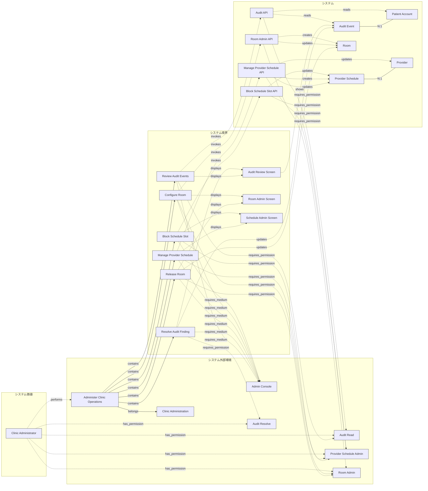
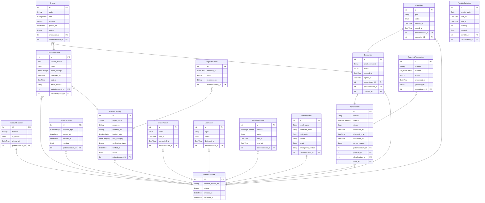

# Clinic Ops 設計書サンプル

<!-- derived-from ../../docs/language-reference.md -->
<!-- derived-from ../../docs/cli-reference.md -->
<!-- derived-from ../../docs/state-derivation.md -->

この文書は `scripts/gen-clinic-ops-design-sample.py` が `samples/clinic-ops/` の `.rdra` と `out/` から生成します。図・CSV・状態到達表を手で直さず、モデルを直して `scripts/check-sample-artifacts.sh` を実行してください。成果物を再生成した後に、このスクリプトでこの文書も再生成します。

この文書は `samples/clinic-ops/` を題材に、要求整理、BUC 分解、UC 分解、System/API 境界、データモデリング、状態検証をレビューできる粒度でまとめる設計書サンプルです。題材は日本の病院の外来業務（受付、資格確認、診察、検査、処方、計算・会計、レセプト請求）で、業務規則は `.rdra` の `//` コメントに一次資料の出典（ファイル名:行）を付けています。入院は対象外です。

図は外部リンクではなく本文に埋め込みます。レビューでは対象章だけを開き、BUC 単位、UC 単位、System/API 単位、データモデル単位の順に確認します。

## 1. 成果物一覧

| 種別 | 生成先 | 用途 |
|---|---|---|
| BUC 別 RDRA Layered Graph 図 | `out/buc/object_graph_*.mmd` | 各 BUC の actor/usecase/entity/screen/event を確認する |
| API マトリクス | `out/api_matrix.csv` | API と Entity CRUD の棚卸し |
| Screen 制約パターン | `out/screen_constraints.csv` | Screen に到達する UC/API ごとの権限・媒体制約を確認する |
| Actor 権限割当監査 | `out/actor_permission_audit.csv` | Actor 側の権限付与が UC/API 要求と合っているかを確認する |
| Event flow | `out/event_flow.mmd` | BUC 間イベント連鎖を確認する |
| ER 図 | `out/er_care_to_billing.mmd` | 診療から請求までのデータ関係を確認する |
| State 図 | `out/state_whole.mmd` | 主要状態遷移の全体像を確認する |
| 状態到達表 | `out/states_appointment.txt`, `out/states_claim_statement.txt` | lifecycle の到達可能性を確認する |

生成コマンド例:

```sh
rdra-ish diagram samples/clinic-ops --kind rdra --format mermaid --buc BucClinicalEncounter --out samples/clinic-ops/out/buc/object_graph_clinical_encounter
rdra-ish csv samples/clinic-ops --kind api-matrix --out samples/clinic-ops/out/api_matrix.csv
rdra-ish csv samples/clinic-ops --kind screen-constraints --out samples/clinic-ops/out/screen_constraints.csv
rdra-ish csv samples/clinic-ops --kind actor-permission-audit --out samples/clinic-ops/out/actor_permission_audit.csv
```

## 2. 業務スコープ

対象は病院の外来業務です。患者登録、予約、受付、診療、検査、処方、計算・会計、レセプト請求、フォローアップ、運営管理を BUC として分け、業務担当者がレビューしやすい単位にしています。受付・会計・レセプトは医事課の業務で、病院が外部に委託することもあります。

| Business | BUC | 主な actor | 目的 |
|---|---|---|---|
| `PatientAccess` | `BucPatientOnboarding` | ReceptionClerk（医事課 受付担当）, Patient | Patient Onboarding |
| `PatientAccess` | `BucAppointmentScheduling` | ReceptionClerk, Patient | Appointment Scheduling |
| `PatientAccess` | `BucVisitCheckIn` | ReceptionClerk, Nurse | 受付（初診・再診） |
| `CareDelivery` | `BucClinicalEncounter` | Nurse（看護師）, Clinician（医師） | Clinical Encounter |
| `CareDelivery` | `BucOrdersResults` | Clinician, Nurse, MedicalClerk（医師事務作業補助者） | Orders and Results |
| `CareDelivery` | `BucPrescriptionFulfillment` | Clinician（医師）, Pharmacist（薬剤師） | 処方 |
| `RevenueCycle` | `BucVisitPayment` | AccountsClerk（医事課 会計担当） | 計算・会計 |
| `RevenueCycle` | `BucBillingClaims` | ClaimsClerk（医事課 レセプト担当） | レセプト作成・請求 |
| `PatientAccess` | `BucFollowupCare` | CareCoordinator, Patient | Follow-Up Care |
| `ClinicAdministration` | `BucStaffAdministration` | ClinicAdmin | Staff Administration |

米国型の診療所モデルとの主な違いは次のとおりです。

| 論点 | このモデル |
|---|---|
| 支払の時点 | 受付では支払わない。診察の後に計算受付・会計受付で精算する |
| 窓口負担 | 負担割合（3割・2割）で計算し、限度額情報があれば自己負担限度額までを窓口で受け取る |
| 資格確認 | 受付のたびにオンライン資格確認等システムで確認する。来院前の一括照会、申立書、システム障害時モードがある |
| 請求 | レセプトを月ごとに審査支払機関（支払基金・国保連）へ請求する。返戻は再請求でき、査定は再審査請求で争う |
| 処方 | 院外処方箋は電子処方箋管理サービスへ登録し、患者が選ぶ保険薬局で調剤する。院内処方は薬剤師が調剤・監査する |
| 紹介 | 紹介状なしの初診は選定療養費（自費）の対象。救急搬送などは除外 |

レビューでは、まず BUC の責務境界を確認し、次に UC 単位で API/Entity 操作を確認します。最後に System/API マトリクスと ER/状態検証で横断的な整合性を見ます。

### 2.1 Context / Access 制約

権限語彙と媒体語彙は `shared/biz.rdra`、actor への権限割当は
`shared/access.rdra` に分けている。各 BUC ファイルでは、UC/API 側の要求を
`requires_permission` / `requires_medium` として定義する。

`BucAppointmentScheduling` は `belongs(...).by(...)` で、
予約業務が窓口端末または患者モバイルから発生することを表す。`BucVisitPayment` は
`AccountsWindow`（会計窓口）と `PaymentKiosk`（自動精算機）、`BucBillingClaims` は
`BillingWorkstation` と `OnlineClaimTerminal`（オンライン請求用端末）から発生する。

Screen には制約を直接書かない。`displays(UC, Screen)` と `invokes(UC, Api)` から
次のような行が `out/screen_constraints.csv` に導出される。

```csv
screen_id,usecase_id,api_id,required_permissions,required_media
ConsentScreen,CaptureConsent,ConsentApi,ConsentCapture,PatientMobile
AppointmentScreen,BookAppointment,BookAppointmentApi,ScheduleWrite,FrontDeskTerminal|PatientMobile
CheckInScreen,CheckInPatient,CheckInPatientApi,VisitCheckIn,FrontDeskTerminal
PaymentWindowScreen,SettleAtWindow,SettlementApi,PaymentCollect,AccountsWindow
ClaimScreen,SubmitClaimStatements,SubmitClaimApi,BillingClaimWrite,OnlineClaimTerminal
DispensingScreen,DispenseAndAudit,DispensingApi,PrescriptionDispense,PharmacyWorkstation
```

Actor 側の権限付与は `out/actor_permission_audit.csv` で確認する。`missing` は
UC/API 要求に対して actor の `has_permission` が不足していること、`excess` は現行モデル上
その actor の実行経路で使われない権限が付いていることを示す。

## 3. BUC 単位の設計レビュー

### 3.1 Patient Onboarding

| 項目 | 内容 |
|---|---|
| BUC | `BucPatientOnboarding` |
| Business | `PatientAccess` |
| 主な actor | ReceptionClerk（医事課 受付担当）, Patient |
| 必要権限 | `PatientProfileRead`, `PatientProfileWrite`, `InsuranceVerify`, `ConsentCapture`, `IntakeManage`, `PatientMessageSend` |
| 主なデータ | `PatientAccount`, `PatientProfile`, `InsurancePolicy`, `EligibilityCheck`, `ConsentRecord`, `IntakePacket`, `PatientMessage` |

新患登録から問診送付までを扱う。新患登録では、オンライン資格確認で得た保険情報と、患者が同意した場合の限度額情報（適用区分）を `InsurancePolicy` に登録する。負担割合 `burden_ratio` と限度額適用区分 `limit_category` は actor が選ぶ値ではなく保険者が決める値なので、variation 型の属性として持つ。

レビュー観点:

- VerifyInsurance が、保険資格の登録と限度額情報の取得を同じ API 境界で扱ってよいか。
- 受付ごとの資格確認（`BucVisitCheckIn`）と新患登録時の資格登録の責務が混ざっていないか。
- SendIntakeForms は予約イベントから起動されるため、予約 BUC 側の責務と混同しないか。

#### Patient Onboarding RDRA Layered Graph 図

生成コマンド:

```sh
rdra-ish diagram samples/clinic-ops --kind rdra --format mermaid --buc BucPatientOnboarding --out samples/clinic-ops/out/buc/object_graph_patient_onboarding
```



```mermaid
%% rdra-ish diagram=rdra scope=buc:BucPatientOnboarding model=samples/clinic-ops
%% layers: environment=システム外部環境 boundary=システム境界 system=システム
%% kinds: business buc timer medium permission usecase screen event api entity state
%% omitted: (none)
flowchart LR
  subgraph layer_environment["システム外部環境"]
    business__PatientAccess["Patient Access"]:::business
    %% desc business__PatientAccess: Patient-facing access workflows from onboarding through appointments.
    buc__BucPatientOnboarding["Onboard and Maintain Patient"]:::buc
    timer__IntakeExpiryCheck["Nightly intake expiry check"]:::timer
    medium__FrontDeskTerminal["Front Desk Terminal"]:::medium
    medium__PatientMobile["Patient Mobile"]:::medium
    permission__ConsentCapture["Consent Capture"]:::permission
    permission__InsuranceVerify["Insurance Verify"]:::permission
    permission__IntakeManage["Intake Manage"]:::permission
    permission__PatientMessageSend["Patient Message Send"]:::permission
    permission__PatientProfileRead["Patient Profile Read"]:::permission
    permission__PatientProfileWrite["Patient Profile Write"]:::permission
  end
  subgraph layer_boundary["システム境界"]
    usecase__ArchivePatient["Archive Patient"]:::usecase
    usecase__CaptureConsent["Capture Consent"]:::usecase
    usecase__CompleteIntakeForms["Complete Intake Forms"]:::usecase
    usecase__ExpireIntakeForms["Expire Intake Forms"]:::usecase
    usecase__MergeDuplicatePatient["Merge Duplicate Patient"]:::usecase
    usecase__RegisterPatient["Register Patient"]:::usecase
    usecase__SearchPatient["Search Patient"]:::usecase
    usecase__SendIntakeForms["Send Intake Forms"]:::usecase
    usecase__UpdateDemographics["Update Demographics"]:::usecase
    usecase__VerifyInsurance["保険資格・限度額情報の登録（新患登録）"]:::usecase
    screen__ConsentScreen["Consent Capture Screen"]:::screen
    screen__InsuranceScreen["Insurance Verification Screen"]:::screen
    screen__IntakePortalScreen["Intake Portal Screen"]:::screen
    screen__PatientProfileScreen["Patient Profile Screen"]:::screen
    screen__PatientSearchScreen["Patient Search Screen"]:::screen
    event__EvAppointmentScheduled["Appointment Scheduled"]:::event
  end
  subgraph layer_system["システム"]
    api__ConsentApi["Consent API"]:::api
    api__EligibilityApi["Eligibility API"]:::api
    api__IntakeMessagingApi["Intake Messaging API"]:::api
    api__RegisterPatientApi["Register Patient API"]:::api
    api__SearchPatientApi["Search Patient API"]:::api
    api__UpdateDemographicsApi["Update Demographics API"]:::api
    entity__ConsentRecord["Consent Record"]:::entity
    entity__EligibilityCheck["資格確認"]:::entity
    entity__InsurancePolicy["保険資格"]:::entity
    entity__IntakePacket["Intake Packet"]:::entity
    entity__PatientAccount["Patient Account"]:::entity
    entity__PatientMessage["Patient Message"]:::entity
    entity__PatientProfile["Patient Profile"]:::entity
    state__IntakePacket_intakecompleted["intakecompleted"]:::state
    state__IntakePacket_intakeexpired["intakeexpired"]:::state
    state__IntakePacket_intakesent["intakesent"]:::state
    state__PatientAccount_patientactive["patientactive"]:::state
    state__PatientAccount_patientinactive["patientinactive"]:::state
    state__PatientAccount_patientmerged["patientmerged"]:::state
  end
  api__ConsentApi -.->|creates| entity__ConsentRecord
  api__ConsentApi -.->|requires_permission| permission__ConsentCapture
  api__EligibilityApi -.->|creates| entity__EligibilityCheck
  api__EligibilityApi -.->|reads| entity__InsurancePolicy
  api__EligibilityApi -.->|requires_permission| permission__InsuranceVerify
  api__EligibilityApi -.->|updates| entity__InsurancePolicy
  api__IntakeMessagingApi -.->|creates| entity__IntakePacket
  api__IntakeMessagingApi -.->|creates| entity__PatientMessage
  api__IntakeMessagingApi -.->|requires_permission| permission__PatientMessageSend
  api__RegisterPatientApi -.->|creates| entity__PatientAccount
  api__RegisterPatientApi -.->|creates| entity__PatientProfile
  api__RegisterPatientApi -.->|requires_permission| permission__PatientProfileWrite
  api__SearchPatientApi -.->|reads| entity__PatientAccount
  api__SearchPatientApi -.->|reads| entity__PatientProfile
  api__SearchPatientApi -.->|requires_permission| permission__PatientProfileRead
  api__UpdateDemographicsApi -.->|requires_permission| permission__PatientProfileWrite
  api__UpdateDemographicsApi -.->|updates| entity__PatientProfile
  buc__BucPatientOnboarding -->|belongs| business__PatientAccess
  buc__BucPatientOnboarding -->|contains| usecase__ArchivePatient
  buc__BucPatientOnboarding -->|contains| usecase__CaptureConsent
  buc__BucPatientOnboarding -->|contains| usecase__CompleteIntakeForms
  buc__BucPatientOnboarding -->|contains| usecase__ExpireIntakeForms
  buc__BucPatientOnboarding -->|contains| usecase__MergeDuplicatePatient
  buc__BucPatientOnboarding -->|contains| usecase__RegisterPatient
  buc__BucPatientOnboarding -->|contains| usecase__SearchPatient
  buc__BucPatientOnboarding -->|contains| usecase__SendIntakeForms
  buc__BucPatientOnboarding -->|contains| usecase__UpdateDemographics
  buc__BucPatientOnboarding -->|contains| usecase__VerifyInsurance
  entity__ConsentRecord ---|N:1| entity__PatientAccount
  entity__EligibilityCheck ---|N:1| entity__InsurancePolicy
  entity__InsurancePolicy ---|N:1| entity__PatientAccount
  entity__IntakePacket ---|N:1| entity__PatientAccount
  entity__PatientMessage ---|N:1| entity__PatientAccount
  entity__PatientProfile ---|1:1| entity__PatientAccount
  event__EvAppointmentScheduled -.->|triggers| buc__BucPatientOnboarding
  event__EvAppointmentScheduled -.->|triggers| usecase__SendIntakeForms
  screen__PatientProfileScreen -.->|shows| entity__PatientProfile
  screen__PatientSearchScreen -.->|shows| entity__PatientAccount
  timer__IntakeExpiryCheck -.->|triggers| usecase__ExpireIntakeForms
  usecase__ArchivePatient -.->|displays| screen__PatientProfileScreen
  usecase__ArchivePatient -.->|requires_medium| medium__FrontDeskTerminal
  usecase__ArchivePatient -.->|requires_permission| permission__PatientProfileWrite
  usecase__ArchivePatient -.->|transitions PatientAccount.status patientactive->patientinactive| state__PatientAccount_patientinactive
  usecase__ArchivePatient -.->|updates| entity__PatientAccount
  usecase__CaptureConsent -.->|displays| screen__ConsentScreen
  usecase__CaptureConsent -.->|invokes| api__ConsentApi
  usecase__CaptureConsent -.->|requires_medium| medium__PatientMobile
  usecase__CaptureConsent -.->|requires_permission| permission__ConsentCapture
  usecase__CompleteIntakeForms -.->|displays| screen__IntakePortalScreen
  usecase__CompleteIntakeForms -.->|requires_medium| medium__PatientMobile
  usecase__CompleteIntakeForms -.->|requires_permission| permission__ConsentCapture
  usecase__CompleteIntakeForms -.->|transitions IntakePacket.status intakesent->intakecompleted| state__IntakePacket_intakecompleted
  usecase__CompleteIntakeForms -.->|updates| entity__IntakePacket
  usecase__ExpireIntakeForms -.->|displays| screen__IntakePortalScreen
  usecase__ExpireIntakeForms -.->|requires_medium| medium__FrontDeskTerminal
  usecase__ExpireIntakeForms -.->|requires_permission| permission__IntakeManage
  usecase__ExpireIntakeForms -.->|transitions IntakePacket.status intakesent->intakeexpired| state__IntakePacket_intakeexpired
  usecase__ExpireIntakeForms -.->|updates| entity__IntakePacket
  usecase__MergeDuplicatePatient -.->|displays| screen__PatientProfileScreen
  usecase__MergeDuplicatePatient -.->|requires_medium| medium__FrontDeskTerminal
  usecase__MergeDuplicatePatient -.->|requires_permission| permission__PatientProfileWrite
  usecase__MergeDuplicatePatient -.->|transitions PatientAccount.status patientactive->patientmerged| state__PatientAccount_patientmerged
  usecase__MergeDuplicatePatient -.->|updates| entity__PatientAccount
  usecase__RegisterPatient -.->|displays| screen__PatientProfileScreen
  usecase__RegisterPatient -.->|invokes| api__RegisterPatientApi
  usecase__RegisterPatient -.->|requires_medium| medium__FrontDeskTerminal
  usecase__RegisterPatient -.->|requires_permission| permission__PatientProfileWrite
  usecase__SearchPatient -.->|displays| screen__PatientSearchScreen
  usecase__SearchPatient -.->|invokes| api__SearchPatientApi
  usecase__SearchPatient -.->|requires_medium| medium__FrontDeskTerminal
  usecase__SearchPatient -.->|requires_permission| permission__PatientProfileRead
  usecase__SendIntakeForms -.->|displays| screen__IntakePortalScreen
  usecase__SendIntakeForms -.->|invokes| api__IntakeMessagingApi
  usecase__SendIntakeForms -.->|requires_medium| medium__FrontDeskTerminal
  usecase__SendIntakeForms -.->|requires_permission| permission__IntakeManage
  usecase__UpdateDemographics -.->|displays| screen__PatientProfileScreen
  usecase__UpdateDemographics -.->|invokes| api__UpdateDemographicsApi
  usecase__UpdateDemographics -.->|requires_medium| medium__FrontDeskTerminal
  usecase__UpdateDemographics -.->|requires_permission| permission__PatientProfileWrite
  usecase__VerifyInsurance -.->|displays| screen__InsuranceScreen
  usecase__VerifyInsurance -.->|invokes| api__EligibilityApi
  usecase__VerifyInsurance -.->|requires_medium| medium__FrontDeskTerminal
  usecase__VerifyInsurance -.->|requires_permission| permission__InsuranceVerify
  classDef business stroke:#333;
  classDef buc stroke:#333;
  classDef timer stroke:#333;
  classDef medium stroke:#333;
  classDef permission stroke:#333;
  classDef usecase stroke:#333;
  classDef screen stroke:#333;
  classDef event stroke:#333;
  classDef api stroke:#333;
  classDef entity stroke:#333;
  classDef state stroke:#333;
```

### 3.2 Appointment Scheduling

| 項目 | 内容 |
|---|---|
| BUC | `BucAppointmentScheduling` |
| Business | `PatientAccess` |
| 主な actor | ReceptionClerk, Patient |
| 必要権限 | `ScheduleRead`, `ScheduleWrite` |
| 主なデータ | `Appointment`, `ProviderSchedule`, `Notification`, `PatientMessage` |

予約検索、仮押さえ、予約確定、変更、取消、通知を扱う。予約枠と予約レコードを同時に更新する UC は専用 API を持ち、予約通知は AppointmentNoticeApi に分ける。予約済みの患者は、来院前に `BucVisitCheckIn` の一括照会の対象になる。

レビュー観点:

- ReserveAppointment と BookAppointment の差が業務上必要か。
- CancelAppointment が Appointment と ProviderSchedule を同じ API 境界で更新することが妥当か。
- 予約時に選ばれる `Appointment.referral`（再診・紹介状あり・紹介状なし・除外）が、受付で確認する紹介状の有無と一致するか。

#### Appointment Scheduling RDRA Layered Graph 図

生成コマンド:

```sh
rdra-ish diagram samples/clinic-ops --kind rdra --format mermaid --buc BucAppointmentScheduling --out samples/clinic-ops/out/buc/object_graph_appointment_scheduling
```

```mermaid
%% rdra-ish diagram=rdra scope=buc:BucAppointmentScheduling model=samples/clinic-ops
%% layers: value=システム価値 environment=システム外部環境 boundary=システム境界 system=システム
%% kinds: actor extsystem business buc timer medium permission usecase screen event api entity state
%% omitted: (none)
flowchart LR
  subgraph layer_value["システム価値"]
    actor__ReceptionClerk["医事課 受付担当"]:::actor
    %% desc actor__ReceptionClerk: 初診・再診の受付、資格確認、紹介状の受付、予約を行う事務職員。
    extsystem__MessagingGateway["Messaging Gateway"]:::extsystem
  end
  subgraph layer_environment["システム外部環境"]
    business__PatientAccess["Patient Access"]:::business
    %% desc business__PatientAccess: Patient-facing access workflows from onboarding through appointments.
    buc__BucAppointmentScheduling["Schedule Appointments"]:::buc
    %% desc buc__BucAppointmentScheduling: Find, reserve, book, change, and notify appointment slots.
    buc__BucPatientOnboarding["Onboard and Maintain Patient"]:::buc
    timer__IntakeExpiryCheck["Nightly intake expiry check"]:::timer
    timer__NoShowSweep["Nightly no-show sweep"]:::timer
    medium__FrontDeskTerminal["Front Desk Terminal"]:::medium
    medium__PatientMobile["Patient Mobile"]:::medium
    permission__ConsentCapture["Consent Capture"]:::permission
    permission__InsuranceVerify["Insurance Verify"]:::permission
    permission__IntakeManage["Intake Manage"]:::permission
    permission__PatientMessageSend["Patient Message Send"]:::permission
    permission__PatientProfileRead["Patient Profile Read"]:::permission
    permission__PatientProfileWrite["Patient Profile Write"]:::permission
    permission__ScheduleRead["Schedule Read"]:::permission
    permission__ScheduleWrite["Schedule Write"]:::permission
  end
  subgraph layer_boundary["システム境界"]
    usecase__ArchivePatient["Archive Patient"]:::usecase
    usecase__BookAppointment["Book Appointment"]:::usecase
    usecase__CancelAppointment["Cancel Appointment"]:::usecase
    usecase__CaptureConsent["Capture Consent"]:::usecase
    usecase__CompleteIntakeForms["Complete Intake Forms"]:::usecase
    usecase__ExpireIntakeForms["Expire Intake Forms"]:::usecase
    usecase__MarkNoShow["Mark No Show"]:::usecase
    usecase__MergeDuplicatePatient["Merge Duplicate Patient"]:::usecase
    usecase__RegisterPatient["Register Patient"]:::usecase
    usecase__RescheduleAppointment["Reschedule Appointment"]:::usecase
    usecase__ReserveAppointment["Reserve Appointment"]:::usecase
    usecase__SearchAvailability["Search Availability"]:::usecase
    usecase__SearchPatient["Search Patient"]:::usecase
    usecase__SendAppointmentNotice["Send Appointment Notice"]:::usecase
    usecase__SendIntakeForms["Send Intake Forms"]:::usecase
    usecase__UpdateDemographics["Update Demographics"]:::usecase
    usecase__VerifyInsurance["保険資格・限度額情報の登録（新患登録）"]:::usecase
    screen__AppointmentNoticeScreen["Appointment Notice Screen"]:::screen
    screen__AppointmentScreen["Appointment Screen"]:::screen
    screen__ConsentScreen["Consent Capture Screen"]:::screen
    screen__InsuranceScreen["Insurance Verification Screen"]:::screen
    screen__IntakePortalScreen["Intake Portal Screen"]:::screen
    screen__PatientProfileScreen["Patient Profile Screen"]:::screen
    screen__PatientSearchScreen["Patient Search Screen"]:::screen
    screen__ScheduleSearchScreen["Schedule Search Screen"]:::screen
    event__EvAppointmentCancelled["Appointment Cancelled"]:::event
    event__EvAppointmentRescheduled["Appointment Rescheduled"]:::event
    event__EvAppointmentScheduled["Appointment Scheduled"]:::event
  end
  subgraph layer_system["システム"]
    api__AppointmentNoticeApi["Appointment Notice API"]:::api
    api__BookAppointmentApi["Book Appointment API"]:::api
    api__CancelAppointmentApi["Cancel Appointment API"]:::api
    api__ConsentApi["Consent API"]:::api
    api__EligibilityApi["Eligibility API"]:::api
    api__IntakeMessagingApi["Intake Messaging API"]:::api
    api__RegisterPatientApi["Register Patient API"]:::api
    api__RescheduleAppointmentApi["Reschedule Appointment API"]:::api
    api__ReserveAppointmentApi["Reserve Appointment API"]:::api
    api__SearchAvailabilityApi["Search Availability API"]:::api
    api__SearchPatientApi["Search Patient API"]:::api
    api__UpdateDemographicsApi["Update Demographics API"]:::api
    entity__Appointment["Appointment"]:::entity
    entity__ClinicLocation["Clinic Location"]:::entity
    entity__ConsentRecord["Consent Record"]:::entity
    entity__EligibilityCheck["資格確認"]:::entity
    entity__InsurancePolicy["保険資格"]:::entity
    entity__IntakePacket["Intake Packet"]:::entity
    entity__Notification["Notification"]:::entity
    entity__PatientAccount["Patient Account"]:::entity
    entity__PatientMessage["Patient Message"]:::entity
    entity__PatientProfile["Patient Profile"]:::entity
    entity__Provider["Provider"]:::entity
    entity__ProviderSchedule["Provider Schedule"]:::entity
    state__Appointment_apptcancelled["apptcancelled"]:::state
    state__Appointment_apptnoshow["apptnoshow"]:::state
    state__Appointment_apptrequested["apptrequested"]:::state
    state__Appointment_apptscheduled["apptscheduled"]:::state
    state__IntakePacket_intakecompleted["intakecompleted"]:::state
    state__IntakePacket_intakeexpired["intakeexpired"]:::state
    state__IntakePacket_intakesent["intakesent"]:::state
    state__PatientAccount_patientactive["patientactive"]:::state
    state__PatientAccount_patientinactive["patientinactive"]:::state
    state__PatientAccount_patientmerged["patientmerged"]:::state
  end
  actor__ReceptionClerk -.->|has_permission| permission__InsuranceVerify
  actor__ReceptionClerk -.->|has_permission| permission__IntakeManage
  actor__ReceptionClerk -.->|has_permission| permission__PatientMessageSend
  actor__ReceptionClerk -.->|has_permission| permission__PatientProfileRead
  actor__ReceptionClerk -.->|has_permission| permission__PatientProfileWrite
  actor__ReceptionClerk -.->|has_permission| permission__ScheduleRead
  actor__ReceptionClerk -.->|has_permission| permission__ScheduleWrite
  actor__ReceptionClerk -.->|performs| buc__BucAppointmentScheduling
  actor__ReceptionClerk -.->|performs| usecase__ArchivePatient
  actor__ReceptionClerk -.->|performs| usecase__BookAppointment
  actor__ReceptionClerk -.->|performs| usecase__CancelAppointment
  actor__ReceptionClerk -.->|performs| usecase__ExpireIntakeForms
  actor__ReceptionClerk -.->|performs| usecase__MarkNoShow
  actor__ReceptionClerk -.->|performs| usecase__MergeDuplicatePatient
  actor__ReceptionClerk -.->|performs| usecase__RegisterPatient
  actor__ReceptionClerk -.->|performs| usecase__RescheduleAppointment
  actor__ReceptionClerk -.->|performs| usecase__ReserveAppointment
  actor__ReceptionClerk -.->|performs| usecase__SearchAvailability
  actor__ReceptionClerk -.->|performs| usecase__SearchPatient
  actor__ReceptionClerk -.->|performs| usecase__SendAppointmentNotice
  actor__ReceptionClerk -.->|performs| usecase__SendIntakeForms
  actor__ReceptionClerk -.->|performs| usecase__UpdateDemographics
  actor__ReceptionClerk -.->|performs| usecase__VerifyInsurance
  api__AppointmentNoticeApi -.->|creates| entity__Notification
  api__AppointmentNoticeApi -.->|creates| entity__PatientMessage
  api__BookAppointmentApi -.->|requires_permission| permission__ScheduleWrite
  api__BookAppointmentApi -.->|updates| entity__Appointment
  api__BookAppointmentApi -.->|updates| entity__ProviderSchedule
  api__CancelAppointmentApi -.->|requires_permission| permission__ScheduleWrite
  api__CancelAppointmentApi -.->|updates| entity__Appointment
  api__CancelAppointmentApi -.->|updates| entity__ProviderSchedule
  api__ConsentApi -.->|creates| entity__ConsentRecord
  api__ConsentApi -.->|requires_permission| permission__ConsentCapture
  api__EligibilityApi -.->|creates| entity__EligibilityCheck
  api__EligibilityApi -.->|reads| entity__InsurancePolicy
  api__EligibilityApi -.->|requires_permission| permission__InsuranceVerify
  api__EligibilityApi -.->|updates| entity__InsurancePolicy
  api__IntakeMessagingApi -.->|creates| entity__IntakePacket
  api__IntakeMessagingApi -.->|creates| entity__PatientMessage
  api__IntakeMessagingApi -.->|requires_permission| permission__PatientMessageSend
  api__RegisterPatientApi -.->|creates| entity__PatientAccount
  api__RegisterPatientApi -.->|creates| entity__PatientProfile
  api__RegisterPatientApi -.->|requires_permission| permission__PatientProfileWrite
  api__RescheduleAppointmentApi -.->|requires_permission| permission__ScheduleWrite
  api__RescheduleAppointmentApi -.->|updates| entity__Appointment
  api__RescheduleAppointmentApi -.->|updates| entity__ProviderSchedule
  api__ReserveAppointmentApi -.->|creates| entity__Appointment
  api__ReserveAppointmentApi -.->|requires_permission| permission__ScheduleWrite
  api__ReserveAppointmentApi -.->|updates| entity__ProviderSchedule
  api__SearchAvailabilityApi -.->|reads| entity__ClinicLocation
  api__SearchAvailabilityApi -.->|reads| entity__Provider
  api__SearchAvailabilityApi -.->|reads| entity__ProviderSchedule
  api__SearchAvailabilityApi -.->|requires_permission| permission__ScheduleRead
  api__SearchPatientApi -.->|reads| entity__PatientAccount
  api__SearchPatientApi -.->|reads| entity__PatientProfile
  api__SearchPatientApi -.->|requires_permission| permission__PatientProfileRead
  api__UpdateDemographicsApi -.->|requires_permission| permission__PatientProfileWrite
  api__UpdateDemographicsApi -.->|updates| entity__PatientProfile
  buc__BucAppointmentScheduling -->|belongs| business__PatientAccess
  buc__BucAppointmentScheduling -->|contains| usecase__BookAppointment
  buc__BucAppointmentScheduling -->|contains| usecase__CancelAppointment
  buc__BucAppointmentScheduling -->|contains| usecase__MarkNoShow
  buc__BucAppointmentScheduling -->|contains| usecase__RescheduleAppointment
  buc__BucAppointmentScheduling -->|contains| usecase__ReserveAppointment
  buc__BucAppointmentScheduling -->|contains| usecase__SearchAvailability
  buc__BucAppointmentScheduling -->|contains| usecase__SendAppointmentNotice
  buc__BucPatientOnboarding -->|belongs| business__PatientAccess
  buc__BucPatientOnboarding -->|contains| usecase__ArchivePatient
  buc__BucPatientOnboarding -->|contains| usecase__CaptureConsent
  buc__BucPatientOnboarding -->|contains| usecase__CompleteIntakeForms
  buc__BucPatientOnboarding -->|contains| usecase__ExpireIntakeForms
  buc__BucPatientOnboarding -->|contains| usecase__MergeDuplicatePatient
  buc__BucPatientOnboarding -->|contains| usecase__RegisterPatient
  buc__BucPatientOnboarding -->|contains| usecase__SearchPatient
  buc__BucPatientOnboarding -->|contains| usecase__SendIntakeForms
  buc__BucPatientOnboarding -->|contains| usecase__UpdateDemographics
  buc__BucPatientOnboarding -->|contains| usecase__VerifyInsurance
  entity__Appointment ---|N:1| entity__ClinicLocation
  entity__Appointment ---|N:1| entity__PatientAccount
  entity__Appointment ---|N:1| entity__Provider
  entity__ConsentRecord ---|N:1| entity__PatientAccount
  entity__EligibilityCheck ---|N:1| entity__InsurancePolicy
  entity__InsurancePolicy ---|N:1| entity__PatientAccount
  entity__IntakePacket ---|N:1| entity__PatientAccount
  entity__Notification ---|N:1| entity__PatientAccount
  entity__PatientMessage ---|N:1| entity__PatientAccount
  entity__PatientProfile ---|1:1| entity__PatientAccount
  entity__ProviderSchedule ---|N:1| entity__ClinicLocation
  entity__ProviderSchedule ---|N:1| entity__Provider
  event__EvAppointmentCancelled -.->|triggers| extsystem__MessagingGateway
  event__EvAppointmentCancelled -.->|triggers| usecase__SendAppointmentNotice
  event__EvAppointmentRescheduled -.->|triggers| extsystem__MessagingGateway
  event__EvAppointmentRescheduled -.->|triggers| usecase__SendAppointmentNotice
  event__EvAppointmentScheduled -.->|triggers| buc__BucPatientOnboarding
  event__EvAppointmentScheduled -.->|triggers| extsystem__MessagingGateway
  event__EvAppointmentScheduled -.->|triggers| usecase__SendAppointmentNotice
  event__EvAppointmentScheduled -.->|triggers| usecase__SendIntakeForms
  screen__PatientProfileScreen -.->|shows| entity__PatientProfile
  screen__PatientSearchScreen -.->|shows| entity__PatientAccount
  screen__ScheduleSearchScreen -.->|shows| entity__ProviderSchedule
  timer__IntakeExpiryCheck -.->|triggers| usecase__ExpireIntakeForms
  timer__NoShowSweep -.->|triggers| usecase__MarkNoShow
  usecase__ArchivePatient -.->|displays| screen__PatientProfileScreen
  usecase__ArchivePatient -.->|requires_medium| medium__FrontDeskTerminal
  usecase__ArchivePatient -.->|requires_permission| permission__PatientProfileWrite
  usecase__ArchivePatient -.->|transitions PatientAccount.status patientactive->patientinactive| state__PatientAccount_patientinactive
  usecase__ArchivePatient -.->|updates| entity__PatientAccount
  usecase__BookAppointment -.->|displays| screen__AppointmentScreen
  usecase__BookAppointment -.->|invokes| api__BookAppointmentApi
  usecase__BookAppointment -.->|raises| event__EvAppointmentScheduled
  usecase__BookAppointment -.->|requires_medium| medium__FrontDeskTerminal
  usecase__BookAppointment -.->|requires_medium| medium__PatientMobile
  usecase__BookAppointment -.->|requires_permission| permission__ScheduleWrite
  usecase__BookAppointment -.->|transitions Appointment.status apptrequested->apptscheduled| state__Appointment_apptscheduled
  usecase__CancelAppointment -.->|displays| screen__AppointmentScreen
  usecase__CancelAppointment -.->|invokes| api__CancelAppointmentApi
  usecase__CancelAppointment -.->|raises| event__EvAppointmentCancelled
  usecase__CancelAppointment -.->|requires_medium| medium__FrontDeskTerminal
  usecase__CancelAppointment -.->|requires_medium| medium__PatientMobile
  usecase__CancelAppointment -.->|requires_permission| permission__ScheduleWrite
  usecase__CancelAppointment -.->|transitions Appointment.status apptscheduled->apptcancelled| state__Appointment_apptcancelled
  usecase__CaptureConsent -.->|displays| screen__ConsentScreen
  usecase__CaptureConsent -.->|invokes| api__ConsentApi
  usecase__CaptureConsent -.->|requires_medium| medium__PatientMobile
  usecase__CaptureConsent -.->|requires_permission| permission__ConsentCapture
  usecase__CompleteIntakeForms -.->|displays| screen__IntakePortalScreen
  usecase__CompleteIntakeForms -.->|requires_medium| medium__PatientMobile
  usecase__CompleteIntakeForms -.->|requires_permission| permission__ConsentCapture
  usecase__CompleteIntakeForms -.->|transitions IntakePacket.status intakesent->intakecompleted| state__IntakePacket_intakecompleted
  usecase__CompleteIntakeForms -.->|updates| entity__IntakePacket
  usecase__ExpireIntakeForms -.->|displays| screen__IntakePortalScreen
  usecase__ExpireIntakeForms -.->|requires_medium| medium__FrontDeskTerminal
  usecase__ExpireIntakeForms -.->|requires_permission| permission__IntakeManage
  usecase__ExpireIntakeForms -.->|transitions IntakePacket.status intakesent->intakeexpired| state__IntakePacket_intakeexpired
  usecase__ExpireIntakeForms -.->|updates| entity__IntakePacket
  usecase__MarkNoShow -.->|displays| screen__AppointmentScreen
  usecase__MarkNoShow -.->|requires_medium| medium__FrontDeskTerminal
  usecase__MarkNoShow -.->|requires_permission| permission__ScheduleWrite
  usecase__MarkNoShow -.->|transitions Appointment.status apptscheduled->apptnoshow| state__Appointment_apptnoshow
  usecase__MarkNoShow -.->|updates| entity__Appointment
  usecase__MergeDuplicatePatient -.->|displays| screen__PatientProfileScreen
  usecase__MergeDuplicatePatient -.->|requires_medium| medium__FrontDeskTerminal
  usecase__MergeDuplicatePatient -.->|requires_permission| permission__PatientProfileWrite
  usecase__MergeDuplicatePatient -.->|transitions PatientAccount.status patientactive->patientmerged| state__PatientAccount_patientmerged
  usecase__MergeDuplicatePatient -.->|updates| entity__PatientAccount
  usecase__RegisterPatient -.->|displays| screen__PatientProfileScreen
  usecase__RegisterPatient -.->|invokes| api__RegisterPatientApi
  usecase__RegisterPatient -.->|requires_medium| medium__FrontDeskTerminal
  usecase__RegisterPatient -.->|requires_permission| permission__PatientProfileWrite
  usecase__RescheduleAppointment -.->|displays| screen__AppointmentScreen
  usecase__RescheduleAppointment -.->|invokes| api__RescheduleAppointmentApi
  usecase__RescheduleAppointment -.->|raises| event__EvAppointmentRescheduled
  usecase__RescheduleAppointment -.->|requires_medium| medium__FrontDeskTerminal
  usecase__RescheduleAppointment -.->|requires_medium| medium__PatientMobile
  usecase__RescheduleAppointment -.->|requires_permission| permission__ScheduleWrite
  usecase__RescheduleAppointment -.->|transitions Appointment.status apptscheduled->apptscheduled| state__Appointment_apptscheduled
  usecase__ReserveAppointment -.->|displays| screen__AppointmentScreen
  usecase__ReserveAppointment -.->|invokes| api__ReserveAppointmentApi
  usecase__ReserveAppointment -.->|requires_medium| medium__FrontDeskTerminal
  usecase__ReserveAppointment -.->|requires_medium| medium__PatientMobile
  usecase__ReserveAppointment -.->|requires_permission| permission__ScheduleWrite
  usecase__SearchAvailability -.->|displays| screen__ScheduleSearchScreen
  usecase__SearchAvailability -.->|invokes| api__SearchAvailabilityApi
  usecase__SearchAvailability -.->|requires_medium| medium__FrontDeskTerminal
  usecase__SearchAvailability -.->|requires_medium| medium__PatientMobile
  usecase__SearchAvailability -.->|requires_permission| permission__ScheduleRead
  usecase__SearchPatient -.->|displays| screen__PatientSearchScreen
  usecase__SearchPatient -.->|invokes| api__SearchPatientApi
  usecase__SearchPatient -.->|requires_medium| medium__FrontDeskTerminal
  usecase__SearchPatient -.->|requires_permission| permission__PatientProfileRead
  usecase__SendAppointmentNotice -.->|displays| screen__AppointmentNoticeScreen
  usecase__SendAppointmentNotice -.->|invokes| api__AppointmentNoticeApi
  usecase__SendAppointmentNotice -.->|requires_medium| medium__FrontDeskTerminal
  usecase__SendAppointmentNotice -.->|requires_permission| permission__ScheduleRead
  usecase__SendIntakeForms -.->|displays| screen__IntakePortalScreen
  usecase__SendIntakeForms -.->|invokes| api__IntakeMessagingApi
  usecase__SendIntakeForms -.->|requires_medium| medium__FrontDeskTerminal
  usecase__SendIntakeForms -.->|requires_permission| permission__IntakeManage
  usecase__UpdateDemographics -.->|displays| screen__PatientProfileScreen
  usecase__UpdateDemographics -.->|invokes| api__UpdateDemographicsApi
  usecase__UpdateDemographics -.->|requires_medium| medium__FrontDeskTerminal
  usecase__UpdateDemographics -.->|requires_permission| permission__PatientProfileWrite
  usecase__VerifyInsurance -.->|displays| screen__InsuranceScreen
  usecase__VerifyInsurance -.->|invokes| api__EligibilityApi
  usecase__VerifyInsurance -.->|requires_medium| medium__FrontDeskTerminal
  usecase__VerifyInsurance -.->|requires_permission| permission__InsuranceVerify
  classDef actor stroke:#333;
  classDef extsystem stroke:#333;
  classDef business stroke:#333;
  classDef buc stroke:#333;
  classDef timer stroke:#333;
  classDef medium stroke:#333;
  classDef permission stroke:#333;
  classDef usecase stroke:#333;
  classDef screen stroke:#333;
  classDef event stroke:#333;
  classDef api stroke:#333;
  classDef entity stroke:#333;
  classDef state stroke:#333;
```

### 3.3 受付（初診・再診）

| 項目 | 内容 |
|---|---|
| BUC | `BucVisitCheckIn` |
| Business | `PatientAccess` |
| 主な actor | ReceptionClerk, Nurse |
| 必要権限 | `VisitCheckIn`, `InsuranceVerify`, `ReferralManage`, `RoomAssign`, `EncounterOpen` |
| 主なデータ | `Appointment`, `PatientAccount`, `InsurancePolicy`, `EligibilityCheck`, `ReferralLetter`, `Room` |

到着確認、資格確認、紹介状の受付、診察室への案内を扱う。療養担当規則 第3条により受付のたびに資格を確認するので、`CheckInPatient` は必ずオンライン資格確認を伴い `EligibilityCheck` を作る。結果は 有効・無効・該当資格なし の 3 通りで、無効と該当資格なしは再確認へ戻る。システムが答えられない場合は被保険者資格申立書かシステム障害時モードで確認する。来院前には予約済み患者の一括照会を行う。受付では支払を受けない（会計は `BucVisitPayment`）。

レビュー観点:

- 受付と資格確認が 1 つの UC にまとまり、資格確認を飛ばす経路がないか。
- 一括照会の結果が無効だった患者を、受付で再確認する流れが説明できるか。
- 被保険者資格申立書とシステム障害時モードが、資格確認結果の状態として区別されているか。

#### 受付（初診・再診） RDRA Layered Graph 図

生成コマンド:

```sh
rdra-ish diagram samples/clinic-ops --kind rdra --format mermaid --buc BucVisitCheckIn --out samples/clinic-ops/out/buc/object_graph_visit_check_in
```

```mermaid
%% rdra-ish diagram=rdra scope=buc:BucVisitCheckIn model=samples/clinic-ops
%% layers: value=システム価値 environment=システム外部環境 boundary=システム境界 system=システム
%% kinds: extsystem business buc flow step timer medium permission usecase screen field event api entity state variation condition
%% omitted: (none)
flowchart LR
  subgraph layer_value["システム価値"]
    extsystem__ClaimsReviewOrganization["審査支払機関（支払基金・国保連）"]:::extsystem
    extsystem__MessagingGateway["Messaging Gateway"]:::extsystem
    extsystem__OnlineEligibilitySystem["オンライン資格確認等システム"]:::extsystem
    extsystem__OutsourcedLabSystem["外注検査システム"]:::extsystem
    extsystem__PaymentGateway["自動精算機・クレジット決済"]:::extsystem
  end
  subgraph layer_environment["システム外部環境"]
    business__CareDelivery["Care Delivery"]:::business
    business__PatientAccess["Patient Access"]:::business
    %% desc business__PatientAccess: Patient-facing access workflows from onboarding through appointments.
    business__RevenueCycle["Revenue Cycle"]:::business
    buc__BucBillingClaims["レセプト作成・請求"]:::buc
    %% desc buc__BucBillingClaims: 月ごとのレセプトの作成・院内点検・請求と、審査支払機関からの受付不能・返戻・査定・支払への対応。
    buc__BucClinicalEncounter["Conduct Clinical Encounter"]:::buc
    buc__BucFollowupCare["Coordinate Follow-Up Care"]:::buc
    buc__BucOrdersResults["Manage Orders and Results"]:::buc
    buc__BucPatientOnboarding["Onboard and Maintain Patient"]:::buc
    buc__BucVisitCheckIn["受付（初診・再診）"]:::buc
    %% desc buc__BucVisitCheckIn: 到着確認、資格確認、紹介状の受付、診察室への案内。会計は診察の後に行う。
    buc__BucVisitPayment["計算・会計"]:::buc
    %% desc buc__BucVisitPayment: 診察後の会計計算入力、患者の呼出、窓口または自動精算機での精算、領収証・明細書の交付。
    flow__ClaimCycleFlow["レセプトの月次サイクル"]:::flow
    flow__VisitCheckInFlow["受付の流れ"]:::flow
    flow__VisitPaymentFlow["計算・会計の流れ"]:::flow
    step__ArrivalStep["到着・予約票の確認"]:::step
    step__AssessStep["査定と再審査請求"]:::step
    step__CalculationStep["計算受付・会計計算入力"]:::step
    step__CallStep["会計の呼出"]:::step
    step__CreateStatementStep["レセプト作成（月初）"]:::step
    step__DeclarationStep["資格を確認できない（申立書・障害時モード）"]:::step
    step__EligibilityStep["資格確認"]:::step
    step__HoldStep["保留（月遅れ）"]:::step
    step__InspectStep["院内点検"]:::step
    step__KioskStep["自動精算機で精算"]:::step
    step__PaidStep["支払（診療翌々月）"]:::step
    step__ReceiptErrorStep["受付不能・要確認の再送（11日・12日）"]:::step
    step__ReceiptStep["領収証・明細書の交付"]:::step
    step__ReferralStep["紹介状あり（初診）"]:::step
    step__ReturnStep["返戻と再請求"]:::step
    step__ReviewStep["審査"]:::step
    step__RoomingStep["診察室への案内"]:::step
    step__SubmitStep["請求（5日～10日）"]:::step
    step__WindowStep["会計窓口で精算"]:::step
    timer__EligibilityBatchInquiry["予約患者の資格の一括照会（来院前）"]:::timer
    timer__ErrorResendWindow["エラー分レセプトの再送（毎月11日・12日）"]:::timer
    timer__IntakeExpiryCheck["Nightly intake expiry check"]:::timer
    timer__MonthlyClaimCreation["前月分レセプトの作成（月初）"]:::timer
    timer__MonthlyClaimDeadline["前月分レセプトの請求（毎月5日～10日）"]:::timer
    timer__ReceivablesMonthlyReview["未収金管理台帳の作成（毎月）"]:::timer
    timer__ReturnDownloadCheck["返戻レセプトの取得（3か月以内）"]:::timer
    medium__AccountsWindow["会計窓口"]:::medium
    medium__BillingWorkstation["Billing Workstation"]:::medium
    medium__CareCoordinationConsole["Care Coordination Console"]:::medium
    medium__ClinicalWorkstation["Clinical Workstation"]:::medium
    medium__FrontDeskTerminal["Front Desk Terminal"]:::medium
    medium__NurseStation["Nurse Station"]:::medium
    medium__OnlineClaimTerminal["オンライン請求用端末"]:::medium
    medium__PatientMobile["Patient Mobile"]:::medium
    medium__PaymentKiosk["自動精算機"]:::medium
    permission__BillCalculate["会計計算"]:::permission
    permission__BillingClaimWrite["レセプト業務"]:::permission
    permission__ClinicalDocument["Clinical Document"]:::permission
    permission__ClinicalOrderWrite["Clinical Order Write"]:::permission
    permission__ConsentCapture["Consent Capture"]:::permission
    permission__EncounterOpen["Encounter Open"]:::permission
    permission__EncounterSign["Encounter Sign"]:::permission
    permission__FollowUpManage["Follow-Up Manage"]:::permission
    permission__InsuranceVerify["Insurance Verify"]:::permission
    permission__IntakeManage["Intake Manage"]:::permission
    permission__LabResultManage["Lab Result Manage"]:::permission
    permission__PatientMessageSend["Patient Message Send"]:::permission
    permission__PatientProfileRead["Patient Profile Read"]:::permission
    permission__PatientProfileWrite["Patient Profile Write"]:::permission
    permission__PaymentCollect["窓口収納"]:::permission
    permission__PaymentPost["Payment Post"]:::permission
    permission__ProxyOrderEntry["代行入力"]:::permission
    permission__ReferralManage["紹介状管理"]:::permission
    permission__RoomAssign["Room Assign"]:::permission
    permission__ScheduleRead["Schedule Read"]:::permission
    permission__ScheduleWrite["Schedule Write"]:::permission
    permission__VisitCheckIn["Visit Check-In"]:::permission
    permission__VitalsRecord["Vitals Record"]:::permission
  end
  subgraph layer_boundary["システム境界"]
    usecase__AmendEncounter["Amend Signed Encounter"]:::usecase
    usecase__ApplySelectedTreatmentFee["選定療養費の算定"]:::usecase
    usecase__ArchivePatient["Archive Patient"]:::usecase
    usecase__AssignRoom["Assign Room"]:::usecase
    usecase__BatchVerifyEligibility["資格の一括照会"]:::usecase
    usecase__CalculateVisitBill["会計計算入力"]:::usecase
    usecase__CallPatientForPayment["会計の呼出"]:::usecase
    usecase__CancelClinicalOrder["Cancel Clinical Order"]:::usecase
    usecase__CaptureConsent["Capture Consent"]:::usecase
    usecase__CheckInPatient["受付（初診・再診）"]:::usecase
    usecase__CloseCarePlan["Close Care Plan"]:::usecase
    usecase__CollectSpecimen["Collect Specimen"]:::usecase
    usecase__CompleteConsultation["診察終了"]:::usecase
    usecase__CompleteIntakeForms["Complete Intake Forms"]:::usecase
    usecase__ConfirmEligibilityInOutageMode["システム障害時モードでの資格確認"]:::usecase
    usecase__ConfirmProxyOrder["代行入力オーダの確定"]:::usecase
    usecase__CorrectReturnedStatement["返戻レセプトの訂正（再請求）"]:::usecase
    usecase__CreateCarePlan["Create Care Plan"]:::usecase
    usecase__CreateCharge["コスト情報の登録"]:::usecase
    usecase__DocumentAssessment["Document Assessment"]:::usecase
    usecase__EnterProxyOrder["検体検査オーダの代行入力"]:::usecase
    usecase__ExpireIntakeForms["Expire Intake Forms"]:::usecase
    usecase__GenerateClaimStatement["レセプト作成"]:::usecase
    usecase__HoldClaimStatement["レセプトの保留（月遅れ）"]:::usecase
    usecase__InspectClaimStatement["レセプトの院内点検"]:::usecase
    usecase__IssueReceipt["領収証・明細書の交付"]:::usecase
    usecase__IssueReferralLetter["診療情報提供書の作成・送信"]:::usecase
    usecase__MergeDuplicatePatient["Merge Duplicate Patient"]:::usecase
    usecase__NotifyCriticalResult["Notify Critical Result"]:::usecase
    usecase__NotifyPatientResult["Notify Patient Result"]:::usecase
    usecase__OpenEncounter["Open Encounter"]:::usecase
    usecase__PlaceLabOrder["Place Lab Order"]:::usecase
    usecase__PostPayment["診療報酬の入金"]:::usecase
    usecase__PrepareEncounter["Prepare Encounter"]:::usecase
    usecase__PrintSpecimenLabel["採血管ラベル発行・貼付"]:::usecase
    usecase__ReceiveClaimAccepted["レセプト受付（審査へ）"]:::usecase
    usecase__ReceiveEligibilityInvalid["資格確認結果（無効）の取込"]:::usecase
    usecase__ReceiveEligibilityNoInfo["資格確認結果（該当資格なし）の取込"]:::usecase
    usecase__ReceiveEligibilityValid["資格確認結果（有効）の取込"]:::usecase
    usecase__ReceiveLabResult["Receive Lab Result"]:::usecase
    usecase__ReceiveReferralLetter["紹介状受付処理"]:::usecase
    usecase__RecheckEligibility["資格の再確認"]:::usecase
    usecase__ReconcileBalance["未収金管理台帳の作成"]:::usecase
    usecase__RecordClaimAssessment["査定の取込"]:::usecase
    usecase__RecordClaimReturn["返戻レセプトの取込"]:::usecase
    usecase__RecordEligibilityDeclaration["被保険者資格申立書の受領"]:::usecase
    usecase__RecordReceiptError["受付不能・要確認の確認"]:::usecase
    usecase__RecordVitals["Record Vitals"]:::usecase
    usecase__RegisterPatient["Register Patient"]:::usecase
    usecase__RegisterPerformedProcedure["実施内容（コスト）の登録"]:::usecase
    usecase__ReleaseHeldStatement["保留レセプトの再提出準備"]:::usecase
    usecase__RequestReexamination["再審査請求"]:::usecase
    usecase__ResendErroredStatement["エラー分レセプトの再送"]:::usecase
    usecase__ReviewClaimTransfer["資格の振替・分割の確認"]:::usecase
    usecase__ReviewLabResult["Review Lab Result"]:::usecase
    usecase__ReviewPatientResponse["Review Patient Response"]:::usecase
    usecase__ScheduleFollowUpVisit["Schedule Follow-Up Visit"]:::usecase
    usecase__SearchPatient["Search Patient"]:::usecase
    usecase__SendAppointmentNotice["Send Appointment Notice"]:::usecase
    usecase__SendFollowUpMessage["Send Follow-Up Message"]:::usecase
    usecase__SendIntakeForms["Send Intake Forms"]:::usecase
    usecase__SettleAtKiosk["自動精算機での精算"]:::usecase
    usecase__SettleAtWindow["会計窓口での精算"]:::usecase
    usecase__SignEncounter["Sign Encounter"]:::usecase
    usecase__SubmitClaimStatements["レセプト請求"]:::usecase
    usecase__UpdateDemographics["Update Demographics"]:::usecase
    usecase__VerifyArrival["予約票・診察券の確認"]:::usecase
    usecase__VerifyInsurance["保険資格・限度額情報の登録（新患登録）"]:::usecase
    usecase__VoidCharge["コストの取消"]:::usecase
    screen__AppointmentNoticeScreen["Appointment Notice Screen"]:::screen
    screen__BalanceScreen["未収金画面"]:::screen
    screen__BillCalculationScreen["会計計算画面"]:::screen
    screen__CarePlanScreen["Care Plan Screen"]:::screen
    screen__ChargeWorklistScreen["Charge Worklist Screen"]:::screen
    screen__CheckInScreen["受付画面"]:::screen
    screen__ClaimScreen["レセプト画面"]:::screen
    screen__ConsentScreen["Consent Capture Screen"]:::screen
    screen__CriticalNoticeScreen["Critical Result Notice Screen"]:::screen
    screen__DiagnosisScreen["Diagnosis Screen"]:::screen
    screen__EligibilityScreen["資格確認画面"]:::screen
    screen__EncounterWorkspaceScreen["Encounter Workspace"]:::screen
    screen__FollowUpScheduleScreen["Follow-Up Schedule Screen"]:::screen
    screen__InsuranceScreen["Insurance Verification Screen"]:::screen
    screen__IntakePortalScreen["Intake Portal Screen"]:::screen
    screen__KioskScreen["自動精算機画面"]:::screen
    screen__OrderEntryScreen["Order Entry Screen"]:::screen
    screen__PatientMessageScreen["Patient Message Screen"]:::screen
    screen__PatientProfileScreen["Patient Profile Screen"]:::screen
    screen__PatientSearchScreen["Patient Search Screen"]:::screen
    screen__PaymentPostingScreen["入金画面"]:::screen
    screen__PaymentWindowScreen["会計窓口画面"]:::screen
    screen__ReferralLetterScreen["診療情報提供書画面"]:::screen
    screen__ReferralScreen["紹介状受付画面"]:::screen
    screen__ResultReviewScreen["Result Review Screen"]:::screen
    screen__RoomBoardScreen["Room Board Screen"]:::screen
    screen__SpecimenScreen["Specimen Collection Screen"]:::screen
    screen__VitalsScreen["Vitals Screen"]:::screen
    field__ArrivalTimeField["受付時刻"]:::field
    field__ChargeCodeField["診療行為"]:::field
    field__EligibilityResultField["資格確認結果"]:::field
    field__KioskReferenceField["精算機の取引番号"]:::field
    field__PaymentAmountField["お支払額"]:::field
    field__ReferralDirectionField["紹介の向き"]:::field
    field__ReferralReceivedField["紹介状の受領日時"]:::field
    event__EvAppointmentCancelled["Appointment Cancelled"]:::event
    event__EvAppointmentCheckedIn["Appointment Checked In"]:::event
    event__EvAppointmentRescheduled["Appointment Rescheduled"]:::event
    event__EvAppointmentScheduled["Appointment Scheduled"]:::event
    event__EvBillCalculated["会計計算完了"]:::event
    event__EvClaimAccepted["レセプト受付"]:::event
    event__EvClaimAssessed["査定"]:::event
    event__EvClaimReceiptError["受付不能・要確認"]:::event
    event__EvClaimReturned["返戻"]:::event
    event__EvClaimStatementsSubmitted["レセプト請求"]:::event
    event__EvClaimTransferred["資格の振替・分割"]:::event
    event__EvClinicalOrderReviewed["Clinical Result Reviewed"]:::event
    event__EvEligibilityChecked["資格確認結果"]:::event
    event__EvEncounterSigned["Encounter Signed"]:::event
    event__EvLabResultReceived["Lab Result Received"]:::event
    event__EvPaymentSettled["自動精算機での精算完了"]:::event
    event__EvRemittance["診療報酬の支払"]:::event
  end
  subgraph layer_system["システム"]
    api__AmendEncounterApi["Amend Encounter API"]:::api
    api__AppointmentNoticeApi["Appointment Notice API"]:::api
    api__AssignRoomApi["Assign Room API"]:::api
    api__BalanceApi["未収金 API"]:::api
    api__CalculateVisitBillApi["会計計算 API"]:::api
    api__CheckInPatientApi["Check-In Patient API"]:::api
    api__ClaimEditApi["レセプト点検・訂正 API"]:::api
    api__ClaimResultApi["審査結果 API"]:::api
    api__CollectSpecimenApi["Collect Specimen API"]:::api
    api__CompleteConsultationApi["診察終了 API"]:::api
    api__ConfirmOrderApi["オーダ確定 API"]:::api
    api__ConsentApi["Consent API"]:::api
    api__CreateCarePlanApi["Create Care Plan API"]:::api
    api__CreateChargeApi["Create Charge API"]:::api
    api__CriticalNoticeApi["Critical Notice API"]:::api
    api__DocumentAssessmentApi["Document Assessment API"]:::api
    api__EligibilityApi["Eligibility API"]:::api
    api__EligibilityResultApi["資格確認結果 API"]:::api
    api__FollowUpScheduleApi["Follow-Up Schedule API"]:::api
    api__GenerateClaimApi["レセプト作成 API"]:::api
    api__IntakeMessagingApi["Intake Messaging API"]:::api
    api__IssueReferralLetterApi["診療情報提供書 API"]:::api
    api__NotifyPatientResultApi["Notify Patient Result API"]:::api
    api__OnlineEligibilityApi["オンライン資格確認 API"]:::api
    api__OpenEncounterApi["Open Encounter API"]:::api
    api__OrderEntryApi["Order Entry API"]:::api
    api__PaymentPostApi["入金 API"]:::api
    api__PerformedProcedureApi["実施登録 API"]:::api
    api__PrepareEncounterApi["Prepare Encounter API"]:::api
    api__ProxyOrderApi["代行入力 API"]:::api
    api__ReceiptApi["領収証 API"]:::api
    api__ReceiveLabResultApi["Receive Lab Result API"]:::api
    api__RecordVitalsApi["Record Vitals API"]:::api
    api__ReferralLetterApi["紹介状 API"]:::api
    api__RegisterPatientApi["Register Patient API"]:::api
    api__ResultReviewApi["Result Review API"]:::api
    api__SearchPatientApi["Search Patient API"]:::api
    api__SelectedFeeApi["選定療養費 API"]:::api
    api__SendFollowUpMessageApi["Send Follow-Up Message API"]:::api
    api__SettlementApi["精算 API"]:::api
    api__SignEncounterApi["Sign Encounter API"]:::api
    api__SubmitClaimApi["オンライン請求 API"]:::api
    api__UpdateDemographicsApi["Update Demographics API"]:::api
    api__VerifyArrivalApi["Verify Arrival API"]:::api
    entity__AccountBalance["未収金残高"]:::entity
    entity__Appointment["Appointment"]:::entity
    entity__CarePlan["Care Plan"]:::entity
    entity__Charge["Charge"]:::entity
    entity__ClaimStatement["レセプト"]:::entity
    entity__ClinicalOrder["Clinical Order"]:::entity
    entity__ConsentRecord["Consent Record"]:::entity
    entity__Diagnosis["Diagnosis"]:::entity
    entity__EligibilityCheck["資格確認"]:::entity
    entity__Encounter["Encounter"]:::entity
    entity__InsurancePolicy["保険資格"]:::entity
    entity__IntakePacket["Intake Packet"]:::entity
    entity__LabResult["Lab Result"]:::entity
    entity__Notification["Notification"]:::entity
    entity__PatientAccount["Patient Account"]:::entity
    entity__PatientMessage["Patient Message"]:::entity
    entity__PatientProfile["Patient Profile"]:::entity
    entity__PaymentTransaction["Payment Transaction"]:::entity
    entity__ProviderSchedule["Provider Schedule"]:::entity
    entity__ReferralLetter["紹介状・診療情報提供書"]:::entity
    entity__Room["Room"]:::entity
    entity__SelectedTreatmentFeeSetting["選定療養費の設定"]:::entity
    entity__VitalSign["Vital Sign"]:::entity
    state__Appointment_apptawaitingcalc["apptawaitingcalc"]:::state
    state__Appointment_apptawaitingpay["apptawaitingpay"]:::state
    state__Appointment_apptcheckedin["apptcheckedin"]:::state
    state__Appointment_apptcompleted["apptcompleted"]:::state
    state__Appointment_apptinconsult["apptinconsult"]:::state
    state__Appointment_apptrequested["apptrequested"]:::state
    state__Appointment_apptscheduled["apptscheduled"]:::state
    state__Appointment_apptsettled["apptsettled"]:::state
    state__CarePlan_careclosed["careclosed"]:::state
    state__CarePlan_caremonitoring["caremonitoring"]:::state
    state__CarePlan_careopen["careopen"]:::state
    state__ClaimStatement_stmtassessed["stmtassessed"]:::state
    state__ClaimStatement_stmtdrafting["stmtdrafting"]:::state
    state__ClaimStatement_stmtinspecting["stmtinspecting"]:::state
    state__ClaimStatement_stmtonhold["stmtonhold"]:::state
    state__ClaimStatement_stmtpaid["stmtpaid"]:::state
    state__ClaimStatement_stmtreceipterror["stmtreceipterror"]:::state
    state__ClaimStatement_stmtrereview["stmtrereview"]:::state
    state__ClaimStatement_stmtreturned["stmtreturned"]:::state
    state__ClaimStatement_stmtsubmitted["stmtsubmitted"]:::state
    state__ClaimStatement_stmtunderreview["stmtunderreview"]:::state
    state__ClinicalOrder_clcancelled["clcancelled"]:::state
    state__ClinicalOrder_clcollected["clcollected"]:::state
    state__ClinicalOrder_clordered["clordered"]:::state
    state__ClinicalOrder_clresulted["clresulted"]:::state
    state__ClinicalOrder_clreviewed["clreviewed"]:::state
    state__EligibilityCheck_eligdeclared["eligdeclared"]:::state
    state__EligibilityCheck_eliginvalid["eliginvalid"]:::state
    state__EligibilityCheck_elignoinfo["elignoinfo"]:::state
    state__EligibilityCheck_eligpending["eligpending"]:::state
    state__EligibilityCheck_eligvalid["eligvalid"]:::state
    state__Encounter_encamended["encamended"]:::state
    state__Encounter_encdocumented["encdocumented"]:::state
    state__Encounter_encopen["encopen"]:::state
    state__Encounter_encsigned["encsigned"]:::state
    state__IntakePacket_intakecompleted["intakecompleted"]:::state
    state__IntakePacket_intakeexpired["intakeexpired"]:::state
    state__IntakePacket_intakesent["intakesent"]:::state
    state__PatientAccount_patientactive["patientactive"]:::state
    state__PatientAccount_patientinactive["patientinactive"]:::state
    state__PatientAccount_patientmerged["patientmerged"]:::state
    variation__BurdenRatio["負担割合"]:::variation
    variation__ChargeKind["診療費の種類"]:::variation
    variation__LimitCategory["限度額適用区分"]:::variation
    variation__PayerChange["資格変更の種類"]:::variation
    variation__ReferralCategory["紹介の有無"]:::variation
    condition__BookedPatient["予約済みの患者"]:::condition
    condition__CopayCappedAtLimit["窓口負担は負担割合で計算し、限度額情報があれば限度額までとする"]:::condition
    condition__OrderConfirmedByPhysician["医師が確定したオーダ"]:::condition
    condition__TransferNotPossible["振替・分割の対象外（負担割合の相違・公費）"]:::condition
    condition__UnreferredFirstVisit["紹介状なしの初診で、除外に当たらない"]:::condition
  end
  api__AmendEncounterApi -.->|requires_permission| permission__EncounterSign
  api__AmendEncounterApi -.->|updates| entity__Encounter
  api__AppointmentNoticeApi -.->|creates| entity__Notification
  api__AppointmentNoticeApi -.->|creates| entity__PatientMessage
  api__AssignRoomApi -.->|requires_permission| permission__RoomAssign
  api__AssignRoomApi -.->|updates| entity__Appointment
  api__AssignRoomApi -.->|updates| entity__Room
  api__BalanceApi -.->|reads| entity__PaymentTransaction
  api__BalanceApi -.->|requires_permission| permission__PaymentPost
  api__BalanceApi -.->|updates| entity__AccountBalance
  api__CalculateVisitBillApi -.->|reads| entity__Charge
  api__CalculateVisitBillApi -.->|reads| entity__InsurancePolicy
  api__CalculateVisitBillApi -.->|requires_permission| permission__BillCalculate
  api__CalculateVisitBillApi -.->|updates| entity__Appointment
  api__CheckInPatientApi -.->|requires_permission| permission__VisitCheckIn
  api__CheckInPatientApi -.->|updates| entity__Appointment
  api__CheckInPatientApi -.->|updates| entity__PatientAccount
  api__ClaimEditApi -.->|requires_permission| permission__BillingClaimWrite
  api__ClaimEditApi -.->|updates| entity__ClaimStatement
  api__ClaimResultApi -.->|requires_permission| permission__BillingClaimWrite
  api__ClaimResultApi -.->|updates| entity__ClaimStatement
  api__CollectSpecimenApi -.->|requires_permission| permission__ClinicalOrderWrite
  api__CollectSpecimenApi -.->|updates| entity__ClinicalOrder
  api__CompleteConsultationApi -.->|requires_permission| permission__EncounterOpen
  api__CompleteConsultationApi -.->|updates| entity__Appointment
  api__CompleteConsultationApi -.->|updates| entity__Room
  api__ConfirmOrderApi -.->|requires_permission| permission__ClinicalOrderWrite
  api__ConfirmOrderApi -.->|updates| entity__ClinicalOrder
  api__ConsentApi -.->|creates| entity__ConsentRecord
  api__ConsentApi -.->|requires_permission| permission__ConsentCapture
  api__CreateCarePlanApi -.->|creates| entity__CarePlan
  api__CreateCarePlanApi -.->|reads| entity__Encounter
  api__CreateCarePlanApi -.->|requires_permission| permission__FollowUpManage
  api__CreateChargeApi -.->|creates| entity__Charge
  api__CreateChargeApi -.->|reads| entity__Encounter
  api__CriticalNoticeApi -.->|creates| entity__Notification
  api__CriticalNoticeApi -.->|creates| entity__PatientMessage
  api__CriticalNoticeApi -.->|requires_permission| permission__PatientMessageSend
  api__DocumentAssessmentApi -.->|creates| entity__Diagnosis
  api__DocumentAssessmentApi -.->|requires_permission| permission__ClinicalDocument
  api__DocumentAssessmentApi -.->|updates| entity__Encounter
  api__EligibilityApi -.->|creates| entity__EligibilityCheck
  api__EligibilityApi -.->|reads| entity__InsurancePolicy
  api__EligibilityApi -.->|requires_permission| permission__InsuranceVerify
  api__EligibilityApi -.->|updates| entity__InsurancePolicy
  api__EligibilityResultApi -.->|updates| entity__EligibilityCheck
  api__FollowUpScheduleApi -.->|creates| entity__Appointment
  api__FollowUpScheduleApi -.->|requires_permission| permission__ScheduleWrite
  api__FollowUpScheduleApi -.->|updates| entity__ProviderSchedule
  api__GenerateClaimApi -.->|creates| entity__ClaimStatement
  api__GenerateClaimApi -.->|reads| entity__Charge
  api__GenerateClaimApi -.->|reads| entity__InsurancePolicy
  api__GenerateClaimApi -.->|requires_permission| permission__BillingClaimWrite
  api__IntakeMessagingApi -.->|creates| entity__IntakePacket
  api__IntakeMessagingApi -.->|creates| entity__PatientMessage
  api__IntakeMessagingApi -.->|requires_permission| permission__PatientMessageSend
  api__IssueReferralLetterApi -.->|creates| entity__ReferralLetter
  api__IssueReferralLetterApi -.->|reads| entity__Encounter
  api__IssueReferralLetterApi -.->|requires_permission| permission__ReferralManage
  api__NotifyPatientResultApi -.->|creates| entity__Notification
  api__NotifyPatientResultApi -.->|requires_permission| permission__PatientMessageSend
  api__OnlineEligibilityApi -.->|creates| entity__EligibilityCheck
  api__OnlineEligibilityApi -.->|reads| entity__InsurancePolicy
  api__OnlineEligibilityApi -.->|requires_permission| permission__InsuranceVerify
  api__OpenEncounterApi -.->|creates| entity__Encounter
  api__OpenEncounterApi -.->|requires_permission| permission__EncounterOpen
  api__OpenEncounterApi -.->|updates| entity__Appointment
  api__OrderEntryApi -.->|creates| entity__ClinicalOrder
  api__OrderEntryApi -.->|reads| entity__Encounter
  api__OrderEntryApi -.->|requires_permission| permission__ClinicalOrderWrite
  api__PaymentPostApi -.->|requires_permission| permission__PaymentPost
  api__PaymentPostApi -.->|updates| entity__ClaimStatement
  api__PerformedProcedureApi -.->|creates| entity__Charge
  api__PerformedProcedureApi -.->|reads| entity__ClinicalOrder
  api__PerformedProcedureApi -.->|reads| entity__Encounter
  api__PerformedProcedureApi -.->|requires_permission| permission__ClinicalOrderWrite
  api__PrepareEncounterApi -.->|reads| entity__Appointment
  api__PrepareEncounterApi -.->|reads| entity__PatientProfile
  api__PrepareEncounterApi -.->|requires_permission| permission__EncounterOpen
  api__ProxyOrderApi -.->|creates| entity__ClinicalOrder
  api__ProxyOrderApi -.->|reads| entity__Encounter
  api__ProxyOrderApi -.->|requires_permission| permission__ProxyOrderEntry
  api__ReceiptApi -.->|reads| entity__Charge
  api__ReceiptApi -.->|reads| entity__PaymentTransaction
  api__ReceiptApi -.->|requires_permission| permission__PaymentCollect
  api__ReceiptApi -.->|updates| entity__Appointment
  api__ReceiveLabResultApi -.->|creates| entity__LabResult
  api__ReceiveLabResultApi -.->|requires_permission| permission__LabResultManage
  api__ReceiveLabResultApi -.->|updates| entity__ClinicalOrder
  api__RecordVitalsApi -.->|creates| entity__VitalSign
  api__RecordVitalsApi -.->|requires_permission| permission__VitalsRecord
  api__RecordVitalsApi -.->|updates| entity__Encounter
  api__ReferralLetterApi -.->|creates| entity__ReferralLetter
  api__ReferralLetterApi -.->|requires_permission| permission__ReferralManage
  api__RegisterPatientApi -.->|creates| entity__PatientAccount
  api__RegisterPatientApi -.->|creates| entity__PatientProfile
  api__RegisterPatientApi -.->|requires_permission| permission__PatientProfileWrite
  api__ResultReviewApi -.->|requires_permission| permission__LabResultManage
  api__ResultReviewApi -.->|updates| entity__ClinicalOrder
  api__ResultReviewApi -.->|updates| entity__LabResult
  api__SearchPatientApi -.->|reads| entity__PatientAccount
  api__SearchPatientApi -.->|reads| entity__PatientProfile
  api__SearchPatientApi -.->|requires_permission| permission__PatientProfileRead
  api__SelectedFeeApi -.->|creates| entity__Charge
  api__SelectedFeeApi -.->|reads| entity__Encounter
  api__SelectedFeeApi -.->|reads| entity__SelectedTreatmentFeeSetting
  api__SelectedFeeApi -.->|requires_permission| permission__BillCalculate
  api__SendFollowUpMessageApi -.->|creates| entity__PatientMessage
  api__SendFollowUpMessageApi -.->|requires_permission| permission__PatientMessageSend
  api__SettlementApi -.->|creates| entity__PaymentTransaction
  api__SettlementApi -.->|requires_permission| permission__PaymentCollect
  api__SettlementApi -.->|updates| entity__AccountBalance
  api__SettlementApi -.->|updates| entity__Appointment
  api__SignEncounterApi -.->|requires_permission| permission__EncounterSign
  api__SignEncounterApi -.->|updates| entity__Encounter
  api__SubmitClaimApi -.->|requires_permission| permission__BillingClaimWrite
  api__SubmitClaimApi -.->|updates| entity__ClaimStatement
  api__UpdateDemographicsApi -.->|requires_permission| permission__PatientProfileWrite
  api__UpdateDemographicsApi -.->|updates| entity__PatientProfile
  api__VerifyArrivalApi -.->|reads| entity__Appointment
  api__VerifyArrivalApi -.->|reads| entity__InsurancePolicy
  api__VerifyArrivalApi -.->|reads| entity__PatientAccount
  api__VerifyArrivalApi -.->|requires_permission| permission__VisitCheckIn
  buc__BucBillingClaims -->|belongs| business__RevenueCycle
  buc__BucBillingClaims -->|contains| flow__ClaimCycleFlow
  buc__BucBillingClaims -->|contains| usecase__CorrectReturnedStatement
  buc__BucBillingClaims -->|contains| usecase__CreateCharge
  buc__BucBillingClaims -->|contains| usecase__GenerateClaimStatement
  buc__BucBillingClaims -->|contains| usecase__HoldClaimStatement
  buc__BucBillingClaims -->|contains| usecase__InspectClaimStatement
  buc__BucBillingClaims -->|contains| usecase__PostPayment
  buc__BucBillingClaims -->|contains| usecase__ReceiveClaimAccepted
  buc__BucBillingClaims -->|contains| usecase__ReconcileBalance
  buc__BucBillingClaims -->|contains| usecase__RecordClaimAssessment
  buc__BucBillingClaims -->|contains| usecase__RecordClaimReturn
  buc__BucBillingClaims -->|contains| usecase__RecordReceiptError
  buc__BucBillingClaims -->|contains| usecase__ReleaseHeldStatement
  buc__BucBillingClaims -->|contains| usecase__RequestReexamination
  buc__BucBillingClaims -->|contains| usecase__ResendErroredStatement
  buc__BucBillingClaims -->|contains| usecase__ReviewClaimTransfer
  buc__BucBillingClaims -->|contains| usecase__SubmitClaimStatements
  buc__BucBillingClaims -->|contains| usecase__VoidCharge
  buc__BucClinicalEncounter -->|belongs| business__CareDelivery
  buc__BucClinicalEncounter -->|contains| usecase__AmendEncounter
  buc__BucClinicalEncounter -->|contains| usecase__CompleteConsultation
  buc__BucClinicalEncounter -->|contains| usecase__DocumentAssessment
  buc__BucClinicalEncounter -->|contains| usecase__IssueReferralLetter
  buc__BucClinicalEncounter -->|contains| usecase__OpenEncounter
  buc__BucClinicalEncounter -->|contains| usecase__RecordVitals
  buc__BucClinicalEncounter -->|contains| usecase__SignEncounter
  buc__BucFollowupCare -->|belongs| business__PatientAccess
  buc__BucFollowupCare -->|contains| usecase__CloseCarePlan
  buc__BucFollowupCare -->|contains| usecase__CreateCarePlan
  buc__BucFollowupCare -->|contains| usecase__NotifyPatientResult
  buc__BucFollowupCare -->|contains| usecase__ReviewPatientResponse
  buc__BucFollowupCare -->|contains| usecase__ScheduleFollowUpVisit
  buc__BucFollowupCare -->|contains| usecase__SendFollowUpMessage
  buc__BucOrdersResults -->|belongs| business__CareDelivery
  buc__BucOrdersResults -->|contains| usecase__CancelClinicalOrder
  buc__BucOrdersResults -->|contains| usecase__CollectSpecimen
  buc__BucOrdersResults -->|contains| usecase__ConfirmProxyOrder
  buc__BucOrdersResults -->|contains| usecase__EnterProxyOrder
  buc__BucOrdersResults -->|contains| usecase__NotifyCriticalResult
  buc__BucOrdersResults -->|contains| usecase__PlaceLabOrder
  buc__BucOrdersResults -->|contains| usecase__PrintSpecimenLabel
  buc__BucOrdersResults -->|contains| usecase__ReceiveLabResult
  buc__BucOrdersResults -->|contains| usecase__RegisterPerformedProcedure
  buc__BucOrdersResults -->|contains| usecase__ReviewLabResult
  buc__BucPatientOnboarding -->|belongs| business__PatientAccess
  buc__BucPatientOnboarding -->|contains| usecase__ArchivePatient
  buc__BucPatientOnboarding -->|contains| usecase__CaptureConsent
  buc__BucPatientOnboarding -->|contains| usecase__CompleteIntakeForms
  buc__BucPatientOnboarding -->|contains| usecase__ExpireIntakeForms
  buc__BucPatientOnboarding -->|contains| usecase__MergeDuplicatePatient
  buc__BucPatientOnboarding -->|contains| usecase__RegisterPatient
  buc__BucPatientOnboarding -->|contains| usecase__SearchPatient
  buc__BucPatientOnboarding -->|contains| usecase__SendIntakeForms
  buc__BucPatientOnboarding -->|contains| usecase__UpdateDemographics
  buc__BucPatientOnboarding -->|contains| usecase__VerifyInsurance
  buc__BucVisitCheckIn -->|belongs| business__PatientAccess
  buc__BucVisitCheckIn -->|contains| flow__VisitCheckInFlow
  buc__BucVisitCheckIn -->|contains| usecase__AssignRoom
  buc__BucVisitCheckIn -->|contains| usecase__BatchVerifyEligibility
  buc__BucVisitCheckIn -->|contains| usecase__CheckInPatient
  buc__BucVisitCheckIn -->|contains| usecase__ConfirmEligibilityInOutageMode
  buc__BucVisitCheckIn -->|contains| usecase__PrepareEncounter
  buc__BucVisitCheckIn -->|contains| usecase__ReceiveEligibilityInvalid
  buc__BucVisitCheckIn -->|contains| usecase__ReceiveEligibilityNoInfo
  buc__BucVisitCheckIn -->|contains| usecase__ReceiveEligibilityValid
  buc__BucVisitCheckIn -->|contains| usecase__ReceiveReferralLetter
  buc__BucVisitCheckIn -->|contains| usecase__RecheckEligibility
  buc__BucVisitCheckIn -->|contains| usecase__RecordEligibilityDeclaration
  buc__BucVisitCheckIn -->|contains| usecase__VerifyArrival
  buc__BucVisitPayment -->|belongs| business__RevenueCycle
  buc__BucVisitPayment -->|contains| flow__VisitPaymentFlow
  buc__BucVisitPayment -->|contains| usecase__ApplySelectedTreatmentFee
  buc__BucVisitPayment -->|contains| usecase__CalculateVisitBill
  buc__BucVisitPayment -->|contains| usecase__CallPatientForPayment
  buc__BucVisitPayment -->|contains| usecase__IssueReceipt
  buc__BucVisitPayment -->|contains| usecase__SettleAtKiosk
  buc__BucVisitPayment -->|contains| usecase__SettleAtWindow
  condition__BookedPatient -.->|applies_to| usecase__BatchVerifyEligibility
  condition__BookedPatient -.->|combines| entity__Appointment
  %% derived condition__BookedPatient -> entity__Appointment from holds
  condition__CopayCappedAtLimit -.->|applies_to| usecase__CalculateVisitBill
  condition__CopayCappedAtLimit -.->|combines| entity__Appointment
  condition__CopayCappedAtLimit -.->|combines| variation__BurdenRatio
  condition__CopayCappedAtLimit -.->|combines| variation__LimitCategory
  condition__OrderConfirmedByPhysician -.->|applies_to| usecase__CollectSpecimen
  condition__OrderConfirmedByPhysician -.->|combines| entity__ClinicalOrder
  %% derived condition__OrderConfirmedByPhysician -> entity__ClinicalOrder from holds
  condition__TransferNotPossible -.->|applies_to| usecase__RecordClaimReturn
  condition__TransferNotPossible -.->|combines| entity__ClaimStatement
  condition__TransferNotPossible -.->|combines| variation__PayerChange
  condition__UnreferredFirstVisit -.->|applies_to| usecase__ApplySelectedTreatmentFee
  condition__UnreferredFirstVisit -.->|combines| variation__ChargeKind
  %% derived condition__UnreferredFirstVisit -> variation__ChargeKind from holds
  condition__UnreferredFirstVisit -.->|combines| variation__ReferralCategory
  %% derived condition__UnreferredFirstVisit -> variation__ReferralCategory from holds
  entity__AccountBalance ---|1:1| entity__PatientAccount
  entity__Appointment ---|N:1| entity__PatientAccount
  entity__Appointment ---|N:1| entity__Room
  entity__CarePlan ---|N:1| entity__Encounter
  entity__CarePlan ---|N:1| entity__PatientAccount
  entity__Charge ---|N:1| entity__ClaimStatement
  entity__Charge ---|N:1| entity__Encounter
  entity__ClaimStatement ---|N:1| entity__InsurancePolicy
  entity__ClaimStatement ---|N:1| entity__PatientAccount
  entity__ClinicalOrder ---|N:1| entity__Encounter
  entity__ConsentRecord ---|N:1| entity__PatientAccount
  entity__Diagnosis ---|N:1| entity__Encounter
  entity__EligibilityCheck ---|N:1| entity__InsurancePolicy
  entity__Encounter ---|1:1| entity__Appointment
  entity__Encounter ---|N:1| entity__PatientAccount
  entity__InsurancePolicy ---|N:1| entity__PatientAccount
  entity__IntakePacket ---|N:1| entity__PatientAccount
  entity__LabResult ---|1:1| entity__ClinicalOrder
  entity__Notification ---|N:1| entity__PatientAccount
  entity__PatientMessage ---|N:1| entity__PatientAccount
  entity__PatientProfile ---|1:1| entity__PatientAccount
  entity__PaymentTransaction ---|N:1| entity__Appointment
  entity__ReferralLetter ---|N:1| entity__PatientAccount
  entity__VitalSign ---|N:1| entity__Encounter
  event__EvAppointmentCancelled -.->|triggers| extsystem__MessagingGateway
  event__EvAppointmentCancelled -.->|triggers| usecase__SendAppointmentNotice
  event__EvAppointmentCheckedIn -.->|triggers| buc__BucClinicalEncounter
  event__EvAppointmentCheckedIn -.->|triggers| extsystem__OnlineEligibilitySystem
  event__EvAppointmentCheckedIn -.->|triggers| usecase__OpenEncounter
  event__EvAppointmentCheckedIn -.->|triggers| usecase__PrepareEncounter
  event__EvAppointmentRescheduled -.->|triggers| extsystem__MessagingGateway
  event__EvAppointmentRescheduled -.->|triggers| usecase__SendAppointmentNotice
  event__EvAppointmentScheduled -.->|triggers| buc__BucPatientOnboarding
  event__EvAppointmentScheduled -.->|triggers| extsystem__MessagingGateway
  event__EvAppointmentScheduled -.->|triggers| usecase__SendAppointmentNotice
  event__EvAppointmentScheduled -.->|triggers| usecase__SendIntakeForms
  event__EvBillCalculated -.->|triggers| extsystem__PaymentGateway
  event__EvBillCalculated -.->|triggers| usecase__CallPatientForPayment
  event__EvClaimAccepted -.->|triggers| usecase__ReceiveClaimAccepted
  event__EvClaimAssessed -.->|triggers| usecase__RecordClaimAssessment
  event__EvClaimReceiptError -.->|triggers| usecase__RecordReceiptError
  event__EvClaimReturned -.->|triggers| usecase__RecordClaimReturn
  event__EvClaimStatementsSubmitted -.->|triggers| extsystem__ClaimsReviewOrganization
  event__EvClaimTransferred -.->|triggers| usecase__ReviewClaimTransfer
  event__EvClinicalOrderReviewed -.->|triggers| buc__BucFollowupCare
  event__EvClinicalOrderReviewed -.->|triggers| usecase__NotifyCriticalResult
  event__EvClinicalOrderReviewed -.->|triggers| usecase__NotifyPatientResult
  event__EvEligibilityChecked -.->|triggers| usecase__ReceiveEligibilityInvalid
  event__EvEligibilityChecked -.->|triggers| usecase__ReceiveEligibilityNoInfo
  event__EvEligibilityChecked -.->|triggers| usecase__ReceiveEligibilityValid
  event__EvEncounterSigned -.->|triggers| buc__BucBillingClaims
  event__EvEncounterSigned -.->|triggers| buc__BucFollowupCare
  event__EvEncounterSigned -.->|triggers| buc__BucOrdersResults
  event__EvEncounterSigned -.->|triggers| buc__BucVisitPayment
  event__EvEncounterSigned -.->|triggers| usecase__CompleteConsultation
  event__EvEncounterSigned -.->|triggers| usecase__CreateCarePlan
  event__EvEncounterSigned -.->|triggers| usecase__CreateCharge
  event__EvEncounterSigned -.->|triggers| usecase__PlaceLabOrder
  event__EvLabResultReceived -.->|triggers| usecase__ReceiveLabResult
  event__EvPaymentSettled -.->|triggers| usecase__SettleAtKiosk
  event__EvRemittance -.->|triggers| usecase__PostPayment
  extsystem__ClaimsReviewOrganization -.->|raises| event__EvClaimAccepted
  extsystem__ClaimsReviewOrganization -.->|raises| event__EvClaimAssessed
  extsystem__ClaimsReviewOrganization -.->|raises| event__EvClaimReceiptError
  extsystem__ClaimsReviewOrganization -.->|raises| event__EvClaimReturned
  extsystem__ClaimsReviewOrganization -.->|raises| event__EvClaimTransferred
  extsystem__ClaimsReviewOrganization -.->|raises| event__EvRemittance
  extsystem__OnlineEligibilitySystem -.->|raises| event__EvEligibilityChecked
  extsystem__OutsourcedLabSystem -.->|raises| event__EvLabResultReceived
  extsystem__PaymentGateway -.->|raises| event__EvPaymentSettled
  field__ArrivalTimeField -.->|maps_field| entity__Appointment
  field__ChargeCodeField -.->|maps_field| entity__Charge
  field__EligibilityResultField -.->|maps_field| entity__EligibilityCheck
  field__KioskReferenceField -.->|maps_field| entity__PaymentTransaction
  field__PaymentAmountField -.->|maps_field| entity__PaymentTransaction
  field__ReferralDirectionField -.->|maps_field| entity__ReferralLetter
  field__ReferralReceivedField -.->|maps_field| entity__ReferralLetter
  flow__ClaimCycleFlow -->|contains| step__AssessStep
  flow__ClaimCycleFlow -->|contains| step__CreateStatementStep
  flow__ClaimCycleFlow -->|contains| step__HoldStep
  flow__ClaimCycleFlow -->|contains| step__InspectStep
  flow__ClaimCycleFlow -->|contains| step__PaidStep
  flow__ClaimCycleFlow -->|contains| step__ReceiptErrorStep
  flow__ClaimCycleFlow -->|contains| step__ReturnStep
  flow__ClaimCycleFlow -->|contains| step__ReviewStep
  flow__ClaimCycleFlow -->|contains| step__SubmitStep
  flow__VisitCheckInFlow -->|contains| step__ArrivalStep
  flow__VisitCheckInFlow -->|contains| step__DeclarationStep
  flow__VisitCheckInFlow -->|contains| step__EligibilityStep
  flow__VisitCheckInFlow -->|contains| step__ReferralStep
  flow__VisitCheckInFlow -->|contains| step__RoomingStep
  flow__VisitPaymentFlow -->|contains| step__CalculationStep
  flow__VisitPaymentFlow -->|contains| step__CallStep
  flow__VisitPaymentFlow -->|contains| step__KioskStep
  flow__VisitPaymentFlow -->|contains| step__ReceiptStep
  flow__VisitPaymentFlow -->|contains| step__WindowStep
  screen__BillCalculationScreen -->|contains| field__ChargeCodeField
  screen__CheckInScreen -->|contains| field__ArrivalTimeField
  screen__CheckInScreen -.->|shows| entity__Appointment
  screen__EligibilityScreen -->|contains| field__EligibilityResultField
  screen__KioskScreen -->|contains| field__KioskReferenceField
  screen__PatientProfileScreen -.->|shows| entity__PatientProfile
  screen__PatientSearchScreen -.->|shows| entity__PatientAccount
  screen__PaymentWindowScreen -->|contains| field__PaymentAmountField
  screen__ReferralLetterScreen -->|contains| field__ReferralDirectionField
  screen__ReferralScreen -->|contains| field__ReferralReceivedField
  step__ArrivalStep -.->|covers| usecase__VerifyArrival
  step__ArrivalStep -->|precedes| step__EligibilityStep
  step__AssessStep -.->|covers| usecase__RecordClaimAssessment
  step__AssessStep -.->|covers| usecase__RequestReexamination
  step__AssessStep -->|precedes| step__PaidStep
  step__CalculationStep -.->|covers| usecase__ApplySelectedTreatmentFee
  step__CalculationStep -.->|covers| usecase__CalculateVisitBill
  step__CalculationStep -->|precedes| step__CallStep
  step__CallStep -->|branches| step__KioskStep
  step__CallStep -.->|covers| usecase__CallPatientForPayment
  step__CallStep -->|precedes| step__WindowStep
  step__CreateStatementStep -.->|covers| timer__MonthlyClaimCreation
  step__CreateStatementStep -.->|covers| usecase__GenerateClaimStatement
  step__CreateStatementStep -->|precedes| step__InspectStep
  step__DeclarationStep -.->|covers| usecase__ConfirmEligibilityInOutageMode
  step__DeclarationStep -.->|covers| usecase__RecordEligibilityDeclaration
  step__DeclarationStep -->|precedes| step__RoomingStep
  step__EligibilityStep -->|branches| step__ReferralStep
  step__EligibilityStep -.->|covers| usecase__CheckInPatient
  step__EligibilityStep -.->|covers| usecase__ReceiveEligibilityInvalid
  step__EligibilityStep -.->|covers| usecase__ReceiveEligibilityNoInfo
  step__EligibilityStep -.->|covers| usecase__ReceiveEligibilityValid
  step__EligibilityStep -.->|covers| usecase__RecheckEligibility
  step__EligibilityStep -.->|excepts| step__DeclarationStep
  step__EligibilityStep -->|precedes| step__RoomingStep
  step__HoldStep -.->|covers| usecase__HoldClaimStatement
  step__HoldStep -.->|covers| usecase__ReleaseHeldStatement
  step__HoldStep -->|repeats| step__InspectStep
  step__InspectStep -->|branches| step__HoldStep
  step__InspectStep -.->|covers| usecase__InspectClaimStatement
  step__InspectStep -->|precedes| step__SubmitStep
  step__KioskStep -.->|covers| event__EvPaymentSettled
  step__KioskStep -.->|covers| usecase__SettleAtKiosk
  step__KioskStep -->|precedes| step__ReceiptStep
  step__PaidStep -.->|covers| usecase__PostPayment
  step__ReceiptErrorStep -.->|covers| timer__ErrorResendWindow
  step__ReceiptErrorStep -.->|covers| usecase__RecordReceiptError
  step__ReceiptErrorStep -.->|covers| usecase__ResendErroredStatement
  step__ReceiptErrorStep -->|repeats| step__SubmitStep
  step__ReceiptStep -.->|covers| usecase__IssueReceipt
  step__ReferralStep -.->|covers| usecase__ReceiveReferralLetter
  step__ReferralStep -->|precedes| step__RoomingStep
  step__ReturnStep -.->|covers| usecase__CorrectReturnedStatement
  step__ReturnStep -.->|covers| usecase__RecordClaimReturn
  step__ReturnStep -->|repeats| step__InspectStep
  step__ReviewStep -->|branches| step__AssessStep
  step__ReviewStep -.->|covers| usecase__ReceiveClaimAccepted
  step__ReviewStep -.->|covers| usecase__ReviewClaimTransfer
  step__ReviewStep -.->|excepts| step__ReturnStep
  step__ReviewStep -->|precedes| step__PaidStep
  step__RoomingStep -.->|covers| usecase__AssignRoom
  step__SubmitStep -.->|covers| timer__MonthlyClaimDeadline
  step__SubmitStep -.->|covers| usecase__SubmitClaimStatements
  step__SubmitStep -.->|excepts| step__ReceiptErrorStep
  step__SubmitStep -->|precedes| step__ReviewStep
  step__WindowStep -.->|covers| usecase__SettleAtWindow
  step__WindowStep -->|precedes| step__ReceiptStep
  timer__EligibilityBatchInquiry -.->|triggers| usecase__BatchVerifyEligibility
  timer__ErrorResendWindow -.->|triggers| usecase__ResendErroredStatement
  timer__IntakeExpiryCheck -.->|triggers| usecase__ExpireIntakeForms
  timer__MonthlyClaimCreation -.->|triggers| usecase__GenerateClaimStatement
  timer__MonthlyClaimDeadline -.->|triggers| usecase__SubmitClaimStatements
  timer__ReceivablesMonthlyReview -.->|triggers| usecase__ReconcileBalance
  timer__ReturnDownloadCheck -.->|triggers| usecase__RecordClaimReturn
  usecase__AmendEncounter -.->|displays| screen__EncounterWorkspaceScreen
  usecase__AmendEncounter -.->|invokes| api__AmendEncounterApi
  usecase__AmendEncounter -.->|requires_medium| medium__ClinicalWorkstation
  usecase__AmendEncounter -.->|requires_permission| permission__EncounterSign
  usecase__AmendEncounter -.->|transitions Encounter.status encsigned->encamended| state__Encounter_encamended
  usecase__ApplySelectedTreatmentFee -.->|displays| screen__BillCalculationScreen
  usecase__ApplySelectedTreatmentFee -.->|invokes| api__SelectedFeeApi
  usecase__ApplySelectedTreatmentFee -.->|requires_medium| medium__BillingWorkstation
  usecase__ApplySelectedTreatmentFee -.->|requires_permission| permission__BillCalculate
  usecase__ArchivePatient -.->|displays| screen__PatientProfileScreen
  usecase__ArchivePatient -.->|requires_medium| medium__FrontDeskTerminal
  usecase__ArchivePatient -.->|requires_permission| permission__PatientProfileWrite
  usecase__ArchivePatient -.->|transitions PatientAccount.status patientactive->patientinactive| state__PatientAccount_patientinactive
  usecase__ArchivePatient -.->|updates| entity__PatientAccount
  usecase__AssignRoom -.->|displays| screen__RoomBoardScreen
  usecase__AssignRoom -.->|invokes| api__AssignRoomApi
  usecase__AssignRoom -.->|requires_medium| medium__NurseStation
  usecase__AssignRoom -.->|requires_permission| permission__RoomAssign
  usecase__BatchVerifyEligibility -.->|displays| screen__EligibilityScreen
  usecase__BatchVerifyEligibility -.->|invokes| api__OnlineEligibilityApi
  usecase__CalculateVisitBill -.->|displays| screen__BillCalculationScreen
  usecase__CalculateVisitBill -.->|invokes| api__CalculateVisitBillApi
  usecase__CalculateVisitBill -.->|raises| event__EvBillCalculated
  usecase__CalculateVisitBill -.->|requires_medium| medium__BillingWorkstation
  usecase__CalculateVisitBill -.->|requires_permission| permission__BillCalculate
  usecase__CalculateVisitBill -.->|transitions Appointment.status apptawaitingcalc->apptawaitingpay| state__Appointment_apptawaitingpay
  usecase__CallPatientForPayment -.->|displays| screen__PaymentWindowScreen
  usecase__CallPatientForPayment -.->|reads| entity__Appointment
  usecase__CallPatientForPayment -.->|requires_medium| medium__AccountsWindow
  usecase__CancelClinicalOrder -.->|displays| screen__OrderEntryScreen
  usecase__CancelClinicalOrder -.->|requires_medium| medium__ClinicalWorkstation
  usecase__CancelClinicalOrder -.->|requires_permission| permission__ClinicalOrderWrite
  usecase__CancelClinicalOrder -.->|transitions ClinicalOrder.status clordered->clcancelled| state__ClinicalOrder_clcancelled
  usecase__CancelClinicalOrder -.->|updates| entity__ClinicalOrder
  usecase__CaptureConsent -.->|displays| screen__ConsentScreen
  usecase__CaptureConsent -.->|invokes| api__ConsentApi
  usecase__CaptureConsent -.->|requires_medium| medium__PatientMobile
  usecase__CaptureConsent -.->|requires_permission| permission__ConsentCapture
  usecase__CheckInPatient -.->|displays| screen__CheckInScreen
  usecase__CheckInPatient -.->|invokes| api__CheckInPatientApi
  usecase__CheckInPatient -.->|invokes| api__OnlineEligibilityApi
  usecase__CheckInPatient -.->|raises| event__EvAppointmentCheckedIn
  usecase__CheckInPatient -.->|requires_medium| medium__FrontDeskTerminal
  usecase__CheckInPatient -.->|requires_permission| permission__VisitCheckIn
  usecase__CheckInPatient -.->|transitions Appointment.status apptscheduled->apptcheckedin| state__Appointment_apptcheckedin
  usecase__CloseCarePlan -.->|displays| screen__CarePlanScreen
  usecase__CloseCarePlan -.->|requires_medium| medium__CareCoordinationConsole
  usecase__CloseCarePlan -.->|requires_permission| permission__FollowUpManage
  usecase__CloseCarePlan -.->|transitions CarePlan.status caremonitoring->careclosed| state__CarePlan_careclosed
  usecase__CloseCarePlan -.->|updates| entity__CarePlan
  usecase__CollectSpecimen -.->|displays| screen__SpecimenScreen
  usecase__CollectSpecimen -.->|invokes| api__CollectSpecimenApi
  usecase__CollectSpecimen -.->|requires_medium| medium__NurseStation
  usecase__CollectSpecimen -.->|requires_permission| permission__ClinicalOrderWrite
  usecase__CollectSpecimen -.->|transitions ClinicalOrder.status clordered->clcollected| state__ClinicalOrder_clcollected
  usecase__CompleteConsultation -.->|displays| screen__EncounterWorkspaceScreen
  usecase__CompleteConsultation -.->|invokes| api__CompleteConsultationApi
  usecase__CompleteConsultation -.->|requires_medium| medium__NurseStation
  usecase__CompleteConsultation -.->|requires_permission| permission__EncounterOpen
  usecase__CompleteConsultation -.->|transitions Appointment.status apptinconsult->apptawaitingcalc| state__Appointment_apptawaitingcalc
  usecase__CompleteIntakeForms -.->|displays| screen__IntakePortalScreen
  usecase__CompleteIntakeForms -.->|requires_medium| medium__PatientMobile
  usecase__CompleteIntakeForms -.->|requires_permission| permission__ConsentCapture
  usecase__CompleteIntakeForms -.->|transitions IntakePacket.status intakesent->intakecompleted| state__IntakePacket_intakecompleted
  usecase__CompleteIntakeForms -.->|updates| entity__IntakePacket
  usecase__ConfirmEligibilityInOutageMode -.->|displays| screen__EligibilityScreen
  usecase__ConfirmEligibilityInOutageMode -.->|invokes| api__EligibilityResultApi
  usecase__ConfirmEligibilityInOutageMode -.->|requires_medium| medium__FrontDeskTerminal
  usecase__ConfirmEligibilityInOutageMode -.->|requires_permission| permission__InsuranceVerify
  usecase__ConfirmEligibilityInOutageMode -.->|transitions EligibilityCheck.result eligpending->eligvalid| state__EligibilityCheck_eligvalid
  usecase__ConfirmProxyOrder -.->|displays| screen__OrderEntryScreen
  usecase__ConfirmProxyOrder -.->|invokes| api__ConfirmOrderApi
  usecase__ConfirmProxyOrder -.->|requires_medium| medium__ClinicalWorkstation
  usecase__ConfirmProxyOrder -.->|requires_permission| permission__ClinicalOrderWrite
  usecase__ConfirmProxyOrder -.->|transitions ClinicalOrder.status clordered->clordered| state__ClinicalOrder_clordered
  usecase__CorrectReturnedStatement -.->|displays| screen__ClaimScreen
  usecase__CorrectReturnedStatement -.->|invokes| api__ClaimEditApi
  usecase__CorrectReturnedStatement -.->|requires_medium| medium__BillingWorkstation
  usecase__CorrectReturnedStatement -.->|requires_permission| permission__BillingClaimWrite
  usecase__CorrectReturnedStatement -.->|transitions ClaimStatement.status stmtreturned->stmtinspecting| state__ClaimStatement_stmtinspecting
  usecase__CreateCarePlan -.->|displays| screen__CarePlanScreen
  usecase__CreateCarePlan -.->|invokes| api__CreateCarePlanApi
  usecase__CreateCarePlan -.->|requires_medium| medium__CareCoordinationConsole
  usecase__CreateCarePlan -.->|requires_permission| permission__FollowUpManage
  usecase__CreateCharge -.->|displays| screen__ChargeWorklistScreen
  usecase__CreateCharge -.->|invokes| api__CreateChargeApi
  usecase__CreateCharge -.->|requires_medium| medium__ClinicalWorkstation
  usecase__DocumentAssessment -.->|displays| screen__DiagnosisScreen
  usecase__DocumentAssessment -.->|invokes| api__DocumentAssessmentApi
  usecase__DocumentAssessment -.->|requires_medium| medium__ClinicalWorkstation
  usecase__DocumentAssessment -.->|requires_permission| permission__ClinicalDocument
  usecase__DocumentAssessment -.->|transitions Encounter.status encopen->encdocumented| state__Encounter_encdocumented
  usecase__EnterProxyOrder -.->|displays| screen__OrderEntryScreen
  usecase__EnterProxyOrder -.->|invokes| api__ProxyOrderApi
  usecase__EnterProxyOrder -.->|requires_medium| medium__ClinicalWorkstation
  usecase__EnterProxyOrder -.->|requires_permission| permission__ProxyOrderEntry
  usecase__ExpireIntakeForms -.->|displays| screen__IntakePortalScreen
  usecase__ExpireIntakeForms -.->|requires_medium| medium__FrontDeskTerminal
  usecase__ExpireIntakeForms -.->|requires_permission| permission__IntakeManage
  usecase__ExpireIntakeForms -.->|transitions IntakePacket.status intakesent->intakeexpired| state__IntakePacket_intakeexpired
  usecase__ExpireIntakeForms -.->|updates| entity__IntakePacket
  usecase__GenerateClaimStatement -.->|displays| screen__ClaimScreen
  usecase__GenerateClaimStatement -.->|invokes| api__GenerateClaimApi
  usecase__GenerateClaimStatement -.->|requires_medium| medium__BillingWorkstation
  usecase__GenerateClaimStatement -.->|requires_permission| permission__BillingClaimWrite
  usecase__HoldClaimStatement -.->|displays| screen__ClaimScreen
  usecase__HoldClaimStatement -.->|invokes| api__ClaimEditApi
  usecase__HoldClaimStatement -.->|requires_medium| medium__BillingWorkstation
  usecase__HoldClaimStatement -.->|requires_permission| permission__BillingClaimWrite
  usecase__HoldClaimStatement -.->|transitions ClaimStatement.status stmtinspecting->stmtonhold| state__ClaimStatement_stmtonhold
  usecase__InspectClaimStatement -.->|displays| screen__ClaimScreen
  usecase__InspectClaimStatement -.->|invokes| api__ClaimEditApi
  usecase__InspectClaimStatement -.->|requires_medium| medium__BillingWorkstation
  usecase__InspectClaimStatement -.->|requires_permission| permission__BillingClaimWrite
  usecase__InspectClaimStatement -.->|transitions ClaimStatement.status stmtdrafting->stmtinspecting| state__ClaimStatement_stmtinspecting
  usecase__IssueReceipt -.->|displays| screen__PaymentWindowScreen
  usecase__IssueReceipt -.->|invokes| api__ReceiptApi
  usecase__IssueReceipt -.->|requires_medium| medium__AccountsWindow
  usecase__IssueReceipt -.->|requires_permission| permission__PaymentCollect
  usecase__IssueReceipt -.->|transitions Appointment.status apptsettled->apptcompleted| state__Appointment_apptcompleted
  usecase__IssueReferralLetter -.->|displays| screen__ReferralLetterScreen
  usecase__IssueReferralLetter -.->|invokes| api__IssueReferralLetterApi
  usecase__IssueReferralLetter -.->|requires_medium| medium__ClinicalWorkstation
  usecase__IssueReferralLetter -.->|requires_permission| permission__ReferralManage
  usecase__MergeDuplicatePatient -.->|displays| screen__PatientProfileScreen
  usecase__MergeDuplicatePatient -.->|requires_medium| medium__FrontDeskTerminal
  usecase__MergeDuplicatePatient -.->|requires_permission| permission__PatientProfileWrite
  usecase__MergeDuplicatePatient -.->|transitions PatientAccount.status patientactive->patientmerged| state__PatientAccount_patientmerged
  usecase__MergeDuplicatePatient -.->|updates| entity__PatientAccount
  usecase__NotifyCriticalResult -.->|displays| screen__CriticalNoticeScreen
  usecase__NotifyCriticalResult -.->|invokes| api__CriticalNoticeApi
  usecase__NotifyCriticalResult -.->|requires_medium| medium__ClinicalWorkstation
  usecase__NotifyCriticalResult -.->|requires_permission| permission__LabResultManage
  usecase__NotifyCriticalResult -.->|requires_permission| permission__PatientMessageSend
  usecase__NotifyPatientResult -.->|displays| screen__PatientMessageScreen
  usecase__NotifyPatientResult -.->|invokes| api__NotifyPatientResultApi
  usecase__NotifyPatientResult -.->|requires_medium| medium__CareCoordinationConsole
  usecase__NotifyPatientResult -.->|requires_permission| permission__PatientMessageSend
  usecase__OpenEncounter -.->|displays| screen__EncounterWorkspaceScreen
  usecase__OpenEncounter -.->|invokes| api__OpenEncounterApi
  usecase__OpenEncounter -.->|requires_medium| medium__NurseStation
  usecase__OpenEncounter -.->|requires_permission| permission__EncounterOpen
  usecase__OpenEncounter -.->|transitions Appointment.status apptcheckedin->apptinconsult| state__Appointment_apptinconsult
  usecase__PlaceLabOrder -.->|displays| screen__OrderEntryScreen
  usecase__PlaceLabOrder -.->|invokes| api__OrderEntryApi
  usecase__PlaceLabOrder -.->|requires_medium| medium__ClinicalWorkstation
  usecase__PlaceLabOrder -.->|requires_permission| permission__ClinicalOrderWrite
  usecase__PostPayment -.->|displays| screen__PaymentPostingScreen
  usecase__PostPayment -.->|invokes| api__PaymentPostApi
  usecase__PostPayment -.->|requires_medium| medium__BillingWorkstation
  usecase__PostPayment -.->|requires_permission| permission__PaymentPost
  usecase__PostPayment -.->|transitions ClaimStatement.status stmtassessed->stmtpaid| state__ClaimStatement_stmtpaid
  usecase__PostPayment -.->|transitions ClaimStatement.status stmtrereview->stmtpaid| state__ClaimStatement_stmtpaid
  usecase__PostPayment -.->|transitions ClaimStatement.status stmtunderreview->stmtpaid| state__ClaimStatement_stmtpaid
  usecase__PrepareEncounter -.->|displays| screen__CheckInScreen
  usecase__PrepareEncounter -.->|invokes| api__PrepareEncounterApi
  usecase__PrepareEncounter -.->|requires_medium| medium__NurseStation
  usecase__PrepareEncounter -.->|requires_permission| permission__EncounterOpen
  usecase__PrintSpecimenLabel -.->|displays| screen__SpecimenScreen
  usecase__PrintSpecimenLabel -.->|reads| entity__ClinicalOrder
  usecase__PrintSpecimenLabel -.->|requires_medium| medium__NurseStation
  usecase__PrintSpecimenLabel -.->|requires_permission| permission__ClinicalOrderWrite
  usecase__ReceiveClaimAccepted -.->|displays| screen__ClaimScreen
  usecase__ReceiveClaimAccepted -.->|invokes| api__ClaimResultApi
  usecase__ReceiveClaimAccepted -.->|requires_medium| medium__OnlineClaimTerminal
  usecase__ReceiveClaimAccepted -.->|requires_permission| permission__BillingClaimWrite
  usecase__ReceiveClaimAccepted -.->|transitions ClaimStatement.status stmtsubmitted->stmtunderreview| state__ClaimStatement_stmtunderreview
  usecase__ReceiveEligibilityInvalid -.->|displays| screen__EligibilityScreen
  usecase__ReceiveEligibilityInvalid -.->|invokes| api__EligibilityResultApi
  usecase__ReceiveEligibilityInvalid -.->|transitions EligibilityCheck.result eligpending->eliginvalid| state__EligibilityCheck_eliginvalid
  usecase__ReceiveEligibilityNoInfo -.->|displays| screen__EligibilityScreen
  usecase__ReceiveEligibilityNoInfo -.->|invokes| api__EligibilityResultApi
  usecase__ReceiveEligibilityNoInfo -.->|transitions EligibilityCheck.result eligpending->elignoinfo| state__EligibilityCheck_elignoinfo
  usecase__ReceiveEligibilityValid -.->|displays| screen__EligibilityScreen
  usecase__ReceiveEligibilityValid -.->|invokes| api__EligibilityResultApi
  usecase__ReceiveEligibilityValid -.->|transitions EligibilityCheck.result eligpending->eligvalid| state__EligibilityCheck_eligvalid
  usecase__ReceiveLabResult -.->|displays| screen__ResultReviewScreen
  usecase__ReceiveLabResult -.->|invokes| api__ReceiveLabResultApi
  usecase__ReceiveLabResult -.->|requires_medium| medium__NurseStation
  usecase__ReceiveLabResult -.->|requires_permission| permission__LabResultManage
  usecase__ReceiveLabResult -.->|transitions ClinicalOrder.status clcollected->clresulted| state__ClinicalOrder_clresulted
  usecase__ReceiveReferralLetter -.->|displays| screen__ReferralScreen
  usecase__ReceiveReferralLetter -.->|invokes| api__ReferralLetterApi
  usecase__ReceiveReferralLetter -.->|requires_medium| medium__FrontDeskTerminal
  usecase__ReceiveReferralLetter -.->|requires_permission| permission__ReferralManage
  usecase__RecheckEligibility -.->|displays| screen__EligibilityScreen
  usecase__RecheckEligibility -.->|invokes| api__EligibilityResultApi
  usecase__RecheckEligibility -.->|requires_medium| medium__FrontDeskTerminal
  usecase__RecheckEligibility -.->|requires_permission| permission__InsuranceVerify
  usecase__RecheckEligibility -.->|transitions EligibilityCheck.result eliginvalid->eligpending| state__EligibilityCheck_eligpending
  usecase__RecheckEligibility -.->|transitions EligibilityCheck.result elignoinfo->eligpending| state__EligibilityCheck_eligpending
  usecase__ReconcileBalance -.->|displays| screen__BalanceScreen
  usecase__ReconcileBalance -.->|invokes| api__BalanceApi
  usecase__ReconcileBalance -.->|requires_medium| medium__BillingWorkstation
  usecase__ReconcileBalance -.->|requires_permission| permission__PaymentPost
  usecase__RecordClaimAssessment -.->|displays| screen__ClaimScreen
  usecase__RecordClaimAssessment -.->|invokes| api__ClaimResultApi
  usecase__RecordClaimAssessment -.->|requires_medium| medium__OnlineClaimTerminal
  usecase__RecordClaimAssessment -.->|requires_permission| permission__BillingClaimWrite
  usecase__RecordClaimAssessment -.->|transitions ClaimStatement.status stmtunderreview->stmtassessed| state__ClaimStatement_stmtassessed
  usecase__RecordClaimReturn -.->|displays| screen__ClaimScreen
  usecase__RecordClaimReturn -.->|invokes| api__ClaimResultApi
  usecase__RecordClaimReturn -.->|requires_medium| medium__OnlineClaimTerminal
  usecase__RecordClaimReturn -.->|requires_permission| permission__BillingClaimWrite
  usecase__RecordClaimReturn -.->|transitions ClaimStatement.status stmtunderreview->stmtreturned| state__ClaimStatement_stmtreturned
  usecase__RecordEligibilityDeclaration -.->|displays| screen__EligibilityScreen
  usecase__RecordEligibilityDeclaration -.->|invokes| api__EligibilityResultApi
  usecase__RecordEligibilityDeclaration -.->|requires_medium| medium__FrontDeskTerminal
  usecase__RecordEligibilityDeclaration -.->|requires_permission| permission__InsuranceVerify
  usecase__RecordEligibilityDeclaration -.->|transitions EligibilityCheck.result eligpending->eligdeclared| state__EligibilityCheck_eligdeclared
  usecase__RecordReceiptError -.->|displays| screen__ClaimScreen
  usecase__RecordReceiptError -.->|invokes| api__ClaimResultApi
  usecase__RecordReceiptError -.->|requires_medium| medium__OnlineClaimTerminal
  usecase__RecordReceiptError -.->|requires_permission| permission__BillingClaimWrite
  usecase__RecordReceiptError -.->|transitions ClaimStatement.status stmtsubmitted->stmtreceipterror| state__ClaimStatement_stmtreceipterror
  usecase__RecordVitals -.->|displays| screen__VitalsScreen
  usecase__RecordVitals -.->|invokes| api__RecordVitalsApi
  usecase__RecordVitals -.->|requires_medium| medium__NurseStation
  usecase__RecordVitals -.->|requires_permission| permission__VitalsRecord
  usecase__RegisterPatient -.->|displays| screen__PatientProfileScreen
  usecase__RegisterPatient -.->|invokes| api__RegisterPatientApi
  usecase__RegisterPatient -.->|requires_medium| medium__FrontDeskTerminal
  usecase__RegisterPatient -.->|requires_permission| permission__PatientProfileWrite
  usecase__RegisterPerformedProcedure -.->|displays| screen__SpecimenScreen
  usecase__RegisterPerformedProcedure -.->|invokes| api__PerformedProcedureApi
  usecase__RegisterPerformedProcedure -.->|requires_medium| medium__NurseStation
  usecase__RegisterPerformedProcedure -.->|requires_permission| permission__ClinicalOrderWrite
  usecase__ReleaseHeldStatement -.->|displays| screen__ClaimScreen
  usecase__ReleaseHeldStatement -.->|invokes| api__ClaimEditApi
  usecase__ReleaseHeldStatement -.->|requires_medium| medium__BillingWorkstation
  usecase__ReleaseHeldStatement -.->|requires_permission| permission__BillingClaimWrite
  usecase__ReleaseHeldStatement -.->|transitions ClaimStatement.status stmtonhold->stmtinspecting| state__ClaimStatement_stmtinspecting
  usecase__RequestReexamination -.->|displays| screen__ClaimScreen
  usecase__RequestReexamination -.->|invokes| api__SubmitClaimApi
  usecase__RequestReexamination -.->|requires_medium| medium__OnlineClaimTerminal
  usecase__RequestReexamination -.->|requires_permission| permission__BillingClaimWrite
  usecase__RequestReexamination -.->|transitions ClaimStatement.status stmtassessed->stmtrereview| state__ClaimStatement_stmtrereview
  usecase__ResendErroredStatement -.->|displays| screen__ClaimScreen
  usecase__ResendErroredStatement -.->|invokes| api__SubmitClaimApi
  usecase__ResendErroredStatement -.->|requires_medium| medium__OnlineClaimTerminal
  usecase__ResendErroredStatement -.->|requires_permission| permission__BillingClaimWrite
  usecase__ResendErroredStatement -.->|transitions ClaimStatement.status stmtreceipterror->stmtsubmitted| state__ClaimStatement_stmtsubmitted
  usecase__ReviewClaimTransfer -.->|displays| screen__ClaimScreen
  usecase__ReviewClaimTransfer -.->|reads| entity__ClaimStatement
  usecase__ReviewClaimTransfer -.->|requires_medium| medium__OnlineClaimTerminal
  usecase__ReviewClaimTransfer -.->|requires_permission| permission__BillingClaimWrite
  usecase__ReviewLabResult -.->|displays| screen__ResultReviewScreen
  usecase__ReviewLabResult -.->|invokes| api__ResultReviewApi
  usecase__ReviewLabResult -.->|raises| event__EvClinicalOrderReviewed
  usecase__ReviewLabResult -.->|requires_medium| medium__ClinicalWorkstation
  usecase__ReviewLabResult -.->|requires_permission| permission__LabResultManage
  usecase__ReviewLabResult -.->|transitions ClinicalOrder.status clresulted->clreviewed| state__ClinicalOrder_clreviewed
  usecase__ReviewPatientResponse -.->|displays| screen__CarePlanScreen
  usecase__ReviewPatientResponse -.->|requires_medium| medium__CareCoordinationConsole
  usecase__ReviewPatientResponse -.->|requires_permission| permission__FollowUpManage
  usecase__ReviewPatientResponse -.->|transitions CarePlan.status careopen->caremonitoring| state__CarePlan_caremonitoring
  usecase__ReviewPatientResponse -.->|updates| entity__CarePlan
  usecase__ReviewPatientResponse -.->|updates| entity__PatientMessage
  usecase__ScheduleFollowUpVisit -.->|displays| screen__FollowUpScheduleScreen
  usecase__ScheduleFollowUpVisit -.->|invokes| api__FollowUpScheduleApi
  usecase__ScheduleFollowUpVisit -.->|raises| event__EvAppointmentScheduled
  usecase__ScheduleFollowUpVisit -.->|requires_medium| medium__CareCoordinationConsole
  usecase__ScheduleFollowUpVisit -.->|requires_permission| permission__FollowUpManage
  usecase__ScheduleFollowUpVisit -.->|requires_permission| permission__ScheduleWrite
  usecase__ScheduleFollowUpVisit -.->|transitions Appointment.status apptrequested->apptscheduled| state__Appointment_apptscheduled
  usecase__SearchPatient -.->|displays| screen__PatientSearchScreen
  usecase__SearchPatient -.->|invokes| api__SearchPatientApi
  usecase__SearchPatient -.->|requires_medium| medium__FrontDeskTerminal
  usecase__SearchPatient -.->|requires_permission| permission__PatientProfileRead
  usecase__SendAppointmentNotice -.->|displays| screen__AppointmentNoticeScreen
  usecase__SendAppointmentNotice -.->|invokes| api__AppointmentNoticeApi
  usecase__SendAppointmentNotice -.->|requires_medium| medium__FrontDeskTerminal
  usecase__SendAppointmentNotice -.->|requires_permission| permission__ScheduleRead
  usecase__SendFollowUpMessage -.->|displays| screen__PatientMessageScreen
  usecase__SendFollowUpMessage -.->|invokes| api__SendFollowUpMessageApi
  usecase__SendFollowUpMessage -.->|requires_medium| medium__CareCoordinationConsole
  usecase__SendFollowUpMessage -.->|requires_permission| permission__PatientMessageSend
  usecase__SendIntakeForms -.->|displays| screen__IntakePortalScreen
  usecase__SendIntakeForms -.->|invokes| api__IntakeMessagingApi
  usecase__SendIntakeForms -.->|requires_medium| medium__FrontDeskTerminal
  usecase__SendIntakeForms -.->|requires_permission| permission__IntakeManage
  usecase__SettleAtKiosk -.->|displays| screen__KioskScreen
  usecase__SettleAtKiosk -.->|invokes| api__SettlementApi
  usecase__SettleAtKiosk -.->|requires_medium| medium__PaymentKiosk
  usecase__SettleAtKiosk -.->|transitions Appointment.status apptawaitingpay->apptsettled| state__Appointment_apptsettled
  usecase__SettleAtWindow -.->|displays| screen__PaymentWindowScreen
  usecase__SettleAtWindow -.->|invokes| api__SettlementApi
  usecase__SettleAtWindow -.->|requires_medium| medium__AccountsWindow
  usecase__SettleAtWindow -.->|requires_permission| permission__PaymentCollect
  usecase__SettleAtWindow -.->|transitions Appointment.status apptawaitingpay->apptsettled| state__Appointment_apptsettled
  usecase__SignEncounter -.->|displays| screen__EncounterWorkspaceScreen
  usecase__SignEncounter -.->|invokes| api__SignEncounterApi
  usecase__SignEncounter -.->|raises| event__EvEncounterSigned
  usecase__SignEncounter -.->|requires_medium| medium__ClinicalWorkstation
  usecase__SignEncounter -.->|requires_permission| permission__EncounterSign
  usecase__SignEncounter -.->|transitions Encounter.status encdocumented->encsigned| state__Encounter_encsigned
  usecase__SubmitClaimStatements -.->|displays| screen__ClaimScreen
  usecase__SubmitClaimStatements -.->|invokes| api__SubmitClaimApi
  usecase__SubmitClaimStatements -.->|raises| event__EvClaimStatementsSubmitted
  usecase__SubmitClaimStatements -.->|requires_medium| medium__OnlineClaimTerminal
  usecase__SubmitClaimStatements -.->|requires_permission| permission__BillingClaimWrite
  usecase__SubmitClaimStatements -.->|transitions ClaimStatement.status stmtinspecting->stmtsubmitted| state__ClaimStatement_stmtsubmitted
  usecase__UpdateDemographics -.->|displays| screen__PatientProfileScreen
  usecase__UpdateDemographics -.->|invokes| api__UpdateDemographicsApi
  usecase__UpdateDemographics -.->|requires_medium| medium__FrontDeskTerminal
  usecase__UpdateDemographics -.->|requires_permission| permission__PatientProfileWrite
  usecase__VerifyArrival -.->|displays| screen__CheckInScreen
  usecase__VerifyArrival -.->|invokes| api__VerifyArrivalApi
  usecase__VerifyArrival -.->|requires_medium| medium__FrontDeskTerminal
  usecase__VerifyArrival -.->|requires_permission| permission__VisitCheckIn
  usecase__VerifyInsurance -.->|displays| screen__InsuranceScreen
  usecase__VerifyInsurance -.->|invokes| api__EligibilityApi
  usecase__VerifyInsurance -.->|requires_medium| medium__FrontDeskTerminal
  usecase__VerifyInsurance -.->|requires_permission| permission__InsuranceVerify
  usecase__VoidCharge -.->|displays| screen__ChargeWorklistScreen
  usecase__VoidCharge -.->|requires_medium| medium__BillingWorkstation
  usecase__VoidCharge -.->|requires_permission| permission__BillingClaimWrite
  usecase__VoidCharge -.->|updates| entity__Charge
  classDef extsystem stroke:#333;
  classDef business stroke:#333;
  classDef buc stroke:#333;
  classDef flow stroke:#333;
  classDef step stroke:#333;
  classDef timer stroke:#333;
  classDef medium stroke:#333;
  classDef permission stroke:#333;
  classDef usecase stroke:#333;
  classDef screen stroke:#333;
  classDef field stroke:#333;
  classDef event stroke:#333;
  classDef api stroke:#333;
  classDef entity stroke:#333;
  classDef state stroke:#333;
  classDef variation stroke:#333;
  classDef condition stroke:#333;
```

### 3.4 Clinical Encounter

| 項目 | 内容 |
|---|---|
| BUC | `BucClinicalEncounter` |
| Business | `CareDelivery` |
| 主な actor | Nurse（看護師）, Clinician（医師） |
| 必要権限 | `EncounterOpen`, `VitalsRecord`, `ClinicalDocument`, `EncounterSign`, `ReferralManage` |
| 主なデータ | `Encounter`, `Appointment`, `VitalSign`, `Diagnosis`, `Room`, `ReferralLetter` |

診療記録を開き、バイタル、診断、署名、診察終了までを扱う。診察終了 `CompleteConsultation` で予約は「計算待ち」になり、会計は計算受付へ移る。他院紹介では医師が診療情報提供書を作成・送信する。EvEncounterSigned は検査、コスト登録、会計、ケアプラン作成を起動する。

レビュー観点:

- SignEncounter を後続 BUC の起点イベントとして扱ってよいか。
- CompleteConsultation が予約を完了にせず「計算待ち」に置くことで、会計前に予約が閉じないか。
- IssueReferralLetter（診療情報提供書）と受付の紹介状受付（ReceiveReferralLetter）が同じ `ReferralLetter` を向きで区別できるか。

#### Clinical Encounter RDRA Layered Graph 図

生成コマンド:

```sh
rdra-ish diagram samples/clinic-ops --kind rdra --format mermaid --buc BucClinicalEncounter --out samples/clinic-ops/out/buc/object_graph_clinical_encounter
```

```mermaid
%% rdra-ish diagram=rdra scope=buc:BucClinicalEncounter model=samples/clinic-ops
%% layers: value=システム価値 environment=システム外部環境 boundary=システム境界 system=システム
%% kinds: extsystem business buc flow step timer medium permission usecase screen field event api entity state variation condition
%% omitted: (none)
flowchart LR
  subgraph layer_value["システム価値"]
    extsystem__ClaimsReviewOrganization["審査支払機関（支払基金・国保連）"]:::extsystem
    extsystem__MessagingGateway["Messaging Gateway"]:::extsystem
    extsystem__OutsourcedLabSystem["外注検査システム"]:::extsystem
    extsystem__PaymentGateway["自動精算機・クレジット決済"]:::extsystem
  end
  subgraph layer_environment["システム外部環境"]
    business__CareDelivery["Care Delivery"]:::business
    business__PatientAccess["Patient Access"]:::business
    %% desc business__PatientAccess: Patient-facing access workflows from onboarding through appointments.
    business__RevenueCycle["Revenue Cycle"]:::business
    buc__BucBillingClaims["レセプト作成・請求"]:::buc
    %% desc buc__BucBillingClaims: 月ごとのレセプトの作成・院内点検・請求と、審査支払機関からの受付不能・返戻・査定・支払への対応。
    buc__BucClinicalEncounter["Conduct Clinical Encounter"]:::buc
    buc__BucFollowupCare["Coordinate Follow-Up Care"]:::buc
    buc__BucOrdersResults["Manage Orders and Results"]:::buc
    buc__BucPatientOnboarding["Onboard and Maintain Patient"]:::buc
    buc__BucVisitPayment["計算・会計"]:::buc
    %% desc buc__BucVisitPayment: 診察後の会計計算入力、患者の呼出、窓口または自動精算機での精算、領収証・明細書の交付。
    flow__ClaimCycleFlow["レセプトの月次サイクル"]:::flow
    flow__VisitPaymentFlow["計算・会計の流れ"]:::flow
    step__AssessStep["査定と再審査請求"]:::step
    step__CalculationStep["計算受付・会計計算入力"]:::step
    step__CallStep["会計の呼出"]:::step
    step__CreateStatementStep["レセプト作成（月初）"]:::step
    step__HoldStep["保留（月遅れ）"]:::step
    step__InspectStep["院内点検"]:::step
    step__KioskStep["自動精算機で精算"]:::step
    step__PaidStep["支払（診療翌々月）"]:::step
    step__ReceiptErrorStep["受付不能・要確認の再送（11日・12日）"]:::step
    step__ReceiptStep["領収証・明細書の交付"]:::step
    step__ReturnStep["返戻と再請求"]:::step
    step__ReviewStep["審査"]:::step
    step__SubmitStep["請求（5日～10日）"]:::step
    step__WindowStep["会計窓口で精算"]:::step
    timer__ErrorResendWindow["エラー分レセプトの再送（毎月11日・12日）"]:::timer
    timer__IntakeExpiryCheck["Nightly intake expiry check"]:::timer
    timer__MonthlyClaimCreation["前月分レセプトの作成（月初）"]:::timer
    timer__MonthlyClaimDeadline["前月分レセプトの請求（毎月5日～10日）"]:::timer
    timer__ReceivablesMonthlyReview["未収金管理台帳の作成（毎月）"]:::timer
    timer__ReturnDownloadCheck["返戻レセプトの取得（3か月以内）"]:::timer
    medium__AccountsWindow["会計窓口"]:::medium
    medium__BillingWorkstation["Billing Workstation"]:::medium
    medium__CareCoordinationConsole["Care Coordination Console"]:::medium
    medium__ClinicalWorkstation["Clinical Workstation"]:::medium
    medium__FrontDeskTerminal["Front Desk Terminal"]:::medium
    medium__NurseStation["Nurse Station"]:::medium
    medium__OnlineClaimTerminal["オンライン請求用端末"]:::medium
    medium__PatientMobile["Patient Mobile"]:::medium
    medium__PaymentKiosk["自動精算機"]:::medium
    permission__BillCalculate["会計計算"]:::permission
    permission__BillingClaimWrite["レセプト業務"]:::permission
    permission__ClinicalDocument["Clinical Document"]:::permission
    permission__ClinicalOrderWrite["Clinical Order Write"]:::permission
    permission__ConsentCapture["Consent Capture"]:::permission
    permission__EncounterOpen["Encounter Open"]:::permission
    permission__EncounterSign["Encounter Sign"]:::permission
    permission__FollowUpManage["Follow-Up Manage"]:::permission
    permission__InsuranceVerify["Insurance Verify"]:::permission
    permission__IntakeManage["Intake Manage"]:::permission
    permission__LabResultManage["Lab Result Manage"]:::permission
    permission__PatientMessageSend["Patient Message Send"]:::permission
    permission__PatientProfileRead["Patient Profile Read"]:::permission
    permission__PatientProfileWrite["Patient Profile Write"]:::permission
    permission__PaymentCollect["窓口収納"]:::permission
    permission__PaymentPost["Payment Post"]:::permission
    permission__ProxyOrderEntry["代行入力"]:::permission
    permission__ReferralManage["紹介状管理"]:::permission
    permission__ScheduleRead["Schedule Read"]:::permission
    permission__ScheduleWrite["Schedule Write"]:::permission
    permission__VitalsRecord["Vitals Record"]:::permission
  end
  subgraph layer_boundary["システム境界"]
    usecase__AmendEncounter["Amend Signed Encounter"]:::usecase
    usecase__ApplySelectedTreatmentFee["選定療養費の算定"]:::usecase
    usecase__ArchivePatient["Archive Patient"]:::usecase
    usecase__CalculateVisitBill["会計計算入力"]:::usecase
    usecase__CallPatientForPayment["会計の呼出"]:::usecase
    usecase__CancelClinicalOrder["Cancel Clinical Order"]:::usecase
    usecase__CaptureConsent["Capture Consent"]:::usecase
    usecase__CloseCarePlan["Close Care Plan"]:::usecase
    usecase__CollectSpecimen["Collect Specimen"]:::usecase
    usecase__CompleteConsultation["診察終了"]:::usecase
    usecase__CompleteIntakeForms["Complete Intake Forms"]:::usecase
    usecase__ConfirmProxyOrder["代行入力オーダの確定"]:::usecase
    usecase__CorrectReturnedStatement["返戻レセプトの訂正（再請求）"]:::usecase
    usecase__CreateCarePlan["Create Care Plan"]:::usecase
    usecase__CreateCharge["コスト情報の登録"]:::usecase
    usecase__DocumentAssessment["Document Assessment"]:::usecase
    usecase__EnterProxyOrder["検体検査オーダの代行入力"]:::usecase
    usecase__ExpireIntakeForms["Expire Intake Forms"]:::usecase
    usecase__GenerateClaimStatement["レセプト作成"]:::usecase
    usecase__HoldClaimStatement["レセプトの保留（月遅れ）"]:::usecase
    usecase__InspectClaimStatement["レセプトの院内点検"]:::usecase
    usecase__IssueReceipt["領収証・明細書の交付"]:::usecase
    usecase__IssueReferralLetter["診療情報提供書の作成・送信"]:::usecase
    usecase__MergeDuplicatePatient["Merge Duplicate Patient"]:::usecase
    usecase__NotifyCriticalResult["Notify Critical Result"]:::usecase
    usecase__NotifyPatientResult["Notify Patient Result"]:::usecase
    usecase__OpenEncounter["Open Encounter"]:::usecase
    usecase__PlaceLabOrder["Place Lab Order"]:::usecase
    usecase__PostPayment["診療報酬の入金"]:::usecase
    usecase__PrintSpecimenLabel["採血管ラベル発行・貼付"]:::usecase
    usecase__ReceiveClaimAccepted["レセプト受付（審査へ）"]:::usecase
    usecase__ReceiveLabResult["Receive Lab Result"]:::usecase
    usecase__ReconcileBalance["未収金管理台帳の作成"]:::usecase
    usecase__RecordClaimAssessment["査定の取込"]:::usecase
    usecase__RecordClaimReturn["返戻レセプトの取込"]:::usecase
    usecase__RecordReceiptError["受付不能・要確認の確認"]:::usecase
    usecase__RecordVitals["Record Vitals"]:::usecase
    usecase__RegisterPatient["Register Patient"]:::usecase
    usecase__RegisterPerformedProcedure["実施内容（コスト）の登録"]:::usecase
    usecase__ReleaseHeldStatement["保留レセプトの再提出準備"]:::usecase
    usecase__RequestReexamination["再審査請求"]:::usecase
    usecase__ResendErroredStatement["エラー分レセプトの再送"]:::usecase
    usecase__ReviewClaimTransfer["資格の振替・分割の確認"]:::usecase
    usecase__ReviewLabResult["Review Lab Result"]:::usecase
    usecase__ReviewPatientResponse["Review Patient Response"]:::usecase
    usecase__ScheduleFollowUpVisit["Schedule Follow-Up Visit"]:::usecase
    usecase__SearchPatient["Search Patient"]:::usecase
    usecase__SendAppointmentNotice["Send Appointment Notice"]:::usecase
    usecase__SendFollowUpMessage["Send Follow-Up Message"]:::usecase
    usecase__SendIntakeForms["Send Intake Forms"]:::usecase
    usecase__SettleAtKiosk["自動精算機での精算"]:::usecase
    usecase__SettleAtWindow["会計窓口での精算"]:::usecase
    usecase__SignEncounter["Sign Encounter"]:::usecase
    usecase__SubmitClaimStatements["レセプト請求"]:::usecase
    usecase__UpdateDemographics["Update Demographics"]:::usecase
    usecase__VerifyInsurance["保険資格・限度額情報の登録（新患登録）"]:::usecase
    usecase__VoidCharge["コストの取消"]:::usecase
    screen__AppointmentNoticeScreen["Appointment Notice Screen"]:::screen
    screen__BalanceScreen["未収金画面"]:::screen
    screen__BillCalculationScreen["会計計算画面"]:::screen
    screen__CarePlanScreen["Care Plan Screen"]:::screen
    screen__ChargeWorklistScreen["Charge Worklist Screen"]:::screen
    screen__ClaimScreen["レセプト画面"]:::screen
    screen__ConsentScreen["Consent Capture Screen"]:::screen
    screen__CriticalNoticeScreen["Critical Result Notice Screen"]:::screen
    screen__DiagnosisScreen["Diagnosis Screen"]:::screen
    screen__EncounterWorkspaceScreen["Encounter Workspace"]:::screen
    screen__FollowUpScheduleScreen["Follow-Up Schedule Screen"]:::screen
    screen__InsuranceScreen["Insurance Verification Screen"]:::screen
    screen__IntakePortalScreen["Intake Portal Screen"]:::screen
    screen__KioskScreen["自動精算機画面"]:::screen
    screen__OrderEntryScreen["Order Entry Screen"]:::screen
    screen__PatientMessageScreen["Patient Message Screen"]:::screen
    screen__PatientProfileScreen["Patient Profile Screen"]:::screen
    screen__PatientSearchScreen["Patient Search Screen"]:::screen
    screen__PaymentPostingScreen["入金画面"]:::screen
    screen__PaymentWindowScreen["会計窓口画面"]:::screen
    screen__ReferralLetterScreen["診療情報提供書画面"]:::screen
    screen__ResultReviewScreen["Result Review Screen"]:::screen
    screen__SpecimenScreen["Specimen Collection Screen"]:::screen
    screen__VitalsScreen["Vitals Screen"]:::screen
    field__ChargeCodeField["診療行為"]:::field
    field__KioskReferenceField["精算機の取引番号"]:::field
    field__PaymentAmountField["お支払額"]:::field
    field__ReferralDirectionField["紹介の向き"]:::field
    event__EvAppointmentCancelled["Appointment Cancelled"]:::event
    event__EvAppointmentCheckedIn["Appointment Checked In"]:::event
    event__EvAppointmentRescheduled["Appointment Rescheduled"]:::event
    event__EvAppointmentScheduled["Appointment Scheduled"]:::event
    event__EvBillCalculated["会計計算完了"]:::event
    event__EvClaimAccepted["レセプト受付"]:::event
    event__EvClaimAssessed["査定"]:::event
    event__EvClaimReceiptError["受付不能・要確認"]:::event
    event__EvClaimReturned["返戻"]:::event
    event__EvClaimStatementsSubmitted["レセプト請求"]:::event
    event__EvClaimTransferred["資格の振替・分割"]:::event
    event__EvClinicalOrderReviewed["Clinical Result Reviewed"]:::event
    event__EvEncounterSigned["Encounter Signed"]:::event
    event__EvLabResultReceived["Lab Result Received"]:::event
    event__EvPaymentSettled["自動精算機での精算完了"]:::event
    event__EvRemittance["診療報酬の支払"]:::event
  end
  subgraph layer_system["システム"]
    api__AmendEncounterApi["Amend Encounter API"]:::api
    api__AppointmentNoticeApi["Appointment Notice API"]:::api
    api__BalanceApi["未収金 API"]:::api
    api__CalculateVisitBillApi["会計計算 API"]:::api
    api__ClaimEditApi["レセプト点検・訂正 API"]:::api
    api__ClaimResultApi["審査結果 API"]:::api
    api__CollectSpecimenApi["Collect Specimen API"]:::api
    api__CompleteConsultationApi["診察終了 API"]:::api
    api__ConfirmOrderApi["オーダ確定 API"]:::api
    api__ConsentApi["Consent API"]:::api
    api__CreateCarePlanApi["Create Care Plan API"]:::api
    api__CreateChargeApi["Create Charge API"]:::api
    api__CriticalNoticeApi["Critical Notice API"]:::api
    api__DocumentAssessmentApi["Document Assessment API"]:::api
    api__EligibilityApi["Eligibility API"]:::api
    api__FollowUpScheduleApi["Follow-Up Schedule API"]:::api
    api__GenerateClaimApi["レセプト作成 API"]:::api
    api__IntakeMessagingApi["Intake Messaging API"]:::api
    api__IssueReferralLetterApi["診療情報提供書 API"]:::api
    api__NotifyPatientResultApi["Notify Patient Result API"]:::api
    api__OpenEncounterApi["Open Encounter API"]:::api
    api__OrderEntryApi["Order Entry API"]:::api
    api__PaymentPostApi["入金 API"]:::api
    api__PerformedProcedureApi["実施登録 API"]:::api
    api__ProxyOrderApi["代行入力 API"]:::api
    api__ReceiptApi["領収証 API"]:::api
    api__ReceiveLabResultApi["Receive Lab Result API"]:::api
    api__RecordVitalsApi["Record Vitals API"]:::api
    api__RegisterPatientApi["Register Patient API"]:::api
    api__ResultReviewApi["Result Review API"]:::api
    api__SearchPatientApi["Search Patient API"]:::api
    api__SelectedFeeApi["選定療養費 API"]:::api
    api__SendFollowUpMessageApi["Send Follow-Up Message API"]:::api
    api__SettlementApi["精算 API"]:::api
    api__SignEncounterApi["Sign Encounter API"]:::api
    api__SubmitClaimApi["オンライン請求 API"]:::api
    api__UpdateDemographicsApi["Update Demographics API"]:::api
    entity__AccountBalance["未収金残高"]:::entity
    entity__Appointment["Appointment"]:::entity
    entity__CarePlan["Care Plan"]:::entity
    entity__Charge["Charge"]:::entity
    entity__ClaimStatement["レセプト"]:::entity
    entity__ClinicalOrder["Clinical Order"]:::entity
    entity__ConsentRecord["Consent Record"]:::entity
    entity__Diagnosis["Diagnosis"]:::entity
    entity__EligibilityCheck["資格確認"]:::entity
    entity__Encounter["Encounter"]:::entity
    entity__InsurancePolicy["保険資格"]:::entity
    entity__IntakePacket["Intake Packet"]:::entity
    entity__LabResult["Lab Result"]:::entity
    entity__Notification["Notification"]:::entity
    entity__PatientAccount["Patient Account"]:::entity
    entity__PatientMessage["Patient Message"]:::entity
    entity__PatientProfile["Patient Profile"]:::entity
    entity__PaymentTransaction["Payment Transaction"]:::entity
    entity__ProviderSchedule["Provider Schedule"]:::entity
    entity__ReferralLetter["紹介状・診療情報提供書"]:::entity
    entity__Room["Room"]:::entity
    entity__SelectedTreatmentFeeSetting["選定療養費の設定"]:::entity
    entity__VitalSign["Vital Sign"]:::entity
    state__Appointment_apptawaitingcalc["apptawaitingcalc"]:::state
    state__Appointment_apptawaitingpay["apptawaitingpay"]:::state
    state__Appointment_apptcheckedin["apptcheckedin"]:::state
    state__Appointment_apptcompleted["apptcompleted"]:::state
    state__Appointment_apptinconsult["apptinconsult"]:::state
    state__Appointment_apptrequested["apptrequested"]:::state
    state__Appointment_apptscheduled["apptscheduled"]:::state
    state__Appointment_apptsettled["apptsettled"]:::state
    state__CarePlan_careclosed["careclosed"]:::state
    state__CarePlan_caremonitoring["caremonitoring"]:::state
    state__CarePlan_careopen["careopen"]:::state
    state__ClaimStatement_stmtassessed["stmtassessed"]:::state
    state__ClaimStatement_stmtdrafting["stmtdrafting"]:::state
    state__ClaimStatement_stmtinspecting["stmtinspecting"]:::state
    state__ClaimStatement_stmtonhold["stmtonhold"]:::state
    state__ClaimStatement_stmtpaid["stmtpaid"]:::state
    state__ClaimStatement_stmtreceipterror["stmtreceipterror"]:::state
    state__ClaimStatement_stmtrereview["stmtrereview"]:::state
    state__ClaimStatement_stmtreturned["stmtreturned"]:::state
    state__ClaimStatement_stmtsubmitted["stmtsubmitted"]:::state
    state__ClaimStatement_stmtunderreview["stmtunderreview"]:::state
    state__ClinicalOrder_clcancelled["clcancelled"]:::state
    state__ClinicalOrder_clcollected["clcollected"]:::state
    state__ClinicalOrder_clordered["clordered"]:::state
    state__ClinicalOrder_clresulted["clresulted"]:::state
    state__ClinicalOrder_clreviewed["clreviewed"]:::state
    state__Encounter_encamended["encamended"]:::state
    state__Encounter_encdocumented["encdocumented"]:::state
    state__Encounter_encopen["encopen"]:::state
    state__Encounter_encsigned["encsigned"]:::state
    state__IntakePacket_intakecompleted["intakecompleted"]:::state
    state__IntakePacket_intakeexpired["intakeexpired"]:::state
    state__IntakePacket_intakesent["intakesent"]:::state
    state__PatientAccount_patientactive["patientactive"]:::state
    state__PatientAccount_patientinactive["patientinactive"]:::state
    state__PatientAccount_patientmerged["patientmerged"]:::state
    variation__BurdenRatio["負担割合"]:::variation
    variation__ChargeKind["診療費の種類"]:::variation
    variation__LimitCategory["限度額適用区分"]:::variation
    variation__PayerChange["資格変更の種類"]:::variation
    variation__ReferralCategory["紹介の有無"]:::variation
    condition__CopayCappedAtLimit["窓口負担は負担割合で計算し、限度額情報があれば限度額までとする"]:::condition
    condition__OrderConfirmedByPhysician["医師が確定したオーダ"]:::condition
    condition__TransferNotPossible["振替・分割の対象外（負担割合の相違・公費）"]:::condition
    condition__UnreferredFirstVisit["紹介状なしの初診で、除外に当たらない"]:::condition
  end
  api__AmendEncounterApi -.->|requires_permission| permission__EncounterSign
  api__AmendEncounterApi -.->|updates| entity__Encounter
  api__AppointmentNoticeApi -.->|creates| entity__Notification
  api__AppointmentNoticeApi -.->|creates| entity__PatientMessage
  api__BalanceApi -.->|reads| entity__PaymentTransaction
  api__BalanceApi -.->|requires_permission| permission__PaymentPost
  api__BalanceApi -.->|updates| entity__AccountBalance
  api__CalculateVisitBillApi -.->|reads| entity__Charge
  api__CalculateVisitBillApi -.->|reads| entity__InsurancePolicy
  api__CalculateVisitBillApi -.->|requires_permission| permission__BillCalculate
  api__CalculateVisitBillApi -.->|updates| entity__Appointment
  api__ClaimEditApi -.->|requires_permission| permission__BillingClaimWrite
  api__ClaimEditApi -.->|updates| entity__ClaimStatement
  api__ClaimResultApi -.->|requires_permission| permission__BillingClaimWrite
  api__ClaimResultApi -.->|updates| entity__ClaimStatement
  api__CollectSpecimenApi -.->|requires_permission| permission__ClinicalOrderWrite
  api__CollectSpecimenApi -.->|updates| entity__ClinicalOrder
  api__CompleteConsultationApi -.->|requires_permission| permission__EncounterOpen
  api__CompleteConsultationApi -.->|updates| entity__Appointment
  api__CompleteConsultationApi -.->|updates| entity__Room
  api__ConfirmOrderApi -.->|requires_permission| permission__ClinicalOrderWrite
  api__ConfirmOrderApi -.->|updates| entity__ClinicalOrder
  api__ConsentApi -.->|creates| entity__ConsentRecord
  api__ConsentApi -.->|requires_permission| permission__ConsentCapture
  api__CreateCarePlanApi -.->|creates| entity__CarePlan
  api__CreateCarePlanApi -.->|reads| entity__Encounter
  api__CreateCarePlanApi -.->|requires_permission| permission__FollowUpManage
  api__CreateChargeApi -.->|creates| entity__Charge
  api__CreateChargeApi -.->|reads| entity__Encounter
  api__CriticalNoticeApi -.->|creates| entity__Notification
  api__CriticalNoticeApi -.->|creates| entity__PatientMessage
  api__CriticalNoticeApi -.->|requires_permission| permission__PatientMessageSend
  api__DocumentAssessmentApi -.->|creates| entity__Diagnosis
  api__DocumentAssessmentApi -.->|requires_permission| permission__ClinicalDocument
  api__DocumentAssessmentApi -.->|updates| entity__Encounter
  api__EligibilityApi -.->|creates| entity__EligibilityCheck
  api__EligibilityApi -.->|reads| entity__InsurancePolicy
  api__EligibilityApi -.->|requires_permission| permission__InsuranceVerify
  api__EligibilityApi -.->|updates| entity__InsurancePolicy
  api__FollowUpScheduleApi -.->|creates| entity__Appointment
  api__FollowUpScheduleApi -.->|requires_permission| permission__ScheduleWrite
  api__FollowUpScheduleApi -.->|updates| entity__ProviderSchedule
  api__GenerateClaimApi -.->|creates| entity__ClaimStatement
  api__GenerateClaimApi -.->|reads| entity__Charge
  api__GenerateClaimApi -.->|reads| entity__InsurancePolicy
  api__GenerateClaimApi -.->|requires_permission| permission__BillingClaimWrite
  api__IntakeMessagingApi -.->|creates| entity__IntakePacket
  api__IntakeMessagingApi -.->|creates| entity__PatientMessage
  api__IntakeMessagingApi -.->|requires_permission| permission__PatientMessageSend
  api__IssueReferralLetterApi -.->|creates| entity__ReferralLetter
  api__IssueReferralLetterApi -.->|reads| entity__Encounter
  api__IssueReferralLetterApi -.->|requires_permission| permission__ReferralManage
  api__NotifyPatientResultApi -.->|creates| entity__Notification
  api__NotifyPatientResultApi -.->|requires_permission| permission__PatientMessageSend
  api__OpenEncounterApi -.->|creates| entity__Encounter
  api__OpenEncounterApi -.->|requires_permission| permission__EncounterOpen
  api__OpenEncounterApi -.->|updates| entity__Appointment
  api__OrderEntryApi -.->|creates| entity__ClinicalOrder
  api__OrderEntryApi -.->|reads| entity__Encounter
  api__OrderEntryApi -.->|requires_permission| permission__ClinicalOrderWrite
  api__PaymentPostApi -.->|requires_permission| permission__PaymentPost
  api__PaymentPostApi -.->|updates| entity__ClaimStatement
  api__PerformedProcedureApi -.->|creates| entity__Charge
  api__PerformedProcedureApi -.->|reads| entity__ClinicalOrder
  api__PerformedProcedureApi -.->|reads| entity__Encounter
  api__PerformedProcedureApi -.->|requires_permission| permission__ClinicalOrderWrite
  api__ProxyOrderApi -.->|creates| entity__ClinicalOrder
  api__ProxyOrderApi -.->|reads| entity__Encounter
  api__ProxyOrderApi -.->|requires_permission| permission__ProxyOrderEntry
  api__ReceiptApi -.->|reads| entity__Charge
  api__ReceiptApi -.->|reads| entity__PaymentTransaction
  api__ReceiptApi -.->|requires_permission| permission__PaymentCollect
  api__ReceiptApi -.->|updates| entity__Appointment
  api__ReceiveLabResultApi -.->|creates| entity__LabResult
  api__ReceiveLabResultApi -.->|requires_permission| permission__LabResultManage
  api__ReceiveLabResultApi -.->|updates| entity__ClinicalOrder
  api__RecordVitalsApi -.->|creates| entity__VitalSign
  api__RecordVitalsApi -.->|requires_permission| permission__VitalsRecord
  api__RecordVitalsApi -.->|updates| entity__Encounter
  api__RegisterPatientApi -.->|creates| entity__PatientAccount
  api__RegisterPatientApi -.->|creates| entity__PatientProfile
  api__RegisterPatientApi -.->|requires_permission| permission__PatientProfileWrite
  api__ResultReviewApi -.->|requires_permission| permission__LabResultManage
  api__ResultReviewApi -.->|updates| entity__ClinicalOrder
  api__ResultReviewApi -.->|updates| entity__LabResult
  api__SearchPatientApi -.->|reads| entity__PatientAccount
  api__SearchPatientApi -.->|reads| entity__PatientProfile
  api__SearchPatientApi -.->|requires_permission| permission__PatientProfileRead
  api__SelectedFeeApi -.->|creates| entity__Charge
  api__SelectedFeeApi -.->|reads| entity__Encounter
  api__SelectedFeeApi -.->|reads| entity__SelectedTreatmentFeeSetting
  api__SelectedFeeApi -.->|requires_permission| permission__BillCalculate
  api__SendFollowUpMessageApi -.->|creates| entity__PatientMessage
  api__SendFollowUpMessageApi -.->|requires_permission| permission__PatientMessageSend
  api__SettlementApi -.->|creates| entity__PaymentTransaction
  api__SettlementApi -.->|requires_permission| permission__PaymentCollect
  api__SettlementApi -.->|updates| entity__AccountBalance
  api__SettlementApi -.->|updates| entity__Appointment
  api__SignEncounterApi -.->|requires_permission| permission__EncounterSign
  api__SignEncounterApi -.->|updates| entity__Encounter
  api__SubmitClaimApi -.->|requires_permission| permission__BillingClaimWrite
  api__SubmitClaimApi -.->|updates| entity__ClaimStatement
  api__UpdateDemographicsApi -.->|requires_permission| permission__PatientProfileWrite
  api__UpdateDemographicsApi -.->|updates| entity__PatientProfile
  buc__BucBillingClaims -->|belongs| business__RevenueCycle
  buc__BucBillingClaims -->|contains| flow__ClaimCycleFlow
  buc__BucBillingClaims -->|contains| usecase__CorrectReturnedStatement
  buc__BucBillingClaims -->|contains| usecase__CreateCharge
  buc__BucBillingClaims -->|contains| usecase__GenerateClaimStatement
  buc__BucBillingClaims -->|contains| usecase__HoldClaimStatement
  buc__BucBillingClaims -->|contains| usecase__InspectClaimStatement
  buc__BucBillingClaims -->|contains| usecase__PostPayment
  buc__BucBillingClaims -->|contains| usecase__ReceiveClaimAccepted
  buc__BucBillingClaims -->|contains| usecase__ReconcileBalance
  buc__BucBillingClaims -->|contains| usecase__RecordClaimAssessment
  buc__BucBillingClaims -->|contains| usecase__RecordClaimReturn
  buc__BucBillingClaims -->|contains| usecase__RecordReceiptError
  buc__BucBillingClaims -->|contains| usecase__ReleaseHeldStatement
  buc__BucBillingClaims -->|contains| usecase__RequestReexamination
  buc__BucBillingClaims -->|contains| usecase__ResendErroredStatement
  buc__BucBillingClaims -->|contains| usecase__ReviewClaimTransfer
  buc__BucBillingClaims -->|contains| usecase__SubmitClaimStatements
  buc__BucBillingClaims -->|contains| usecase__VoidCharge
  buc__BucClinicalEncounter -->|belongs| business__CareDelivery
  buc__BucClinicalEncounter -->|contains| usecase__AmendEncounter
  buc__BucClinicalEncounter -->|contains| usecase__CompleteConsultation
  buc__BucClinicalEncounter -->|contains| usecase__DocumentAssessment
  buc__BucClinicalEncounter -->|contains| usecase__IssueReferralLetter
  buc__BucClinicalEncounter -->|contains| usecase__OpenEncounter
  buc__BucClinicalEncounter -->|contains| usecase__RecordVitals
  buc__BucClinicalEncounter -->|contains| usecase__SignEncounter
  buc__BucFollowupCare -->|belongs| business__PatientAccess
  buc__BucFollowupCare -->|contains| usecase__CloseCarePlan
  buc__BucFollowupCare -->|contains| usecase__CreateCarePlan
  buc__BucFollowupCare -->|contains| usecase__NotifyPatientResult
  buc__BucFollowupCare -->|contains| usecase__ReviewPatientResponse
  buc__BucFollowupCare -->|contains| usecase__ScheduleFollowUpVisit
  buc__BucFollowupCare -->|contains| usecase__SendFollowUpMessage
  buc__BucOrdersResults -->|belongs| business__CareDelivery
  buc__BucOrdersResults -->|contains| usecase__CancelClinicalOrder
  buc__BucOrdersResults -->|contains| usecase__CollectSpecimen
  buc__BucOrdersResults -->|contains| usecase__ConfirmProxyOrder
  buc__BucOrdersResults -->|contains| usecase__EnterProxyOrder
  buc__BucOrdersResults -->|contains| usecase__NotifyCriticalResult
  buc__BucOrdersResults -->|contains| usecase__PlaceLabOrder
  buc__BucOrdersResults -->|contains| usecase__PrintSpecimenLabel
  buc__BucOrdersResults -->|contains| usecase__ReceiveLabResult
  buc__BucOrdersResults -->|contains| usecase__RegisterPerformedProcedure
  buc__BucOrdersResults -->|contains| usecase__ReviewLabResult
  buc__BucPatientOnboarding -->|belongs| business__PatientAccess
  buc__BucPatientOnboarding -->|contains| usecase__ArchivePatient
  buc__BucPatientOnboarding -->|contains| usecase__CaptureConsent
  buc__BucPatientOnboarding -->|contains| usecase__CompleteIntakeForms
  buc__BucPatientOnboarding -->|contains| usecase__ExpireIntakeForms
  buc__BucPatientOnboarding -->|contains| usecase__MergeDuplicatePatient
  buc__BucPatientOnboarding -->|contains| usecase__RegisterPatient
  buc__BucPatientOnboarding -->|contains| usecase__SearchPatient
  buc__BucPatientOnboarding -->|contains| usecase__SendIntakeForms
  buc__BucPatientOnboarding -->|contains| usecase__UpdateDemographics
  buc__BucPatientOnboarding -->|contains| usecase__VerifyInsurance
  buc__BucVisitPayment -->|belongs| business__RevenueCycle
  buc__BucVisitPayment -->|contains| flow__VisitPaymentFlow
  buc__BucVisitPayment -->|contains| usecase__ApplySelectedTreatmentFee
  buc__BucVisitPayment -->|contains| usecase__CalculateVisitBill
  buc__BucVisitPayment -->|contains| usecase__CallPatientForPayment
  buc__BucVisitPayment -->|contains| usecase__IssueReceipt
  buc__BucVisitPayment -->|contains| usecase__SettleAtKiosk
  buc__BucVisitPayment -->|contains| usecase__SettleAtWindow
  condition__CopayCappedAtLimit -.->|applies_to| usecase__CalculateVisitBill
  condition__CopayCappedAtLimit -.->|combines| entity__Appointment
  condition__CopayCappedAtLimit -.->|combines| variation__BurdenRatio
  condition__CopayCappedAtLimit -.->|combines| variation__LimitCategory
  condition__OrderConfirmedByPhysician -.->|applies_to| usecase__CollectSpecimen
  condition__OrderConfirmedByPhysician -.->|combines| entity__ClinicalOrder
  %% derived condition__OrderConfirmedByPhysician -> entity__ClinicalOrder from holds
  condition__TransferNotPossible -.->|applies_to| usecase__RecordClaimReturn
  condition__TransferNotPossible -.->|combines| entity__ClaimStatement
  condition__TransferNotPossible -.->|combines| variation__PayerChange
  condition__UnreferredFirstVisit -.->|applies_to| usecase__ApplySelectedTreatmentFee
  condition__UnreferredFirstVisit -.->|combines| variation__ChargeKind
  %% derived condition__UnreferredFirstVisit -> variation__ChargeKind from holds
  condition__UnreferredFirstVisit -.->|combines| variation__ReferralCategory
  %% derived condition__UnreferredFirstVisit -> variation__ReferralCategory from holds
  entity__AccountBalance ---|1:1| entity__PatientAccount
  entity__Appointment ---|N:1| entity__PatientAccount
  entity__Appointment ---|N:1| entity__Room
  entity__CarePlan ---|N:1| entity__Encounter
  entity__CarePlan ---|N:1| entity__PatientAccount
  entity__Charge ---|N:1| entity__ClaimStatement
  entity__Charge ---|N:1| entity__Encounter
  entity__ClaimStatement ---|N:1| entity__InsurancePolicy
  entity__ClaimStatement ---|N:1| entity__PatientAccount
  entity__ClinicalOrder ---|N:1| entity__Encounter
  entity__ConsentRecord ---|N:1| entity__PatientAccount
  entity__Diagnosis ---|N:1| entity__Encounter
  entity__EligibilityCheck ---|N:1| entity__InsurancePolicy
  entity__Encounter ---|1:1| entity__Appointment
  entity__Encounter ---|N:1| entity__PatientAccount
  entity__InsurancePolicy ---|N:1| entity__PatientAccount
  entity__IntakePacket ---|N:1| entity__PatientAccount
  entity__LabResult ---|1:1| entity__ClinicalOrder
  entity__Notification ---|N:1| entity__PatientAccount
  entity__PatientMessage ---|N:1| entity__PatientAccount
  entity__PatientProfile ---|1:1| entity__PatientAccount
  entity__PaymentTransaction ---|N:1| entity__Appointment
  entity__ReferralLetter ---|N:1| entity__PatientAccount
  entity__VitalSign ---|N:1| entity__Encounter
  event__EvAppointmentCancelled -.->|triggers| extsystem__MessagingGateway
  event__EvAppointmentCancelled -.->|triggers| usecase__SendAppointmentNotice
  event__EvAppointmentCheckedIn -.->|triggers| buc__BucClinicalEncounter
  event__EvAppointmentCheckedIn -.->|triggers| usecase__OpenEncounter
  event__EvAppointmentRescheduled -.->|triggers| extsystem__MessagingGateway
  event__EvAppointmentRescheduled -.->|triggers| usecase__SendAppointmentNotice
  event__EvAppointmentScheduled -.->|triggers| buc__BucPatientOnboarding
  event__EvAppointmentScheduled -.->|triggers| extsystem__MessagingGateway
  event__EvAppointmentScheduled -.->|triggers| usecase__SendAppointmentNotice
  event__EvAppointmentScheduled -.->|triggers| usecase__SendIntakeForms
  event__EvBillCalculated -.->|triggers| extsystem__PaymentGateway
  event__EvBillCalculated -.->|triggers| usecase__CallPatientForPayment
  event__EvClaimAccepted -.->|triggers| usecase__ReceiveClaimAccepted
  event__EvClaimAssessed -.->|triggers| usecase__RecordClaimAssessment
  event__EvClaimReceiptError -.->|triggers| usecase__RecordReceiptError
  event__EvClaimReturned -.->|triggers| usecase__RecordClaimReturn
  event__EvClaimStatementsSubmitted -.->|triggers| extsystem__ClaimsReviewOrganization
  event__EvClaimTransferred -.->|triggers| usecase__ReviewClaimTransfer
  event__EvClinicalOrderReviewed -.->|triggers| buc__BucFollowupCare
  event__EvClinicalOrderReviewed -.->|triggers| usecase__NotifyCriticalResult
  event__EvClinicalOrderReviewed -.->|triggers| usecase__NotifyPatientResult
  event__EvEncounterSigned -.->|triggers| buc__BucBillingClaims
  event__EvEncounterSigned -.->|triggers| buc__BucFollowupCare
  event__EvEncounterSigned -.->|triggers| buc__BucOrdersResults
  event__EvEncounterSigned -.->|triggers| buc__BucVisitPayment
  event__EvEncounterSigned -.->|triggers| usecase__CompleteConsultation
  event__EvEncounterSigned -.->|triggers| usecase__CreateCarePlan
  event__EvEncounterSigned -.->|triggers| usecase__CreateCharge
  event__EvEncounterSigned -.->|triggers| usecase__PlaceLabOrder
  event__EvLabResultReceived -.->|triggers| usecase__ReceiveLabResult
  event__EvPaymentSettled -.->|triggers| usecase__SettleAtKiosk
  event__EvRemittance -.->|triggers| usecase__PostPayment
  extsystem__ClaimsReviewOrganization -.->|raises| event__EvClaimAccepted
  extsystem__ClaimsReviewOrganization -.->|raises| event__EvClaimAssessed
  extsystem__ClaimsReviewOrganization -.->|raises| event__EvClaimReceiptError
  extsystem__ClaimsReviewOrganization -.->|raises| event__EvClaimReturned
  extsystem__ClaimsReviewOrganization -.->|raises| event__EvClaimTransferred
  extsystem__ClaimsReviewOrganization -.->|raises| event__EvRemittance
  extsystem__OutsourcedLabSystem -.->|raises| event__EvLabResultReceived
  extsystem__PaymentGateway -.->|raises| event__EvPaymentSettled
  field__ChargeCodeField -.->|maps_field| entity__Charge
  field__KioskReferenceField -.->|maps_field| entity__PaymentTransaction
  field__PaymentAmountField -.->|maps_field| entity__PaymentTransaction
  field__ReferralDirectionField -.->|maps_field| entity__ReferralLetter
  flow__ClaimCycleFlow -->|contains| step__AssessStep
  flow__ClaimCycleFlow -->|contains| step__CreateStatementStep
  flow__ClaimCycleFlow -->|contains| step__HoldStep
  flow__ClaimCycleFlow -->|contains| step__InspectStep
  flow__ClaimCycleFlow -->|contains| step__PaidStep
  flow__ClaimCycleFlow -->|contains| step__ReceiptErrorStep
  flow__ClaimCycleFlow -->|contains| step__ReturnStep
  flow__ClaimCycleFlow -->|contains| step__ReviewStep
  flow__ClaimCycleFlow -->|contains| step__SubmitStep
  flow__VisitPaymentFlow -->|contains| step__CalculationStep
  flow__VisitPaymentFlow -->|contains| step__CallStep
  flow__VisitPaymentFlow -->|contains| step__KioskStep
  flow__VisitPaymentFlow -->|contains| step__ReceiptStep
  flow__VisitPaymentFlow -->|contains| step__WindowStep
  screen__BillCalculationScreen -->|contains| field__ChargeCodeField
  screen__KioskScreen -->|contains| field__KioskReferenceField
  screen__PatientProfileScreen -.->|shows| entity__PatientProfile
  screen__PatientSearchScreen -.->|shows| entity__PatientAccount
  screen__PaymentWindowScreen -->|contains| field__PaymentAmountField
  screen__ReferralLetterScreen -->|contains| field__ReferralDirectionField
  step__AssessStep -.->|covers| usecase__RecordClaimAssessment
  step__AssessStep -.->|covers| usecase__RequestReexamination
  step__AssessStep -->|precedes| step__PaidStep
  step__CalculationStep -.->|covers| usecase__ApplySelectedTreatmentFee
  step__CalculationStep -.->|covers| usecase__CalculateVisitBill
  step__CalculationStep -->|precedes| step__CallStep
  step__CallStep -->|branches| step__KioskStep
  step__CallStep -.->|covers| usecase__CallPatientForPayment
  step__CallStep -->|precedes| step__WindowStep
  step__CreateStatementStep -.->|covers| timer__MonthlyClaimCreation
  step__CreateStatementStep -.->|covers| usecase__GenerateClaimStatement
  step__CreateStatementStep -->|precedes| step__InspectStep
  step__HoldStep -.->|covers| usecase__HoldClaimStatement
  step__HoldStep -.->|covers| usecase__ReleaseHeldStatement
  step__HoldStep -->|repeats| step__InspectStep
  step__InspectStep -->|branches| step__HoldStep
  step__InspectStep -.->|covers| usecase__InspectClaimStatement
  step__InspectStep -->|precedes| step__SubmitStep
  step__KioskStep -.->|covers| event__EvPaymentSettled
  step__KioskStep -.->|covers| usecase__SettleAtKiosk
  step__KioskStep -->|precedes| step__ReceiptStep
  step__PaidStep -.->|covers| usecase__PostPayment
  step__ReceiptErrorStep -.->|covers| timer__ErrorResendWindow
  step__ReceiptErrorStep -.->|covers| usecase__RecordReceiptError
  step__ReceiptErrorStep -.->|covers| usecase__ResendErroredStatement
  step__ReceiptErrorStep -->|repeats| step__SubmitStep
  step__ReceiptStep -.->|covers| usecase__IssueReceipt
  step__ReturnStep -.->|covers| usecase__CorrectReturnedStatement
  step__ReturnStep -.->|covers| usecase__RecordClaimReturn
  step__ReturnStep -->|repeats| step__InspectStep
  step__ReviewStep -->|branches| step__AssessStep
  step__ReviewStep -.->|covers| usecase__ReceiveClaimAccepted
  step__ReviewStep -.->|covers| usecase__ReviewClaimTransfer
  step__ReviewStep -.->|excepts| step__ReturnStep
  step__ReviewStep -->|precedes| step__PaidStep
  step__SubmitStep -.->|covers| timer__MonthlyClaimDeadline
  step__SubmitStep -.->|covers| usecase__SubmitClaimStatements
  step__SubmitStep -.->|excepts| step__ReceiptErrorStep
  step__SubmitStep -->|precedes| step__ReviewStep
  step__WindowStep -.->|covers| usecase__SettleAtWindow
  step__WindowStep -->|precedes| step__ReceiptStep
  timer__ErrorResendWindow -.->|triggers| usecase__ResendErroredStatement
  timer__IntakeExpiryCheck -.->|triggers| usecase__ExpireIntakeForms
  timer__MonthlyClaimCreation -.->|triggers| usecase__GenerateClaimStatement
  timer__MonthlyClaimDeadline -.->|triggers| usecase__SubmitClaimStatements
  timer__ReceivablesMonthlyReview -.->|triggers| usecase__ReconcileBalance
  timer__ReturnDownloadCheck -.->|triggers| usecase__RecordClaimReturn
  usecase__AmendEncounter -.->|displays| screen__EncounterWorkspaceScreen
  usecase__AmendEncounter -.->|invokes| api__AmendEncounterApi
  usecase__AmendEncounter -.->|requires_medium| medium__ClinicalWorkstation
  usecase__AmendEncounter -.->|requires_permission| permission__EncounterSign
  usecase__AmendEncounter -.->|transitions Encounter.status encsigned->encamended| state__Encounter_encamended
  usecase__ApplySelectedTreatmentFee -.->|displays| screen__BillCalculationScreen
  usecase__ApplySelectedTreatmentFee -.->|invokes| api__SelectedFeeApi
  usecase__ApplySelectedTreatmentFee -.->|requires_medium| medium__BillingWorkstation
  usecase__ApplySelectedTreatmentFee -.->|requires_permission| permission__BillCalculate
  usecase__ArchivePatient -.->|displays| screen__PatientProfileScreen
  usecase__ArchivePatient -.->|requires_medium| medium__FrontDeskTerminal
  usecase__ArchivePatient -.->|requires_permission| permission__PatientProfileWrite
  usecase__ArchivePatient -.->|transitions PatientAccount.status patientactive->patientinactive| state__PatientAccount_patientinactive
  usecase__ArchivePatient -.->|updates| entity__PatientAccount
  usecase__CalculateVisitBill -.->|displays| screen__BillCalculationScreen
  usecase__CalculateVisitBill -.->|invokes| api__CalculateVisitBillApi
  usecase__CalculateVisitBill -.->|raises| event__EvBillCalculated
  usecase__CalculateVisitBill -.->|requires_medium| medium__BillingWorkstation
  usecase__CalculateVisitBill -.->|requires_permission| permission__BillCalculate
  usecase__CalculateVisitBill -.->|transitions Appointment.status apptawaitingcalc->apptawaitingpay| state__Appointment_apptawaitingpay
  usecase__CallPatientForPayment -.->|displays| screen__PaymentWindowScreen
  usecase__CallPatientForPayment -.->|reads| entity__Appointment
  usecase__CallPatientForPayment -.->|requires_medium| medium__AccountsWindow
  usecase__CancelClinicalOrder -.->|displays| screen__OrderEntryScreen
  usecase__CancelClinicalOrder -.->|requires_medium| medium__ClinicalWorkstation
  usecase__CancelClinicalOrder -.->|requires_permission| permission__ClinicalOrderWrite
  usecase__CancelClinicalOrder -.->|transitions ClinicalOrder.status clordered->clcancelled| state__ClinicalOrder_clcancelled
  usecase__CancelClinicalOrder -.->|updates| entity__ClinicalOrder
  usecase__CaptureConsent -.->|displays| screen__ConsentScreen
  usecase__CaptureConsent -.->|invokes| api__ConsentApi
  usecase__CaptureConsent -.->|requires_medium| medium__PatientMobile
  usecase__CaptureConsent -.->|requires_permission| permission__ConsentCapture
  usecase__CloseCarePlan -.->|displays| screen__CarePlanScreen
  usecase__CloseCarePlan -.->|requires_medium| medium__CareCoordinationConsole
  usecase__CloseCarePlan -.->|requires_permission| permission__FollowUpManage
  usecase__CloseCarePlan -.->|transitions CarePlan.status caremonitoring->careclosed| state__CarePlan_careclosed
  usecase__CloseCarePlan -.->|updates| entity__CarePlan
  usecase__CollectSpecimen -.->|displays| screen__SpecimenScreen
  usecase__CollectSpecimen -.->|invokes| api__CollectSpecimenApi
  usecase__CollectSpecimen -.->|requires_medium| medium__NurseStation
  usecase__CollectSpecimen -.->|requires_permission| permission__ClinicalOrderWrite
  usecase__CollectSpecimen -.->|transitions ClinicalOrder.status clordered->clcollected| state__ClinicalOrder_clcollected
  usecase__CompleteConsultation -.->|displays| screen__EncounterWorkspaceScreen
  usecase__CompleteConsultation -.->|invokes| api__CompleteConsultationApi
  usecase__CompleteConsultation -.->|requires_medium| medium__NurseStation
  usecase__CompleteConsultation -.->|requires_permission| permission__EncounterOpen
  usecase__CompleteConsultation -.->|transitions Appointment.status apptinconsult->apptawaitingcalc| state__Appointment_apptawaitingcalc
  usecase__CompleteIntakeForms -.->|displays| screen__IntakePortalScreen
  usecase__CompleteIntakeForms -.->|requires_medium| medium__PatientMobile
  usecase__CompleteIntakeForms -.->|requires_permission| permission__ConsentCapture
  usecase__CompleteIntakeForms -.->|transitions IntakePacket.status intakesent->intakecompleted| state__IntakePacket_intakecompleted
  usecase__CompleteIntakeForms -.->|updates| entity__IntakePacket
  usecase__ConfirmProxyOrder -.->|displays| screen__OrderEntryScreen
  usecase__ConfirmProxyOrder -.->|invokes| api__ConfirmOrderApi
  usecase__ConfirmProxyOrder -.->|requires_medium| medium__ClinicalWorkstation
  usecase__ConfirmProxyOrder -.->|requires_permission| permission__ClinicalOrderWrite
  usecase__ConfirmProxyOrder -.->|transitions ClinicalOrder.status clordered->clordered| state__ClinicalOrder_clordered
  usecase__CorrectReturnedStatement -.->|displays| screen__ClaimScreen
  usecase__CorrectReturnedStatement -.->|invokes| api__ClaimEditApi
  usecase__CorrectReturnedStatement -.->|requires_medium| medium__BillingWorkstation
  usecase__CorrectReturnedStatement -.->|requires_permission| permission__BillingClaimWrite
  usecase__CorrectReturnedStatement -.->|transitions ClaimStatement.status stmtreturned->stmtinspecting| state__ClaimStatement_stmtinspecting
  usecase__CreateCarePlan -.->|displays| screen__CarePlanScreen
  usecase__CreateCarePlan -.->|invokes| api__CreateCarePlanApi
  usecase__CreateCarePlan -.->|requires_medium| medium__CareCoordinationConsole
  usecase__CreateCarePlan -.->|requires_permission| permission__FollowUpManage
  usecase__CreateCharge -.->|displays| screen__ChargeWorklistScreen
  usecase__CreateCharge -.->|invokes| api__CreateChargeApi
  usecase__CreateCharge -.->|requires_medium| medium__ClinicalWorkstation
  usecase__DocumentAssessment -.->|displays| screen__DiagnosisScreen
  usecase__DocumentAssessment -.->|invokes| api__DocumentAssessmentApi
  usecase__DocumentAssessment -.->|requires_medium| medium__ClinicalWorkstation
  usecase__DocumentAssessment -.->|requires_permission| permission__ClinicalDocument
  usecase__DocumentAssessment -.->|transitions Encounter.status encopen->encdocumented| state__Encounter_encdocumented
  usecase__EnterProxyOrder -.->|displays| screen__OrderEntryScreen
  usecase__EnterProxyOrder -.->|invokes| api__ProxyOrderApi
  usecase__EnterProxyOrder -.->|requires_medium| medium__ClinicalWorkstation
  usecase__EnterProxyOrder -.->|requires_permission| permission__ProxyOrderEntry
  usecase__ExpireIntakeForms -.->|displays| screen__IntakePortalScreen
  usecase__ExpireIntakeForms -.->|requires_medium| medium__FrontDeskTerminal
  usecase__ExpireIntakeForms -.->|requires_permission| permission__IntakeManage
  usecase__ExpireIntakeForms -.->|transitions IntakePacket.status intakesent->intakeexpired| state__IntakePacket_intakeexpired
  usecase__ExpireIntakeForms -.->|updates| entity__IntakePacket
  usecase__GenerateClaimStatement -.->|displays| screen__ClaimScreen
  usecase__GenerateClaimStatement -.->|invokes| api__GenerateClaimApi
  usecase__GenerateClaimStatement -.->|requires_medium| medium__BillingWorkstation
  usecase__GenerateClaimStatement -.->|requires_permission| permission__BillingClaimWrite
  usecase__HoldClaimStatement -.->|displays| screen__ClaimScreen
  usecase__HoldClaimStatement -.->|invokes| api__ClaimEditApi
  usecase__HoldClaimStatement -.->|requires_medium| medium__BillingWorkstation
  usecase__HoldClaimStatement -.->|requires_permission| permission__BillingClaimWrite
  usecase__HoldClaimStatement -.->|transitions ClaimStatement.status stmtinspecting->stmtonhold| state__ClaimStatement_stmtonhold
  usecase__InspectClaimStatement -.->|displays| screen__ClaimScreen
  usecase__InspectClaimStatement -.->|invokes| api__ClaimEditApi
  usecase__InspectClaimStatement -.->|requires_medium| medium__BillingWorkstation
  usecase__InspectClaimStatement -.->|requires_permission| permission__BillingClaimWrite
  usecase__InspectClaimStatement -.->|transitions ClaimStatement.status stmtdrafting->stmtinspecting| state__ClaimStatement_stmtinspecting
  usecase__IssueReceipt -.->|displays| screen__PaymentWindowScreen
  usecase__IssueReceipt -.->|invokes| api__ReceiptApi
  usecase__IssueReceipt -.->|requires_medium| medium__AccountsWindow
  usecase__IssueReceipt -.->|requires_permission| permission__PaymentCollect
  usecase__IssueReceipt -.->|transitions Appointment.status apptsettled->apptcompleted| state__Appointment_apptcompleted
  usecase__IssueReferralLetter -.->|displays| screen__ReferralLetterScreen
  usecase__IssueReferralLetter -.->|invokes| api__IssueReferralLetterApi
  usecase__IssueReferralLetter -.->|requires_medium| medium__ClinicalWorkstation
  usecase__IssueReferralLetter -.->|requires_permission| permission__ReferralManage
  usecase__MergeDuplicatePatient -.->|displays| screen__PatientProfileScreen
  usecase__MergeDuplicatePatient -.->|requires_medium| medium__FrontDeskTerminal
  usecase__MergeDuplicatePatient -.->|requires_permission| permission__PatientProfileWrite
  usecase__MergeDuplicatePatient -.->|transitions PatientAccount.status patientactive->patientmerged| state__PatientAccount_patientmerged
  usecase__MergeDuplicatePatient -.->|updates| entity__PatientAccount
  usecase__NotifyCriticalResult -.->|displays| screen__CriticalNoticeScreen
  usecase__NotifyCriticalResult -.->|invokes| api__CriticalNoticeApi
  usecase__NotifyCriticalResult -.->|requires_medium| medium__ClinicalWorkstation
  usecase__NotifyCriticalResult -.->|requires_permission| permission__LabResultManage
  usecase__NotifyCriticalResult -.->|requires_permission| permission__PatientMessageSend
  usecase__NotifyPatientResult -.->|displays| screen__PatientMessageScreen
  usecase__NotifyPatientResult -.->|invokes| api__NotifyPatientResultApi
  usecase__NotifyPatientResult -.->|requires_medium| medium__CareCoordinationConsole
  usecase__NotifyPatientResult -.->|requires_permission| permission__PatientMessageSend
  usecase__OpenEncounter -.->|displays| screen__EncounterWorkspaceScreen
  usecase__OpenEncounter -.->|invokes| api__OpenEncounterApi
  usecase__OpenEncounter -.->|requires_medium| medium__NurseStation
  usecase__OpenEncounter -.->|requires_permission| permission__EncounterOpen
  usecase__OpenEncounter -.->|transitions Appointment.status apptcheckedin->apptinconsult| state__Appointment_apptinconsult
  usecase__PlaceLabOrder -.->|displays| screen__OrderEntryScreen
  usecase__PlaceLabOrder -.->|invokes| api__OrderEntryApi
  usecase__PlaceLabOrder -.->|requires_medium| medium__ClinicalWorkstation
  usecase__PlaceLabOrder -.->|requires_permission| permission__ClinicalOrderWrite
  usecase__PostPayment -.->|displays| screen__PaymentPostingScreen
  usecase__PostPayment -.->|invokes| api__PaymentPostApi
  usecase__PostPayment -.->|requires_medium| medium__BillingWorkstation
  usecase__PostPayment -.->|requires_permission| permission__PaymentPost
  usecase__PostPayment -.->|transitions ClaimStatement.status stmtassessed->stmtpaid| state__ClaimStatement_stmtpaid
  usecase__PostPayment -.->|transitions ClaimStatement.status stmtrereview->stmtpaid| state__ClaimStatement_stmtpaid
  usecase__PostPayment -.->|transitions ClaimStatement.status stmtunderreview->stmtpaid| state__ClaimStatement_stmtpaid
  usecase__PrintSpecimenLabel -.->|displays| screen__SpecimenScreen
  usecase__PrintSpecimenLabel -.->|reads| entity__ClinicalOrder
  usecase__PrintSpecimenLabel -.->|requires_medium| medium__NurseStation
  usecase__PrintSpecimenLabel -.->|requires_permission| permission__ClinicalOrderWrite
  usecase__ReceiveClaimAccepted -.->|displays| screen__ClaimScreen
  usecase__ReceiveClaimAccepted -.->|invokes| api__ClaimResultApi
  usecase__ReceiveClaimAccepted -.->|requires_medium| medium__OnlineClaimTerminal
  usecase__ReceiveClaimAccepted -.->|requires_permission| permission__BillingClaimWrite
  usecase__ReceiveClaimAccepted -.->|transitions ClaimStatement.status stmtsubmitted->stmtunderreview| state__ClaimStatement_stmtunderreview
  usecase__ReceiveLabResult -.->|displays| screen__ResultReviewScreen
  usecase__ReceiveLabResult -.->|invokes| api__ReceiveLabResultApi
  usecase__ReceiveLabResult -.->|requires_medium| medium__NurseStation
  usecase__ReceiveLabResult -.->|requires_permission| permission__LabResultManage
  usecase__ReceiveLabResult -.->|transitions ClinicalOrder.status clcollected->clresulted| state__ClinicalOrder_clresulted
  usecase__ReconcileBalance -.->|displays| screen__BalanceScreen
  usecase__ReconcileBalance -.->|invokes| api__BalanceApi
  usecase__ReconcileBalance -.->|requires_medium| medium__BillingWorkstation
  usecase__ReconcileBalance -.->|requires_permission| permission__PaymentPost
  usecase__RecordClaimAssessment -.->|displays| screen__ClaimScreen
  usecase__RecordClaimAssessment -.->|invokes| api__ClaimResultApi
  usecase__RecordClaimAssessment -.->|requires_medium| medium__OnlineClaimTerminal
  usecase__RecordClaimAssessment -.->|requires_permission| permission__BillingClaimWrite
  usecase__RecordClaimAssessment -.->|transitions ClaimStatement.status stmtunderreview->stmtassessed| state__ClaimStatement_stmtassessed
  usecase__RecordClaimReturn -.->|displays| screen__ClaimScreen
  usecase__RecordClaimReturn -.->|invokes| api__ClaimResultApi
  usecase__RecordClaimReturn -.->|requires_medium| medium__OnlineClaimTerminal
  usecase__RecordClaimReturn -.->|requires_permission| permission__BillingClaimWrite
  usecase__RecordClaimReturn -.->|transitions ClaimStatement.status stmtunderreview->stmtreturned| state__ClaimStatement_stmtreturned
  usecase__RecordReceiptError -.->|displays| screen__ClaimScreen
  usecase__RecordReceiptError -.->|invokes| api__ClaimResultApi
  usecase__RecordReceiptError -.->|requires_medium| medium__OnlineClaimTerminal
  usecase__RecordReceiptError -.->|requires_permission| permission__BillingClaimWrite
  usecase__RecordReceiptError -.->|transitions ClaimStatement.status stmtsubmitted->stmtreceipterror| state__ClaimStatement_stmtreceipterror
  usecase__RecordVitals -.->|displays| screen__VitalsScreen
  usecase__RecordVitals -.->|invokes| api__RecordVitalsApi
  usecase__RecordVitals -.->|requires_medium| medium__NurseStation
  usecase__RecordVitals -.->|requires_permission| permission__VitalsRecord
  usecase__RegisterPatient -.->|displays| screen__PatientProfileScreen
  usecase__RegisterPatient -.->|invokes| api__RegisterPatientApi
  usecase__RegisterPatient -.->|requires_medium| medium__FrontDeskTerminal
  usecase__RegisterPatient -.->|requires_permission| permission__PatientProfileWrite
  usecase__RegisterPerformedProcedure -.->|displays| screen__SpecimenScreen
  usecase__RegisterPerformedProcedure -.->|invokes| api__PerformedProcedureApi
  usecase__RegisterPerformedProcedure -.->|requires_medium| medium__NurseStation
  usecase__RegisterPerformedProcedure -.->|requires_permission| permission__ClinicalOrderWrite
  usecase__ReleaseHeldStatement -.->|displays| screen__ClaimScreen
  usecase__ReleaseHeldStatement -.->|invokes| api__ClaimEditApi
  usecase__ReleaseHeldStatement -.->|requires_medium| medium__BillingWorkstation
  usecase__ReleaseHeldStatement -.->|requires_permission| permission__BillingClaimWrite
  usecase__ReleaseHeldStatement -.->|transitions ClaimStatement.status stmtonhold->stmtinspecting| state__ClaimStatement_stmtinspecting
  usecase__RequestReexamination -.->|displays| screen__ClaimScreen
  usecase__RequestReexamination -.->|invokes| api__SubmitClaimApi
  usecase__RequestReexamination -.->|requires_medium| medium__OnlineClaimTerminal
  usecase__RequestReexamination -.->|requires_permission| permission__BillingClaimWrite
  usecase__RequestReexamination -.->|transitions ClaimStatement.status stmtassessed->stmtrereview| state__ClaimStatement_stmtrereview
  usecase__ResendErroredStatement -.->|displays| screen__ClaimScreen
  usecase__ResendErroredStatement -.->|invokes| api__SubmitClaimApi
  usecase__ResendErroredStatement -.->|requires_medium| medium__OnlineClaimTerminal
  usecase__ResendErroredStatement -.->|requires_permission| permission__BillingClaimWrite
  usecase__ResendErroredStatement -.->|transitions ClaimStatement.status stmtreceipterror->stmtsubmitted| state__ClaimStatement_stmtsubmitted
  usecase__ReviewClaimTransfer -.->|displays| screen__ClaimScreen
  usecase__ReviewClaimTransfer -.->|reads| entity__ClaimStatement
  usecase__ReviewClaimTransfer -.->|requires_medium| medium__OnlineClaimTerminal
  usecase__ReviewClaimTransfer -.->|requires_permission| permission__BillingClaimWrite
  usecase__ReviewLabResult -.->|displays| screen__ResultReviewScreen
  usecase__ReviewLabResult -.->|invokes| api__ResultReviewApi
  usecase__ReviewLabResult -.->|raises| event__EvClinicalOrderReviewed
  usecase__ReviewLabResult -.->|requires_medium| medium__ClinicalWorkstation
  usecase__ReviewLabResult -.->|requires_permission| permission__LabResultManage
  usecase__ReviewLabResult -.->|transitions ClinicalOrder.status clresulted->clreviewed| state__ClinicalOrder_clreviewed
  usecase__ReviewPatientResponse -.->|displays| screen__CarePlanScreen
  usecase__ReviewPatientResponse -.->|requires_medium| medium__CareCoordinationConsole
  usecase__ReviewPatientResponse -.->|requires_permission| permission__FollowUpManage
  usecase__ReviewPatientResponse -.->|transitions CarePlan.status careopen->caremonitoring| state__CarePlan_caremonitoring
  usecase__ReviewPatientResponse -.->|updates| entity__CarePlan
  usecase__ReviewPatientResponse -.->|updates| entity__PatientMessage
  usecase__ScheduleFollowUpVisit -.->|displays| screen__FollowUpScheduleScreen
  usecase__ScheduleFollowUpVisit -.->|invokes| api__FollowUpScheduleApi
  usecase__ScheduleFollowUpVisit -.->|raises| event__EvAppointmentScheduled
  usecase__ScheduleFollowUpVisit -.->|requires_medium| medium__CareCoordinationConsole
  usecase__ScheduleFollowUpVisit -.->|requires_permission| permission__FollowUpManage
  usecase__ScheduleFollowUpVisit -.->|requires_permission| permission__ScheduleWrite
  usecase__ScheduleFollowUpVisit -.->|transitions Appointment.status apptrequested->apptscheduled| state__Appointment_apptscheduled
  usecase__SearchPatient -.->|displays| screen__PatientSearchScreen
  usecase__SearchPatient -.->|invokes| api__SearchPatientApi
  usecase__SearchPatient -.->|requires_medium| medium__FrontDeskTerminal
  usecase__SearchPatient -.->|requires_permission| permission__PatientProfileRead
  usecase__SendAppointmentNotice -.->|displays| screen__AppointmentNoticeScreen
  usecase__SendAppointmentNotice -.->|invokes| api__AppointmentNoticeApi
  usecase__SendAppointmentNotice -.->|requires_medium| medium__FrontDeskTerminal
  usecase__SendAppointmentNotice -.->|requires_permission| permission__ScheduleRead
  usecase__SendFollowUpMessage -.->|displays| screen__PatientMessageScreen
  usecase__SendFollowUpMessage -.->|invokes| api__SendFollowUpMessageApi
  usecase__SendFollowUpMessage -.->|requires_medium| medium__CareCoordinationConsole
  usecase__SendFollowUpMessage -.->|requires_permission| permission__PatientMessageSend
  usecase__SendIntakeForms -.->|displays| screen__IntakePortalScreen
  usecase__SendIntakeForms -.->|invokes| api__IntakeMessagingApi
  usecase__SendIntakeForms -.->|requires_medium| medium__FrontDeskTerminal
  usecase__SendIntakeForms -.->|requires_permission| permission__IntakeManage
  usecase__SettleAtKiosk -.->|displays| screen__KioskScreen
  usecase__SettleAtKiosk -.->|invokes| api__SettlementApi
  usecase__SettleAtKiosk -.->|requires_medium| medium__PaymentKiosk
  usecase__SettleAtKiosk -.->|transitions Appointment.status apptawaitingpay->apptsettled| state__Appointment_apptsettled
  usecase__SettleAtWindow -.->|displays| screen__PaymentWindowScreen
  usecase__SettleAtWindow -.->|invokes| api__SettlementApi
  usecase__SettleAtWindow -.->|requires_medium| medium__AccountsWindow
  usecase__SettleAtWindow -.->|requires_permission| permission__PaymentCollect
  usecase__SettleAtWindow -.->|transitions Appointment.status apptawaitingpay->apptsettled| state__Appointment_apptsettled
  usecase__SignEncounter -.->|displays| screen__EncounterWorkspaceScreen
  usecase__SignEncounter -.->|invokes| api__SignEncounterApi
  usecase__SignEncounter -.->|raises| event__EvEncounterSigned
  usecase__SignEncounter -.->|requires_medium| medium__ClinicalWorkstation
  usecase__SignEncounter -.->|requires_permission| permission__EncounterSign
  usecase__SignEncounter -.->|transitions Encounter.status encdocumented->encsigned| state__Encounter_encsigned
  usecase__SubmitClaimStatements -.->|displays| screen__ClaimScreen
  usecase__SubmitClaimStatements -.->|invokes| api__SubmitClaimApi
  usecase__SubmitClaimStatements -.->|raises| event__EvClaimStatementsSubmitted
  usecase__SubmitClaimStatements -.->|requires_medium| medium__OnlineClaimTerminal
  usecase__SubmitClaimStatements -.->|requires_permission| permission__BillingClaimWrite
  usecase__SubmitClaimStatements -.->|transitions ClaimStatement.status stmtinspecting->stmtsubmitted| state__ClaimStatement_stmtsubmitted
  usecase__UpdateDemographics -.->|displays| screen__PatientProfileScreen
  usecase__UpdateDemographics -.->|invokes| api__UpdateDemographicsApi
  usecase__UpdateDemographics -.->|requires_medium| medium__FrontDeskTerminal
  usecase__UpdateDemographics -.->|requires_permission| permission__PatientProfileWrite
  usecase__VerifyInsurance -.->|displays| screen__InsuranceScreen
  usecase__VerifyInsurance -.->|invokes| api__EligibilityApi
  usecase__VerifyInsurance -.->|requires_medium| medium__FrontDeskTerminal
  usecase__VerifyInsurance -.->|requires_permission| permission__InsuranceVerify
  usecase__VoidCharge -.->|displays| screen__ChargeWorklistScreen
  usecase__VoidCharge -.->|requires_medium| medium__BillingWorkstation
  usecase__VoidCharge -.->|requires_permission| permission__BillingClaimWrite
  usecase__VoidCharge -.->|updates| entity__Charge
  classDef extsystem stroke:#333;
  classDef business stroke:#333;
  classDef buc stroke:#333;
  classDef flow stroke:#333;
  classDef step stroke:#333;
  classDef timer stroke:#333;
  classDef medium stroke:#333;
  classDef permission stroke:#333;
  classDef usecase stroke:#333;
  classDef screen stroke:#333;
  classDef field stroke:#333;
  classDef event stroke:#333;
  classDef api stroke:#333;
  classDef entity stroke:#333;
  classDef state stroke:#333;
  classDef variation stroke:#333;
  classDef condition stroke:#333;
```

### 3.5 Orders and Results

| 項目 | 内容 |
|---|---|
| BUC | `BucOrdersResults` |
| Business | `CareDelivery` |
| 主な actor | Clinician, Nurse, MedicalClerk（医師事務作業補助者） |
| 必要権限 | `ClinicalOrderWrite`, `ProxyOrderEntry`, `LabResultManage`, `PatientMessageSend` |
| 主なデータ | `ClinicalOrder`, `LabResult`, `Charge`, `Notification`, `PatientMessage` |

検査オーダーから結果確認、重要結果通知までを扱う。医師事務作業補助者や看護師がオーダを代行入力した場合、医師が確定するまで看護師は採血しない（保助看法 第37条）。この規則は `OrderConfirmedByPhysician` 条件と `forbidden(ClinicalOrder, status == clcollected, physician_confirmed == false)` で検証する。外注検査の結果は外注検査システムから届く。採血管ラベルの発行と実施内容（コスト）の登録が会計計算の入力になる。

レビュー観点:

- 代行入力オーダが医師の確定前に採血へ進まないことが、状態検証で示されているか。
- RegisterPerformedProcedure が作る Charge を、会計計算入力が読めるか。
- NotifyCriticalResult は結果確認イベントから起動されるため、手動 UC と自動 UC の違いをレビューできるか。

#### Orders and Results RDRA Layered Graph 図

生成コマンド:

```sh
rdra-ish diagram samples/clinic-ops --kind rdra --format mermaid --buc BucOrdersResults --out samples/clinic-ops/out/buc/object_graph_orders_results
```

```mermaid
%% rdra-ish diagram=rdra scope=buc:BucOrdersResults model=samples/clinic-ops
%% layers: value=システム価値 environment=システム外部環境 boundary=システム境界 system=システム
%% kinds: extsystem business buc timer medium permission usecase screen event api entity state condition
%% omitted: (none)
flowchart LR
  subgraph layer_value["システム価値"]
    extsystem__MessagingGateway["Messaging Gateway"]:::extsystem
    extsystem__OutsourcedLabSystem["外注検査システム"]:::extsystem
  end
  subgraph layer_environment["システム外部環境"]
    business__CareDelivery["Care Delivery"]:::business
    business__PatientAccess["Patient Access"]:::business
    %% desc business__PatientAccess: Patient-facing access workflows from onboarding through appointments.
    buc__BucFollowupCare["Coordinate Follow-Up Care"]:::buc
    buc__BucOrdersResults["Manage Orders and Results"]:::buc
    buc__BucPatientOnboarding["Onboard and Maintain Patient"]:::buc
    timer__IntakeExpiryCheck["Nightly intake expiry check"]:::timer
    medium__CareCoordinationConsole["Care Coordination Console"]:::medium
    medium__ClinicalWorkstation["Clinical Workstation"]:::medium
    medium__FrontDeskTerminal["Front Desk Terminal"]:::medium
    medium__NurseStation["Nurse Station"]:::medium
    medium__PatientMobile["Patient Mobile"]:::medium
    permission__ClinicalOrderWrite["Clinical Order Write"]:::permission
    permission__ConsentCapture["Consent Capture"]:::permission
    permission__FollowUpManage["Follow-Up Manage"]:::permission
    permission__InsuranceVerify["Insurance Verify"]:::permission
    permission__IntakeManage["Intake Manage"]:::permission
    permission__LabResultManage["Lab Result Manage"]:::permission
    permission__PatientMessageSend["Patient Message Send"]:::permission
    permission__PatientProfileRead["Patient Profile Read"]:::permission
    permission__PatientProfileWrite["Patient Profile Write"]:::permission
    permission__ProxyOrderEntry["代行入力"]:::permission
    permission__ScheduleRead["Schedule Read"]:::permission
    permission__ScheduleWrite["Schedule Write"]:::permission
  end
  subgraph layer_boundary["システム境界"]
    usecase__ArchivePatient["Archive Patient"]:::usecase
    usecase__CancelClinicalOrder["Cancel Clinical Order"]:::usecase
    usecase__CaptureConsent["Capture Consent"]:::usecase
    usecase__CloseCarePlan["Close Care Plan"]:::usecase
    usecase__CollectSpecimen["Collect Specimen"]:::usecase
    usecase__CompleteIntakeForms["Complete Intake Forms"]:::usecase
    usecase__ConfirmProxyOrder["代行入力オーダの確定"]:::usecase
    usecase__CreateCarePlan["Create Care Plan"]:::usecase
    usecase__EnterProxyOrder["検体検査オーダの代行入力"]:::usecase
    usecase__ExpireIntakeForms["Expire Intake Forms"]:::usecase
    usecase__MergeDuplicatePatient["Merge Duplicate Patient"]:::usecase
    usecase__NotifyCriticalResult["Notify Critical Result"]:::usecase
    usecase__NotifyPatientResult["Notify Patient Result"]:::usecase
    usecase__PlaceLabOrder["Place Lab Order"]:::usecase
    usecase__PrintSpecimenLabel["採血管ラベル発行・貼付"]:::usecase
    usecase__ReceiveLabResult["Receive Lab Result"]:::usecase
    usecase__RegisterPatient["Register Patient"]:::usecase
    usecase__RegisterPerformedProcedure["実施内容（コスト）の登録"]:::usecase
    usecase__ReviewLabResult["Review Lab Result"]:::usecase
    usecase__ReviewPatientResponse["Review Patient Response"]:::usecase
    usecase__ScheduleFollowUpVisit["Schedule Follow-Up Visit"]:::usecase
    usecase__SearchPatient["Search Patient"]:::usecase
    usecase__SendAppointmentNotice["Send Appointment Notice"]:::usecase
    usecase__SendFollowUpMessage["Send Follow-Up Message"]:::usecase
    usecase__SendIntakeForms["Send Intake Forms"]:::usecase
    usecase__UpdateDemographics["Update Demographics"]:::usecase
    usecase__VerifyInsurance["保険資格・限度額情報の登録（新患登録）"]:::usecase
    screen__AppointmentNoticeScreen["Appointment Notice Screen"]:::screen
    screen__CarePlanScreen["Care Plan Screen"]:::screen
    screen__ConsentScreen["Consent Capture Screen"]:::screen
    screen__CriticalNoticeScreen["Critical Result Notice Screen"]:::screen
    screen__FollowUpScheduleScreen["Follow-Up Schedule Screen"]:::screen
    screen__InsuranceScreen["Insurance Verification Screen"]:::screen
    screen__IntakePortalScreen["Intake Portal Screen"]:::screen
    screen__OrderEntryScreen["Order Entry Screen"]:::screen
    screen__PatientMessageScreen["Patient Message Screen"]:::screen
    screen__PatientProfileScreen["Patient Profile Screen"]:::screen
    screen__PatientSearchScreen["Patient Search Screen"]:::screen
    screen__ResultReviewScreen["Result Review Screen"]:::screen
    screen__SpecimenScreen["Specimen Collection Screen"]:::screen
    event__EvAppointmentCancelled["Appointment Cancelled"]:::event
    event__EvAppointmentRescheduled["Appointment Rescheduled"]:::event
    event__EvAppointmentScheduled["Appointment Scheduled"]:::event
    event__EvClinicalOrderReviewed["Clinical Result Reviewed"]:::event
    event__EvEncounterSigned["Encounter Signed"]:::event
    event__EvLabResultReceived["Lab Result Received"]:::event
  end
  subgraph layer_system["システム"]
    api__AppointmentNoticeApi["Appointment Notice API"]:::api
    api__CollectSpecimenApi["Collect Specimen API"]:::api
    api__ConfirmOrderApi["オーダ確定 API"]:::api
    api__ConsentApi["Consent API"]:::api
    api__CreateCarePlanApi["Create Care Plan API"]:::api
    api__CriticalNoticeApi["Critical Notice API"]:::api
    api__EligibilityApi["Eligibility API"]:::api
    api__FollowUpScheduleApi["Follow-Up Schedule API"]:::api
    api__IntakeMessagingApi["Intake Messaging API"]:::api
    api__NotifyPatientResultApi["Notify Patient Result API"]:::api
    api__OrderEntryApi["Order Entry API"]:::api
    api__PerformedProcedureApi["実施登録 API"]:::api
    api__ProxyOrderApi["代行入力 API"]:::api
    api__ReceiveLabResultApi["Receive Lab Result API"]:::api
    api__RegisterPatientApi["Register Patient API"]:::api
    api__ResultReviewApi["Result Review API"]:::api
    api__SearchPatientApi["Search Patient API"]:::api
    api__SendFollowUpMessageApi["Send Follow-Up Message API"]:::api
    api__UpdateDemographicsApi["Update Demographics API"]:::api
    entity__Appointment["Appointment"]:::entity
    entity__CarePlan["Care Plan"]:::entity
    entity__Charge["Charge"]:::entity
    entity__ClinicalOrder["Clinical Order"]:::entity
    entity__ConsentRecord["Consent Record"]:::entity
    entity__EligibilityCheck["資格確認"]:::entity
    entity__Encounter["Encounter"]:::entity
    entity__InsurancePolicy["保険資格"]:::entity
    entity__IntakePacket["Intake Packet"]:::entity
    entity__LabResult["Lab Result"]:::entity
    entity__Notification["Notification"]:::entity
    entity__PatientAccount["Patient Account"]:::entity
    entity__PatientMessage["Patient Message"]:::entity
    entity__PatientProfile["Patient Profile"]:::entity
    entity__ProviderSchedule["Provider Schedule"]:::entity
    state__Appointment_apptrequested["apptrequested"]:::state
    state__Appointment_apptscheduled["apptscheduled"]:::state
    state__CarePlan_careclosed["careclosed"]:::state
    state__CarePlan_caremonitoring["caremonitoring"]:::state
    state__CarePlan_careopen["careopen"]:::state
    state__ClinicalOrder_clcancelled["clcancelled"]:::state
    state__ClinicalOrder_clcollected["clcollected"]:::state
    state__ClinicalOrder_clordered["clordered"]:::state
    state__ClinicalOrder_clresulted["clresulted"]:::state
    state__ClinicalOrder_clreviewed["clreviewed"]:::state
    state__IntakePacket_intakecompleted["intakecompleted"]:::state
    state__IntakePacket_intakeexpired["intakeexpired"]:::state
    state__IntakePacket_intakesent["intakesent"]:::state
    state__PatientAccount_patientactive["patientactive"]:::state
    state__PatientAccount_patientinactive["patientinactive"]:::state
    state__PatientAccount_patientmerged["patientmerged"]:::state
    condition__OrderConfirmedByPhysician["医師が確定したオーダ"]:::condition
  end
  api__AppointmentNoticeApi -.->|creates| entity__Notification
  api__AppointmentNoticeApi -.->|creates| entity__PatientMessage
  api__CollectSpecimenApi -.->|requires_permission| permission__ClinicalOrderWrite
  api__CollectSpecimenApi -.->|updates| entity__ClinicalOrder
  api__ConfirmOrderApi -.->|requires_permission| permission__ClinicalOrderWrite
  api__ConfirmOrderApi -.->|updates| entity__ClinicalOrder
  api__ConsentApi -.->|creates| entity__ConsentRecord
  api__ConsentApi -.->|requires_permission| permission__ConsentCapture
  api__CreateCarePlanApi -.->|creates| entity__CarePlan
  api__CreateCarePlanApi -.->|reads| entity__Encounter
  api__CreateCarePlanApi -.->|requires_permission| permission__FollowUpManage
  api__CriticalNoticeApi -.->|creates| entity__Notification
  api__CriticalNoticeApi -.->|creates| entity__PatientMessage
  api__CriticalNoticeApi -.->|requires_permission| permission__PatientMessageSend
  api__EligibilityApi -.->|creates| entity__EligibilityCheck
  api__EligibilityApi -.->|reads| entity__InsurancePolicy
  api__EligibilityApi -.->|requires_permission| permission__InsuranceVerify
  api__EligibilityApi -.->|updates| entity__InsurancePolicy
  api__FollowUpScheduleApi -.->|creates| entity__Appointment
  api__FollowUpScheduleApi -.->|requires_permission| permission__ScheduleWrite
  api__FollowUpScheduleApi -.->|updates| entity__ProviderSchedule
  api__IntakeMessagingApi -.->|creates| entity__IntakePacket
  api__IntakeMessagingApi -.->|creates| entity__PatientMessage
  api__IntakeMessagingApi -.->|requires_permission| permission__PatientMessageSend
  api__NotifyPatientResultApi -.->|creates| entity__Notification
  api__NotifyPatientResultApi -.->|requires_permission| permission__PatientMessageSend
  api__OrderEntryApi -.->|creates| entity__ClinicalOrder
  api__OrderEntryApi -.->|reads| entity__Encounter
  api__OrderEntryApi -.->|requires_permission| permission__ClinicalOrderWrite
  api__PerformedProcedureApi -.->|creates| entity__Charge
  api__PerformedProcedureApi -.->|reads| entity__ClinicalOrder
  api__PerformedProcedureApi -.->|reads| entity__Encounter
  api__PerformedProcedureApi -.->|requires_permission| permission__ClinicalOrderWrite
  api__ProxyOrderApi -.->|creates| entity__ClinicalOrder
  api__ProxyOrderApi -.->|reads| entity__Encounter
  api__ProxyOrderApi -.->|requires_permission| permission__ProxyOrderEntry
  api__ReceiveLabResultApi -.->|creates| entity__LabResult
  api__ReceiveLabResultApi -.->|requires_permission| permission__LabResultManage
  api__ReceiveLabResultApi -.->|updates| entity__ClinicalOrder
  api__RegisterPatientApi -.->|creates| entity__PatientAccount
  api__RegisterPatientApi -.->|creates| entity__PatientProfile
  api__RegisterPatientApi -.->|requires_permission| permission__PatientProfileWrite
  api__ResultReviewApi -.->|requires_permission| permission__LabResultManage
  api__ResultReviewApi -.->|updates| entity__ClinicalOrder
  api__ResultReviewApi -.->|updates| entity__LabResult
  api__SearchPatientApi -.->|reads| entity__PatientAccount
  api__SearchPatientApi -.->|reads| entity__PatientProfile
  api__SearchPatientApi -.->|requires_permission| permission__PatientProfileRead
  api__SendFollowUpMessageApi -.->|creates| entity__PatientMessage
  api__SendFollowUpMessageApi -.->|requires_permission| permission__PatientMessageSend
  api__UpdateDemographicsApi -.->|requires_permission| permission__PatientProfileWrite
  api__UpdateDemographicsApi -.->|updates| entity__PatientProfile
  buc__BucFollowupCare -->|belongs| business__PatientAccess
  buc__BucFollowupCare -->|contains| usecase__CloseCarePlan
  buc__BucFollowupCare -->|contains| usecase__CreateCarePlan
  buc__BucFollowupCare -->|contains| usecase__NotifyPatientResult
  buc__BucFollowupCare -->|contains| usecase__ReviewPatientResponse
  buc__BucFollowupCare -->|contains| usecase__ScheduleFollowUpVisit
  buc__BucFollowupCare -->|contains| usecase__SendFollowUpMessage
  buc__BucOrdersResults -->|belongs| business__CareDelivery
  buc__BucOrdersResults -->|contains| usecase__CancelClinicalOrder
  buc__BucOrdersResults -->|contains| usecase__CollectSpecimen
  buc__BucOrdersResults -->|contains| usecase__ConfirmProxyOrder
  buc__BucOrdersResults -->|contains| usecase__EnterProxyOrder
  buc__BucOrdersResults -->|contains| usecase__NotifyCriticalResult
  buc__BucOrdersResults -->|contains| usecase__PlaceLabOrder
  buc__BucOrdersResults -->|contains| usecase__PrintSpecimenLabel
  buc__BucOrdersResults -->|contains| usecase__ReceiveLabResult
  buc__BucOrdersResults -->|contains| usecase__RegisterPerformedProcedure
  buc__BucOrdersResults -->|contains| usecase__ReviewLabResult
  buc__BucPatientOnboarding -->|belongs| business__PatientAccess
  buc__BucPatientOnboarding -->|contains| usecase__ArchivePatient
  buc__BucPatientOnboarding -->|contains| usecase__CaptureConsent
  buc__BucPatientOnboarding -->|contains| usecase__CompleteIntakeForms
  buc__BucPatientOnboarding -->|contains| usecase__ExpireIntakeForms
  buc__BucPatientOnboarding -->|contains| usecase__MergeDuplicatePatient
  buc__BucPatientOnboarding -->|contains| usecase__RegisterPatient
  buc__BucPatientOnboarding -->|contains| usecase__SearchPatient
  buc__BucPatientOnboarding -->|contains| usecase__SendIntakeForms
  buc__BucPatientOnboarding -->|contains| usecase__UpdateDemographics
  buc__BucPatientOnboarding -->|contains| usecase__VerifyInsurance
  condition__OrderConfirmedByPhysician -.->|applies_to| usecase__CollectSpecimen
  condition__OrderConfirmedByPhysician -.->|combines| entity__ClinicalOrder
  %% derived condition__OrderConfirmedByPhysician -> entity__ClinicalOrder from holds
  entity__Appointment ---|N:1| entity__PatientAccount
  entity__CarePlan ---|N:1| entity__Encounter
  entity__CarePlan ---|N:1| entity__PatientAccount
  entity__Charge ---|N:1| entity__Encounter
  entity__ClinicalOrder ---|N:1| entity__Encounter
  entity__ConsentRecord ---|N:1| entity__PatientAccount
  entity__EligibilityCheck ---|N:1| entity__InsurancePolicy
  entity__Encounter ---|1:1| entity__Appointment
  entity__Encounter ---|N:1| entity__PatientAccount
  entity__InsurancePolicy ---|N:1| entity__PatientAccount
  entity__IntakePacket ---|N:1| entity__PatientAccount
  entity__LabResult ---|1:1| entity__ClinicalOrder
  entity__Notification ---|N:1| entity__PatientAccount
  entity__PatientMessage ---|N:1| entity__PatientAccount
  entity__PatientProfile ---|1:1| entity__PatientAccount
  event__EvAppointmentCancelled -.->|triggers| extsystem__MessagingGateway
  event__EvAppointmentCancelled -.->|triggers| usecase__SendAppointmentNotice
  event__EvAppointmentRescheduled -.->|triggers| extsystem__MessagingGateway
  event__EvAppointmentRescheduled -.->|triggers| usecase__SendAppointmentNotice
  event__EvAppointmentScheduled -.->|triggers| buc__BucPatientOnboarding
  event__EvAppointmentScheduled -.->|triggers| extsystem__MessagingGateway
  event__EvAppointmentScheduled -.->|triggers| usecase__SendAppointmentNotice
  event__EvAppointmentScheduled -.->|triggers| usecase__SendIntakeForms
  event__EvClinicalOrderReviewed -.->|triggers| buc__BucFollowupCare
  event__EvClinicalOrderReviewed -.->|triggers| usecase__NotifyCriticalResult
  event__EvClinicalOrderReviewed -.->|triggers| usecase__NotifyPatientResult
  event__EvEncounterSigned -.->|triggers| buc__BucFollowupCare
  event__EvEncounterSigned -.->|triggers| buc__BucOrdersResults
  event__EvEncounterSigned -.->|triggers| usecase__CreateCarePlan
  event__EvEncounterSigned -.->|triggers| usecase__PlaceLabOrder
  event__EvLabResultReceived -.->|triggers| usecase__ReceiveLabResult
  extsystem__OutsourcedLabSystem -.->|raises| event__EvLabResultReceived
  screen__PatientProfileScreen -.->|shows| entity__PatientProfile
  screen__PatientSearchScreen -.->|shows| entity__PatientAccount
  timer__IntakeExpiryCheck -.->|triggers| usecase__ExpireIntakeForms
  usecase__ArchivePatient -.->|displays| screen__PatientProfileScreen
  usecase__ArchivePatient -.->|requires_medium| medium__FrontDeskTerminal
  usecase__ArchivePatient -.->|requires_permission| permission__PatientProfileWrite
  usecase__ArchivePatient -.->|transitions PatientAccount.status patientactive->patientinactive| state__PatientAccount_patientinactive
  usecase__ArchivePatient -.->|updates| entity__PatientAccount
  usecase__CancelClinicalOrder -.->|displays| screen__OrderEntryScreen
  usecase__CancelClinicalOrder -.->|requires_medium| medium__ClinicalWorkstation
  usecase__CancelClinicalOrder -.->|requires_permission| permission__ClinicalOrderWrite
  usecase__CancelClinicalOrder -.->|transitions ClinicalOrder.status clordered->clcancelled| state__ClinicalOrder_clcancelled
  usecase__CancelClinicalOrder -.->|updates| entity__ClinicalOrder
  usecase__CaptureConsent -.->|displays| screen__ConsentScreen
  usecase__CaptureConsent -.->|invokes| api__ConsentApi
  usecase__CaptureConsent -.->|requires_medium| medium__PatientMobile
  usecase__CaptureConsent -.->|requires_permission| permission__ConsentCapture
  usecase__CloseCarePlan -.->|displays| screen__CarePlanScreen
  usecase__CloseCarePlan -.->|requires_medium| medium__CareCoordinationConsole
  usecase__CloseCarePlan -.->|requires_permission| permission__FollowUpManage
  usecase__CloseCarePlan -.->|transitions CarePlan.status caremonitoring->careclosed| state__CarePlan_careclosed
  usecase__CloseCarePlan -.->|updates| entity__CarePlan
  usecase__CollectSpecimen -.->|displays| screen__SpecimenScreen
  usecase__CollectSpecimen -.->|invokes| api__CollectSpecimenApi
  usecase__CollectSpecimen -.->|requires_medium| medium__NurseStation
  usecase__CollectSpecimen -.->|requires_permission| permission__ClinicalOrderWrite
  usecase__CollectSpecimen -.->|transitions ClinicalOrder.status clordered->clcollected| state__ClinicalOrder_clcollected
  usecase__CompleteIntakeForms -.->|displays| screen__IntakePortalScreen
  usecase__CompleteIntakeForms -.->|requires_medium| medium__PatientMobile
  usecase__CompleteIntakeForms -.->|requires_permission| permission__ConsentCapture
  usecase__CompleteIntakeForms -.->|transitions IntakePacket.status intakesent->intakecompleted| state__IntakePacket_intakecompleted
  usecase__CompleteIntakeForms -.->|updates| entity__IntakePacket
  usecase__ConfirmProxyOrder -.->|displays| screen__OrderEntryScreen
  usecase__ConfirmProxyOrder -.->|invokes| api__ConfirmOrderApi
  usecase__ConfirmProxyOrder -.->|requires_medium| medium__ClinicalWorkstation
  usecase__ConfirmProxyOrder -.->|requires_permission| permission__ClinicalOrderWrite
  usecase__ConfirmProxyOrder -.->|transitions ClinicalOrder.status clordered->clordered| state__ClinicalOrder_clordered
  usecase__CreateCarePlan -.->|displays| screen__CarePlanScreen
  usecase__CreateCarePlan -.->|invokes| api__CreateCarePlanApi
  usecase__CreateCarePlan -.->|requires_medium| medium__CareCoordinationConsole
  usecase__CreateCarePlan -.->|requires_permission| permission__FollowUpManage
  usecase__EnterProxyOrder -.->|displays| screen__OrderEntryScreen
  usecase__EnterProxyOrder -.->|invokes| api__ProxyOrderApi
  usecase__EnterProxyOrder -.->|requires_medium| medium__ClinicalWorkstation
  usecase__EnterProxyOrder -.->|requires_permission| permission__ProxyOrderEntry
  usecase__ExpireIntakeForms -.->|displays| screen__IntakePortalScreen
  usecase__ExpireIntakeForms -.->|requires_medium| medium__FrontDeskTerminal
  usecase__ExpireIntakeForms -.->|requires_permission| permission__IntakeManage
  usecase__ExpireIntakeForms -.->|transitions IntakePacket.status intakesent->intakeexpired| state__IntakePacket_intakeexpired
  usecase__ExpireIntakeForms -.->|updates| entity__IntakePacket
  usecase__MergeDuplicatePatient -.->|displays| screen__PatientProfileScreen
  usecase__MergeDuplicatePatient -.->|requires_medium| medium__FrontDeskTerminal
  usecase__MergeDuplicatePatient -.->|requires_permission| permission__PatientProfileWrite
  usecase__MergeDuplicatePatient -.->|transitions PatientAccount.status patientactive->patientmerged| state__PatientAccount_patientmerged
  usecase__MergeDuplicatePatient -.->|updates| entity__PatientAccount
  usecase__NotifyCriticalResult -.->|displays| screen__CriticalNoticeScreen
  usecase__NotifyCriticalResult -.->|invokes| api__CriticalNoticeApi
  usecase__NotifyCriticalResult -.->|requires_medium| medium__ClinicalWorkstation
  usecase__NotifyCriticalResult -.->|requires_permission| permission__LabResultManage
  usecase__NotifyCriticalResult -.->|requires_permission| permission__PatientMessageSend
  usecase__NotifyPatientResult -.->|displays| screen__PatientMessageScreen
  usecase__NotifyPatientResult -.->|invokes| api__NotifyPatientResultApi
  usecase__NotifyPatientResult -.->|requires_medium| medium__CareCoordinationConsole
  usecase__NotifyPatientResult -.->|requires_permission| permission__PatientMessageSend
  usecase__PlaceLabOrder -.->|displays| screen__OrderEntryScreen
  usecase__PlaceLabOrder -.->|invokes| api__OrderEntryApi
  usecase__PlaceLabOrder -.->|requires_medium| medium__ClinicalWorkstation
  usecase__PlaceLabOrder -.->|requires_permission| permission__ClinicalOrderWrite
  usecase__PrintSpecimenLabel -.->|displays| screen__SpecimenScreen
  usecase__PrintSpecimenLabel -.->|reads| entity__ClinicalOrder
  usecase__PrintSpecimenLabel -.->|requires_medium| medium__NurseStation
  usecase__PrintSpecimenLabel -.->|requires_permission| permission__ClinicalOrderWrite
  usecase__ReceiveLabResult -.->|displays| screen__ResultReviewScreen
  usecase__ReceiveLabResult -.->|invokes| api__ReceiveLabResultApi
  usecase__ReceiveLabResult -.->|requires_medium| medium__NurseStation
  usecase__ReceiveLabResult -.->|requires_permission| permission__LabResultManage
  usecase__ReceiveLabResult -.->|transitions ClinicalOrder.status clcollected->clresulted| state__ClinicalOrder_clresulted
  usecase__RegisterPatient -.->|displays| screen__PatientProfileScreen
  usecase__RegisterPatient -.->|invokes| api__RegisterPatientApi
  usecase__RegisterPatient -.->|requires_medium| medium__FrontDeskTerminal
  usecase__RegisterPatient -.->|requires_permission| permission__PatientProfileWrite
  usecase__RegisterPerformedProcedure -.->|displays| screen__SpecimenScreen
  usecase__RegisterPerformedProcedure -.->|invokes| api__PerformedProcedureApi
  usecase__RegisterPerformedProcedure -.->|requires_medium| medium__NurseStation
  usecase__RegisterPerformedProcedure -.->|requires_permission| permission__ClinicalOrderWrite
  usecase__ReviewLabResult -.->|displays| screen__ResultReviewScreen
  usecase__ReviewLabResult -.->|invokes| api__ResultReviewApi
  usecase__ReviewLabResult -.->|raises| event__EvClinicalOrderReviewed
  usecase__ReviewLabResult -.->|requires_medium| medium__ClinicalWorkstation
  usecase__ReviewLabResult -.->|requires_permission| permission__LabResultManage
  usecase__ReviewLabResult -.->|transitions ClinicalOrder.status clresulted->clreviewed| state__ClinicalOrder_clreviewed
  usecase__ReviewPatientResponse -.->|displays| screen__CarePlanScreen
  usecase__ReviewPatientResponse -.->|requires_medium| medium__CareCoordinationConsole
  usecase__ReviewPatientResponse -.->|requires_permission| permission__FollowUpManage
  usecase__ReviewPatientResponse -.->|transitions CarePlan.status careopen->caremonitoring| state__CarePlan_caremonitoring
  usecase__ReviewPatientResponse -.->|updates| entity__CarePlan
  usecase__ReviewPatientResponse -.->|updates| entity__PatientMessage
  usecase__ScheduleFollowUpVisit -.->|displays| screen__FollowUpScheduleScreen
  usecase__ScheduleFollowUpVisit -.->|invokes| api__FollowUpScheduleApi
  usecase__ScheduleFollowUpVisit -.->|raises| event__EvAppointmentScheduled
  usecase__ScheduleFollowUpVisit -.->|requires_medium| medium__CareCoordinationConsole
  usecase__ScheduleFollowUpVisit -.->|requires_permission| permission__FollowUpManage
  usecase__ScheduleFollowUpVisit -.->|requires_permission| permission__ScheduleWrite
  usecase__ScheduleFollowUpVisit -.->|transitions Appointment.status apptrequested->apptscheduled| state__Appointment_apptscheduled
  usecase__SearchPatient -.->|displays| screen__PatientSearchScreen
  usecase__SearchPatient -.->|invokes| api__SearchPatientApi
  usecase__SearchPatient -.->|requires_medium| medium__FrontDeskTerminal
  usecase__SearchPatient -.->|requires_permission| permission__PatientProfileRead
  usecase__SendAppointmentNotice -.->|displays| screen__AppointmentNoticeScreen
  usecase__SendAppointmentNotice -.->|invokes| api__AppointmentNoticeApi
  usecase__SendAppointmentNotice -.->|requires_medium| medium__FrontDeskTerminal
  usecase__SendAppointmentNotice -.->|requires_permission| permission__ScheduleRead
  usecase__SendFollowUpMessage -.->|displays| screen__PatientMessageScreen
  usecase__SendFollowUpMessage -.->|invokes| api__SendFollowUpMessageApi
  usecase__SendFollowUpMessage -.->|requires_medium| medium__CareCoordinationConsole
  usecase__SendFollowUpMessage -.->|requires_permission| permission__PatientMessageSend
  usecase__SendIntakeForms -.->|displays| screen__IntakePortalScreen
  usecase__SendIntakeForms -.->|invokes| api__IntakeMessagingApi
  usecase__SendIntakeForms -.->|requires_medium| medium__FrontDeskTerminal
  usecase__SendIntakeForms -.->|requires_permission| permission__IntakeManage
  usecase__UpdateDemographics -.->|displays| screen__PatientProfileScreen
  usecase__UpdateDemographics -.->|invokes| api__UpdateDemographicsApi
  usecase__UpdateDemographics -.->|requires_medium| medium__FrontDeskTerminal
  usecase__UpdateDemographics -.->|requires_permission| permission__PatientProfileWrite
  usecase__VerifyInsurance -.->|displays| screen__InsuranceScreen
  usecase__VerifyInsurance -.->|invokes| api__EligibilityApi
  usecase__VerifyInsurance -.->|requires_medium| medium__FrontDeskTerminal
  usecase__VerifyInsurance -.->|requires_permission| permission__InsuranceVerify
  classDef extsystem stroke:#333;
  classDef business stroke:#333;
  classDef buc stroke:#333;
  classDef timer stroke:#333;
  classDef medium stroke:#333;
  classDef permission stroke:#333;
  classDef usecase stroke:#333;
  classDef screen stroke:#333;
  classDef event stroke:#333;
  classDef api stroke:#333;
  classDef entity stroke:#333;
  classDef state stroke:#333;
  classDef condition stroke:#333;
```

### 3.6 処方

| 項目 | 内容 |
|---|---|
| BUC | `BucPrescriptionFulfillment` |
| Business | `CareDelivery` |
| 主な actor | Clinician（医師）, Pharmacist（薬剤師） |
| 必要権限 | `PrescriptionWrite`, `PrescriptionDispense` |
| 主なデータ | `Prescription`, `Medication`, `Encounter` |

処方オーダから院外処方箋の発行、院内処方の調剤・監査・服薬指導・交付、疑義照会までを扱う。院外処方箋は電子処方箋管理サービスへ登録し、患者が選ぶ保険薬局で調剤される。病院は特定の保険薬局を指示しない（療担規則 第2条の5）ので、`Prescription` は薬局を持たない。使用期間は交付日を含めて4日以内で、日数は DSL で数えられないためタイマーで期限切れにする。薬剤師は疑わしい点があれば医師に問い合わせ、回答までは調剤しない。

レビュー観点:

- 院外（rxissued）と院内（rxvoucher → rxaudited → rxcounseled → rxdispensed）の経路が状態で区別できるか。
- 疑義照会中（rxinquiry）の処方箋が調剤・監査に進まないか。
- 使用期間切れ（rxexpired）が院外処方箋にだけ起きることが業務と合うか。

#### 処方 RDRA Layered Graph 図

生成コマンド:

```sh
rdra-ish diagram samples/clinic-ops --kind rdra --format mermaid --buc BucPrescriptionFulfillment --out samples/clinic-ops/out/buc/object_graph_prescription_fulfillment
```



```mermaid
%% rdra-ish diagram=rdra scope=buc:BucPrescriptionFulfillment model=samples/clinic-ops
%% layers: value=システム価値 environment=システム外部環境 boundary=システム境界 system=システム
%% kinds: extsystem business buc flow step timer medium permission usecase screen field event api entity state
%% omitted: (none)
flowchart LR
  subgraph layer_value["システム価値"]
    extsystem__EPrescriptionService["電子処方箋管理サービス"]:::extsystem
    extsystem__InsurancePharmacy["保険薬局"]:::extsystem
  end
  subgraph layer_environment["システム外部環境"]
    business__CareDelivery["Care Delivery"]:::business
    buc__BucPrescriptionFulfillment["処方"]:::buc
    %% desc buc__BucPrescriptionFulfillment: 処方オーダ、院外処方箋の発行と電子処方箋管理サービスへの登録、院内処方の調剤・監査・服薬指導・交付、疑義照会。
    flow__PrescriptionFlow["処方の流れ"]:::flow
    step__CounselStep["服薬指導・薬剤交付"]:::step
    step__DispenseStep["調剤・監査"]:::step
    step__InhouseStep["院内処方（引換券）"]:::step
    step__InquiryStep["疑義照会"]:::step
    step__OrderStep["処方オーダ"]:::step
    step__OutsideStep["院外処方箋（電子処方箋管理サービス）"]:::step
    step__PharmacyStep["保険薬局での調剤"]:::step
    timer__PrescriptionUsePeriodCheck["処方箋の使用期間切れ確認"]:::timer
    medium__ClinicalWorkstation["Clinical Workstation"]:::medium
    medium__PharmacyWorkstation["薬剤部端末"]:::medium
    permission__PrescriptionDispense["Prescription Dispense"]:::permission
    permission__PrescriptionWrite["Prescription Write"]:::permission
  end
  subgraph layer_boundary["システム境界"]
    usecase__AnswerPharmacyInquiry["保険薬局からの疑義照会への回答"]:::usecase
    usecase__AnswerPrescriptionInquiry["疑義照会への回答"]:::usecase
    usecase__CancelPrescription["処方の取消"]:::usecase
    usecase__ConfirmDispense["保険薬局での調剤結果の受信"]:::usecase
    usecase__CounselMedication["服薬指導"]:::usecase
    usecase__DispenseAndAudit["調剤・監査"]:::usecase
    usecase__DraftPrescription["処方オーダの登録"]:::usecase
    usecase__ExpirePrescription["処方箋の使用期間切れ"]:::usecase
    usecase__HandOverMedication["薬剤交付"]:::usecase
    usecase__IssueInhouseVoucher["院内処方用引換券の交付"]:::usecase
    usecase__IssueOutsidePrescription["院外処方箋の発行"]:::usecase
    usecase__IssueRefillPrescription["リフィル処方箋の処方オーダ"]:::usecase
    usecase__RaisePrescriptionInquiry["疑義照会"]:::usecase
    usecase__SearchMedication["Search Medication"]:::usecase
    screen__DispensingScreen["調剤・監査画面"]:::screen
    screen__MedicationSearchScreen["Medication Search Screen"]:::screen
    screen__PharmacyStatusScreen["電子処方箋の状況画面"]:::screen
    screen__PrescriptionScreen["処方画面"]:::screen
    field__DispensedAtField["交付日時"]:::field
    field__RefillLimitField["リフィルの使用回数の上限"]:::field
    field__UsePeriodField["使用期間（日）"]:::field
    event__EvPharmacyInquiry["保険薬局からの疑義照会"]:::event
    event__EvPrescriptionDispensed["Prescription Dispensed"]:::event
    event__EvPrescriptionIssued["電子処方箋の登録"]:::event
  end
  subgraph layer_system["システム"]
    api__ConfirmDispenseApi["調剤結果 API"]:::api
    api__DispensingApi["院内調剤 API"]:::api
    api__DraftPrescriptionApi["処方オーダ API"]:::api
    api__IssuePrescriptionApi["処方箋発行 API"]:::api
    api__MedicationCatalogApi["Medication Catalog API"]:::api
    api__PrescriptionInquiryApi["疑義照会 API"]:::api
    entity__Encounter["Encounter"]:::entity
    entity__Medication["Medication"]:::entity
    entity__Prescription["処方箋"]:::entity
    state__Prescription_rxaudited["rxaudited"]:::state
    state__Prescription_rxcancelled["rxcancelled"]:::state
    state__Prescription_rxcounseled["rxcounseled"]:::state
    state__Prescription_rxdispensed["rxdispensed"]:::state
    state__Prescription_rxdrafted["rxdrafted"]:::state
    state__Prescription_rxexpired["rxexpired"]:::state
    state__Prescription_rxinquiry["rxinquiry"]:::state
    state__Prescription_rxissued["rxissued"]:::state
    state__Prescription_rxvoucher["rxvoucher"]:::state
  end
  api__ConfirmDispenseApi -.->|updates| entity__Prescription
  api__DispensingApi -.->|requires_permission| permission__PrescriptionDispense
  api__DispensingApi -.->|updates| entity__Prescription
  api__DraftPrescriptionApi -.->|creates| entity__Prescription
  api__DraftPrescriptionApi -.->|reads| entity__Encounter
  api__DraftPrescriptionApi -.->|requires_permission| permission__PrescriptionWrite
  api__IssuePrescriptionApi -.->|requires_permission| permission__PrescriptionWrite
  api__IssuePrescriptionApi -.->|updates| entity__Prescription
  api__MedicationCatalogApi -.->|reads| entity__Medication
  api__MedicationCatalogApi -.->|requires_permission| permission__PrescriptionWrite
  api__PrescriptionInquiryApi -.->|requires_permission| permission__PrescriptionWrite
  api__PrescriptionInquiryApi -.->|updates| entity__Prescription
  buc__BucPrescriptionFulfillment -->|belongs| business__CareDelivery
  buc__BucPrescriptionFulfillment -->|contains| flow__PrescriptionFlow
  buc__BucPrescriptionFulfillment -->|contains| usecase__AnswerPharmacyInquiry
  buc__BucPrescriptionFulfillment -->|contains| usecase__AnswerPrescriptionInquiry
  buc__BucPrescriptionFulfillment -->|contains| usecase__CancelPrescription
  buc__BucPrescriptionFulfillment -->|contains| usecase__ConfirmDispense
  buc__BucPrescriptionFulfillment -->|contains| usecase__CounselMedication
  buc__BucPrescriptionFulfillment -->|contains| usecase__DispenseAndAudit
  buc__BucPrescriptionFulfillment -->|contains| usecase__DraftPrescription
  buc__BucPrescriptionFulfillment -->|contains| usecase__ExpirePrescription
  buc__BucPrescriptionFulfillment -->|contains| usecase__HandOverMedication
  buc__BucPrescriptionFulfillment -->|contains| usecase__IssueInhouseVoucher
  buc__BucPrescriptionFulfillment -->|contains| usecase__IssueOutsidePrescription
  buc__BucPrescriptionFulfillment -->|contains| usecase__IssueRefillPrescription
  buc__BucPrescriptionFulfillment -->|contains| usecase__RaisePrescriptionInquiry
  buc__BucPrescriptionFulfillment -->|contains| usecase__SearchMedication
  entity__Prescription ---|N:1| entity__Encounter
  entity__Prescription ---|N:1| entity__Medication
  event__EvPharmacyInquiry -.->|triggers| usecase__AnswerPharmacyInquiry
  event__EvPrescriptionDispensed -.->|triggers| usecase__ConfirmDispense
  event__EvPrescriptionIssued -.->|triggers| extsystem__EPrescriptionService
  extsystem__EPrescriptionService -.->|raises| event__EvPrescriptionDispensed
  extsystem__InsurancePharmacy -.->|raises| event__EvPharmacyInquiry
  field__DispensedAtField -.->|maps_field| entity__Prescription
  field__RefillLimitField -.->|maps_field| entity__Prescription
  field__UsePeriodField -.->|maps_field| entity__Prescription
  flow__PrescriptionFlow -->|contains| step__CounselStep
  flow__PrescriptionFlow -->|contains| step__DispenseStep
  flow__PrescriptionFlow -->|contains| step__InhouseStep
  flow__PrescriptionFlow -->|contains| step__InquiryStep
  flow__PrescriptionFlow -->|contains| step__OrderStep
  flow__PrescriptionFlow -->|contains| step__OutsideStep
  flow__PrescriptionFlow -->|contains| step__PharmacyStep
  screen__DispensingScreen -->|contains| field__DispensedAtField
  screen__MedicationSearchScreen -.->|shows| entity__Medication
  screen__PrescriptionScreen -->|contains| field__RefillLimitField
  screen__PrescriptionScreen -->|contains| field__UsePeriodField
  step__CounselStep -.->|covers| usecase__CounselMedication
  step__CounselStep -.->|covers| usecase__HandOverMedication
  step__DispenseStep -.->|covers| usecase__DispenseAndAudit
  step__DispenseStep -.->|excepts| step__InquiryStep
  step__DispenseStep -->|precedes| step__CounselStep
  step__InhouseStep -.->|covers| usecase__IssueInhouseVoucher
  step__InhouseStep -->|precedes| step__DispenseStep
  step__InquiryStep -.->|covers| usecase__AnswerPrescriptionInquiry
  step__InquiryStep -.->|covers| usecase__RaisePrescriptionInquiry
  step__InquiryStep -->|repeats| step__DispenseStep
  step__OrderStep -->|branches| step__InhouseStep
  step__OrderStep -.->|covers| usecase__DraftPrescription
  step__OrderStep -.->|covers| usecase__IssueRefillPrescription
  step__OrderStep -->|precedes| step__OutsideStep
  step__OutsideStep -.->|covers| usecase__IssueOutsidePrescription
  step__OutsideStep -->|precedes| step__PharmacyStep
  step__PharmacyStep -.->|covers| usecase__AnswerPharmacyInquiry
  step__PharmacyStep -.->|covers| usecase__ConfirmDispense
  timer__PrescriptionUsePeriodCheck -.->|triggers| usecase__ExpirePrescription
  usecase__AnswerPharmacyInquiry -.->|displays| screen__PrescriptionScreen
  usecase__AnswerPharmacyInquiry -.->|invokes| api__PrescriptionInquiryApi
  usecase__AnswerPharmacyInquiry -.->|requires_medium| medium__ClinicalWorkstation
  usecase__AnswerPharmacyInquiry -.->|requires_permission| permission__PrescriptionWrite
  usecase__AnswerPharmacyInquiry -.->|transitions Prescription.status rxissued->rxissued| state__Prescription_rxissued
  usecase__AnswerPrescriptionInquiry -.->|displays| screen__PrescriptionScreen
  usecase__AnswerPrescriptionInquiry -.->|invokes| api__PrescriptionInquiryApi
  usecase__AnswerPrescriptionInquiry -.->|requires_medium| medium__ClinicalWorkstation
  usecase__AnswerPrescriptionInquiry -.->|requires_permission| permission__PrescriptionWrite
  usecase__AnswerPrescriptionInquiry -.->|transitions Prescription.status rxinquiry->rxvoucher| state__Prescription_rxvoucher
  usecase__CancelPrescription -.->|displays| screen__PrescriptionScreen
  usecase__CancelPrescription -.->|requires_medium| medium__ClinicalWorkstation
  usecase__CancelPrescription -.->|requires_permission| permission__PrescriptionWrite
  usecase__CancelPrescription -.->|transitions Prescription.status rxdrafted->rxcancelled| state__Prescription_rxcancelled
  usecase__CancelPrescription -.->|updates| entity__Prescription
  usecase__ConfirmDispense -.->|displays| screen__PharmacyStatusScreen
  usecase__ConfirmDispense -.->|invokes| api__ConfirmDispenseApi
  usecase__ConfirmDispense -.->|requires_medium| medium__PharmacyWorkstation
  usecase__ConfirmDispense -.->|transitions Prescription.status rxissued->rxdispensed| state__Prescription_rxdispensed
  usecase__CounselMedication -.->|displays| screen__DispensingScreen
  usecase__CounselMedication -.->|invokes| api__DispensingApi
  usecase__CounselMedication -.->|requires_medium| medium__PharmacyWorkstation
  usecase__CounselMedication -.->|requires_permission| permission__PrescriptionDispense
  usecase__CounselMedication -.->|transitions Prescription.status rxaudited->rxcounseled| state__Prescription_rxcounseled
  usecase__DispenseAndAudit -.->|displays| screen__DispensingScreen
  usecase__DispenseAndAudit -.->|invokes| api__DispensingApi
  usecase__DispenseAndAudit -.->|requires_medium| medium__PharmacyWorkstation
  usecase__DispenseAndAudit -.->|requires_permission| permission__PrescriptionDispense
  usecase__DispenseAndAudit -.->|transitions Prescription.status rxvoucher->rxaudited| state__Prescription_rxaudited
  usecase__DraftPrescription -.->|displays| screen__PrescriptionScreen
  usecase__DraftPrescription -.->|invokes| api__DraftPrescriptionApi
  usecase__DraftPrescription -.->|requires_medium| medium__ClinicalWorkstation
  usecase__DraftPrescription -.->|requires_permission| permission__PrescriptionWrite
  usecase__ExpirePrescription -.->|displays| screen__PharmacyStatusScreen
  usecase__ExpirePrescription -.->|invokes| api__ConfirmDispenseApi
  usecase__ExpirePrescription -.->|transitions Prescription.status rxissued->rxexpired| state__Prescription_rxexpired
  usecase__HandOverMedication -.->|displays| screen__DispensingScreen
  usecase__HandOverMedication -.->|invokes| api__DispensingApi
  usecase__HandOverMedication -.->|requires_medium| medium__PharmacyWorkstation
  usecase__HandOverMedication -.->|requires_permission| permission__PrescriptionDispense
  usecase__HandOverMedication -.->|transitions Prescription.status rxcounseled->rxdispensed| state__Prescription_rxdispensed
  usecase__IssueInhouseVoucher -.->|displays| screen__PrescriptionScreen
  usecase__IssueInhouseVoucher -.->|invokes| api__IssuePrescriptionApi
  usecase__IssueInhouseVoucher -.->|requires_medium| medium__ClinicalWorkstation
  usecase__IssueInhouseVoucher -.->|requires_permission| permission__PrescriptionWrite
  usecase__IssueInhouseVoucher -.->|transitions Prescription.status rxdrafted->rxvoucher| state__Prescription_rxvoucher
  usecase__IssueOutsidePrescription -.->|displays| screen__PrescriptionScreen
  usecase__IssueOutsidePrescription -.->|invokes| api__IssuePrescriptionApi
  usecase__IssueOutsidePrescription -.->|raises| event__EvPrescriptionIssued
  usecase__IssueOutsidePrescription -.->|requires_medium| medium__ClinicalWorkstation
  usecase__IssueOutsidePrescription -.->|requires_permission| permission__PrescriptionWrite
  usecase__IssueOutsidePrescription -.->|transitions Prescription.status rxdrafted->rxissued| state__Prescription_rxissued
  usecase__IssueRefillPrescription -.->|displays| screen__PrescriptionScreen
  usecase__IssueRefillPrescription -.->|invokes| api__DraftPrescriptionApi
  usecase__IssueRefillPrescription -.->|requires_medium| medium__ClinicalWorkstation
  usecase__IssueRefillPrescription -.->|requires_permission| permission__PrescriptionWrite
  usecase__RaisePrescriptionInquiry -.->|displays| screen__DispensingScreen
  usecase__RaisePrescriptionInquiry -.->|invokes| api__DispensingApi
  usecase__RaisePrescriptionInquiry -.->|requires_medium| medium__PharmacyWorkstation
  usecase__RaisePrescriptionInquiry -.->|requires_permission| permission__PrescriptionDispense
  usecase__RaisePrescriptionInquiry -.->|transitions Prescription.status rxvoucher->rxinquiry| state__Prescription_rxinquiry
  usecase__SearchMedication -.->|displays| screen__MedicationSearchScreen
  usecase__SearchMedication -.->|invokes| api__MedicationCatalogApi
  usecase__SearchMedication -.->|requires_medium| medium__ClinicalWorkstation
  usecase__SearchMedication -.->|requires_permission| permission__PrescriptionWrite
  classDef extsystem stroke:#333;
  classDef business stroke:#333;
  classDef buc stroke:#333;
  classDef flow stroke:#333;
  classDef step stroke:#333;
  classDef timer stroke:#333;
  classDef medium stroke:#333;
  classDef permission stroke:#333;
  classDef usecase stroke:#333;
  classDef screen stroke:#333;
  classDef field stroke:#333;
  classDef event stroke:#333;
  classDef api stroke:#333;
  classDef entity stroke:#333;
  classDef state stroke:#333;
```

### 3.7 計算・会計

| 項目 | 内容 |
|---|---|
| BUC | `BucVisitPayment` |
| Business | `RevenueCycle` |
| 主な actor | AccountsClerk（医事課 会計担当） |
| 必要権限 | `BillCalculate`, `PaymentCollect` |
| 主なデータ | `Appointment`, `Charge`, `PaymentTransaction`, `AccountBalance`, `InsurancePolicy`, `SelectedTreatmentFeeSetting` |

診察の後の会計計算入力、患者の呼出、会計窓口または自動精算機での精算、領収証・明細書の交付を扱う。一部負担金は負担割合で計算し、限度額情報があれば窓口での支払は自己負担限度額までになる（`CopayCappedAtLimit`）。紹介状なしの初診で除外に当たらない場合は選定療養費を自費の Charge として算定する（`UnreferredFirstVisit`）。金額は病院の設定 `SelectedTreatmentFeeSetting` に置き、モデルは数値を持たない。

レビュー観点:

- 予約が 計算待ち → 会計待ち → 精算済 → 完了 と進み、受付時点で支払が発生しないか。
- 選定療養費の除外（救急搬送、初診時にそのまま入院 など）が `ReferralCategory` の値として説明できるか。
- 窓口精算と自動精算機の精算が同じ PaymentTransaction と未収金残高を更新してよいか。

#### 計算・会計 RDRA Layered Graph 図

生成コマンド:

```sh
rdra-ish diagram samples/clinic-ops --kind rdra --format mermaid --buc BucVisitPayment --out samples/clinic-ops/out/buc/object_graph_visit_payment
```



```mermaid
%% rdra-ish diagram=rdra scope=buc:BucVisitPayment model=samples/clinic-ops
%% layers: value=システム価値 environment=システム外部環境 boundary=システム境界 system=システム
%% kinds: actor extsystem business buc flow step medium permission usecase screen field event api entity state variation condition
%% omitted: (none)
flowchart LR
  subgraph layer_value["システム価値"]
    actor__AccountsClerk["医事課 会計担当"]:::actor
    %% desc actor__AccountsClerk: 会計計算入力、患者の呼出、窓口精算、領収証・明細書の交付を行う事務職員。
    extsystem__PaymentGateway["自動精算機・クレジット決済"]:::extsystem
  end
  subgraph layer_environment["システム外部環境"]
    business__RevenueCycle["Revenue Cycle"]:::business
    buc__BucVisitPayment["計算・会計"]:::buc
    %% desc buc__BucVisitPayment: 診察後の会計計算入力、患者の呼出、窓口または自動精算機での精算、領収証・明細書の交付。
    flow__VisitPaymentFlow["計算・会計の流れ"]:::flow
    step__CalculationStep["計算受付・会計計算入力"]:::step
    step__CallStep["会計の呼出"]:::step
    step__KioskStep["自動精算機で精算"]:::step
    step__ReceiptStep["領収証・明細書の交付"]:::step
    step__WindowStep["会計窓口で精算"]:::step
    medium__AccountsWindow["会計窓口"]:::medium
    medium__BillingWorkstation["Billing Workstation"]:::medium
    medium__PaymentKiosk["自動精算機"]:::medium
    permission__BillCalculate["会計計算"]:::permission
    permission__PaymentCollect["窓口収納"]:::permission
  end
  subgraph layer_boundary["システム境界"]
    usecase__ApplySelectedTreatmentFee["選定療養費の算定"]:::usecase
    usecase__CalculateVisitBill["会計計算入力"]:::usecase
    usecase__CallPatientForPayment["会計の呼出"]:::usecase
    usecase__IssueReceipt["領収証・明細書の交付"]:::usecase
    usecase__SettleAtKiosk["自動精算機での精算"]:::usecase
    usecase__SettleAtWindow["会計窓口での精算"]:::usecase
    screen__BillCalculationScreen["会計計算画面"]:::screen
    screen__KioskScreen["自動精算機画面"]:::screen
    screen__PaymentWindowScreen["会計窓口画面"]:::screen
    field__ChargeCodeField["診療行為"]:::field
    field__KioskReferenceField["精算機の取引番号"]:::field
    field__PaymentAmountField["お支払額"]:::field
    event__EvBillCalculated["会計計算完了"]:::event
    event__EvEncounterSigned["Encounter Signed"]:::event
    event__EvPaymentSettled["自動精算機での精算完了"]:::event
  end
  subgraph layer_system["システム"]
    api__CalculateVisitBillApi["会計計算 API"]:::api
    api__ReceiptApi["領収証 API"]:::api
    api__SelectedFeeApi["選定療養費 API"]:::api
    api__SettlementApi["精算 API"]:::api
    entity__AccountBalance["未収金残高"]:::entity
    entity__Appointment["Appointment"]:::entity
    entity__Charge["Charge"]:::entity
    entity__Encounter["Encounter"]:::entity
    entity__InsurancePolicy["保険資格"]:::entity
    entity__PaymentTransaction["Payment Transaction"]:::entity
    entity__SelectedTreatmentFeeSetting["選定療養費の設定"]:::entity
    state__Appointment_apptawaitingcalc["apptawaitingcalc"]:::state
    state__Appointment_apptawaitingpay["apptawaitingpay"]:::state
    state__Appointment_apptcompleted["apptcompleted"]:::state
    state__Appointment_apptsettled["apptsettled"]:::state
    variation__BurdenRatio["負担割合"]:::variation
    variation__ChargeKind["診療費の種類"]:::variation
    variation__LimitCategory["限度額適用区分"]:::variation
    variation__ReferralCategory["紹介の有無"]:::variation
    condition__CopayCappedAtLimit["窓口負担は負担割合で計算し、限度額情報があれば限度額までとする"]:::condition
    condition__UnreferredFirstVisit["紹介状なしの初診で、除外に当たらない"]:::condition
  end
  actor__AccountsClerk -.->|has_permission| permission__BillCalculate
  actor__AccountsClerk -.->|has_permission| permission__PaymentCollect
  actor__AccountsClerk -.->|performs| buc__BucVisitPayment
  actor__AccountsClerk -.->|performs| usecase__ApplySelectedTreatmentFee
  actor__AccountsClerk -.->|performs| usecase__CalculateVisitBill
  actor__AccountsClerk -.->|performs| usecase__CallPatientForPayment
  actor__AccountsClerk -.->|performs| usecase__IssueReceipt
  actor__AccountsClerk -.->|performs| usecase__SettleAtWindow
  api__CalculateVisitBillApi -.->|reads| entity__Charge
  api__CalculateVisitBillApi -.->|reads| entity__InsurancePolicy
  api__CalculateVisitBillApi -.->|requires_permission| permission__BillCalculate
  api__CalculateVisitBillApi -.->|updates| entity__Appointment
  api__ReceiptApi -.->|reads| entity__Charge
  api__ReceiptApi -.->|reads| entity__PaymentTransaction
  api__ReceiptApi -.->|requires_permission| permission__PaymentCollect
  api__ReceiptApi -.->|updates| entity__Appointment
  api__SelectedFeeApi -.->|creates| entity__Charge
  api__SelectedFeeApi -.->|reads| entity__Encounter
  api__SelectedFeeApi -.->|reads| entity__SelectedTreatmentFeeSetting
  api__SelectedFeeApi -.->|requires_permission| permission__BillCalculate
  api__SettlementApi -.->|creates| entity__PaymentTransaction
  api__SettlementApi -.->|requires_permission| permission__PaymentCollect
  api__SettlementApi -.->|updates| entity__AccountBalance
  api__SettlementApi -.->|updates| entity__Appointment
  buc__BucVisitPayment -->|belongs| business__RevenueCycle
  buc__BucVisitPayment -->|contains| flow__VisitPaymentFlow
  buc__BucVisitPayment -->|contains| usecase__ApplySelectedTreatmentFee
  buc__BucVisitPayment -->|contains| usecase__CalculateVisitBill
  buc__BucVisitPayment -->|contains| usecase__CallPatientForPayment
  buc__BucVisitPayment -->|contains| usecase__IssueReceipt
  buc__BucVisitPayment -->|contains| usecase__SettleAtKiosk
  buc__BucVisitPayment -->|contains| usecase__SettleAtWindow
  condition__CopayCappedAtLimit -.->|applies_to| usecase__CalculateVisitBill
  condition__CopayCappedAtLimit -.->|combines| entity__Appointment
  condition__CopayCappedAtLimit -.->|combines| variation__BurdenRatio
  condition__CopayCappedAtLimit -.->|combines| variation__LimitCategory
  condition__UnreferredFirstVisit -.->|applies_to| usecase__ApplySelectedTreatmentFee
  condition__UnreferredFirstVisit -.->|combines| variation__ChargeKind
  %% derived condition__UnreferredFirstVisit -> variation__ChargeKind from holds
  condition__UnreferredFirstVisit -.->|combines| variation__ReferralCategory
  %% derived condition__UnreferredFirstVisit -> variation__ReferralCategory from holds
  entity__Charge ---|N:1| entity__Encounter
  entity__Encounter ---|1:1| entity__Appointment
  entity__PaymentTransaction ---|N:1| entity__Appointment
  event__EvBillCalculated -.->|triggers| extsystem__PaymentGateway
  event__EvBillCalculated -.->|triggers| usecase__CallPatientForPayment
  event__EvEncounterSigned -.->|triggers| buc__BucVisitPayment
  event__EvPaymentSettled -.->|triggers| usecase__SettleAtKiosk
  extsystem__PaymentGateway -.->|raises| event__EvPaymentSettled
  field__ChargeCodeField -.->|maps_field| entity__Charge
  field__KioskReferenceField -.->|maps_field| entity__PaymentTransaction
  field__PaymentAmountField -.->|maps_field| entity__PaymentTransaction
  flow__VisitPaymentFlow -->|contains| step__CalculationStep
  flow__VisitPaymentFlow -->|contains| step__CallStep
  flow__VisitPaymentFlow -->|contains| step__KioskStep
  flow__VisitPaymentFlow -->|contains| step__ReceiptStep
  flow__VisitPaymentFlow -->|contains| step__WindowStep
  screen__BillCalculationScreen -->|contains| field__ChargeCodeField
  screen__KioskScreen -->|contains| field__KioskReferenceField
  screen__PaymentWindowScreen -->|contains| field__PaymentAmountField
  step__CalculationStep -.->|covers| usecase__ApplySelectedTreatmentFee
  step__CalculationStep -.->|covers| usecase__CalculateVisitBill
  step__CalculationStep -->|precedes| step__CallStep
  step__CallStep -->|branches| step__KioskStep
  step__CallStep -.->|covers| usecase__CallPatientForPayment
  step__CallStep -->|precedes| step__WindowStep
  step__KioskStep -.->|covers| event__EvPaymentSettled
  step__KioskStep -.->|covers| usecase__SettleAtKiosk
  step__KioskStep -->|precedes| step__ReceiptStep
  step__ReceiptStep -.->|covers| usecase__IssueReceipt
  step__WindowStep -.->|covers| usecase__SettleAtWindow
  step__WindowStep -->|precedes| step__ReceiptStep
  usecase__ApplySelectedTreatmentFee -.->|displays| screen__BillCalculationScreen
  usecase__ApplySelectedTreatmentFee -.->|invokes| api__SelectedFeeApi
  usecase__ApplySelectedTreatmentFee -.->|requires_medium| medium__BillingWorkstation
  usecase__ApplySelectedTreatmentFee -.->|requires_permission| permission__BillCalculate
  usecase__CalculateVisitBill -.->|displays| screen__BillCalculationScreen
  usecase__CalculateVisitBill -.->|invokes| api__CalculateVisitBillApi
  usecase__CalculateVisitBill -.->|raises| event__EvBillCalculated
  usecase__CalculateVisitBill -.->|requires_medium| medium__BillingWorkstation
  usecase__CalculateVisitBill -.->|requires_permission| permission__BillCalculate
  usecase__CalculateVisitBill -.->|transitions Appointment.status apptawaitingcalc->apptawaitingpay| state__Appointment_apptawaitingpay
  usecase__CallPatientForPayment -.->|displays| screen__PaymentWindowScreen
  usecase__CallPatientForPayment -.->|reads| entity__Appointment
  usecase__CallPatientForPayment -.->|requires_medium| medium__AccountsWindow
  usecase__IssueReceipt -.->|displays| screen__PaymentWindowScreen
  usecase__IssueReceipt -.->|invokes| api__ReceiptApi
  usecase__IssueReceipt -.->|requires_medium| medium__AccountsWindow
  usecase__IssueReceipt -.->|requires_permission| permission__PaymentCollect
  usecase__IssueReceipt -.->|transitions Appointment.status apptsettled->apptcompleted| state__Appointment_apptcompleted
  usecase__SettleAtKiosk -.->|displays| screen__KioskScreen
  usecase__SettleAtKiosk -.->|invokes| api__SettlementApi
  usecase__SettleAtKiosk -.->|requires_medium| medium__PaymentKiosk
  usecase__SettleAtKiosk -.->|transitions Appointment.status apptawaitingpay->apptsettled| state__Appointment_apptsettled
  usecase__SettleAtWindow -.->|displays| screen__PaymentWindowScreen
  usecase__SettleAtWindow -.->|invokes| api__SettlementApi
  usecase__SettleAtWindow -.->|requires_medium| medium__AccountsWindow
  usecase__SettleAtWindow -.->|requires_permission| permission__PaymentCollect
  usecase__SettleAtWindow -.->|transitions Appointment.status apptawaitingpay->apptsettled| state__Appointment_apptsettled
  classDef actor stroke:#333;
  classDef extsystem stroke:#333;
  classDef business stroke:#333;
  classDef buc stroke:#333;
  classDef flow stroke:#333;
  classDef step stroke:#333;
  classDef medium stroke:#333;
  classDef permission stroke:#333;
  classDef usecase stroke:#333;
  classDef screen stroke:#333;
  classDef field stroke:#333;
  classDef event stroke:#333;
  classDef api stroke:#333;
  classDef entity stroke:#333;
  classDef state stroke:#333;
  classDef variation stroke:#333;
  classDef condition stroke:#333;
```

### 3.8 レセプト作成・請求

| 項目 | 内容 |
|---|---|
| BUC | `BucBillingClaims` |
| Business | `RevenueCycle` |
| 主な actor | ClaimsClerk（医事課 レセプト担当） |
| 必要権限 | `BillingClaimWrite`, `PaymentPost` |
| 主なデータ | `ClaimStatement`, `Charge`, `InsurancePolicy`, `AccountBalance` |

レセプト（患者 × 診療月 × 保険者）の作成・院内点検・請求と、審査支払機関（支払基金・国保連）からの受付不能・返戻・査定・支払への対応を扱う。前月分は翌月10日までに請求し、受付不能・要確認は11日・12日に再送する。返戻は訂正して当月分と併せて再請求できるが、査定は再請求できず再審査請求で争う。資格が変わったレセプトは審査支払機関が振替・分割するので返戻にならないが、負担割合が異なる変更や公費の分割はできず返戻になる。支払は診療の翌々月。期間のうち DSL で表せないもの（10日、11・12日、5日〜月末、3か月、翌々月）はタイマーとコメントで示す。

レビュー観点:

- 返戻（stmtreturned → stmtinspecting）と査定（stmtassessed → stmtrereview）の出口が区別されているか。
- 保留（月遅れ）と受付不能が、それぞれ請求前と請求後の状態として説明できるか。
- GenerateClaimStatement が Charge を更新しない（読むだけ）ことで、レセプトの検証が受診の状態から切り離されていることが妥当か。

#### レセプト作成・請求 RDRA Layered Graph 図

生成コマンド:

```sh
rdra-ish diagram samples/clinic-ops --kind rdra --format mermaid --buc BucBillingClaims --out samples/clinic-ops/out/buc/object_graph_billing_claims
```

```mermaid
%% rdra-ish diagram=rdra scope=buc:BucBillingClaims model=samples/clinic-ops
%% layers: value=システム価値 environment=システム外部環境 boundary=システム境界 system=システム
%% kinds: actor extsystem business buc flow step timer medium permission usecase screen event api entity state variation condition
%% omitted: (none)
flowchart LR
  subgraph layer_value["システム価値"]
    actor__ClaimsClerk["医事課 レセプト担当"]:::actor
    %% desc actor__ClaimsClerk: レセプトの作成・院内点検・請求と、返戻・査定への対応を行う事務職員。
    extsystem__ClaimsReviewOrganization["審査支払機関（支払基金・国保連）"]:::extsystem
  end
  subgraph layer_environment["システム外部環境"]
    business__RevenueCycle["Revenue Cycle"]:::business
    buc__BucBillingClaims["レセプト作成・請求"]:::buc
    %% desc buc__BucBillingClaims: 月ごとのレセプトの作成・院内点検・請求と、審査支払機関からの受付不能・返戻・査定・支払への対応。
    flow__ClaimCycleFlow["レセプトの月次サイクル"]:::flow
    step__AssessStep["査定と再審査請求"]:::step
    step__CreateStatementStep["レセプト作成（月初）"]:::step
    step__HoldStep["保留（月遅れ）"]:::step
    step__InspectStep["院内点検"]:::step
    step__PaidStep["支払（診療翌々月）"]:::step
    step__ReceiptErrorStep["受付不能・要確認の再送（11日・12日）"]:::step
    step__ReturnStep["返戻と再請求"]:::step
    step__ReviewStep["審査"]:::step
    step__SubmitStep["請求（5日～10日）"]:::step
    timer__ErrorResendWindow["エラー分レセプトの再送（毎月11日・12日）"]:::timer
    timer__MonthlyClaimCreation["前月分レセプトの作成（月初）"]:::timer
    timer__MonthlyClaimDeadline["前月分レセプトの請求（毎月5日～10日）"]:::timer
    timer__ReceivablesMonthlyReview["未収金管理台帳の作成（毎月）"]:::timer
    timer__ReturnDownloadCheck["返戻レセプトの取得（3か月以内）"]:::timer
    medium__BillingWorkstation["Billing Workstation"]:::medium
    medium__ClinicalWorkstation["Clinical Workstation"]:::medium
    medium__OnlineClaimTerminal["オンライン請求用端末"]:::medium
    permission__BillingClaimWrite["レセプト業務"]:::permission
    permission__PaymentPost["Payment Post"]:::permission
  end
  subgraph layer_boundary["システム境界"]
    usecase__CorrectReturnedStatement["返戻レセプトの訂正（再請求）"]:::usecase
    usecase__CreateCharge["コスト情報の登録"]:::usecase
    usecase__GenerateClaimStatement["レセプト作成"]:::usecase
    usecase__HoldClaimStatement["レセプトの保留（月遅れ）"]:::usecase
    usecase__InspectClaimStatement["レセプトの院内点検"]:::usecase
    usecase__PostPayment["診療報酬の入金"]:::usecase
    usecase__ReceiveClaimAccepted["レセプト受付（審査へ）"]:::usecase
    usecase__ReconcileBalance["未収金管理台帳の作成"]:::usecase
    usecase__RecordClaimAssessment["査定の取込"]:::usecase
    usecase__RecordClaimReturn["返戻レセプトの取込"]:::usecase
    usecase__RecordReceiptError["受付不能・要確認の確認"]:::usecase
    usecase__ReleaseHeldStatement["保留レセプトの再提出準備"]:::usecase
    usecase__RequestReexamination["再審査請求"]:::usecase
    usecase__ResendErroredStatement["エラー分レセプトの再送"]:::usecase
    usecase__ReviewClaimTransfer["資格の振替・分割の確認"]:::usecase
    usecase__SubmitClaimStatements["レセプト請求"]:::usecase
    usecase__VoidCharge["コストの取消"]:::usecase
    screen__BalanceScreen["未収金画面"]:::screen
    screen__ChargeWorklistScreen["Charge Worklist Screen"]:::screen
    screen__ClaimScreen["レセプト画面"]:::screen
    screen__PaymentPostingScreen["入金画面"]:::screen
    event__EvClaimAccepted["レセプト受付"]:::event
    event__EvClaimAssessed["査定"]:::event
    event__EvClaimReceiptError["受付不能・要確認"]:::event
    event__EvClaimReturned["返戻"]:::event
    event__EvClaimStatementsSubmitted["レセプト請求"]:::event
    event__EvClaimTransferred["資格の振替・分割"]:::event
    event__EvEncounterSigned["Encounter Signed"]:::event
    event__EvRemittance["診療報酬の支払"]:::event
  end
  subgraph layer_system["システム"]
    api__BalanceApi["未収金 API"]:::api
    api__ClaimEditApi["レセプト点検・訂正 API"]:::api
    api__ClaimResultApi["審査結果 API"]:::api
    api__CreateChargeApi["Create Charge API"]:::api
    api__GenerateClaimApi["レセプト作成 API"]:::api
    api__PaymentPostApi["入金 API"]:::api
    api__SubmitClaimApi["オンライン請求 API"]:::api
    entity__AccountBalance["未収金残高"]:::entity
    entity__Charge["Charge"]:::entity
    entity__ClaimStatement["レセプト"]:::entity
    entity__Encounter["Encounter"]:::entity
    entity__InsurancePolicy["保険資格"]:::entity
    entity__PaymentTransaction["Payment Transaction"]:::entity
    state__ClaimStatement_stmtassessed["stmtassessed"]:::state
    state__ClaimStatement_stmtdrafting["stmtdrafting"]:::state
    state__ClaimStatement_stmtinspecting["stmtinspecting"]:::state
    state__ClaimStatement_stmtonhold["stmtonhold"]:::state
    state__ClaimStatement_stmtpaid["stmtpaid"]:::state
    state__ClaimStatement_stmtreceipterror["stmtreceipterror"]:::state
    state__ClaimStatement_stmtrereview["stmtrereview"]:::state
    state__ClaimStatement_stmtreturned["stmtreturned"]:::state
    state__ClaimStatement_stmtsubmitted["stmtsubmitted"]:::state
    state__ClaimStatement_stmtunderreview["stmtunderreview"]:::state
    variation__PayerChange["資格変更の種類"]:::variation
    condition__TransferNotPossible["振替・分割の対象外（負担割合の相違・公費）"]:::condition
  end
  actor__ClaimsClerk -.->|has_permission| permission__BillingClaimWrite
  actor__ClaimsClerk -.->|has_permission| permission__PaymentPost
  actor__ClaimsClerk -.->|performs| buc__BucBillingClaims
  actor__ClaimsClerk -.->|performs| usecase__CorrectReturnedStatement
  actor__ClaimsClerk -.->|performs| usecase__HoldClaimStatement
  actor__ClaimsClerk -.->|performs| usecase__InspectClaimStatement
  actor__ClaimsClerk -.->|performs| usecase__ReconcileBalance
  actor__ClaimsClerk -.->|performs| usecase__ReleaseHeldStatement
  actor__ClaimsClerk -.->|performs| usecase__RequestReexamination
  actor__ClaimsClerk -.->|performs| usecase__VoidCharge
  api__BalanceApi -.->|reads| entity__PaymentTransaction
  api__BalanceApi -.->|requires_permission| permission__PaymentPost
  api__BalanceApi -.->|updates| entity__AccountBalance
  api__ClaimEditApi -.->|requires_permission| permission__BillingClaimWrite
  api__ClaimEditApi -.->|updates| entity__ClaimStatement
  api__ClaimResultApi -.->|requires_permission| permission__BillingClaimWrite
  api__ClaimResultApi -.->|updates| entity__ClaimStatement
  api__CreateChargeApi -.->|creates| entity__Charge
  api__CreateChargeApi -.->|reads| entity__Encounter
  api__GenerateClaimApi -.->|creates| entity__ClaimStatement
  api__GenerateClaimApi -.->|reads| entity__Charge
  api__GenerateClaimApi -.->|reads| entity__InsurancePolicy
  api__GenerateClaimApi -.->|requires_permission| permission__BillingClaimWrite
  api__PaymentPostApi -.->|requires_permission| permission__PaymentPost
  api__PaymentPostApi -.->|updates| entity__ClaimStatement
  api__SubmitClaimApi -.->|requires_permission| permission__BillingClaimWrite
  api__SubmitClaimApi -.->|updates| entity__ClaimStatement
  buc__BucBillingClaims -->|belongs| business__RevenueCycle
  buc__BucBillingClaims -->|contains| flow__ClaimCycleFlow
  buc__BucBillingClaims -->|contains| usecase__CorrectReturnedStatement
  buc__BucBillingClaims -->|contains| usecase__CreateCharge
  buc__BucBillingClaims -->|contains| usecase__GenerateClaimStatement
  buc__BucBillingClaims -->|contains| usecase__HoldClaimStatement
  buc__BucBillingClaims -->|contains| usecase__InspectClaimStatement
  buc__BucBillingClaims -->|contains| usecase__PostPayment
  buc__BucBillingClaims -->|contains| usecase__ReceiveClaimAccepted
  buc__BucBillingClaims -->|contains| usecase__ReconcileBalance
  buc__BucBillingClaims -->|contains| usecase__RecordClaimAssessment
  buc__BucBillingClaims -->|contains| usecase__RecordClaimReturn
  buc__BucBillingClaims -->|contains| usecase__RecordReceiptError
  buc__BucBillingClaims -->|contains| usecase__ReleaseHeldStatement
  buc__BucBillingClaims -->|contains| usecase__RequestReexamination
  buc__BucBillingClaims -->|contains| usecase__ResendErroredStatement
  buc__BucBillingClaims -->|contains| usecase__ReviewClaimTransfer
  buc__BucBillingClaims -->|contains| usecase__SubmitClaimStatements
  buc__BucBillingClaims -->|contains| usecase__VoidCharge
  condition__TransferNotPossible -.->|applies_to| usecase__RecordClaimReturn
  condition__TransferNotPossible -.->|combines| entity__ClaimStatement
  condition__TransferNotPossible -.->|combines| variation__PayerChange
  entity__Charge ---|N:1| entity__ClaimStatement
  entity__Charge ---|N:1| entity__Encounter
  entity__ClaimStatement ---|N:1| entity__InsurancePolicy
  event__EvClaimAccepted -.->|triggers| usecase__ReceiveClaimAccepted
  event__EvClaimAssessed -.->|triggers| usecase__RecordClaimAssessment
  event__EvClaimReceiptError -.->|triggers| usecase__RecordReceiptError
  event__EvClaimReturned -.->|triggers| usecase__RecordClaimReturn
  event__EvClaimStatementsSubmitted -.->|triggers| extsystem__ClaimsReviewOrganization
  event__EvClaimTransferred -.->|triggers| usecase__ReviewClaimTransfer
  event__EvEncounterSigned -.->|triggers| buc__BucBillingClaims
  event__EvEncounterSigned -.->|triggers| usecase__CreateCharge
  event__EvRemittance -.->|triggers| usecase__PostPayment
  extsystem__ClaimsReviewOrganization -.->|raises| event__EvClaimAccepted
  extsystem__ClaimsReviewOrganization -.->|raises| event__EvClaimAssessed
  extsystem__ClaimsReviewOrganization -.->|raises| event__EvClaimReceiptError
  extsystem__ClaimsReviewOrganization -.->|raises| event__EvClaimReturned
  extsystem__ClaimsReviewOrganization -.->|raises| event__EvClaimTransferred
  extsystem__ClaimsReviewOrganization -.->|raises| event__EvRemittance
  flow__ClaimCycleFlow -->|contains| step__AssessStep
  flow__ClaimCycleFlow -->|contains| step__CreateStatementStep
  flow__ClaimCycleFlow -->|contains| step__HoldStep
  flow__ClaimCycleFlow -->|contains| step__InspectStep
  flow__ClaimCycleFlow -->|contains| step__PaidStep
  flow__ClaimCycleFlow -->|contains| step__ReceiptErrorStep
  flow__ClaimCycleFlow -->|contains| step__ReturnStep
  flow__ClaimCycleFlow -->|contains| step__ReviewStep
  flow__ClaimCycleFlow -->|contains| step__SubmitStep
  step__AssessStep -.->|covers| usecase__RecordClaimAssessment
  step__AssessStep -.->|covers| usecase__RequestReexamination
  step__AssessStep -->|precedes| step__PaidStep
  step__CreateStatementStep -.->|covers| timer__MonthlyClaimCreation
  step__CreateStatementStep -.->|covers| usecase__GenerateClaimStatement
  step__CreateStatementStep -->|precedes| step__InspectStep
  step__HoldStep -.->|covers| usecase__HoldClaimStatement
  step__HoldStep -.->|covers| usecase__ReleaseHeldStatement
  step__HoldStep -->|repeats| step__InspectStep
  step__InspectStep -->|branches| step__HoldStep
  step__InspectStep -.->|covers| usecase__InspectClaimStatement
  step__InspectStep -->|precedes| step__SubmitStep
  step__PaidStep -.->|covers| usecase__PostPayment
  step__ReceiptErrorStep -.->|covers| timer__ErrorResendWindow
  step__ReceiptErrorStep -.->|covers| usecase__RecordReceiptError
  step__ReceiptErrorStep -.->|covers| usecase__ResendErroredStatement
  step__ReceiptErrorStep -->|repeats| step__SubmitStep
  step__ReturnStep -.->|covers| usecase__CorrectReturnedStatement
  step__ReturnStep -.->|covers| usecase__RecordClaimReturn
  step__ReturnStep -->|repeats| step__InspectStep
  step__ReviewStep -->|branches| step__AssessStep
  step__ReviewStep -.->|covers| usecase__ReceiveClaimAccepted
  step__ReviewStep -.->|covers| usecase__ReviewClaimTransfer
  step__ReviewStep -.->|excepts| step__ReturnStep
  step__ReviewStep -->|precedes| step__PaidStep
  step__SubmitStep -.->|covers| timer__MonthlyClaimDeadline
  step__SubmitStep -.->|covers| usecase__SubmitClaimStatements
  step__SubmitStep -.->|excepts| step__ReceiptErrorStep
  step__SubmitStep -->|precedes| step__ReviewStep
  timer__ErrorResendWindow -.->|triggers| usecase__ResendErroredStatement
  timer__MonthlyClaimCreation -.->|triggers| usecase__GenerateClaimStatement
  timer__MonthlyClaimDeadline -.->|triggers| usecase__SubmitClaimStatements
  timer__ReceivablesMonthlyReview -.->|triggers| usecase__ReconcileBalance
  timer__ReturnDownloadCheck -.->|triggers| usecase__RecordClaimReturn
  usecase__CorrectReturnedStatement -.->|displays| screen__ClaimScreen
  usecase__CorrectReturnedStatement -.->|invokes| api__ClaimEditApi
  usecase__CorrectReturnedStatement -.->|requires_medium| medium__BillingWorkstation
  usecase__CorrectReturnedStatement -.->|requires_permission| permission__BillingClaimWrite
  usecase__CorrectReturnedStatement -.->|transitions ClaimStatement.status stmtreturned->stmtinspecting| state__ClaimStatement_stmtinspecting
  usecase__CreateCharge -.->|displays| screen__ChargeWorklistScreen
  usecase__CreateCharge -.->|invokes| api__CreateChargeApi
  usecase__CreateCharge -.->|requires_medium| medium__ClinicalWorkstation
  usecase__GenerateClaimStatement -.->|displays| screen__ClaimScreen
  usecase__GenerateClaimStatement -.->|invokes| api__GenerateClaimApi
  usecase__GenerateClaimStatement -.->|requires_medium| medium__BillingWorkstation
  usecase__GenerateClaimStatement -.->|requires_permission| permission__BillingClaimWrite
  usecase__HoldClaimStatement -.->|displays| screen__ClaimScreen
  usecase__HoldClaimStatement -.->|invokes| api__ClaimEditApi
  usecase__HoldClaimStatement -.->|requires_medium| medium__BillingWorkstation
  usecase__HoldClaimStatement -.->|requires_permission| permission__BillingClaimWrite
  usecase__HoldClaimStatement -.->|transitions ClaimStatement.status stmtinspecting->stmtonhold| state__ClaimStatement_stmtonhold
  usecase__InspectClaimStatement -.->|displays| screen__ClaimScreen
  usecase__InspectClaimStatement -.->|invokes| api__ClaimEditApi
  usecase__InspectClaimStatement -.->|requires_medium| medium__BillingWorkstation
  usecase__InspectClaimStatement -.->|requires_permission| permission__BillingClaimWrite
  usecase__InspectClaimStatement -.->|transitions ClaimStatement.status stmtdrafting->stmtinspecting| state__ClaimStatement_stmtinspecting
  usecase__PostPayment -.->|displays| screen__PaymentPostingScreen
  usecase__PostPayment -.->|invokes| api__PaymentPostApi
  usecase__PostPayment -.->|requires_medium| medium__BillingWorkstation
  usecase__PostPayment -.->|requires_permission| permission__PaymentPost
  usecase__PostPayment -.->|transitions ClaimStatement.status stmtassessed->stmtpaid| state__ClaimStatement_stmtpaid
  usecase__PostPayment -.->|transitions ClaimStatement.status stmtrereview->stmtpaid| state__ClaimStatement_stmtpaid
  usecase__PostPayment -.->|transitions ClaimStatement.status stmtunderreview->stmtpaid| state__ClaimStatement_stmtpaid
  usecase__ReceiveClaimAccepted -.->|displays| screen__ClaimScreen
  usecase__ReceiveClaimAccepted -.->|invokes| api__ClaimResultApi
  usecase__ReceiveClaimAccepted -.->|requires_medium| medium__OnlineClaimTerminal
  usecase__ReceiveClaimAccepted -.->|requires_permission| permission__BillingClaimWrite
  usecase__ReceiveClaimAccepted -.->|transitions ClaimStatement.status stmtsubmitted->stmtunderreview| state__ClaimStatement_stmtunderreview
  usecase__ReconcileBalance -.->|displays| screen__BalanceScreen
  usecase__ReconcileBalance -.->|invokes| api__BalanceApi
  usecase__ReconcileBalance -.->|requires_medium| medium__BillingWorkstation
  usecase__ReconcileBalance -.->|requires_permission| permission__PaymentPost
  usecase__RecordClaimAssessment -.->|displays| screen__ClaimScreen
  usecase__RecordClaimAssessment -.->|invokes| api__ClaimResultApi
  usecase__RecordClaimAssessment -.->|requires_medium| medium__OnlineClaimTerminal
  usecase__RecordClaimAssessment -.->|requires_permission| permission__BillingClaimWrite
  usecase__RecordClaimAssessment -.->|transitions ClaimStatement.status stmtunderreview->stmtassessed| state__ClaimStatement_stmtassessed
  usecase__RecordClaimReturn -.->|displays| screen__ClaimScreen
  usecase__RecordClaimReturn -.->|invokes| api__ClaimResultApi
  usecase__RecordClaimReturn -.->|requires_medium| medium__OnlineClaimTerminal
  usecase__RecordClaimReturn -.->|requires_permission| permission__BillingClaimWrite
  usecase__RecordClaimReturn -.->|transitions ClaimStatement.status stmtunderreview->stmtreturned| state__ClaimStatement_stmtreturned
  usecase__RecordReceiptError -.->|displays| screen__ClaimScreen
  usecase__RecordReceiptError -.->|invokes| api__ClaimResultApi
  usecase__RecordReceiptError -.->|requires_medium| medium__OnlineClaimTerminal
  usecase__RecordReceiptError -.->|requires_permission| permission__BillingClaimWrite
  usecase__RecordReceiptError -.->|transitions ClaimStatement.status stmtsubmitted->stmtreceipterror| state__ClaimStatement_stmtreceipterror
  usecase__ReleaseHeldStatement -.->|displays| screen__ClaimScreen
  usecase__ReleaseHeldStatement -.->|invokes| api__ClaimEditApi
  usecase__ReleaseHeldStatement -.->|requires_medium| medium__BillingWorkstation
  usecase__ReleaseHeldStatement -.->|requires_permission| permission__BillingClaimWrite
  usecase__ReleaseHeldStatement -.->|transitions ClaimStatement.status stmtonhold->stmtinspecting| state__ClaimStatement_stmtinspecting
  usecase__RequestReexamination -.->|displays| screen__ClaimScreen
  usecase__RequestReexamination -.->|invokes| api__SubmitClaimApi
  usecase__RequestReexamination -.->|requires_medium| medium__OnlineClaimTerminal
  usecase__RequestReexamination -.->|requires_permission| permission__BillingClaimWrite
  usecase__RequestReexamination -.->|transitions ClaimStatement.status stmtassessed->stmtrereview| state__ClaimStatement_stmtrereview
  usecase__ResendErroredStatement -.->|displays| screen__ClaimScreen
  usecase__ResendErroredStatement -.->|invokes| api__SubmitClaimApi
  usecase__ResendErroredStatement -.->|requires_medium| medium__OnlineClaimTerminal
  usecase__ResendErroredStatement -.->|requires_permission| permission__BillingClaimWrite
  usecase__ResendErroredStatement -.->|transitions ClaimStatement.status stmtreceipterror->stmtsubmitted| state__ClaimStatement_stmtsubmitted
  usecase__ReviewClaimTransfer -.->|displays| screen__ClaimScreen
  usecase__ReviewClaimTransfer -.->|reads| entity__ClaimStatement
  usecase__ReviewClaimTransfer -.->|requires_medium| medium__OnlineClaimTerminal
  usecase__ReviewClaimTransfer -.->|requires_permission| permission__BillingClaimWrite
  usecase__SubmitClaimStatements -.->|displays| screen__ClaimScreen
  usecase__SubmitClaimStatements -.->|invokes| api__SubmitClaimApi
  usecase__SubmitClaimStatements -.->|raises| event__EvClaimStatementsSubmitted
  usecase__SubmitClaimStatements -.->|requires_medium| medium__OnlineClaimTerminal
  usecase__SubmitClaimStatements -.->|requires_permission| permission__BillingClaimWrite
  usecase__SubmitClaimStatements -.->|transitions ClaimStatement.status stmtinspecting->stmtsubmitted| state__ClaimStatement_stmtsubmitted
  usecase__VoidCharge -.->|displays| screen__ChargeWorklistScreen
  usecase__VoidCharge -.->|requires_medium| medium__BillingWorkstation
  usecase__VoidCharge -.->|requires_permission| permission__BillingClaimWrite
  usecase__VoidCharge -.->|updates| entity__Charge
  classDef actor stroke:#333;
  classDef extsystem stroke:#333;
  classDef business stroke:#333;
  classDef buc stroke:#333;
  classDef flow stroke:#333;
  classDef step stroke:#333;
  classDef timer stroke:#333;
  classDef medium stroke:#333;
  classDef permission stroke:#333;
  classDef usecase stroke:#333;
  classDef screen stroke:#333;
  classDef event stroke:#333;
  classDef api stroke:#333;
  classDef entity stroke:#333;
  classDef state stroke:#333;
  classDef variation stroke:#333;
  classDef condition stroke:#333;
```

### 3.9 Follow-Up Care

| 項目 | 内容 |
|---|---|
| BUC | `BucFollowupCare` |
| Business | `PatientAccess` |
| 主な actor | CareCoordinator, Patient |
| 必要権限 | `FollowUpManage`, `PatientMessageSend`, `ScheduleWrite` |
| 主なデータ | `CarePlan`, `PatientMessage`, `Appointment`, `Notification` |

診療後のケアプラン作成、患者連絡、患者応答確認、再診予約、ケアプラン終了を扱う。

レビュー観点:

- ScheduleFollowUpVisit が予約 BUC と同じ Appointment lifecycle を使ってよいか。
- NotifyPatientResult と NotifyCriticalResult の通知責務が重複していないか。

#### Follow-Up Care RDRA Layered Graph 図

生成コマンド:

```sh
rdra-ish diagram samples/clinic-ops --kind rdra --format mermaid --buc BucFollowupCare --out samples/clinic-ops/out/buc/object_graph_followup_care
```

```mermaid
%% rdra-ish diagram=rdra scope=buc:BucFollowupCare model=samples/clinic-ops
%% layers: value=システム価値 environment=システム外部環境 boundary=システム境界 system=システム
%% kinds: actor extsystem business buc timer medium permission usecase screen event api entity state
%% omitted: (none)
flowchart LR
  subgraph layer_value["システム価値"]
    actor__CareCoordinator["Care Coordinator"]:::actor
    extsystem__MessagingGateway["Messaging Gateway"]:::extsystem
  end
  subgraph layer_environment["システム外部環境"]
    business__PatientAccess["Patient Access"]:::business
    %% desc business__PatientAccess: Patient-facing access workflows from onboarding through appointments.
    buc__BucFollowupCare["Coordinate Follow-Up Care"]:::buc
    buc__BucPatientOnboarding["Onboard and Maintain Patient"]:::buc
    timer__IntakeExpiryCheck["Nightly intake expiry check"]:::timer
    medium__CareCoordinationConsole["Care Coordination Console"]:::medium
    medium__FrontDeskTerminal["Front Desk Terminal"]:::medium
    medium__PatientMobile["Patient Mobile"]:::medium
    permission__ConsentCapture["Consent Capture"]:::permission
    permission__FollowUpManage["Follow-Up Manage"]:::permission
    permission__InsuranceVerify["Insurance Verify"]:::permission
    permission__IntakeManage["Intake Manage"]:::permission
    permission__PatientMessageSend["Patient Message Send"]:::permission
    permission__PatientProfileRead["Patient Profile Read"]:::permission
    permission__PatientProfileWrite["Patient Profile Write"]:::permission
    permission__ScheduleRead["Schedule Read"]:::permission
    permission__ScheduleWrite["Schedule Write"]:::permission
  end
  subgraph layer_boundary["システム境界"]
    usecase__ArchivePatient["Archive Patient"]:::usecase
    usecase__CaptureConsent["Capture Consent"]:::usecase
    usecase__CloseCarePlan["Close Care Plan"]:::usecase
    usecase__CompleteIntakeForms["Complete Intake Forms"]:::usecase
    usecase__CreateCarePlan["Create Care Plan"]:::usecase
    usecase__ExpireIntakeForms["Expire Intake Forms"]:::usecase
    usecase__MergeDuplicatePatient["Merge Duplicate Patient"]:::usecase
    usecase__NotifyPatientResult["Notify Patient Result"]:::usecase
    usecase__RegisterPatient["Register Patient"]:::usecase
    usecase__ReviewPatientResponse["Review Patient Response"]:::usecase
    usecase__ScheduleFollowUpVisit["Schedule Follow-Up Visit"]:::usecase
    usecase__SearchPatient["Search Patient"]:::usecase
    usecase__SendAppointmentNotice["Send Appointment Notice"]:::usecase
    usecase__SendFollowUpMessage["Send Follow-Up Message"]:::usecase
    usecase__SendIntakeForms["Send Intake Forms"]:::usecase
    usecase__UpdateDemographics["Update Demographics"]:::usecase
    usecase__VerifyInsurance["保険資格・限度額情報の登録（新患登録）"]:::usecase
    screen__AppointmentNoticeScreen["Appointment Notice Screen"]:::screen
    screen__CarePlanScreen["Care Plan Screen"]:::screen
    screen__ConsentScreen["Consent Capture Screen"]:::screen
    screen__FollowUpScheduleScreen["Follow-Up Schedule Screen"]:::screen
    screen__InsuranceScreen["Insurance Verification Screen"]:::screen
    screen__IntakePortalScreen["Intake Portal Screen"]:::screen
    screen__PatientMessageScreen["Patient Message Screen"]:::screen
    screen__PatientProfileScreen["Patient Profile Screen"]:::screen
    screen__PatientSearchScreen["Patient Search Screen"]:::screen
    event__EvAppointmentCancelled["Appointment Cancelled"]:::event
    event__EvAppointmentRescheduled["Appointment Rescheduled"]:::event
    event__EvAppointmentScheduled["Appointment Scheduled"]:::event
    event__EvClinicalOrderReviewed["Clinical Result Reviewed"]:::event
    event__EvEncounterSigned["Encounter Signed"]:::event
  end
  subgraph layer_system["システム"]
    api__AppointmentNoticeApi["Appointment Notice API"]:::api
    api__ConsentApi["Consent API"]:::api
    api__CreateCarePlanApi["Create Care Plan API"]:::api
    api__EligibilityApi["Eligibility API"]:::api
    api__FollowUpScheduleApi["Follow-Up Schedule API"]:::api
    api__IntakeMessagingApi["Intake Messaging API"]:::api
    api__NotifyPatientResultApi["Notify Patient Result API"]:::api
    api__RegisterPatientApi["Register Patient API"]:::api
    api__SearchPatientApi["Search Patient API"]:::api
    api__SendFollowUpMessageApi["Send Follow-Up Message API"]:::api
    api__UpdateDemographicsApi["Update Demographics API"]:::api
    entity__Appointment["Appointment"]:::entity
    entity__CarePlan["Care Plan"]:::entity
    entity__ConsentRecord["Consent Record"]:::entity
    entity__EligibilityCheck["資格確認"]:::entity
    entity__Encounter["Encounter"]:::entity
    entity__InsurancePolicy["保険資格"]:::entity
    entity__IntakePacket["Intake Packet"]:::entity
    entity__Notification["Notification"]:::entity
    entity__PatientAccount["Patient Account"]:::entity
    entity__PatientMessage["Patient Message"]:::entity
    entity__PatientProfile["Patient Profile"]:::entity
    entity__ProviderSchedule["Provider Schedule"]:::entity
    state__Appointment_apptrequested["apptrequested"]:::state
    state__Appointment_apptscheduled["apptscheduled"]:::state
    state__CarePlan_careclosed["careclosed"]:::state
    state__CarePlan_caremonitoring["caremonitoring"]:::state
    state__CarePlan_careopen["careopen"]:::state
    state__IntakePacket_intakecompleted["intakecompleted"]:::state
    state__IntakePacket_intakeexpired["intakeexpired"]:::state
    state__IntakePacket_intakesent["intakesent"]:::state
    state__PatientAccount_patientactive["patientactive"]:::state
    state__PatientAccount_patientinactive["patientinactive"]:::state
    state__PatientAccount_patientmerged["patientmerged"]:::state
  end
  actor__CareCoordinator -.->|has_permission| permission__FollowUpManage
  actor__CareCoordinator -.->|has_permission| permission__PatientMessageSend
  actor__CareCoordinator -.->|has_permission| permission__ScheduleWrite
  actor__CareCoordinator -.->|performs| buc__BucFollowupCare
  actor__CareCoordinator -.->|performs| usecase__CloseCarePlan
  actor__CareCoordinator -.->|performs| usecase__CreateCarePlan
  actor__CareCoordinator -.->|performs| usecase__NotifyPatientResult
  actor__CareCoordinator -.->|performs| usecase__ReviewPatientResponse
  actor__CareCoordinator -.->|performs| usecase__ScheduleFollowUpVisit
  actor__CareCoordinator -.->|performs| usecase__SendFollowUpMessage
  api__AppointmentNoticeApi -.->|creates| entity__Notification
  api__AppointmentNoticeApi -.->|creates| entity__PatientMessage
  api__ConsentApi -.->|creates| entity__ConsentRecord
  api__ConsentApi -.->|requires_permission| permission__ConsentCapture
  api__CreateCarePlanApi -.->|creates| entity__CarePlan
  api__CreateCarePlanApi -.->|reads| entity__Encounter
  api__CreateCarePlanApi -.->|requires_permission| permission__FollowUpManage
  api__EligibilityApi -.->|creates| entity__EligibilityCheck
  api__EligibilityApi -.->|reads| entity__InsurancePolicy
  api__EligibilityApi -.->|requires_permission| permission__InsuranceVerify
  api__EligibilityApi -.->|updates| entity__InsurancePolicy
  api__FollowUpScheduleApi -.->|creates| entity__Appointment
  api__FollowUpScheduleApi -.->|requires_permission| permission__ScheduleWrite
  api__FollowUpScheduleApi -.->|updates| entity__ProviderSchedule
  api__IntakeMessagingApi -.->|creates| entity__IntakePacket
  api__IntakeMessagingApi -.->|creates| entity__PatientMessage
  api__IntakeMessagingApi -.->|requires_permission| permission__PatientMessageSend
  api__NotifyPatientResultApi -.->|creates| entity__Notification
  api__NotifyPatientResultApi -.->|requires_permission| permission__PatientMessageSend
  api__RegisterPatientApi -.->|creates| entity__PatientAccount
  api__RegisterPatientApi -.->|creates| entity__PatientProfile
  api__RegisterPatientApi -.->|requires_permission| permission__PatientProfileWrite
  api__SearchPatientApi -.->|reads| entity__PatientAccount
  api__SearchPatientApi -.->|reads| entity__PatientProfile
  api__SearchPatientApi -.->|requires_permission| permission__PatientProfileRead
  api__SendFollowUpMessageApi -.->|creates| entity__PatientMessage
  api__SendFollowUpMessageApi -.->|requires_permission| permission__PatientMessageSend
  api__UpdateDemographicsApi -.->|requires_permission| permission__PatientProfileWrite
  api__UpdateDemographicsApi -.->|updates| entity__PatientProfile
  buc__BucFollowupCare -->|belongs| business__PatientAccess
  buc__BucFollowupCare -->|contains| usecase__CloseCarePlan
  buc__BucFollowupCare -->|contains| usecase__CreateCarePlan
  buc__BucFollowupCare -->|contains| usecase__NotifyPatientResult
  buc__BucFollowupCare -->|contains| usecase__ReviewPatientResponse
  buc__BucFollowupCare -->|contains| usecase__ScheduleFollowUpVisit
  buc__BucFollowupCare -->|contains| usecase__SendFollowUpMessage
  buc__BucPatientOnboarding -->|belongs| business__PatientAccess
  buc__BucPatientOnboarding -->|contains| usecase__ArchivePatient
  buc__BucPatientOnboarding -->|contains| usecase__CaptureConsent
  buc__BucPatientOnboarding -->|contains| usecase__CompleteIntakeForms
  buc__BucPatientOnboarding -->|contains| usecase__ExpireIntakeForms
  buc__BucPatientOnboarding -->|contains| usecase__MergeDuplicatePatient
  buc__BucPatientOnboarding -->|contains| usecase__RegisterPatient
  buc__BucPatientOnboarding -->|contains| usecase__SearchPatient
  buc__BucPatientOnboarding -->|contains| usecase__SendIntakeForms
  buc__BucPatientOnboarding -->|contains| usecase__UpdateDemographics
  buc__BucPatientOnboarding -->|contains| usecase__VerifyInsurance
  entity__Appointment ---|N:1| entity__PatientAccount
  entity__CarePlan ---|N:1| entity__Encounter
  entity__CarePlan ---|N:1| entity__PatientAccount
  entity__ConsentRecord ---|N:1| entity__PatientAccount
  entity__EligibilityCheck ---|N:1| entity__InsurancePolicy
  entity__Encounter ---|1:1| entity__Appointment
  entity__Encounter ---|N:1| entity__PatientAccount
  entity__InsurancePolicy ---|N:1| entity__PatientAccount
  entity__IntakePacket ---|N:1| entity__PatientAccount
  entity__Notification ---|N:1| entity__PatientAccount
  entity__PatientMessage ---|N:1| entity__PatientAccount
  entity__PatientProfile ---|1:1| entity__PatientAccount
  event__EvAppointmentCancelled -.->|triggers| extsystem__MessagingGateway
  event__EvAppointmentCancelled -.->|triggers| usecase__SendAppointmentNotice
  event__EvAppointmentRescheduled -.->|triggers| extsystem__MessagingGateway
  event__EvAppointmentRescheduled -.->|triggers| usecase__SendAppointmentNotice
  event__EvAppointmentScheduled -.->|triggers| buc__BucPatientOnboarding
  event__EvAppointmentScheduled -.->|triggers| extsystem__MessagingGateway
  event__EvAppointmentScheduled -.->|triggers| usecase__SendAppointmentNotice
  event__EvAppointmentScheduled -.->|triggers| usecase__SendIntakeForms
  event__EvClinicalOrderReviewed -.->|triggers| buc__BucFollowupCare
  event__EvClinicalOrderReviewed -.->|triggers| usecase__NotifyPatientResult
  event__EvEncounterSigned -.->|triggers| buc__BucFollowupCare
  event__EvEncounterSigned -.->|triggers| usecase__CreateCarePlan
  screen__PatientProfileScreen -.->|shows| entity__PatientProfile
  screen__PatientSearchScreen -.->|shows| entity__PatientAccount
  timer__IntakeExpiryCheck -.->|triggers| usecase__ExpireIntakeForms
  usecase__ArchivePatient -.->|displays| screen__PatientProfileScreen
  usecase__ArchivePatient -.->|requires_medium| medium__FrontDeskTerminal
  usecase__ArchivePatient -.->|requires_permission| permission__PatientProfileWrite
  usecase__ArchivePatient -.->|transitions PatientAccount.status patientactive->patientinactive| state__PatientAccount_patientinactive
  usecase__ArchivePatient -.->|updates| entity__PatientAccount
  usecase__CaptureConsent -.->|displays| screen__ConsentScreen
  usecase__CaptureConsent -.->|invokes| api__ConsentApi
  usecase__CaptureConsent -.->|requires_medium| medium__PatientMobile
  usecase__CaptureConsent -.->|requires_permission| permission__ConsentCapture
  usecase__CloseCarePlan -.->|displays| screen__CarePlanScreen
  usecase__CloseCarePlan -.->|requires_medium| medium__CareCoordinationConsole
  usecase__CloseCarePlan -.->|requires_permission| permission__FollowUpManage
  usecase__CloseCarePlan -.->|transitions CarePlan.status caremonitoring->careclosed| state__CarePlan_careclosed
  usecase__CloseCarePlan -.->|updates| entity__CarePlan
  usecase__CompleteIntakeForms -.->|displays| screen__IntakePortalScreen
  usecase__CompleteIntakeForms -.->|requires_medium| medium__PatientMobile
  usecase__CompleteIntakeForms -.->|requires_permission| permission__ConsentCapture
  usecase__CompleteIntakeForms -.->|transitions IntakePacket.status intakesent->intakecompleted| state__IntakePacket_intakecompleted
  usecase__CompleteIntakeForms -.->|updates| entity__IntakePacket
  usecase__CreateCarePlan -.->|displays| screen__CarePlanScreen
  usecase__CreateCarePlan -.->|invokes| api__CreateCarePlanApi
  usecase__CreateCarePlan -.->|requires_medium| medium__CareCoordinationConsole
  usecase__CreateCarePlan -.->|requires_permission| permission__FollowUpManage
  usecase__ExpireIntakeForms -.->|displays| screen__IntakePortalScreen
  usecase__ExpireIntakeForms -.->|requires_medium| medium__FrontDeskTerminal
  usecase__ExpireIntakeForms -.->|requires_permission| permission__IntakeManage
  usecase__ExpireIntakeForms -.->|transitions IntakePacket.status intakesent->intakeexpired| state__IntakePacket_intakeexpired
  usecase__ExpireIntakeForms -.->|updates| entity__IntakePacket
  usecase__MergeDuplicatePatient -.->|displays| screen__PatientProfileScreen
  usecase__MergeDuplicatePatient -.->|requires_medium| medium__FrontDeskTerminal
  usecase__MergeDuplicatePatient -.->|requires_permission| permission__PatientProfileWrite
  usecase__MergeDuplicatePatient -.->|transitions PatientAccount.status patientactive->patientmerged| state__PatientAccount_patientmerged
  usecase__MergeDuplicatePatient -.->|updates| entity__PatientAccount
  usecase__NotifyPatientResult -.->|displays| screen__PatientMessageScreen
  usecase__NotifyPatientResult -.->|invokes| api__NotifyPatientResultApi
  usecase__NotifyPatientResult -.->|requires_medium| medium__CareCoordinationConsole
  usecase__NotifyPatientResult -.->|requires_permission| permission__PatientMessageSend
  usecase__RegisterPatient -.->|displays| screen__PatientProfileScreen
  usecase__RegisterPatient -.->|invokes| api__RegisterPatientApi
  usecase__RegisterPatient -.->|requires_medium| medium__FrontDeskTerminal
  usecase__RegisterPatient -.->|requires_permission| permission__PatientProfileWrite
  usecase__ReviewPatientResponse -.->|displays| screen__CarePlanScreen
  usecase__ReviewPatientResponse -.->|requires_medium| medium__CareCoordinationConsole
  usecase__ReviewPatientResponse -.->|requires_permission| permission__FollowUpManage
  usecase__ReviewPatientResponse -.->|transitions CarePlan.status careopen->caremonitoring| state__CarePlan_caremonitoring
  usecase__ReviewPatientResponse -.->|updates| entity__CarePlan
  usecase__ReviewPatientResponse -.->|updates| entity__PatientMessage
  usecase__ScheduleFollowUpVisit -.->|displays| screen__FollowUpScheduleScreen
  usecase__ScheduleFollowUpVisit -.->|invokes| api__FollowUpScheduleApi
  usecase__ScheduleFollowUpVisit -.->|raises| event__EvAppointmentScheduled
  usecase__ScheduleFollowUpVisit -.->|requires_medium| medium__CareCoordinationConsole
  usecase__ScheduleFollowUpVisit -.->|requires_permission| permission__FollowUpManage
  usecase__ScheduleFollowUpVisit -.->|requires_permission| permission__ScheduleWrite
  usecase__ScheduleFollowUpVisit -.->|transitions Appointment.status apptrequested->apptscheduled| state__Appointment_apptscheduled
  usecase__SearchPatient -.->|displays| screen__PatientSearchScreen
  usecase__SearchPatient -.->|invokes| api__SearchPatientApi
  usecase__SearchPatient -.->|requires_medium| medium__FrontDeskTerminal
  usecase__SearchPatient -.->|requires_permission| permission__PatientProfileRead
  usecase__SendAppointmentNotice -.->|displays| screen__AppointmentNoticeScreen
  usecase__SendAppointmentNotice -.->|invokes| api__AppointmentNoticeApi
  usecase__SendAppointmentNotice -.->|requires_medium| medium__FrontDeskTerminal
  usecase__SendAppointmentNotice -.->|requires_permission| permission__ScheduleRead
  usecase__SendFollowUpMessage -.->|displays| screen__PatientMessageScreen
  usecase__SendFollowUpMessage -.->|invokes| api__SendFollowUpMessageApi
  usecase__SendFollowUpMessage -.->|requires_medium| medium__CareCoordinationConsole
  usecase__SendFollowUpMessage -.->|requires_permission| permission__PatientMessageSend
  usecase__SendIntakeForms -.->|displays| screen__IntakePortalScreen
  usecase__SendIntakeForms -.->|invokes| api__IntakeMessagingApi
  usecase__SendIntakeForms -.->|requires_medium| medium__FrontDeskTerminal
  usecase__SendIntakeForms -.->|requires_permission| permission__IntakeManage
  usecase__UpdateDemographics -.->|displays| screen__PatientProfileScreen
  usecase__UpdateDemographics -.->|invokes| api__UpdateDemographicsApi
  usecase__UpdateDemographics -.->|requires_medium| medium__FrontDeskTerminal
  usecase__UpdateDemographics -.->|requires_permission| permission__PatientProfileWrite
  usecase__VerifyInsurance -.->|displays| screen__InsuranceScreen
  usecase__VerifyInsurance -.->|invokes| api__EligibilityApi
  usecase__VerifyInsurance -.->|requires_medium| medium__FrontDeskTerminal
  usecase__VerifyInsurance -.->|requires_permission| permission__InsuranceVerify
  classDef actor stroke:#333;
  classDef extsystem stroke:#333;
  classDef business stroke:#333;
  classDef buc stroke:#333;
  classDef timer stroke:#333;
  classDef medium stroke:#333;
  classDef permission stroke:#333;
  classDef usecase stroke:#333;
  classDef screen stroke:#333;
  classDef event stroke:#333;
  classDef api stroke:#333;
  classDef entity stroke:#333;
  classDef state stroke:#333;
```

### 3.10 Staff Administration

| 項目 | 内容 |
|---|---|
| BUC | `BucStaffAdministration` |
| Business | `ClinicAdministration` |
| 主な actor | ClinicAdmin |
| 必要権限 | `ProviderScheduleAdmin`, `RoomAdmin`, `AuditRead`, `AuditResolve` |
| 主なデータ | `Provider`, `ProviderSchedule`, `Room`, `AuditEvent` |

診療所運営のマスタ・監査系業務を扱う。

レビュー観点:

- ReleaseRoom と診察終了の部屋状態更新が重複しないか。
- ResolveAuditFinding が AdminConsole に限定されているか。

#### Staff Administration RDRA Layered Graph 図

生成コマンド:

```sh
rdra-ish diagram samples/clinic-ops --kind rdra --format mermaid --buc BucStaffAdministration --out samples/clinic-ops/out/buc/object_graph_staff_administration
```



## 4. UC 単位のレビュー

UC ごとの必要権限と確認点を表にまとめます。各 UC の画面、API、Entity 操作は BUC 別 RDRA Layered Graph 図と API マトリクスで確認します。

### 4.1 Patient Onboarding UC

| UC | 必要権限 | 主な確認点 |
|---|---|---|
| `SearchPatient` | `PatientProfileRead` | 患者検索が read-only API として表現され、患者作成と混ざらないこと |
| `RegisterPatient` | `PatientProfileWrite` | PatientAccount と PatientProfile を同時作成する境界 |
| `UpdateDemographics` | `PatientProfileWrite` | 患者属性更新の API 境界 |
| `VerifyInsurance` | `InsuranceVerify` | 保険資格の登録と限度額情報（適用区分）の取得 |
| `CaptureConsent` | `ConsentCapture` | 同意記録作成と nullable/Bool effect |
| `SendIntakeForms` | `IntakeManage`, `PatientMessageSend` | 問診パケットとメッセージ作成 |
| `CompleteIntakeForms` | `ConsentCapture` | 問診完了イベント |
| `ExpireIntakeForms` | `IntakeManage` | 問診期限切れイベント |
| `MergeDuplicatePatient` | `PatientProfileWrite` | 患者統合状態 |
| `ArchivePatient` | `PatientProfileWrite` | 患者アーカイブ状態 |

### 4.2 Appointment Scheduling UC

| UC | 必要権限 | 主な確認点 |
|---|---|---|
| `SearchAvailability` | `ScheduleRead` | 予約枠検索の read-only API |
| `ReserveAppointment` | `ScheduleWrite` | 仮押さえで Appointment を作る境界 |
| `BookAppointment` | `ScheduleWrite` | 予約確定と予約枠更新 |
| `RescheduleAppointment` | `ScheduleWrite` | 予約変更の自己遷移 |
| `CancelAppointment` | `ScheduleWrite` | 取消理由と予約枠更新 |
| `MarkNoShow` | `ScheduleWrite` | タイマー起動の未来院処理 |
| `SendAppointmentNotice` | `ScheduleRead` | 予約イベントからの通知作成 |

### 4.3 受付（初診・再診） UC

| UC | 必要権限 | 主な確認点 |
|---|---|---|
| `VerifyArrival` | `VisitCheckIn` | 予約票・診察券の確認（参照のみ） |
| `CheckInPatient` | `VisitCheckIn`, `InsuranceVerify` | 受付で予約を受付済にし、同時にオンライン資格確認を作る |
| `BatchVerifyEligibility` | `InsuranceVerify` | 予約済み患者（BookedPatient 条件）だけを一括照会する |
| `ReceiveEligibilityValid` | （なし） | 資格確認結果「有効」の取込 |
| `ReceiveEligibilityInvalid` | （なし） | 資格確認結果「無効」の取込 |
| `ReceiveEligibilityNoInfo` | （なし） | 資格確認結果「該当資格なし」の取込 |
| `RecheckEligibility` | `InsuranceVerify` | 無効・該当資格なしからの再確認 |
| `RecordEligibilityDeclaration` | `InsuranceVerify` | 被保険者資格申立書による確認 |
| `ConfirmEligibilityInOutageMode` | `InsuranceVerify` | システム障害時モードによる確認 |
| `ReceiveReferralLetter` | `ReferralManage` | 紹介状の受領と受付処理 |
| `AssignRoom` | `RoomAssign` | 部屋と予約の同期更新 |
| `PrepareEncounter` | `EncounterOpen` | 診療準備の参照情報 |

### 4.4 Clinical Encounter UC

| UC | 必要権限 | 主な確認点 |
|---|---|---|
| `OpenEncounter` | `EncounterOpen` | 受付済の予約から診療記録を開く |
| `RecordVitals` | `VitalsRecord` | バイタル記録 |
| `DocumentAssessment` | `ClinicalDocument` | 診断記録と記録状態 |
| `SignEncounter` | `EncounterSign` | 署名と後続 BUC の起点イベント |
| `AmendEncounter` | `EncounterSign` | 署名済み記録の修正 |
| `IssueReferralLetter` | `ReferralManage` | 診療情報提供書の作成・送信 |
| `CompleteConsultation` | `EncounterOpen` | 診察終了で予約を計算待ちにし、部屋を清掃中にする |

### 4.5 Orders and Results UC

| UC | 必要権限 | 主な確認点 |
|---|---|---|
| `PlaceLabOrder` | `ClinicalOrderWrite` | 医師が登録したオーダは確定済み |
| `EnterProxyOrder` | `ProxyOrderEntry` | 代行入力オーダは未確定で作られる |
| `ConfirmProxyOrder` | `ClinicalOrderWrite` | 医師による代行入力オーダの確定 |
| `PrintSpecimenLabel` | `ClinicalOrderWrite` | 採血管ラベルの発行（参照のみ） |
| `CollectSpecimen` | `ClinicalOrderWrite` | 医師が確定したオーダだけを採取する |
| `RegisterPerformedProcedure` | `ClinicalOrderWrite` | 実施内容（コスト）の登録 |
| `ReceiveLabResult` | `LabResultManage` | 外注検査システムからの結果受信 |
| `ReviewLabResult` | `LabResultManage` | 結果確認と後続通知の起点 |
| `NotifyCriticalResult` | `LabResultManage`, `PatientMessageSend` | 重要結果の患者通知 |
| `CancelClinicalOrder` | `ClinicalOrderWrite` | オーダ取消 |

### 4.6 処方 UC

| UC | 必要権限 | 主な確認点 |
|---|---|---|
| `SearchMedication` | `PrescriptionWrite` | 薬剤検索の read-only API |
| `DraftPrescription` | `PrescriptionWrite` | 処方オーダの作成 |
| `IssueRefillPrescription` | `PrescriptionWrite` | リフィル処方箋の処方オーダ（使用回数の上限を記載） |
| `IssueOutsidePrescription` | `PrescriptionWrite` | 院外処方箋の発行と電子処方箋管理サービスへの登録 |
| `IssueInhouseVoucher` | `PrescriptionWrite` | 院内処方用引換券の交付 |
| `DispenseAndAudit` | `PrescriptionDispense` | 薬剤師による調剤・監査 |
| `CounselMedication` | `PrescriptionDispense` | 服薬指導 |
| `HandOverMedication` | `PrescriptionDispense` | 薬剤交付 |
| `RaisePrescriptionInquiry` | `PrescriptionDispense` | 薬剤師による疑義照会 |
| `AnswerPrescriptionInquiry` | `PrescriptionWrite` | 医師の回答で引換券へ戻す |
| `AnswerPharmacyInquiry` | `PrescriptionWrite` | 保険薬局からの疑義照会への回答 |
| `ConfirmDispense` | （なし） | 保険薬局での調剤結果の受信 |
| `ExpirePrescription` | （なし） | 使用期間切れのタイマー処理 |
| `CancelPrescription` | `PrescriptionWrite` | 処方の取消 |

### 4.7 計算・会計 UC

| UC | 必要権限 | 主な確認点 |
|---|---|---|
| `CalculateVisitBill` | `BillCalculate` | 会計計算入力で予約を会計待ちにする |
| `ApplySelectedTreatmentFee` | `BillCalculate` | 紹介状なし初診だけに選定療養費の Charge を作る |
| `CallPatientForPayment` | （なし） | 会計の呼出（参照のみ） |
| `SettleAtWindow` | `PaymentCollect` | 会計窓口での精算 |
| `SettleAtKiosk` | `PaymentCollect` | 自動精算機での精算 |
| `IssueReceipt` | `PaymentCollect` | 領収証・明細書の交付で予約を完了にする |

### 4.8 レセプト作成・請求 UC

| UC | 必要権限 | 主な確認点 |
|---|---|---|
| `CreateCharge` | （なし） | 署名時のコスト情報登録（システム起動） |
| `GenerateClaimStatement` | `BillingClaimWrite` | 月初のレセプト作成 |
| `InspectClaimStatement` | `BillingClaimWrite` | 院内点検 |
| `HoldClaimStatement` | `BillingClaimWrite` | 保留（月遅れ） |
| `ReleaseHeldStatement` | `BillingClaimWrite` | 保留レセプトの再提出準備 |
| `SubmitClaimStatements` | `BillingClaimWrite` | 毎月10日までの請求 |
| `RecordReceiptError` | `BillingClaimWrite` | 受付不能・要確認の確認 |
| `ResendErroredStatement` | `BillingClaimWrite` | 11日・12日のエラー分再送 |
| `ReceiveClaimAccepted` | `BillingClaimWrite` | 審査支払機関の受付で審査中になる |
| `ReviewClaimTransfer` | `BillingClaimWrite` | 資格の振替・分割の確認（参照のみ） |
| `RecordClaimReturn` | `BillingClaimWrite` | 返戻レセプトの取込（3か月以内） |
| `CorrectReturnedStatement` | `BillingClaimWrite` | 返戻の訂正と再請求 |
| `RecordClaimAssessment` | `BillingClaimWrite` | 査定の取込 |
| `RequestReexamination` | `BillingClaimWrite` | 再審査請求 |
| `PostPayment` | `PaymentPost` | 診療翌々月の入金 |
| `ReconcileBalance` | `PaymentPost` | 未収金管理台帳の作成 |
| `VoidCharge` | `BillingClaimWrite` | コストの取消 |

### 4.9 Follow-Up Care UC

| UC | 必要権限 | 主な確認点 |
|---|---|---|
| `CreateCarePlan` | `FollowUpManage` | 署名イベントからのケアプラン作成 |
| `SendFollowUpMessage` | `PatientMessageSend` | 患者連絡 |
| `ReviewPatientResponse` | `FollowUpManage` | 患者応答の確認 |
| `ScheduleFollowUpVisit` | `FollowUpManage`, `ScheduleWrite` | 再診予約 |
| `CloseCarePlan` | `FollowUpManage` | ケアプラン終了 |
| `NotifyPatientResult` | `PatientMessageSend` | 結果の患者通知 |

### 4.10 Staff Administration UC

| UC | 必要権限 | 主な確認点 |
|---|---|---|
| `ManageProviderSchedule` | `ProviderScheduleAdmin` | 診療枠の管理 |
| `BlockScheduleSlot` | `ProviderScheduleAdmin` | 診療枠の停止 |
| `ConfigureRoom` | `RoomAdmin` | 部屋の設定 |
| `ReleaseRoom` | `RoomAdmin` | 部屋の解放 |
| `ReviewAuditEvents` | `AuditRead` | 監査イベントの確認 |
| `ResolveAuditFinding` | `AuditResolve` | 監査指摘の解決 |

## 5. System/API 単位の設計

### 5.1 System 境界

本サンプルでは、内部 System を `ClinicOpsSystem` に集約しています。現時点の意図は、分散システム境界よりも API と Entity CRUD の棚卸しをレビューすることです。院外の仕組みは外部システムとしてイベントでつなぎます。

| 外部システム | 役割 |
|---|---|
| `OnlineEligibilitySystem` | オンライン資格確認等システム。受付と一括照会の資格確認結果を返す |
| `PaymentGateway` | 自動精算機・クレジット決済。精算完了を通知する |
| `OutsourcedLabSystem` | 外注検査システム。検査結果を返す |
| `EPrescriptionService` | 電子処方箋管理サービス。院外処方箋を受け、保険薬局での調剤結果を返す |
| `InsurancePharmacy` | 保険薬局。疑義照会を送る |
| `ClaimsReviewOrganization` | 審査支払機関（支払基金・国保連）。受付不能、受付、振替・分割、返戻、査定、支払を返す |
| `MessagingGateway` | 患者への通知 |

```rdra
system ClinicOpsSystem "Clinic Operations System"
contains(ClinicOpsSystem, <EachApi>)
```

### 5.2 API 設計方針

| 方針 | 理由 |
|---|---|
| 書き込み UC は原則 UC 専用 API を持つ | API matrix で UC ごとの書き込み責務が混ざらないようにする |
| read-only UC も必要に応じて API 化する | API matrix で参照責務を確認する |
| direct CRUD は単純な状態更新に限定する | API 境界を置くほどの一貫性責務がない場合のみ使用する |
| 作成 API と更新 API を分ける | 作成 API を呼ぶ UC は空きスロットを要するので、状態だけを動かす UC には更新 API を使う |

### 5.3 Event flow

Event flow は BUC をまたぐ連鎖だけを見るための図です。

生成コマンド:

```sh
rdra-ish diagram samples/clinic-ops --kind event --format mermaid --out samples/clinic-ops/out/event_flow
```



```mermaid
%% rdra-ish diagram=event scope=whole model=samples/clinic-ops
%% kinds: event usecase extsystem buc timer
%% omitted: state transitions
flowchart LR
  event__EvAppointmentCancelled["Appointment Cancelled"]:::event
  usecase__CancelAppointment["Cancel Appointment"]:::usecase
  usecase__CancelAppointment -.->|raises| event__EvAppointmentCancelled
  usecase__SendAppointmentNotice["Send Appointment Notice"]:::usecase
  event__EvAppointmentCancelled -.->|triggers| usecase__SendAppointmentNotice
  extsystem__MessagingGateway["Messaging Gateway"]:::extsystem
  event__EvAppointmentCancelled -.->|triggers| extsystem__MessagingGateway
  event__EvAppointmentCheckedIn["Appointment Checked In"]:::event
  usecase__CheckInPatient["受付（初診・再診）"]:::usecase
  usecase__CheckInPatient -.->|raises| event__EvAppointmentCheckedIn
  usecase__OpenEncounter["Open Encounter"]:::usecase
  event__EvAppointmentCheckedIn -.->|triggers| usecase__OpenEncounter
  usecase__PrepareEncounter["Prepare Encounter"]:::usecase
  event__EvAppointmentCheckedIn -.->|triggers| usecase__PrepareEncounter
  buc__BucClinicalEncounter["Conduct Clinical Encounter"]:::buc
  event__EvAppointmentCheckedIn -.->|triggers| buc__BucClinicalEncounter
  extsystem__OnlineEligibilitySystem["オンライン資格確認等システム"]:::extsystem
  event__EvAppointmentCheckedIn -.->|triggers| extsystem__OnlineEligibilitySystem
  event__EvAppointmentRescheduled["Appointment Rescheduled"]:::event
  usecase__RescheduleAppointment["Reschedule Appointment"]:::usecase
  usecase__RescheduleAppointment -.->|raises| event__EvAppointmentRescheduled
  event__EvAppointmentRescheduled -.->|triggers| usecase__SendAppointmentNotice
  event__EvAppointmentRescheduled -.->|triggers| extsystem__MessagingGateway
  event__EvAppointmentScheduled["Appointment Scheduled"]:::event
  usecase__BookAppointment["Book Appointment"]:::usecase
  usecase__BookAppointment -.->|raises| event__EvAppointmentScheduled
  usecase__ScheduleFollowUpVisit["Schedule Follow-Up Visit"]:::usecase
  usecase__ScheduleFollowUpVisit -.->|raises| event__EvAppointmentScheduled
  event__EvAppointmentScheduled -.->|triggers| usecase__SendAppointmentNotice
  usecase__SendIntakeForms["Send Intake Forms"]:::usecase
  event__EvAppointmentScheduled -.->|triggers| usecase__SendIntakeForms
  buc__BucPatientOnboarding["Onboard and Maintain Patient"]:::buc
  event__EvAppointmentScheduled -.->|triggers| buc__BucPatientOnboarding
  event__EvAppointmentScheduled -.->|triggers| extsystem__MessagingGateway
  event__EvBillCalculated["会計計算完了"]:::event
  usecase__CalculateVisitBill["会計計算入力"]:::usecase
  usecase__CalculateVisitBill -.->|raises| event__EvBillCalculated
  usecase__CallPatientForPayment["会計の呼出"]:::usecase
  event__EvBillCalculated -.->|triggers| usecase__CallPatientForPayment
  extsystem__PaymentGateway["自動精算機・クレジット決済"]:::extsystem
  event__EvBillCalculated -.->|triggers| extsystem__PaymentGateway
  event__EvClaimAccepted["レセプト受付"]:::event
  extsystem__ClaimsReviewOrganization["審査支払機関（支払基金・国保連）"]:::extsystem
  extsystem__ClaimsReviewOrganization -.->|raises| event__EvClaimAccepted
  usecase__ReceiveClaimAccepted["レセプト受付（審査へ）"]:::usecase
  event__EvClaimAccepted -.->|triggers| usecase__ReceiveClaimAccepted
  event__EvClaimAssessed["査定"]:::event
  extsystem__ClaimsReviewOrganization -.->|raises| event__EvClaimAssessed
  usecase__RecordClaimAssessment["査定の取込"]:::usecase
  event__EvClaimAssessed -.->|triggers| usecase__RecordClaimAssessment
  event__EvClaimReceiptError["受付不能・要確認"]:::event
  extsystem__ClaimsReviewOrganization -.->|raises| event__EvClaimReceiptError
  usecase__RecordReceiptError["受付不能・要確認の確認"]:::usecase
  event__EvClaimReceiptError -.->|triggers| usecase__RecordReceiptError
  event__EvClaimReturned["返戻"]:::event
  extsystem__ClaimsReviewOrganization -.->|raises| event__EvClaimReturned
  usecase__RecordClaimReturn["返戻レセプトの取込"]:::usecase
  event__EvClaimReturned -.->|triggers| usecase__RecordClaimReturn
  event__EvClaimStatementsSubmitted["レセプト請求"]:::event
  usecase__SubmitClaimStatements["レセプト請求"]:::usecase
  usecase__SubmitClaimStatements -.->|raises| event__EvClaimStatementsSubmitted
  event__EvClaimStatementsSubmitted -.->|triggers| extsystem__ClaimsReviewOrganization
  event__EvClaimTransferred["資格の振替・分割"]:::event
  extsystem__ClaimsReviewOrganization -.->|raises| event__EvClaimTransferred
  usecase__ReviewClaimTransfer["資格の振替・分割の確認"]:::usecase
  event__EvClaimTransferred -.->|triggers| usecase__ReviewClaimTransfer
  event__EvClinicalOrderReviewed["Clinical Result Reviewed"]:::event
  usecase__ReviewLabResult["Review Lab Result"]:::usecase
  usecase__ReviewLabResult -.->|raises| event__EvClinicalOrderReviewed
  usecase__NotifyCriticalResult["Notify Critical Result"]:::usecase
  event__EvClinicalOrderReviewed -.->|triggers| usecase__NotifyCriticalResult
  usecase__NotifyPatientResult["Notify Patient Result"]:::usecase
  event__EvClinicalOrderReviewed -.->|triggers| usecase__NotifyPatientResult
  buc__BucFollowupCare["Coordinate Follow-Up Care"]:::buc
  event__EvClinicalOrderReviewed -.->|triggers| buc__BucFollowupCare
  event__EvEligibilityChecked["資格確認結果"]:::event
  extsystem__OnlineEligibilitySystem -.->|raises| event__EvEligibilityChecked
  usecase__ReceiveEligibilityInvalid["資格確認結果（無効）の取込"]:::usecase
  event__EvEligibilityChecked -.->|triggers| usecase__ReceiveEligibilityInvalid
  usecase__ReceiveEligibilityNoInfo["資格確認結果（該当資格なし）の取込"]:::usecase
  event__EvEligibilityChecked -.->|triggers| usecase__ReceiveEligibilityNoInfo
  usecase__ReceiveEligibilityValid["資格確認結果（有効）の取込"]:::usecase
  event__EvEligibilityChecked -.->|triggers| usecase__ReceiveEligibilityValid
  event__EvEncounterSigned["Encounter Signed"]:::event
  usecase__SignEncounter["Sign Encounter"]:::usecase
  usecase__SignEncounter -.->|raises| event__EvEncounterSigned
  usecase__CompleteConsultation["診察終了"]:::usecase
  event__EvEncounterSigned -.->|triggers| usecase__CompleteConsultation
  usecase__CreateCarePlan["Create Care Plan"]:::usecase
  event__EvEncounterSigned -.->|triggers| usecase__CreateCarePlan
  usecase__CreateCharge["コスト情報の登録"]:::usecase
  event__EvEncounterSigned -.->|triggers| usecase__CreateCharge
  usecase__PlaceLabOrder["Place Lab Order"]:::usecase
  event__EvEncounterSigned -.->|triggers| usecase__PlaceLabOrder
  buc__BucBillingClaims["レセプト作成・請求"]:::buc
  %% desc buc__BucBillingClaims: 月ごとのレセプトの作成・院内点検・請求と、審査支払機関からの受付不能・返戻・査定・支払への対応。
  event__EvEncounterSigned -.->|triggers| buc__BucBillingClaims
  event__EvEncounterSigned -.->|triggers| buc__BucFollowupCare
  buc__BucOrdersResults["Manage Orders and Results"]:::buc
  event__EvEncounterSigned -.->|triggers| buc__BucOrdersResults
  buc__BucVisitPayment["計算・会計"]:::buc
  %% desc buc__BucVisitPayment: 診察後の会計計算入力、患者の呼出、窓口または自動精算機での精算、領収証・明細書の交付。
  event__EvEncounterSigned -.->|triggers| buc__BucVisitPayment
  event__EvLabResultReceived["Lab Result Received"]:::event
  extsystem__OutsourcedLabSystem["外注検査システム"]:::extsystem
  extsystem__OutsourcedLabSystem -.->|raises| event__EvLabResultReceived
  usecase__ReceiveLabResult["Receive Lab Result"]:::usecase
  event__EvLabResultReceived -.->|triggers| usecase__ReceiveLabResult
  event__EvPaymentSettled["自動精算機での精算完了"]:::event
  extsystem__PaymentGateway -.->|raises| event__EvPaymentSettled
  usecase__SettleAtKiosk["自動精算機での精算"]:::usecase
  event__EvPaymentSettled -.->|triggers| usecase__SettleAtKiosk
  event__EvPharmacyInquiry["保険薬局からの疑義照会"]:::event
  extsystem__InsurancePharmacy["保険薬局"]:::extsystem
  extsystem__InsurancePharmacy -.->|raises| event__EvPharmacyInquiry
  usecase__AnswerPharmacyInquiry["保険薬局からの疑義照会への回答"]:::usecase
  event__EvPharmacyInquiry -.->|triggers| usecase__AnswerPharmacyInquiry
  event__EvPrescriptionDispensed["Prescription Dispensed"]:::event
  extsystem__EPrescriptionService["電子処方箋管理サービス"]:::extsystem
  extsystem__EPrescriptionService -.->|raises| event__EvPrescriptionDispensed
  usecase__ConfirmDispense["保険薬局での調剤結果の受信"]:::usecase
  event__EvPrescriptionDispensed -.->|triggers| usecase__ConfirmDispense
  event__EvPrescriptionIssued["電子処方箋の登録"]:::event
  usecase__IssueOutsidePrescription["院外処方箋の発行"]:::usecase
  usecase__IssueOutsidePrescription -.->|raises| event__EvPrescriptionIssued
  event__EvPrescriptionIssued -.->|triggers| extsystem__EPrescriptionService
  event__EvRemittance["診療報酬の支払"]:::event
  extsystem__ClaimsReviewOrganization -.->|raises| event__EvRemittance
  usecase__PostPayment["診療報酬の入金"]:::usecase
  event__EvRemittance -.->|triggers| usecase__PostPayment
  timer__EligibilityBatchInquiry["予約患者の資格の一括照会（来院前）"]:::timer
  usecase__BatchVerifyEligibility["資格の一括照会"]:::usecase
  timer__EligibilityBatchInquiry -.->|triggers| usecase__BatchVerifyEligibility
  timer__ErrorResendWindow["エラー分レセプトの再送（毎月11日・12日）"]:::timer
  usecase__ResendErroredStatement["エラー分レセプトの再送"]:::usecase
  timer__ErrorResendWindow -.->|triggers| usecase__ResendErroredStatement
  timer__IntakeExpiryCheck["Nightly intake expiry check"]:::timer
  usecase__ExpireIntakeForms["Expire Intake Forms"]:::usecase
  timer__IntakeExpiryCheck -.->|triggers| usecase__ExpireIntakeForms
  timer__MonthlyClaimCreation["前月分レセプトの作成（月初）"]:::timer
  usecase__GenerateClaimStatement["レセプト作成"]:::usecase
  timer__MonthlyClaimCreation -.->|triggers| usecase__GenerateClaimStatement
  timer__MonthlyClaimDeadline["前月分レセプトの請求（毎月5日～10日）"]:::timer
  timer__MonthlyClaimDeadline -.->|triggers| usecase__SubmitClaimStatements
  timer__NoShowSweep["Nightly no-show sweep"]:::timer
  usecase__MarkNoShow["Mark No Show"]:::usecase
  timer__NoShowSweep -.->|triggers| usecase__MarkNoShow
  timer__PrescriptionUsePeriodCheck["処方箋の使用期間切れ確認"]:::timer
  usecase__ExpirePrescription["処方箋の使用期間切れ"]:::usecase
  timer__PrescriptionUsePeriodCheck -.->|triggers| usecase__ExpirePrescription
  timer__ReceivablesMonthlyReview["未収金管理台帳の作成（毎月）"]:::timer
  usecase__ReconcileBalance["未収金管理台帳の作成"]:::usecase
  timer__ReceivablesMonthlyReview -.->|triggers| usecase__ReconcileBalance
  timer__ReturnDownloadCheck["返戻レセプトの取得（3か月以内）"]:::timer
  timer__ReturnDownloadCheck -.->|triggers| usecase__RecordClaimReturn
  classDef event stroke:#333;
  classDef usecase stroke:#333;
  classDef extsystem stroke:#333;
  classDef buc stroke:#333;
  classDef timer stroke:#333;
```

主要イベントと起動先:

| Event | 発生元 | 起動先 |
|---|---|---|
| `EvAppointmentCheckedIn` | `CheckInPatient` | `OnlineEligibilitySystem`, `BucClinicalEncounter`, `OpenEncounter`, `PrepareEncounter` |
| `EvEligibilityChecked` | `OnlineEligibilitySystem` | `ReceiveEligibilityValid`, `ReceiveEligibilityInvalid`, `ReceiveEligibilityNoInfo` |
| `EvEncounterSigned` | `SignEncounter` | `BucBillingClaims`, `BucVisitPayment`, `BucFollowupCare`, `BucOrdersResults`, `CompleteConsultation`, `PlaceLabOrder`, `CreateCharge`, `CreateCarePlan` |
| `EvBillCalculated` | `CalculateVisitBill` | `CallPatientForPayment`, `PaymentGateway` |
| `EvPaymentSettled` | `PaymentGateway` | `SettleAtKiosk` |
| `EvClaimStatementsSubmitted` | `SubmitClaimStatements` | `ClaimsReviewOrganization` |
| `EvClaimReturned` | `ClaimsReviewOrganization` | `RecordClaimReturn` |
| `EvClaimAssessed` | `ClaimsReviewOrganization` | `RecordClaimAssessment` |
| `EvRemittance` | `ClaimsReviewOrganization` | `PostPayment` |
| `EvPharmacyInquiry` | `InsurancePharmacy` | `AnswerPharmacyInquiry` |

タイマーと起動先:

| Timer | 起動先 | 根拠となる期間 |
|---|---|---|
| `EligibilityBatchInquiry` | `BatchVerifyEligibility` | 来院前（予約済み患者） |
| `MonthlyClaimCreation` | `GenerateClaimStatement` | 前月分を月初に作成 |
| `MonthlyClaimDeadline` | `SubmitClaimStatements` | 翌月10日まで、請求可能期間 5日～10日 |
| `ErrorResendWindow` | `ResendErroredStatement` | エラー分は 11日・12日 |
| `ReturnDownloadCheck` | `RecordClaimReturn` | 返戻ファイルのダウンロード期間 3か月 |
| `PrescriptionUsePeriodCheck` | `ExpirePrescription` | 交付の日を含めて4日以内 |
| `ReceivablesMonthlyReview` | `ReconcileBalance` | 未収金管理台帳（毎月） |

再審査等請求期間（5日～月末）と支払の時期（診療翌々月）は、use case を起動する時点ではないため `.rdra` のコメントに出典付きで書いている。

### 5.4 API マトリクスの読み方

`out/api_matrix.csv` は、API を行、Entity を列にした CRUD 表です。レビューでは、1 API が不自然に多くの Entity を操作していないか、read-only API と write API が混ざっていないか、複数 Entity 更新が業務上 1 つの atomic boundary として説明できるかを確認します。

## 6. 最終データモデリング

### 6.1 データ領域

| 領域 | Entity |
|---|---|
| 患者マスタ | `PatientAccount`, `PatientProfile`, `InsurancePolicy`, `EligibilityCheck`, `ConsentRecord`, `IntakePacket`, `ReferralLetter` |
| 施設・予定 | `Provider`, `ClinicLocation`, `Room`, `ProviderSchedule` |
| 予約・診療 | `Appointment`, `Encounter`, `VitalSign`, `Diagnosis` |
| オーダー・結果・処方 | `ClinicalOrder`, `LabResult`, `Medication`, `Prescription` |
| 会計 | `Charge`, `PaymentTransaction`, `AccountBalance`, `SelectedTreatmentFeeSetting` |
| 請求 | `ClaimStatement` |
| フォロー・通知・監査 | `CarePlan`, `PatientMessage`, `Notification`, `AuditEvent` |

variation（actor や保険者が決め、use case が動かさない値）:

| Variation | 型を付ける列 | 値 |
|---|---|---|
| `BurdenRatio` | `InsurancePolicy.burden_ratio` | 3割, 2割 |
| `LimitCategory` | `InsurancePolicy.limit_category` | 限度額情報なし, 適用区分を取得済 |
| `ReferralCategory` | `Appointment.referral` | 再診, 紹介状あり初診, 紹介状なし初診, 紹介状なし初診（救急搬送等の除外） |
| `ChargeKind` | `Charge.kind` | 保険診療, 選定療養（自費） |
| `ReferralDirection` | `ReferralLetter.direction` | 紹介元から受領, 紹介先へ送付 |
| `PayerChange` | `ClaimStatement.payer_change` | 資格変更なし, 負担割合が同じ資格への変更, 負担割合が異なる資格への変更, 公費が関わる変更 |
| `PaymentMethod` | `PaymentTransaction.method` | 現金, クレジットカード, 還付・追加徴収 |

### 6.2 ER 図

生成コマンド:

```sh
rdra-ish diagram samples/clinic-ops --kind er --format mermaid --buc BucFollowupCare --buc BucBillingClaims --out samples/clinic-ops/out/er_care_to_billing
```



### 6.3 State 図

生成コマンド:

```sh
rdra-ish diagram samples/clinic-ops --kind state --format mermaid --out samples/clinic-ops/out/state_whole
```



```mermaid
%% rdra-ish diagram=state scope=whole model=samples/clinic-ops
%% kinds: statemodel state usecase
%% omitted: Charge.status InsurancePolicy.verification_status Notification.status PatientMessage.status PaymentTransaction.status Room.occupancy_status (Enum without transitions)
stateDiagram-v2
  state "Appointment.status" as statemodel__Appointment_status {
    [*] --> state__Appointment_apptrequested
    [*] --> state__Appointment_apptscheduled
    state "apptrequested" as state__Appointment_apptrequested
    state "apptscheduled" as state__Appointment_apptscheduled
    state "apptcheckedin" as state__Appointment_apptcheckedin
    state "apptinconsult" as state__Appointment_apptinconsult
    state "apptawaitingcalc" as state__Appointment_apptawaitingcalc
    state "apptawaitingpay" as state__Appointment_apptawaitingpay
    state "apptsettled" as state__Appointment_apptsettled
    state "apptcompleted" as state__Appointment_apptcompleted
    state "apptcancelled" as state__Appointment_apptcancelled
    state "apptnoshow" as state__Appointment_apptnoshow
    state__Appointment_apptrequested --> state__Appointment_apptscheduled : usecase__BookAppointment
    state__Appointment_apptrequested --> state__Appointment_apptscheduled : usecase__ScheduleFollowUpVisit
    state__Appointment_apptscheduled --> state__Appointment_apptscheduled : usecase__RescheduleAppointment
    state__Appointment_apptscheduled --> state__Appointment_apptcheckedin : usecase__CheckInPatient
    state__Appointment_apptscheduled --> state__Appointment_apptcancelled : usecase__CancelAppointment
    state__Appointment_apptscheduled --> state__Appointment_apptnoshow : usecase__MarkNoShow
    state__Appointment_apptcheckedin --> state__Appointment_apptinconsult : usecase__OpenEncounter
    state__Appointment_apptinconsult --> state__Appointment_apptawaitingcalc : usecase__CompleteConsultation
    state__Appointment_apptawaitingcalc --> state__Appointment_apptawaitingpay : usecase__CalculateVisitBill
    state__Appointment_apptawaitingpay --> state__Appointment_apptsettled : usecase__SettleAtKiosk
    state__Appointment_apptawaitingpay --> state__Appointment_apptsettled : usecase__SettleAtWindow
    state__Appointment_apptsettled --> state__Appointment_apptcompleted : usecase__IssueReceipt
    state__Appointment_apptcompleted --> [*]
    state__Appointment_apptcancelled --> [*]
    state__Appointment_apptnoshow --> [*]
  }
  state "CarePlan.status" as statemodel__CarePlan_status {
    [*] --> state__CarePlan_careopen
    state "careopen" as state__CarePlan_careopen
    state "caremonitoring" as state__CarePlan_caremonitoring
    state "careclosed" as state__CarePlan_careclosed
    state__CarePlan_careopen --> state__CarePlan_caremonitoring : usecase__ReviewPatientResponse
    state__CarePlan_caremonitoring --> state__CarePlan_careclosed : usecase__CloseCarePlan
    state__CarePlan_careclosed --> [*]
  }
  state "ClaimStatement.status" as statemodel__ClaimStatement_status {
    [*] --> state__ClaimStatement_stmtdrafting
    state "stmtdrafting" as state__ClaimStatement_stmtdrafting
    state "stmtinspecting" as state__ClaimStatement_stmtinspecting
    state "stmtonhold" as state__ClaimStatement_stmtonhold
    state "stmtsubmitted" as state__ClaimStatement_stmtsubmitted
    state "stmtreceipterror" as state__ClaimStatement_stmtreceipterror
    state "stmtunderreview" as state__ClaimStatement_stmtunderreview
    state "stmtpaid" as state__ClaimStatement_stmtpaid
    state "stmtreturned" as state__ClaimStatement_stmtreturned
    state "stmtassessed" as state__ClaimStatement_stmtassessed
    state "stmtrereview" as state__ClaimStatement_stmtrereview
    state__ClaimStatement_stmtdrafting --> state__ClaimStatement_stmtinspecting : usecase__InspectClaimStatement
    state__ClaimStatement_stmtinspecting --> state__ClaimStatement_stmtonhold : usecase__HoldClaimStatement
    state__ClaimStatement_stmtinspecting --> state__ClaimStatement_stmtsubmitted : usecase__SubmitClaimStatements
    state__ClaimStatement_stmtonhold --> state__ClaimStatement_stmtinspecting : usecase__ReleaseHeldStatement
    state__ClaimStatement_stmtsubmitted --> state__ClaimStatement_stmtreceipterror : usecase__RecordReceiptError
    state__ClaimStatement_stmtsubmitted --> state__ClaimStatement_stmtunderreview : usecase__ReceiveClaimAccepted
    state__ClaimStatement_stmtreceipterror --> state__ClaimStatement_stmtsubmitted : usecase__ResendErroredStatement
    state__ClaimStatement_stmtunderreview --> state__ClaimStatement_stmtpaid : usecase__PostPayment
    state__ClaimStatement_stmtunderreview --> state__ClaimStatement_stmtreturned : usecase__RecordClaimReturn
    state__ClaimStatement_stmtunderreview --> state__ClaimStatement_stmtassessed : usecase__RecordClaimAssessment
    state__ClaimStatement_stmtreturned --> state__ClaimStatement_stmtinspecting : usecase__CorrectReturnedStatement
    state__ClaimStatement_stmtassessed --> state__ClaimStatement_stmtpaid : usecase__PostPayment
    state__ClaimStatement_stmtassessed --> state__ClaimStatement_stmtrereview : usecase__RequestReexamination
    state__ClaimStatement_stmtrereview --> state__ClaimStatement_stmtpaid : usecase__PostPayment
    state__ClaimStatement_stmtpaid --> [*]
  }
  state "ClinicalOrder.status" as statemodel__ClinicalOrder_status {
    [*] --> state__ClinicalOrder_clordered
    state "clordered" as state__ClinicalOrder_clordered
    state "clcollected" as state__ClinicalOrder_clcollected
    state "clresulted" as state__ClinicalOrder_clresulted
    state "clreviewed" as state__ClinicalOrder_clreviewed
    state "clcancelled" as state__ClinicalOrder_clcancelled
    state__ClinicalOrder_clordered --> state__ClinicalOrder_clordered : usecase__ConfirmProxyOrder
    state__ClinicalOrder_clordered --> state__ClinicalOrder_clcollected : usecase__CollectSpecimen
    state__ClinicalOrder_clordered --> state__ClinicalOrder_clcancelled : usecase__CancelClinicalOrder
    state__ClinicalOrder_clcollected --> state__ClinicalOrder_clresulted : usecase__ReceiveLabResult
    state__ClinicalOrder_clresulted --> state__ClinicalOrder_clreviewed : usecase__ReviewLabResult
    state__ClinicalOrder_clreviewed --> [*]
    state__ClinicalOrder_clcancelled --> [*]
  }
  state "EligibilityCheck.result" as statemodel__EligibilityCheck_result {
    [*] --> state__EligibilityCheck_eligpending
    [*] --> state__EligibilityCheck_eligvalid
    state "eligpending" as state__EligibilityCheck_eligpending
    state "eligvalid" as state__EligibilityCheck_eligvalid
    state "eliginvalid" as state__EligibilityCheck_eliginvalid
    state "elignoinfo" as state__EligibilityCheck_elignoinfo
    state "eligdeclared" as state__EligibilityCheck_eligdeclared
    state__EligibilityCheck_eligpending --> state__EligibilityCheck_eligvalid : usecase__ConfirmEligibilityInOutageMode
    state__EligibilityCheck_eligpending --> state__EligibilityCheck_eligvalid : usecase__ReceiveEligibilityValid
    state__EligibilityCheck_eligpending --> state__EligibilityCheck_eliginvalid : usecase__ReceiveEligibilityInvalid
    state__EligibilityCheck_eligpending --> state__EligibilityCheck_elignoinfo : usecase__ReceiveEligibilityNoInfo
    state__EligibilityCheck_eligpending --> state__EligibilityCheck_eligdeclared : usecase__RecordEligibilityDeclaration
    state__EligibilityCheck_eliginvalid --> state__EligibilityCheck_eligpending : usecase__RecheckEligibility
    state__EligibilityCheck_elignoinfo --> state__EligibilityCheck_eligpending : usecase__RecheckEligibility
    state__EligibilityCheck_eligvalid --> [*]
    state__EligibilityCheck_eligdeclared --> [*]
  }
  state "Encounter.status" as statemodel__Encounter_status {
    [*] --> state__Encounter_encopen
    state "encopen" as state__Encounter_encopen
    state "encdocumented" as state__Encounter_encdocumented
    state "encsigned" as state__Encounter_encsigned
    state "encamended" as state__Encounter_encamended
    state__Encounter_encopen --> state__Encounter_encdocumented : usecase__DocumentAssessment
    state__Encounter_encdocumented --> state__Encounter_encsigned : usecase__SignEncounter
    state__Encounter_encsigned --> state__Encounter_encamended : usecase__AmendEncounter
    state__Encounter_encamended --> [*]
  }
  state "IntakePacket.status" as statemodel__IntakePacket_status {
    [*] --> state__IntakePacket_intakesent
    state "intakesent" as state__IntakePacket_intakesent
    state "intakecompleted" as state__IntakePacket_intakecompleted
    state "intakeexpired" as state__IntakePacket_intakeexpired
    state__IntakePacket_intakesent --> state__IntakePacket_intakecompleted : usecase__CompleteIntakeForms
    state__IntakePacket_intakesent --> state__IntakePacket_intakeexpired : usecase__ExpireIntakeForms
    state__IntakePacket_intakecompleted --> [*]
    state__IntakePacket_intakeexpired --> [*]
  }
  state "PatientAccount.status" as statemodel__PatientAccount_status {
    [*] --> state__PatientAccount_patientactive
    state "patientactive" as state__PatientAccount_patientactive
    state "patientinactive" as state__PatientAccount_patientinactive
    state "patientmerged" as state__PatientAccount_patientmerged
    state__PatientAccount_patientactive --> state__PatientAccount_patientinactive : usecase__ArchivePatient
    state__PatientAccount_patientactive --> state__PatientAccount_patientmerged : usecase__MergeDuplicatePatient
    state__PatientAccount_patientinactive --> [*]
    state__PatientAccount_patientmerged --> [*]
  }
  state "Prescription.status" as statemodel__Prescription_status {
    [*] --> state__Prescription_rxdrafted
    state "rxdrafted" as state__Prescription_rxdrafted
    state "rxissued" as state__Prescription_rxissued
    state "rxvoucher" as state__Prescription_rxvoucher
    state "rxinquiry" as state__Prescription_rxinquiry
    state "rxaudited" as state__Prescription_rxaudited
    state "rxcounseled" as state__Prescription_rxcounseled
    state "rxdispensed" as state__Prescription_rxdispensed
    state "rxexpired" as state__Prescription_rxexpired
    state "rxcancelled" as state__Prescription_rxcancelled
    state__Prescription_rxdrafted --> state__Prescription_rxissued : usecase__IssueOutsidePrescription
    state__Prescription_rxdrafted --> state__Prescription_rxvoucher : usecase__IssueInhouseVoucher
    state__Prescription_rxdrafted --> state__Prescription_rxcancelled : usecase__CancelPrescription
    state__Prescription_rxissued --> state__Prescription_rxissued : usecase__AnswerPharmacyInquiry
    state__Prescription_rxissued --> state__Prescription_rxdispensed : usecase__ConfirmDispense
    state__Prescription_rxissued --> state__Prescription_rxexpired : usecase__ExpirePrescription
    state__Prescription_rxvoucher --> state__Prescription_rxinquiry : usecase__RaisePrescriptionInquiry
    state__Prescription_rxvoucher --> state__Prescription_rxaudited : usecase__DispenseAndAudit
    state__Prescription_rxinquiry --> state__Prescription_rxvoucher : usecase__AnswerPrescriptionInquiry
    state__Prescription_rxaudited --> state__Prescription_rxcounseled : usecase__CounselMedication
    state__Prescription_rxcounseled --> state__Prescription_rxdispensed : usecase__HandOverMedication
    state__Prescription_rxdispensed --> [*]
    state__Prescription_rxexpired --> [*]
    state__Prescription_rxcancelled --> [*]
  }
```

### 6.4 状態到達表

Appointment:

```text
Entity: Appointment (Appointment)
  axes: referral[revisit|referred|unreferred|exempt], status[apptrequested|apptscheduled|apptcheckedin|apptinconsult|apptawaitingcalc|apptawaitingpay|apptsettled|apptcompleted|apptcancelled|apptnoshow], checked_in_at[null|present], completed_at[null|present], cancel_reason[null|present]

  REFERRAL    STATUS            CHECKED_IN_AT  COMPLETED_AT  CANCEL_REASON  INITIAL  TERMINAL  VIA
  ──────────  ────────────────  ─────────────  ────────────  ─────────────  ───────  ────────  ────────────────────────────────────────────────────────────────────────────────────────────────────────────────────────────────────────────────────────────────────────────────────────────────────────────────────────────────────────────────────────────────────────────────────────────────────────────────────────────────────────────────────────────────────────────────────────────────────────
  revisit     apptscheduled     null           null          null           yes      no        BucAppointmentScheduling/BookAppointment, BucAppointmentScheduling/ReserveAppointment, BucFollowupCare/ScheduleFollowUpVisit, BucVisitCheckIn/AssignRoom
  referred    apptscheduled     null           null          null           yes      no        BucAppointmentScheduling/BookAppointment, BucAppointmentScheduling/ReserveAppointment, BucFollowupCare/ScheduleFollowUpVisit, BucVisitCheckIn/AssignRoom
  unreferred  apptscheduled     null           null          null           yes      no        BucAppointmentScheduling/BookAppointment, BucAppointmentScheduling/ReserveAppointment, BucFollowupCare/ScheduleFollowUpVisit, BucVisitCheckIn/AssignRoom
  exempt      apptscheduled     null           null          null           yes      no        BucAppointmentScheduling/BookAppointment, BucAppointmentScheduling/ReserveAppointment, BucFollowupCare/ScheduleFollowUpVisit, BucVisitCheckIn/AssignRoom
  revisit     apptrequested     null           null          null           yes      no        BucAppointmentScheduling/ReserveAppointment, BucVisitCheckIn/AssignRoom
  referred    apptrequested     null           null          null           yes      no        BucAppointmentScheduling/ReserveAppointment, BucVisitCheckIn/AssignRoom
  unreferred  apptrequested     null           null          null           yes      no        BucAppointmentScheduling/ReserveAppointment, BucVisitCheckIn/AssignRoom
  exempt      apptrequested     null           null          null           yes      no        BucAppointmentScheduling/ReserveAppointment, BucVisitCheckIn/AssignRoom
  revisit     apptcancelled     null           null          present        no       yes       BucAppointmentScheduling/BookAppointment, BucAppointmentScheduling/CancelAppointment, BucAppointmentScheduling/ReserveAppointment, BucFollowupCare/ScheduleFollowUpVisit, BucVisitCheckIn/AssignRoom
  revisit     apptnoshow        null           null          null           no       yes       BucAppointmentScheduling/BookAppointment, BucAppointmentScheduling/MarkNoShow, BucAppointmentScheduling/ReserveAppointment, BucFollowupCare/ScheduleFollowUpVisit, BucVisitCheckIn/AssignRoom
  revisit     apptcheckedin     present        null          null           no       no        BucAppointmentScheduling/BookAppointment, BucAppointmentScheduling/ReserveAppointment, BucFollowupCare/ScheduleFollowUpVisit, BucVisitCheckIn/AssignRoom, BucVisitCheckIn/CheckInPatient
  referred    apptcancelled     null           null          present        no       yes       BucAppointmentScheduling/BookAppointment, BucAppointmentScheduling/CancelAppointment, BucAppointmentScheduling/ReserveAppointment, BucFollowupCare/ScheduleFollowUpVisit, BucVisitCheckIn/AssignRoom
  referred    apptnoshow        null           null          null           no       yes       BucAppointmentScheduling/BookAppointment, BucAppointmentScheduling/MarkNoShow, BucAppointmentScheduling/ReserveAppointment, BucFollowupCare/ScheduleFollowUpVisit, BucVisitCheckIn/AssignRoom
  referred    apptcheckedin     present        null          null           no       no        BucAppointmentScheduling/BookAppointment, BucAppointmentScheduling/ReserveAppointment, BucFollowupCare/ScheduleFollowUpVisit, BucVisitCheckIn/AssignRoom, BucVisitCheckIn/CheckInPatient
  unreferred  apptcancelled     null           null          present        no       yes       BucAppointmentScheduling/BookAppointment, BucAppointmentScheduling/CancelAppointment, BucAppointmentScheduling/ReserveAppointment, BucFollowupCare/ScheduleFollowUpVisit, BucVisitCheckIn/AssignRoom
  unreferred  apptnoshow        null           null          null           no       yes       BucAppointmentScheduling/BookAppointment, BucAppointmentScheduling/MarkNoShow, BucAppointmentScheduling/ReserveAppointment, BucFollowupCare/ScheduleFollowUpVisit, BucVisitCheckIn/AssignRoom
  unreferred  apptcheckedin     present        null          null           no       no        BucAppointmentScheduling/BookAppointment, BucAppointmentScheduling/ReserveAppointment, BucFollowupCare/ScheduleFollowUpVisit, BucVisitCheckIn/AssignRoom, BucVisitCheckIn/CheckInPatient
  exempt      apptcancelled     null           null          present        no       yes       BucAppointmentScheduling/BookAppointment, BucAppointmentScheduling/CancelAppointment, BucAppointmentScheduling/ReserveAppointment, BucFollowupCare/ScheduleFollowUpVisit, BucVisitCheckIn/AssignRoom
  exempt      apptnoshow        null           null          null           no       yes       BucAppointmentScheduling/BookAppointment, BucAppointmentScheduling/MarkNoShow, BucAppointmentScheduling/ReserveAppointment, BucFollowupCare/ScheduleFollowUpVisit, BucVisitCheckIn/AssignRoom
  exempt      apptcheckedin     present        null          null           no       no        BucAppointmentScheduling/BookAppointment, BucAppointmentScheduling/ReserveAppointment, BucFollowupCare/ScheduleFollowUpVisit, BucVisitCheckIn/AssignRoom, BucVisitCheckIn/CheckInPatient
  revisit     apptinconsult     present        null          null           no       no        BucAppointmentScheduling/BookAppointment, BucAppointmentScheduling/ReserveAppointment, BucClinicalEncounter/OpenEncounter, BucFollowupCare/ScheduleFollowUpVisit, BucVisitCheckIn/AssignRoom, BucVisitCheckIn/CheckInPatient
  referred    apptinconsult     present        null          null           no       no        BucAppointmentScheduling/BookAppointment, BucAppointmentScheduling/ReserveAppointment, BucClinicalEncounter/OpenEncounter, BucFollowupCare/ScheduleFollowUpVisit, BucVisitCheckIn/AssignRoom, BucVisitCheckIn/CheckInPatient
  unreferred  apptinconsult     present        null          null           no       no        BucAppointmentScheduling/BookAppointment, BucAppointmentScheduling/ReserveAppointment, BucClinicalEncounter/OpenEncounter, BucFollowupCare/ScheduleFollowUpVisit, BucVisitCheckIn/AssignRoom, BucVisitCheckIn/CheckInPatient
  exempt      apptinconsult     present        null          null           no       no        BucAppointmentScheduling/BookAppointment, BucAppointmentScheduling/ReserveAppointment, BucClinicalEncounter/OpenEncounter, BucFollowupCare/ScheduleFollowUpVisit, BucVisitCheckIn/AssignRoom, BucVisitCheckIn/CheckInPatient
  revisit     apptawaitingcalc  present        null          null           no       no        BucAppointmentScheduling/BookAppointment, BucAppointmentScheduling/ReserveAppointment, BucClinicalEncounter/CompleteConsultation, BucClinicalEncounter/OpenEncounter, BucFollowupCare/ScheduleFollowUpVisit, BucVisitCheckIn/AssignRoom, BucVisitCheckIn/CheckInPatient
  referred    apptawaitingcalc  present        null          null           no       no        BucAppointmentScheduling/BookAppointment, BucAppointmentScheduling/ReserveAppointment, BucClinicalEncounter/CompleteConsultation, BucClinicalEncounter/OpenEncounter, BucFollowupCare/ScheduleFollowUpVisit, BucVisitCheckIn/AssignRoom, BucVisitCheckIn/CheckInPatient
  unreferred  apptawaitingcalc  present        null          null           no       no        BucAppointmentScheduling/BookAppointment, BucAppointmentScheduling/ReserveAppointment, BucClinicalEncounter/CompleteConsultation, BucClinicalEncounter/OpenEncounter, BucFollowupCare/ScheduleFollowUpVisit, BucVisitCheckIn/AssignRoom, BucVisitCheckIn/CheckInPatient
  exempt      apptawaitingcalc  present        null          null           no       no        BucAppointmentScheduling/BookAppointment, BucAppointmentScheduling/ReserveAppointment, BucClinicalEncounter/CompleteConsultation, BucClinicalEncounter/OpenEncounter, BucFollowupCare/ScheduleFollowUpVisit, BucVisitCheckIn/AssignRoom, BucVisitCheckIn/CheckInPatient
  revisit     apptawaitingpay   present        null          null           no       no        BucAppointmentScheduling/BookAppointment, BucAppointmentScheduling/ReserveAppointment, BucClinicalEncounter/CompleteConsultation, BucClinicalEncounter/OpenEncounter, BucFollowupCare/ScheduleFollowUpVisit, BucVisitCheckIn/AssignRoom, BucVisitCheckIn/CheckInPatient, BucVisitPayment/CalculateVisitBill
  referred    apptawaitingpay   present        null          null           no       no        BucAppointmentScheduling/BookAppointment, BucAppointmentScheduling/ReserveAppointment, BucClinicalEncounter/CompleteConsultation, BucClinicalEncounter/OpenEncounter, BucFollowupCare/ScheduleFollowUpVisit, BucVisitCheckIn/AssignRoom, BucVisitCheckIn/CheckInPatient, BucVisitPayment/CalculateVisitBill
  unreferred  apptawaitingpay   present        null          null           no       no        BucAppointmentScheduling/BookAppointment, BucAppointmentScheduling/ReserveAppointment, BucClinicalEncounter/CompleteConsultation, BucClinicalEncounter/OpenEncounter, BucFollowupCare/ScheduleFollowUpVisit, BucVisitCheckIn/AssignRoom, BucVisitCheckIn/CheckInPatient, BucVisitPayment/CalculateVisitBill
  exempt      apptawaitingpay   present        null          null           no       no        BucAppointmentScheduling/BookAppointment, BucAppointmentScheduling/ReserveAppointment, BucClinicalEncounter/CompleteConsultation, BucClinicalEncounter/OpenEncounter, BucFollowupCare/ScheduleFollowUpVisit, BucVisitCheckIn/AssignRoom, BucVisitCheckIn/CheckInPatient, BucVisitPayment/CalculateVisitBill
  revisit     apptsettled       present        null          null           no       no        BucAppointmentScheduling/BookAppointment, BucAppointmentScheduling/ReserveAppointment, BucClinicalEncounter/CompleteConsultation, BucClinicalEncounter/OpenEncounter, BucFollowupCare/ScheduleFollowUpVisit, BucVisitCheckIn/AssignRoom, BucVisitCheckIn/CheckInPatient, BucVisitPayment/CalculateVisitBill, BucVisitPayment/SettleAtKiosk, BucVisitPayment/SettleAtWindow
  referred    apptsettled       present        null          null           no       no        BucAppointmentScheduling/BookAppointment, BucAppointmentScheduling/ReserveAppointment, BucClinicalEncounter/CompleteConsultation, BucClinicalEncounter/OpenEncounter, BucFollowupCare/ScheduleFollowUpVisit, BucVisitCheckIn/AssignRoom, BucVisitCheckIn/CheckInPatient, BucVisitPayment/CalculateVisitBill, BucVisitPayment/SettleAtKiosk, BucVisitPayment/SettleAtWindow
  unreferred  apptsettled       present        null          null           no       no        BucAppointmentScheduling/BookAppointment, BucAppointmentScheduling/ReserveAppointment, BucClinicalEncounter/CompleteConsultation, BucClinicalEncounter/OpenEncounter, BucFollowupCare/ScheduleFollowUpVisit, BucVisitCheckIn/AssignRoom, BucVisitCheckIn/CheckInPatient, BucVisitPayment/CalculateVisitBill, BucVisitPayment/SettleAtKiosk, BucVisitPayment/SettleAtWindow
  exempt      apptsettled       present        null          null           no       no        BucAppointmentScheduling/BookAppointment, BucAppointmentScheduling/ReserveAppointment, BucClinicalEncounter/CompleteConsultation, BucClinicalEncounter/OpenEncounter, BucFollowupCare/ScheduleFollowUpVisit, BucVisitCheckIn/AssignRoom, BucVisitCheckIn/CheckInPatient, BucVisitPayment/CalculateVisitBill, BucVisitPayment/SettleAtKiosk, BucVisitPayment/SettleAtWindow
  revisit     apptcompleted     present        present       null           no       yes       BucAppointmentScheduling/BookAppointment, BucAppointmentScheduling/ReserveAppointment, BucClinicalEncounter/CompleteConsultation, BucClinicalEncounter/OpenEncounter, BucFollowupCare/ScheduleFollowUpVisit, BucVisitCheckIn/AssignRoom, BucVisitCheckIn/CheckInPatient, BucVisitPayment/CalculateVisitBill, BucVisitPayment/IssueReceipt, BucVisitPayment/SettleAtKiosk, BucVisitPayment/SettleAtWindow
  referred    apptcompleted     present        present       null           no       yes       BucAppointmentScheduling/BookAppointment, BucAppointmentScheduling/ReserveAppointment, BucClinicalEncounter/CompleteConsultation, BucClinicalEncounter/OpenEncounter, BucFollowupCare/ScheduleFollowUpVisit, BucVisitCheckIn/AssignRoom, BucVisitCheckIn/CheckInPatient, BucVisitPayment/CalculateVisitBill, BucVisitPayment/IssueReceipt, BucVisitPayment/SettleAtKiosk, BucVisitPayment/SettleAtWindow
  unreferred  apptcompleted     present        present       null           no       yes       BucAppointmentScheduling/BookAppointment, BucAppointmentScheduling/ReserveAppointment, BucClinicalEncounter/CompleteConsultation, BucClinicalEncounter/OpenEncounter, BucFollowupCare/ScheduleFollowUpVisit, BucVisitCheckIn/AssignRoom, BucVisitCheckIn/CheckInPatient, BucVisitPayment/CalculateVisitBill, BucVisitPayment/IssueReceipt, BucVisitPayment/SettleAtKiosk, BucVisitPayment/SettleAtWindow
  exempt      apptcompleted     present        present       null           no       yes       BucAppointmentScheduling/BookAppointment, BucAppointmentScheduling/ReserveAppointment, BucClinicalEncounter/CompleteConsultation, BucClinicalEncounter/OpenEncounter, BucFollowupCare/ScheduleFollowUpVisit, BucVisitCheckIn/AssignRoom, BucVisitCheckIn/CheckInPatient, BucVisitPayment/CalculateVisitBill, BucVisitPayment/IssueReceipt, BucVisitPayment/SettleAtKiosk, BucVisitPayment/SettleAtWindow

  reachable: 40 / bound: 320
```

ClaimStatement（レセプト）:

```text
Entity: ClaimStatement (レセプト)
  axes: status[stmtdrafting|stmtinspecting|stmtonhold|stmtsubmitted|stmtreceipterror|stmtunderreview|stmtpaid|stmtreturned|stmtassessed|stmtrereview], submitted_at[null|present], paid_at[null|present], return_reason[null|present]

  STATUS            SUBMITTED_AT  PAID_AT  RETURN_REASON  INITIAL  TERMINAL  VIA
  ────────────────  ────────────  ───────  ─────────────  ───────  ────────  ────────────────────────────────────────────────────────────────────────────────────────────────────────────────────────────────────────────────────────────────────────────────────────────────────────────────────────────────────────────────────────────────────────────────────────────────────────────────────────────────────────────────────────────────────────────────────────────────────────────────────────────────────────────────────────────────────────────────────────────────────────────────────
  stmtdrafting      null          null     null           yes      no        BucBillingClaims/GenerateClaimStatement
  stmtinspecting    null          null     null           no       no        BucBillingClaims/GenerateClaimStatement, BucBillingClaims/HoldClaimStatement, BucBillingClaims/InspectClaimStatement, BucBillingClaims/ReleaseHeldStatement
  stmtonhold        null          null     null           no       no        BucBillingClaims/GenerateClaimStatement, BucBillingClaims/HoldClaimStatement, BucBillingClaims/InspectClaimStatement, BucBillingClaims/ReleaseHeldStatement
  stmtsubmitted     present       null     null           no       no        BucBillingClaims/CorrectReturnedStatement, BucBillingClaims/GenerateClaimStatement, BucBillingClaims/HoldClaimStatement, BucBillingClaims/InspectClaimStatement, BucBillingClaims/ReceiveClaimAccepted, BucBillingClaims/RecordClaimReturn, BucBillingClaims/RecordReceiptError, BucBillingClaims/ReleaseHeldStatement, BucBillingClaims/ResendErroredStatement, BucBillingClaims/SubmitClaimStatements
  stmtreceipterror  present       null     null           no       no        BucBillingClaims/CorrectReturnedStatement, BucBillingClaims/GenerateClaimStatement, BucBillingClaims/HoldClaimStatement, BucBillingClaims/InspectClaimStatement, BucBillingClaims/ReceiveClaimAccepted, BucBillingClaims/RecordClaimReturn, BucBillingClaims/RecordReceiptError, BucBillingClaims/ReleaseHeldStatement, BucBillingClaims/ResendErroredStatement, BucBillingClaims/SubmitClaimStatements
  stmtunderreview   present       null     null           no       no        BucBillingClaims/CorrectReturnedStatement, BucBillingClaims/GenerateClaimStatement, BucBillingClaims/HoldClaimStatement, BucBillingClaims/InspectClaimStatement, BucBillingClaims/ReceiveClaimAccepted, BucBillingClaims/RecordClaimReturn, BucBillingClaims/RecordReceiptError, BucBillingClaims/ReleaseHeldStatement, BucBillingClaims/ResendErroredStatement, BucBillingClaims/SubmitClaimStatements
  stmtreturned      present       null     present        no       no        BucBillingClaims/CorrectReturnedStatement, BucBillingClaims/GenerateClaimStatement, BucBillingClaims/HoldClaimStatement, BucBillingClaims/InspectClaimStatement, BucBillingClaims/ReceiveClaimAccepted, BucBillingClaims/RecordClaimReturn, BucBillingClaims/RecordReceiptError, BucBillingClaims/ReleaseHeldStatement, BucBillingClaims/ResendErroredStatement, BucBillingClaims/SubmitClaimStatements
  stmtassessed      present       null     null           no       no        BucBillingClaims/CorrectReturnedStatement, BucBillingClaims/GenerateClaimStatement, BucBillingClaims/HoldClaimStatement, BucBillingClaims/InspectClaimStatement, BucBillingClaims/ReceiveClaimAccepted, BucBillingClaims/RecordClaimAssessment, BucBillingClaims/RecordClaimReturn, BucBillingClaims/RecordReceiptError, BucBillingClaims/ReleaseHeldStatement, BucBillingClaims/ResendErroredStatement, BucBillingClaims/SubmitClaimStatements
  stmtpaid          present       present  null           no       yes       BucBillingClaims/CorrectReturnedStatement, BucBillingClaims/GenerateClaimStatement, BucBillingClaims/HoldClaimStatement, BucBillingClaims/InspectClaimStatement, BucBillingClaims/PostPayment, BucBillingClaims/ReceiveClaimAccepted, BucBillingClaims/RecordClaimAssessment, BucBillingClaims/RecordClaimReturn, BucBillingClaims/RecordReceiptError, BucBillingClaims/ReleaseHeldStatement, BucBillingClaims/RequestReexamination, BucBillingClaims/ResendErroredStatement, BucBillingClaims/SubmitClaimStatements
  stmtinspecting    present       null     null           no       no        BucBillingClaims/CorrectReturnedStatement, BucBillingClaims/GenerateClaimStatement, BucBillingClaims/HoldClaimStatement, BucBillingClaims/InspectClaimStatement, BucBillingClaims/ReceiveClaimAccepted, BucBillingClaims/RecordClaimReturn, BucBillingClaims/RecordReceiptError, BucBillingClaims/ReleaseHeldStatement, BucBillingClaims/ResendErroredStatement, BucBillingClaims/SubmitClaimStatements
  stmtrereview      present       null     null           no       no        BucBillingClaims/CorrectReturnedStatement, BucBillingClaims/GenerateClaimStatement, BucBillingClaims/HoldClaimStatement, BucBillingClaims/InspectClaimStatement, BucBillingClaims/ReceiveClaimAccepted, BucBillingClaims/RecordClaimAssessment, BucBillingClaims/RecordClaimReturn, BucBillingClaims/RecordReceiptError, BucBillingClaims/ReleaseHeldStatement, BucBillingClaims/RequestReexamination, BucBillingClaims/ResendErroredStatement, BucBillingClaims/SubmitClaimStatements
  stmtonhold        present       null     null           no       no        BucBillingClaims/CorrectReturnedStatement, BucBillingClaims/GenerateClaimStatement, BucBillingClaims/HoldClaimStatement, BucBillingClaims/InspectClaimStatement, BucBillingClaims/ReceiveClaimAccepted, BucBillingClaims/RecordClaimReturn, BucBillingClaims/RecordReceiptError, BucBillingClaims/ReleaseHeldStatement, BucBillingClaims/ResendErroredStatement, BucBillingClaims/SubmitClaimStatements

  reachable: 12 / bound: 80
```

状態検証では、初期状態から想定する終端状態へ到達できるか、到達してはいけない状態組み合わせがないか、nullable column や Bool column の `sets` が不足していないかを確認します。`rdra-ish check samples/clinic-ops` と `rdra-ish verify samples/clinic-ops` は、各状態の到達証拠（NoWitness なし）、抜け出せない状態（Deadlock なし）、実行されない use case（NeverRuns なし）、invariant・forbidden・1:1 の一意性を検証する。

検証で確かめている業務規則:

| 規則 | 宣言 |
|---|---|
| 精算前に予約が完了しない | `Appointment` の状態 `apptawaitingcalc → apptawaitingpay → apptsettled → apptcompleted` と `invariant(Appointment).when(status == apptcompleted).then(completed_at == present)` |
| 医師が確定していないオーダは採取しない | `forbidden(ClinicalOrder, status == clcollected, physician_confirmed == false)` と `OrderConfirmedByPhysician` |
| 返戻の理由は再請求前に消す | `forbidden(ClaimStatement, status == stmtpaid, return_reason == present)` |
| 支払済のレセプトは入金日を持つ | `invariant(ClaimStatement).when(status == stmtpaid).then(paid_at == present)` |
| 院外処方箋は送信日時を持つ | `invariant(Prescription).when(status == rxissued).then(sent_at == present)` |
| 選定療養費は紹介状なし初診だけに付く | `UnreferredFirstVisit` が `ApplySelectedTreatmentFee` の作成を制約する |

## 7. 権限モデルレビュー

この章は、`shared/access.rdra` と各 BUC の `requires_permission` /
`requires_medium`、`out/screen_constraints.csv`、`out/actor_permission_audit.csv` を
使った権限レビューの例である。
権限は UI 画面へ直接付けず、actor が持つ権限、UC/API が要求する権限、操作媒体を分けて確認する。

### 7.1 権限語彙と actor 割当

権限語彙は業務能力の単位で切っている。画面名や API 名をそのまま権限名にせず、
「何を許可するか」が読める名前にする。

| Actor | 権限 |
|---|---|
| `Patient` | `ConsentCapture`, `ScheduleRead` |
| `ReceptionClerk` | `PatientProfileRead`, `PatientProfileWrite`, `InsuranceVerify`, `IntakeManage`, `ScheduleRead`, `ScheduleWrite`, `VisitCheckIn`, `ReferralManage`, `PatientMessageSend` |
| `AccountsClerk` | `BillCalculate`, `PaymentCollect` |
| `Nurse` | `RoomAssign`, `EncounterOpen`, `VitalsRecord`, `ClinicalOrderWrite`, `LabResultManage`, `ProxyOrderEntry` |
| `Clinician` | `EncounterOpen`, `ClinicalDocument`, `EncounterSign`, `ClinicalOrderWrite`, `LabResultManage`, `PrescriptionWrite`, `ReferralManage`, `PatientMessageSend` |
| `MedicalClerk` | `ProxyOrderEntry` |
| `Pharmacist` | `PrescriptionDispense` |
| `ClaimsClerk` | `BillingClaimWrite`, `PaymentPost` |
| `CareCoordinator` | `FollowUpManage`, `PatientMessageSend`, `ScheduleWrite` |
| `ClinicAdmin` | `ProviderScheduleAdmin`, `RoomAdmin`, `AuditRead`, `AuditResolve` |

レビューでは、actor に付いた権限が BUC の責務と合っているかを先に見る。たとえば
`ReceptionClerk` は受付と資格確認を広く扱うが、会計の収納やレセプト請求は持たない。
`MedicalClerk`（医師事務作業補助者）は代行入力 `ProxyOrderEntry` だけを持ち、オーダの確定
`ClinicalOrderWrite` は医師が持つ。`Pharmacist` は調剤 `PrescriptionDispense` を持つが処方の作成は持たない。

### 7.2 UC/API 要求の読み方

UC には「その操作を開始するのに必要な権限」と「操作媒体」を置く。API には
「バックエンド境界が要求する権限」を置く。同じ UC が API を呼ぶ場合、screen constraint
行では UC と API の要求が結合される。

| BUC | 代表 UC/API | 要求 |
|---|---|---|
| Appointment Scheduling | `BookAppointment` / `BookAppointmentApi` | `ScheduleWrite`、`FrontDeskTerminal` または `PatientMobile` |
| 受付 | `CheckInPatient` / `OnlineEligibilityApi` | `VisitCheckIn` と `InsuranceVerify`、`FrontDeskTerminal` |
| Clinical Encounter | `SignEncounter` / `SignEncounterApi` | `EncounterSign`、`ClinicalWorkstation` |
| 計算・会計 | `SettleAtWindow` / `SettlementApi` | `PaymentCollect`、`AccountsWindow` |
| レセプト作成・請求 | `SubmitClaimStatements` / `SubmitClaimApi` | `BillingClaimWrite`、`OnlineClaimTerminal` |
| Staff Administration | `ResolveAuditFinding` | `AuditResolve`、`AdminConsole` |

権限レビューでは、UC の要求と API の要求が同じである必要はない。たとえば
`CheckInPatient` は受付の権限に加えて、オンライン資格確認 API 側の `InsuranceVerify`
も必要になる。

### 7.3 Screen 制約パターン

`screen_constraints.csv` は、画面を通る UC/API パスごとの権限と媒体を横断確認するための
成果物である。生成コマンド:

```sh
rdra-ish csv samples/clinic-ops --kind screen-constraints --out samples/clinic-ops/out/screen_constraints.csv
```

代表行:

```csv
screen_id,usecase_id,api_id,required_permissions,required_media
AppointmentScreen,BookAppointment,BookAppointmentApi,ScheduleWrite,FrontDeskTerminal|PatientMobile
DiagnosisScreen,DocumentAssessment,DocumentAssessmentApi,ClinicalDocument,ClinicalWorkstation
CriticalNoticeScreen,NotifyCriticalResult,CriticalNoticeApi,LabResultManage|PatientMessageSend,ClinicalWorkstation
KioskScreen,SettleAtKiosk,SettlementApi,PaymentCollect,PaymentKiosk
PaymentPostingScreen,PostPayment,PaymentPostApi,PaymentPost,BillingWorkstation
AuditReviewScreen,ResolveAuditFinding,,AuditResolve,AdminConsole
```

読み方:

- `api_id` が空の行は、UC が直接 entity を操作している。画面レビューでは UC 側の
  `requires_*` だけが根拠になる。
- `required_permissions` が `A|B` の場合は、UC/API パス上で複数の権限が必要である。
- `required_media` が `A|B` の場合は、同じ操作が複数媒体から許可される。
- 同じ screen に複数 UC が出る場合、画面単位で最も強い権限に寄せるのではなく、
  UC/API パスごとにボタン、導線、API 呼び出し制御を分けてレビューする。

### 7.4 Actor 権限割当監査

`actor_permission_audit.csv` は、`performs` で actor が実行できる UC/API パスから
必要権限を逆算し、`has_permission` と比較する成果物である。生成コマンド:

```sh
rdra-ish csv samples/clinic-ops --kind actor-permission-audit --out samples/clinic-ops/out/actor_permission_audit.csv
```

代表行:

```csv
actor_id,actor_label,permission_id,permission_label,assigned,required,status,required_usecase_ids,required_api_paths
Clinician,医師,PatientMessageSend,Patient Message Send,true,true,ok,NotifyCriticalResult,NotifyCriticalResult->CriticalNoticeApi
ReceptionClerk,医事課 受付担当,PatientMessageSend,Patient Message Send,true,true,ok,,SendIntakeForms->IntakeMessagingApi
MedicalClerk,医師事務作業補助者,ProxyOrderEntry,代行入力,true,true,ok,EnterProxyOrder,EnterProxyOrder->ProxyOrderApi
ClaimsClerk,医事課 レセプト担当,BillingClaimWrite,レセプト業務,true,true,ok,CorrectReturnedStatement|GenerateClaimStatement|HoldClaimStatement|InspectClaimStatement|ReceiveClaimAccepted|RecordClaimAssessment|RecordClaimReturn|RecordReceiptError|ReleaseHeldStatement|RequestReexamination|ResendErroredStatement|ReviewClaimTransfer|SubmitClaimStatements|VoidCharge,CorrectReturnedStatement->ClaimEditApi|GenerateClaimStatement->GenerateClaimApi|HoldClaimStatement->ClaimEditApi|InspectClaimStatement->ClaimEditApi|ReceiveClaimAccepted->ClaimResultApi|RecordClaimAssessment->ClaimResultApi|RecordClaimReturn->ClaimResultApi|RecordReceiptError->ClaimResultApi|ReleaseHeldStatement->ClaimEditApi|RequestReexamination->SubmitClaimApi|ResendErroredStatement->SubmitClaimApi|SubmitClaimStatements->SubmitClaimApi
```

読み方:

- `missing` は、actor が実行できる UC/API パスで必要な権限が未付与である。
- `excess` は、actor に付与されているが現行モデル上の実行経路では要求されない権限である。
- `ok` は、actor 側付与と UC/API 側要求が少なくとも 1 つの実行経路で対応している。

### 7.5 レビュー観点と指摘例

| 観点 | 確認すること | 指摘例 |
|---|---|---|
| Actor coverage | `performs` する actor が必要権限を持つか | `Patient` が `BookAppointment` を実行するなら `ScheduleWrite` を持つべきか、患者用の別権限へ分けるべきか確認する |
| Least privilege | actor に不要な権限がないか | `MedicalClerk` に `ClinicalOrderWrite` を付けない（確定は医師） |
| Media constraint | 操作媒体が業務実態と合うか | レセプト請求はオンライン請求用端末に限定する |
| UC/API split | UC と API の権限が混ざっていないか | 受付 UC には `VisitCheckIn`、資格確認 API には `InsuranceVerify` を置く |
| Screen path | 同じ画面の操作ごとに制約を区別できるか | `ClaimScreen` の点検、保留、請求を同じ権限として扱ってよいか確認する |

レビューでは `shared/access.rdra`、各 BUC ファイルの Access constraints ブロック、
`out/screen_constraints.csv`、`out/actor_permission_audit.csv` を突き合わせ、
actor が実行する UC/API パスに必要な権限と媒体が説明できることを承認条件にする。

## 8. レビュー手順

1. BUC 単位の RDRA Layered Graph 図でスコープと actor/usecase を確認する。
2. 論点のある UC は UC 単位のレビュー表で確認点を確認する。
3. Event flow で BUC 間連鎖とタイマーを確認する。
4. API matrix で API/Entity CRUD の責務を横断確認する。
5. Screen 制約パターンで権限と媒体を横断確認する。
6. Actor 権限割当監査で不足/過剰な actor 側権限を確認する。
7. ER 図で最終データ構造を確認する。
8. State 図と状態到達表で lifecycle と rule の不足を確認する。
9. `.rdra` のコメントの出典で、各業務規則が一次資料に基づくことを確認する。

## 9. 承認条件

| 観点 | 承認条件 |
|---|---|
| BUC | 業務スコープが 10 BUC に分解され、担当 actor が説明できる |
| UC | 各 UC の主要 CRUD、参照、イベントが説明できる |
| API | API matrix 上で責務の広すぎる API がない |
| Access | actor 権限、UC/API 要求、媒体制約が screen constraint 行と actor permission audit 行として説明できる |
| Event | BUC 間イベント連鎖とタイマーが Event flow で説明できる |
| Data | ER と状態到達表で主要 lifecycle が確認できる |
| 出典 | 業務規則ごとに一次資料の出典が `.rdra` のコメントにある |

## Summary

<!-- derived-from #3-buc-単位の設計レビュー -->
<!-- derived-from #4-uc-単位のレビュー -->
<!-- derived-from #5-systemapi-単位の設計 -->
<!-- derived-from #6-最終データモデリング -->
<!-- derived-from #7-権限モデルレビュー -->

Clinic Ops の設計レビューは、巨大な全体図ではなく、BUC、UC、System/API、権限、データモデルの順に分割して進める。BUC 別の図は BUC の対象内に閉じ、BUC をまたぐ連鎖は Event flow で別に確認する。権限と媒体は screen constraint CSV で UC/API パスごとに確認し、actor 側の不足/過剰付与は actor permission audit で確認する。
