# Clinic Ops 設計書サンプル

<!-- derived-from ../../docs/language-reference.md -->
<!-- derived-from ../../docs/cli-reference.md -->
<!-- derived-from ../../docs/state-derivation.md -->

この文書は `scripts/gen-clinic-ops-design-sample.py` が `samples/clinic-ops/` の `.rdra` と `out/` から生成します。図・CSV・状態到達表を手で直さず、モデルを直して `scripts/check-sample-artifacts.sh` の後にこのスクリプトを実行してください。

この文書は `samples/clinic-ops/` を題材に、要求整理、BUC 分解、UC 分解、System/API 境界、データモデリング、状態検証をレビューできる粒度でまとめる設計書サンプルです。題材は日本の病院の外来業務（受付、資格確認、診察、検査、処方、計算・会計、レセプト請求）で、業務規則は `.rdra` の `//` コメントに一次資料の出典（ファイル名:行）を付けています。入院は対象外です。

図は外部リンクではなく本文に埋め込みます。レビューでは対象章だけを開き、BUC 単位、UC 単位、System/API 単位、データモデル単位の順に確認します。

## 1. 成果物一覧

| 種別 | 生成先 | 用途 |
|---|---|---|
| BUC 別 RDRA Layered Graph 図 | `out/buc/object_graph_*.mmd` | 各 BUC の actor/usecase/entity/screen/event を確認する |
| BUC 別 sequence 図 | `out/buc/sequence_*.mmd` | BUC 内 UC の画面、API、Entity 操作を確認する |
| UC 別 sequence 図 | `out/uc/sequence_*.mmd` | 1 UC だけの actor/screen/API/entity を確認する |
| API マトリクス | `out/api_matrix.csv` | API と Entity CRUD の棚卸し |
| Screen 制約パターン | `out/screen_constraints.csv` | Screen に到達する UC/API ごとの権限・媒体制約を確認する |
| Actor 権限割当監査 | `out/actor_permission_audit.csv` | Actor 側の権限付与が UC/API 要求と合っているかを確認する |
| Event flow | `out/event_flow.mmd` | BUC 間イベント連鎖を確認する |
| ER 図 | `out/er_care_to_billing.mmd` | 診療から請求までのデータ関係を確認する |
| State 図 | `out/state_whole.mmd` | 主要状態遷移の全体像を確認する |
| 状態到達表 | `out/states_appointment.txt`, `out/states_claim_statement.txt` | lifecycle の到達可能性を確認する |

生成コマンド例:

```sh
rdra-ish diagram samples/clinic-ops --kind rdra --format mermaid --buc BucClinicalEncounter --out samples/clinic-ops/out/buc/object_graph_clinical_encounter
rdra-ish diagram samples/clinic-ops --kind sequence --format mermaid --buc BucClinicalEncounter --out samples/clinic-ops/out/buc/sequence_clinical_encounter
rdra-ish diagram samples/clinic-ops --kind sequence --format mermaid --usecase SignEncounter --out samples/clinic-ops/out/uc/sequence_sign_encounter
rdra-ish csv samples/clinic-ops --kind api-matrix --out samples/clinic-ops/out/api_matrix.csv
rdra-ish csv samples/clinic-ops --kind screen-constraints --out samples/clinic-ops/out/screen_constraints.csv
rdra-ish csv samples/clinic-ops --kind actor-permission-audit --out samples/clinic-ops/out/actor_permission_audit.csv
```

## 2. 業務スコープ

対象は病院の外来業務です。患者登録、予約、受付、診療、検査、処方、計算・会計、レセプト請求、フォローアップ、運営管理を BUC として分け、業務担当者がレビューしやすい単位にしています。受付・会計・レセプトは医事課の業務で、病院が外部に委託することもあります。

| Business | BUC | 主な actor | 目的 |
|---|---|---|---|
| `PatientAccess` | `BucPatientOnboarding` | ReceptionClerk（医事課 受付担当）, Patient | Patient Onboarding |
| `PatientAccess` | `BucAppointmentScheduling` | ReceptionClerk, Patient | Appointment Scheduling |
| `PatientAccess` | `BucVisitCheckIn` | ReceptionClerk, Nurse | 受付（初診・再診） |
| `CareDelivery` | `BucClinicalEncounter` | Nurse（看護師）, Clinician（医師） | Clinical Encounter |
| `CareDelivery` | `BucOrdersResults` | Clinician, Nurse, MedicalClerk（医師事務作業補助者） | Orders and Results |
| `CareDelivery` | `BucPrescriptionFulfillment` | Clinician（医師）, Pharmacist（薬剤師） | 処方 |
| `RevenueCycle` | `BucVisitPayment` | AccountsClerk（医事課 会計担当） | 計算・会計 |
| `RevenueCycle` | `BucBillingClaims` | ClaimsClerk（医事課 レセプト担当） | レセプト作成・請求 |
| `PatientAccess` | `BucFollowupCare` | CareCoordinator, Patient | Follow-Up Care |
| `ClinicAdministration` | `BucStaffAdministration` | ClinicAdmin | Staff Administration |

米国型の診療所モデルとの主な違いは次のとおりです。

| 論点 | このモデル |
|---|---|
| 支払の時点 | 受付では支払わない。診察の後に計算受付・会計受付で精算する |
| 窓口負担 | 負担割合（3割・2割）で計算し、限度額情報があれば自己負担限度額までを窓口で受け取る |
| 資格確認 | 受付のたびにオンライン資格確認等システムで確認する。来院前の一括照会、申立書、システム障害時モードがある |
| 請求 | レセプトを月ごとに審査支払機関（支払基金・国保連）へ請求する。返戻は再請求でき、査定は再審査請求で争う |
| 処方 | 院外処方箋は電子処方箋管理サービスへ登録し、患者が選ぶ保険薬局で調剤する。院内処方は薬剤師が調剤・監査する |
| 紹介 | 紹介状なしの初診は選定療養費（自費）の対象。救急搬送などは除外 |

レビューでは、まず BUC の責務境界を確認し、次に UC 単位で API/Entity 操作を確認します。最後に System/API マトリクスと ER/状態検証で横断的な整合性を見ます。

### 2.1 Context / Access 制約

権限語彙と媒体語彙は `shared/biz.rdra`、actor への権限割当は
`shared/access.rdra` に分けている。各 BUC ファイルでは、UC/API 側の要求を
`requires_permission` / `requires_medium` として定義する。

`BucAppointmentScheduling` は `belongs(...).by(...)` で、
予約業務が窓口端末または患者モバイルから発生することを表す。`BucVisitPayment` は
`AccountsWindow`（会計窓口）と `PaymentKiosk`（自動精算機）、`BucBillingClaims` は
`BillingWorkstation` と `OnlineClaimTerminal`（オンライン請求用端末）から発生する。

Screen には制約を直接書かない。`displays(UC, Screen)` と `invokes(UC, Api)` から
次のような行が `out/screen_constraints.csv` に導出される。

```csv
screen_id,usecase_id,api_id,required_permissions,required_media
ConsentScreen,CaptureConsent,ConsentApi,ConsentCapture,PatientMobile
AppointmentScreen,BookAppointment,BookAppointmentApi,ScheduleWrite,FrontDeskTerminal|PatientMobile
CheckInScreen,CheckInPatient,CheckInPatientApi,VisitCheckIn,FrontDeskTerminal
PaymentWindowScreen,SettleAtWindow,SettlementApi,PaymentCollect,AccountsWindow
ClaimScreen,SubmitClaimStatements,SubmitClaimApi,BillingClaimWrite,OnlineClaimTerminal
DispensingScreen,DispenseAndAudit,DispensingApi,PrescriptionDispense,PharmacyWorkstation
```

Actor 側の権限付与は `out/actor_permission_audit.csv` で確認する。`missing` は
UC/API 要求に対して actor の `has_permission` が不足していること、`excess` は現行モデル上
その actor の実行経路で使われない権限が付いていることを示す。

## 3. BUC 単位の設計レビュー

### 3.1 Patient Onboarding

| 項目 | 内容 |
|---|---|
| BUC | `BucPatientOnboarding` |
| Business | `PatientAccess` |
| 主な actor | ReceptionClerk（医事課 受付担当）, Patient |
| 必要権限 | `PatientProfileRead`, `PatientProfileWrite`, `InsuranceVerify`, `ConsentCapture`, `IntakeManage`, `PatientMessageSend` |
| 主なデータ | `PatientAccount`, `PatientProfile`, `InsurancePolicy`, `EligibilityCheck`, `ConsentRecord`, `IntakePacket`, `PatientMessage` |

新患登録から問診送付までを扱う。新患登録では、オンライン資格確認で得た保険情報と、患者が同意した場合の限度額情報（適用区分）を `InsurancePolicy` に登録する。負担割合 `burden_ratio` と限度額適用区分 `limit_category` は actor が選ぶ値ではなく保険者が決める値なので、variation 型の属性として持つ。

レビュー観点:

- VerifyInsurance が、保険資格の登録と限度額情報の取得を同じ API 境界で扱ってよいか。
- 受付ごとの資格確認（`BucVisitCheckIn`）と新患登録時の資格登録の責務が混ざっていないか。
- SendIntakeForms は予約イベントから起動されるため、予約 BUC 側の責務と混同しないか。

#### Patient Onboarding RDRA Layered Graph 図

生成コマンド:

```sh
rdra-ish diagram samples/clinic-ops --kind rdra --format mermaid --buc BucPatientOnboarding --out samples/clinic-ops/out/buc/object_graph_patient_onboarding
```

```mermaid
flowchart LR
  subgraph layer_value[System Value]
    direction TB
    Patient(["👤 Patient"])
    ReceptionClerk(["👤 医事課 受付担当"])
  end
  subgraph layer_environment[External Environment]
    direction TB
    PatientAccess["💼 Patient Access"]
    BucPatientOnboarding["📦 Onboard and Maintain Patient"]
    IntakeExpiryCheck["⏱️ Nightly intake expiry check"]
    FrontDeskTerminal[/"📱 Front Desk Terminal"/]
    PatientMobile[/"📱 Patient Mobile"/]
    ConsentCapture["🔑 Consent Capture"]
    InsuranceVerify["🔑 Insurance Verify"]
    IntakeManage["🔑 Intake Manage"]
    PatientMessageSend["🔑 Patient Message Send"]
    PatientProfileRead["🔑 Patient Profile Read"]
    PatientProfileWrite["🔑 Patient Profile Write"]
  end
  subgraph layer_boundary[System Boundary]
    direction TB
    ArchivePatient(["✅ Archive Patient"])
    CaptureConsent(["✅ Capture Consent"])
    CompleteIntakeForms(["✅ Complete Intake Forms"])
    ExpireIntakeForms(["✅ Expire Intake Forms"])
    MergeDuplicatePatient(["✅ Merge Duplicate Patient"])
    RegisterPatient(["✅ Register Patient"])
    SearchPatient(["✅ Search Patient"])
    SendIntakeForms(["✅ Send Intake Forms"])
    UpdateDemographics(["✅ Update Demographics"])
    VerifyInsurance(["✅ 保険資格・限度額情報の登録（新患登録）"])
    ConsentScreen[["🖥️ Consent Capture Screen"]]
    InsuranceScreen[["🖥️ Insurance Verification Screen"]]
    IntakePortalScreen[["🖥️ Intake Portal Screen"]]
    PatientProfileScreen[["🖥️ Patient Profile Screen"]]
    PatientSearchScreen[["🖥️ Patient Search Screen"]]
    EvAppointmentScheduled{"⚡ Appointment Scheduled"}
  end
  subgraph layer_system[System]
    direction TB
    ConsentApi["🔌 Consent API"]
    EligibilityApi["🔌 Eligibility API"]
    IntakeMessagingApi["🔌 Intake Messaging API"]
    RegisterPatientApi["🔌 Register Patient API"]
    SearchPatientApi["🔌 Search Patient API"]
    UpdateDemographicsApi["🔌 Update Demographics API"]
    ConsentRecord[("🗄️ Consent Record")]
    EligibilityCheck[("🗄️ 資格確認")]
    InsurancePolicy[("🗄️ 保険資格")]
    IntakePacket[("🗄️ Intake Packet")]
    PatientAccount[("🗄️ Patient Account")]
    PatientMessage[("🗄️ Patient Message")]
    PatientProfile[("🗄️ Patient Profile")]
  end
  Patient -.->|has_permission| PatientProfileRead
  Patient -.->|has_permission| ConsentCapture
  Patient -->|performs| BucPatientOnboarding
  Patient -->|performs| CaptureConsent
  Patient -->|performs| CompleteIntakeForms
  ReceptionClerk -.->|has_permission| PatientProfileRead
  ReceptionClerk -.->|has_permission| PatientProfileWrite
  ReceptionClerk -.->|has_permission| InsuranceVerify
  ReceptionClerk -.->|has_permission| IntakeManage
  ReceptionClerk -->|performs| BucPatientOnboarding
  ReceptionClerk -->|performs| SearchPatient
  ReceptionClerk -->|performs| RegisterPatient
  ReceptionClerk -->|performs| UpdateDemographics
  ReceptionClerk -->|performs| VerifyInsurance
  ReceptionClerk -->|performs| SendIntakeForms
  ReceptionClerk -->|performs| ExpireIntakeForms
  ReceptionClerk -->|performs| MergeDuplicatePatient
  ReceptionClerk -->|performs| ArchivePatient
  SearchPatientApi -.->|reads| PatientAccount
  SearchPatientApi -.->|reads| PatientProfile
  SearchPatientApi -.->|requires_permission| PatientProfileRead
  RegisterPatientApi -.->|creates| PatientAccount
  RegisterPatientApi -.->|creates| PatientProfile
  RegisterPatientApi -.->|requires_permission| PatientProfileWrite
  UpdateDemographicsApi -.->|requires_permission| PatientProfileWrite
  UpdateDemographicsApi -.->|updates| PatientProfile
  EligibilityApi -.->|creates| EligibilityCheck
  EligibilityApi -.->|reads| InsurancePolicy
  EligibilityApi -.->|requires_permission| InsuranceVerify
  EligibilityApi -.->|updates| InsurancePolicy
  ConsentApi -.->|creates| ConsentRecord
  ConsentApi -.->|requires_permission| ConsentCapture
  IntakeMessagingApi -.->|creates| PatientMessage
  IntakeMessagingApi -.->|creates| IntakePacket
  IntakeMessagingApi -.->|requires_permission| PatientMessageSend
  BucPatientOnboarding -.->|belongs| PatientAccess
  BucPatientOnboarding -->|contains| SearchPatient
  BucPatientOnboarding -->|contains| RegisterPatient
  BucPatientOnboarding -->|contains| UpdateDemographics
  BucPatientOnboarding -->|contains| VerifyInsurance
  BucPatientOnboarding -->|contains| CaptureConsent
  BucPatientOnboarding -->|contains| SendIntakeForms
  BucPatientOnboarding -->|contains| CompleteIntakeForms
  BucPatientOnboarding -->|contains| ExpireIntakeForms
  BucPatientOnboarding -->|contains| MergeDuplicatePatient
  BucPatientOnboarding -->|contains| ArchivePatient
  PatientMessage ---|N:1| PatientAccount
  PatientProfile ---|1:1| PatientAccount
  InsurancePolicy ---|N:1| PatientAccount
  EligibilityCheck ---|N:1| InsurancePolicy
  ConsentRecord ---|N:1| PatientAccount
  IntakePacket ---|N:1| PatientAccount
  EvAppointmentScheduled -.->|triggers| BucPatientOnboarding
  EvAppointmentScheduled -.->|triggers| SendIntakeForms
  PatientSearchScreen -.->|shows| PatientAccount
  PatientProfileScreen -.->|shows| PatientProfile
  IntakeExpiryCheck -.->|triggers| ExpireIntakeForms
  SearchPatient -.->|displays| PatientSearchScreen
  SearchPatient -.->|invokes| SearchPatientApi
  SearchPatient -.->|requires_medium| FrontDeskTerminal
  SearchPatient -.->|requires_permission| PatientProfileRead
  RegisterPatient -.->|displays| PatientProfileScreen
  RegisterPatient -.->|invokes| RegisterPatientApi
  RegisterPatient -.->|requires_medium| FrontDeskTerminal
  RegisterPatient -.->|requires_permission| PatientProfileWrite
  UpdateDemographics -.->|displays| PatientProfileScreen
  UpdateDemographics -.->|invokes| UpdateDemographicsApi
  UpdateDemographics -.->|requires_medium| FrontDeskTerminal
  UpdateDemographics -.->|requires_permission| PatientProfileWrite
  VerifyInsurance -.->|displays| InsuranceScreen
  VerifyInsurance -.->|invokes| EligibilityApi
  VerifyInsurance -.->|requires_medium| FrontDeskTerminal
  VerifyInsurance -.->|requires_permission| InsuranceVerify
  CaptureConsent -.->|displays| ConsentScreen
  CaptureConsent -.->|invokes| ConsentApi
  CaptureConsent -.->|requires_medium| PatientMobile
  CaptureConsent -.->|requires_permission| ConsentCapture
  SendIntakeForms -.->|displays| IntakePortalScreen
  SendIntakeForms -.->|invokes| IntakeMessagingApi
  SendIntakeForms -.->|requires_medium| FrontDeskTerminal
  SendIntakeForms -.->|requires_permission| IntakeManage
  CompleteIntakeForms -.->|displays| IntakePortalScreen
  CompleteIntakeForms -.->|requires_medium| PatientMobile
  CompleteIntakeForms -.->|requires_permission| ConsentCapture
  CompleteIntakeForms -.->|updates| IntakePacket
  ExpireIntakeForms -.->|displays| IntakePortalScreen
  ExpireIntakeForms -.->|requires_medium| FrontDeskTerminal
  ExpireIntakeForms -.->|requires_permission| IntakeManage
  ExpireIntakeForms -.->|updates| IntakePacket
  MergeDuplicatePatient -.->|displays| PatientProfileScreen
  MergeDuplicatePatient -.->|requires_medium| FrontDeskTerminal
  MergeDuplicatePatient -.->|requires_permission| PatientProfileWrite
  MergeDuplicatePatient -.->|updates| PatientAccount
  ArchivePatient -.->|displays| PatientProfileScreen
  ArchivePatient -.->|requires_medium| FrontDeskTerminal
  ArchivePatient -.->|requires_permission| PatientProfileWrite
  ArchivePatient -.->|updates| PatientAccount
```

#### Patient Onboarding sequence 図

生成コマンド:

```sh
rdra-ish diagram samples/clinic-ops --kind sequence --format mermaid --buc BucPatientOnboarding --out samples/clinic-ops/out/buc/sequence_patient_onboarding
```

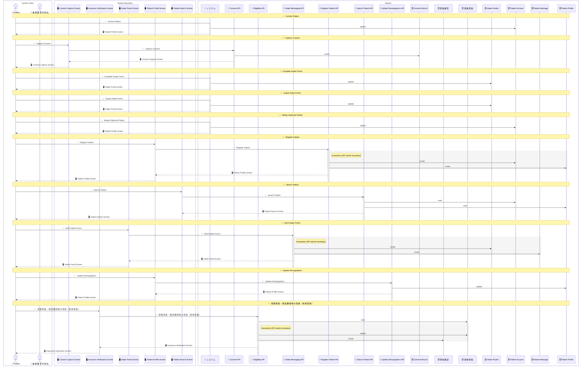

### 3.2 Appointment Scheduling

| 項目 | 内容 |
|---|---|
| BUC | `BucAppointmentScheduling` |
| Business | `PatientAccess` |
| 主な actor | ReceptionClerk, Patient |
| 必要権限 | `ScheduleRead`, `ScheduleWrite` |
| 主なデータ | `Appointment`, `ProviderSchedule`, `Notification`, `PatientMessage` |

予約検索、仮押さえ、予約確定、変更、取消、通知を扱う。予約枠と予約レコードを同時に更新する UC は専用 API を持ち、予約通知は AppointmentNoticeApi に分ける。予約済みの患者は、来院前に `BucVisitCheckIn` の一括照会の対象になる。

レビュー観点:

- ReserveAppointment と BookAppointment の差が業務上必要か。
- CancelAppointment が Appointment と ProviderSchedule を同じ API 境界で更新することが妥当か。
- 予約時に選ばれる `Appointment.referral`（再診・紹介状あり・紹介状なし・除外）が、受付で確認する紹介状の有無と一致するか。

#### Appointment Scheduling RDRA Layered Graph 図

生成コマンド:

```sh
rdra-ish diagram samples/clinic-ops --kind rdra --format mermaid --buc BucAppointmentScheduling --out samples/clinic-ops/out/buc/object_graph_appointment_scheduling
```

```mermaid
flowchart LR
  subgraph layer_value[System Value]
    direction TB
    Patient(["👤 Patient"])
    ReceptionClerk(["👤 医事課 受付担当"])
    MessagingGateway[/"🌐 Messaging Gateway"/]
  end
  subgraph layer_environment[External Environment]
    direction TB
    PatientAccess["💼 Patient Access"]
    BucAppointmentScheduling["📦 Schedule Appointments"]
    BucPatientOnboarding["📦 Onboard and Maintain Patient"]
    IntakeExpiryCheck["⏱️ Nightly intake expiry check"]
    NoShowSweep["⏱️ Nightly no-show sweep"]
    FrontDeskTerminal[/"📱 Front Desk Terminal"/]
    PatientMobile[/"📱 Patient Mobile"/]
    ConsentCapture["🔑 Consent Capture"]
    InsuranceVerify["🔑 Insurance Verify"]
    IntakeManage["🔑 Intake Manage"]
    PatientMessageSend["🔑 Patient Message Send"]
    PatientProfileRead["🔑 Patient Profile Read"]
    PatientProfileWrite["🔑 Patient Profile Write"]
    ScheduleRead["🔑 Schedule Read"]
    ScheduleWrite["🔑 Schedule Write"]
  end
  subgraph layer_boundary[System Boundary]
    direction TB
    ArchivePatient(["✅ Archive Patient"])
    BookAppointment(["✅ Book Appointment"])
    CancelAppointment(["✅ Cancel Appointment"])
    CaptureConsent(["✅ Capture Consent"])
    CompleteIntakeForms(["✅ Complete Intake Forms"])
    ExpireIntakeForms(["✅ Expire Intake Forms"])
    MarkNoShow(["✅ Mark No Show"])
    MergeDuplicatePatient(["✅ Merge Duplicate Patient"])
    RegisterPatient(["✅ Register Patient"])
    RescheduleAppointment(["✅ Reschedule Appointment"])
    ReserveAppointment(["✅ Reserve Appointment"])
    SearchAvailability(["✅ Search Availability"])
    SearchPatient(["✅ Search Patient"])
    SendAppointmentNotice(["✅ Send Appointment Notice"])
    SendIntakeForms(["✅ Send Intake Forms"])
    UpdateDemographics(["✅ Update Demographics"])
    VerifyInsurance(["✅ 保険資格・限度額情報の登録（新患登録）"])
    AppointmentNoticeScreen[["🖥️ Appointment Notice Screen"]]
    AppointmentScreen[["🖥️ Appointment Screen"]]
    ConsentScreen[["🖥️ Consent Capture Screen"]]
    InsuranceScreen[["🖥️ Insurance Verification Screen"]]
    IntakePortalScreen[["🖥️ Intake Portal Screen"]]
    PatientProfileScreen[["🖥️ Patient Profile Screen"]]
    PatientSearchScreen[["🖥️ Patient Search Screen"]]
    ScheduleSearchScreen[["🖥️ Schedule Search Screen"]]
    EvAppointmentCancelled{"⚡ Appointment Cancelled"}
    EvAppointmentRescheduled{"⚡ Appointment Rescheduled"}
    EvAppointmentScheduled{"⚡ Appointment Scheduled"}
  end
  subgraph layer_system[System]
    direction TB
    AppointmentNoticeApi["🔌 Appointment Notice API"]
    BookAppointmentApi["🔌 Book Appointment API"]
    CancelAppointmentApi["🔌 Cancel Appointment API"]
    ConsentApi["🔌 Consent API"]
    EligibilityApi["🔌 Eligibility API"]
    IntakeMessagingApi["🔌 Intake Messaging API"]
    RegisterPatientApi["🔌 Register Patient API"]
    RescheduleAppointmentApi["🔌 Reschedule Appointment API"]
    ReserveAppointmentApi["🔌 Reserve Appointment API"]
    SearchAvailabilityApi["🔌 Search Availability API"]
    SearchPatientApi["🔌 Search Patient API"]
    UpdateDemographicsApi["🔌 Update Demographics API"]
    Appointment[("🗄️ Appointment")]
    ClinicLocation[("🗄️ Clinic Location")]
    ConsentRecord[("🗄️ Consent Record")]
    EligibilityCheck[("🗄️ 資格確認")]
    InsurancePolicy[("🗄️ 保険資格")]
    IntakePacket[("🗄️ Intake Packet")]
    Notification[("🗄️ Notification")]
    PatientAccount[("🗄️ Patient Account")]
    PatientMessage[("🗄️ Patient Message")]
    PatientProfile[("🗄️ Patient Profile")]
    Provider[("🗄️ Provider")]
    ProviderSchedule[("🗄️ Provider Schedule")]
  end
  Patient -.->|has_permission| PatientProfileRead
  Patient -.->|has_permission| ConsentCapture
  Patient -.->|has_permission| ScheduleRead
  Patient -->|performs| BucAppointmentScheduling
  Patient -->|performs| BucPatientOnboarding
  Patient -->|performs| SearchAvailability
  Patient -->|performs| ReserveAppointment
  Patient -->|performs| BookAppointment
  Patient -->|performs| RescheduleAppointment
  Patient -->|performs| CaptureConsent
  Patient -->|performs| CompleteIntakeForms
  Patient -->|performs| CancelAppointment
  ReceptionClerk -.->|has_permission| PatientProfileRead
  ReceptionClerk -.->|has_permission| PatientProfileWrite
  ReceptionClerk -.->|has_permission| InsuranceVerify
  ReceptionClerk -.->|has_permission| IntakeManage
  ReceptionClerk -.->|has_permission| ScheduleRead
  ReceptionClerk -.->|has_permission| ScheduleWrite
  ReceptionClerk -->|performs| BucAppointmentScheduling
  ReceptionClerk -->|performs| BucPatientOnboarding
  ReceptionClerk -->|performs| SearchAvailability
  ReceptionClerk -->|performs| ReserveAppointment
  ReceptionClerk -->|performs| BookAppointment
  ReceptionClerk -->|performs| SearchPatient
  ReceptionClerk -->|performs| RegisterPatient
  ReceptionClerk -->|performs| RescheduleAppointment
  ReceptionClerk -->|performs| UpdateDemographics
  ReceptionClerk -->|performs| VerifyInsurance
  ReceptionClerk -->|performs| SendIntakeForms
  ReceptionClerk -->|performs| ExpireIntakeForms
  ReceptionClerk -->|performs| MergeDuplicatePatient
  ReceptionClerk -->|performs| ArchivePatient
  ReceptionClerk -->|performs| CancelAppointment
  ReceptionClerk -->|performs| MarkNoShow
  ReceptionClerk -->|performs| SendAppointmentNotice
  SearchAvailabilityApi -.->|reads| ProviderSchedule
  SearchAvailabilityApi -.->|reads| Provider
  SearchAvailabilityApi -.->|reads| ClinicLocation
  SearchAvailabilityApi -.->|requires_permission| ScheduleRead
  ReserveAppointmentApi -.->|creates| Appointment
  ReserveAppointmentApi -.->|requires_permission| ScheduleWrite
  ReserveAppointmentApi -.->|updates| ProviderSchedule
  SearchPatientApi -.->|reads| PatientAccount
  SearchPatientApi -.->|reads| PatientProfile
  SearchPatientApi -.->|requires_permission| PatientProfileRead
  RegisterPatientApi -.->|creates| PatientAccount
  RegisterPatientApi -.->|creates| PatientProfile
  RegisterPatientApi -.->|requires_permission| PatientProfileWrite
  UpdateDemographicsApi -.->|requires_permission| PatientProfileWrite
  UpdateDemographicsApi -.->|updates| PatientProfile
  EligibilityApi -.->|creates| EligibilityCheck
  EligibilityApi -.->|reads| InsurancePolicy
  EligibilityApi -.->|requires_permission| InsuranceVerify
  EligibilityApi -.->|updates| InsurancePolicy
  ConsentApi -.->|creates| ConsentRecord
  ConsentApi -.->|requires_permission| ConsentCapture
  IntakeMessagingApi -.->|creates| PatientMessage
  IntakeMessagingApi -.->|creates| IntakePacket
  IntakeMessagingApi -.->|requires_permission| PatientMessageSend
  BookAppointmentApi -.->|requires_permission| ScheduleWrite
  BookAppointmentApi -.->|updates| ProviderSchedule
  BookAppointmentApi -.->|updates| Appointment
  RescheduleAppointmentApi -.->|requires_permission| ScheduleWrite
  RescheduleAppointmentApi -.->|updates| ProviderSchedule
  RescheduleAppointmentApi -.->|updates| Appointment
  CancelAppointmentApi -.->|requires_permission| ScheduleWrite
  CancelAppointmentApi -.->|updates| ProviderSchedule
  CancelAppointmentApi -.->|updates| Appointment
  AppointmentNoticeApi -.->|creates| PatientMessage
  AppointmentNoticeApi -.->|creates| Notification
  BucAppointmentScheduling -.->|belongs| PatientAccess
  BucAppointmentScheduling -->|contains| SearchAvailability
  BucAppointmentScheduling -->|contains| ReserveAppointment
  BucAppointmentScheduling -->|contains| BookAppointment
  BucAppointmentScheduling -->|contains| RescheduleAppointment
  BucAppointmentScheduling -->|contains| CancelAppointment
  BucAppointmentScheduling -->|contains| MarkNoShow
  BucAppointmentScheduling -->|contains| SendAppointmentNotice
  BucPatientOnboarding -.->|belongs| PatientAccess
  BucPatientOnboarding -->|contains| SearchPatient
  BucPatientOnboarding -->|contains| RegisterPatient
  BucPatientOnboarding -->|contains| UpdateDemographics
  BucPatientOnboarding -->|contains| VerifyInsurance
  BucPatientOnboarding -->|contains| CaptureConsent
  BucPatientOnboarding -->|contains| SendIntakeForms
  BucPatientOnboarding -->|contains| CompleteIntakeForms
  BucPatientOnboarding -->|contains| ExpireIntakeForms
  BucPatientOnboarding -->|contains| MergeDuplicatePatient
  BucPatientOnboarding -->|contains| ArchivePatient
  ProviderSchedule ---|N:1| Provider
  ProviderSchedule ---|N:1| ClinicLocation
  Appointment ---|N:1| PatientAccount
  Appointment ---|N:1| Provider
  Appointment ---|N:1| ClinicLocation
  PatientMessage ---|N:1| PatientAccount
  Notification ---|N:1| PatientAccount
  PatientProfile ---|1:1| PatientAccount
  InsurancePolicy ---|N:1| PatientAccount
  EligibilityCheck ---|N:1| InsurancePolicy
  ConsentRecord ---|N:1| PatientAccount
  IntakePacket ---|N:1| PatientAccount
  EvAppointmentScheduled -.->|triggers| BucPatientOnboarding
  EvAppointmentScheduled -.->|triggers| MessagingGateway
  EvAppointmentScheduled -.->|triggers| SendIntakeForms
  EvAppointmentScheduled -.->|triggers| SendAppointmentNotice
  EvAppointmentRescheduled -.->|triggers| MessagingGateway
  EvAppointmentRescheduled -.->|triggers| SendAppointmentNotice
  EvAppointmentCancelled -.->|triggers| MessagingGateway
  EvAppointmentCancelled -.->|triggers| SendAppointmentNotice
  PatientSearchScreen -.->|shows| PatientAccount
  ScheduleSearchScreen -.->|shows| ProviderSchedule
  PatientProfileScreen -.->|shows| PatientProfile
  IntakeExpiryCheck -.->|triggers| ExpireIntakeForms
  NoShowSweep -.->|triggers| MarkNoShow
  SearchAvailability -.->|displays| ScheduleSearchScreen
  SearchAvailability -.->|invokes| SearchAvailabilityApi
  SearchAvailability -.->|requires_medium| FrontDeskTerminal
  SearchAvailability -.->|requires_medium| PatientMobile
  SearchAvailability -.->|requires_permission| ScheduleRead
  ReserveAppointment -.->|displays| AppointmentScreen
  ReserveAppointment -.->|invokes| ReserveAppointmentApi
  ReserveAppointment -.->|requires_medium| FrontDeskTerminal
  ReserveAppointment -.->|requires_medium| PatientMobile
  ReserveAppointment -.->|requires_permission| ScheduleWrite
  BookAppointment -.->|displays| AppointmentScreen
  BookAppointment -.->|invokes| BookAppointmentApi
  BookAppointment -.->|raises| EvAppointmentScheduled
  BookAppointment -.->|requires_medium| FrontDeskTerminal
  BookAppointment -.->|requires_medium| PatientMobile
  BookAppointment -.->|requires_permission| ScheduleWrite
  SearchPatient -.->|displays| PatientSearchScreen
  SearchPatient -.->|invokes| SearchPatientApi
  SearchPatient -.->|requires_medium| FrontDeskTerminal
  SearchPatient -.->|requires_permission| PatientProfileRead
  RegisterPatient -.->|displays| PatientProfileScreen
  RegisterPatient -.->|invokes| RegisterPatientApi
  RegisterPatient -.->|requires_medium| FrontDeskTerminal
  RegisterPatient -.->|requires_permission| PatientProfileWrite
  RescheduleAppointment -.->|displays| AppointmentScreen
  RescheduleAppointment -.->|invokes| RescheduleAppointmentApi
  RescheduleAppointment -.->|raises| EvAppointmentRescheduled
  RescheduleAppointment -.->|requires_medium| FrontDeskTerminal
  RescheduleAppointment -.->|requires_medium| PatientMobile
  RescheduleAppointment -.->|requires_permission| ScheduleWrite
  UpdateDemographics -.->|displays| PatientProfileScreen
  UpdateDemographics -.->|invokes| UpdateDemographicsApi
  UpdateDemographics -.->|requires_medium| FrontDeskTerminal
  UpdateDemographics -.->|requires_permission| PatientProfileWrite
  VerifyInsurance -.->|displays| InsuranceScreen
  VerifyInsurance -.->|invokes| EligibilityApi
  VerifyInsurance -.->|requires_medium| FrontDeskTerminal
  VerifyInsurance -.->|requires_permission| InsuranceVerify
  CaptureConsent -.->|displays| ConsentScreen
  CaptureConsent -.->|invokes| ConsentApi
  CaptureConsent -.->|requires_medium| PatientMobile
  CaptureConsent -.->|requires_permission| ConsentCapture
  SendIntakeForms -.->|displays| IntakePortalScreen
  SendIntakeForms -.->|invokes| IntakeMessagingApi
  SendIntakeForms -.->|requires_medium| FrontDeskTerminal
  SendIntakeForms -.->|requires_permission| IntakeManage
  CompleteIntakeForms -.->|displays| IntakePortalScreen
  CompleteIntakeForms -.->|requires_medium| PatientMobile
  CompleteIntakeForms -.->|requires_permission| ConsentCapture
  CompleteIntakeForms -.->|updates| IntakePacket
  ExpireIntakeForms -.->|displays| IntakePortalScreen
  ExpireIntakeForms -.->|requires_medium| FrontDeskTerminal
  ExpireIntakeForms -.->|requires_permission| IntakeManage
  ExpireIntakeForms -.->|updates| IntakePacket
  MergeDuplicatePatient -.->|displays| PatientProfileScreen
  MergeDuplicatePatient -.->|requires_medium| FrontDeskTerminal
  MergeDuplicatePatient -.->|requires_permission| PatientProfileWrite
  MergeDuplicatePatient -.->|updates| PatientAccount
  ArchivePatient -.->|displays| PatientProfileScreen
  ArchivePatient -.->|requires_medium| FrontDeskTerminal
  ArchivePatient -.->|requires_permission| PatientProfileWrite
  ArchivePatient -.->|updates| PatientAccount
  CancelAppointment -.->|displays| AppointmentScreen
  CancelAppointment -.->|invokes| CancelAppointmentApi
  CancelAppointment -.->|raises| EvAppointmentCancelled
  CancelAppointment -.->|requires_medium| FrontDeskTerminal
  CancelAppointment -.->|requires_medium| PatientMobile
  CancelAppointment -.->|requires_permission| ScheduleWrite
  MarkNoShow -.->|displays| AppointmentScreen
  MarkNoShow -.->|requires_medium| FrontDeskTerminal
  MarkNoShow -.->|requires_permission| ScheduleWrite
  MarkNoShow -.->|updates| Appointment
  SendAppointmentNotice -.->|displays| AppointmentNoticeScreen
  SendAppointmentNotice -.->|invokes| AppointmentNoticeApi
  SendAppointmentNotice -.->|requires_medium| FrontDeskTerminal
  SendAppointmentNotice -.->|requires_permission| ScheduleRead
```

#### Appointment Scheduling sequence 図

生成コマンド:

```sh
rdra-ish diagram samples/clinic-ops --kind sequence --format mermaid --buc BucAppointmentScheduling --out samples/clinic-ops/out/buc/sequence_appointment_scheduling
```

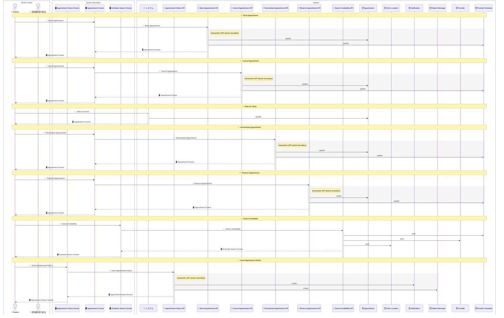

### 3.3 受付（初診・再診）

| 項目 | 内容 |
|---|---|
| BUC | `BucVisitCheckIn` |
| Business | `PatientAccess` |
| 主な actor | ReceptionClerk, Nurse |
| 必要権限 | `VisitCheckIn`, `InsuranceVerify`, `ReferralManage`, `RoomAssign`, `EncounterOpen` |
| 主なデータ | `Appointment`, `PatientAccount`, `InsurancePolicy`, `EligibilityCheck`, `ReferralLetter`, `Room` |

到着確認、資格確認、紹介状の受付、診察室への案内を扱う。療養担当規則 第3条により受付のたびに資格を確認するので、`CheckInPatient` は必ずオンライン資格確認を伴い `EligibilityCheck` を作る。結果は 有効・無効・該当資格なし の 3 通りで、無効と該当資格なしは再確認へ戻る。システムが答えられない場合は被保険者資格申立書かシステム障害時モードで確認する。来院前には予約済み患者の一括照会を行う。受付では支払を受けない（会計は `BucVisitPayment`）。

レビュー観点:

- 受付と資格確認が 1 つの UC にまとまり、資格確認を飛ばす経路がないか。
- 一括照会の結果が無効だった患者を、受付で再確認する流れが説明できるか。
- 被保険者資格申立書とシステム障害時モードが、資格確認結果の状態として区別されているか。

#### 受付（初診・再診） RDRA Layered Graph 図

生成コマンド:

```sh
rdra-ish diagram samples/clinic-ops --kind rdra --format mermaid --buc BucVisitCheckIn --out samples/clinic-ops/out/buc/object_graph_visit_check_in
```

```mermaid
flowchart LR
  subgraph layer_value[System Value]
    direction TB
    Nurse(["👤 看護師"])
    ReceptionClerk(["👤 医事課 受付担当"])
    ClaimsReviewOrganization[/"🌐 審査支払機関（支払基金・国保連）"/]
    MessagingGateway[/"🌐 Messaging Gateway"/]
    OnlineEligibilitySystem[/"🌐 オンライン資格確認等システム"/]
    OutsourcedLabSystem[/"🌐 外注検査システム"/]
    PaymentGateway[/"🌐 自動精算機・クレジット決済"/]
  end
  subgraph layer_environment[External Environment]
    direction TB
    CareDelivery["💼 Care Delivery"]
    PatientAccess["💼 Patient Access"]
    RevenueCycle["💼 Revenue Cycle"]
    BucBillingClaims["📦 レセプト作成・請求"]
    BucClinicalEncounter["📦 Conduct Clinical Encounter"]
    BucFollowupCare["📦 Coordinate Follow-Up Care"]
    BucOrdersResults["📦 Manage Orders and Results"]
    BucPatientOnboarding["📦 Onboard and Maintain Patient"]
    BucVisitCheckIn["📦 受付（初診・再診）"]
    BucVisitPayment["📦 計算・会計"]
    ClaimCycleFlow["🧭 レセプトの月次サイクル"]
    VisitCheckInFlow["🧭 受付の流れ"]
    VisitPaymentFlow["🧭 計算・会計の流れ"]
    ArrivalStep(["➡️ 到着・予約票の確認"])
    AssessStep(["➡️ 査定と再審査請求"])
    CalculationStep(["➡️ 計算受付・会計計算入力"])
    CallStep(["➡️ 会計の呼出"])
    CreateStatementStep(["➡️ レセプト作成（月初）"])
    DeclarationStep(["➡️ 資格を確認できない（申立書・障害時モード）"])
    EligibilityStep(["➡️ 資格確認"])
    HoldStep(["➡️ 保留（月遅れ）"])
    InspectStep(["➡️ 院内点検"])
    KioskStep(["➡️ 自動精算機で精算"])
    PaidStep(["➡️ 支払（診療翌々月）"])
    ReceiptErrorStep(["➡️ 受付不能・要確認の再送（11日・12日）"])
    ReceiptStep(["➡️ 領収証・明細書の交付"])
    ReferralStep(["➡️ 紹介状あり（初診）"])
    ReturnStep(["➡️ 返戻と再請求"])
    ReviewStep(["➡️ 審査"])
    RoomingStep(["➡️ 診察室への案内"])
    SubmitStep(["➡️ 請求（5日～10日）"])
    WindowStep(["➡️ 会計窓口で精算"])
    EligibilityBatchInquiry["⏱️ 予約患者の資格の一括照会（来院前）"]
    ErrorResendWindow["⏱️ エラー分レセプトの再送（毎月11日・12日）"]
    IntakeExpiryCheck["⏱️ Nightly intake expiry check"]
    MonthlyClaimCreation["⏱️ 前月分レセプトの作成（月初）"]
    MonthlyClaimDeadline["⏱️ 前月分レセプトの請求（毎月5日～10日）"]
    ReceivablesMonthlyReview["⏱️ 未収金管理台帳の作成（毎月）"]
    ReturnDownloadCheck["⏱️ 返戻レセプトの取得（3か月以内）"]
    AccountsWindow[/"📱 会計窓口"/]
    BillingWorkstation[/"📱 Billing Workstation"/]
    CareCoordinationConsole[/"📱 Care Coordination Console"/]
    ClinicalWorkstation[/"📱 Clinical Workstation"/]
    FrontDeskTerminal[/"📱 Front Desk Terminal"/]
    NurseStation[/"📱 Nurse Station"/]
    OnlineClaimTerminal[/"📱 オンライン請求用端末"/]
    PatientMobile[/"📱 Patient Mobile"/]
    PaymentKiosk[/"📱 自動精算機"/]
    BillCalculate["🔑 会計計算"]
    BillingClaimWrite["🔑 レセプト業務"]
    ClinicalDocument["🔑 Clinical Document"]
    ClinicalOrderWrite["🔑 Clinical Order Write"]
    ConsentCapture["🔑 Consent Capture"]
    EncounterOpen["🔑 Encounter Open"]
    EncounterSign["🔑 Encounter Sign"]
    FollowUpManage["🔑 Follow-Up Manage"]
    InsuranceVerify["🔑 Insurance Verify"]
    IntakeManage["🔑 Intake Manage"]
    LabResultManage["🔑 Lab Result Manage"]
    PatientMessageSend["🔑 Patient Message Send"]
    PatientProfileRead["🔑 Patient Profile Read"]
    PatientProfileWrite["🔑 Patient Profile Write"]
    PaymentCollect["🔑 窓口収納"]
    PaymentPost["🔑 Payment Post"]
    ProxyOrderEntry["🔑 代行入力"]
    ReferralManage["🔑 紹介状管理"]
    RoomAssign["🔑 Room Assign"]
    ScheduleRead["🔑 Schedule Read"]
    ScheduleWrite["🔑 Schedule Write"]
    VisitCheckIn["🔑 Visit Check-In"]
    VitalsRecord["🔑 Vitals Record"]
  end
  subgraph layer_boundary[System Boundary]
    direction TB
    AmendEncounter(["✅ Amend Signed Encounter"])
    ApplySelectedTreatmentFee(["✅ 選定療養費の算定"])
    ArchivePatient(["✅ Archive Patient"])
    AssignRoom(["✅ Assign Room"])
    BatchVerifyEligibility(["✅ 資格の一括照会"])
    CalculateVisitBill(["✅ 会計計算入力"])
    CallPatientForPayment(["✅ 会計の呼出"])
    CancelClinicalOrder(["✅ Cancel Clinical Order"])
    CaptureConsent(["✅ Capture Consent"])
    CheckInPatient(["✅ 受付（初診・再診）"])
    CloseCarePlan(["✅ Close Care Plan"])
    CollectSpecimen(["✅ Collect Specimen"])
    CompleteConsultation(["✅ 診察終了"])
    CompleteIntakeForms(["✅ Complete Intake Forms"])
    ConfirmEligibilityInOutageMode(["✅ システム障害時モードでの資格確認"])
    ConfirmProxyOrder(["✅ 代行入力オーダの確定"])
    CorrectReturnedStatement(["✅ 返戻レセプトの訂正（再請求）"])
    CreateCarePlan(["✅ Create Care Plan"])
    CreateCharge(["✅ コスト情報の登録"])
    DocumentAssessment(["✅ Document Assessment"])
    EnterProxyOrder(["✅ 検体検査オーダの代行入力"])
    ExpireIntakeForms(["✅ Expire Intake Forms"])
    GenerateClaimStatement(["✅ レセプト作成"])
    HoldClaimStatement(["✅ レセプトの保留（月遅れ）"])
    InspectClaimStatement(["✅ レセプトの院内点検"])
    IssueReceipt(["✅ 領収証・明細書の交付"])
    IssueReferralLetter(["✅ 診療情報提供書の作成・送信"])
    MergeDuplicatePatient(["✅ Merge Duplicate Patient"])
    NotifyCriticalResult(["✅ Notify Critical Result"])
    NotifyPatientResult(["✅ Notify Patient Result"])
    OpenEncounter(["✅ Open Encounter"])
    PlaceLabOrder(["✅ Place Lab Order"])
    PostPayment(["✅ 診療報酬の入金"])
    PrepareEncounter(["✅ Prepare Encounter"])
    PrintSpecimenLabel(["✅ 採血管ラベル発行・貼付"])
    ReceiveClaimAccepted(["✅ レセプト受付（審査へ）"])
    ReceiveEligibilityInvalid(["✅ 資格確認結果（無効）の取込"])
    ReceiveEligibilityNoInfo(["✅ 資格確認結果（該当資格なし）の取込"])
    ReceiveEligibilityValid(["✅ 資格確認結果（有効）の取込"])
    ReceiveLabResult(["✅ Receive Lab Result"])
    ReceiveReferralLetter(["✅ 紹介状受付処理"])
    RecheckEligibility(["✅ 資格の再確認"])
    ReconcileBalance(["✅ 未収金管理台帳の作成"])
    RecordClaimAssessment(["✅ 査定の取込"])
    RecordClaimReturn(["✅ 返戻レセプトの取込"])
    RecordEligibilityDeclaration(["✅ 被保険者資格申立書の受領"])
    RecordReceiptError(["✅ 受付不能・要確認の確認"])
    RecordVitals(["✅ Record Vitals"])
    RegisterPatient(["✅ Register Patient"])
    RegisterPerformedProcedure(["✅ 実施内容（コスト）の登録"])
    ReleaseHeldStatement(["✅ 保留レセプトの再提出準備"])
    RequestReexamination(["✅ 再審査請求"])
    ResendErroredStatement(["✅ エラー分レセプトの再送"])
    ReviewClaimTransfer(["✅ 資格の振替・分割の確認"])
    ReviewLabResult(["✅ Review Lab Result"])
    ReviewPatientResponse(["✅ Review Patient Response"])
    ScheduleFollowUpVisit(["✅ Schedule Follow-Up Visit"])
    SearchPatient(["✅ Search Patient"])
    SendAppointmentNotice(["✅ Send Appointment Notice"])
    SendFollowUpMessage(["✅ Send Follow-Up Message"])
    SendIntakeForms(["✅ Send Intake Forms"])
    SettleAtKiosk(["✅ 自動精算機での精算"])
    SettleAtWindow(["✅ 会計窓口での精算"])
    SignEncounter(["✅ Sign Encounter"])
    SubmitClaimStatements(["✅ レセプト請求"])
    UpdateDemographics(["✅ Update Demographics"])
    VerifyArrival(["✅ 予約票・診察券の確認"])
    VerifyInsurance(["✅ 保険資格・限度額情報の登録（新患登録）"])
    VoidCharge(["✅ コストの取消"])
    AppointmentNoticeScreen[["🖥️ Appointment Notice Screen"]]
    BalanceScreen[["🖥️ 未収金画面"]]
    BillCalculationScreen[["🖥️ 会計計算画面"]]
    CarePlanScreen[["🖥️ Care Plan Screen"]]
    ChargeWorklistScreen[["🖥️ Charge Worklist Screen"]]
    CheckInScreen[["🖥️ 受付画面"]]
    ClaimScreen[["🖥️ レセプト画面"]]
    ConsentScreen[["🖥️ Consent Capture Screen"]]
    CriticalNoticeScreen[["🖥️ Critical Result Notice Screen"]]
    DiagnosisScreen[["🖥️ Diagnosis Screen"]]
    EligibilityScreen[["🖥️ 資格確認画面"]]
    EncounterWorkspaceScreen[["🖥️ Encounter Workspace"]]
    FollowUpScheduleScreen[["🖥️ Follow-Up Schedule Screen"]]
    InsuranceScreen[["🖥️ Insurance Verification Screen"]]
    IntakePortalScreen[["🖥️ Intake Portal Screen"]]
    KioskScreen[["🖥️ 自動精算機画面"]]
    OrderEntryScreen[["🖥️ Order Entry Screen"]]
    PatientMessageScreen[["🖥️ Patient Message Screen"]]
    PatientProfileScreen[["🖥️ Patient Profile Screen"]]
    PatientSearchScreen[["🖥️ Patient Search Screen"]]
    PaymentPostingScreen[["🖥️ 入金画面"]]
    PaymentWindowScreen[["🖥️ 会計窓口画面"]]
    ReferralLetterScreen[["🖥️ 診療情報提供書画面"]]
    ReferralScreen[["🖥️ 紹介状受付画面"]]
    ResultReviewScreen[["🖥️ Result Review Screen"]]
    RoomBoardScreen[["🖥️ Room Board Screen"]]
    SpecimenScreen[["🖥️ Specimen Collection Screen"]]
    VitalsScreen[["🖥️ Vitals Screen"]]
    ArrivalTimeField[["🔤 受付時刻"]]
    ChargeCodeField[["🔤 診療行為"]]
    EligibilityResultField[["🔤 資格確認結果"]]
    KioskReferenceField[["🔤 精算機の取引番号"]]
    PaymentAmountField[["🔤 お支払額"]]
    ReferralDirectionField[["🔤 紹介の向き"]]
    ReferralReceivedField[["🔤 紹介状の受領日時"]]
    EvAppointmentCancelled{"⚡ Appointment Cancelled"}
    EvAppointmentCheckedIn{"⚡ Appointment Checked In"}
    EvAppointmentRescheduled{"⚡ Appointment Rescheduled"}
    EvAppointmentScheduled{"⚡ Appointment Scheduled"}
    EvBillCalculated{"⚡ 会計計算完了"}
    EvClaimAccepted{"⚡ レセプト受付"}
    EvClaimAssessed{"⚡ 査定"}
    EvClaimReceiptError{"⚡ 受付不能・要確認"}
    EvClaimReturned{"⚡ 返戻"}
    EvClaimStatementsSubmitted{"⚡ レセプト請求"}
    EvClaimTransferred{"⚡ 資格の振替・分割"}
    EvClinicalOrderReviewed{"⚡ Clinical Result Reviewed"}
    EvEligibilityChecked{"⚡ 資格確認結果"}
    EvEncounterSigned{"⚡ Encounter Signed"}
    EvLabResultReceived{"⚡ Lab Result Received"}
    EvPaymentSettled{"⚡ 自動精算機での精算完了"}
    EvRemittance{"⚡ 診療報酬の支払"}
  end
  subgraph layer_system[System]
    direction TB
    AmendEncounterApi["🔌 Amend Encounter API"]
    AppointmentNoticeApi["🔌 Appointment Notice API"]
    AssignRoomApi["🔌 Assign Room API"]
    BalanceApi["🔌 未収金 API"]
    CalculateVisitBillApi["🔌 会計計算 API"]
    CheckInPatientApi["🔌 Check-In Patient API"]
    ClaimEditApi["🔌 レセプト点検・訂正 API"]
    ClaimResultApi["🔌 審査結果 API"]
    CollectSpecimenApi["🔌 Collect Specimen API"]
    CompleteConsultationApi["🔌 診察終了 API"]
    ConfirmOrderApi["🔌 オーダ確定 API"]
    ConsentApi["🔌 Consent API"]
    CreateCarePlanApi["🔌 Create Care Plan API"]
    CreateChargeApi["🔌 Create Charge API"]
    CriticalNoticeApi["🔌 Critical Notice API"]
    DocumentAssessmentApi["🔌 Document Assessment API"]
    EligibilityApi["🔌 Eligibility API"]
    EligibilityResultApi["🔌 資格確認結果 API"]
    FollowUpScheduleApi["🔌 Follow-Up Schedule API"]
    GenerateClaimApi["🔌 レセプト作成 API"]
    IntakeMessagingApi["🔌 Intake Messaging API"]
    IssueReferralLetterApi["🔌 診療情報提供書 API"]
    NotifyPatientResultApi["🔌 Notify Patient Result API"]
    OnlineEligibilityApi["🔌 オンライン資格確認 API"]
    OpenEncounterApi["🔌 Open Encounter API"]
    OrderEntryApi["🔌 Order Entry API"]
    PaymentPostApi["🔌 入金 API"]
    PerformedProcedureApi["🔌 実施登録 API"]
    PrepareEncounterApi["🔌 Prepare Encounter API"]
    ProxyOrderApi["🔌 代行入力 API"]
    ReceiptApi["🔌 領収証 API"]
    ReceiveLabResultApi["🔌 Receive Lab Result API"]
    RecordVitalsApi["🔌 Record Vitals API"]
    ReferralLetterApi["🔌 紹介状 API"]
    RegisterPatientApi["🔌 Register Patient API"]
    ResultReviewApi["🔌 Result Review API"]
    SearchPatientApi["🔌 Search Patient API"]
    SelectedFeeApi["🔌 選定療養費 API"]
    SendFollowUpMessageApi["🔌 Send Follow-Up Message API"]
    SettlementApi["🔌 精算 API"]
    SignEncounterApi["🔌 Sign Encounter API"]
    SubmitClaimApi["🔌 オンライン請求 API"]
    UpdateDemographicsApi["🔌 Update Demographics API"]
    VerifyArrivalApi["🔌 Verify Arrival API"]
    AccountBalance[("🗄️ 未収金残高")]
    Appointment[("🗄️ Appointment")]
    CarePlan[("🗄️ Care Plan")]
    Charge[("🗄️ Charge")]
    ClaimStatement[("🗄️ レセプト")]
    ClinicalOrder[("🗄️ Clinical Order")]
    ConsentRecord[("🗄️ Consent Record")]
    Diagnosis[("🗄️ Diagnosis")]
    EligibilityCheck[("🗄️ 資格確認")]
    Encounter[("🗄️ Encounter")]
    InsurancePolicy[("🗄️ 保険資格")]
    IntakePacket[("🗄️ Intake Packet")]
    LabResult[("🗄️ Lab Result")]
    Notification[("🗄️ Notification")]
    PatientAccount[("🗄️ Patient Account")]
    PatientMessage[("🗄️ Patient Message")]
    PatientProfile[("🗄️ Patient Profile")]
    PaymentTransaction[("🗄️ Payment Transaction")]
    ProviderSchedule[("🗄️ Provider Schedule")]
    ReferralLetter[("🗄️ 紹介状・診療情報提供書")]
    Room[("🗄️ Room")]
    SelectedTreatmentFeeSetting[("🗄️ 選定療養費の設定")]
    VitalSign[("🗄️ Vital Sign")]
    BurdenRatio["🎚️ 負担割合"]
    ChargeKind["🎚️ 診療費の種類"]
    LimitCategory["🎚️ 限度額適用区分"]
    PayerChange["🎚️ 資格変更の種類"]
    ReferralCategory["🎚️ 紹介の有無"]
    BookedPatient{"🔀 予約済みの患者"}
    CopayCappedAtLimit{"🔀 窓口負担は負担割合で計算し、限度額情報があれば限度額までとする"}
    OrderConfirmedByPhysician{"🔀 医師が確定したオーダ"}
    TransferNotPossible{"🔀 振替・分割の対象外（負担割合の相違・公費）"}
    UnreferredFirstVisit{"🔀 紹介状なしの初診で、除外に当たらない"}
  end
  ReceptionClerk -.->|has_permission| ReferralManage
  ReceptionClerk -.->|has_permission| PatientProfileRead
  ReceptionClerk -.->|has_permission| PatientProfileWrite
  ReceptionClerk -.->|has_permission| InsuranceVerify
  ReceptionClerk -.->|has_permission| IntakeManage
  ReceptionClerk -.->|has_permission| ScheduleRead
  ReceptionClerk -.->|has_permission| ScheduleWrite
  ReceptionClerk -.->|has_permission| VisitCheckIn
  ReceptionClerk -->|performs| BucPatientOnboarding
  ReceptionClerk -->|performs| BucVisitCheckIn
  ReceptionClerk -->|performs| SearchPatient
  ReceptionClerk -->|performs| RegisterPatient
  ReceptionClerk -->|performs| UpdateDemographics
  ReceptionClerk -->|performs| VerifyInsurance
  ReceptionClerk -->|performs| SendIntakeForms
  ReceptionClerk -->|performs| ExpireIntakeForms
  ReceptionClerk -->|performs| MergeDuplicatePatient
  ReceptionClerk -->|performs| ArchivePatient
  ReceptionClerk -->|performs| VerifyArrival
  ReceptionClerk -->|performs| CheckInPatient
  ReceptionClerk -->|performs| SendAppointmentNotice
  ReceptionClerk -->|performs| RecheckEligibility
  ReceptionClerk -->|performs| RecordEligibilityDeclaration
  ReceptionClerk -->|performs| ConfirmEligibilityInOutageMode
  ReceptionClerk -->|performs| ReceiveReferralLetter
  Nurse -.->|has_permission| ProxyOrderEntry
  Nurse -.->|has_permission| RoomAssign
  Nurse -.->|has_permission| EncounterOpen
  Nurse -.->|has_permission| VitalsRecord
  Nurse -.->|has_permission| ClinicalOrderWrite
  Nurse -.->|has_permission| LabResultManage
  Nurse -.->|has_permission| VisitCheckIn
  Nurse -->|performs| BucClinicalEncounter
  Nurse -->|performs| BucOrdersResults
  Nurse -->|performs| BucVisitCheckIn
  Nurse -->|performs| OpenEncounter
  Nurse -->|performs| RecordVitals
  Nurse -->|performs| CompleteConsultation
  Nurse -->|performs| PrintSpecimenLabel
  Nurse -->|performs| CollectSpecimen
  Nurse -->|performs| RegisterPerformedProcedure
  Nurse -->|performs| ReceiveLabResult
  Nurse -->|performs| AssignRoom
  Nurse -->|performs| PrepareEncounter
  SubmitClaimApi -.->|requires_permission| BillingClaimWrite
  SubmitClaimApi -.->|updates| ClaimStatement
  ClaimResultApi -.->|requires_permission| BillingClaimWrite
  ClaimResultApi -.->|updates| ClaimStatement
  PaymentPostApi -.->|requires_permission| PaymentPost
  PaymentPostApi -.->|updates| ClaimStatement
  BalanceApi -.->|reads| PaymentTransaction
  BalanceApi -.->|requires_permission| PaymentPost
  BalanceApi -.->|updates| AccountBalance
  OpenEncounterApi -.->|creates| Encounter
  OpenEncounterApi -.->|requires_permission| EncounterOpen
  OpenEncounterApi -.->|updates| Appointment
  RecordVitalsApi -.->|creates| VitalSign
  RecordVitalsApi -.->|requires_permission| VitalsRecord
  RecordVitalsApi -.->|updates| Encounter
  DocumentAssessmentApi -.->|creates| Diagnosis
  DocumentAssessmentApi -.->|requires_permission| ClinicalDocument
  DocumentAssessmentApi -.->|updates| Encounter
  SignEncounterApi -.->|requires_permission| EncounterSign
  SignEncounterApi -.->|updates| Encounter
  AmendEncounterApi -.->|requires_permission| EncounterSign
  AmendEncounterApi -.->|updates| Encounter
  IssueReferralLetterApi -.->|creates| ReferralLetter
  IssueReferralLetterApi -.->|reads| Encounter
  IssueReferralLetterApi -.->|requires_permission| ReferralManage
  CompleteConsultationApi -.->|requires_permission| EncounterOpen
  CompleteConsultationApi -.->|updates| Appointment
  CompleteConsultationApi -.->|updates| Room
  CreateCarePlanApi -.->|creates| CarePlan
  CreateCarePlanApi -.->|reads| Encounter
  CreateCarePlanApi -.->|requires_permission| FollowUpManage
  SendFollowUpMessageApi -.->|creates| PatientMessage
  SendFollowUpMessageApi -.->|requires_permission| PatientMessageSend
  FollowUpScheduleApi -.->|creates| Appointment
  FollowUpScheduleApi -.->|requires_permission| ScheduleWrite
  FollowUpScheduleApi -.->|updates| ProviderSchedule
  NotifyPatientResultApi -.->|creates| Notification
  NotifyPatientResultApi -.->|requires_permission| PatientMessageSend
  OrderEntryApi -.->|creates| ClinicalOrder
  OrderEntryApi -.->|reads| Encounter
  OrderEntryApi -.->|requires_permission| ClinicalOrderWrite
  ProxyOrderApi -.->|creates| ClinicalOrder
  ProxyOrderApi -.->|reads| Encounter
  ProxyOrderApi -.->|requires_permission| ProxyOrderEntry
  ConfirmOrderApi -.->|requires_permission| ClinicalOrderWrite
  ConfirmOrderApi -.->|updates| ClinicalOrder
  PerformedProcedureApi -.->|creates| Charge
  PerformedProcedureApi -.->|reads| Encounter
  PerformedProcedureApi -.->|reads| ClinicalOrder
  PerformedProcedureApi -.->|requires_permission| ClinicalOrderWrite
  CollectSpecimenApi -.->|requires_permission| ClinicalOrderWrite
  CollectSpecimenApi -.->|updates| ClinicalOrder
  ReceiveLabResultApi -.->|creates| LabResult
  ReceiveLabResultApi -.->|requires_permission| LabResultManage
  ReceiveLabResultApi -.->|updates| ClinicalOrder
  ResultReviewApi -.->|requires_permission| LabResultManage
  ResultReviewApi -.->|updates| ClinicalOrder
  ResultReviewApi -.->|updates| LabResult
  CriticalNoticeApi -.->|creates| PatientMessage
  CriticalNoticeApi -.->|creates| Notification
  CriticalNoticeApi -.->|requires_permission| PatientMessageSend
  SearchPatientApi -.->|reads| PatientAccount
  SearchPatientApi -.->|reads| PatientProfile
  SearchPatientApi -.->|requires_permission| PatientProfileRead
  RegisterPatientApi -.->|creates| PatientAccount
  RegisterPatientApi -.->|creates| PatientProfile
  RegisterPatientApi -.->|requires_permission| PatientProfileWrite
  UpdateDemographicsApi -.->|requires_permission| PatientProfileWrite
  UpdateDemographicsApi -.->|updates| PatientProfile
  EligibilityApi -.->|creates| EligibilityCheck
  EligibilityApi -.->|reads| InsurancePolicy
  EligibilityApi -.->|requires_permission| InsuranceVerify
  EligibilityApi -.->|updates| InsurancePolicy
  ConsentApi -.->|creates| ConsentRecord
  ConsentApi -.->|requires_permission| ConsentCapture
  IntakeMessagingApi -.->|creates| PatientMessage
  IntakeMessagingApi -.->|creates| IntakePacket
  IntakeMessagingApi -.->|requires_permission| PatientMessageSend
  VerifyArrivalApi -.->|reads| Appointment
  VerifyArrivalApi -.->|reads| PatientAccount
  VerifyArrivalApi -.->|reads| InsurancePolicy
  VerifyArrivalApi -.->|requires_permission| VisitCheckIn
  CheckInPatientApi -.->|requires_permission| VisitCheckIn
  CheckInPatientApi -.->|updates| Appointment
  CheckInPatientApi -.->|updates| PatientAccount
  OnlineEligibilityApi -.->|creates| EligibilityCheck
  OnlineEligibilityApi -.->|reads| InsurancePolicy
  OnlineEligibilityApi -.->|requires_permission| InsuranceVerify
  EligibilityResultApi -.->|requires_permission| InsuranceVerify
  EligibilityResultApi -.->|updates| EligibilityCheck
  ReferralLetterApi -.->|creates| ReferralLetter
  ReferralLetterApi -.->|requires_permission| ReferralManage
  AssignRoomApi -.->|requires_permission| RoomAssign
  AssignRoomApi -.->|updates| Appointment
  AssignRoomApi -.->|updates| Room
  PrepareEncounterApi -.->|reads| Appointment
  PrepareEncounterApi -.->|reads| PatientProfile
  PrepareEncounterApi -.->|requires_permission| EncounterOpen
  CalculateVisitBillApi -.->|reads| Charge
  CalculateVisitBillApi -.->|reads| InsurancePolicy
  CalculateVisitBillApi -.->|requires_permission| BillCalculate
  CalculateVisitBillApi -.->|updates| Appointment
  SelectedFeeApi -.->|creates| Charge
  SelectedFeeApi -.->|reads| Encounter
  SelectedFeeApi -.->|reads| SelectedTreatmentFeeSetting
  SelectedFeeApi -.->|requires_permission| BillCalculate
  SettlementApi -.->|creates| PaymentTransaction
  SettlementApi -.->|requires_permission| PaymentCollect
  SettlementApi -.->|updates| Appointment
  SettlementApi -.->|updates| AccountBalance
  ReceiptApi -.->|reads| Charge
  ReceiptApi -.->|reads| PaymentTransaction
  ReceiptApi -.->|requires_permission| PaymentCollect
  ReceiptApi -.->|updates| Appointment
  AppointmentNoticeApi -.->|creates| PatientMessage
  AppointmentNoticeApi -.->|creates| Notification
  CreateChargeApi -.->|creates| Charge
  CreateChargeApi -.->|reads| Encounter
  GenerateClaimApi -.->|creates| ClaimStatement
  GenerateClaimApi -.->|reads| Charge
  GenerateClaimApi -.->|reads| InsurancePolicy
  GenerateClaimApi -.->|requires_permission| BillingClaimWrite
  ClaimEditApi -.->|requires_permission| BillingClaimWrite
  ClaimEditApi -.->|updates| ClaimStatement
  BucVisitPayment -.->|belongs| RevenueCycle
  BucVisitPayment -->|contains| VisitPaymentFlow
  BucVisitPayment -->|contains| CalculateVisitBill
  BucVisitPayment -->|contains| ApplySelectedTreatmentFee
  BucVisitPayment -->|contains| CallPatientForPayment
  BucVisitPayment -->|contains| SettleAtWindow
  BucVisitPayment -->|contains| SettleAtKiosk
  BucVisitPayment -->|contains| IssueReceipt
  BucBillingClaims -.->|belongs| RevenueCycle
  BucBillingClaims -->|contains| ClaimCycleFlow
  BucBillingClaims -->|contains| InspectClaimStatement
  BucBillingClaims -->|contains| HoldClaimStatement
  BucBillingClaims -->|contains| ReleaseHeldStatement
  BucBillingClaims -->|contains| SubmitClaimStatements
  BucBillingClaims -->|contains| RecordReceiptError
  BucBillingClaims -->|contains| ResendErroredStatement
  BucBillingClaims -->|contains| ReceiveClaimAccepted
  BucBillingClaims -->|contains| ReviewClaimTransfer
  BucBillingClaims -->|contains| RecordClaimReturn
  BucBillingClaims -->|contains| CorrectReturnedStatement
  BucBillingClaims -->|contains| RecordClaimAssessment
  BucBillingClaims -->|contains| RequestReexamination
  BucBillingClaims -->|contains| PostPayment
  BucBillingClaims -->|contains| ReconcileBalance
  BucBillingClaims -->|contains| VoidCharge
  BucBillingClaims -->|contains| CreateCharge
  BucBillingClaims -->|contains| GenerateClaimStatement
  BucClinicalEncounter -.->|belongs| CareDelivery
  BucClinicalEncounter -->|contains| OpenEncounter
  BucClinicalEncounter -->|contains| RecordVitals
  BucClinicalEncounter -->|contains| DocumentAssessment
  BucClinicalEncounter -->|contains| SignEncounter
  BucClinicalEncounter -->|contains| AmendEncounter
  BucClinicalEncounter -->|contains| IssueReferralLetter
  BucClinicalEncounter -->|contains| CompleteConsultation
  BucFollowupCare -.->|belongs| PatientAccess
  BucFollowupCare -->|contains| CreateCarePlan
  BucFollowupCare -->|contains| SendFollowUpMessage
  BucFollowupCare -->|contains| ReviewPatientResponse
  BucFollowupCare -->|contains| ScheduleFollowUpVisit
  BucFollowupCare -->|contains| CloseCarePlan
  BucFollowupCare -->|contains| NotifyPatientResult
  BucOrdersResults -.->|belongs| CareDelivery
  BucOrdersResults -->|contains| PlaceLabOrder
  BucOrdersResults -->|contains| EnterProxyOrder
  BucOrdersResults -->|contains| ConfirmProxyOrder
  BucOrdersResults -->|contains| PrintSpecimenLabel
  BucOrdersResults -->|contains| CollectSpecimen
  BucOrdersResults -->|contains| RegisterPerformedProcedure
  BucOrdersResults -->|contains| ReceiveLabResult
  BucOrdersResults -->|contains| ReviewLabResult
  BucOrdersResults -->|contains| NotifyCriticalResult
  BucOrdersResults -->|contains| CancelClinicalOrder
  BucPatientOnboarding -.->|belongs| PatientAccess
  BucPatientOnboarding -->|contains| SearchPatient
  BucPatientOnboarding -->|contains| RegisterPatient
  BucPatientOnboarding -->|contains| UpdateDemographics
  BucPatientOnboarding -->|contains| VerifyInsurance
  BucPatientOnboarding -->|contains| CaptureConsent
  BucPatientOnboarding -->|contains| SendIntakeForms
  BucPatientOnboarding -->|contains| CompleteIntakeForms
  BucPatientOnboarding -->|contains| ExpireIntakeForms
  BucPatientOnboarding -->|contains| MergeDuplicatePatient
  BucPatientOnboarding -->|contains| ArchivePatient
  BucVisitCheckIn -.->|belongs| PatientAccess
  BucVisitCheckIn -->|contains| VisitCheckInFlow
  BucVisitCheckIn -->|contains| VerifyArrival
  BucVisitCheckIn -->|contains| CheckInPatient
  BucVisitCheckIn -->|contains| BatchVerifyEligibility
  BucVisitCheckIn -->|contains| ReceiveEligibilityValid
  BucVisitCheckIn -->|contains| ReceiveEligibilityInvalid
  BucVisitCheckIn -->|contains| ReceiveEligibilityNoInfo
  BucVisitCheckIn -->|contains| RecheckEligibility
  BucVisitCheckIn -->|contains| RecordEligibilityDeclaration
  BucVisitCheckIn -->|contains| ConfirmEligibilityInOutageMode
  BucVisitCheckIn -->|contains| ReceiveReferralLetter
  BucVisitCheckIn -->|contains| AssignRoom
  BucVisitCheckIn -->|contains| PrepareEncounter
  TransferNotPossible -.->|applies_to| RecordClaimReturn
  TransferNotPossible -.->|combines| ClaimStatement
  TransferNotPossible -.->|combines| PayerChange
  OrderConfirmedByPhysician -.->|applies_to| CollectSpecimen
  OrderConfirmedByPhysician -.->|combines| ClinicalOrder
  BookedPatient -.->|applies_to| BatchVerifyEligibility
  BookedPatient -.->|combines| Appointment
  CopayCappedAtLimit -.->|applies_to| CalculateVisitBill
  CopayCappedAtLimit -.->|combines| Appointment
  CopayCappedAtLimit -.->|combines| BurdenRatio
  CopayCappedAtLimit -.->|combines| LimitCategory
  UnreferredFirstVisit -.->|applies_to| ApplySelectedTreatmentFee
  UnreferredFirstVisit -.->|combines| ReferralCategory
  UnreferredFirstVisit -.->|combines| ChargeKind
  Appointment ---|N:1| PatientAccount
  Appointment ---|N:1| Room
  Encounter ---|N:1| PatientAccount
  Encounter ---|1:1| Appointment
  VitalSign ---|N:1| Encounter
  Diagnosis ---|N:1| Encounter
  ClinicalOrder ---|N:1| Encounter
  LabResult ---|1:1| ClinicalOrder
  Charge ---|N:1| Encounter
  Charge ---|N:1| ClaimStatement
  ClaimStatement ---|N:1| PatientAccount
  ClaimStatement ---|N:1| InsurancePolicy
  PaymentTransaction ---|N:1| Appointment
  AccountBalance ---|1:1| PatientAccount
  ReferralLetter ---|N:1| PatientAccount
  CarePlan ---|N:1| Encounter
  CarePlan ---|N:1| PatientAccount
  PatientMessage ---|N:1| PatientAccount
  Notification ---|N:1| PatientAccount
  PatientProfile ---|1:1| PatientAccount
  InsurancePolicy ---|N:1| PatientAccount
  EligibilityCheck ---|N:1| InsurancePolicy
  ConsentRecord ---|N:1| PatientAccount
  IntakePacket ---|N:1| PatientAccount
  EvPaymentSettled -.->|triggers| SettleAtKiosk
  EvBillCalculated -.->|triggers| PaymentGateway
  EvBillCalculated -.->|triggers| CallPatientForPayment
  EvClaimStatementsSubmitted -.->|triggers| ClaimsReviewOrganization
  EvClaimReceiptError -.->|triggers| RecordReceiptError
  EvClaimAccepted -.->|triggers| ReceiveClaimAccepted
  EvClaimReturned -.->|triggers| RecordClaimReturn
  EvClaimAssessed -.->|triggers| RecordClaimAssessment
  EvClaimTransferred -.->|triggers| ReviewClaimTransfer
  EvRemittance -.->|triggers| PostPayment
  EvAppointmentScheduled -.->|triggers| BucPatientOnboarding
  EvAppointmentScheduled -.->|triggers| MessagingGateway
  EvAppointmentScheduled -.->|triggers| SendIntakeForms
  EvAppointmentScheduled -.->|triggers| SendAppointmentNotice
  EvAppointmentRescheduled -.->|triggers| MessagingGateway
  EvAppointmentRescheduled -.->|triggers| SendAppointmentNotice
  EvAppointmentCheckedIn -.->|triggers| BucClinicalEncounter
  EvAppointmentCheckedIn -.->|triggers| OnlineEligibilitySystem
  EvAppointmentCheckedIn -.->|triggers| OpenEncounter
  EvAppointmentCheckedIn -.->|triggers| PrepareEncounter
  EvAppointmentCancelled -.->|triggers| MessagingGateway
  EvAppointmentCancelled -.->|triggers| SendAppointmentNotice
  EvEncounterSigned -.->|triggers| BucVisitPayment
  EvEncounterSigned -.->|triggers| BucBillingClaims
  EvEncounterSigned -.->|triggers| BucFollowupCare
  EvEncounterSigned -.->|triggers| BucOrdersResults
  EvEncounterSigned -.->|triggers| CompleteConsultation
  EvEncounterSigned -.->|triggers| CreateCarePlan
  EvEncounterSigned -.->|triggers| PlaceLabOrder
  EvEncounterSigned -.->|triggers| CreateCharge
  EvClinicalOrderReviewed -.->|triggers| BucFollowupCare
  EvClinicalOrderReviewed -.->|triggers| NotifyPatientResult
  EvClinicalOrderReviewed -.->|triggers| NotifyCriticalResult
  EvLabResultReceived -.->|triggers| ReceiveLabResult
  EvEligibilityChecked -.->|triggers| ReceiveEligibilityValid
  EvEligibilityChecked -.->|triggers| ReceiveEligibilityInvalid
  EvEligibilityChecked -.->|triggers| ReceiveEligibilityNoInfo
  OnlineEligibilitySystem -.->|raises| EvEligibilityChecked
  PaymentGateway -.->|raises| EvPaymentSettled
  OutsourcedLabSystem -.->|raises| EvLabResultReceived
  ClaimsReviewOrganization -.->|raises| EvClaimReceiptError
  ClaimsReviewOrganization -.->|raises| EvClaimAccepted
  ClaimsReviewOrganization -.->|raises| EvClaimReturned
  ClaimsReviewOrganization -.->|raises| EvClaimAssessed
  ClaimsReviewOrganization -.->|raises| EvClaimTransferred
  ClaimsReviewOrganization -.->|raises| EvRemittance
  KioskReferenceField -.->|maps_field| PaymentTransaction
  ReferralDirectionField -.->|maps_field| ReferralLetter
  ArrivalTimeField -.->|maps_field| Appointment
  EligibilityResultField -.->|maps_field| EligibilityCheck
  ReferralReceivedField -.->|maps_field| ReferralLetter
  PaymentAmountField -.->|maps_field| PaymentTransaction
  ChargeCodeField -.->|maps_field| Charge
  ClaimCycleFlow -->|contains| CreateStatementStep
  ClaimCycleFlow -->|contains| InspectStep
  ClaimCycleFlow -->|contains| HoldStep
  ClaimCycleFlow -->|contains| SubmitStep
  ClaimCycleFlow -->|contains| ReceiptErrorStep
  ClaimCycleFlow -->|contains| ReviewStep
  ClaimCycleFlow -->|contains| ReturnStep
  ClaimCycleFlow -->|contains| AssessStep
  ClaimCycleFlow -->|contains| PaidStep
  VisitCheckInFlow -->|contains| ArrivalStep
  VisitCheckInFlow -->|contains| EligibilityStep
  VisitCheckInFlow -->|contains| DeclarationStep
  VisitCheckInFlow -->|contains| ReferralStep
  VisitCheckInFlow -->|contains| RoomingStep
  VisitPaymentFlow -->|contains| CalculationStep
  VisitPaymentFlow -->|contains| CallStep
  VisitPaymentFlow -->|contains| WindowStep
  VisitPaymentFlow -->|contains| KioskStep
  VisitPaymentFlow -->|contains| ReceiptStep
  ReferralLetterScreen -->|contains| ReferralDirectionField
  PatientSearchScreen -.->|shows| PatientAccount
  PatientProfileScreen -.->|shows| PatientProfile
  CheckInScreen -->|contains| ArrivalTimeField
  CheckInScreen -.->|shows| Appointment
  EligibilityScreen -->|contains| EligibilityResultField
  ReferralScreen -->|contains| ReferralReceivedField
  BillCalculationScreen -->|contains| ChargeCodeField
  PaymentWindowScreen -->|contains| PaymentAmountField
  KioskScreen -->|contains| KioskReferenceField
  ArrivalStep -.->|covers| VerifyArrival
  ArrivalStep -.->|precedes| EligibilityStep
  EligibilityStep -.->|branches| ReferralStep
  EligibilityStep -.->|covers| CheckInPatient
  EligibilityStep -.->|covers| ReceiveEligibilityValid
  EligibilityStep -.->|covers| ReceiveEligibilityInvalid
  EligibilityStep -.->|covers| ReceiveEligibilityNoInfo
  EligibilityStep -.->|covers| RecheckEligibility
  EligibilityStep -.->|excepts| DeclarationStep
  EligibilityStep -.->|precedes| RoomingStep
  DeclarationStep -.->|covers| RecordEligibilityDeclaration
  DeclarationStep -.->|covers| ConfirmEligibilityInOutageMode
  DeclarationStep -.->|precedes| RoomingStep
  CreateStatementStep -.->|covers| MonthlyClaimCreation
  CreateStatementStep -.->|covers| GenerateClaimStatement
  CreateStatementStep -.->|precedes| InspectStep
  ReferralStep -.->|covers| ReceiveReferralLetter
  ReferralStep -.->|precedes| RoomingStep
  RoomingStep -.->|covers| AssignRoom
  CalculationStep -.->|covers| CalculateVisitBill
  CalculationStep -.->|covers| ApplySelectedTreatmentFee
  CalculationStep -.->|precedes| CallStep
  CallStep -.->|branches| KioskStep
  CallStep -.->|covers| CallPatientForPayment
  CallStep -.->|precedes| WindowStep
  WindowStep -.->|covers| SettleAtWindow
  WindowStep -.->|precedes| ReceiptStep
  KioskStep -.->|covers| EvPaymentSettled
  KioskStep -.->|covers| SettleAtKiosk
  KioskStep -.->|precedes| ReceiptStep
  ReceiptStep -.->|covers| IssueReceipt
  InspectStep -.->|branches| HoldStep
  InspectStep -.->|covers| InspectClaimStatement
  InspectStep -.->|precedes| SubmitStep
  HoldStep -.->|covers| HoldClaimStatement
  HoldStep -.->|covers| ReleaseHeldStatement
  HoldStep -.->|repeats| InspectStep
  SubmitStep -.->|covers| MonthlyClaimDeadline
  SubmitStep -.->|covers| SubmitClaimStatements
  SubmitStep -.->|excepts| ReceiptErrorStep
  SubmitStep -.->|precedes| ReviewStep
  ReceiptErrorStep -.->|covers| ErrorResendWindow
  ReceiptErrorStep -.->|covers| RecordReceiptError
  ReceiptErrorStep -.->|covers| ResendErroredStatement
  ReceiptErrorStep -.->|repeats| SubmitStep
  ReviewStep -.->|branches| AssessStep
  ReviewStep -.->|covers| ReceiveClaimAccepted
  ReviewStep -.->|covers| ReviewClaimTransfer
  ReviewStep -.->|excepts| ReturnStep
  ReviewStep -.->|precedes| PaidStep
  ReturnStep -.->|covers| RecordClaimReturn
  ReturnStep -.->|covers| CorrectReturnedStatement
  ReturnStep -.->|repeats| InspectStep
  AssessStep -.->|covers| RecordClaimAssessment
  AssessStep -.->|covers| RequestReexamination
  AssessStep -.->|precedes| PaidStep
  PaidStep -.->|covers| PostPayment
  IntakeExpiryCheck -.->|triggers| ExpireIntakeForms
  EligibilityBatchInquiry -.->|triggers| BatchVerifyEligibility
  MonthlyClaimCreation -.->|triggers| GenerateClaimStatement
  MonthlyClaimDeadline -.->|triggers| SubmitClaimStatements
  ErrorResendWindow -.->|triggers| ResendErroredStatement
  ReturnDownloadCheck -.->|triggers| RecordClaimReturn
  ReceivablesMonthlyReview -.->|triggers| ReconcileBalance
  InspectClaimStatement -.->|displays| ClaimScreen
  InspectClaimStatement -.->|invokes| ClaimEditApi
  InspectClaimStatement -.->|requires_medium| BillingWorkstation
  InspectClaimStatement -.->|requires_permission| BillingClaimWrite
  HoldClaimStatement -.->|displays| ClaimScreen
  HoldClaimStatement -.->|invokes| ClaimEditApi
  HoldClaimStatement -.->|requires_medium| BillingWorkstation
  HoldClaimStatement -.->|requires_permission| BillingClaimWrite
  ReleaseHeldStatement -.->|displays| ClaimScreen
  ReleaseHeldStatement -.->|invokes| ClaimEditApi
  ReleaseHeldStatement -.->|requires_medium| BillingWorkstation
  ReleaseHeldStatement -.->|requires_permission| BillingClaimWrite
  SubmitClaimStatements -.->|displays| ClaimScreen
  SubmitClaimStatements -.->|invokes| SubmitClaimApi
  SubmitClaimStatements -.->|raises| EvClaimStatementsSubmitted
  SubmitClaimStatements -.->|requires_medium| OnlineClaimTerminal
  SubmitClaimStatements -.->|requires_permission| BillingClaimWrite
  RecordReceiptError -.->|displays| ClaimScreen
  RecordReceiptError -.->|invokes| ClaimResultApi
  RecordReceiptError -.->|requires_medium| OnlineClaimTerminal
  RecordReceiptError -.->|requires_permission| BillingClaimWrite
  ResendErroredStatement -.->|displays| ClaimScreen
  ResendErroredStatement -.->|invokes| SubmitClaimApi
  ResendErroredStatement -.->|requires_medium| OnlineClaimTerminal
  ResendErroredStatement -.->|requires_permission| BillingClaimWrite
  ReceiveClaimAccepted -.->|displays| ClaimScreen
  ReceiveClaimAccepted -.->|invokes| ClaimResultApi
  ReceiveClaimAccepted -.->|requires_medium| OnlineClaimTerminal
  ReceiveClaimAccepted -.->|requires_permission| BillingClaimWrite
  ReviewClaimTransfer -.->|displays| ClaimScreen
  ReviewClaimTransfer -.->|reads| ClaimStatement
  ReviewClaimTransfer -.->|requires_medium| OnlineClaimTerminal
  ReviewClaimTransfer -.->|requires_permission| BillingClaimWrite
  RecordClaimReturn -.->|displays| ClaimScreen
  RecordClaimReturn -.->|invokes| ClaimResultApi
  RecordClaimReturn -.->|requires_medium| OnlineClaimTerminal
  RecordClaimReturn -.->|requires_permission| BillingClaimWrite
  CorrectReturnedStatement -.->|displays| ClaimScreen
  CorrectReturnedStatement -.->|invokes| ClaimEditApi
  CorrectReturnedStatement -.->|requires_medium| BillingWorkstation
  CorrectReturnedStatement -.->|requires_permission| BillingClaimWrite
  RecordClaimAssessment -.->|displays| ClaimScreen
  RecordClaimAssessment -.->|invokes| ClaimResultApi
  RecordClaimAssessment -.->|requires_medium| OnlineClaimTerminal
  RecordClaimAssessment -.->|requires_permission| BillingClaimWrite
  RequestReexamination -.->|displays| ClaimScreen
  RequestReexamination -.->|invokes| SubmitClaimApi
  RequestReexamination -.->|requires_medium| OnlineClaimTerminal
  RequestReexamination -.->|requires_permission| BillingClaimWrite
  PostPayment -.->|displays| PaymentPostingScreen
  PostPayment -.->|invokes| PaymentPostApi
  PostPayment -.->|requires_medium| BillingWorkstation
  PostPayment -.->|requires_permission| PaymentPost
  ReconcileBalance -.->|displays| BalanceScreen
  ReconcileBalance -.->|invokes| BalanceApi
  ReconcileBalance -.->|requires_medium| BillingWorkstation
  ReconcileBalance -.->|requires_permission| PaymentPost
  VoidCharge -.->|displays| ChargeWorklistScreen
  VoidCharge -.->|requires_medium| BillingWorkstation
  VoidCharge -.->|requires_permission| BillingClaimWrite
  VoidCharge -.->|updates| Charge
  OpenEncounter -.->|displays| EncounterWorkspaceScreen
  OpenEncounter -.->|invokes| OpenEncounterApi
  OpenEncounter -.->|requires_medium| NurseStation
  OpenEncounter -.->|requires_permission| EncounterOpen
  RecordVitals -.->|displays| VitalsScreen
  RecordVitals -.->|invokes| RecordVitalsApi
  RecordVitals -.->|requires_medium| NurseStation
  RecordVitals -.->|requires_permission| VitalsRecord
  DocumentAssessment -.->|displays| DiagnosisScreen
  DocumentAssessment -.->|invokes| DocumentAssessmentApi
  DocumentAssessment -.->|requires_medium| ClinicalWorkstation
  DocumentAssessment -.->|requires_permission| ClinicalDocument
  SignEncounter -.->|displays| EncounterWorkspaceScreen
  SignEncounter -.->|invokes| SignEncounterApi
  SignEncounter -.->|raises| EvEncounterSigned
  SignEncounter -.->|requires_medium| ClinicalWorkstation
  SignEncounter -.->|requires_permission| EncounterSign
  AmendEncounter -.->|displays| EncounterWorkspaceScreen
  AmendEncounter -.->|invokes| AmendEncounterApi
  AmendEncounter -.->|requires_medium| ClinicalWorkstation
  AmendEncounter -.->|requires_permission| EncounterSign
  IssueReferralLetter -.->|displays| ReferralLetterScreen
  IssueReferralLetter -.->|invokes| IssueReferralLetterApi
  IssueReferralLetter -.->|requires_medium| ClinicalWorkstation
  IssueReferralLetter -.->|requires_permission| ReferralManage
  CompleteConsultation -.->|displays| EncounterWorkspaceScreen
  CompleteConsultation -.->|invokes| CompleteConsultationApi
  CompleteConsultation -.->|requires_medium| NurseStation
  CompleteConsultation -.->|requires_permission| EncounterOpen
  CreateCarePlan -.->|displays| CarePlanScreen
  CreateCarePlan -.->|invokes| CreateCarePlanApi
  CreateCarePlan -.->|requires_medium| CareCoordinationConsole
  CreateCarePlan -.->|requires_permission| FollowUpManage
  SendFollowUpMessage -.->|displays| PatientMessageScreen
  SendFollowUpMessage -.->|invokes| SendFollowUpMessageApi
  SendFollowUpMessage -.->|requires_medium| CareCoordinationConsole
  SendFollowUpMessage -.->|requires_permission| PatientMessageSend
  ReviewPatientResponse -.->|displays| CarePlanScreen
  ReviewPatientResponse -.->|requires_medium| CareCoordinationConsole
  ReviewPatientResponse -.->|requires_permission| FollowUpManage
  ReviewPatientResponse -.->|updates| CarePlan
  ReviewPatientResponse -.->|updates| PatientMessage
  ScheduleFollowUpVisit -.->|displays| FollowUpScheduleScreen
  ScheduleFollowUpVisit -.->|invokes| FollowUpScheduleApi
  ScheduleFollowUpVisit -.->|raises| EvAppointmentScheduled
  ScheduleFollowUpVisit -.->|requires_medium| CareCoordinationConsole
  ScheduleFollowUpVisit -.->|requires_permission| FollowUpManage
  ScheduleFollowUpVisit -.->|requires_permission| ScheduleWrite
  CloseCarePlan -.->|displays| CarePlanScreen
  CloseCarePlan -.->|requires_medium| CareCoordinationConsole
  CloseCarePlan -.->|requires_permission| FollowUpManage
  CloseCarePlan -.->|updates| CarePlan
  NotifyPatientResult -.->|displays| PatientMessageScreen
  NotifyPatientResult -.->|invokes| NotifyPatientResultApi
  NotifyPatientResult -.->|requires_medium| CareCoordinationConsole
  NotifyPatientResult -.->|requires_permission| PatientMessageSend
  PlaceLabOrder -.->|displays| OrderEntryScreen
  PlaceLabOrder -.->|invokes| OrderEntryApi
  PlaceLabOrder -.->|requires_medium| ClinicalWorkstation
  PlaceLabOrder -.->|requires_permission| ClinicalOrderWrite
  EnterProxyOrder -.->|displays| OrderEntryScreen
  EnterProxyOrder -.->|invokes| ProxyOrderApi
  EnterProxyOrder -.->|requires_medium| ClinicalWorkstation
  EnterProxyOrder -.->|requires_permission| ProxyOrderEntry
  ConfirmProxyOrder -.->|displays| OrderEntryScreen
  ConfirmProxyOrder -.->|invokes| ConfirmOrderApi
  ConfirmProxyOrder -.->|requires_medium| ClinicalWorkstation
  ConfirmProxyOrder -.->|requires_permission| ClinicalOrderWrite
  PrintSpecimenLabel -.->|displays| SpecimenScreen
  PrintSpecimenLabel -.->|reads| ClinicalOrder
  PrintSpecimenLabel -.->|requires_medium| NurseStation
  PrintSpecimenLabel -.->|requires_permission| ClinicalOrderWrite
  CollectSpecimen -.->|displays| SpecimenScreen
  CollectSpecimen -.->|invokes| CollectSpecimenApi
  CollectSpecimen -.->|requires_medium| NurseStation
  CollectSpecimen -.->|requires_permission| ClinicalOrderWrite
  RegisterPerformedProcedure -.->|displays| SpecimenScreen
  RegisterPerformedProcedure -.->|invokes| PerformedProcedureApi
  RegisterPerformedProcedure -.->|requires_medium| NurseStation
  RegisterPerformedProcedure -.->|requires_permission| ClinicalOrderWrite
  ReceiveLabResult -.->|displays| ResultReviewScreen
  ReceiveLabResult -.->|invokes| ReceiveLabResultApi
  ReceiveLabResult -.->|requires_medium| NurseStation
  ReceiveLabResult -.->|requires_permission| LabResultManage
  ReviewLabResult -.->|displays| ResultReviewScreen
  ReviewLabResult -.->|invokes| ResultReviewApi
  ReviewLabResult -.->|raises| EvClinicalOrderReviewed
  ReviewLabResult -.->|requires_medium| ClinicalWorkstation
  ReviewLabResult -.->|requires_permission| LabResultManage
  NotifyCriticalResult -.->|displays| CriticalNoticeScreen
  NotifyCriticalResult -.->|invokes| CriticalNoticeApi
  NotifyCriticalResult -.->|requires_medium| ClinicalWorkstation
  NotifyCriticalResult -.->|requires_permission| LabResultManage
  NotifyCriticalResult -.->|requires_permission| PatientMessageSend
  CancelClinicalOrder -.->|displays| OrderEntryScreen
  CancelClinicalOrder -.->|requires_medium| ClinicalWorkstation
  CancelClinicalOrder -.->|requires_permission| ClinicalOrderWrite
  CancelClinicalOrder -.->|updates| ClinicalOrder
  SearchPatient -.->|displays| PatientSearchScreen
  SearchPatient -.->|invokes| SearchPatientApi
  SearchPatient -.->|requires_medium| FrontDeskTerminal
  SearchPatient -.->|requires_permission| PatientProfileRead
  RegisterPatient -.->|displays| PatientProfileScreen
  RegisterPatient -.->|invokes| RegisterPatientApi
  RegisterPatient -.->|requires_medium| FrontDeskTerminal
  RegisterPatient -.->|requires_permission| PatientProfileWrite
  UpdateDemographics -.->|displays| PatientProfileScreen
  UpdateDemographics -.->|invokes| UpdateDemographicsApi
  UpdateDemographics -.->|requires_medium| FrontDeskTerminal
  UpdateDemographics -.->|requires_permission| PatientProfileWrite
  VerifyInsurance -.->|displays| InsuranceScreen
  VerifyInsurance -.->|invokes| EligibilityApi
  VerifyInsurance -.->|requires_medium| FrontDeskTerminal
  VerifyInsurance -.->|requires_permission| InsuranceVerify
  CaptureConsent -.->|displays| ConsentScreen
  CaptureConsent -.->|invokes| ConsentApi
  CaptureConsent -.->|requires_medium| PatientMobile
  CaptureConsent -.->|requires_permission| ConsentCapture
  SendIntakeForms -.->|displays| IntakePortalScreen
  SendIntakeForms -.->|invokes| IntakeMessagingApi
  SendIntakeForms -.->|requires_medium| FrontDeskTerminal
  SendIntakeForms -.->|requires_permission| IntakeManage
  CompleteIntakeForms -.->|displays| IntakePortalScreen
  CompleteIntakeForms -.->|requires_medium| PatientMobile
  CompleteIntakeForms -.->|requires_permission| ConsentCapture
  CompleteIntakeForms -.->|updates| IntakePacket
  ExpireIntakeForms -.->|displays| IntakePortalScreen
  ExpireIntakeForms -.->|requires_medium| FrontDeskTerminal
  ExpireIntakeForms -.->|requires_permission| IntakeManage
  ExpireIntakeForms -.->|updates| IntakePacket
  MergeDuplicatePatient -.->|displays| PatientProfileScreen
  MergeDuplicatePatient -.->|requires_medium| FrontDeskTerminal
  MergeDuplicatePatient -.->|requires_permission| PatientProfileWrite
  MergeDuplicatePatient -.->|updates| PatientAccount
  ArchivePatient -.->|displays| PatientProfileScreen
  ArchivePatient -.->|requires_medium| FrontDeskTerminal
  ArchivePatient -.->|requires_permission| PatientProfileWrite
  ArchivePatient -.->|updates| PatientAccount
  VerifyArrival -.->|displays| CheckInScreen
  VerifyArrival -.->|invokes| VerifyArrivalApi
  VerifyArrival -.->|requires_medium| FrontDeskTerminal
  VerifyArrival -.->|requires_permission| VisitCheckIn
  CheckInPatient -.->|displays| CheckInScreen
  CheckInPatient -.->|invokes| CheckInPatientApi
  CheckInPatient -.->|invokes| OnlineEligibilityApi
  CheckInPatient -.->|raises| EvAppointmentCheckedIn
  CheckInPatient -.->|requires_medium| FrontDeskTerminal
  CheckInPatient -.->|requires_permission| VisitCheckIn
  SendAppointmentNotice -.->|displays| AppointmentNoticeScreen
  SendAppointmentNotice -.->|invokes| AppointmentNoticeApi
  SendAppointmentNotice -.->|requires_medium| FrontDeskTerminal
  SendAppointmentNotice -.->|requires_permission| ScheduleRead
  BatchVerifyEligibility -.->|displays| EligibilityScreen
  BatchVerifyEligibility -.->|invokes| OnlineEligibilityApi
  ReceiveEligibilityValid -.->|displays| EligibilityScreen
  ReceiveEligibilityValid -.->|invokes| EligibilityResultApi
  ReceiveEligibilityInvalid -.->|displays| EligibilityScreen
  ReceiveEligibilityInvalid -.->|invokes| EligibilityResultApi
  ReceiveEligibilityNoInfo -.->|displays| EligibilityScreen
  ReceiveEligibilityNoInfo -.->|invokes| EligibilityResultApi
  RecheckEligibility -.->|displays| EligibilityScreen
  RecheckEligibility -.->|invokes| EligibilityResultApi
  RecheckEligibility -.->|requires_medium| FrontDeskTerminal
  RecheckEligibility -.->|requires_permission| InsuranceVerify
  RecordEligibilityDeclaration -.->|displays| EligibilityScreen
  RecordEligibilityDeclaration -.->|invokes| EligibilityResultApi
  RecordEligibilityDeclaration -.->|requires_medium| FrontDeskTerminal
  RecordEligibilityDeclaration -.->|requires_permission| InsuranceVerify
  ConfirmEligibilityInOutageMode -.->|displays| EligibilityScreen
  ConfirmEligibilityInOutageMode -.->|invokes| EligibilityResultApi
  ConfirmEligibilityInOutageMode -.->|requires_medium| FrontDeskTerminal
  ConfirmEligibilityInOutageMode -.->|requires_permission| InsuranceVerify
  ReceiveReferralLetter -.->|displays| ReferralScreen
  ReceiveReferralLetter -.->|invokes| ReferralLetterApi
  ReceiveReferralLetter -.->|requires_medium| FrontDeskTerminal
  ReceiveReferralLetter -.->|requires_permission| ReferralManage
  AssignRoom -.->|displays| RoomBoardScreen
  AssignRoom -.->|invokes| AssignRoomApi
  AssignRoom -.->|requires_medium| NurseStation
  AssignRoom -.->|requires_permission| RoomAssign
  PrepareEncounter -.->|displays| CheckInScreen
  PrepareEncounter -.->|invokes| PrepareEncounterApi
  PrepareEncounter -.->|requires_medium| NurseStation
  PrepareEncounter -.->|requires_permission| EncounterOpen
  CreateCharge -.->|displays| ChargeWorklistScreen
  CreateCharge -.->|invokes| CreateChargeApi
  CreateCharge -.->|requires_medium| ClinicalWorkstation
  CalculateVisitBill -.->|displays| BillCalculationScreen
  CalculateVisitBill -.->|invokes| CalculateVisitBillApi
  CalculateVisitBill -.->|raises| EvBillCalculated
  CalculateVisitBill -.->|requires_medium| BillingWorkstation
  CalculateVisitBill -.->|requires_permission| BillCalculate
  ApplySelectedTreatmentFee -.->|displays| BillCalculationScreen
  ApplySelectedTreatmentFee -.->|invokes| SelectedFeeApi
  ApplySelectedTreatmentFee -.->|requires_medium| BillingWorkstation
  ApplySelectedTreatmentFee -.->|requires_permission| BillCalculate
  CallPatientForPayment -.->|displays| PaymentWindowScreen
  CallPatientForPayment -.->|reads| Appointment
  CallPatientForPayment -.->|requires_medium| AccountsWindow
  SettleAtWindow -.->|displays| PaymentWindowScreen
  SettleAtWindow -.->|invokes| SettlementApi
  SettleAtWindow -.->|requires_medium| AccountsWindow
  SettleAtWindow -.->|requires_permission| PaymentCollect
  SettleAtKiosk -.->|displays| KioskScreen
  SettleAtKiosk -.->|invokes| SettlementApi
  SettleAtKiosk -.->|requires_medium| PaymentKiosk
  IssueReceipt -.->|displays| PaymentWindowScreen
  IssueReceipt -.->|invokes| ReceiptApi
  IssueReceipt -.->|requires_medium| AccountsWindow
  IssueReceipt -.->|requires_permission| PaymentCollect
  GenerateClaimStatement -.->|displays| ClaimScreen
  GenerateClaimStatement -.->|invokes| GenerateClaimApi
  GenerateClaimStatement -.->|requires_medium| BillingWorkstation
  GenerateClaimStatement -.->|requires_permission| BillingClaimWrite
```

#### 受付（初診・再診） sequence 図

生成コマンド:

```sh
rdra-ish diagram samples/clinic-ops --kind sequence --format mermaid --buc BucVisitCheckIn --out samples/clinic-ops/out/buc/sequence_visit_check_in
```

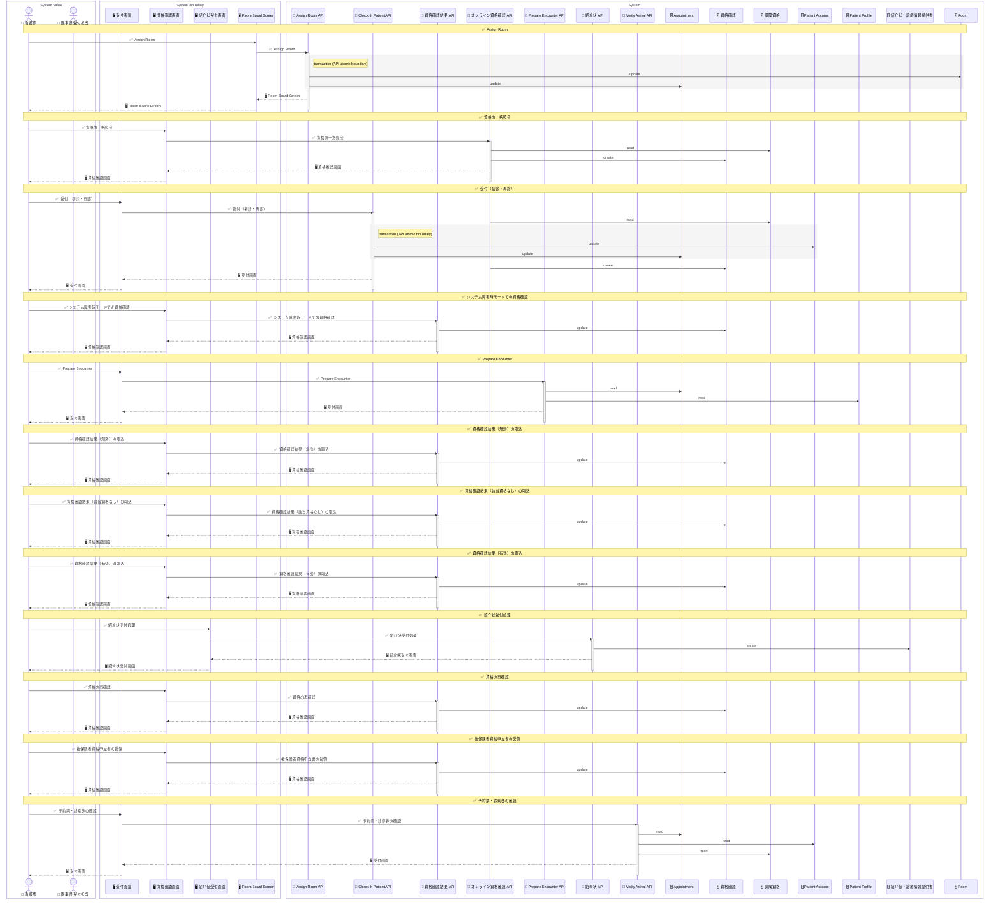

### 3.4 Clinical Encounter

| 項目 | 内容 |
|---|---|
| BUC | `BucClinicalEncounter` |
| Business | `CareDelivery` |
| 主な actor | Nurse（看護師）, Clinician（医師） |
| 必要権限 | `EncounterOpen`, `VitalsRecord`, `ClinicalDocument`, `EncounterSign`, `ReferralManage` |
| 主なデータ | `Encounter`, `Appointment`, `VitalSign`, `Diagnosis`, `Room`, `ReferralLetter` |

診療記録を開き、バイタル、診断、署名、診察終了までを扱う。診察終了 `CompleteConsultation` で予約は「計算待ち」になり、会計は計算受付へ移る。他院紹介では医師が診療情報提供書を作成・送信する。EvEncounterSigned は検査、コスト登録、会計、ケアプラン作成を起動する。

レビュー観点:

- SignEncounter を後続 BUC の起点イベントとして扱ってよいか。
- CompleteConsultation が予約を完了にせず「計算待ち」に置くことで、会計前に予約が閉じないか。
- IssueReferralLetter（診療情報提供書）と受付の紹介状受付（ReceiveReferralLetter）が同じ `ReferralLetter` を向きで区別できるか。

#### Clinical Encounter RDRA Layered Graph 図

生成コマンド:

```sh
rdra-ish diagram samples/clinic-ops --kind rdra --format mermaid --buc BucClinicalEncounter --out samples/clinic-ops/out/buc/object_graph_clinical_encounter
```

```mermaid
flowchart LR
  subgraph layer_value[System Value]
    direction TB
    Clinician(["👤 医師"])
    Nurse(["👤 看護師"])
    ClaimsReviewOrganization[/"🌐 審査支払機関（支払基金・国保連）"/]
    MessagingGateway[/"🌐 Messaging Gateway"/]
    OutsourcedLabSystem[/"🌐 外注検査システム"/]
    PaymentGateway[/"🌐 自動精算機・クレジット決済"/]
  end
  subgraph layer_environment[External Environment]
    direction TB
    CareDelivery["💼 Care Delivery"]
    PatientAccess["💼 Patient Access"]
    RevenueCycle["💼 Revenue Cycle"]
    BucBillingClaims["📦 レセプト作成・請求"]
    BucClinicalEncounter["📦 Conduct Clinical Encounter"]
    BucFollowupCare["📦 Coordinate Follow-Up Care"]
    BucOrdersResults["📦 Manage Orders and Results"]
    BucPatientOnboarding["📦 Onboard and Maintain Patient"]
    BucVisitPayment["📦 計算・会計"]
    ClaimCycleFlow["🧭 レセプトの月次サイクル"]
    VisitPaymentFlow["🧭 計算・会計の流れ"]
    AssessStep(["➡️ 査定と再審査請求"])
    CalculationStep(["➡️ 計算受付・会計計算入力"])
    CallStep(["➡️ 会計の呼出"])
    CreateStatementStep(["➡️ レセプト作成（月初）"])
    HoldStep(["➡️ 保留（月遅れ）"])
    InspectStep(["➡️ 院内点検"])
    KioskStep(["➡️ 自動精算機で精算"])
    PaidStep(["➡️ 支払（診療翌々月）"])
    ReceiptErrorStep(["➡️ 受付不能・要確認の再送（11日・12日）"])
    ReceiptStep(["➡️ 領収証・明細書の交付"])
    ReturnStep(["➡️ 返戻と再請求"])
    ReviewStep(["➡️ 審査"])
    SubmitStep(["➡️ 請求（5日～10日）"])
    WindowStep(["➡️ 会計窓口で精算"])
    ErrorResendWindow["⏱️ エラー分レセプトの再送（毎月11日・12日）"]
    IntakeExpiryCheck["⏱️ Nightly intake expiry check"]
    MonthlyClaimCreation["⏱️ 前月分レセプトの作成（月初）"]
    MonthlyClaimDeadline["⏱️ 前月分レセプトの請求（毎月5日～10日）"]
    ReceivablesMonthlyReview["⏱️ 未収金管理台帳の作成（毎月）"]
    ReturnDownloadCheck["⏱️ 返戻レセプトの取得（3か月以内）"]
    AccountsWindow[/"📱 会計窓口"/]
    BillingWorkstation[/"📱 Billing Workstation"/]
    CareCoordinationConsole[/"📱 Care Coordination Console"/]
    ClinicalWorkstation[/"📱 Clinical Workstation"/]
    FrontDeskTerminal[/"📱 Front Desk Terminal"/]
    NurseStation[/"📱 Nurse Station"/]
    OnlineClaimTerminal[/"📱 オンライン請求用端末"/]
    PatientMobile[/"📱 Patient Mobile"/]
    PaymentKiosk[/"📱 自動精算機"/]
    BillCalculate["🔑 会計計算"]
    BillingClaimWrite["🔑 レセプト業務"]
    ClinicalDocument["🔑 Clinical Document"]
    ClinicalOrderWrite["🔑 Clinical Order Write"]
    ConsentCapture["🔑 Consent Capture"]
    EncounterOpen["🔑 Encounter Open"]
    EncounterSign["🔑 Encounter Sign"]
    FollowUpManage["🔑 Follow-Up Manage"]
    InsuranceVerify["🔑 Insurance Verify"]
    IntakeManage["🔑 Intake Manage"]
    LabResultManage["🔑 Lab Result Manage"]
    PatientMessageSend["🔑 Patient Message Send"]
    PatientProfileRead["🔑 Patient Profile Read"]
    PatientProfileWrite["🔑 Patient Profile Write"]
    PaymentCollect["🔑 窓口収納"]
    PaymentPost["🔑 Payment Post"]
    ProxyOrderEntry["🔑 代行入力"]
    ReferralManage["🔑 紹介状管理"]
    ScheduleRead["🔑 Schedule Read"]
    ScheduleWrite["🔑 Schedule Write"]
    VitalsRecord["🔑 Vitals Record"]
  end
  subgraph layer_boundary[System Boundary]
    direction TB
    AmendEncounter(["✅ Amend Signed Encounter"])
    ApplySelectedTreatmentFee(["✅ 選定療養費の算定"])
    ArchivePatient(["✅ Archive Patient"])
    CalculateVisitBill(["✅ 会計計算入力"])
    CallPatientForPayment(["✅ 会計の呼出"])
    CancelClinicalOrder(["✅ Cancel Clinical Order"])
    CaptureConsent(["✅ Capture Consent"])
    CloseCarePlan(["✅ Close Care Plan"])
    CollectSpecimen(["✅ Collect Specimen"])
    CompleteConsultation(["✅ 診察終了"])
    CompleteIntakeForms(["✅ Complete Intake Forms"])
    ConfirmProxyOrder(["✅ 代行入力オーダの確定"])
    CorrectReturnedStatement(["✅ 返戻レセプトの訂正（再請求）"])
    CreateCarePlan(["✅ Create Care Plan"])
    CreateCharge(["✅ コスト情報の登録"])
    DocumentAssessment(["✅ Document Assessment"])
    EnterProxyOrder(["✅ 検体検査オーダの代行入力"])
    ExpireIntakeForms(["✅ Expire Intake Forms"])
    GenerateClaimStatement(["✅ レセプト作成"])
    HoldClaimStatement(["✅ レセプトの保留（月遅れ）"])
    InspectClaimStatement(["✅ レセプトの院内点検"])
    IssueReceipt(["✅ 領収証・明細書の交付"])
    IssueReferralLetter(["✅ 診療情報提供書の作成・送信"])
    MergeDuplicatePatient(["✅ Merge Duplicate Patient"])
    NotifyCriticalResult(["✅ Notify Critical Result"])
    NotifyPatientResult(["✅ Notify Patient Result"])
    OpenEncounter(["✅ Open Encounter"])
    PlaceLabOrder(["✅ Place Lab Order"])
    PostPayment(["✅ 診療報酬の入金"])
    PrintSpecimenLabel(["✅ 採血管ラベル発行・貼付"])
    ReceiveClaimAccepted(["✅ レセプト受付（審査へ）"])
    ReceiveLabResult(["✅ Receive Lab Result"])
    ReconcileBalance(["✅ 未収金管理台帳の作成"])
    RecordClaimAssessment(["✅ 査定の取込"])
    RecordClaimReturn(["✅ 返戻レセプトの取込"])
    RecordReceiptError(["✅ 受付不能・要確認の確認"])
    RecordVitals(["✅ Record Vitals"])
    RegisterPatient(["✅ Register Patient"])
    RegisterPerformedProcedure(["✅ 実施内容（コスト）の登録"])
    ReleaseHeldStatement(["✅ 保留レセプトの再提出準備"])
    RequestReexamination(["✅ 再審査請求"])
    ResendErroredStatement(["✅ エラー分レセプトの再送"])
    ReviewClaimTransfer(["✅ 資格の振替・分割の確認"])
    ReviewLabResult(["✅ Review Lab Result"])
    ReviewPatientResponse(["✅ Review Patient Response"])
    ScheduleFollowUpVisit(["✅ Schedule Follow-Up Visit"])
    SearchPatient(["✅ Search Patient"])
    SendAppointmentNotice(["✅ Send Appointment Notice"])
    SendFollowUpMessage(["✅ Send Follow-Up Message"])
    SendIntakeForms(["✅ Send Intake Forms"])
    SettleAtKiosk(["✅ 自動精算機での精算"])
    SettleAtWindow(["✅ 会計窓口での精算"])
    SignEncounter(["✅ Sign Encounter"])
    SubmitClaimStatements(["✅ レセプト請求"])
    UpdateDemographics(["✅ Update Demographics"])
    VerifyInsurance(["✅ 保険資格・限度額情報の登録（新患登録）"])
    VoidCharge(["✅ コストの取消"])
    AppointmentNoticeScreen[["🖥️ Appointment Notice Screen"]]
    BalanceScreen[["🖥️ 未収金画面"]]
    BillCalculationScreen[["🖥️ 会計計算画面"]]
    CarePlanScreen[["🖥️ Care Plan Screen"]]
    ChargeWorklistScreen[["🖥️ Charge Worklist Screen"]]
    ClaimScreen[["🖥️ レセプト画面"]]
    ConsentScreen[["🖥️ Consent Capture Screen"]]
    CriticalNoticeScreen[["🖥️ Critical Result Notice Screen"]]
    DiagnosisScreen[["🖥️ Diagnosis Screen"]]
    EncounterWorkspaceScreen[["🖥️ Encounter Workspace"]]
    FollowUpScheduleScreen[["🖥️ Follow-Up Schedule Screen"]]
    InsuranceScreen[["🖥️ Insurance Verification Screen"]]
    IntakePortalScreen[["🖥️ Intake Portal Screen"]]
    KioskScreen[["🖥️ 自動精算機画面"]]
    OrderEntryScreen[["🖥️ Order Entry Screen"]]
    PatientMessageScreen[["🖥️ Patient Message Screen"]]
    PatientProfileScreen[["🖥️ Patient Profile Screen"]]
    PatientSearchScreen[["🖥️ Patient Search Screen"]]
    PaymentPostingScreen[["🖥️ 入金画面"]]
    PaymentWindowScreen[["🖥️ 会計窓口画面"]]
    ReferralLetterScreen[["🖥️ 診療情報提供書画面"]]
    ResultReviewScreen[["🖥️ Result Review Screen"]]
    SpecimenScreen[["🖥️ Specimen Collection Screen"]]
    VitalsScreen[["🖥️ Vitals Screen"]]
    ChargeCodeField[["🔤 診療行為"]]
    KioskReferenceField[["🔤 精算機の取引番号"]]
    PaymentAmountField[["🔤 お支払額"]]
    ReferralDirectionField[["🔤 紹介の向き"]]
    EvAppointmentCancelled{"⚡ Appointment Cancelled"}
    EvAppointmentCheckedIn{"⚡ Appointment Checked In"}
    EvAppointmentRescheduled{"⚡ Appointment Rescheduled"}
    EvAppointmentScheduled{"⚡ Appointment Scheduled"}
    EvBillCalculated{"⚡ 会計計算完了"}
    EvClaimAccepted{"⚡ レセプト受付"}
    EvClaimAssessed{"⚡ 査定"}
    EvClaimReceiptError{"⚡ 受付不能・要確認"}
    EvClaimReturned{"⚡ 返戻"}
    EvClaimStatementsSubmitted{"⚡ レセプト請求"}
    EvClaimTransferred{"⚡ 資格の振替・分割"}
    EvClinicalOrderReviewed{"⚡ Clinical Result Reviewed"}
    EvEncounterSigned{"⚡ Encounter Signed"}
    EvLabResultReceived{"⚡ Lab Result Received"}
    EvPaymentSettled{"⚡ 自動精算機での精算完了"}
    EvRemittance{"⚡ 診療報酬の支払"}
  end
  subgraph layer_system[System]
    direction TB
    AmendEncounterApi["🔌 Amend Encounter API"]
    AppointmentNoticeApi["🔌 Appointment Notice API"]
    BalanceApi["🔌 未収金 API"]
    CalculateVisitBillApi["🔌 会計計算 API"]
    ClaimEditApi["🔌 レセプト点検・訂正 API"]
    ClaimResultApi["🔌 審査結果 API"]
    CollectSpecimenApi["🔌 Collect Specimen API"]
    CompleteConsultationApi["🔌 診察終了 API"]
    ConfirmOrderApi["🔌 オーダ確定 API"]
    ConsentApi["🔌 Consent API"]
    CreateCarePlanApi["🔌 Create Care Plan API"]
    CreateChargeApi["🔌 Create Charge API"]
    CriticalNoticeApi["🔌 Critical Notice API"]
    DocumentAssessmentApi["🔌 Document Assessment API"]
    EligibilityApi["🔌 Eligibility API"]
    FollowUpScheduleApi["🔌 Follow-Up Schedule API"]
    GenerateClaimApi["🔌 レセプト作成 API"]
    IntakeMessagingApi["🔌 Intake Messaging API"]
    IssueReferralLetterApi["🔌 診療情報提供書 API"]
    NotifyPatientResultApi["🔌 Notify Patient Result API"]
    OpenEncounterApi["🔌 Open Encounter API"]
    OrderEntryApi["🔌 Order Entry API"]
    PaymentPostApi["🔌 入金 API"]
    PerformedProcedureApi["🔌 実施登録 API"]
    ProxyOrderApi["🔌 代行入力 API"]
    ReceiptApi["🔌 領収証 API"]
    ReceiveLabResultApi["🔌 Receive Lab Result API"]
    RecordVitalsApi["🔌 Record Vitals API"]
    RegisterPatientApi["🔌 Register Patient API"]
    ResultReviewApi["🔌 Result Review API"]
    SearchPatientApi["🔌 Search Patient API"]
    SelectedFeeApi["🔌 選定療養費 API"]
    SendFollowUpMessageApi["🔌 Send Follow-Up Message API"]
    SettlementApi["🔌 精算 API"]
    SignEncounterApi["🔌 Sign Encounter API"]
    SubmitClaimApi["🔌 オンライン請求 API"]
    UpdateDemographicsApi["🔌 Update Demographics API"]
    AccountBalance[("🗄️ 未収金残高")]
    Appointment[("🗄️ Appointment")]
    CarePlan[("🗄️ Care Plan")]
    Charge[("🗄️ Charge")]
    ClaimStatement[("🗄️ レセプト")]
    ClinicalOrder[("🗄️ Clinical Order")]
    ConsentRecord[("🗄️ Consent Record")]
    Diagnosis[("🗄️ Diagnosis")]
    EligibilityCheck[("🗄️ 資格確認")]
    Encounter[("🗄️ Encounter")]
    InsurancePolicy[("🗄️ 保険資格")]
    IntakePacket[("🗄️ Intake Packet")]
    LabResult[("🗄️ Lab Result")]
    Notification[("🗄️ Notification")]
    PatientAccount[("🗄️ Patient Account")]
    PatientMessage[("🗄️ Patient Message")]
    PatientProfile[("🗄️ Patient Profile")]
    PaymentTransaction[("🗄️ Payment Transaction")]
    ProviderSchedule[("🗄️ Provider Schedule")]
    ReferralLetter[("🗄️ 紹介状・診療情報提供書")]
    Room[("🗄️ Room")]
    SelectedTreatmentFeeSetting[("🗄️ 選定療養費の設定")]
    VitalSign[("🗄️ Vital Sign")]
    BurdenRatio["🎚️ 負担割合"]
    ChargeKind["🎚️ 診療費の種類"]
    LimitCategory["🎚️ 限度額適用区分"]
    PayerChange["🎚️ 資格変更の種類"]
    ReferralCategory["🎚️ 紹介の有無"]
    CopayCappedAtLimit{"🔀 窓口負担は負担割合で計算し、限度額情報があれば限度額までとする"}
    OrderConfirmedByPhysician{"🔀 医師が確定したオーダ"}
    TransferNotPossible{"🔀 振替・分割の対象外（負担割合の相違・公費）"}
    UnreferredFirstVisit{"🔀 紹介状なしの初診で、除外に当たらない"}
  end
  Nurse -.->|has_permission| ProxyOrderEntry
  Nurse -.->|has_permission| EncounterOpen
  Nurse -.->|has_permission| VitalsRecord
  Nurse -.->|has_permission| ClinicalOrderWrite
  Nurse -.->|has_permission| LabResultManage
  Nurse -->|performs| BucClinicalEncounter
  Nurse -->|performs| BucOrdersResults
  Nurse -->|performs| OpenEncounter
  Nurse -->|performs| RecordVitals
  Nurse -->|performs| CompleteConsultation
  Nurse -->|performs| PrintSpecimenLabel
  Nurse -->|performs| CollectSpecimen
  Nurse -->|performs| RegisterPerformedProcedure
  Nurse -->|performs| ReceiveLabResult
  Clinician -.->|has_permission| ReferralManage
  Clinician -.->|has_permission| EncounterOpen
  Clinician -.->|has_permission| ClinicalDocument
  Clinician -.->|has_permission| EncounterSign
  Clinician -.->|has_permission| ClinicalOrderWrite
  Clinician -.->|has_permission| LabResultManage
  Clinician -->|performs| BucClinicalEncounter
  Clinician -->|performs| DocumentAssessment
  Clinician -->|performs| SignEncounter
  Clinician -->|performs| AmendEncounter
  Clinician -->|performs| IssueReferralLetter
  Clinician -->|performs| PlaceLabOrder
  Clinician -->|performs| ConfirmProxyOrder
  Clinician -->|performs| ReviewLabResult
  Clinician -->|performs| NotifyCriticalResult
  Clinician -->|performs| CancelClinicalOrder
  SubmitClaimApi -.->|requires_permission| BillingClaimWrite
  SubmitClaimApi -.->|updates| ClaimStatement
  ClaimResultApi -.->|requires_permission| BillingClaimWrite
  ClaimResultApi -.->|updates| ClaimStatement
  PaymentPostApi -.->|requires_permission| PaymentPost
  PaymentPostApi -.->|updates| ClaimStatement
  BalanceApi -.->|reads| PaymentTransaction
  BalanceApi -.->|requires_permission| PaymentPost
  BalanceApi -.->|updates| AccountBalance
  OpenEncounterApi -.->|creates| Encounter
  OpenEncounterApi -.->|requires_permission| EncounterOpen
  OpenEncounterApi -.->|updates| Appointment
  RecordVitalsApi -.->|creates| VitalSign
  RecordVitalsApi -.->|requires_permission| VitalsRecord
  RecordVitalsApi -.->|updates| Encounter
  DocumentAssessmentApi -.->|creates| Diagnosis
  DocumentAssessmentApi -.->|requires_permission| ClinicalDocument
  DocumentAssessmentApi -.->|updates| Encounter
  SignEncounterApi -.->|requires_permission| EncounterSign
  SignEncounterApi -.->|updates| Encounter
  AmendEncounterApi -.->|requires_permission| EncounterSign
  AmendEncounterApi -.->|updates| Encounter
  IssueReferralLetterApi -.->|creates| ReferralLetter
  IssueReferralLetterApi -.->|reads| Encounter
  IssueReferralLetterApi -.->|requires_permission| ReferralManage
  CompleteConsultationApi -.->|requires_permission| EncounterOpen
  CompleteConsultationApi -.->|updates| Appointment
  CompleteConsultationApi -.->|updates| Room
  CreateCarePlanApi -.->|creates| CarePlan
  CreateCarePlanApi -.->|reads| Encounter
  CreateCarePlanApi -.->|requires_permission| FollowUpManage
  SendFollowUpMessageApi -.->|creates| PatientMessage
  SendFollowUpMessageApi -.->|requires_permission| PatientMessageSend
  FollowUpScheduleApi -.->|creates| Appointment
  FollowUpScheduleApi -.->|requires_permission| ScheduleWrite
  FollowUpScheduleApi -.->|updates| ProviderSchedule
  NotifyPatientResultApi -.->|creates| Notification
  NotifyPatientResultApi -.->|requires_permission| PatientMessageSend
  OrderEntryApi -.->|creates| ClinicalOrder
  OrderEntryApi -.->|reads| Encounter
  OrderEntryApi -.->|requires_permission| ClinicalOrderWrite
  ProxyOrderApi -.->|creates| ClinicalOrder
  ProxyOrderApi -.->|reads| Encounter
  ProxyOrderApi -.->|requires_permission| ProxyOrderEntry
  ConfirmOrderApi -.->|requires_permission| ClinicalOrderWrite
  ConfirmOrderApi -.->|updates| ClinicalOrder
  PerformedProcedureApi -.->|creates| Charge
  PerformedProcedureApi -.->|reads| Encounter
  PerformedProcedureApi -.->|reads| ClinicalOrder
  PerformedProcedureApi -.->|requires_permission| ClinicalOrderWrite
  CollectSpecimenApi -.->|requires_permission| ClinicalOrderWrite
  CollectSpecimenApi -.->|updates| ClinicalOrder
  ReceiveLabResultApi -.->|creates| LabResult
  ReceiveLabResultApi -.->|requires_permission| LabResultManage
  ReceiveLabResultApi -.->|updates| ClinicalOrder
  ResultReviewApi -.->|requires_permission| LabResultManage
  ResultReviewApi -.->|updates| ClinicalOrder
  ResultReviewApi -.->|updates| LabResult
  CriticalNoticeApi -.->|creates| PatientMessage
  CriticalNoticeApi -.->|creates| Notification
  CriticalNoticeApi -.->|requires_permission| PatientMessageSend
  SearchPatientApi -.->|reads| PatientAccount
  SearchPatientApi -.->|reads| PatientProfile
  SearchPatientApi -.->|requires_permission| PatientProfileRead
  RegisterPatientApi -.->|creates| PatientAccount
  RegisterPatientApi -.->|creates| PatientProfile
  RegisterPatientApi -.->|requires_permission| PatientProfileWrite
  UpdateDemographicsApi -.->|requires_permission| PatientProfileWrite
  UpdateDemographicsApi -.->|updates| PatientProfile
  EligibilityApi -.->|creates| EligibilityCheck
  EligibilityApi -.->|reads| InsurancePolicy
  EligibilityApi -.->|requires_permission| InsuranceVerify
  EligibilityApi -.->|updates| InsurancePolicy
  ConsentApi -.->|creates| ConsentRecord
  ConsentApi -.->|requires_permission| ConsentCapture
  IntakeMessagingApi -.->|creates| PatientMessage
  IntakeMessagingApi -.->|creates| IntakePacket
  IntakeMessagingApi -.->|requires_permission| PatientMessageSend
  CalculateVisitBillApi -.->|reads| Charge
  CalculateVisitBillApi -.->|reads| InsurancePolicy
  CalculateVisitBillApi -.->|requires_permission| BillCalculate
  CalculateVisitBillApi -.->|updates| Appointment
  SelectedFeeApi -.->|creates| Charge
  SelectedFeeApi -.->|reads| Encounter
  SelectedFeeApi -.->|reads| SelectedTreatmentFeeSetting
  SelectedFeeApi -.->|requires_permission| BillCalculate
  SettlementApi -.->|creates| PaymentTransaction
  SettlementApi -.->|requires_permission| PaymentCollect
  SettlementApi -.->|updates| Appointment
  SettlementApi -.->|updates| AccountBalance
  ReceiptApi -.->|reads| Charge
  ReceiptApi -.->|reads| PaymentTransaction
  ReceiptApi -.->|requires_permission| PaymentCollect
  ReceiptApi -.->|updates| Appointment
  AppointmentNoticeApi -.->|creates| PatientMessage
  AppointmentNoticeApi -.->|creates| Notification
  CreateChargeApi -.->|creates| Charge
  CreateChargeApi -.->|reads| Encounter
  GenerateClaimApi -.->|creates| ClaimStatement
  GenerateClaimApi -.->|reads| Charge
  GenerateClaimApi -.->|reads| InsurancePolicy
  GenerateClaimApi -.->|requires_permission| BillingClaimWrite
  ClaimEditApi -.->|requires_permission| BillingClaimWrite
  ClaimEditApi -.->|updates| ClaimStatement
  BucVisitPayment -.->|belongs| RevenueCycle
  BucVisitPayment -->|contains| VisitPaymentFlow
  BucVisitPayment -->|contains| CalculateVisitBill
  BucVisitPayment -->|contains| ApplySelectedTreatmentFee
  BucVisitPayment -->|contains| CallPatientForPayment
  BucVisitPayment -->|contains| SettleAtWindow
  BucVisitPayment -->|contains| SettleAtKiosk
  BucVisitPayment -->|contains| IssueReceipt
  BucBillingClaims -.->|belongs| RevenueCycle
  BucBillingClaims -->|contains| ClaimCycleFlow
  BucBillingClaims -->|contains| InspectClaimStatement
  BucBillingClaims -->|contains| HoldClaimStatement
  BucBillingClaims -->|contains| ReleaseHeldStatement
  BucBillingClaims -->|contains| SubmitClaimStatements
  BucBillingClaims -->|contains| RecordReceiptError
  BucBillingClaims -->|contains| ResendErroredStatement
  BucBillingClaims -->|contains| ReceiveClaimAccepted
  BucBillingClaims -->|contains| ReviewClaimTransfer
  BucBillingClaims -->|contains| RecordClaimReturn
  BucBillingClaims -->|contains| CorrectReturnedStatement
  BucBillingClaims -->|contains| RecordClaimAssessment
  BucBillingClaims -->|contains| RequestReexamination
  BucBillingClaims -->|contains| PostPayment
  BucBillingClaims -->|contains| ReconcileBalance
  BucBillingClaims -->|contains| VoidCharge
  BucBillingClaims -->|contains| CreateCharge
  BucBillingClaims -->|contains| GenerateClaimStatement
  BucClinicalEncounter -.->|belongs| CareDelivery
  BucClinicalEncounter -->|contains| OpenEncounter
  BucClinicalEncounter -->|contains| RecordVitals
  BucClinicalEncounter -->|contains| DocumentAssessment
  BucClinicalEncounter -->|contains| SignEncounter
  BucClinicalEncounter -->|contains| AmendEncounter
  BucClinicalEncounter -->|contains| IssueReferralLetter
  BucClinicalEncounter -->|contains| CompleteConsultation
  BucFollowupCare -.->|belongs| PatientAccess
  BucFollowupCare -->|contains| CreateCarePlan
  BucFollowupCare -->|contains| SendFollowUpMessage
  BucFollowupCare -->|contains| ReviewPatientResponse
  BucFollowupCare -->|contains| ScheduleFollowUpVisit
  BucFollowupCare -->|contains| CloseCarePlan
  BucFollowupCare -->|contains| NotifyPatientResult
  BucOrdersResults -.->|belongs| CareDelivery
  BucOrdersResults -->|contains| PlaceLabOrder
  BucOrdersResults -->|contains| EnterProxyOrder
  BucOrdersResults -->|contains| ConfirmProxyOrder
  BucOrdersResults -->|contains| PrintSpecimenLabel
  BucOrdersResults -->|contains| CollectSpecimen
  BucOrdersResults -->|contains| RegisterPerformedProcedure
  BucOrdersResults -->|contains| ReceiveLabResult
  BucOrdersResults -->|contains| ReviewLabResult
  BucOrdersResults -->|contains| NotifyCriticalResult
  BucOrdersResults -->|contains| CancelClinicalOrder
  BucPatientOnboarding -.->|belongs| PatientAccess
  BucPatientOnboarding -->|contains| SearchPatient
  BucPatientOnboarding -->|contains| RegisterPatient
  BucPatientOnboarding -->|contains| UpdateDemographics
  BucPatientOnboarding -->|contains| VerifyInsurance
  BucPatientOnboarding -->|contains| CaptureConsent
  BucPatientOnboarding -->|contains| SendIntakeForms
  BucPatientOnboarding -->|contains| CompleteIntakeForms
  BucPatientOnboarding -->|contains| ExpireIntakeForms
  BucPatientOnboarding -->|contains| MergeDuplicatePatient
  BucPatientOnboarding -->|contains| ArchivePatient
  TransferNotPossible -.->|applies_to| RecordClaimReturn
  TransferNotPossible -.->|combines| ClaimStatement
  TransferNotPossible -.->|combines| PayerChange
  OrderConfirmedByPhysician -.->|applies_to| CollectSpecimen
  OrderConfirmedByPhysician -.->|combines| ClinicalOrder
  CopayCappedAtLimit -.->|applies_to| CalculateVisitBill
  CopayCappedAtLimit -.->|combines| Appointment
  CopayCappedAtLimit -.->|combines| BurdenRatio
  CopayCappedAtLimit -.->|combines| LimitCategory
  UnreferredFirstVisit -.->|applies_to| ApplySelectedTreatmentFee
  UnreferredFirstVisit -.->|combines| ReferralCategory
  UnreferredFirstVisit -.->|combines| ChargeKind
  Appointment ---|N:1| PatientAccount
  Appointment ---|N:1| Room
  Encounter ---|N:1| PatientAccount
  Encounter ---|1:1| Appointment
  VitalSign ---|N:1| Encounter
  Diagnosis ---|N:1| Encounter
  ClinicalOrder ---|N:1| Encounter
  LabResult ---|1:1| ClinicalOrder
  Charge ---|N:1| Encounter
  Charge ---|N:1| ClaimStatement
  ClaimStatement ---|N:1| PatientAccount
  ClaimStatement ---|N:1| InsurancePolicy
  PaymentTransaction ---|N:1| Appointment
  AccountBalance ---|1:1| PatientAccount
  ReferralLetter ---|N:1| PatientAccount
  CarePlan ---|N:1| Encounter
  CarePlan ---|N:1| PatientAccount
  PatientMessage ---|N:1| PatientAccount
  Notification ---|N:1| PatientAccount
  PatientProfile ---|1:1| PatientAccount
  InsurancePolicy ---|N:1| PatientAccount
  EligibilityCheck ---|N:1| InsurancePolicy
  ConsentRecord ---|N:1| PatientAccount
  IntakePacket ---|N:1| PatientAccount
  EvPaymentSettled -.->|triggers| SettleAtKiosk
  EvBillCalculated -.->|triggers| PaymentGateway
  EvBillCalculated -.->|triggers| CallPatientForPayment
  EvClaimStatementsSubmitted -.->|triggers| ClaimsReviewOrganization
  EvClaimReceiptError -.->|triggers| RecordReceiptError
  EvClaimAccepted -.->|triggers| ReceiveClaimAccepted
  EvClaimReturned -.->|triggers| RecordClaimReturn
  EvClaimAssessed -.->|triggers| RecordClaimAssessment
  EvClaimTransferred -.->|triggers| ReviewClaimTransfer
  EvRemittance -.->|triggers| PostPayment
  EvAppointmentScheduled -.->|triggers| BucPatientOnboarding
  EvAppointmentScheduled -.->|triggers| MessagingGateway
  EvAppointmentScheduled -.->|triggers| SendIntakeForms
  EvAppointmentScheduled -.->|triggers| SendAppointmentNotice
  EvAppointmentRescheduled -.->|triggers| MessagingGateway
  EvAppointmentRescheduled -.->|triggers| SendAppointmentNotice
  EvAppointmentCheckedIn -.->|triggers| BucClinicalEncounter
  EvAppointmentCheckedIn -.->|triggers| OpenEncounter
  EvAppointmentCancelled -.->|triggers| MessagingGateway
  EvAppointmentCancelled -.->|triggers| SendAppointmentNotice
  EvEncounterSigned -.->|triggers| BucVisitPayment
  EvEncounterSigned -.->|triggers| BucBillingClaims
  EvEncounterSigned -.->|triggers| BucFollowupCare
  EvEncounterSigned -.->|triggers| BucOrdersResults
  EvEncounterSigned -.->|triggers| CompleteConsultation
  EvEncounterSigned -.->|triggers| CreateCarePlan
  EvEncounterSigned -.->|triggers| PlaceLabOrder
  EvEncounterSigned -.->|triggers| CreateCharge
  EvClinicalOrderReviewed -.->|triggers| BucFollowupCare
  EvClinicalOrderReviewed -.->|triggers| NotifyPatientResult
  EvClinicalOrderReviewed -.->|triggers| NotifyCriticalResult
  EvLabResultReceived -.->|triggers| ReceiveLabResult
  PaymentGateway -.->|raises| EvPaymentSettled
  OutsourcedLabSystem -.->|raises| EvLabResultReceived
  ClaimsReviewOrganization -.->|raises| EvClaimReceiptError
  ClaimsReviewOrganization -.->|raises| EvClaimAccepted
  ClaimsReviewOrganization -.->|raises| EvClaimReturned
  ClaimsReviewOrganization -.->|raises| EvClaimAssessed
  ClaimsReviewOrganization -.->|raises| EvClaimTransferred
  ClaimsReviewOrganization -.->|raises| EvRemittance
  KioskReferenceField -.->|maps_field| PaymentTransaction
  ReferralDirectionField -.->|maps_field| ReferralLetter
  PaymentAmountField -.->|maps_field| PaymentTransaction
  ChargeCodeField -.->|maps_field| Charge
  ClaimCycleFlow -->|contains| CreateStatementStep
  ClaimCycleFlow -->|contains| InspectStep
  ClaimCycleFlow -->|contains| HoldStep
  ClaimCycleFlow -->|contains| SubmitStep
  ClaimCycleFlow -->|contains| ReceiptErrorStep
  ClaimCycleFlow -->|contains| ReviewStep
  ClaimCycleFlow -->|contains| ReturnStep
  ClaimCycleFlow -->|contains| AssessStep
  ClaimCycleFlow -->|contains| PaidStep
  VisitPaymentFlow -->|contains| CalculationStep
  VisitPaymentFlow -->|contains| CallStep
  VisitPaymentFlow -->|contains| WindowStep
  VisitPaymentFlow -->|contains| KioskStep
  VisitPaymentFlow -->|contains| ReceiptStep
  ReferralLetterScreen -->|contains| ReferralDirectionField
  PatientSearchScreen -.->|shows| PatientAccount
  PatientProfileScreen -.->|shows| PatientProfile
  BillCalculationScreen -->|contains| ChargeCodeField
  PaymentWindowScreen -->|contains| PaymentAmountField
  KioskScreen -->|contains| KioskReferenceField
  CreateStatementStep -.->|covers| MonthlyClaimCreation
  CreateStatementStep -.->|covers| GenerateClaimStatement
  CreateStatementStep -.->|precedes| InspectStep
  CalculationStep -.->|covers| CalculateVisitBill
  CalculationStep -.->|covers| ApplySelectedTreatmentFee
  CalculationStep -.->|precedes| CallStep
  CallStep -.->|branches| KioskStep
  CallStep -.->|covers| CallPatientForPayment
  CallStep -.->|precedes| WindowStep
  WindowStep -.->|covers| SettleAtWindow
  WindowStep -.->|precedes| ReceiptStep
  KioskStep -.->|covers| EvPaymentSettled
  KioskStep -.->|covers| SettleAtKiosk
  KioskStep -.->|precedes| ReceiptStep
  ReceiptStep -.->|covers| IssueReceipt
  InspectStep -.->|branches| HoldStep
  InspectStep -.->|covers| InspectClaimStatement
  InspectStep -.->|precedes| SubmitStep
  HoldStep -.->|covers| HoldClaimStatement
  HoldStep -.->|covers| ReleaseHeldStatement
  HoldStep -.->|repeats| InspectStep
  SubmitStep -.->|covers| MonthlyClaimDeadline
  SubmitStep -.->|covers| SubmitClaimStatements
  SubmitStep -.->|excepts| ReceiptErrorStep
  SubmitStep -.->|precedes| ReviewStep
  ReceiptErrorStep -.->|covers| ErrorResendWindow
  ReceiptErrorStep -.->|covers| RecordReceiptError
  ReceiptErrorStep -.->|covers| ResendErroredStatement
  ReceiptErrorStep -.->|repeats| SubmitStep
  ReviewStep -.->|branches| AssessStep
  ReviewStep -.->|covers| ReceiveClaimAccepted
  ReviewStep -.->|covers| ReviewClaimTransfer
  ReviewStep -.->|excepts| ReturnStep
  ReviewStep -.->|precedes| PaidStep
  ReturnStep -.->|covers| RecordClaimReturn
  ReturnStep -.->|covers| CorrectReturnedStatement
  ReturnStep -.->|repeats| InspectStep
  AssessStep -.->|covers| RecordClaimAssessment
  AssessStep -.->|covers| RequestReexamination
  AssessStep -.->|precedes| PaidStep
  PaidStep -.->|covers| PostPayment
  IntakeExpiryCheck -.->|triggers| ExpireIntakeForms
  MonthlyClaimCreation -.->|triggers| GenerateClaimStatement
  MonthlyClaimDeadline -.->|triggers| SubmitClaimStatements
  ErrorResendWindow -.->|triggers| ResendErroredStatement
  ReturnDownloadCheck -.->|triggers| RecordClaimReturn
  ReceivablesMonthlyReview -.->|triggers| ReconcileBalance
  InspectClaimStatement -.->|displays| ClaimScreen
  InspectClaimStatement -.->|invokes| ClaimEditApi
  InspectClaimStatement -.->|requires_medium| BillingWorkstation
  InspectClaimStatement -.->|requires_permission| BillingClaimWrite
  HoldClaimStatement -.->|displays| ClaimScreen
  HoldClaimStatement -.->|invokes| ClaimEditApi
  HoldClaimStatement -.->|requires_medium| BillingWorkstation
  HoldClaimStatement -.->|requires_permission| BillingClaimWrite
  ReleaseHeldStatement -.->|displays| ClaimScreen
  ReleaseHeldStatement -.->|invokes| ClaimEditApi
  ReleaseHeldStatement -.->|requires_medium| BillingWorkstation
  ReleaseHeldStatement -.->|requires_permission| BillingClaimWrite
  SubmitClaimStatements -.->|displays| ClaimScreen
  SubmitClaimStatements -.->|invokes| SubmitClaimApi
  SubmitClaimStatements -.->|raises| EvClaimStatementsSubmitted
  SubmitClaimStatements -.->|requires_medium| OnlineClaimTerminal
  SubmitClaimStatements -.->|requires_permission| BillingClaimWrite
  RecordReceiptError -.->|displays| ClaimScreen
  RecordReceiptError -.->|invokes| ClaimResultApi
  RecordReceiptError -.->|requires_medium| OnlineClaimTerminal
  RecordReceiptError -.->|requires_permission| BillingClaimWrite
  ResendErroredStatement -.->|displays| ClaimScreen
  ResendErroredStatement -.->|invokes| SubmitClaimApi
  ResendErroredStatement -.->|requires_medium| OnlineClaimTerminal
  ResendErroredStatement -.->|requires_permission| BillingClaimWrite
  ReceiveClaimAccepted -.->|displays| ClaimScreen
  ReceiveClaimAccepted -.->|invokes| ClaimResultApi
  ReceiveClaimAccepted -.->|requires_medium| OnlineClaimTerminal
  ReceiveClaimAccepted -.->|requires_permission| BillingClaimWrite
  ReviewClaimTransfer -.->|displays| ClaimScreen
  ReviewClaimTransfer -.->|reads| ClaimStatement
  ReviewClaimTransfer -.->|requires_medium| OnlineClaimTerminal
  ReviewClaimTransfer -.->|requires_permission| BillingClaimWrite
  RecordClaimReturn -.->|displays| ClaimScreen
  RecordClaimReturn -.->|invokes| ClaimResultApi
  RecordClaimReturn -.->|requires_medium| OnlineClaimTerminal
  RecordClaimReturn -.->|requires_permission| BillingClaimWrite
  CorrectReturnedStatement -.->|displays| ClaimScreen
  CorrectReturnedStatement -.->|invokes| ClaimEditApi
  CorrectReturnedStatement -.->|requires_medium| BillingWorkstation
  CorrectReturnedStatement -.->|requires_permission| BillingClaimWrite
  RecordClaimAssessment -.->|displays| ClaimScreen
  RecordClaimAssessment -.->|invokes| ClaimResultApi
  RecordClaimAssessment -.->|requires_medium| OnlineClaimTerminal
  RecordClaimAssessment -.->|requires_permission| BillingClaimWrite
  RequestReexamination -.->|displays| ClaimScreen
  RequestReexamination -.->|invokes| SubmitClaimApi
  RequestReexamination -.->|requires_medium| OnlineClaimTerminal
  RequestReexamination -.->|requires_permission| BillingClaimWrite
  PostPayment -.->|displays| PaymentPostingScreen
  PostPayment -.->|invokes| PaymentPostApi
  PostPayment -.->|requires_medium| BillingWorkstation
  PostPayment -.->|requires_permission| PaymentPost
  ReconcileBalance -.->|displays| BalanceScreen
  ReconcileBalance -.->|invokes| BalanceApi
  ReconcileBalance -.->|requires_medium| BillingWorkstation
  ReconcileBalance -.->|requires_permission| PaymentPost
  VoidCharge -.->|displays| ChargeWorklistScreen
  VoidCharge -.->|requires_medium| BillingWorkstation
  VoidCharge -.->|requires_permission| BillingClaimWrite
  VoidCharge -.->|updates| Charge
  OpenEncounter -.->|displays| EncounterWorkspaceScreen
  OpenEncounter -.->|invokes| OpenEncounterApi
  OpenEncounter -.->|requires_medium| NurseStation
  OpenEncounter -.->|requires_permission| EncounterOpen
  RecordVitals -.->|displays| VitalsScreen
  RecordVitals -.->|invokes| RecordVitalsApi
  RecordVitals -.->|requires_medium| NurseStation
  RecordVitals -.->|requires_permission| VitalsRecord
  DocumentAssessment -.->|displays| DiagnosisScreen
  DocumentAssessment -.->|invokes| DocumentAssessmentApi
  DocumentAssessment -.->|requires_medium| ClinicalWorkstation
  DocumentAssessment -.->|requires_permission| ClinicalDocument
  SignEncounter -.->|displays| EncounterWorkspaceScreen
  SignEncounter -.->|invokes| SignEncounterApi
  SignEncounter -.->|raises| EvEncounterSigned
  SignEncounter -.->|requires_medium| ClinicalWorkstation
  SignEncounter -.->|requires_permission| EncounterSign
  AmendEncounter -.->|displays| EncounterWorkspaceScreen
  AmendEncounter -.->|invokes| AmendEncounterApi
  AmendEncounter -.->|requires_medium| ClinicalWorkstation
  AmendEncounter -.->|requires_permission| EncounterSign
  IssueReferralLetter -.->|displays| ReferralLetterScreen
  IssueReferralLetter -.->|invokes| IssueReferralLetterApi
  IssueReferralLetter -.->|requires_medium| ClinicalWorkstation
  IssueReferralLetter -.->|requires_permission| ReferralManage
  CompleteConsultation -.->|displays| EncounterWorkspaceScreen
  CompleteConsultation -.->|invokes| CompleteConsultationApi
  CompleteConsultation -.->|requires_medium| NurseStation
  CompleteConsultation -.->|requires_permission| EncounterOpen
  CreateCarePlan -.->|displays| CarePlanScreen
  CreateCarePlan -.->|invokes| CreateCarePlanApi
  CreateCarePlan -.->|requires_medium| CareCoordinationConsole
  CreateCarePlan -.->|requires_permission| FollowUpManage
  SendFollowUpMessage -.->|displays| PatientMessageScreen
  SendFollowUpMessage -.->|invokes| SendFollowUpMessageApi
  SendFollowUpMessage -.->|requires_medium| CareCoordinationConsole
  SendFollowUpMessage -.->|requires_permission| PatientMessageSend
  ReviewPatientResponse -.->|displays| CarePlanScreen
  ReviewPatientResponse -.->|requires_medium| CareCoordinationConsole
  ReviewPatientResponse -.->|requires_permission| FollowUpManage
  ReviewPatientResponse -.->|updates| CarePlan
  ReviewPatientResponse -.->|updates| PatientMessage
  ScheduleFollowUpVisit -.->|displays| FollowUpScheduleScreen
  ScheduleFollowUpVisit -.->|invokes| FollowUpScheduleApi
  ScheduleFollowUpVisit -.->|raises| EvAppointmentScheduled
  ScheduleFollowUpVisit -.->|requires_medium| CareCoordinationConsole
  ScheduleFollowUpVisit -.->|requires_permission| FollowUpManage
  ScheduleFollowUpVisit -.->|requires_permission| ScheduleWrite
  CloseCarePlan -.->|displays| CarePlanScreen
  CloseCarePlan -.->|requires_medium| CareCoordinationConsole
  CloseCarePlan -.->|requires_permission| FollowUpManage
  CloseCarePlan -.->|updates| CarePlan
  NotifyPatientResult -.->|displays| PatientMessageScreen
  NotifyPatientResult -.->|invokes| NotifyPatientResultApi
  NotifyPatientResult -.->|requires_medium| CareCoordinationConsole
  NotifyPatientResult -.->|requires_permission| PatientMessageSend
  PlaceLabOrder -.->|displays| OrderEntryScreen
  PlaceLabOrder -.->|invokes| OrderEntryApi
  PlaceLabOrder -.->|requires_medium| ClinicalWorkstation
  PlaceLabOrder -.->|requires_permission| ClinicalOrderWrite
  EnterProxyOrder -.->|displays| OrderEntryScreen
  EnterProxyOrder -.->|invokes| ProxyOrderApi
  EnterProxyOrder -.->|requires_medium| ClinicalWorkstation
  EnterProxyOrder -.->|requires_permission| ProxyOrderEntry
  ConfirmProxyOrder -.->|displays| OrderEntryScreen
  ConfirmProxyOrder -.->|invokes| ConfirmOrderApi
  ConfirmProxyOrder -.->|requires_medium| ClinicalWorkstation
  ConfirmProxyOrder -.->|requires_permission| ClinicalOrderWrite
  PrintSpecimenLabel -.->|displays| SpecimenScreen
  PrintSpecimenLabel -.->|reads| ClinicalOrder
  PrintSpecimenLabel -.->|requires_medium| NurseStation
  PrintSpecimenLabel -.->|requires_permission| ClinicalOrderWrite
  CollectSpecimen -.->|displays| SpecimenScreen
  CollectSpecimen -.->|invokes| CollectSpecimenApi
  CollectSpecimen -.->|requires_medium| NurseStation
  CollectSpecimen -.->|requires_permission| ClinicalOrderWrite
  RegisterPerformedProcedure -.->|displays| SpecimenScreen
  RegisterPerformedProcedure -.->|invokes| PerformedProcedureApi
  RegisterPerformedProcedure -.->|requires_medium| NurseStation
  RegisterPerformedProcedure -.->|requires_permission| ClinicalOrderWrite
  ReceiveLabResult -.->|displays| ResultReviewScreen
  ReceiveLabResult -.->|invokes| ReceiveLabResultApi
  ReceiveLabResult -.->|requires_medium| NurseStation
  ReceiveLabResult -.->|requires_permission| LabResultManage
  ReviewLabResult -.->|displays| ResultReviewScreen
  ReviewLabResult -.->|invokes| ResultReviewApi
  ReviewLabResult -.->|raises| EvClinicalOrderReviewed
  ReviewLabResult -.->|requires_medium| ClinicalWorkstation
  ReviewLabResult -.->|requires_permission| LabResultManage
  NotifyCriticalResult -.->|displays| CriticalNoticeScreen
  NotifyCriticalResult -.->|invokes| CriticalNoticeApi
  NotifyCriticalResult -.->|requires_medium| ClinicalWorkstation
  NotifyCriticalResult -.->|requires_permission| LabResultManage
  NotifyCriticalResult -.->|requires_permission| PatientMessageSend
  CancelClinicalOrder -.->|displays| OrderEntryScreen
  CancelClinicalOrder -.->|requires_medium| ClinicalWorkstation
  CancelClinicalOrder -.->|requires_permission| ClinicalOrderWrite
  CancelClinicalOrder -.->|updates| ClinicalOrder
  SearchPatient -.->|displays| PatientSearchScreen
  SearchPatient -.->|invokes| SearchPatientApi
  SearchPatient -.->|requires_medium| FrontDeskTerminal
  SearchPatient -.->|requires_permission| PatientProfileRead
  RegisterPatient -.->|displays| PatientProfileScreen
  RegisterPatient -.->|invokes| RegisterPatientApi
  RegisterPatient -.->|requires_medium| FrontDeskTerminal
  RegisterPatient -.->|requires_permission| PatientProfileWrite
  UpdateDemographics -.->|displays| PatientProfileScreen
  UpdateDemographics -.->|invokes| UpdateDemographicsApi
  UpdateDemographics -.->|requires_medium| FrontDeskTerminal
  UpdateDemographics -.->|requires_permission| PatientProfileWrite
  VerifyInsurance -.->|displays| InsuranceScreen
  VerifyInsurance -.->|invokes| EligibilityApi
  VerifyInsurance -.->|requires_medium| FrontDeskTerminal
  VerifyInsurance -.->|requires_permission| InsuranceVerify
  CaptureConsent -.->|displays| ConsentScreen
  CaptureConsent -.->|invokes| ConsentApi
  CaptureConsent -.->|requires_medium| PatientMobile
  CaptureConsent -.->|requires_permission| ConsentCapture
  SendIntakeForms -.->|displays| IntakePortalScreen
  SendIntakeForms -.->|invokes| IntakeMessagingApi
  SendIntakeForms -.->|requires_medium| FrontDeskTerminal
  SendIntakeForms -.->|requires_permission| IntakeManage
  CompleteIntakeForms -.->|displays| IntakePortalScreen
  CompleteIntakeForms -.->|requires_medium| PatientMobile
  CompleteIntakeForms -.->|requires_permission| ConsentCapture
  CompleteIntakeForms -.->|updates| IntakePacket
  ExpireIntakeForms -.->|displays| IntakePortalScreen
  ExpireIntakeForms -.->|requires_medium| FrontDeskTerminal
  ExpireIntakeForms -.->|requires_permission| IntakeManage
  ExpireIntakeForms -.->|updates| IntakePacket
  MergeDuplicatePatient -.->|displays| PatientProfileScreen
  MergeDuplicatePatient -.->|requires_medium| FrontDeskTerminal
  MergeDuplicatePatient -.->|requires_permission| PatientProfileWrite
  MergeDuplicatePatient -.->|updates| PatientAccount
  ArchivePatient -.->|displays| PatientProfileScreen
  ArchivePatient -.->|requires_medium| FrontDeskTerminal
  ArchivePatient -.->|requires_permission| PatientProfileWrite
  ArchivePatient -.->|updates| PatientAccount
  SendAppointmentNotice -.->|displays| AppointmentNoticeScreen
  SendAppointmentNotice -.->|invokes| AppointmentNoticeApi
  SendAppointmentNotice -.->|requires_medium| FrontDeskTerminal
  SendAppointmentNotice -.->|requires_permission| ScheduleRead
  CreateCharge -.->|displays| ChargeWorklistScreen
  CreateCharge -.->|invokes| CreateChargeApi
  CreateCharge -.->|requires_medium| ClinicalWorkstation
  CalculateVisitBill -.->|displays| BillCalculationScreen
  CalculateVisitBill -.->|invokes| CalculateVisitBillApi
  CalculateVisitBill -.->|raises| EvBillCalculated
  CalculateVisitBill -.->|requires_medium| BillingWorkstation
  CalculateVisitBill -.->|requires_permission| BillCalculate
  ApplySelectedTreatmentFee -.->|displays| BillCalculationScreen
  ApplySelectedTreatmentFee -.->|invokes| SelectedFeeApi
  ApplySelectedTreatmentFee -.->|requires_medium| BillingWorkstation
  ApplySelectedTreatmentFee -.->|requires_permission| BillCalculate
  CallPatientForPayment -.->|displays| PaymentWindowScreen
  CallPatientForPayment -.->|reads| Appointment
  CallPatientForPayment -.->|requires_medium| AccountsWindow
  SettleAtWindow -.->|displays| PaymentWindowScreen
  SettleAtWindow -.->|invokes| SettlementApi
  SettleAtWindow -.->|requires_medium| AccountsWindow
  SettleAtWindow -.->|requires_permission| PaymentCollect
  SettleAtKiosk -.->|displays| KioskScreen
  SettleAtKiosk -.->|invokes| SettlementApi
  SettleAtKiosk -.->|requires_medium| PaymentKiosk
  IssueReceipt -.->|displays| PaymentWindowScreen
  IssueReceipt -.->|invokes| ReceiptApi
  IssueReceipt -.->|requires_medium| AccountsWindow
  IssueReceipt -.->|requires_permission| PaymentCollect
  GenerateClaimStatement -.->|displays| ClaimScreen
  GenerateClaimStatement -.->|invokes| GenerateClaimApi
  GenerateClaimStatement -.->|requires_medium| BillingWorkstation
  GenerateClaimStatement -.->|requires_permission| BillingClaimWrite
```

#### Clinical Encounter sequence 図

生成コマンド:

```sh
rdra-ish diagram samples/clinic-ops --kind sequence --format mermaid --buc BucClinicalEncounter --out samples/clinic-ops/out/buc/sequence_clinical_encounter
```

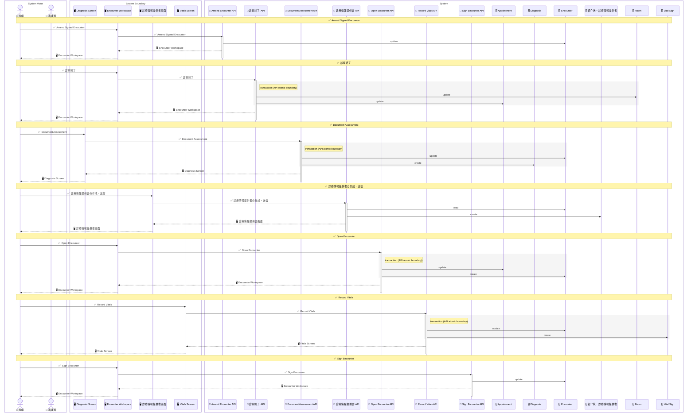

### 3.5 Orders and Results

| 項目 | 内容 |
|---|---|
| BUC | `BucOrdersResults` |
| Business | `CareDelivery` |
| 主な actor | Clinician, Nurse, MedicalClerk（医師事務作業補助者） |
| 必要権限 | `ClinicalOrderWrite`, `ProxyOrderEntry`, `LabResultManage`, `PatientMessageSend` |
| 主なデータ | `ClinicalOrder`, `LabResult`, `Charge`, `Notification`, `PatientMessage` |

検査オーダーから結果確認、重要結果通知までを扱う。医師事務作業補助者や看護師がオーダを代行入力した場合、医師が確定するまで看護師は採血しない（保助看法 第37条）。この規則は `OrderConfirmedByPhysician` 条件と `forbidden(ClinicalOrder, status == clcollected, physician_confirmed == false)` で検証する。外注検査の結果は外注検査システムから届く。採血管ラベルの発行と実施内容（コスト）の登録が会計計算の入力になる。

レビュー観点:

- 代行入力オーダが医師の確定前に採血へ進まないことが、状態検証で示されているか。
- RegisterPerformedProcedure が作る Charge を、会計計算入力が読めるか。
- NotifyCriticalResult は結果確認イベントから起動されるため、手動 UC と自動 UC の違いをレビューできるか。

#### Orders and Results RDRA Layered Graph 図

生成コマンド:

```sh
rdra-ish diagram samples/clinic-ops --kind rdra --format mermaid --buc BucOrdersResults --out samples/clinic-ops/out/buc/object_graph_orders_results
```

```mermaid
flowchart LR
  subgraph layer_value[System Value]
    direction TB
    Nurse(["👤 看護師"])
    MessagingGateway[/"🌐 Messaging Gateway"/]
    OutsourcedLabSystem[/"🌐 外注検査システム"/]
  end
  subgraph layer_environment[External Environment]
    direction TB
    CareDelivery["💼 Care Delivery"]
    PatientAccess["💼 Patient Access"]
    BucFollowupCare["📦 Coordinate Follow-Up Care"]
    BucOrdersResults["📦 Manage Orders and Results"]
    BucPatientOnboarding["📦 Onboard and Maintain Patient"]
    IntakeExpiryCheck["⏱️ Nightly intake expiry check"]
    CareCoordinationConsole[/"📱 Care Coordination Console"/]
    ClinicalWorkstation[/"📱 Clinical Workstation"/]
    FrontDeskTerminal[/"📱 Front Desk Terminal"/]
    NurseStation[/"📱 Nurse Station"/]
    PatientMobile[/"📱 Patient Mobile"/]
    ClinicalOrderWrite["🔑 Clinical Order Write"]
    ConsentCapture["🔑 Consent Capture"]
    FollowUpManage["🔑 Follow-Up Manage"]
    InsuranceVerify["🔑 Insurance Verify"]
    IntakeManage["🔑 Intake Manage"]
    LabResultManage["🔑 Lab Result Manage"]
    PatientMessageSend["🔑 Patient Message Send"]
    PatientProfileRead["🔑 Patient Profile Read"]
    PatientProfileWrite["🔑 Patient Profile Write"]
    ProxyOrderEntry["🔑 代行入力"]
    ScheduleRead["🔑 Schedule Read"]
    ScheduleWrite["🔑 Schedule Write"]
  end
  subgraph layer_boundary[System Boundary]
    direction TB
    ArchivePatient(["✅ Archive Patient"])
    CancelClinicalOrder(["✅ Cancel Clinical Order"])
    CaptureConsent(["✅ Capture Consent"])
    CloseCarePlan(["✅ Close Care Plan"])
    CollectSpecimen(["✅ Collect Specimen"])
    CompleteIntakeForms(["✅ Complete Intake Forms"])
    ConfirmProxyOrder(["✅ 代行入力オーダの確定"])
    CreateCarePlan(["✅ Create Care Plan"])
    EnterProxyOrder(["✅ 検体検査オーダの代行入力"])
    ExpireIntakeForms(["✅ Expire Intake Forms"])
    MergeDuplicatePatient(["✅ Merge Duplicate Patient"])
    NotifyCriticalResult(["✅ Notify Critical Result"])
    NotifyPatientResult(["✅ Notify Patient Result"])
    PlaceLabOrder(["✅ Place Lab Order"])
    PrintSpecimenLabel(["✅ 採血管ラベル発行・貼付"])
    ReceiveLabResult(["✅ Receive Lab Result"])
    RegisterPatient(["✅ Register Patient"])
    RegisterPerformedProcedure(["✅ 実施内容（コスト）の登録"])
    ReviewLabResult(["✅ Review Lab Result"])
    ReviewPatientResponse(["✅ Review Patient Response"])
    ScheduleFollowUpVisit(["✅ Schedule Follow-Up Visit"])
    SearchPatient(["✅ Search Patient"])
    SendAppointmentNotice(["✅ Send Appointment Notice"])
    SendFollowUpMessage(["✅ Send Follow-Up Message"])
    SendIntakeForms(["✅ Send Intake Forms"])
    UpdateDemographics(["✅ Update Demographics"])
    VerifyInsurance(["✅ 保険資格・限度額情報の登録（新患登録）"])
    AppointmentNoticeScreen[["🖥️ Appointment Notice Screen"]]
    CarePlanScreen[["🖥️ Care Plan Screen"]]
    ConsentScreen[["🖥️ Consent Capture Screen"]]
    CriticalNoticeScreen[["🖥️ Critical Result Notice Screen"]]
    FollowUpScheduleScreen[["🖥️ Follow-Up Schedule Screen"]]
    InsuranceScreen[["🖥️ Insurance Verification Screen"]]
    IntakePortalScreen[["🖥️ Intake Portal Screen"]]
    OrderEntryScreen[["🖥️ Order Entry Screen"]]
    PatientMessageScreen[["🖥️ Patient Message Screen"]]
    PatientProfileScreen[["🖥️ Patient Profile Screen"]]
    PatientSearchScreen[["🖥️ Patient Search Screen"]]
    ResultReviewScreen[["🖥️ Result Review Screen"]]
    SpecimenScreen[["🖥️ Specimen Collection Screen"]]
    EvAppointmentCancelled{"⚡ Appointment Cancelled"}
    EvAppointmentRescheduled{"⚡ Appointment Rescheduled"}
    EvAppointmentScheduled{"⚡ Appointment Scheduled"}
    EvClinicalOrderReviewed{"⚡ Clinical Result Reviewed"}
    EvEncounterSigned{"⚡ Encounter Signed"}
    EvLabResultReceived{"⚡ Lab Result Received"}
  end
  subgraph layer_system[System]
    direction TB
    AppointmentNoticeApi["🔌 Appointment Notice API"]
    CollectSpecimenApi["🔌 Collect Specimen API"]
    ConfirmOrderApi["🔌 オーダ確定 API"]
    ConsentApi["🔌 Consent API"]
    CreateCarePlanApi["🔌 Create Care Plan API"]
    CriticalNoticeApi["🔌 Critical Notice API"]
    EligibilityApi["🔌 Eligibility API"]
    FollowUpScheduleApi["🔌 Follow-Up Schedule API"]
    IntakeMessagingApi["🔌 Intake Messaging API"]
    NotifyPatientResultApi["🔌 Notify Patient Result API"]
    OrderEntryApi["🔌 Order Entry API"]
    PerformedProcedureApi["🔌 実施登録 API"]
    ProxyOrderApi["🔌 代行入力 API"]
    ReceiveLabResultApi["🔌 Receive Lab Result API"]
    RegisterPatientApi["🔌 Register Patient API"]
    ResultReviewApi["🔌 Result Review API"]
    SearchPatientApi["🔌 Search Patient API"]
    SendFollowUpMessageApi["🔌 Send Follow-Up Message API"]
    UpdateDemographicsApi["🔌 Update Demographics API"]
    Appointment[("🗄️ Appointment")]
    CarePlan[("🗄️ Care Plan")]
    Charge[("🗄️ Charge")]
    ClinicalOrder[("🗄️ Clinical Order")]
    ConsentRecord[("🗄️ Consent Record")]
    EligibilityCheck[("🗄️ 資格確認")]
    Encounter[("🗄️ Encounter")]
    InsurancePolicy[("🗄️ 保険資格")]
    IntakePacket[("🗄️ Intake Packet")]
    LabResult[("🗄️ Lab Result")]
    Notification[("🗄️ Notification")]
    PatientAccount[("🗄️ Patient Account")]
    PatientMessage[("🗄️ Patient Message")]
    PatientProfile[("🗄️ Patient Profile")]
    ProviderSchedule[("🗄️ Provider Schedule")]
    OrderConfirmedByPhysician{"🔀 医師が確定したオーダ"}
  end
  Nurse -.->|has_permission| ProxyOrderEntry
  Nurse -.->|has_permission| ClinicalOrderWrite
  Nurse -.->|has_permission| LabResultManage
  Nurse -->|performs| BucOrdersResults
  Nurse -->|performs| PrintSpecimenLabel
  Nurse -->|performs| CollectSpecimen
  Nurse -->|performs| RegisterPerformedProcedure
  Nurse -->|performs| ReceiveLabResult
  CreateCarePlanApi -.->|creates| CarePlan
  CreateCarePlanApi -.->|reads| Encounter
  CreateCarePlanApi -.->|requires_permission| FollowUpManage
  SendFollowUpMessageApi -.->|creates| PatientMessage
  SendFollowUpMessageApi -.->|requires_permission| PatientMessageSend
  FollowUpScheduleApi -.->|creates| Appointment
  FollowUpScheduleApi -.->|requires_permission| ScheduleWrite
  FollowUpScheduleApi -.->|updates| ProviderSchedule
  NotifyPatientResultApi -.->|creates| Notification
  NotifyPatientResultApi -.->|requires_permission| PatientMessageSend
  OrderEntryApi -.->|creates| ClinicalOrder
  OrderEntryApi -.->|reads| Encounter
  OrderEntryApi -.->|requires_permission| ClinicalOrderWrite
  ProxyOrderApi -.->|creates| ClinicalOrder
  ProxyOrderApi -.->|reads| Encounter
  ProxyOrderApi -.->|requires_permission| ProxyOrderEntry
  ConfirmOrderApi -.->|requires_permission| ClinicalOrderWrite
  ConfirmOrderApi -.->|updates| ClinicalOrder
  PerformedProcedureApi -.->|creates| Charge
  PerformedProcedureApi -.->|reads| Encounter
  PerformedProcedureApi -.->|reads| ClinicalOrder
  PerformedProcedureApi -.->|requires_permission| ClinicalOrderWrite
  CollectSpecimenApi -.->|requires_permission| ClinicalOrderWrite
  CollectSpecimenApi -.->|updates| ClinicalOrder
  ReceiveLabResultApi -.->|creates| LabResult
  ReceiveLabResultApi -.->|requires_permission| LabResultManage
  ReceiveLabResultApi -.->|updates| ClinicalOrder
  ResultReviewApi -.->|requires_permission| LabResultManage
  ResultReviewApi -.->|updates| ClinicalOrder
  ResultReviewApi -.->|updates| LabResult
  CriticalNoticeApi -.->|creates| PatientMessage
  CriticalNoticeApi -.->|creates| Notification
  CriticalNoticeApi -.->|requires_permission| PatientMessageSend
  SearchPatientApi -.->|reads| PatientAccount
  SearchPatientApi -.->|reads| PatientProfile
  SearchPatientApi -.->|requires_permission| PatientProfileRead
  RegisterPatientApi -.->|creates| PatientAccount
  RegisterPatientApi -.->|creates| PatientProfile
  RegisterPatientApi -.->|requires_permission| PatientProfileWrite
  UpdateDemographicsApi -.->|requires_permission| PatientProfileWrite
  UpdateDemographicsApi -.->|updates| PatientProfile
  EligibilityApi -.->|creates| EligibilityCheck
  EligibilityApi -.->|reads| InsurancePolicy
  EligibilityApi -.->|requires_permission| InsuranceVerify
  EligibilityApi -.->|updates| InsurancePolicy
  ConsentApi -.->|creates| ConsentRecord
  ConsentApi -.->|requires_permission| ConsentCapture
  IntakeMessagingApi -.->|creates| PatientMessage
  IntakeMessagingApi -.->|creates| IntakePacket
  IntakeMessagingApi -.->|requires_permission| PatientMessageSend
  AppointmentNoticeApi -.->|creates| PatientMessage
  AppointmentNoticeApi -.->|creates| Notification
  BucFollowupCare -.->|belongs| PatientAccess
  BucFollowupCare -->|contains| CreateCarePlan
  BucFollowupCare -->|contains| SendFollowUpMessage
  BucFollowupCare -->|contains| ReviewPatientResponse
  BucFollowupCare -->|contains| ScheduleFollowUpVisit
  BucFollowupCare -->|contains| CloseCarePlan
  BucFollowupCare -->|contains| NotifyPatientResult
  BucOrdersResults -.->|belongs| CareDelivery
  BucOrdersResults -->|contains| PlaceLabOrder
  BucOrdersResults -->|contains| EnterProxyOrder
  BucOrdersResults -->|contains| ConfirmProxyOrder
  BucOrdersResults -->|contains| PrintSpecimenLabel
  BucOrdersResults -->|contains| CollectSpecimen
  BucOrdersResults -->|contains| RegisterPerformedProcedure
  BucOrdersResults -->|contains| ReceiveLabResult
  BucOrdersResults -->|contains| ReviewLabResult
  BucOrdersResults -->|contains| NotifyCriticalResult
  BucOrdersResults -->|contains| CancelClinicalOrder
  BucPatientOnboarding -.->|belongs| PatientAccess
  BucPatientOnboarding -->|contains| SearchPatient
  BucPatientOnboarding -->|contains| RegisterPatient
  BucPatientOnboarding -->|contains| UpdateDemographics
  BucPatientOnboarding -->|contains| VerifyInsurance
  BucPatientOnboarding -->|contains| CaptureConsent
  BucPatientOnboarding -->|contains| SendIntakeForms
  BucPatientOnboarding -->|contains| CompleteIntakeForms
  BucPatientOnboarding -->|contains| ExpireIntakeForms
  BucPatientOnboarding -->|contains| MergeDuplicatePatient
  BucPatientOnboarding -->|contains| ArchivePatient
  OrderConfirmedByPhysician -.->|applies_to| CollectSpecimen
  OrderConfirmedByPhysician -.->|combines| ClinicalOrder
  Appointment ---|N:1| PatientAccount
  Encounter ---|N:1| PatientAccount
  Encounter ---|1:1| Appointment
  ClinicalOrder ---|N:1| Encounter
  LabResult ---|1:1| ClinicalOrder
  Charge ---|N:1| Encounter
  CarePlan ---|N:1| Encounter
  CarePlan ---|N:1| PatientAccount
  PatientMessage ---|N:1| PatientAccount
  Notification ---|N:1| PatientAccount
  PatientProfile ---|1:1| PatientAccount
  InsurancePolicy ---|N:1| PatientAccount
  EligibilityCheck ---|N:1| InsurancePolicy
  ConsentRecord ---|N:1| PatientAccount
  IntakePacket ---|N:1| PatientAccount
  EvAppointmentScheduled -.->|triggers| BucPatientOnboarding
  EvAppointmentScheduled -.->|triggers| MessagingGateway
  EvAppointmentScheduled -.->|triggers| SendIntakeForms
  EvAppointmentScheduled -.->|triggers| SendAppointmentNotice
  EvAppointmentRescheduled -.->|triggers| MessagingGateway
  EvAppointmentRescheduled -.->|triggers| SendAppointmentNotice
  EvAppointmentCancelled -.->|triggers| MessagingGateway
  EvAppointmentCancelled -.->|triggers| SendAppointmentNotice
  EvEncounterSigned -.->|triggers| BucFollowupCare
  EvEncounterSigned -.->|triggers| BucOrdersResults
  EvEncounterSigned -.->|triggers| CreateCarePlan
  EvEncounterSigned -.->|triggers| PlaceLabOrder
  EvClinicalOrderReviewed -.->|triggers| BucFollowupCare
  EvClinicalOrderReviewed -.->|triggers| NotifyPatientResult
  EvClinicalOrderReviewed -.->|triggers| NotifyCriticalResult
  EvLabResultReceived -.->|triggers| ReceiveLabResult
  OutsourcedLabSystem -.->|raises| EvLabResultReceived
  PatientSearchScreen -.->|shows| PatientAccount
  PatientProfileScreen -.->|shows| PatientProfile
  IntakeExpiryCheck -.->|triggers| ExpireIntakeForms
  CreateCarePlan -.->|displays| CarePlanScreen
  CreateCarePlan -.->|invokes| CreateCarePlanApi
  CreateCarePlan -.->|requires_medium| CareCoordinationConsole
  CreateCarePlan -.->|requires_permission| FollowUpManage
  SendFollowUpMessage -.->|displays| PatientMessageScreen
  SendFollowUpMessage -.->|invokes| SendFollowUpMessageApi
  SendFollowUpMessage -.->|requires_medium| CareCoordinationConsole
  SendFollowUpMessage -.->|requires_permission| PatientMessageSend
  ReviewPatientResponse -.->|displays| CarePlanScreen
  ReviewPatientResponse -.->|requires_medium| CareCoordinationConsole
  ReviewPatientResponse -.->|requires_permission| FollowUpManage
  ReviewPatientResponse -.->|updates| CarePlan
  ReviewPatientResponse -.->|updates| PatientMessage
  ScheduleFollowUpVisit -.->|displays| FollowUpScheduleScreen
  ScheduleFollowUpVisit -.->|invokes| FollowUpScheduleApi
  ScheduleFollowUpVisit -.->|raises| EvAppointmentScheduled
  ScheduleFollowUpVisit -.->|requires_medium| CareCoordinationConsole
  ScheduleFollowUpVisit -.->|requires_permission| FollowUpManage
  ScheduleFollowUpVisit -.->|requires_permission| ScheduleWrite
  CloseCarePlan -.->|displays| CarePlanScreen
  CloseCarePlan -.->|requires_medium| CareCoordinationConsole
  CloseCarePlan -.->|requires_permission| FollowUpManage
  CloseCarePlan -.->|updates| CarePlan
  NotifyPatientResult -.->|displays| PatientMessageScreen
  NotifyPatientResult -.->|invokes| NotifyPatientResultApi
  NotifyPatientResult -.->|requires_medium| CareCoordinationConsole
  NotifyPatientResult -.->|requires_permission| PatientMessageSend
  PlaceLabOrder -.->|displays| OrderEntryScreen
  PlaceLabOrder -.->|invokes| OrderEntryApi
  PlaceLabOrder -.->|requires_medium| ClinicalWorkstation
  PlaceLabOrder -.->|requires_permission| ClinicalOrderWrite
  EnterProxyOrder -.->|displays| OrderEntryScreen
  EnterProxyOrder -.->|invokes| ProxyOrderApi
  EnterProxyOrder -.->|requires_medium| ClinicalWorkstation
  EnterProxyOrder -.->|requires_permission| ProxyOrderEntry
  ConfirmProxyOrder -.->|displays| OrderEntryScreen
  ConfirmProxyOrder -.->|invokes| ConfirmOrderApi
  ConfirmProxyOrder -.->|requires_medium| ClinicalWorkstation
  ConfirmProxyOrder -.->|requires_permission| ClinicalOrderWrite
  PrintSpecimenLabel -.->|displays| SpecimenScreen
  PrintSpecimenLabel -.->|reads| ClinicalOrder
  PrintSpecimenLabel -.->|requires_medium| NurseStation
  PrintSpecimenLabel -.->|requires_permission| ClinicalOrderWrite
  CollectSpecimen -.->|displays| SpecimenScreen
  CollectSpecimen -.->|invokes| CollectSpecimenApi
  CollectSpecimen -.->|requires_medium| NurseStation
  CollectSpecimen -.->|requires_permission| ClinicalOrderWrite
  RegisterPerformedProcedure -.->|displays| SpecimenScreen
  RegisterPerformedProcedure -.->|invokes| PerformedProcedureApi
  RegisterPerformedProcedure -.->|requires_medium| NurseStation
  RegisterPerformedProcedure -.->|requires_permission| ClinicalOrderWrite
  ReceiveLabResult -.->|displays| ResultReviewScreen
  ReceiveLabResult -.->|invokes| ReceiveLabResultApi
  ReceiveLabResult -.->|requires_medium| NurseStation
  ReceiveLabResult -.->|requires_permission| LabResultManage
  ReviewLabResult -.->|displays| ResultReviewScreen
  ReviewLabResult -.->|invokes| ResultReviewApi
  ReviewLabResult -.->|raises| EvClinicalOrderReviewed
  ReviewLabResult -.->|requires_medium| ClinicalWorkstation
  ReviewLabResult -.->|requires_permission| LabResultManage
  NotifyCriticalResult -.->|displays| CriticalNoticeScreen
  NotifyCriticalResult -.->|invokes| CriticalNoticeApi
  NotifyCriticalResult -.->|requires_medium| ClinicalWorkstation
  NotifyCriticalResult -.->|requires_permission| LabResultManage
  NotifyCriticalResult -.->|requires_permission| PatientMessageSend
  CancelClinicalOrder -.->|displays| OrderEntryScreen
  CancelClinicalOrder -.->|requires_medium| ClinicalWorkstation
  CancelClinicalOrder -.->|requires_permission| ClinicalOrderWrite
  CancelClinicalOrder -.->|updates| ClinicalOrder
  SearchPatient -.->|displays| PatientSearchScreen
  SearchPatient -.->|invokes| SearchPatientApi
  SearchPatient -.->|requires_medium| FrontDeskTerminal
  SearchPatient -.->|requires_permission| PatientProfileRead
  RegisterPatient -.->|displays| PatientProfileScreen
  RegisterPatient -.->|invokes| RegisterPatientApi
  RegisterPatient -.->|requires_medium| FrontDeskTerminal
  RegisterPatient -.->|requires_permission| PatientProfileWrite
  UpdateDemographics -.->|displays| PatientProfileScreen
  UpdateDemographics -.->|invokes| UpdateDemographicsApi
  UpdateDemographics -.->|requires_medium| FrontDeskTerminal
  UpdateDemographics -.->|requires_permission| PatientProfileWrite
  VerifyInsurance -.->|displays| InsuranceScreen
  VerifyInsurance -.->|invokes| EligibilityApi
  VerifyInsurance -.->|requires_medium| FrontDeskTerminal
  VerifyInsurance -.->|requires_permission| InsuranceVerify
  CaptureConsent -.->|displays| ConsentScreen
  CaptureConsent -.->|invokes| ConsentApi
  CaptureConsent -.->|requires_medium| PatientMobile
  CaptureConsent -.->|requires_permission| ConsentCapture
  SendIntakeForms -.->|displays| IntakePortalScreen
  SendIntakeForms -.->|invokes| IntakeMessagingApi
  SendIntakeForms -.->|requires_medium| FrontDeskTerminal
  SendIntakeForms -.->|requires_permission| IntakeManage
  CompleteIntakeForms -.->|displays| IntakePortalScreen
  CompleteIntakeForms -.->|requires_medium| PatientMobile
  CompleteIntakeForms -.->|requires_permission| ConsentCapture
  CompleteIntakeForms -.->|updates| IntakePacket
  ExpireIntakeForms -.->|displays| IntakePortalScreen
  ExpireIntakeForms -.->|requires_medium| FrontDeskTerminal
  ExpireIntakeForms -.->|requires_permission| IntakeManage
  ExpireIntakeForms -.->|updates| IntakePacket
  MergeDuplicatePatient -.->|displays| PatientProfileScreen
  MergeDuplicatePatient -.->|requires_medium| FrontDeskTerminal
  MergeDuplicatePatient -.->|requires_permission| PatientProfileWrite
  MergeDuplicatePatient -.->|updates| PatientAccount
  ArchivePatient -.->|displays| PatientProfileScreen
  ArchivePatient -.->|requires_medium| FrontDeskTerminal
  ArchivePatient -.->|requires_permission| PatientProfileWrite
  ArchivePatient -.->|updates| PatientAccount
  SendAppointmentNotice -.->|displays| AppointmentNoticeScreen
  SendAppointmentNotice -.->|invokes| AppointmentNoticeApi
  SendAppointmentNotice -.->|requires_medium| FrontDeskTerminal
  SendAppointmentNotice -.->|requires_permission| ScheduleRead
```

#### Orders and Results sequence 図

生成コマンド:

```sh
rdra-ish diagram samples/clinic-ops --kind sequence --format mermaid --buc BucOrdersResults --out samples/clinic-ops/out/buc/sequence_orders_results
```

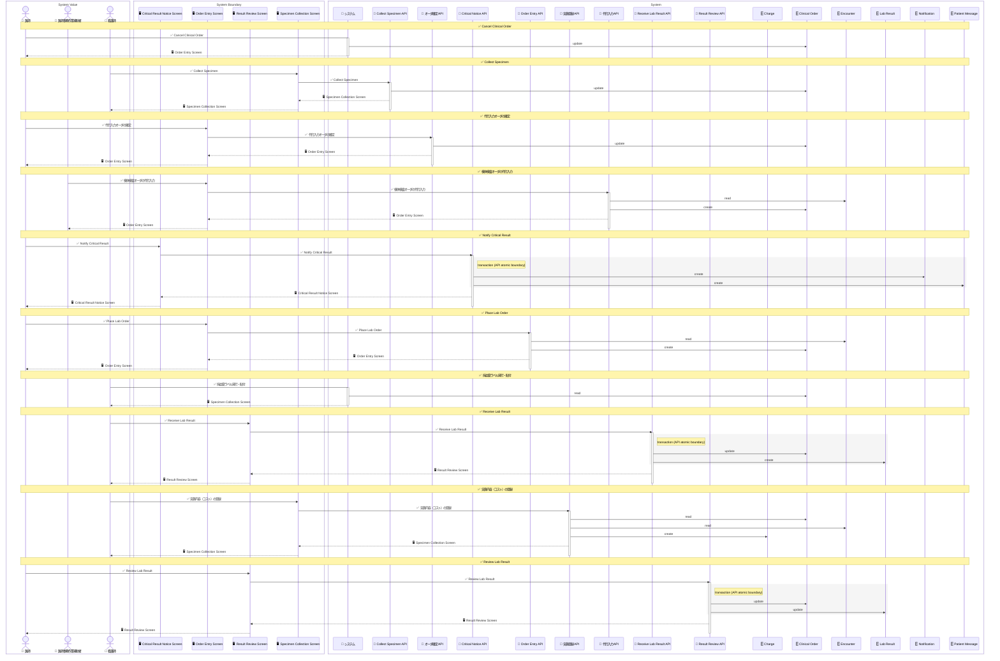

### 3.6 処方

| 項目 | 内容 |
|---|---|
| BUC | `BucPrescriptionFulfillment` |
| Business | `CareDelivery` |
| 主な actor | Clinician（医師）, Pharmacist（薬剤師） |
| 必要権限 | `PrescriptionWrite`, `PrescriptionDispense` |
| 主なデータ | `Prescription`, `Medication`, `Encounter` |

処方オーダから院外処方箋の発行、院内処方の調剤・監査・服薬指導・交付、疑義照会までを扱う。院外処方箋は電子処方箋管理サービスへ登録し、患者が選ぶ保険薬局で調剤される。病院は特定の保険薬局を指示しない（療担規則 第2条の5）ので、`Prescription` は薬局を持たない。使用期間は交付日を含めて4日以内で、日数は DSL で数えられないためタイマーで期限切れにする。薬剤師は疑わしい点があれば医師に問い合わせ、回答までは調剤しない。

レビュー観点:

- 院外（rxissued）と院内（rxvoucher → rxaudited → rxcounseled → rxdispensed）の経路が状態で区別できるか。
- 疑義照会中（rxinquiry）の処方箋が調剤・監査に進まないか。
- 使用期間切れ（rxexpired）が院外処方箋にだけ起きることが業務と合うか。

#### 処方 RDRA Layered Graph 図

生成コマンド:

```sh
rdra-ish diagram samples/clinic-ops --kind rdra --format mermaid --buc BucPrescriptionFulfillment --out samples/clinic-ops/out/buc/object_graph_prescription_fulfillment
```

```mermaid
flowchart LR
  subgraph layer_value[System Value]
    direction TB
    Clinician(["👤 医師"])
    EPrescriptionService[/"🌐 電子処方箋管理サービス"/]
    InsurancePharmacy[/"🌐 保険薬局"/]
  end
  subgraph layer_environment[External Environment]
    direction TB
    CareDelivery["💼 Care Delivery"]
    BucPrescriptionFulfillment["📦 処方"]
    PrescriptionFlow["🧭 処方の流れ"]
    CounselStep(["➡️ 服薬指導・薬剤交付"])
    DispenseStep(["➡️ 調剤・監査"])
    InhouseStep(["➡️ 院内処方（引換券）"])
    InquiryStep(["➡️ 疑義照会"])
    OrderStep(["➡️ 処方オーダ"])
    OutsideStep(["➡️ 院外処方箋（電子処方箋管理サービス）"])
    PharmacyStep(["➡️ 保険薬局での調剤"])
    PrescriptionUsePeriodCheck["⏱️ 処方箋の使用期間切れ確認"]
    ClinicalWorkstation[/"📱 Clinical Workstation"/]
    PharmacyWorkstation[/"📱 薬剤部端末"/]
    PrescriptionDispense["🔑 Prescription Dispense"]
    PrescriptionWrite["🔑 Prescription Write"]
  end
  subgraph layer_boundary[System Boundary]
    direction TB
    AnswerPharmacyInquiry(["✅ 保険薬局からの疑義照会への回答"])
    AnswerPrescriptionInquiry(["✅ 疑義照会への回答"])
    CancelPrescription(["✅ 処方の取消"])
    ConfirmDispense(["✅ 保険薬局での調剤結果の受信"])
    CounselMedication(["✅ 服薬指導"])
    DispenseAndAudit(["✅ 調剤・監査"])
    DraftPrescription(["✅ 処方オーダの登録"])
    ExpirePrescription(["✅ 処方箋の使用期間切れ"])
    HandOverMedication(["✅ 薬剤交付"])
    IssueInhouseVoucher(["✅ 院内処方用引換券の交付"])
    IssueOutsidePrescription(["✅ 院外処方箋の発行"])
    IssueRefillPrescription(["✅ リフィル処方箋の処方オーダ"])
    RaisePrescriptionInquiry(["✅ 疑義照会"])
    SearchMedication(["✅ Search Medication"])
    DispensingScreen[["🖥️ 調剤・監査画面"]]
    MedicationSearchScreen[["🖥️ Medication Search Screen"]]
    PharmacyStatusScreen[["🖥️ 電子処方箋の状況画面"]]
    PrescriptionScreen[["🖥️ 処方画面"]]
    DispensedAtField[["🔤 交付日時"]]
    RefillLimitField[["🔤 リフィルの使用回数の上限"]]
    UsePeriodField[["🔤 使用期間（日）"]]
    EvPharmacyInquiry{"⚡ 保険薬局からの疑義照会"}
    EvPrescriptionDispensed{"⚡ Prescription Dispensed"}
    EvPrescriptionIssued{"⚡ 電子処方箋の登録"}
  end
  subgraph layer_system[System]
    direction TB
    ConfirmDispenseApi["🔌 調剤結果 API"]
    DispensingApi["🔌 院内調剤 API"]
    DraftPrescriptionApi["🔌 処方オーダ API"]
    IssuePrescriptionApi["🔌 処方箋発行 API"]
    MedicationCatalogApi["🔌 Medication Catalog API"]
    PrescriptionInquiryApi["🔌 疑義照会 API"]
    Encounter[("🗄️ Encounter")]
    Medication[("🗄️ Medication")]
    Prescription[("🗄️ 処方箋")]
  end
  Clinician -.->|has_permission| PrescriptionWrite
  Clinician -->|performs| BucPrescriptionFulfillment
  Clinician -->|performs| SearchMedication
  Clinician -->|performs| DraftPrescription
  Clinician -->|performs| IssueRefillPrescription
  Clinician -->|performs| IssueOutsidePrescription
  Clinician -->|performs| IssueInhouseVoucher
  Clinician -->|performs| AnswerPrescriptionInquiry
  Clinician -->|performs| AnswerPharmacyInquiry
  Clinician -->|performs| CancelPrescription
  MedicationCatalogApi -.->|reads| Medication
  MedicationCatalogApi -.->|requires_permission| PrescriptionWrite
  DraftPrescriptionApi -.->|creates| Prescription
  DraftPrescriptionApi -.->|reads| Encounter
  DraftPrescriptionApi -.->|requires_permission| PrescriptionWrite
  IssuePrescriptionApi -.->|requires_permission| PrescriptionWrite
  IssuePrescriptionApi -.->|updates| Prescription
  DispensingApi -.->|requires_permission| PrescriptionDispense
  DispensingApi -.->|updates| Prescription
  ConfirmDispenseApi -.->|updates| Prescription
  PrescriptionInquiryApi -.->|requires_permission| PrescriptionWrite
  PrescriptionInquiryApi -.->|updates| Prescription
  BucPrescriptionFulfillment -.->|belongs| CareDelivery
  BucPrescriptionFulfillment -->|contains| PrescriptionFlow
  BucPrescriptionFulfillment -->|contains| SearchMedication
  BucPrescriptionFulfillment -->|contains| DraftPrescription
  BucPrescriptionFulfillment -->|contains| IssueRefillPrescription
  BucPrescriptionFulfillment -->|contains| IssueOutsidePrescription
  BucPrescriptionFulfillment -->|contains| IssueInhouseVoucher
  BucPrescriptionFulfillment -->|contains| DispenseAndAudit
  BucPrescriptionFulfillment -->|contains| CounselMedication
  BucPrescriptionFulfillment -->|contains| HandOverMedication
  BucPrescriptionFulfillment -->|contains| RaisePrescriptionInquiry
  BucPrescriptionFulfillment -->|contains| AnswerPrescriptionInquiry
  BucPrescriptionFulfillment -->|contains| AnswerPharmacyInquiry
  BucPrescriptionFulfillment -->|contains| ConfirmDispense
  BucPrescriptionFulfillment -->|contains| ExpirePrescription
  BucPrescriptionFulfillment -->|contains| CancelPrescription
  Prescription ---|N:1| Encounter
  Prescription ---|N:1| Medication
  EvPharmacyInquiry -.->|triggers| AnswerPharmacyInquiry
  EvPrescriptionIssued -.->|triggers| EPrescriptionService
  EvPrescriptionDispensed -.->|triggers| ConfirmDispense
  EPrescriptionService -.->|raises| EvPrescriptionDispensed
  InsurancePharmacy -.->|raises| EvPharmacyInquiry
  UsePeriodField -.->|maps_field| Prescription
  RefillLimitField -.->|maps_field| Prescription
  DispensedAtField -.->|maps_field| Prescription
  PrescriptionFlow -->|contains| OrderStep
  PrescriptionFlow -->|contains| OutsideStep
  PrescriptionFlow -->|contains| InhouseStep
  PrescriptionFlow -->|contains| DispenseStep
  PrescriptionFlow -->|contains| InquiryStep
  PrescriptionFlow -->|contains| CounselStep
  PrescriptionFlow -->|contains| PharmacyStep
  MedicationSearchScreen -.->|shows| Medication
  PrescriptionScreen -->|contains| UsePeriodField
  PrescriptionScreen -->|contains| RefillLimitField
  DispensingScreen -->|contains| DispensedAtField
  OrderStep -.->|branches| InhouseStep
  OrderStep -.->|covers| DraftPrescription
  OrderStep -.->|covers| IssueRefillPrescription
  OrderStep -.->|precedes| OutsideStep
  OutsideStep -.->|covers| IssueOutsidePrescription
  OutsideStep -.->|precedes| PharmacyStep
  InhouseStep -.->|covers| IssueInhouseVoucher
  InhouseStep -.->|precedes| DispenseStep
  DispenseStep -.->|covers| DispenseAndAudit
  DispenseStep -.->|excepts| InquiryStep
  DispenseStep -.->|precedes| CounselStep
  InquiryStep -.->|covers| RaisePrescriptionInquiry
  InquiryStep -.->|covers| AnswerPrescriptionInquiry
  InquiryStep -.->|repeats| DispenseStep
  CounselStep -.->|covers| CounselMedication
  CounselStep -.->|covers| HandOverMedication
  PharmacyStep -.->|covers| AnswerPharmacyInquiry
  PharmacyStep -.->|covers| ConfirmDispense
  PrescriptionUsePeriodCheck -.->|triggers| ExpirePrescription
  SearchMedication -.->|displays| MedicationSearchScreen
  SearchMedication -.->|invokes| MedicationCatalogApi
  SearchMedication -.->|requires_medium| ClinicalWorkstation
  SearchMedication -.->|requires_permission| PrescriptionWrite
  DraftPrescription -.->|displays| PrescriptionScreen
  DraftPrescription -.->|invokes| DraftPrescriptionApi
  DraftPrescription -.->|requires_medium| ClinicalWorkstation
  DraftPrescription -.->|requires_permission| PrescriptionWrite
  IssueRefillPrescription -.->|displays| PrescriptionScreen
  IssueRefillPrescription -.->|invokes| DraftPrescriptionApi
  IssueRefillPrescription -.->|requires_medium| ClinicalWorkstation
  IssueRefillPrescription -.->|requires_permission| PrescriptionWrite
  IssueOutsidePrescription -.->|displays| PrescriptionScreen
  IssueOutsidePrescription -.->|invokes| IssuePrescriptionApi
  IssueOutsidePrescription -.->|raises| EvPrescriptionIssued
  IssueOutsidePrescription -.->|requires_medium| ClinicalWorkstation
  IssueOutsidePrescription -.->|requires_permission| PrescriptionWrite
  IssueInhouseVoucher -.->|displays| PrescriptionScreen
  IssueInhouseVoucher -.->|invokes| IssuePrescriptionApi
  IssueInhouseVoucher -.->|requires_medium| ClinicalWorkstation
  IssueInhouseVoucher -.->|requires_permission| PrescriptionWrite
  DispenseAndAudit -.->|displays| DispensingScreen
  DispenseAndAudit -.->|invokes| DispensingApi
  DispenseAndAudit -.->|requires_medium| PharmacyWorkstation
  DispenseAndAudit -.->|requires_permission| PrescriptionDispense
  CounselMedication -.->|displays| DispensingScreen
  CounselMedication -.->|invokes| DispensingApi
  CounselMedication -.->|requires_medium| PharmacyWorkstation
  CounselMedication -.->|requires_permission| PrescriptionDispense
  HandOverMedication -.->|displays| DispensingScreen
  HandOverMedication -.->|invokes| DispensingApi
  HandOverMedication -.->|requires_medium| PharmacyWorkstation
  HandOverMedication -.->|requires_permission| PrescriptionDispense
  RaisePrescriptionInquiry -.->|displays| DispensingScreen
  RaisePrescriptionInquiry -.->|invokes| DispensingApi
  RaisePrescriptionInquiry -.->|requires_medium| PharmacyWorkstation
  RaisePrescriptionInquiry -.->|requires_permission| PrescriptionDispense
  AnswerPrescriptionInquiry -.->|displays| PrescriptionScreen
  AnswerPrescriptionInquiry -.->|invokes| PrescriptionInquiryApi
  AnswerPrescriptionInquiry -.->|requires_medium| ClinicalWorkstation
  AnswerPrescriptionInquiry -.->|requires_permission| PrescriptionWrite
  AnswerPharmacyInquiry -.->|displays| PrescriptionScreen
  AnswerPharmacyInquiry -.->|invokes| PrescriptionInquiryApi
  AnswerPharmacyInquiry -.->|requires_medium| ClinicalWorkstation
  AnswerPharmacyInquiry -.->|requires_permission| PrescriptionWrite
  ConfirmDispense -.->|displays| PharmacyStatusScreen
  ConfirmDispense -.->|invokes| ConfirmDispenseApi
  ConfirmDispense -.->|requires_medium| PharmacyWorkstation
  ExpirePrescription -.->|displays| PharmacyStatusScreen
  ExpirePrescription -.->|invokes| ConfirmDispenseApi
  CancelPrescription -.->|displays| PrescriptionScreen
  CancelPrescription -.->|requires_medium| ClinicalWorkstation
  CancelPrescription -.->|requires_permission| PrescriptionWrite
  CancelPrescription -.->|updates| Prescription
```

#### 処方 sequence 図

生成コマンド:

```sh
rdra-ish diagram samples/clinic-ops --kind sequence --format mermaid --buc BucPrescriptionFulfillment --out samples/clinic-ops/out/buc/sequence_prescription_fulfillment
```

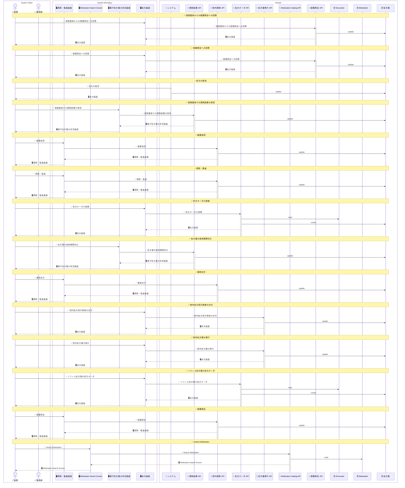

### 3.7 計算・会計

| 項目 | 内容 |
|---|---|
| BUC | `BucVisitPayment` |
| Business | `RevenueCycle` |
| 主な actor | AccountsClerk（医事課 会計担当） |
| 必要権限 | `BillCalculate`, `PaymentCollect` |
| 主なデータ | `Appointment`, `Charge`, `PaymentTransaction`, `AccountBalance`, `InsurancePolicy`, `SelectedTreatmentFeeSetting` |

診察の後の会計計算入力、患者の呼出、会計窓口または自動精算機での精算、領収証・明細書の交付を扱う。一部負担金は負担割合で計算し、限度額情報があれば窓口での支払は自己負担限度額までになる（`CopayCappedAtLimit`）。紹介状なしの初診で除外に当たらない場合は選定療養費を自費の Charge として算定する（`UnreferredFirstVisit`）。金額は病院の設定 `SelectedTreatmentFeeSetting` に置き、モデルは数値を持たない。

レビュー観点:

- 予約が 計算待ち → 会計待ち → 精算済 → 完了 と進み、受付時点で支払が発生しないか。
- 選定療養費の除外（救急搬送、初診時にそのまま入院 など）が `ReferralCategory` の値として説明できるか。
- 窓口精算と自動精算機の精算が同じ PaymentTransaction と未収金残高を更新してよいか。

#### 計算・会計 RDRA Layered Graph 図

生成コマンド:

```sh
rdra-ish diagram samples/clinic-ops --kind rdra --format mermaid --buc BucVisitPayment --out samples/clinic-ops/out/buc/object_graph_visit_payment
```

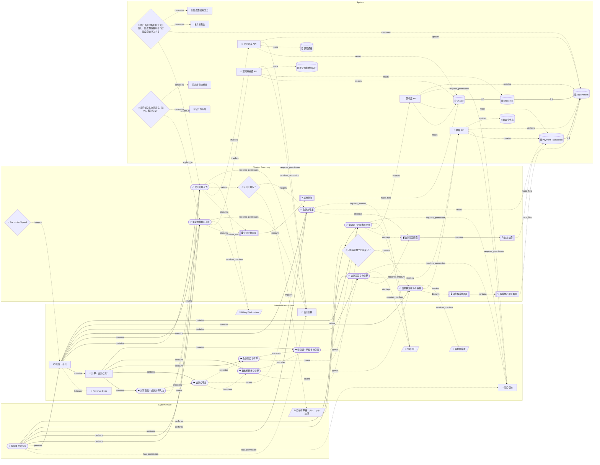

#### 計算・会計 sequence 図

生成コマンド:

```sh
rdra-ish diagram samples/clinic-ops --kind sequence --format mermaid --buc BucVisitPayment --out samples/clinic-ops/out/buc/sequence_visit_payment
```

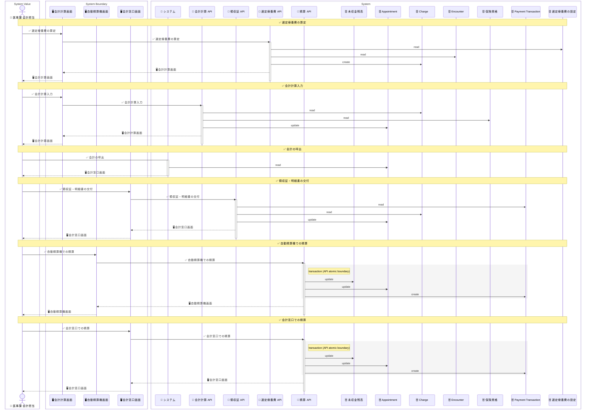

### 3.8 レセプト作成・請求

| 項目 | 内容 |
|---|---|
| BUC | `BucBillingClaims` |
| Business | `RevenueCycle` |
| 主な actor | ClaimsClerk（医事課 レセプト担当） |
| 必要権限 | `BillingClaimWrite`, `PaymentPost` |
| 主なデータ | `ClaimStatement`, `Charge`, `InsurancePolicy`, `AccountBalance` |

レセプト（患者 × 診療月 × 保険者）の作成・院内点検・請求と、審査支払機関（支払基金・国保連）からの受付不能・返戻・査定・支払への対応を扱う。前月分は翌月10日までに請求し、受付不能・要確認は11日・12日に再送する。返戻は訂正して当月分と併せて再請求できるが、査定は再請求できず再審査請求で争う。資格が変わったレセプトは審査支払機関が振替・分割するので返戻にならないが、負担割合が異なる変更や公費の分割はできず返戻になる。支払は診療の翌々月。期間のうち DSL で表せないもの（10日、11・12日、5日〜月末、3か月、翌々月）はタイマーとコメントで示す。

レビュー観点:

- 返戻（stmtreturned → stmtinspecting）と査定（stmtassessed → stmtrereview）の出口が区別されているか。
- 保留（月遅れ）と受付不能が、それぞれ請求前と請求後の状態として説明できるか。
- GenerateClaimStatement が Charge を更新しない（読むだけ）ことで、レセプトの検証が受診の状態から切り離されていることが妥当か。

#### レセプト作成・請求 RDRA Layered Graph 図

生成コマンド:

```sh
rdra-ish diagram samples/clinic-ops --kind rdra --format mermaid --buc BucBillingClaims --out samples/clinic-ops/out/buc/object_graph_billing_claims
```

```mermaid
flowchart LR
  subgraph layer_value[System Value]
    direction TB
    ClaimsClerk(["👤 医事課 レセプト担当"])
    ClaimsReviewOrganization[/"🌐 審査支払機関（支払基金・国保連）"/]
  end
  subgraph layer_environment[External Environment]
    direction TB
    RevenueCycle["💼 Revenue Cycle"]
    BucBillingClaims["📦 レセプト作成・請求"]
    ClaimCycleFlow["🧭 レセプトの月次サイクル"]
    AssessStep(["➡️ 査定と再審査請求"])
    CreateStatementStep(["➡️ レセプト作成（月初）"])
    HoldStep(["➡️ 保留（月遅れ）"])
    InspectStep(["➡️ 院内点検"])
    PaidStep(["➡️ 支払（診療翌々月）"])
    ReceiptErrorStep(["➡️ 受付不能・要確認の再送（11日・12日）"])
    ReturnStep(["➡️ 返戻と再請求"])
    ReviewStep(["➡️ 審査"])
    SubmitStep(["➡️ 請求（5日～10日）"])
    ErrorResendWindow["⏱️ エラー分レセプトの再送（毎月11日・12日）"]
    MonthlyClaimCreation["⏱️ 前月分レセプトの作成（月初）"]
    MonthlyClaimDeadline["⏱️ 前月分レセプトの請求（毎月5日～10日）"]
    ReceivablesMonthlyReview["⏱️ 未収金管理台帳の作成（毎月）"]
    ReturnDownloadCheck["⏱️ 返戻レセプトの取得（3か月以内）"]
    BillingWorkstation[/"📱 Billing Workstation"/]
    ClinicalWorkstation[/"📱 Clinical Workstation"/]
    OnlineClaimTerminal[/"📱 オンライン請求用端末"/]
    BillingClaimWrite["🔑 レセプト業務"]
    PaymentPost["🔑 Payment Post"]
  end
  subgraph layer_boundary[System Boundary]
    direction TB
    CorrectReturnedStatement(["✅ 返戻レセプトの訂正（再請求）"])
    CreateCharge(["✅ コスト情報の登録"])
    GenerateClaimStatement(["✅ レセプト作成"])
    HoldClaimStatement(["✅ レセプトの保留（月遅れ）"])
    InspectClaimStatement(["✅ レセプトの院内点検"])
    PostPayment(["✅ 診療報酬の入金"])
    ReceiveClaimAccepted(["✅ レセプト受付（審査へ）"])
    ReconcileBalance(["✅ 未収金管理台帳の作成"])
    RecordClaimAssessment(["✅ 査定の取込"])
    RecordClaimReturn(["✅ 返戻レセプトの取込"])
    RecordReceiptError(["✅ 受付不能・要確認の確認"])
    ReleaseHeldStatement(["✅ 保留レセプトの再提出準備"])
    RequestReexamination(["✅ 再審査請求"])
    ResendErroredStatement(["✅ エラー分レセプトの再送"])
    ReviewClaimTransfer(["✅ 資格の振替・分割の確認"])
    SubmitClaimStatements(["✅ レセプト請求"])
    VoidCharge(["✅ コストの取消"])
    BalanceScreen[["🖥️ 未収金画面"]]
    ChargeWorklistScreen[["🖥️ Charge Worklist Screen"]]
    ClaimScreen[["🖥️ レセプト画面"]]
    PaymentPostingScreen[["🖥️ 入金画面"]]
    EvClaimAccepted{"⚡ レセプト受付"}
    EvClaimAssessed{"⚡ 査定"}
    EvClaimReceiptError{"⚡ 受付不能・要確認"}
    EvClaimReturned{"⚡ 返戻"}
    EvClaimStatementsSubmitted{"⚡ レセプト請求"}
    EvClaimTransferred{"⚡ 資格の振替・分割"}
    EvEncounterSigned{"⚡ Encounter Signed"}
    EvRemittance{"⚡ 診療報酬の支払"}
  end
  subgraph layer_system[System]
    direction TB
    BalanceApi["🔌 未収金 API"]
    ClaimEditApi["🔌 レセプト点検・訂正 API"]
    ClaimResultApi["🔌 審査結果 API"]
    CreateChargeApi["🔌 Create Charge API"]
    GenerateClaimApi["🔌 レセプト作成 API"]
    PaymentPostApi["🔌 入金 API"]
    SubmitClaimApi["🔌 オンライン請求 API"]
    AccountBalance[("🗄️ 未収金残高")]
    Charge[("🗄️ Charge")]
    ClaimStatement[("🗄️ レセプト")]
    Encounter[("🗄️ Encounter")]
    InsurancePolicy[("🗄️ 保険資格")]
    PaymentTransaction[("🗄️ Payment Transaction")]
    PayerChange["🎚️ 資格変更の種類"]
    TransferNotPossible{"🔀 振替・分割の対象外（負担割合の相違・公費）"}
  end
  ClaimsClerk -.->|has_permission| BillingClaimWrite
  ClaimsClerk -.->|has_permission| PaymentPost
  ClaimsClerk -->|performs| BucBillingClaims
  ClaimsClerk -->|performs| InspectClaimStatement
  ClaimsClerk -->|performs| HoldClaimStatement
  ClaimsClerk -->|performs| ReleaseHeldStatement
  ClaimsClerk -->|performs| CorrectReturnedStatement
  ClaimsClerk -->|performs| RequestReexamination
  ClaimsClerk -->|performs| ReconcileBalance
  ClaimsClerk -->|performs| VoidCharge
  SubmitClaimApi -.->|requires_permission| BillingClaimWrite
  SubmitClaimApi -.->|updates| ClaimStatement
  ClaimResultApi -.->|requires_permission| BillingClaimWrite
  ClaimResultApi -.->|updates| ClaimStatement
  PaymentPostApi -.->|requires_permission| PaymentPost
  PaymentPostApi -.->|updates| ClaimStatement
  BalanceApi -.->|reads| PaymentTransaction
  BalanceApi -.->|requires_permission| PaymentPost
  BalanceApi -.->|updates| AccountBalance
  CreateChargeApi -.->|creates| Charge
  CreateChargeApi -.->|reads| Encounter
  GenerateClaimApi -.->|creates| ClaimStatement
  GenerateClaimApi -.->|reads| Charge
  GenerateClaimApi -.->|reads| InsurancePolicy
  GenerateClaimApi -.->|requires_permission| BillingClaimWrite
  ClaimEditApi -.->|requires_permission| BillingClaimWrite
  ClaimEditApi -.->|updates| ClaimStatement
  BucBillingClaims -.->|belongs| RevenueCycle
  BucBillingClaims -->|contains| ClaimCycleFlow
  BucBillingClaims -->|contains| InspectClaimStatement
  BucBillingClaims -->|contains| HoldClaimStatement
  BucBillingClaims -->|contains| ReleaseHeldStatement
  BucBillingClaims -->|contains| SubmitClaimStatements
  BucBillingClaims -->|contains| RecordReceiptError
  BucBillingClaims -->|contains| ResendErroredStatement
  BucBillingClaims -->|contains| ReceiveClaimAccepted
  BucBillingClaims -->|contains| ReviewClaimTransfer
  BucBillingClaims -->|contains| RecordClaimReturn
  BucBillingClaims -->|contains| CorrectReturnedStatement
  BucBillingClaims -->|contains| RecordClaimAssessment
  BucBillingClaims -->|contains| RequestReexamination
  BucBillingClaims -->|contains| PostPayment
  BucBillingClaims -->|contains| ReconcileBalance
  BucBillingClaims -->|contains| VoidCharge
  BucBillingClaims -->|contains| CreateCharge
  BucBillingClaims -->|contains| GenerateClaimStatement
  TransferNotPossible -.->|applies_to| RecordClaimReturn
  TransferNotPossible -.->|combines| ClaimStatement
  TransferNotPossible -.->|combines| PayerChange
  Charge ---|N:1| Encounter
  Charge ---|N:1| ClaimStatement
  ClaimStatement ---|N:1| InsurancePolicy
  EvClaimStatementsSubmitted -.->|triggers| ClaimsReviewOrganization
  EvClaimReceiptError -.->|triggers| RecordReceiptError
  EvClaimAccepted -.->|triggers| ReceiveClaimAccepted
  EvClaimReturned -.->|triggers| RecordClaimReturn
  EvClaimAssessed -.->|triggers| RecordClaimAssessment
  EvClaimTransferred -.->|triggers| ReviewClaimTransfer
  EvRemittance -.->|triggers| PostPayment
  EvEncounterSigned -.->|triggers| BucBillingClaims
  EvEncounterSigned -.->|triggers| CreateCharge
  ClaimsReviewOrganization -.->|raises| EvClaimReceiptError
  ClaimsReviewOrganization -.->|raises| EvClaimAccepted
  ClaimsReviewOrganization -.->|raises| EvClaimReturned
  ClaimsReviewOrganization -.->|raises| EvClaimAssessed
  ClaimsReviewOrganization -.->|raises| EvClaimTransferred
  ClaimsReviewOrganization -.->|raises| EvRemittance
  ClaimCycleFlow -->|contains| CreateStatementStep
  ClaimCycleFlow -->|contains| InspectStep
  ClaimCycleFlow -->|contains| HoldStep
  ClaimCycleFlow -->|contains| SubmitStep
  ClaimCycleFlow -->|contains| ReceiptErrorStep
  ClaimCycleFlow -->|contains| ReviewStep
  ClaimCycleFlow -->|contains| ReturnStep
  ClaimCycleFlow -->|contains| AssessStep
  ClaimCycleFlow -->|contains| PaidStep
  CreateStatementStep -.->|covers| MonthlyClaimCreation
  CreateStatementStep -.->|covers| GenerateClaimStatement
  CreateStatementStep -.->|precedes| InspectStep
  InspectStep -.->|branches| HoldStep
  InspectStep -.->|covers| InspectClaimStatement
  InspectStep -.->|precedes| SubmitStep
  HoldStep -.->|covers| HoldClaimStatement
  HoldStep -.->|covers| ReleaseHeldStatement
  HoldStep -.->|repeats| InspectStep
  SubmitStep -.->|covers| MonthlyClaimDeadline
  SubmitStep -.->|covers| SubmitClaimStatements
  SubmitStep -.->|excepts| ReceiptErrorStep
  SubmitStep -.->|precedes| ReviewStep
  ReceiptErrorStep -.->|covers| ErrorResendWindow
  ReceiptErrorStep -.->|covers| RecordReceiptError
  ReceiptErrorStep -.->|covers| ResendErroredStatement
  ReceiptErrorStep -.->|repeats| SubmitStep
  ReviewStep -.->|branches| AssessStep
  ReviewStep -.->|covers| ReceiveClaimAccepted
  ReviewStep -.->|covers| ReviewClaimTransfer
  ReviewStep -.->|excepts| ReturnStep
  ReviewStep -.->|precedes| PaidStep
  ReturnStep -.->|covers| RecordClaimReturn
  ReturnStep -.->|covers| CorrectReturnedStatement
  ReturnStep -.->|repeats| InspectStep
  AssessStep -.->|covers| RecordClaimAssessment
  AssessStep -.->|covers| RequestReexamination
  AssessStep -.->|precedes| PaidStep
  PaidStep -.->|covers| PostPayment
  MonthlyClaimCreation -.->|triggers| GenerateClaimStatement
  MonthlyClaimDeadline -.->|triggers| SubmitClaimStatements
  ErrorResendWindow -.->|triggers| ResendErroredStatement
  ReturnDownloadCheck -.->|triggers| RecordClaimReturn
  ReceivablesMonthlyReview -.->|triggers| ReconcileBalance
  InspectClaimStatement -.->|displays| ClaimScreen
  InspectClaimStatement -.->|invokes| ClaimEditApi
  InspectClaimStatement -.->|requires_medium| BillingWorkstation
  InspectClaimStatement -.->|requires_permission| BillingClaimWrite
  HoldClaimStatement -.->|displays| ClaimScreen
  HoldClaimStatement -.->|invokes| ClaimEditApi
  HoldClaimStatement -.->|requires_medium| BillingWorkstation
  HoldClaimStatement -.->|requires_permission| BillingClaimWrite
  ReleaseHeldStatement -.->|displays| ClaimScreen
  ReleaseHeldStatement -.->|invokes| ClaimEditApi
  ReleaseHeldStatement -.->|requires_medium| BillingWorkstation
  ReleaseHeldStatement -.->|requires_permission| BillingClaimWrite
  SubmitClaimStatements -.->|displays| ClaimScreen
  SubmitClaimStatements -.->|invokes| SubmitClaimApi
  SubmitClaimStatements -.->|raises| EvClaimStatementsSubmitted
  SubmitClaimStatements -.->|requires_medium| OnlineClaimTerminal
  SubmitClaimStatements -.->|requires_permission| BillingClaimWrite
  RecordReceiptError -.->|displays| ClaimScreen
  RecordReceiptError -.->|invokes| ClaimResultApi
  RecordReceiptError -.->|requires_medium| OnlineClaimTerminal
  RecordReceiptError -.->|requires_permission| BillingClaimWrite
  ResendErroredStatement -.->|displays| ClaimScreen
  ResendErroredStatement -.->|invokes| SubmitClaimApi
  ResendErroredStatement -.->|requires_medium| OnlineClaimTerminal
  ResendErroredStatement -.->|requires_permission| BillingClaimWrite
  ReceiveClaimAccepted -.->|displays| ClaimScreen
  ReceiveClaimAccepted -.->|invokes| ClaimResultApi
  ReceiveClaimAccepted -.->|requires_medium| OnlineClaimTerminal
  ReceiveClaimAccepted -.->|requires_permission| BillingClaimWrite
  ReviewClaimTransfer -.->|displays| ClaimScreen
  ReviewClaimTransfer -.->|reads| ClaimStatement
  ReviewClaimTransfer -.->|requires_medium| OnlineClaimTerminal
  ReviewClaimTransfer -.->|requires_permission| BillingClaimWrite
  RecordClaimReturn -.->|displays| ClaimScreen
  RecordClaimReturn -.->|invokes| ClaimResultApi
  RecordClaimReturn -.->|requires_medium| OnlineClaimTerminal
  RecordClaimReturn -.->|requires_permission| BillingClaimWrite
  CorrectReturnedStatement -.->|displays| ClaimScreen
  CorrectReturnedStatement -.->|invokes| ClaimEditApi
  CorrectReturnedStatement -.->|requires_medium| BillingWorkstation
  CorrectReturnedStatement -.->|requires_permission| BillingClaimWrite
  RecordClaimAssessment -.->|displays| ClaimScreen
  RecordClaimAssessment -.->|invokes| ClaimResultApi
  RecordClaimAssessment -.->|requires_medium| OnlineClaimTerminal
  RecordClaimAssessment -.->|requires_permission| BillingClaimWrite
  RequestReexamination -.->|displays| ClaimScreen
  RequestReexamination -.->|invokes| SubmitClaimApi
  RequestReexamination -.->|requires_medium| OnlineClaimTerminal
  RequestReexamination -.->|requires_permission| BillingClaimWrite
  PostPayment -.->|displays| PaymentPostingScreen
  PostPayment -.->|invokes| PaymentPostApi
  PostPayment -.->|requires_medium| BillingWorkstation
  PostPayment -.->|requires_permission| PaymentPost
  ReconcileBalance -.->|displays| BalanceScreen
  ReconcileBalance -.->|invokes| BalanceApi
  ReconcileBalance -.->|requires_medium| BillingWorkstation
  ReconcileBalance -.->|requires_permission| PaymentPost
  VoidCharge -.->|displays| ChargeWorklistScreen
  VoidCharge -.->|requires_medium| BillingWorkstation
  VoidCharge -.->|requires_permission| BillingClaimWrite
  VoidCharge -.->|updates| Charge
  CreateCharge -.->|displays| ChargeWorklistScreen
  CreateCharge -.->|invokes| CreateChargeApi
  CreateCharge -.->|requires_medium| ClinicalWorkstation
  GenerateClaimStatement -.->|displays| ClaimScreen
  GenerateClaimStatement -.->|invokes| GenerateClaimApi
  GenerateClaimStatement -.->|requires_medium| BillingWorkstation
  GenerateClaimStatement -.->|requires_permission| BillingClaimWrite
```

#### レセプト作成・請求 sequence 図

生成コマンド:

```sh
rdra-ish diagram samples/clinic-ops --kind sequence --format mermaid --buc BucBillingClaims --out samples/clinic-ops/out/buc/sequence_billing_claims
```

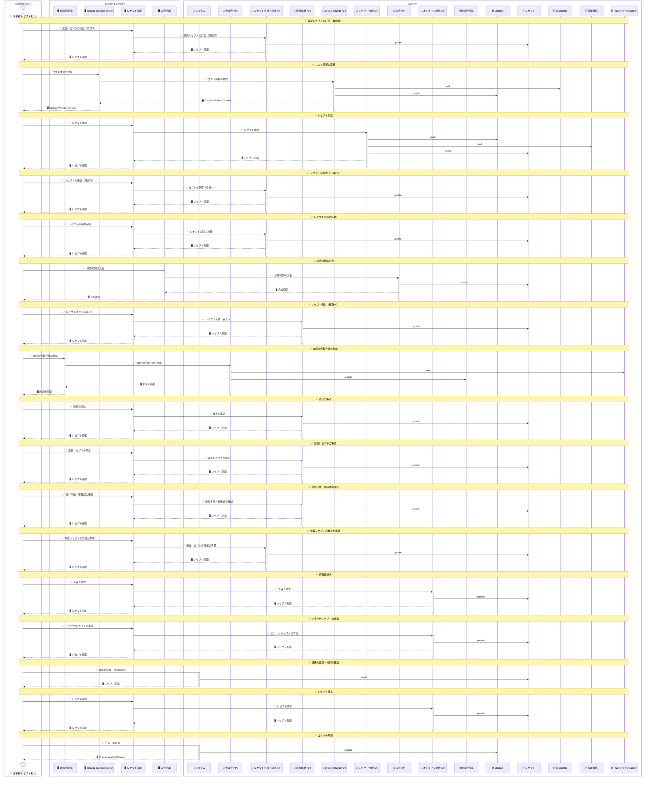

### 3.9 Follow-Up Care

| 項目 | 内容 |
|---|---|
| BUC | `BucFollowupCare` |
| Business | `PatientAccess` |
| 主な actor | CareCoordinator, Patient |
| 必要権限 | `FollowUpManage`, `PatientMessageSend`, `ScheduleWrite` |
| 主なデータ | `CarePlan`, `PatientMessage`, `Appointment`, `Notification` |

診療後のケアプラン作成、患者連絡、患者応答確認、再診予約、ケアプラン終了を扱う。

レビュー観点:

- ScheduleFollowUpVisit が予約 BUC と同じ Appointment lifecycle を使ってよいか。
- NotifyPatientResult と NotifyCriticalResult の通知責務が重複していないか。

#### Follow-Up Care RDRA Layered Graph 図

生成コマンド:

```sh
rdra-ish diagram samples/clinic-ops --kind rdra --format mermaid --buc BucFollowupCare --out samples/clinic-ops/out/buc/object_graph_followup_care
```

```mermaid
flowchart LR
  subgraph layer_value[System Value]
    direction TB
    CareCoordinator(["👤 Care Coordinator"])
    Patient(["👤 Patient"])
    MessagingGateway[/"🌐 Messaging Gateway"/]
  end
  subgraph layer_environment[External Environment]
    direction TB
    PatientAccess["💼 Patient Access"]
    BucFollowupCare["📦 Coordinate Follow-Up Care"]
    BucPatientOnboarding["📦 Onboard and Maintain Patient"]
    IntakeExpiryCheck["⏱️ Nightly intake expiry check"]
    CareCoordinationConsole[/"📱 Care Coordination Console"/]
    FrontDeskTerminal[/"📱 Front Desk Terminal"/]
    PatientMobile[/"📱 Patient Mobile"/]
    ConsentCapture["🔑 Consent Capture"]
    FollowUpManage["🔑 Follow-Up Manage"]
    InsuranceVerify["🔑 Insurance Verify"]
    IntakeManage["🔑 Intake Manage"]
    PatientMessageSend["🔑 Patient Message Send"]
    PatientProfileRead["🔑 Patient Profile Read"]
    PatientProfileWrite["🔑 Patient Profile Write"]
    ScheduleRead["🔑 Schedule Read"]
    ScheduleWrite["🔑 Schedule Write"]
  end
  subgraph layer_boundary[System Boundary]
    direction TB
    ArchivePatient(["✅ Archive Patient"])
    CaptureConsent(["✅ Capture Consent"])
    CloseCarePlan(["✅ Close Care Plan"])
    CompleteIntakeForms(["✅ Complete Intake Forms"])
    CreateCarePlan(["✅ Create Care Plan"])
    ExpireIntakeForms(["✅ Expire Intake Forms"])
    MergeDuplicatePatient(["✅ Merge Duplicate Patient"])
    NotifyPatientResult(["✅ Notify Patient Result"])
    RegisterPatient(["✅ Register Patient"])
    ReviewPatientResponse(["✅ Review Patient Response"])
    ScheduleFollowUpVisit(["✅ Schedule Follow-Up Visit"])
    SearchPatient(["✅ Search Patient"])
    SendAppointmentNotice(["✅ Send Appointment Notice"])
    SendFollowUpMessage(["✅ Send Follow-Up Message"])
    SendIntakeForms(["✅ Send Intake Forms"])
    UpdateDemographics(["✅ Update Demographics"])
    VerifyInsurance(["✅ 保険資格・限度額情報の登録（新患登録）"])
    AppointmentNoticeScreen[["🖥️ Appointment Notice Screen"]]
    CarePlanScreen[["🖥️ Care Plan Screen"]]
    ConsentScreen[["🖥️ Consent Capture Screen"]]
    FollowUpScheduleScreen[["🖥️ Follow-Up Schedule Screen"]]
    InsuranceScreen[["🖥️ Insurance Verification Screen"]]
    IntakePortalScreen[["🖥️ Intake Portal Screen"]]
    PatientMessageScreen[["🖥️ Patient Message Screen"]]
    PatientProfileScreen[["🖥️ Patient Profile Screen"]]
    PatientSearchScreen[["🖥️ Patient Search Screen"]]
    EvAppointmentCancelled{"⚡ Appointment Cancelled"}
    EvAppointmentRescheduled{"⚡ Appointment Rescheduled"}
    EvAppointmentScheduled{"⚡ Appointment Scheduled"}
    EvClinicalOrderReviewed{"⚡ Clinical Result Reviewed"}
    EvEncounterSigned{"⚡ Encounter Signed"}
  end
  subgraph layer_system[System]
    direction TB
    AppointmentNoticeApi["🔌 Appointment Notice API"]
    ConsentApi["🔌 Consent API"]
    CreateCarePlanApi["🔌 Create Care Plan API"]
    EligibilityApi["🔌 Eligibility API"]
    FollowUpScheduleApi["🔌 Follow-Up Schedule API"]
    IntakeMessagingApi["🔌 Intake Messaging API"]
    NotifyPatientResultApi["🔌 Notify Patient Result API"]
    RegisterPatientApi["🔌 Register Patient API"]
    SearchPatientApi["🔌 Search Patient API"]
    SendFollowUpMessageApi["🔌 Send Follow-Up Message API"]
    UpdateDemographicsApi["🔌 Update Demographics API"]
    Appointment[("🗄️ Appointment")]
    CarePlan[("🗄️ Care Plan")]
    ConsentRecord[("🗄️ Consent Record")]
    EligibilityCheck[("🗄️ 資格確認")]
    Encounter[("🗄️ Encounter")]
    InsurancePolicy[("🗄️ 保険資格")]
    IntakePacket[("🗄️ Intake Packet")]
    Notification[("🗄️ Notification")]
    PatientAccount[("🗄️ Patient Account")]
    PatientMessage[("🗄️ Patient Message")]
    PatientProfile[("🗄️ Patient Profile")]
    ProviderSchedule[("🗄️ Provider Schedule")]
  end
  Patient -.->|has_permission| PatientProfileRead
  Patient -.->|has_permission| ConsentCapture
  Patient -.->|has_permission| ScheduleRead
  Patient -->|performs| BucFollowupCare
  Patient -->|performs| BucPatientOnboarding
  Patient -->|performs| CaptureConsent
  Patient -->|performs| CompleteIntakeForms
  CareCoordinator -.->|has_permission| FollowUpManage
  CareCoordinator -.->|has_permission| PatientMessageSend
  CareCoordinator -.->|has_permission| ScheduleWrite
  CareCoordinator -->|performs| BucFollowupCare
  CareCoordinator -->|performs| CreateCarePlan
  CareCoordinator -->|performs| SendFollowUpMessage
  CareCoordinator -->|performs| ReviewPatientResponse
  CareCoordinator -->|performs| ScheduleFollowUpVisit
  CareCoordinator -->|performs| CloseCarePlan
  CareCoordinator -->|performs| NotifyPatientResult
  CreateCarePlanApi -.->|creates| CarePlan
  CreateCarePlanApi -.->|reads| Encounter
  CreateCarePlanApi -.->|requires_permission| FollowUpManage
  SendFollowUpMessageApi -.->|creates| PatientMessage
  SendFollowUpMessageApi -.->|requires_permission| PatientMessageSend
  FollowUpScheduleApi -.->|creates| Appointment
  FollowUpScheduleApi -.->|requires_permission| ScheduleWrite
  FollowUpScheduleApi -.->|updates| ProviderSchedule
  NotifyPatientResultApi -.->|creates| Notification
  NotifyPatientResultApi -.->|requires_permission| PatientMessageSend
  SearchPatientApi -.->|reads| PatientAccount
  SearchPatientApi -.->|reads| PatientProfile
  SearchPatientApi -.->|requires_permission| PatientProfileRead
  RegisterPatientApi -.->|creates| PatientAccount
  RegisterPatientApi -.->|creates| PatientProfile
  RegisterPatientApi -.->|requires_permission| PatientProfileWrite
  UpdateDemographicsApi -.->|requires_permission| PatientProfileWrite
  UpdateDemographicsApi -.->|updates| PatientProfile
  EligibilityApi -.->|creates| EligibilityCheck
  EligibilityApi -.->|reads| InsurancePolicy
  EligibilityApi -.->|requires_permission| InsuranceVerify
  EligibilityApi -.->|updates| InsurancePolicy
  ConsentApi -.->|creates| ConsentRecord
  ConsentApi -.->|requires_permission| ConsentCapture
  IntakeMessagingApi -.->|creates| PatientMessage
  IntakeMessagingApi -.->|creates| IntakePacket
  IntakeMessagingApi -.->|requires_permission| PatientMessageSend
  AppointmentNoticeApi -.->|creates| PatientMessage
  AppointmentNoticeApi -.->|creates| Notification
  BucFollowupCare -.->|belongs| PatientAccess
  BucFollowupCare -->|contains| CreateCarePlan
  BucFollowupCare -->|contains| SendFollowUpMessage
  BucFollowupCare -->|contains| ReviewPatientResponse
  BucFollowupCare -->|contains| ScheduleFollowUpVisit
  BucFollowupCare -->|contains| CloseCarePlan
  BucFollowupCare -->|contains| NotifyPatientResult
  BucPatientOnboarding -.->|belongs| PatientAccess
  BucPatientOnboarding -->|contains| SearchPatient
  BucPatientOnboarding -->|contains| RegisterPatient
  BucPatientOnboarding -->|contains| UpdateDemographics
  BucPatientOnboarding -->|contains| VerifyInsurance
  BucPatientOnboarding -->|contains| CaptureConsent
  BucPatientOnboarding -->|contains| SendIntakeForms
  BucPatientOnboarding -->|contains| CompleteIntakeForms
  BucPatientOnboarding -->|contains| ExpireIntakeForms
  BucPatientOnboarding -->|contains| MergeDuplicatePatient
  BucPatientOnboarding -->|contains| ArchivePatient
  Appointment ---|N:1| PatientAccount
  Encounter ---|N:1| PatientAccount
  Encounter ---|1:1| Appointment
  CarePlan ---|N:1| Encounter
  CarePlan ---|N:1| PatientAccount
  PatientMessage ---|N:1| PatientAccount
  Notification ---|N:1| PatientAccount
  PatientProfile ---|1:1| PatientAccount
  InsurancePolicy ---|N:1| PatientAccount
  EligibilityCheck ---|N:1| InsurancePolicy
  ConsentRecord ---|N:1| PatientAccount
  IntakePacket ---|N:1| PatientAccount
  EvAppointmentScheduled -.->|triggers| BucPatientOnboarding
  EvAppointmentScheduled -.->|triggers| MessagingGateway
  EvAppointmentScheduled -.->|triggers| SendIntakeForms
  EvAppointmentScheduled -.->|triggers| SendAppointmentNotice
  EvAppointmentRescheduled -.->|triggers| MessagingGateway
  EvAppointmentRescheduled -.->|triggers| SendAppointmentNotice
  EvAppointmentCancelled -.->|triggers| MessagingGateway
  EvAppointmentCancelled -.->|triggers| SendAppointmentNotice
  EvEncounterSigned -.->|triggers| BucFollowupCare
  EvEncounterSigned -.->|triggers| CreateCarePlan
  EvClinicalOrderReviewed -.->|triggers| BucFollowupCare
  EvClinicalOrderReviewed -.->|triggers| NotifyPatientResult
  PatientSearchScreen -.->|shows| PatientAccount
  PatientProfileScreen -.->|shows| PatientProfile
  IntakeExpiryCheck -.->|triggers| ExpireIntakeForms
  CreateCarePlan -.->|displays| CarePlanScreen
  CreateCarePlan -.->|invokes| CreateCarePlanApi
  CreateCarePlan -.->|requires_medium| CareCoordinationConsole
  CreateCarePlan -.->|requires_permission| FollowUpManage
  SendFollowUpMessage -.->|displays| PatientMessageScreen
  SendFollowUpMessage -.->|invokes| SendFollowUpMessageApi
  SendFollowUpMessage -.->|requires_medium| CareCoordinationConsole
  SendFollowUpMessage -.->|requires_permission| PatientMessageSend
  ReviewPatientResponse -.->|displays| CarePlanScreen
  ReviewPatientResponse -.->|requires_medium| CareCoordinationConsole
  ReviewPatientResponse -.->|requires_permission| FollowUpManage
  ReviewPatientResponse -.->|updates| CarePlan
  ReviewPatientResponse -.->|updates| PatientMessage
  ScheduleFollowUpVisit -.->|displays| FollowUpScheduleScreen
  ScheduleFollowUpVisit -.->|invokes| FollowUpScheduleApi
  ScheduleFollowUpVisit -.->|raises| EvAppointmentScheduled
  ScheduleFollowUpVisit -.->|requires_medium| CareCoordinationConsole
  ScheduleFollowUpVisit -.->|requires_permission| FollowUpManage
  ScheduleFollowUpVisit -.->|requires_permission| ScheduleWrite
  CloseCarePlan -.->|displays| CarePlanScreen
  CloseCarePlan -.->|requires_medium| CareCoordinationConsole
  CloseCarePlan -.->|requires_permission| FollowUpManage
  CloseCarePlan -.->|updates| CarePlan
  NotifyPatientResult -.->|displays| PatientMessageScreen
  NotifyPatientResult -.->|invokes| NotifyPatientResultApi
  NotifyPatientResult -.->|requires_medium| CareCoordinationConsole
  NotifyPatientResult -.->|requires_permission| PatientMessageSend
  SearchPatient -.->|displays| PatientSearchScreen
  SearchPatient -.->|invokes| SearchPatientApi
  SearchPatient -.->|requires_medium| FrontDeskTerminal
  SearchPatient -.->|requires_permission| PatientProfileRead
  RegisterPatient -.->|displays| PatientProfileScreen
  RegisterPatient -.->|invokes| RegisterPatientApi
  RegisterPatient -.->|requires_medium| FrontDeskTerminal
  RegisterPatient -.->|requires_permission| PatientProfileWrite
  UpdateDemographics -.->|displays| PatientProfileScreen
  UpdateDemographics -.->|invokes| UpdateDemographicsApi
  UpdateDemographics -.->|requires_medium| FrontDeskTerminal
  UpdateDemographics -.->|requires_permission| PatientProfileWrite
  VerifyInsurance -.->|displays| InsuranceScreen
  VerifyInsurance -.->|invokes| EligibilityApi
  VerifyInsurance -.->|requires_medium| FrontDeskTerminal
  VerifyInsurance -.->|requires_permission| InsuranceVerify
  CaptureConsent -.->|displays| ConsentScreen
  CaptureConsent -.->|invokes| ConsentApi
  CaptureConsent -.->|requires_medium| PatientMobile
  CaptureConsent -.->|requires_permission| ConsentCapture
  SendIntakeForms -.->|displays| IntakePortalScreen
  SendIntakeForms -.->|invokes| IntakeMessagingApi
  SendIntakeForms -.->|requires_medium| FrontDeskTerminal
  SendIntakeForms -.->|requires_permission| IntakeManage
  CompleteIntakeForms -.->|displays| IntakePortalScreen
  CompleteIntakeForms -.->|requires_medium| PatientMobile
  CompleteIntakeForms -.->|requires_permission| ConsentCapture
  CompleteIntakeForms -.->|updates| IntakePacket
  ExpireIntakeForms -.->|displays| IntakePortalScreen
  ExpireIntakeForms -.->|requires_medium| FrontDeskTerminal
  ExpireIntakeForms -.->|requires_permission| IntakeManage
  ExpireIntakeForms -.->|updates| IntakePacket
  MergeDuplicatePatient -.->|displays| PatientProfileScreen
  MergeDuplicatePatient -.->|requires_medium| FrontDeskTerminal
  MergeDuplicatePatient -.->|requires_permission| PatientProfileWrite
  MergeDuplicatePatient -.->|updates| PatientAccount
  ArchivePatient -.->|displays| PatientProfileScreen
  ArchivePatient -.->|requires_medium| FrontDeskTerminal
  ArchivePatient -.->|requires_permission| PatientProfileWrite
  ArchivePatient -.->|updates| PatientAccount
  SendAppointmentNotice -.->|displays| AppointmentNoticeScreen
  SendAppointmentNotice -.->|invokes| AppointmentNoticeApi
  SendAppointmentNotice -.->|requires_medium| FrontDeskTerminal
  SendAppointmentNotice -.->|requires_permission| ScheduleRead
```

#### Follow-Up Care sequence 図

生成コマンド:

```sh
rdra-ish diagram samples/clinic-ops --kind sequence --format mermaid --buc BucFollowupCare --out samples/clinic-ops/out/buc/sequence_followup_care
```

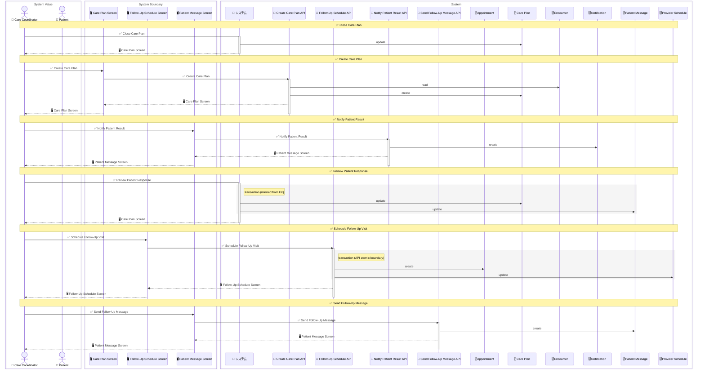

### 3.10 Staff Administration

| 項目 | 内容 |
|---|---|
| BUC | `BucStaffAdministration` |
| Business | `ClinicAdministration` |
| 主な actor | ClinicAdmin |
| 必要権限 | `ProviderScheduleAdmin`, `RoomAdmin`, `AuditRead`, `AuditResolve` |
| 主なデータ | `Provider`, `ProviderSchedule`, `Room`, `AuditEvent` |

診療所運営のマスタ・監査系業務を扱う。

レビュー観点:

- ReleaseRoom と診察終了の部屋状態更新が重複しないか。
- ResolveAuditFinding が AdminConsole に限定されているか。

#### Staff Administration RDRA Layered Graph 図

生成コマンド:

```sh
rdra-ish diagram samples/clinic-ops --kind rdra --format mermaid --buc BucStaffAdministration --out samples/clinic-ops/out/buc/object_graph_staff_administration
```

```mermaid
flowchart LR
  subgraph layer_value[System Value]
    direction TB
    ClinicAdmin(["👤 Clinic Administrator"])
  end
  subgraph layer_environment[External Environment]
    direction TB
    ClinicAdministration["💼 Clinic Administration"]
    BucStaffAdministration["📦 Administer Clinic Operations"]
    AdminConsole[/"📱 Admin Console"/]
    AuditRead["🔑 Audit Read"]
    AuditResolve["🔑 Audit Resolve"]
    ProviderScheduleAdmin["🔑 Provider Schedule Admin"]
    RoomAdmin["🔑 Room Admin"]
  end
  subgraph layer_boundary[System Boundary]
    direction TB
    BlockScheduleSlot(["✅ Block Schedule Slot"])
    ConfigureRoom(["✅ Configure Room"])
    ManageProviderSchedule(["✅ Manage Provider Schedule"])
    ReleaseRoom(["✅ Release Room"])
    ResolveAuditFinding(["✅ Resolve Audit Finding"])
    ReviewAuditEvents(["✅ Review Audit Events"])
    AuditReviewScreen[["🖥️ Audit Review Screen"]]
    RoomAdminScreen[["🖥️ Room Admin Screen"]]
    ScheduleAdminScreen[["🖥️ Schedule Admin Screen"]]
  end
  subgraph layer_system[System]
    direction TB
    AuditApi["🔌 Audit API"]
    BlockScheduleSlotApi["🔌 Block Schedule Slot API"]
    ManageProviderScheduleApi["🔌 Manage Provider Schedule API"]
    RoomAdminApi["🔌 Room Admin API"]
    AuditEvent[("🗄️ Audit Event")]
    PatientAccount[("🗄️ Patient Account")]
    Provider[("🗄️ Provider")]
    ProviderSchedule[("🗄️ Provider Schedule")]
    Room[("🗄️ Room")]
  end
  ClinicAdmin -.->|has_permission| ProviderScheduleAdmin
  ClinicAdmin -.->|has_permission| RoomAdmin
  ClinicAdmin -.->|has_permission| AuditRead
  ClinicAdmin -.->|has_permission| AuditResolve
  ClinicAdmin -->|performs| BucStaffAdministration
  ManageProviderScheduleApi -.->|creates| ProviderSchedule
  ManageProviderScheduleApi -.->|requires_permission| ProviderScheduleAdmin
  ManageProviderScheduleApi -.->|updates| ProviderSchedule
  ManageProviderScheduleApi -.->|updates| Provider
  BlockScheduleSlotApi -.->|requires_permission| ProviderScheduleAdmin
  BlockScheduleSlotApi -.->|updates| ProviderSchedule
  RoomAdminApi -.->|creates| Room
  RoomAdminApi -.->|requires_permission| RoomAdmin
  RoomAdminApi -.->|updates| Room
  AuditApi -.->|reads| PatientAccount
  AuditApi -.->|reads| AuditEvent
  AuditApi -.->|requires_permission| AuditRead
  BucStaffAdministration -.->|belongs| ClinicAdministration
  BucStaffAdministration -->|contains| ManageProviderSchedule
  BucStaffAdministration -->|contains| BlockScheduleSlot
  BucStaffAdministration -->|contains| ConfigureRoom
  BucStaffAdministration -->|contains| ReleaseRoom
  BucStaffAdministration -->|contains| ReviewAuditEvents
  BucStaffAdministration -->|contains| ResolveAuditFinding
  ProviderSchedule ---|N:1| Provider
  AuditEvent ---|N:1| PatientAccount
  AuditReviewScreen -.->|shows| AuditEvent
  ManageProviderSchedule -.->|displays| ScheduleAdminScreen
  ManageProviderSchedule -.->|invokes| ManageProviderScheduleApi
  ManageProviderSchedule -.->|requires_medium| AdminConsole
  ManageProviderSchedule -.->|requires_permission| ProviderScheduleAdmin
  BlockScheduleSlot -.->|displays| ScheduleAdminScreen
  BlockScheduleSlot -.->|invokes| BlockScheduleSlotApi
  BlockScheduleSlot -.->|requires_medium| AdminConsole
  BlockScheduleSlot -.->|requires_permission| ProviderScheduleAdmin
  ConfigureRoom -.->|displays| RoomAdminScreen
  ConfigureRoom -.->|invokes| RoomAdminApi
  ConfigureRoom -.->|requires_medium| AdminConsole
  ConfigureRoom -.->|requires_permission| RoomAdmin
  ReleaseRoom -.->|displays| RoomAdminScreen
  ReleaseRoom -.->|requires_medium| AdminConsole
  ReleaseRoom -.->|requires_permission| RoomAdmin
  ReleaseRoom -.->|updates| Room
  ReviewAuditEvents -.->|displays| AuditReviewScreen
  ReviewAuditEvents -.->|invokes| AuditApi
  ReviewAuditEvents -.->|requires_medium| AdminConsole
  ReviewAuditEvents -.->|requires_permission| AuditRead
  ResolveAuditFinding -.->|displays| AuditReviewScreen
  ResolveAuditFinding -.->|requires_medium| AdminConsole
  ResolveAuditFinding -.->|requires_permission| AuditResolve
  ResolveAuditFinding -.->|updates| AuditEvent
```

#### Staff Administration sequence 図

生成コマンド:

```sh
rdra-ish diagram samples/clinic-ops --kind sequence --format mermaid --buc BucStaffAdministration --out samples/clinic-ops/out/buc/sequence_staff_administration
```

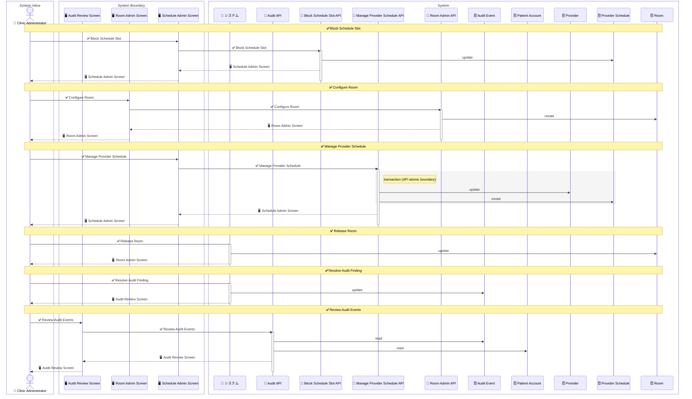

## 4. UC 単位のレビュー

UC 単位の sequence は、1 UC の actor、screen、API、Entity 操作だけを本文に埋め込みます。BUC 図で責務境界を見たあと、論点のある UC だけを個別に確認します。

actor は `performs(Actor, UseCase)` があれば UC 直結の actor を優先します。BUC には複数 actor がいても、UC sequence にはその UC の代表 actor だけを出し、主担当が未確定の UC だけ `performs(Actor, Buc)` へ fallback します。

### 4.1 Patient Onboarding UC

| UC | 必要権限 | 主な確認点 |
|---|---|---|
| `SearchPatient` | `PatientProfileRead` | 患者検索が read-only API として表現され、患者作成と混ざらないこと |
| `RegisterPatient` | `PatientProfileWrite` | PatientAccount と PatientProfile を同時作成する境界 |
| `UpdateDemographics` | `PatientProfileWrite` | 患者属性更新の API 境界 |
| `VerifyInsurance` | `InsuranceVerify` | 保険資格の登録と限度額情報（適用区分）の取得 |
| `CaptureConsent` | `ConsentCapture` | 同意記録作成と nullable/Bool effect |
| `SendIntakeForms` | `IntakeManage`, `PatientMessageSend` | 問診パケットとメッセージ作成 |
| `CompleteIntakeForms` | `ConsentCapture` | 問診完了イベント |
| `ExpireIntakeForms` | `IntakeManage` | 問診期限切れイベント |
| `MergeDuplicatePatient` | `PatientProfileWrite` | 患者統合状態 |
| `ArchivePatient` | `PatientProfileWrite` | 患者アーカイブ状態 |

#### SearchPatient

Search Patient。患者検索が read-only API として表現され、患者作成と混ざらないこと

生成コマンド:

```sh
rdra-ish diagram samples/clinic-ops --kind sequence --format mermaid --usecase SearchPatient --out samples/clinic-ops/out/uc/sequence_search_patient
```

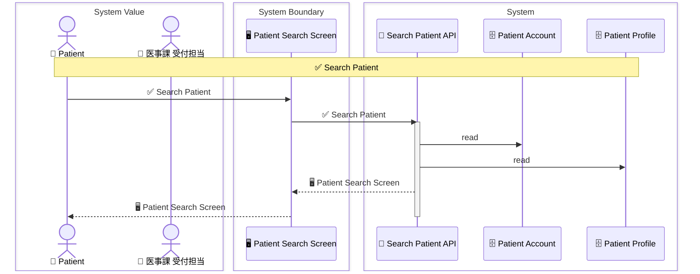

#### RegisterPatient

Register Patient。PatientAccount と PatientProfile を同時作成する境界

生成コマンド:

```sh
rdra-ish diagram samples/clinic-ops --kind sequence --format mermaid --usecase RegisterPatient --out samples/clinic-ops/out/uc/sequence_register_patient
```

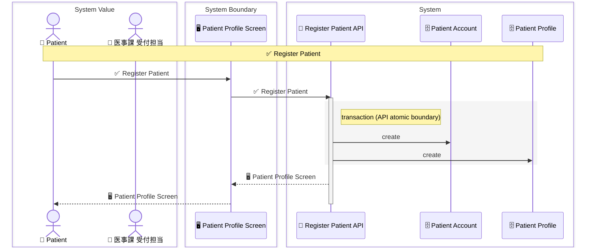

#### UpdateDemographics

Update Demographics。患者属性更新の API 境界

生成コマンド:

```sh
rdra-ish diagram samples/clinic-ops --kind sequence --format mermaid --usecase UpdateDemographics --out samples/clinic-ops/out/uc/sequence_update_demographics
```

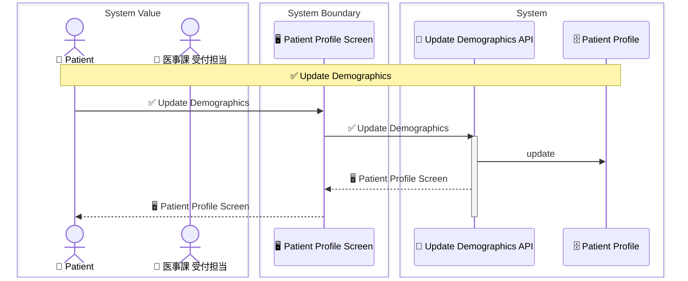

#### VerifyInsurance

保険資格・限度額情報の登録（新患登録）。保険資格の登録と限度額情報（適用区分）の取得

生成コマンド:

```sh
rdra-ish diagram samples/clinic-ops --kind sequence --format mermaid --usecase VerifyInsurance --out samples/clinic-ops/out/uc/sequence_verify_insurance
```

```mermaid
sequenceDiagram
  box System Value
    actor Patient as 👤 Patient
    actor ReceptionClerk as 👤 医事課 受付担当
  end
  box System Boundary
    participant InsuranceScreen as 🖥️ Insurance Verification Screen
  end
  box System
    participant EligibilityApi as 🔌 Eligibility API
    participant EligibilityCheck as 🗄️ 資格確認
    participant InsurancePolicy as 🗄️ 保険資格
  end

  Note over Patient,InsurancePolicy: ✅ 保険資格・限度額情報の登録（新患登録）
  Patient->>InsuranceScreen: ✅ 保険資格・限度額情報の登録（新患登録）
  InsuranceScreen->>EligibilityApi: ✅ 保険資格・限度額情報の登録（新患登録）
  activate EligibilityApi
  EligibilityApi->>InsurancePolicy: read
  rect rgb(245,245,245)
    Note right of EligibilityApi: transaction (API atomic boundary)
    EligibilityApi->>InsurancePolicy: update
    EligibilityApi->>EligibilityCheck: create
  end
  EligibilityApi-->>InsuranceScreen: 🖥️ Insurance Verification Screen
  InsuranceScreen-->>Patient: 🖥️ Insurance Verification Screen
  deactivate EligibilityApi
```

#### CaptureConsent

Capture Consent。同意記録作成と nullable/Bool effect

生成コマンド:

```sh
rdra-ish diagram samples/clinic-ops --kind sequence --format mermaid --usecase CaptureConsent --out samples/clinic-ops/out/uc/sequence_capture_consent
```

```mermaid
sequenceDiagram
  box System Value
    actor Patient as 👤 Patient
    actor ReceptionClerk as 👤 医事課 受付担当
  end
  box System Boundary
    participant ConsentScreen as 🖥️ Consent Capture Screen
  end
  box System
    participant ConsentApi as 🔌 Consent API
    participant ConsentRecord as 🗄️ Consent Record
  end

  Note over Patient,ConsentRecord: ✅ Capture Consent
  Patient->>ConsentScreen: ✅ Capture Consent
  ConsentScreen->>ConsentApi: ✅ Capture Consent
  activate ConsentApi
  ConsentApi->>ConsentRecord: create
  ConsentApi-->>ConsentScreen: 🖥️ Consent Capture Screen
  ConsentScreen-->>Patient: 🖥️ Consent Capture Screen
  deactivate ConsentApi
```

#### SendIntakeForms

Send Intake Forms。問診パケットとメッセージ作成

生成コマンド:

```sh
rdra-ish diagram samples/clinic-ops --kind sequence --format mermaid --usecase SendIntakeForms --out samples/clinic-ops/out/uc/sequence_send_intake_forms
```

```mermaid
sequenceDiagram
  box System Value
    actor Patient as 👤 Patient
    actor ReceptionClerk as 👤 医事課 受付担当
  end
  box System Boundary
    participant IntakePortalScreen as 🖥️ Intake Portal Screen
  end
  box System
    participant IntakeMessagingApi as 🔌 Intake Messaging API
    participant IntakePacket as 🗄️ Intake Packet
    participant PatientMessage as 🗄️ Patient Message
  end

  Note over Patient,PatientMessage: ✅ Send Intake Forms
  Patient->>IntakePortalScreen: ✅ Send Intake Forms
  IntakePortalScreen->>IntakeMessagingApi: ✅ Send Intake Forms
  activate IntakeMessagingApi
  rect rgb(245,245,245)
    Note right of IntakeMessagingApi: transaction (API atomic boundary)
    IntakeMessagingApi->>IntakePacket: create
    IntakeMessagingApi->>PatientMessage: create
  end
  IntakeMessagingApi-->>IntakePortalScreen: 🖥️ Intake Portal Screen
  IntakePortalScreen-->>Patient: 🖥️ Intake Portal Screen
  deactivate IntakeMessagingApi
```

#### CompleteIntakeForms

Complete Intake Forms。問診完了イベント

生成コマンド:

```sh
rdra-ish diagram samples/clinic-ops --kind sequence --format mermaid --usecase CompleteIntakeForms --out samples/clinic-ops/out/uc/sequence_complete_intake_forms
```

```mermaid
sequenceDiagram
  box System Value
    actor Patient as 👤 Patient
    actor ReceptionClerk as 👤 医事課 受付担当
  end
  box System Boundary
    participant IntakePortalScreen as 🖥️ Intake Portal Screen
  end
  box System
    participant System as 🧩 システム
    participant IntakePacket as 🗄️ Intake Packet
  end

  Note over Patient,IntakePacket: ✅ Complete Intake Forms
  Patient->System: ✅ Complete Intake Forms
  activate System
  System->>IntakePacket: update
  System-->>Patient: 🖥️ Intake Portal Screen
  deactivate System
```

#### ExpireIntakeForms

Expire Intake Forms。問診期限切れイベント

生成コマンド:

```sh
rdra-ish diagram samples/clinic-ops --kind sequence --format mermaid --usecase ExpireIntakeForms --out samples/clinic-ops/out/uc/sequence_expire_intake_forms
```

```mermaid
sequenceDiagram
  box System Value
    actor Patient as 👤 Patient
    actor ReceptionClerk as 👤 医事課 受付担当
  end
  box System Boundary
    participant IntakePortalScreen as 🖥️ Intake Portal Screen
  end
  box System
    participant System as 🧩 システム
    participant IntakePacket as 🗄️ Intake Packet
  end

  Note over Patient,IntakePacket: ✅ Expire Intake Forms
  Patient->System: ✅ Expire Intake Forms
  activate System
  System->>IntakePacket: update
  System-->>Patient: 🖥️ Intake Portal Screen
  deactivate System
```

#### MergeDuplicatePatient

Merge Duplicate Patient。患者統合状態

生成コマンド:

```sh
rdra-ish diagram samples/clinic-ops --kind sequence --format mermaid --usecase MergeDuplicatePatient --out samples/clinic-ops/out/uc/sequence_merge_duplicate_patient
```

```mermaid
sequenceDiagram
  box System Value
    actor Patient as 👤 Patient
    actor ReceptionClerk as 👤 医事課 受付担当
  end
  box System Boundary
    participant PatientProfileScreen as 🖥️ Patient Profile Screen
  end
  box System
    participant System as 🧩 システム
    participant PatientAccount as 🗄️ Patient Account
  end

  Note over Patient,PatientAccount: ✅ Merge Duplicate Patient
  Patient->System: ✅ Merge Duplicate Patient
  activate System
  System->>PatientAccount: update
  System-->>Patient: 🖥️ Patient Profile Screen
  deactivate System
```

#### ArchivePatient

Archive Patient。患者アーカイブ状態

生成コマンド:

```sh
rdra-ish diagram samples/clinic-ops --kind sequence --format mermaid --usecase ArchivePatient --out samples/clinic-ops/out/uc/sequence_archive_patient
```

```mermaid
sequenceDiagram
  box System Value
    actor Patient as 👤 Patient
    actor ReceptionClerk as 👤 医事課 受付担当
  end
  box System Boundary
    participant PatientProfileScreen as 🖥️ Patient Profile Screen
  end
  box System
    participant System as 🧩 システム
    participant PatientAccount as 🗄️ Patient Account
  end

  Note over Patient,PatientAccount: ✅ Archive Patient
  Patient->System: ✅ Archive Patient
  activate System
  System->>PatientAccount: update
  System-->>Patient: 🖥️ Patient Profile Screen
  deactivate System
```

### 4.2 Appointment Scheduling UC

| UC | 必要権限 | 主な確認点 |
|---|---|---|
| `SearchAvailability` | `ScheduleRead` | 予約枠検索の read-only API |
| `ReserveAppointment` | `ScheduleWrite` | 仮押さえで Appointment を作る境界 |
| `BookAppointment` | `ScheduleWrite` | 予約確定と予約枠更新 |
| `RescheduleAppointment` | `ScheduleWrite` | 予約変更の自己遷移 |
| `CancelAppointment` | `ScheduleWrite` | 取消理由と予約枠更新 |
| `MarkNoShow` | `ScheduleWrite` | タイマー起動の未来院処理 |
| `SendAppointmentNotice` | `ScheduleRead` | 予約イベントからの通知作成 |

#### SearchAvailability

Search Availability。予約枠検索の read-only API

生成コマンド:

```sh
rdra-ish diagram samples/clinic-ops --kind sequence --format mermaid --usecase SearchAvailability --out samples/clinic-ops/out/uc/sequence_search_availability
```

```mermaid
sequenceDiagram
  box System Value
    actor Patient as 👤 Patient
    actor ReceptionClerk as 👤 医事課 受付担当
  end
  box System Boundary
    participant ScheduleSearchScreen as 🖥️ Schedule Search Screen
  end
  box System
    participant SearchAvailabilityApi as 🔌 Search Availability API
    participant ClinicLocation as 🗄️ Clinic Location
    participant Provider as 🗄️ Provider
    participant ProviderSchedule as 🗄️ Provider Schedule
  end

  Note over Patient,ProviderSchedule: ✅ Search Availability
  Patient->>ScheduleSearchScreen: ✅ Search Availability
  ScheduleSearchScreen->>SearchAvailabilityApi: ✅ Search Availability
  activate SearchAvailabilityApi
  SearchAvailabilityApi->>ProviderSchedule: read
  SearchAvailabilityApi->>Provider: read
  SearchAvailabilityApi->>ClinicLocation: read
  SearchAvailabilityApi-->>ScheduleSearchScreen: 🖥️ Schedule Search Screen
  ScheduleSearchScreen-->>Patient: 🖥️ Schedule Search Screen
  deactivate SearchAvailabilityApi
```

#### ReserveAppointment

Reserve Appointment。仮押さえで Appointment を作る境界

生成コマンド:

```sh
rdra-ish diagram samples/clinic-ops --kind sequence --format mermaid --usecase ReserveAppointment --out samples/clinic-ops/out/uc/sequence_reserve_appointment
```

```mermaid
sequenceDiagram
  box System Value
    actor Patient as 👤 Patient
    actor ReceptionClerk as 👤 医事課 受付担当
  end
  box System Boundary
    participant AppointmentScreen as 🖥️ Appointment Screen
  end
  box System
    participant ReserveAppointmentApi as 🔌 Reserve Appointment API
    participant Appointment as 🗄️ Appointment
    participant ProviderSchedule as 🗄️ Provider Schedule
  end

  Note over Patient,ProviderSchedule: ✅ Reserve Appointment
  Patient->>AppointmentScreen: ✅ Reserve Appointment
  AppointmentScreen->>ReserveAppointmentApi: ✅ Reserve Appointment
  activate ReserveAppointmentApi
  rect rgb(245,245,245)
    Note right of ReserveAppointmentApi: transaction (API atomic boundary)
    ReserveAppointmentApi->>Appointment: create
    ReserveAppointmentApi->>ProviderSchedule: update
  end
  ReserveAppointmentApi-->>AppointmentScreen: 🖥️ Appointment Screen
  AppointmentScreen-->>Patient: 🖥️ Appointment Screen
  deactivate ReserveAppointmentApi
```

#### BookAppointment

Book Appointment。予約確定と予約枠更新

生成コマンド:

```sh
rdra-ish diagram samples/clinic-ops --kind sequence --format mermaid --usecase BookAppointment --out samples/clinic-ops/out/uc/sequence_book_appointment
```

```mermaid
sequenceDiagram
  box System Value
    actor Patient as 👤 Patient
    actor ReceptionClerk as 👤 医事課 受付担当
  end
  box System Boundary
    participant AppointmentScreen as 🖥️ Appointment Screen
  end
  box System
    participant BookAppointmentApi as 🔌 Book Appointment API
    participant Appointment as 🗄️ Appointment
    participant ProviderSchedule as 🗄️ Provider Schedule
  end

  Note over Patient,ProviderSchedule: ✅ Book Appointment
  Patient->>AppointmentScreen: ✅ Book Appointment
  AppointmentScreen->>BookAppointmentApi: ✅ Book Appointment
  activate BookAppointmentApi
  rect rgb(245,245,245)
    Note right of BookAppointmentApi: transaction (API atomic boundary)
    BookAppointmentApi->>Appointment: update
    BookAppointmentApi->>ProviderSchedule: update
  end
  BookAppointmentApi-->>AppointmentScreen: 🖥️ Appointment Screen
  AppointmentScreen-->>Patient: 🖥️ Appointment Screen
  deactivate BookAppointmentApi
```

#### RescheduleAppointment

Reschedule Appointment。予約変更の自己遷移

生成コマンド:

```sh
rdra-ish diagram samples/clinic-ops --kind sequence --format mermaid --usecase RescheduleAppointment --out samples/clinic-ops/out/uc/sequence_reschedule_appointment
```

```mermaid
sequenceDiagram
  box System Value
    actor Patient as 👤 Patient
    actor ReceptionClerk as 👤 医事課 受付担当
  end
  box System Boundary
    participant AppointmentScreen as 🖥️ Appointment Screen
  end
  box System
    participant RescheduleAppointmentApi as 🔌 Reschedule Appointment API
    participant Appointment as 🗄️ Appointment
    participant ProviderSchedule as 🗄️ Provider Schedule
  end

  Note over Patient,ProviderSchedule: ✅ Reschedule Appointment
  Patient->>AppointmentScreen: ✅ Reschedule Appointment
  AppointmentScreen->>RescheduleAppointmentApi: ✅ Reschedule Appointment
  activate RescheduleAppointmentApi
  rect rgb(245,245,245)
    Note right of RescheduleAppointmentApi: transaction (API atomic boundary)
    RescheduleAppointmentApi->>Appointment: update
    RescheduleAppointmentApi->>ProviderSchedule: update
  end
  RescheduleAppointmentApi-->>AppointmentScreen: 🖥️ Appointment Screen
  AppointmentScreen-->>Patient: 🖥️ Appointment Screen
  deactivate RescheduleAppointmentApi
```

#### CancelAppointment

Cancel Appointment。取消理由と予約枠更新

生成コマンド:

```sh
rdra-ish diagram samples/clinic-ops --kind sequence --format mermaid --usecase CancelAppointment --out samples/clinic-ops/out/uc/sequence_cancel_appointment
```

```mermaid
sequenceDiagram
  box System Value
    actor Patient as 👤 Patient
    actor ReceptionClerk as 👤 医事課 受付担当
  end
  box System Boundary
    participant AppointmentScreen as 🖥️ Appointment Screen
  end
  box System
    participant CancelAppointmentApi as 🔌 Cancel Appointment API
    participant Appointment as 🗄️ Appointment
    participant ProviderSchedule as 🗄️ Provider Schedule
  end

  Note over Patient,ProviderSchedule: ✅ Cancel Appointment
  Patient->>AppointmentScreen: ✅ Cancel Appointment
  AppointmentScreen->>CancelAppointmentApi: ✅ Cancel Appointment
  activate CancelAppointmentApi
  rect rgb(245,245,245)
    Note right of CancelAppointmentApi: transaction (API atomic boundary)
    CancelAppointmentApi->>Appointment: update
    CancelAppointmentApi->>ProviderSchedule: update
  end
  CancelAppointmentApi-->>AppointmentScreen: 🖥️ Appointment Screen
  AppointmentScreen-->>Patient: 🖥️ Appointment Screen
  deactivate CancelAppointmentApi
```

#### MarkNoShow

Mark No Show。タイマー起動の未来院処理

生成コマンド:

```sh
rdra-ish diagram samples/clinic-ops --kind sequence --format mermaid --usecase MarkNoShow --out samples/clinic-ops/out/uc/sequence_mark_no_show
```

```mermaid
sequenceDiagram
  box System Value
    actor Patient as 👤 Patient
    actor ReceptionClerk as 👤 医事課 受付担当
  end
  box System Boundary
    participant AppointmentScreen as 🖥️ Appointment Screen
  end
  box System
    participant System as 🧩 システム
    participant Appointment as 🗄️ Appointment
  end

  Note over Patient,Appointment: ✅ Mark No Show
  Patient->System: ✅ Mark No Show
  activate System
  System->>Appointment: update
  System-->>Patient: 🖥️ Appointment Screen
  deactivate System
```

#### SendAppointmentNotice

Send Appointment Notice。予約イベントからの通知作成

生成コマンド:

```sh
rdra-ish diagram samples/clinic-ops --kind sequence --format mermaid --usecase SendAppointmentNotice --out samples/clinic-ops/out/uc/sequence_send_appointment_notice
```

```mermaid
sequenceDiagram
  box System Value
    actor Patient as 👤 Patient
    actor ReceptionClerk as 👤 医事課 受付担当
  end
  box System Boundary
    participant AppointmentNoticeScreen as 🖥️ Appointment Notice Screen
  end
  box System
    participant AppointmentNoticeApi as 🔌 Appointment Notice API
    participant Notification as 🗄️ Notification
    participant PatientMessage as 🗄️ Patient Message
  end

  Note over Patient,PatientMessage: ✅ Send Appointment Notice
  Patient->>AppointmentNoticeScreen: ✅ Send Appointment Notice
  AppointmentNoticeScreen->>AppointmentNoticeApi: ✅ Send Appointment Notice
  activate AppointmentNoticeApi
  rect rgb(245,245,245)
    Note right of AppointmentNoticeApi: transaction (API atomic boundary)
    AppointmentNoticeApi->>Notification: create
    AppointmentNoticeApi->>PatientMessage: create
  end
  AppointmentNoticeApi-->>AppointmentNoticeScreen: 🖥️ Appointment Notice Screen
  AppointmentNoticeScreen-->>Patient: 🖥️ Appointment Notice Screen
  deactivate AppointmentNoticeApi
```

### 4.3 受付（初診・再診） UC

| UC | 必要権限 | 主な確認点 |
|---|---|---|
| `VerifyArrival` | `VisitCheckIn` | 予約票・診察券の確認（参照のみ） |
| `CheckInPatient` | `VisitCheckIn`, `InsuranceVerify` | 受付で予約を受付済にし、同時にオンライン資格確認を作る |
| `BatchVerifyEligibility` | `InsuranceVerify` | 予約済み患者（BookedPatient 条件）だけを一括照会する |
| `ReceiveEligibilityValid` | `InsuranceVerify` | 資格確認結果「有効」の取込 |
| `ReceiveEligibilityInvalid` | `InsuranceVerify` | 資格確認結果「無効」の取込 |
| `ReceiveEligibilityNoInfo` | `InsuranceVerify` | 資格確認結果「該当資格なし」の取込 |
| `RecheckEligibility` | `InsuranceVerify` | 無効・該当資格なしからの再確認 |
| `RecordEligibilityDeclaration` | `InsuranceVerify` | 被保険者資格申立書による確認 |
| `ConfirmEligibilityInOutageMode` | `InsuranceVerify` | システム障害時モードによる確認 |
| `ReceiveReferralLetter` | `ReferralManage` | 紹介状の受領と受付処理 |
| `AssignRoom` | `RoomAssign` | 部屋と予約の同期更新 |
| `PrepareEncounter` | `EncounterOpen` | 診療準備の参照情報 |

#### VerifyArrival

予約票・診察券の確認。予約票・診察券の確認（参照のみ）

生成コマンド:

```sh
rdra-ish diagram samples/clinic-ops --kind sequence --format mermaid --usecase VerifyArrival --out samples/clinic-ops/out/uc/sequence_verify_arrival
```

```mermaid
sequenceDiagram
  box System Value
    actor Nurse as 👤 看護師
    actor ReceptionClerk as 👤 医事課 受付担当
  end
  box System Boundary
    participant CheckInScreen as 🖥️ 受付画面
  end
  box System
    participant VerifyArrivalApi as 🔌 Verify Arrival API
    participant Appointment as 🗄️ Appointment
    participant InsurancePolicy as 🗄️ 保険資格
    participant PatientAccount as 🗄️ Patient Account
  end

  Note over Nurse,PatientAccount: ✅ 予約票・診察券の確認
  Nurse->>CheckInScreen: ✅ 予約票・診察券の確認
  CheckInScreen->>VerifyArrivalApi: ✅ 予約票・診察券の確認
  activate VerifyArrivalApi
  VerifyArrivalApi->>Appointment: read
  VerifyArrivalApi->>PatientAccount: read
  VerifyArrivalApi->>InsurancePolicy: read
  VerifyArrivalApi-->>CheckInScreen: 🖥️ 受付画面
  CheckInScreen-->>Nurse: 🖥️ 受付画面
  deactivate VerifyArrivalApi
```

#### CheckInPatient

受付（初診・再診）。受付で予約を受付済にし、同時にオンライン資格確認を作る

生成コマンド:

```sh
rdra-ish diagram samples/clinic-ops --kind sequence --format mermaid --usecase CheckInPatient --out samples/clinic-ops/out/uc/sequence_check_in_patient
```

```mermaid
sequenceDiagram
  box System Value
    actor Nurse as 👤 看護師
    actor ReceptionClerk as 👤 医事課 受付担当
  end
  box System Boundary
    participant CheckInScreen as 🖥️ 受付画面
  end
  box System
    participant CheckInPatientApi as 🔌 Check-In Patient API
    participant OnlineEligibilityApi as 🔌 オンライン資格確認 API
    participant Appointment as 🗄️ Appointment
    participant EligibilityCheck as 🗄️ 資格確認
    participant InsurancePolicy as 🗄️ 保険資格
    participant PatientAccount as 🗄️ Patient Account
  end

  Note over Nurse,PatientAccount: ✅ 受付（初診・再診）
  Nurse->>CheckInScreen: ✅ 受付（初診・再診）
  CheckInScreen->>CheckInPatientApi: ✅ 受付（初診・再診）
  activate CheckInPatientApi
  OnlineEligibilityApi->>InsurancePolicy: read
  rect rgb(245,245,245)
    Note right of CheckInPatientApi: transaction (API atomic boundary)
    CheckInPatientApi->>PatientAccount: update
    CheckInPatientApi->>Appointment: update
  end
  OnlineEligibilityApi->>EligibilityCheck: create
  CheckInPatientApi-->>CheckInScreen: 🖥️ 受付画面
  CheckInScreen-->>Nurse: 🖥️ 受付画面
  deactivate CheckInPatientApi
```

#### BatchVerifyEligibility

資格の一括照会。予約済み患者（BookedPatient 条件）だけを一括照会する

生成コマンド:

```sh
rdra-ish diagram samples/clinic-ops --kind sequence --format mermaid --usecase BatchVerifyEligibility --out samples/clinic-ops/out/uc/sequence_batch_verify_eligibility
```

```mermaid
sequenceDiagram
  box System Value
    actor Nurse as 👤 看護師
    actor ReceptionClerk as 👤 医事課 受付担当
  end
  box System Boundary
    participant EligibilityScreen as 🖥️ 資格確認画面
  end
  box System
    participant OnlineEligibilityApi as 🔌 オンライン資格確認 API
    participant EligibilityCheck as 🗄️ 資格確認
    participant InsurancePolicy as 🗄️ 保険資格
  end

  Note over Nurse,InsurancePolicy: ✅ 資格の一括照会
  Nurse->>EligibilityScreen: ✅ 資格の一括照会
  EligibilityScreen->>OnlineEligibilityApi: ✅ 資格の一括照会
  activate OnlineEligibilityApi
  OnlineEligibilityApi->>InsurancePolicy: read
  OnlineEligibilityApi->>EligibilityCheck: create
  OnlineEligibilityApi-->>EligibilityScreen: 🖥️ 資格確認画面
  EligibilityScreen-->>Nurse: 🖥️ 資格確認画面
  deactivate OnlineEligibilityApi
```

#### ReceiveEligibilityValid

資格確認結果（有効）の取込。資格確認結果「有効」の取込

生成コマンド:

```sh
rdra-ish diagram samples/clinic-ops --kind sequence --format mermaid --usecase ReceiveEligibilityValid --out samples/clinic-ops/out/uc/sequence_receive_eligibility_valid
```

```mermaid
sequenceDiagram
  box System Value
    actor Nurse as 👤 看護師
    actor ReceptionClerk as 👤 医事課 受付担当
  end
  box System Boundary
    participant EligibilityScreen as 🖥️ 資格確認画面
  end
  box System
    participant EligibilityResultApi as 🔌 資格確認結果 API
    participant EligibilityCheck as 🗄️ 資格確認
  end

  Note over Nurse,EligibilityCheck: ✅ 資格確認結果（有効）の取込
  Nurse->>EligibilityScreen: ✅ 資格確認結果（有効）の取込
  EligibilityScreen->>EligibilityResultApi: ✅ 資格確認結果（有効）の取込
  activate EligibilityResultApi
  EligibilityResultApi->>EligibilityCheck: update
  EligibilityResultApi-->>EligibilityScreen: 🖥️ 資格確認画面
  EligibilityScreen-->>Nurse: 🖥️ 資格確認画面
  deactivate EligibilityResultApi
```

#### ReceiveEligibilityInvalid

資格確認結果（無効）の取込。資格確認結果「無効」の取込

生成コマンド:

```sh
rdra-ish diagram samples/clinic-ops --kind sequence --format mermaid --usecase ReceiveEligibilityInvalid --out samples/clinic-ops/out/uc/sequence_receive_eligibility_invalid
```

```mermaid
sequenceDiagram
  box System Value
    actor Nurse as 👤 看護師
    actor ReceptionClerk as 👤 医事課 受付担当
  end
  box System Boundary
    participant EligibilityScreen as 🖥️ 資格確認画面
  end
  box System
    participant EligibilityResultApi as 🔌 資格確認結果 API
    participant EligibilityCheck as 🗄️ 資格確認
  end

  Note over Nurse,EligibilityCheck: ✅ 資格確認結果（無効）の取込
  Nurse->>EligibilityScreen: ✅ 資格確認結果（無効）の取込
  EligibilityScreen->>EligibilityResultApi: ✅ 資格確認結果（無効）の取込
  activate EligibilityResultApi
  EligibilityResultApi->>EligibilityCheck: update
  EligibilityResultApi-->>EligibilityScreen: 🖥️ 資格確認画面
  EligibilityScreen-->>Nurse: 🖥️ 資格確認画面
  deactivate EligibilityResultApi
```

#### ReceiveEligibilityNoInfo

資格確認結果（該当資格なし）の取込。資格確認結果「該当資格なし」の取込

生成コマンド:

```sh
rdra-ish diagram samples/clinic-ops --kind sequence --format mermaid --usecase ReceiveEligibilityNoInfo --out samples/clinic-ops/out/uc/sequence_receive_eligibility_no_info
```

```mermaid
sequenceDiagram
  box System Value
    actor Nurse as 👤 看護師
    actor ReceptionClerk as 👤 医事課 受付担当
  end
  box System Boundary
    participant EligibilityScreen as 🖥️ 資格確認画面
  end
  box System
    participant EligibilityResultApi as 🔌 資格確認結果 API
    participant EligibilityCheck as 🗄️ 資格確認
  end

  Note over Nurse,EligibilityCheck: ✅ 資格確認結果（該当資格なし）の取込
  Nurse->>EligibilityScreen: ✅ 資格確認結果（該当資格なし）の取込
  EligibilityScreen->>EligibilityResultApi: ✅ 資格確認結果（該当資格なし）の取込
  activate EligibilityResultApi
  EligibilityResultApi->>EligibilityCheck: update
  EligibilityResultApi-->>EligibilityScreen: 🖥️ 資格確認画面
  EligibilityScreen-->>Nurse: 🖥️ 資格確認画面
  deactivate EligibilityResultApi
```

#### RecheckEligibility

資格の再確認。無効・該当資格なしからの再確認

生成コマンド:

```sh
rdra-ish diagram samples/clinic-ops --kind sequence --format mermaid --usecase RecheckEligibility --out samples/clinic-ops/out/uc/sequence_recheck_eligibility
```

```mermaid
sequenceDiagram
  box System Value
    actor Nurse as 👤 看護師
    actor ReceptionClerk as 👤 医事課 受付担当
  end
  box System Boundary
    participant EligibilityScreen as 🖥️ 資格確認画面
  end
  box System
    participant EligibilityResultApi as 🔌 資格確認結果 API
    participant EligibilityCheck as 🗄️ 資格確認
  end

  Note over Nurse,EligibilityCheck: ✅ 資格の再確認
  Nurse->>EligibilityScreen: ✅ 資格の再確認
  EligibilityScreen->>EligibilityResultApi: ✅ 資格の再確認
  activate EligibilityResultApi
  EligibilityResultApi->>EligibilityCheck: update
  EligibilityResultApi-->>EligibilityScreen: 🖥️ 資格確認画面
  EligibilityScreen-->>Nurse: 🖥️ 資格確認画面
  deactivate EligibilityResultApi
```

#### RecordEligibilityDeclaration

被保険者資格申立書の受領。被保険者資格申立書による確認

生成コマンド:

```sh
rdra-ish diagram samples/clinic-ops --kind sequence --format mermaid --usecase RecordEligibilityDeclaration --out samples/clinic-ops/out/uc/sequence_record_eligibility_declaration
```

```mermaid
sequenceDiagram
  box System Value
    actor Nurse as 👤 看護師
    actor ReceptionClerk as 👤 医事課 受付担当
  end
  box System Boundary
    participant EligibilityScreen as 🖥️ 資格確認画面
  end
  box System
    participant EligibilityResultApi as 🔌 資格確認結果 API
    participant EligibilityCheck as 🗄️ 資格確認
  end

  Note over Nurse,EligibilityCheck: ✅ 被保険者資格申立書の受領
  Nurse->>EligibilityScreen: ✅ 被保険者資格申立書の受領
  EligibilityScreen->>EligibilityResultApi: ✅ 被保険者資格申立書の受領
  activate EligibilityResultApi
  EligibilityResultApi->>EligibilityCheck: update
  EligibilityResultApi-->>EligibilityScreen: 🖥️ 資格確認画面
  EligibilityScreen-->>Nurse: 🖥️ 資格確認画面
  deactivate EligibilityResultApi
```

#### ConfirmEligibilityInOutageMode

システム障害時モードでの資格確認。システム障害時モードによる確認

生成コマンド:

```sh
rdra-ish diagram samples/clinic-ops --kind sequence --format mermaid --usecase ConfirmEligibilityInOutageMode --out samples/clinic-ops/out/uc/sequence_confirm_eligibility_in_outage_mode
```

```mermaid
sequenceDiagram
  box System Value
    actor Nurse as 👤 看護師
    actor ReceptionClerk as 👤 医事課 受付担当
  end
  box System Boundary
    participant EligibilityScreen as 🖥️ 資格確認画面
  end
  box System
    participant EligibilityResultApi as 🔌 資格確認結果 API
    participant EligibilityCheck as 🗄️ 資格確認
  end

  Note over Nurse,EligibilityCheck: ✅ システム障害時モードでの資格確認
  Nurse->>EligibilityScreen: ✅ システム障害時モードでの資格確認
  EligibilityScreen->>EligibilityResultApi: ✅ システム障害時モードでの資格確認
  activate EligibilityResultApi
  EligibilityResultApi->>EligibilityCheck: update
  EligibilityResultApi-->>EligibilityScreen: 🖥️ 資格確認画面
  EligibilityScreen-->>Nurse: 🖥️ 資格確認画面
  deactivate EligibilityResultApi
```

#### ReceiveReferralLetter

紹介状受付処理。紹介状の受領と受付処理

生成コマンド:

```sh
rdra-ish diagram samples/clinic-ops --kind sequence --format mermaid --usecase ReceiveReferralLetter --out samples/clinic-ops/out/uc/sequence_receive_referral_letter
```

```mermaid
sequenceDiagram
  box System Value
    actor Nurse as 👤 看護師
    actor ReceptionClerk as 👤 医事課 受付担当
  end
  box System Boundary
    participant ReferralScreen as 🖥️ 紹介状受付画面
  end
  box System
    participant ReferralLetterApi as 🔌 紹介状 API
    participant ReferralLetter as 🗄️ 紹介状・診療情報提供書
  end

  Note over Nurse,ReferralLetter: ✅ 紹介状受付処理
  Nurse->>ReferralScreen: ✅ 紹介状受付処理
  ReferralScreen->>ReferralLetterApi: ✅ 紹介状受付処理
  activate ReferralLetterApi
  ReferralLetterApi->>ReferralLetter: create
  ReferralLetterApi-->>ReferralScreen: 🖥️ 紹介状受付画面
  ReferralScreen-->>Nurse: 🖥️ 紹介状受付画面
  deactivate ReferralLetterApi
```

#### AssignRoom

Assign Room。部屋と予約の同期更新

生成コマンド:

```sh
rdra-ish diagram samples/clinic-ops --kind sequence --format mermaid --usecase AssignRoom --out samples/clinic-ops/out/uc/sequence_assign_room
```

```mermaid
sequenceDiagram
  box System Value
    actor Nurse as 👤 看護師
    actor ReceptionClerk as 👤 医事課 受付担当
  end
  box System Boundary
    participant RoomBoardScreen as 🖥️ Room Board Screen
  end
  box System
    participant AssignRoomApi as 🔌 Assign Room API
    participant Appointment as 🗄️ Appointment
    participant Room as 🗄️ Room
  end

  Note over Nurse,Room: ✅ Assign Room
  Nurse->>RoomBoardScreen: ✅ Assign Room
  RoomBoardScreen->>AssignRoomApi: ✅ Assign Room
  activate AssignRoomApi
  rect rgb(245,245,245)
    Note right of AssignRoomApi: transaction (API atomic boundary)
    AssignRoomApi->>Room: update
    AssignRoomApi->>Appointment: update
  end
  AssignRoomApi-->>RoomBoardScreen: 🖥️ Room Board Screen
  RoomBoardScreen-->>Nurse: 🖥️ Room Board Screen
  deactivate AssignRoomApi
```

#### PrepareEncounter

Prepare Encounter。診療準備の参照情報

生成コマンド:

```sh
rdra-ish diagram samples/clinic-ops --kind sequence --format mermaid --usecase PrepareEncounter --out samples/clinic-ops/out/uc/sequence_prepare_encounter
```

```mermaid
sequenceDiagram
  box System Value
    actor Nurse as 👤 看護師
    actor ReceptionClerk as 👤 医事課 受付担当
  end
  box System Boundary
    participant CheckInScreen as 🖥️ 受付画面
  end
  box System
    participant PrepareEncounterApi as 🔌 Prepare Encounter API
    participant Appointment as 🗄️ Appointment
    participant PatientProfile as 🗄️ Patient Profile
  end

  Note over Nurse,PatientProfile: ✅ Prepare Encounter
  Nurse->>CheckInScreen: ✅ Prepare Encounter
  CheckInScreen->>PrepareEncounterApi: ✅ Prepare Encounter
  activate PrepareEncounterApi
  PrepareEncounterApi->>Appointment: read
  PrepareEncounterApi->>PatientProfile: read
  PrepareEncounterApi-->>CheckInScreen: 🖥️ 受付画面
  CheckInScreen-->>Nurse: 🖥️ 受付画面
  deactivate PrepareEncounterApi
```

### 4.4 Clinical Encounter UC

| UC | 必要権限 | 主な確認点 |
|---|---|---|
| `OpenEncounter` | `EncounterOpen` | 受付済の予約から診療記録を開く |
| `RecordVitals` | `VitalsRecord` | バイタル記録 |
| `DocumentAssessment` | `ClinicalDocument` | 診断記録と記録状態 |
| `SignEncounter` | `EncounterSign` | 署名と後続 BUC の起点イベント |
| `AmendEncounter` | `EncounterSign` | 署名済み記録の修正 |
| `IssueReferralLetter` | `ReferralManage` | 診療情報提供書の作成・送信 |
| `CompleteConsultation` | `EncounterOpen` | 診察終了で予約を計算待ちにし、部屋を清掃中にする |

#### OpenEncounter

Open Encounter。受付済の予約から診療記録を開く

生成コマンド:

```sh
rdra-ish diagram samples/clinic-ops --kind sequence --format mermaid --usecase OpenEncounter --out samples/clinic-ops/out/uc/sequence_open_encounter
```

```mermaid
sequenceDiagram
  box System Value
    actor Clinician as 👤 医師
    actor Nurse as 👤 看護師
  end
  box System Boundary
    participant EncounterWorkspaceScreen as 🖥️ Encounter Workspace
  end
  box System
    participant OpenEncounterApi as 🔌 Open Encounter API
    participant Appointment as 🗄️ Appointment
    participant Encounter as 🗄️ Encounter
  end

  Note over Clinician,Encounter: ✅ Open Encounter
  Clinician->>EncounterWorkspaceScreen: ✅ Open Encounter
  EncounterWorkspaceScreen->>OpenEncounterApi: ✅ Open Encounter
  activate OpenEncounterApi
  rect rgb(245,245,245)
    Note right of OpenEncounterApi: transaction (API atomic boundary)
    OpenEncounterApi->>Appointment: update
    OpenEncounterApi->>Encounter: create
  end
  OpenEncounterApi-->>EncounterWorkspaceScreen: 🖥️ Encounter Workspace
  EncounterWorkspaceScreen-->>Clinician: 🖥️ Encounter Workspace
  deactivate OpenEncounterApi
```

#### RecordVitals

Record Vitals。バイタル記録

生成コマンド:

```sh
rdra-ish diagram samples/clinic-ops --kind sequence --format mermaid --usecase RecordVitals --out samples/clinic-ops/out/uc/sequence_record_vitals
```

```mermaid
sequenceDiagram
  box System Value
    actor Clinician as 👤 医師
    actor Nurse as 👤 看護師
  end
  box System Boundary
    participant VitalsScreen as 🖥️ Vitals Screen
  end
  box System
    participant RecordVitalsApi as 🔌 Record Vitals API
    participant Encounter as 🗄️ Encounter
    participant VitalSign as 🗄️ Vital Sign
  end

  Note over Clinician,VitalSign: ✅ Record Vitals
  Clinician->>VitalsScreen: ✅ Record Vitals
  VitalsScreen->>RecordVitalsApi: ✅ Record Vitals
  activate RecordVitalsApi
  rect rgb(245,245,245)
    Note right of RecordVitalsApi: transaction (API atomic boundary)
    RecordVitalsApi->>Encounter: update
    RecordVitalsApi->>VitalSign: create
  end
  RecordVitalsApi-->>VitalsScreen: 🖥️ Vitals Screen
  VitalsScreen-->>Clinician: 🖥️ Vitals Screen
  deactivate RecordVitalsApi
```

#### DocumentAssessment

Document Assessment。診断記録と記録状態

生成コマンド:

```sh
rdra-ish diagram samples/clinic-ops --kind sequence --format mermaid --usecase DocumentAssessment --out samples/clinic-ops/out/uc/sequence_document_assessment
```

```mermaid
sequenceDiagram
  box System Value
    actor Clinician as 👤 医師
    actor Nurse as 👤 看護師
  end
  box System Boundary
    participant DiagnosisScreen as 🖥️ Diagnosis Screen
  end
  box System
    participant DocumentAssessmentApi as 🔌 Document Assessment API
    participant Diagnosis as 🗄️ Diagnosis
    participant Encounter as 🗄️ Encounter
  end

  Note over Clinician,Encounter: ✅ Document Assessment
  Clinician->>DiagnosisScreen: ✅ Document Assessment
  DiagnosisScreen->>DocumentAssessmentApi: ✅ Document Assessment
  activate DocumentAssessmentApi
  rect rgb(245,245,245)
    Note right of DocumentAssessmentApi: transaction (API atomic boundary)
    DocumentAssessmentApi->>Encounter: update
    DocumentAssessmentApi->>Diagnosis: create
  end
  DocumentAssessmentApi-->>DiagnosisScreen: 🖥️ Diagnosis Screen
  DiagnosisScreen-->>Clinician: 🖥️ Diagnosis Screen
  deactivate DocumentAssessmentApi
```

#### SignEncounter

Sign Encounter。署名と後続 BUC の起点イベント

生成コマンド:

```sh
rdra-ish diagram samples/clinic-ops --kind sequence --format mermaid --usecase SignEncounter --out samples/clinic-ops/out/uc/sequence_sign_encounter
```

```mermaid
sequenceDiagram
  box System Value
    actor Clinician as 👤 医師
    actor Nurse as 👤 看護師
  end
  box System Boundary
    participant EncounterWorkspaceScreen as 🖥️ Encounter Workspace
  end
  box System
    participant SignEncounterApi as 🔌 Sign Encounter API
    participant Encounter as 🗄️ Encounter
  end

  Note over Clinician,Encounter: ✅ Sign Encounter
  Clinician->>EncounterWorkspaceScreen: ✅ Sign Encounter
  EncounterWorkspaceScreen->>SignEncounterApi: ✅ Sign Encounter
  activate SignEncounterApi
  SignEncounterApi->>Encounter: update
  SignEncounterApi-->>EncounterWorkspaceScreen: 🖥️ Encounter Workspace
  EncounterWorkspaceScreen-->>Clinician: 🖥️ Encounter Workspace
  deactivate SignEncounterApi
```

#### AmendEncounter

Amend Signed Encounter。署名済み記録の修正

生成コマンド:

```sh
rdra-ish diagram samples/clinic-ops --kind sequence --format mermaid --usecase AmendEncounter --out samples/clinic-ops/out/uc/sequence_amend_encounter
```

```mermaid
sequenceDiagram
  box System Value
    actor Clinician as 👤 医師
    actor Nurse as 👤 看護師
  end
  box System Boundary
    participant EncounterWorkspaceScreen as 🖥️ Encounter Workspace
  end
  box System
    participant AmendEncounterApi as 🔌 Amend Encounter API
    participant Encounter as 🗄️ Encounter
  end

  Note over Clinician,Encounter: ✅ Amend Signed Encounter
  Clinician->>EncounterWorkspaceScreen: ✅ Amend Signed Encounter
  EncounterWorkspaceScreen->>AmendEncounterApi: ✅ Amend Signed Encounter
  activate AmendEncounterApi
  AmendEncounterApi->>Encounter: update
  AmendEncounterApi-->>EncounterWorkspaceScreen: 🖥️ Encounter Workspace
  EncounterWorkspaceScreen-->>Clinician: 🖥️ Encounter Workspace
  deactivate AmendEncounterApi
```

#### IssueReferralLetter

診療情報提供書の作成・送信。診療情報提供書の作成・送信

生成コマンド:

```sh
rdra-ish diagram samples/clinic-ops --kind sequence --format mermaid --usecase IssueReferralLetter --out samples/clinic-ops/out/uc/sequence_issue_referral_letter
```

```mermaid
sequenceDiagram
  box System Value
    actor Clinician as 👤 医師
    actor Nurse as 👤 看護師
  end
  box System Boundary
    participant ReferralLetterScreen as 🖥️ 診療情報提供書画面
  end
  box System
    participant IssueReferralLetterApi as 🔌 診療情報提供書 API
    participant Encounter as 🗄️ Encounter
    participant ReferralLetter as 🗄️ 紹介状・診療情報提供書
  end

  Note over Clinician,ReferralLetter: ✅ 診療情報提供書の作成・送信
  Clinician->>ReferralLetterScreen: ✅ 診療情報提供書の作成・送信
  ReferralLetterScreen->>IssueReferralLetterApi: ✅ 診療情報提供書の作成・送信
  activate IssueReferralLetterApi
  IssueReferralLetterApi->>Encounter: read
  IssueReferralLetterApi->>ReferralLetter: create
  IssueReferralLetterApi-->>ReferralLetterScreen: 🖥️ 診療情報提供書画面
  ReferralLetterScreen-->>Clinician: 🖥️ 診療情報提供書画面
  deactivate IssueReferralLetterApi
```

#### CompleteConsultation

診察終了。診察終了で予約を計算待ちにし、部屋を清掃中にする

生成コマンド:

```sh
rdra-ish diagram samples/clinic-ops --kind sequence --format mermaid --usecase CompleteConsultation --out samples/clinic-ops/out/uc/sequence_complete_consultation
```

```mermaid
sequenceDiagram
  box System Value
    actor Clinician as 👤 医師
    actor Nurse as 👤 看護師
  end
  box System Boundary
    participant EncounterWorkspaceScreen as 🖥️ Encounter Workspace
  end
  box System
    participant CompleteConsultationApi as 🔌 診察終了 API
    participant Appointment as 🗄️ Appointment
    participant Room as 🗄️ Room
  end

  Note over Clinician,Room: ✅ 診察終了
  Clinician->>EncounterWorkspaceScreen: ✅ 診察終了
  EncounterWorkspaceScreen->>CompleteConsultationApi: ✅ 診察終了
  activate CompleteConsultationApi
  rect rgb(245,245,245)
    Note right of CompleteConsultationApi: transaction (API atomic boundary)
    CompleteConsultationApi->>Room: update
    CompleteConsultationApi->>Appointment: update
  end
  CompleteConsultationApi-->>EncounterWorkspaceScreen: 🖥️ Encounter Workspace
  EncounterWorkspaceScreen-->>Clinician: 🖥️ Encounter Workspace
  deactivate CompleteConsultationApi
```

### 4.5 Orders and Results UC

| UC | 必要権限 | 主な確認点 |
|---|---|---|
| `PlaceLabOrder` | `ClinicalOrderWrite` | 医師が登録したオーダは確定済み |
| `EnterProxyOrder` | `ProxyOrderEntry` | 代行入力オーダは未確定で作られる |
| `ConfirmProxyOrder` | `ClinicalOrderWrite` | 医師による代行入力オーダの確定 |
| `PrintSpecimenLabel` | `ClinicalOrderWrite` | 採血管ラベルの発行（参照のみ） |
| `CollectSpecimen` | `ClinicalOrderWrite` | 医師が確定したオーダだけを採取する |
| `RegisterPerformedProcedure` | `ClinicalOrderWrite` | 実施内容（コスト）の登録 |
| `ReceiveLabResult` | `LabResultManage` | 外注検査システムからの結果受信 |
| `ReviewLabResult` | `LabResultManage` | 結果確認と後続通知の起点 |
| `NotifyCriticalResult` | `LabResultManage`, `PatientMessageSend` | 重要結果の患者通知 |
| `CancelClinicalOrder` | `ClinicalOrderWrite` | オーダ取消 |

#### PlaceLabOrder

Place Lab Order。医師が登録したオーダは確定済み

生成コマンド:

```sh
rdra-ish diagram samples/clinic-ops --kind sequence --format mermaid --usecase PlaceLabOrder --out samples/clinic-ops/out/uc/sequence_place_lab_order
```

```mermaid
sequenceDiagram
  box System Value
    actor Clinician as 👤 医師
    actor Nurse as 👤 看護師
  end
  box System Boundary
    participant OrderEntryScreen as 🖥️ Order Entry Screen
  end
  box System
    participant OrderEntryApi as 🔌 Order Entry API
    participant ClinicalOrder as 🗄️ Clinical Order
    participant Encounter as 🗄️ Encounter
  end

  Note over Clinician,Encounter: ✅ Place Lab Order
  Clinician->>OrderEntryScreen: ✅ Place Lab Order
  OrderEntryScreen->>OrderEntryApi: ✅ Place Lab Order
  activate OrderEntryApi
  OrderEntryApi->>Encounter: read
  OrderEntryApi->>ClinicalOrder: create
  OrderEntryApi-->>OrderEntryScreen: 🖥️ Order Entry Screen
  OrderEntryScreen-->>Clinician: 🖥️ Order Entry Screen
  deactivate OrderEntryApi
```

#### EnterProxyOrder

検体検査オーダの代行入力。代行入力オーダは未確定で作られる

生成コマンド:

```sh
rdra-ish diagram samples/clinic-ops --kind sequence --format mermaid --usecase EnterProxyOrder --out samples/clinic-ops/out/uc/sequence_enter_proxy_order
```

```mermaid
sequenceDiagram
  box System Value
    actor MedicalClerk as 👤 医師事務作業補助者
    actor Nurse as 👤 看護師
  end
  box System Boundary
    participant OrderEntryScreen as 🖥️ Order Entry Screen
  end
  box System
    participant ProxyOrderApi as 🔌 代行入力 API
    participant ClinicalOrder as 🗄️ Clinical Order
    participant Encounter as 🗄️ Encounter
  end

  Note over MedicalClerk,Encounter: ✅ 検体検査オーダの代行入力
  MedicalClerk->>OrderEntryScreen: ✅ 検体検査オーダの代行入力
  OrderEntryScreen->>ProxyOrderApi: ✅ 検体検査オーダの代行入力
  activate ProxyOrderApi
  ProxyOrderApi->>Encounter: read
  ProxyOrderApi->>ClinicalOrder: create
  ProxyOrderApi-->>OrderEntryScreen: 🖥️ Order Entry Screen
  OrderEntryScreen-->>MedicalClerk: 🖥️ Order Entry Screen
  deactivate ProxyOrderApi
```

#### ConfirmProxyOrder

代行入力オーダの確定。医師による代行入力オーダの確定

生成コマンド:

```sh
rdra-ish diagram samples/clinic-ops --kind sequence --format mermaid --usecase ConfirmProxyOrder --out samples/clinic-ops/out/uc/sequence_confirm_proxy_order
```

```mermaid
sequenceDiagram
  box System Value
    actor Clinician as 👤 医師
    actor Nurse as 👤 看護師
  end
  box System Boundary
    participant OrderEntryScreen as 🖥️ Order Entry Screen
  end
  box System
    participant ConfirmOrderApi as 🔌 オーダ確定 API
    participant ClinicalOrder as 🗄️ Clinical Order
  end

  Note over Clinician,ClinicalOrder: ✅ 代行入力オーダの確定
  Clinician->>OrderEntryScreen: ✅ 代行入力オーダの確定
  OrderEntryScreen->>ConfirmOrderApi: ✅ 代行入力オーダの確定
  activate ConfirmOrderApi
  ConfirmOrderApi->>ClinicalOrder: update
  ConfirmOrderApi-->>OrderEntryScreen: 🖥️ Order Entry Screen
  OrderEntryScreen-->>Clinician: 🖥️ Order Entry Screen
  deactivate ConfirmOrderApi
```

#### PrintSpecimenLabel

採血管ラベル発行・貼付。採血管ラベルの発行（参照のみ）

生成コマンド:

```sh
rdra-ish diagram samples/clinic-ops --kind sequence --format mermaid --usecase PrintSpecimenLabel --out samples/clinic-ops/out/uc/sequence_print_specimen_label
```

```mermaid
sequenceDiagram
  box System Value
    actor Nurse as 👤 看護師
  end
  box System Boundary
    participant SpecimenScreen as 🖥️ Specimen Collection Screen
  end
  box System
    participant System as 🧩 システム
    participant ClinicalOrder as 🗄️ Clinical Order
  end

  Note over Nurse,ClinicalOrder: ✅ 採血管ラベル発行・貼付
  Nurse->System: ✅ 採血管ラベル発行・貼付
  activate System
  System->>ClinicalOrder: read
  System-->>Nurse: 🖥️ Specimen Collection Screen
  deactivate System
```

#### CollectSpecimen

Collect Specimen。医師が確定したオーダだけを採取する

生成コマンド:

```sh
rdra-ish diagram samples/clinic-ops --kind sequence --format mermaid --usecase CollectSpecimen --out samples/clinic-ops/out/uc/sequence_collect_specimen
```

```mermaid
sequenceDiagram
  box System Value
    actor Nurse as 👤 看護師
  end
  box System Boundary
    participant SpecimenScreen as 🖥️ Specimen Collection Screen
  end
  box System
    participant CollectSpecimenApi as 🔌 Collect Specimen API
    participant ClinicalOrder as 🗄️ Clinical Order
  end

  Note over Nurse,ClinicalOrder: ✅ Collect Specimen
  Nurse->>SpecimenScreen: ✅ Collect Specimen
  SpecimenScreen->>CollectSpecimenApi: ✅ Collect Specimen
  activate CollectSpecimenApi
  CollectSpecimenApi->>ClinicalOrder: update
  CollectSpecimenApi-->>SpecimenScreen: 🖥️ Specimen Collection Screen
  SpecimenScreen-->>Nurse: 🖥️ Specimen Collection Screen
  deactivate CollectSpecimenApi
```

#### RegisterPerformedProcedure

実施内容（コスト）の登録。実施内容（コスト）の登録

生成コマンド:

```sh
rdra-ish diagram samples/clinic-ops --kind sequence --format mermaid --usecase RegisterPerformedProcedure --out samples/clinic-ops/out/uc/sequence_register_performed_procedure
```

```mermaid
sequenceDiagram
  box System Value
    actor Nurse as 👤 看護師
  end
  box System Boundary
    participant SpecimenScreen as 🖥️ Specimen Collection Screen
  end
  box System
    participant PerformedProcedureApi as 🔌 実施登録 API
    participant Charge as 🗄️ Charge
    participant ClinicalOrder as 🗄️ Clinical Order
    participant Encounter as 🗄️ Encounter
  end

  Note over Nurse,Encounter: ✅ 実施内容（コスト）の登録
  Nurse->>SpecimenScreen: ✅ 実施内容（コスト）の登録
  SpecimenScreen->>PerformedProcedureApi: ✅ 実施内容（コスト）の登録
  activate PerformedProcedureApi
  PerformedProcedureApi->>ClinicalOrder: read
  PerformedProcedureApi->>Encounter: read
  PerformedProcedureApi->>Charge: create
  PerformedProcedureApi-->>SpecimenScreen: 🖥️ Specimen Collection Screen
  SpecimenScreen-->>Nurse: 🖥️ Specimen Collection Screen
  deactivate PerformedProcedureApi
```

#### ReceiveLabResult

Receive Lab Result。外注検査システムからの結果受信

生成コマンド:

```sh
rdra-ish diagram samples/clinic-ops --kind sequence --format mermaid --usecase ReceiveLabResult --out samples/clinic-ops/out/uc/sequence_receive_lab_result
```

```mermaid
sequenceDiagram
  box System Value
    actor Nurse as 👤 看護師
  end
  box System Boundary
    participant ResultReviewScreen as 🖥️ Result Review Screen
  end
  box System
    participant ReceiveLabResultApi as 🔌 Receive Lab Result API
    participant ClinicalOrder as 🗄️ Clinical Order
    participant LabResult as 🗄️ Lab Result
  end

  Note over Nurse,LabResult: ✅ Receive Lab Result
  Nurse->>ResultReviewScreen: ✅ Receive Lab Result
  ResultReviewScreen->>ReceiveLabResultApi: ✅ Receive Lab Result
  activate ReceiveLabResultApi
  rect rgb(245,245,245)
    Note right of ReceiveLabResultApi: transaction (API atomic boundary)
    ReceiveLabResultApi->>ClinicalOrder: update
    ReceiveLabResultApi->>LabResult: create
  end
  ReceiveLabResultApi-->>ResultReviewScreen: 🖥️ Result Review Screen
  ResultReviewScreen-->>Nurse: 🖥️ Result Review Screen
  deactivate ReceiveLabResultApi
```

#### ReviewLabResult

Review Lab Result。結果確認と後続通知の起点

生成コマンド:

```sh
rdra-ish diagram samples/clinic-ops --kind sequence --format mermaid --usecase ReviewLabResult --out samples/clinic-ops/out/uc/sequence_review_lab_result
```

```mermaid
sequenceDiagram
  box System Value
    actor Clinician as 👤 医師
    actor Nurse as 👤 看護師
  end
  box System Boundary
    participant ResultReviewScreen as 🖥️ Result Review Screen
  end
  box System
    participant ResultReviewApi as 🔌 Result Review API
    participant ClinicalOrder as 🗄️ Clinical Order
    participant LabResult as 🗄️ Lab Result
  end

  Note over Clinician,LabResult: ✅ Review Lab Result
  Clinician->>ResultReviewScreen: ✅ Review Lab Result
  ResultReviewScreen->>ResultReviewApi: ✅ Review Lab Result
  activate ResultReviewApi
  rect rgb(245,245,245)
    Note right of ResultReviewApi: transaction (API atomic boundary)
    ResultReviewApi->>ClinicalOrder: update
    ResultReviewApi->>LabResult: update
  end
  ResultReviewApi-->>ResultReviewScreen: 🖥️ Result Review Screen
  ResultReviewScreen-->>Clinician: 🖥️ Result Review Screen
  deactivate ResultReviewApi
```

#### NotifyCriticalResult

Notify Critical Result。重要結果の患者通知

生成コマンド:

```sh
rdra-ish diagram samples/clinic-ops --kind sequence --format mermaid --usecase NotifyCriticalResult --out samples/clinic-ops/out/uc/sequence_notify_critical_result
```

```mermaid
sequenceDiagram
  box System Value
    actor Clinician as 👤 医師
    actor Nurse as 👤 看護師
  end
  box System Boundary
    participant CriticalNoticeScreen as 🖥️ Critical Result Notice Screen
  end
  box System
    participant CriticalNoticeApi as 🔌 Critical Notice API
    participant Notification as 🗄️ Notification
    participant PatientMessage as 🗄️ Patient Message
  end

  Note over Clinician,PatientMessage: ✅ Notify Critical Result
  Clinician->>CriticalNoticeScreen: ✅ Notify Critical Result
  CriticalNoticeScreen->>CriticalNoticeApi: ✅ Notify Critical Result
  activate CriticalNoticeApi
  rect rgb(245,245,245)
    Note right of CriticalNoticeApi: transaction (API atomic boundary)
    CriticalNoticeApi->>Notification: create
    CriticalNoticeApi->>PatientMessage: create
  end
  CriticalNoticeApi-->>CriticalNoticeScreen: 🖥️ Critical Result Notice Screen
  CriticalNoticeScreen-->>Clinician: 🖥️ Critical Result Notice Screen
  deactivate CriticalNoticeApi
```

#### CancelClinicalOrder

Cancel Clinical Order。オーダ取消

生成コマンド:

```sh
rdra-ish diagram samples/clinic-ops --kind sequence --format mermaid --usecase CancelClinicalOrder --out samples/clinic-ops/out/uc/sequence_cancel_clinical_order
```

```mermaid
sequenceDiagram
  box System Value
    actor Clinician as 👤 医師
    actor Nurse as 👤 看護師
  end
  box System Boundary
    participant OrderEntryScreen as 🖥️ Order Entry Screen
  end
  box System
    participant System as 🧩 システム
    participant ClinicalOrder as 🗄️ Clinical Order
  end

  Note over Clinician,ClinicalOrder: ✅ Cancel Clinical Order
  Clinician->System: ✅ Cancel Clinical Order
  activate System
  System->>ClinicalOrder: update
  System-->>Clinician: 🖥️ Order Entry Screen
  deactivate System
```

### 4.6 処方 UC

| UC | 必要権限 | 主な確認点 |
|---|---|---|
| `SearchMedication` | `PrescriptionWrite` | 薬剤検索の read-only API |
| `DraftPrescription` | `PrescriptionWrite` | 処方オーダの作成 |
| `IssueRefillPrescription` | `PrescriptionWrite` | リフィル処方箋の処方オーダ（使用回数の上限を記載） |
| `IssueOutsidePrescription` | `PrescriptionWrite` | 院外処方箋の発行と電子処方箋管理サービスへの登録 |
| `IssueInhouseVoucher` | `PrescriptionWrite` | 院内処方用引換券の交付 |
| `DispenseAndAudit` | `PrescriptionDispense` | 薬剤師による調剤・監査 |
| `CounselMedication` | `PrescriptionDispense` | 服薬指導 |
| `HandOverMedication` | `PrescriptionDispense` | 薬剤交付 |
| `RaisePrescriptionInquiry` | `PrescriptionDispense` | 薬剤師による疑義照会 |
| `AnswerPrescriptionInquiry` | `PrescriptionWrite` | 医師の回答で引換券へ戻す |
| `AnswerPharmacyInquiry` | `PrescriptionWrite` | 保険薬局からの疑義照会への回答 |
| `ConfirmDispense` | （なし） | 保険薬局での調剤結果の受信 |
| `ExpirePrescription` | （なし） | 使用期間切れのタイマー処理 |
| `CancelPrescription` | `PrescriptionWrite` | 処方の取消 |

#### SearchMedication

Search Medication。薬剤検索の read-only API

生成コマンド:

```sh
rdra-ish diagram samples/clinic-ops --kind sequence --format mermaid --usecase SearchMedication --out samples/clinic-ops/out/uc/sequence_search_medication
```

```mermaid
sequenceDiagram
  box System Value
    actor Clinician as 👤 医師
  end
  box System Boundary
    participant MedicationSearchScreen as 🖥️ Medication Search Screen
  end
  box System
    participant MedicationCatalogApi as 🔌 Medication Catalog API
    participant Medication as 🗄️ Medication
  end

  Note over Clinician,Medication: ✅ Search Medication
  Clinician->>MedicationSearchScreen: ✅ Search Medication
  MedicationSearchScreen->>MedicationCatalogApi: ✅ Search Medication
  activate MedicationCatalogApi
  MedicationCatalogApi->>Medication: read
  MedicationCatalogApi-->>MedicationSearchScreen: 🖥️ Medication Search Screen
  MedicationSearchScreen-->>Clinician: 🖥️ Medication Search Screen
  deactivate MedicationCatalogApi
```

#### DraftPrescription

処方オーダの登録。処方オーダの作成

生成コマンド:

```sh
rdra-ish diagram samples/clinic-ops --kind sequence --format mermaid --usecase DraftPrescription --out samples/clinic-ops/out/uc/sequence_draft_prescription
```

```mermaid
sequenceDiagram
  box System Value
    actor Clinician as 👤 医師
  end
  box System Boundary
    participant PrescriptionScreen as 🖥️ 処方画面
  end
  box System
    participant DraftPrescriptionApi as 🔌 処方オーダ API
    participant Encounter as 🗄️ Encounter
    participant Prescription as 🗄️ 処方箋
  end

  Note over Clinician,Prescription: ✅ 処方オーダの登録
  Clinician->>PrescriptionScreen: ✅ 処方オーダの登録
  PrescriptionScreen->>DraftPrescriptionApi: ✅ 処方オーダの登録
  activate DraftPrescriptionApi
  DraftPrescriptionApi->>Encounter: read
  DraftPrescriptionApi->>Prescription: create
  DraftPrescriptionApi-->>PrescriptionScreen: 🖥️ 処方画面
  PrescriptionScreen-->>Clinician: 🖥️ 処方画面
  deactivate DraftPrescriptionApi
```

#### IssueRefillPrescription

リフィル処方箋の処方オーダ。リフィル処方箋の処方オーダ（使用回数の上限を記載）

生成コマンド:

```sh
rdra-ish diagram samples/clinic-ops --kind sequence --format mermaid --usecase IssueRefillPrescription --out samples/clinic-ops/out/uc/sequence_issue_refill_prescription
```

```mermaid
sequenceDiagram
  box System Value
    actor Clinician as 👤 医師
  end
  box System Boundary
    participant PrescriptionScreen as 🖥️ 処方画面
  end
  box System
    participant DraftPrescriptionApi as 🔌 処方オーダ API
    participant Encounter as 🗄️ Encounter
    participant Prescription as 🗄️ 処方箋
  end

  Note over Clinician,Prescription: ✅ リフィル処方箋の処方オーダ
  Clinician->>PrescriptionScreen: ✅ リフィル処方箋の処方オーダ
  PrescriptionScreen->>DraftPrescriptionApi: ✅ リフィル処方箋の処方オーダ
  activate DraftPrescriptionApi
  DraftPrescriptionApi->>Encounter: read
  DraftPrescriptionApi->>Prescription: create
  DraftPrescriptionApi-->>PrescriptionScreen: 🖥️ 処方画面
  PrescriptionScreen-->>Clinician: 🖥️ 処方画面
  deactivate DraftPrescriptionApi
```

#### IssueOutsidePrescription

院外処方箋の発行。院外処方箋の発行と電子処方箋管理サービスへの登録

生成コマンド:

```sh
rdra-ish diagram samples/clinic-ops --kind sequence --format mermaid --usecase IssueOutsidePrescription --out samples/clinic-ops/out/uc/sequence_issue_outside_prescription
```

```mermaid
sequenceDiagram
  box System Value
    actor Clinician as 👤 医師
  end
  box System Boundary
    participant PrescriptionScreen as 🖥️ 処方画面
  end
  box System
    participant IssuePrescriptionApi as 🔌 処方箋発行 API
    participant Prescription as 🗄️ 処方箋
  end

  Note over Clinician,Prescription: ✅ 院外処方箋の発行
  Clinician->>PrescriptionScreen: ✅ 院外処方箋の発行
  PrescriptionScreen->>IssuePrescriptionApi: ✅ 院外処方箋の発行
  activate IssuePrescriptionApi
  IssuePrescriptionApi->>Prescription: update
  IssuePrescriptionApi-->>PrescriptionScreen: 🖥️ 処方画面
  PrescriptionScreen-->>Clinician: 🖥️ 処方画面
  deactivate IssuePrescriptionApi
```

#### IssueInhouseVoucher

院内処方用引換券の交付。院内処方用引換券の交付

生成コマンド:

```sh
rdra-ish diagram samples/clinic-ops --kind sequence --format mermaid --usecase IssueInhouseVoucher --out samples/clinic-ops/out/uc/sequence_issue_inhouse_voucher
```

```mermaid
sequenceDiagram
  box System Value
    actor Clinician as 👤 医師
  end
  box System Boundary
    participant PrescriptionScreen as 🖥️ 処方画面
  end
  box System
    participant IssuePrescriptionApi as 🔌 処方箋発行 API
    participant Prescription as 🗄️ 処方箋
  end

  Note over Clinician,Prescription: ✅ 院内処方用引換券の交付
  Clinician->>PrescriptionScreen: ✅ 院内処方用引換券の交付
  PrescriptionScreen->>IssuePrescriptionApi: ✅ 院内処方用引換券の交付
  activate IssuePrescriptionApi
  IssuePrescriptionApi->>Prescription: update
  IssuePrescriptionApi-->>PrescriptionScreen: 🖥️ 処方画面
  PrescriptionScreen-->>Clinician: 🖥️ 処方画面
  deactivate IssuePrescriptionApi
```

#### DispenseAndAudit

調剤・監査。薬剤師による調剤・監査

生成コマンド:

```sh
rdra-ish diagram samples/clinic-ops --kind sequence --format mermaid --usecase DispenseAndAudit --out samples/clinic-ops/out/uc/sequence_dispense_and_audit
```

```mermaid
sequenceDiagram
  box System Value
    actor Clinician as 👤 医師
    actor Pharmacist as 👤 薬剤師
  end
  box System Boundary
    participant DispensingScreen as 🖥️ 調剤・監査画面
  end
  box System
    participant DispensingApi as 🔌 院内調剤 API
    participant Prescription as 🗄️ 処方箋
  end

  Note over Clinician,Prescription: ✅ 調剤・監査
  Clinician->>DispensingScreen: ✅ 調剤・監査
  DispensingScreen->>DispensingApi: ✅ 調剤・監査
  activate DispensingApi
  DispensingApi->>Prescription: update
  DispensingApi-->>DispensingScreen: 🖥️ 調剤・監査画面
  DispensingScreen-->>Clinician: 🖥️ 調剤・監査画面
  deactivate DispensingApi
```

#### CounselMedication

服薬指導。服薬指導

生成コマンド:

```sh
rdra-ish diagram samples/clinic-ops --kind sequence --format mermaid --usecase CounselMedication --out samples/clinic-ops/out/uc/sequence_counsel_medication
```

```mermaid
sequenceDiagram
  box System Value
    actor Clinician as 👤 医師
    actor Pharmacist as 👤 薬剤師
  end
  box System Boundary
    participant DispensingScreen as 🖥️ 調剤・監査画面
  end
  box System
    participant DispensingApi as 🔌 院内調剤 API
    participant Prescription as 🗄️ 処方箋
  end

  Note over Clinician,Prescription: ✅ 服薬指導
  Clinician->>DispensingScreen: ✅ 服薬指導
  DispensingScreen->>DispensingApi: ✅ 服薬指導
  activate DispensingApi
  DispensingApi->>Prescription: update
  DispensingApi-->>DispensingScreen: 🖥️ 調剤・監査画面
  DispensingScreen-->>Clinician: 🖥️ 調剤・監査画面
  deactivate DispensingApi
```

#### HandOverMedication

薬剤交付。薬剤交付

生成コマンド:

```sh
rdra-ish diagram samples/clinic-ops --kind sequence --format mermaid --usecase HandOverMedication --out samples/clinic-ops/out/uc/sequence_hand_over_medication
```

```mermaid
sequenceDiagram
  box System Value
    actor Clinician as 👤 医師
    actor Pharmacist as 👤 薬剤師
  end
  box System Boundary
    participant DispensingScreen as 🖥️ 調剤・監査画面
  end
  box System
    participant DispensingApi as 🔌 院内調剤 API
    participant Prescription as 🗄️ 処方箋
  end

  Note over Clinician,Prescription: ✅ 薬剤交付
  Clinician->>DispensingScreen: ✅ 薬剤交付
  DispensingScreen->>DispensingApi: ✅ 薬剤交付
  activate DispensingApi
  DispensingApi->>Prescription: update
  DispensingApi-->>DispensingScreen: 🖥️ 調剤・監査画面
  DispensingScreen-->>Clinician: 🖥️ 調剤・監査画面
  deactivate DispensingApi
```

#### RaisePrescriptionInquiry

疑義照会。薬剤師による疑義照会

生成コマンド:

```sh
rdra-ish diagram samples/clinic-ops --kind sequence --format mermaid --usecase RaisePrescriptionInquiry --out samples/clinic-ops/out/uc/sequence_raise_prescription_inquiry
```

```mermaid
sequenceDiagram
  box System Value
    actor Clinician as 👤 医師
    actor Pharmacist as 👤 薬剤師
  end
  box System Boundary
    participant DispensingScreen as 🖥️ 調剤・監査画面
  end
  box System
    participant DispensingApi as 🔌 院内調剤 API
    participant Prescription as 🗄️ 処方箋
  end

  Note over Clinician,Prescription: ✅ 疑義照会
  Clinician->>DispensingScreen: ✅ 疑義照会
  DispensingScreen->>DispensingApi: ✅ 疑義照会
  activate DispensingApi
  DispensingApi->>Prescription: update
  DispensingApi-->>DispensingScreen: 🖥️ 調剤・監査画面
  DispensingScreen-->>Clinician: 🖥️ 調剤・監査画面
  deactivate DispensingApi
```

#### AnswerPrescriptionInquiry

疑義照会への回答。医師の回答で引換券へ戻す

生成コマンド:

```sh
rdra-ish diagram samples/clinic-ops --kind sequence --format mermaid --usecase AnswerPrescriptionInquiry --out samples/clinic-ops/out/uc/sequence_answer_prescription_inquiry
```

```mermaid
sequenceDiagram
  box System Value
    actor Clinician as 👤 医師
  end
  box System Boundary
    participant PrescriptionScreen as 🖥️ 処方画面
  end
  box System
    participant PrescriptionInquiryApi as 🔌 疑義照会 API
    participant Prescription as 🗄️ 処方箋
  end

  Note over Clinician,Prescription: ✅ 疑義照会への回答
  Clinician->>PrescriptionScreen: ✅ 疑義照会への回答
  PrescriptionScreen->>PrescriptionInquiryApi: ✅ 疑義照会への回答
  activate PrescriptionInquiryApi
  PrescriptionInquiryApi->>Prescription: update
  PrescriptionInquiryApi-->>PrescriptionScreen: 🖥️ 処方画面
  PrescriptionScreen-->>Clinician: 🖥️ 処方画面
  deactivate PrescriptionInquiryApi
```

#### AnswerPharmacyInquiry

保険薬局からの疑義照会への回答。保険薬局からの疑義照会への回答

生成コマンド:

```sh
rdra-ish diagram samples/clinic-ops --kind sequence --format mermaid --usecase AnswerPharmacyInquiry --out samples/clinic-ops/out/uc/sequence_answer_pharmacy_inquiry
```

```mermaid
sequenceDiagram
  box System Value
    actor Clinician as 👤 医師
  end
  box System Boundary
    participant PrescriptionScreen as 🖥️ 処方画面
  end
  box System
    participant PrescriptionInquiryApi as 🔌 疑義照会 API
    participant Prescription as 🗄️ 処方箋
  end

  Note over Clinician,Prescription: ✅ 保険薬局からの疑義照会への回答
  Clinician->>PrescriptionScreen: ✅ 保険薬局からの疑義照会への回答
  PrescriptionScreen->>PrescriptionInquiryApi: ✅ 保険薬局からの疑義照会への回答
  activate PrescriptionInquiryApi
  PrescriptionInquiryApi->>Prescription: update
  PrescriptionInquiryApi-->>PrescriptionScreen: 🖥️ 処方画面
  PrescriptionScreen-->>Clinician: 🖥️ 処方画面
  deactivate PrescriptionInquiryApi
```

#### ConfirmDispense

保険薬局での調剤結果の受信。保険薬局での調剤結果の受信

生成コマンド:

```sh
rdra-ish diagram samples/clinic-ops --kind sequence --format mermaid --usecase ConfirmDispense --out samples/clinic-ops/out/uc/sequence_confirm_dispense
```

```mermaid
sequenceDiagram
  box System Value
    actor Clinician as 👤 医師
  end
  box System Boundary
    participant PharmacyStatusScreen as 🖥️ 電子処方箋の状況画面
  end
  box System
    participant ConfirmDispenseApi as 🔌 調剤結果 API
    participant Prescription as 🗄️ 処方箋
  end

  Note over Clinician,Prescription: ✅ 保険薬局での調剤結果の受信
  Clinician->>PharmacyStatusScreen: ✅ 保険薬局での調剤結果の受信
  PharmacyStatusScreen->>ConfirmDispenseApi: ✅ 保険薬局での調剤結果の受信
  activate ConfirmDispenseApi
  ConfirmDispenseApi->>Prescription: update
  ConfirmDispenseApi-->>PharmacyStatusScreen: 🖥️ 電子処方箋の状況画面
  PharmacyStatusScreen-->>Clinician: 🖥️ 電子処方箋の状況画面
  deactivate ConfirmDispenseApi
```

#### ExpirePrescription

処方箋の使用期間切れ。使用期間切れのタイマー処理

生成コマンド:

```sh
rdra-ish diagram samples/clinic-ops --kind sequence --format mermaid --usecase ExpirePrescription --out samples/clinic-ops/out/uc/sequence_expire_prescription
```

```mermaid
sequenceDiagram
  box System Value
    actor Clinician as 👤 医師
  end
  box System Boundary
    participant PharmacyStatusScreen as 🖥️ 電子処方箋の状況画面
  end
  box System
    participant ConfirmDispenseApi as 🔌 調剤結果 API
    participant Prescription as 🗄️ 処方箋
  end

  Note over Clinician,Prescription: ✅ 処方箋の使用期間切れ
  Clinician->>PharmacyStatusScreen: ✅ 処方箋の使用期間切れ
  PharmacyStatusScreen->>ConfirmDispenseApi: ✅ 処方箋の使用期間切れ
  activate ConfirmDispenseApi
  ConfirmDispenseApi->>Prescription: update
  ConfirmDispenseApi-->>PharmacyStatusScreen: 🖥️ 電子処方箋の状況画面
  PharmacyStatusScreen-->>Clinician: 🖥️ 電子処方箋の状況画面
  deactivate ConfirmDispenseApi
```

#### CancelPrescription

処方の取消。処方の取消

生成コマンド:

```sh
rdra-ish diagram samples/clinic-ops --kind sequence --format mermaid --usecase CancelPrescription --out samples/clinic-ops/out/uc/sequence_cancel_prescription
```

```mermaid
sequenceDiagram
  box System Value
    actor Clinician as 👤 医師
  end
  box System Boundary
    participant PrescriptionScreen as 🖥️ 処方画面
  end
  box System
    participant System as 🧩 システム
    participant Prescription as 🗄️ 処方箋
  end

  Note over Clinician,Prescription: ✅ 処方の取消
  Clinician->System: ✅ 処方の取消
  activate System
  System->>Prescription: update
  System-->>Clinician: 🖥️ 処方画面
  deactivate System
```

### 4.7 計算・会計 UC

| UC | 必要権限 | 主な確認点 |
|---|---|---|
| `CalculateVisitBill` | `BillCalculate` | 会計計算入力で予約を会計待ちにする |
| `ApplySelectedTreatmentFee` | `BillCalculate` | 紹介状なし初診だけに選定療養費の Charge を作る |
| `CallPatientForPayment` | （なし） | 会計の呼出（参照のみ） |
| `SettleAtWindow` | `PaymentCollect` | 会計窓口での精算 |
| `SettleAtKiosk` | `PaymentCollect` | 自動精算機での精算 |
| `IssueReceipt` | `PaymentCollect` | 領収証・明細書の交付で予約を完了にする |

#### CalculateVisitBill

会計計算入力。会計計算入力で予約を会計待ちにする

生成コマンド:

```sh
rdra-ish diagram samples/clinic-ops --kind sequence --format mermaid --usecase CalculateVisitBill --out samples/clinic-ops/out/uc/sequence_calculate_visit_bill
```

```mermaid
sequenceDiagram
  box System Value
    actor AccountsClerk as 👤 医事課 会計担当
  end
  box System Boundary
    participant BillCalculationScreen as 🖥️ 会計計算画面
  end
  box System
    participant CalculateVisitBillApi as 🔌 会計計算 API
    participant Appointment as 🗄️ Appointment
    participant Charge as 🗄️ Charge
    participant InsurancePolicy as 🗄️ 保険資格
  end

  Note over AccountsClerk,InsurancePolicy: ✅ 会計計算入力
  AccountsClerk->>BillCalculationScreen: ✅ 会計計算入力
  BillCalculationScreen->>CalculateVisitBillApi: ✅ 会計計算入力
  activate CalculateVisitBillApi
  CalculateVisitBillApi->>Charge: read
  CalculateVisitBillApi->>InsurancePolicy: read
  CalculateVisitBillApi->>Appointment: update
  CalculateVisitBillApi-->>BillCalculationScreen: 🖥️ 会計計算画面
  BillCalculationScreen-->>AccountsClerk: 🖥️ 会計計算画面
  deactivate CalculateVisitBillApi
```

#### ApplySelectedTreatmentFee

選定療養費の算定。紹介状なし初診だけに選定療養費の Charge を作る

生成コマンド:

```sh
rdra-ish diagram samples/clinic-ops --kind sequence --format mermaid --usecase ApplySelectedTreatmentFee --out samples/clinic-ops/out/uc/sequence_apply_selected_treatment_fee
```

```mermaid
sequenceDiagram
  box System Value
    actor AccountsClerk as 👤 医事課 会計担当
  end
  box System Boundary
    participant BillCalculationScreen as 🖥️ 会計計算画面
  end
  box System
    participant SelectedFeeApi as 🔌 選定療養費 API
    participant Charge as 🗄️ Charge
    participant Encounter as 🗄️ Encounter
    participant SelectedTreatmentFeeSetting as 🗄️ 選定療養費の設定
  end

  Note over AccountsClerk,SelectedTreatmentFeeSetting: ✅ 選定療養費の算定
  AccountsClerk->>BillCalculationScreen: ✅ 選定療養費の算定
  BillCalculationScreen->>SelectedFeeApi: ✅ 選定療養費の算定
  activate SelectedFeeApi
  SelectedFeeApi->>SelectedTreatmentFeeSetting: read
  SelectedFeeApi->>Encounter: read
  SelectedFeeApi->>Charge: create
  SelectedFeeApi-->>BillCalculationScreen: 🖥️ 会計計算画面
  BillCalculationScreen-->>AccountsClerk: 🖥️ 会計計算画面
  deactivate SelectedFeeApi
```

#### CallPatientForPayment

会計の呼出。会計の呼出（参照のみ）

生成コマンド:

```sh
rdra-ish diagram samples/clinic-ops --kind sequence --format mermaid --usecase CallPatientForPayment --out samples/clinic-ops/out/uc/sequence_call_patient_for_payment
```

```mermaid
sequenceDiagram
  box System Value
    actor AccountsClerk as 👤 医事課 会計担当
  end
  box System Boundary
    participant PaymentWindowScreen as 🖥️ 会計窓口画面
  end
  box System
    participant System as 🧩 システム
    participant Appointment as 🗄️ Appointment
  end

  Note over AccountsClerk,Appointment: ✅ 会計の呼出
  AccountsClerk->System: ✅ 会計の呼出
  activate System
  System->>Appointment: read
  System-->>AccountsClerk: 🖥️ 会計窓口画面
  deactivate System
```

#### SettleAtWindow

会計窓口での精算。会計窓口での精算

生成コマンド:

```sh
rdra-ish diagram samples/clinic-ops --kind sequence --format mermaid --usecase SettleAtWindow --out samples/clinic-ops/out/uc/sequence_settle_at_window
```

```mermaid
sequenceDiagram
  box System Value
    actor AccountsClerk as 👤 医事課 会計担当
  end
  box System Boundary
    participant PaymentWindowScreen as 🖥️ 会計窓口画面
  end
  box System
    participant SettlementApi as 🔌 精算 API
    participant AccountBalance as 🗄️ 未収金残高
    participant Appointment as 🗄️ Appointment
    participant PaymentTransaction as 🗄️ Payment Transaction
  end

  Note over AccountsClerk,PaymentTransaction: ✅ 会計窓口での精算
  AccountsClerk->>PaymentWindowScreen: ✅ 会計窓口での精算
  PaymentWindowScreen->>SettlementApi: ✅ 会計窓口での精算
  activate SettlementApi
  rect rgb(245,245,245)
    Note right of SettlementApi: transaction (API atomic boundary)
    SettlementApi->>AccountBalance: update
    SettlementApi->>Appointment: update
    SettlementApi->>PaymentTransaction: create
  end
  SettlementApi-->>PaymentWindowScreen: 🖥️ 会計窓口画面
  PaymentWindowScreen-->>AccountsClerk: 🖥️ 会計窓口画面
  deactivate SettlementApi
```

#### SettleAtKiosk

自動精算機での精算。自動精算機での精算

生成コマンド:

```sh
rdra-ish diagram samples/clinic-ops --kind sequence --format mermaid --usecase SettleAtKiosk --out samples/clinic-ops/out/uc/sequence_settle_at_kiosk
```

```mermaid
sequenceDiagram
  box System Value
    actor AccountsClerk as 👤 医事課 会計担当
  end
  box System Boundary
    participant KioskScreen as 🖥️ 自動精算機画面
  end
  box System
    participant SettlementApi as 🔌 精算 API
    participant AccountBalance as 🗄️ 未収金残高
    participant Appointment as 🗄️ Appointment
    participant PaymentTransaction as 🗄️ Payment Transaction
  end

  Note over AccountsClerk,PaymentTransaction: ✅ 自動精算機での精算
  AccountsClerk->>KioskScreen: ✅ 自動精算機での精算
  KioskScreen->>SettlementApi: ✅ 自動精算機での精算
  activate SettlementApi
  rect rgb(245,245,245)
    Note right of SettlementApi: transaction (API atomic boundary)
    SettlementApi->>AccountBalance: update
    SettlementApi->>Appointment: update
    SettlementApi->>PaymentTransaction: create
  end
  SettlementApi-->>KioskScreen: 🖥️ 自動精算機画面
  KioskScreen-->>AccountsClerk: 🖥️ 自動精算機画面
  deactivate SettlementApi
```

#### IssueReceipt

領収証・明細書の交付。領収証・明細書の交付で予約を完了にする

生成コマンド:

```sh
rdra-ish diagram samples/clinic-ops --kind sequence --format mermaid --usecase IssueReceipt --out samples/clinic-ops/out/uc/sequence_issue_receipt
```

```mermaid
sequenceDiagram
  box System Value
    actor AccountsClerk as 👤 医事課 会計担当
  end
  box System Boundary
    participant PaymentWindowScreen as 🖥️ 会計窓口画面
  end
  box System
    participant ReceiptApi as 🔌 領収証 API
    participant Appointment as 🗄️ Appointment
    participant Charge as 🗄️ Charge
    participant PaymentTransaction as 🗄️ Payment Transaction
  end

  Note over AccountsClerk,PaymentTransaction: ✅ 領収証・明細書の交付
  AccountsClerk->>PaymentWindowScreen: ✅ 領収証・明細書の交付
  PaymentWindowScreen->>ReceiptApi: ✅ 領収証・明細書の交付
  activate ReceiptApi
  ReceiptApi->>PaymentTransaction: read
  ReceiptApi->>Charge: read
  ReceiptApi->>Appointment: update
  ReceiptApi-->>PaymentWindowScreen: 🖥️ 会計窓口画面
  PaymentWindowScreen-->>AccountsClerk: 🖥️ 会計窓口画面
  deactivate ReceiptApi
```

### 4.8 レセプト作成・請求 UC

| UC | 必要権限 | 主な確認点 |
|---|---|---|
| `CreateCharge` | （なし） | 署名時のコスト情報登録（システム起動） |
| `GenerateClaimStatement` | `BillingClaimWrite` | 月初のレセプト作成 |
| `InspectClaimStatement` | `BillingClaimWrite` | 院内点検 |
| `HoldClaimStatement` | `BillingClaimWrite` | 保留（月遅れ） |
| `ReleaseHeldStatement` | `BillingClaimWrite` | 保留レセプトの再提出準備 |
| `SubmitClaimStatements` | `BillingClaimWrite` | 毎月10日までの請求 |
| `RecordReceiptError` | `BillingClaimWrite` | 受付不能・要確認の確認 |
| `ResendErroredStatement` | `BillingClaimWrite` | 11日・12日のエラー分再送 |
| `ReceiveClaimAccepted` | `BillingClaimWrite` | 審査支払機関の受付で審査中になる |
| `ReviewClaimTransfer` | `BillingClaimWrite` | 資格の振替・分割の確認（参照のみ） |
| `RecordClaimReturn` | `BillingClaimWrite` | 返戻レセプトの取込（3か月以内） |
| `CorrectReturnedStatement` | `BillingClaimWrite` | 返戻の訂正と再請求 |
| `RecordClaimAssessment` | `BillingClaimWrite` | 査定の取込 |
| `RequestReexamination` | `BillingClaimWrite` | 再審査請求 |
| `PostPayment` | `PaymentPost` | 診療翌々月の入金 |
| `ReconcileBalance` | `PaymentPost` | 未収金管理台帳の作成 |
| `VoidCharge` | `BillingClaimWrite` | コストの取消 |

#### CreateCharge

コスト情報の登録。署名時のコスト情報登録（システム起動）

生成コマンド:

```sh
rdra-ish diagram samples/clinic-ops --kind sequence --format mermaid --usecase CreateCharge --out samples/clinic-ops/out/uc/sequence_create_charge
```

```mermaid
sequenceDiagram
  box System Value
    actor ClaimsClerk as 👤 医事課 レセプト担当
  end
  box System Boundary
    participant ChargeWorklistScreen as 🖥️ Charge Worklist Screen
  end
  box System
    participant CreateChargeApi as 🔌 Create Charge API
    participant Charge as 🗄️ Charge
    participant Encounter as 🗄️ Encounter
  end

  Note over ClaimsClerk,Encounter: ✅ コスト情報の登録
  ClaimsClerk->>ChargeWorklistScreen: ✅ コスト情報の登録
  ChargeWorklistScreen->>CreateChargeApi: ✅ コスト情報の登録
  activate CreateChargeApi
  CreateChargeApi->>Encounter: read
  CreateChargeApi->>Charge: create
  CreateChargeApi-->>ChargeWorklistScreen: 🖥️ Charge Worklist Screen
  ChargeWorklistScreen-->>ClaimsClerk: 🖥️ Charge Worklist Screen
  deactivate CreateChargeApi
```

#### GenerateClaimStatement

レセプト作成。月初のレセプト作成

生成コマンド:

```sh
rdra-ish diagram samples/clinic-ops --kind sequence --format mermaid --usecase GenerateClaimStatement --out samples/clinic-ops/out/uc/sequence_generate_claim_statement
```

```mermaid
sequenceDiagram
  box System Value
    actor ClaimsClerk as 👤 医事課 レセプト担当
  end
  box System Boundary
    participant ClaimScreen as 🖥️ レセプト画面
  end
  box System
    participant GenerateClaimApi as 🔌 レセプト作成 API
    participant Charge as 🗄️ Charge
    participant ClaimStatement as 🗄️ レセプト
    participant InsurancePolicy as 🗄️ 保険資格
  end

  Note over ClaimsClerk,InsurancePolicy: ✅ レセプト作成
  ClaimsClerk->>ClaimScreen: ✅ レセプト作成
  ClaimScreen->>GenerateClaimApi: ✅ レセプト作成
  activate GenerateClaimApi
  GenerateClaimApi->>Charge: read
  GenerateClaimApi->>InsurancePolicy: read
  GenerateClaimApi->>ClaimStatement: create
  GenerateClaimApi-->>ClaimScreen: 🖥️ レセプト画面
  ClaimScreen-->>ClaimsClerk: 🖥️ レセプト画面
  deactivate GenerateClaimApi
```

#### InspectClaimStatement

レセプトの院内点検。院内点検

生成コマンド:

```sh
rdra-ish diagram samples/clinic-ops --kind sequence --format mermaid --usecase InspectClaimStatement --out samples/clinic-ops/out/uc/sequence_inspect_claim_statement
```

```mermaid
sequenceDiagram
  box System Value
    actor ClaimsClerk as 👤 医事課 レセプト担当
  end
  box System Boundary
    participant ClaimScreen as 🖥️ レセプト画面
  end
  box System
    participant ClaimEditApi as 🔌 レセプト点検・訂正 API
    participant ClaimStatement as 🗄️ レセプト
  end

  Note over ClaimsClerk,ClaimStatement: ✅ レセプトの院内点検
  ClaimsClerk->>ClaimScreen: ✅ レセプトの院内点検
  ClaimScreen->>ClaimEditApi: ✅ レセプトの院内点検
  activate ClaimEditApi
  ClaimEditApi->>ClaimStatement: update
  ClaimEditApi-->>ClaimScreen: 🖥️ レセプト画面
  ClaimScreen-->>ClaimsClerk: 🖥️ レセプト画面
  deactivate ClaimEditApi
```

#### HoldClaimStatement

レセプトの保留（月遅れ）。保留（月遅れ）

生成コマンド:

```sh
rdra-ish diagram samples/clinic-ops --kind sequence --format mermaid --usecase HoldClaimStatement --out samples/clinic-ops/out/uc/sequence_hold_claim_statement
```

```mermaid
sequenceDiagram
  box System Value
    actor ClaimsClerk as 👤 医事課 レセプト担当
  end
  box System Boundary
    participant ClaimScreen as 🖥️ レセプト画面
  end
  box System
    participant ClaimEditApi as 🔌 レセプト点検・訂正 API
    participant ClaimStatement as 🗄️ レセプト
  end

  Note over ClaimsClerk,ClaimStatement: ✅ レセプトの保留（月遅れ）
  ClaimsClerk->>ClaimScreen: ✅ レセプトの保留（月遅れ）
  ClaimScreen->>ClaimEditApi: ✅ レセプトの保留（月遅れ）
  activate ClaimEditApi
  ClaimEditApi->>ClaimStatement: update
  ClaimEditApi-->>ClaimScreen: 🖥️ レセプト画面
  ClaimScreen-->>ClaimsClerk: 🖥️ レセプト画面
  deactivate ClaimEditApi
```

#### ReleaseHeldStatement

保留レセプトの再提出準備。保留レセプトの再提出準備

生成コマンド:

```sh
rdra-ish diagram samples/clinic-ops --kind sequence --format mermaid --usecase ReleaseHeldStatement --out samples/clinic-ops/out/uc/sequence_release_held_statement
```

```mermaid
sequenceDiagram
  box System Value
    actor ClaimsClerk as 👤 医事課 レセプト担当
  end
  box System Boundary
    participant ClaimScreen as 🖥️ レセプト画面
  end
  box System
    participant ClaimEditApi as 🔌 レセプト点検・訂正 API
    participant ClaimStatement as 🗄️ レセプト
  end

  Note over ClaimsClerk,ClaimStatement: ✅ 保留レセプトの再提出準備
  ClaimsClerk->>ClaimScreen: ✅ 保留レセプトの再提出準備
  ClaimScreen->>ClaimEditApi: ✅ 保留レセプトの再提出準備
  activate ClaimEditApi
  ClaimEditApi->>ClaimStatement: update
  ClaimEditApi-->>ClaimScreen: 🖥️ レセプト画面
  ClaimScreen-->>ClaimsClerk: 🖥️ レセプト画面
  deactivate ClaimEditApi
```

#### SubmitClaimStatements

レセプト請求。毎月10日までの請求

生成コマンド:

```sh
rdra-ish diagram samples/clinic-ops --kind sequence --format mermaid --usecase SubmitClaimStatements --out samples/clinic-ops/out/uc/sequence_submit_claim_statements
```

```mermaid
sequenceDiagram
  box System Value
    actor ClaimsClerk as 👤 医事課 レセプト担当
  end
  box System Boundary
    participant ClaimScreen as 🖥️ レセプト画面
  end
  box System
    participant SubmitClaimApi as 🔌 オンライン請求 API
    participant ClaimStatement as 🗄️ レセプト
  end

  Note over ClaimsClerk,ClaimStatement: ✅ レセプト請求
  ClaimsClerk->>ClaimScreen: ✅ レセプト請求
  ClaimScreen->>SubmitClaimApi: ✅ レセプト請求
  activate SubmitClaimApi
  SubmitClaimApi->>ClaimStatement: update
  SubmitClaimApi-->>ClaimScreen: 🖥️ レセプト画面
  ClaimScreen-->>ClaimsClerk: 🖥️ レセプト画面
  deactivate SubmitClaimApi
```

#### RecordReceiptError

受付不能・要確認の確認。受付不能・要確認の確認

生成コマンド:

```sh
rdra-ish diagram samples/clinic-ops --kind sequence --format mermaid --usecase RecordReceiptError --out samples/clinic-ops/out/uc/sequence_record_receipt_error
```

```mermaid
sequenceDiagram
  box System Value
    actor ClaimsClerk as 👤 医事課 レセプト担当
  end
  box System Boundary
    participant ClaimScreen as 🖥️ レセプト画面
  end
  box System
    participant ClaimResultApi as 🔌 審査結果 API
    participant ClaimStatement as 🗄️ レセプト
  end

  Note over ClaimsClerk,ClaimStatement: ✅ 受付不能・要確認の確認
  ClaimsClerk->>ClaimScreen: ✅ 受付不能・要確認の確認
  ClaimScreen->>ClaimResultApi: ✅ 受付不能・要確認の確認
  activate ClaimResultApi
  ClaimResultApi->>ClaimStatement: update
  ClaimResultApi-->>ClaimScreen: 🖥️ レセプト画面
  ClaimScreen-->>ClaimsClerk: 🖥️ レセプト画面
  deactivate ClaimResultApi
```

#### ResendErroredStatement

エラー分レセプトの再送。11日・12日のエラー分再送

生成コマンド:

```sh
rdra-ish diagram samples/clinic-ops --kind sequence --format mermaid --usecase ResendErroredStatement --out samples/clinic-ops/out/uc/sequence_resend_errored_statement
```

```mermaid
sequenceDiagram
  box System Value
    actor ClaimsClerk as 👤 医事課 レセプト担当
  end
  box System Boundary
    participant ClaimScreen as 🖥️ レセプト画面
  end
  box System
    participant SubmitClaimApi as 🔌 オンライン請求 API
    participant ClaimStatement as 🗄️ レセプト
  end

  Note over ClaimsClerk,ClaimStatement: ✅ エラー分レセプトの再送
  ClaimsClerk->>ClaimScreen: ✅ エラー分レセプトの再送
  ClaimScreen->>SubmitClaimApi: ✅ エラー分レセプトの再送
  activate SubmitClaimApi
  SubmitClaimApi->>ClaimStatement: update
  SubmitClaimApi-->>ClaimScreen: 🖥️ レセプト画面
  ClaimScreen-->>ClaimsClerk: 🖥️ レセプト画面
  deactivate SubmitClaimApi
```

#### ReceiveClaimAccepted

レセプト受付（審査へ）。審査支払機関の受付で審査中になる

生成コマンド:

```sh
rdra-ish diagram samples/clinic-ops --kind sequence --format mermaid --usecase ReceiveClaimAccepted --out samples/clinic-ops/out/uc/sequence_receive_claim_accepted
```

```mermaid
sequenceDiagram
  box System Value
    actor ClaimsClerk as 👤 医事課 レセプト担当
  end
  box System Boundary
    participant ClaimScreen as 🖥️ レセプト画面
  end
  box System
    participant ClaimResultApi as 🔌 審査結果 API
    participant ClaimStatement as 🗄️ レセプト
  end

  Note over ClaimsClerk,ClaimStatement: ✅ レセプト受付（審査へ）
  ClaimsClerk->>ClaimScreen: ✅ レセプト受付（審査へ）
  ClaimScreen->>ClaimResultApi: ✅ レセプト受付（審査へ）
  activate ClaimResultApi
  ClaimResultApi->>ClaimStatement: update
  ClaimResultApi-->>ClaimScreen: 🖥️ レセプト画面
  ClaimScreen-->>ClaimsClerk: 🖥️ レセプト画面
  deactivate ClaimResultApi
```

#### ReviewClaimTransfer

資格の振替・分割の確認。資格の振替・分割の確認（参照のみ）

生成コマンド:

```sh
rdra-ish diagram samples/clinic-ops --kind sequence --format mermaid --usecase ReviewClaimTransfer --out samples/clinic-ops/out/uc/sequence_review_claim_transfer
```

```mermaid
sequenceDiagram
  box System Value
    actor ClaimsClerk as 👤 医事課 レセプト担当
  end
  box System Boundary
    participant ClaimScreen as 🖥️ レセプト画面
  end
  box System
    participant System as 🧩 システム
    participant ClaimStatement as 🗄️ レセプト
  end

  Note over ClaimsClerk,ClaimStatement: ✅ 資格の振替・分割の確認
  ClaimsClerk->System: ✅ 資格の振替・分割の確認
  activate System
  System->>ClaimStatement: read
  System-->>ClaimsClerk: 🖥️ レセプト画面
  deactivate System
```

#### RecordClaimReturn

返戻レセプトの取込。返戻レセプトの取込（3か月以内）

生成コマンド:

```sh
rdra-ish diagram samples/clinic-ops --kind sequence --format mermaid --usecase RecordClaimReturn --out samples/clinic-ops/out/uc/sequence_record_claim_return
```

```mermaid
sequenceDiagram
  box System Value
    actor ClaimsClerk as 👤 医事課 レセプト担当
  end
  box System Boundary
    participant ClaimScreen as 🖥️ レセプト画面
  end
  box System
    participant ClaimResultApi as 🔌 審査結果 API
    participant ClaimStatement as 🗄️ レセプト
  end

  Note over ClaimsClerk,ClaimStatement: ✅ 返戻レセプトの取込
  ClaimsClerk->>ClaimScreen: ✅ 返戻レセプトの取込
  ClaimScreen->>ClaimResultApi: ✅ 返戻レセプトの取込
  activate ClaimResultApi
  ClaimResultApi->>ClaimStatement: update
  ClaimResultApi-->>ClaimScreen: 🖥️ レセプト画面
  ClaimScreen-->>ClaimsClerk: 🖥️ レセプト画面
  deactivate ClaimResultApi
```

#### CorrectReturnedStatement

返戻レセプトの訂正（再請求）。返戻の訂正と再請求

生成コマンド:

```sh
rdra-ish diagram samples/clinic-ops --kind sequence --format mermaid --usecase CorrectReturnedStatement --out samples/clinic-ops/out/uc/sequence_correct_returned_statement
```

```mermaid
sequenceDiagram
  box System Value
    actor ClaimsClerk as 👤 医事課 レセプト担当
  end
  box System Boundary
    participant ClaimScreen as 🖥️ レセプト画面
  end
  box System
    participant ClaimEditApi as 🔌 レセプト点検・訂正 API
    participant ClaimStatement as 🗄️ レセプト
  end

  Note over ClaimsClerk,ClaimStatement: ✅ 返戻レセプトの訂正（再請求）
  ClaimsClerk->>ClaimScreen: ✅ 返戻レセプトの訂正（再請求）
  ClaimScreen->>ClaimEditApi: ✅ 返戻レセプトの訂正（再請求）
  activate ClaimEditApi
  ClaimEditApi->>ClaimStatement: update
  ClaimEditApi-->>ClaimScreen: 🖥️ レセプト画面
  ClaimScreen-->>ClaimsClerk: 🖥️ レセプト画面
  deactivate ClaimEditApi
```

#### RecordClaimAssessment

査定の取込。査定の取込

生成コマンド:

```sh
rdra-ish diagram samples/clinic-ops --kind sequence --format mermaid --usecase RecordClaimAssessment --out samples/clinic-ops/out/uc/sequence_record_claim_assessment
```

```mermaid
sequenceDiagram
  box System Value
    actor ClaimsClerk as 👤 医事課 レセプト担当
  end
  box System Boundary
    participant ClaimScreen as 🖥️ レセプト画面
  end
  box System
    participant ClaimResultApi as 🔌 審査結果 API
    participant ClaimStatement as 🗄️ レセプト
  end

  Note over ClaimsClerk,ClaimStatement: ✅ 査定の取込
  ClaimsClerk->>ClaimScreen: ✅ 査定の取込
  ClaimScreen->>ClaimResultApi: ✅ 査定の取込
  activate ClaimResultApi
  ClaimResultApi->>ClaimStatement: update
  ClaimResultApi-->>ClaimScreen: 🖥️ レセプト画面
  ClaimScreen-->>ClaimsClerk: 🖥️ レセプト画面
  deactivate ClaimResultApi
```

#### RequestReexamination

再審査請求。再審査請求

生成コマンド:

```sh
rdra-ish diagram samples/clinic-ops --kind sequence --format mermaid --usecase RequestReexamination --out samples/clinic-ops/out/uc/sequence_request_reexamination
```

```mermaid
sequenceDiagram
  box System Value
    actor ClaimsClerk as 👤 医事課 レセプト担当
  end
  box System Boundary
    participant ClaimScreen as 🖥️ レセプト画面
  end
  box System
    participant SubmitClaimApi as 🔌 オンライン請求 API
    participant ClaimStatement as 🗄️ レセプト
  end

  Note over ClaimsClerk,ClaimStatement: ✅ 再審査請求
  ClaimsClerk->>ClaimScreen: ✅ 再審査請求
  ClaimScreen->>SubmitClaimApi: ✅ 再審査請求
  activate SubmitClaimApi
  SubmitClaimApi->>ClaimStatement: update
  SubmitClaimApi-->>ClaimScreen: 🖥️ レセプト画面
  ClaimScreen-->>ClaimsClerk: 🖥️ レセプト画面
  deactivate SubmitClaimApi
```

#### PostPayment

診療報酬の入金。診療翌々月の入金

生成コマンド:

```sh
rdra-ish diagram samples/clinic-ops --kind sequence --format mermaid --usecase PostPayment --out samples/clinic-ops/out/uc/sequence_post_payment
```

```mermaid
sequenceDiagram
  box System Value
    actor ClaimsClerk as 👤 医事課 レセプト担当
  end
  box System Boundary
    participant PaymentPostingScreen as 🖥️ 入金画面
  end
  box System
    participant PaymentPostApi as 🔌 入金 API
    participant ClaimStatement as 🗄️ レセプト
  end

  Note over ClaimsClerk,ClaimStatement: ✅ 診療報酬の入金
  ClaimsClerk->>PaymentPostingScreen: ✅ 診療報酬の入金
  PaymentPostingScreen->>PaymentPostApi: ✅ 診療報酬の入金
  activate PaymentPostApi
  PaymentPostApi->>ClaimStatement: update
  PaymentPostApi-->>PaymentPostingScreen: 🖥️ 入金画面
  PaymentPostingScreen-->>ClaimsClerk: 🖥️ 入金画面
  deactivate PaymentPostApi
```

#### ReconcileBalance

未収金管理台帳の作成。未収金管理台帳の作成

生成コマンド:

```sh
rdra-ish diagram samples/clinic-ops --kind sequence --format mermaid --usecase ReconcileBalance --out samples/clinic-ops/out/uc/sequence_reconcile_balance
```

```mermaid
sequenceDiagram
  box System Value
    actor ClaimsClerk as 👤 医事課 レセプト担当
  end
  box System Boundary
    participant BalanceScreen as 🖥️ 未収金画面
  end
  box System
    participant BalanceApi as 🔌 未収金 API
    participant AccountBalance as 🗄️ 未収金残高
    participant PaymentTransaction as 🗄️ Payment Transaction
  end

  Note over ClaimsClerk,PaymentTransaction: ✅ 未収金管理台帳の作成
  ClaimsClerk->>BalanceScreen: ✅ 未収金管理台帳の作成
  BalanceScreen->>BalanceApi: ✅ 未収金管理台帳の作成
  activate BalanceApi
  BalanceApi->>PaymentTransaction: read
  BalanceApi->>AccountBalance: update
  BalanceApi-->>BalanceScreen: 🖥️ 未収金画面
  BalanceScreen-->>ClaimsClerk: 🖥️ 未収金画面
  deactivate BalanceApi
```

#### VoidCharge

コストの取消。コストの取消

生成コマンド:

```sh
rdra-ish diagram samples/clinic-ops --kind sequence --format mermaid --usecase VoidCharge --out samples/clinic-ops/out/uc/sequence_void_charge
```

```mermaid
sequenceDiagram
  box System Value
    actor ClaimsClerk as 👤 医事課 レセプト担当
  end
  box System Boundary
    participant ChargeWorklistScreen as 🖥️ Charge Worklist Screen
  end
  box System
    participant System as 🧩 システム
    participant Charge as 🗄️ Charge
  end

  Note over ClaimsClerk,Charge: ✅ コストの取消
  ClaimsClerk->System: ✅ コストの取消
  activate System
  System->>Charge: update
  System-->>ClaimsClerk: 🖥️ Charge Worklist Screen
  deactivate System
```

### 4.9 Follow-Up Care UC

| UC | 必要権限 | 主な確認点 |
|---|---|---|
| `CreateCarePlan` | `FollowUpManage` | 署名イベントからのケアプラン作成 |
| `SendFollowUpMessage` | `PatientMessageSend` | 患者連絡 |
| `ReviewPatientResponse` | `FollowUpManage` | 患者応答の確認 |
| `ScheduleFollowUpVisit` | `FollowUpManage`, `ScheduleWrite` | 再診予約 |
| `CloseCarePlan` | `FollowUpManage` | ケアプラン終了 |
| `NotifyPatientResult` | `PatientMessageSend` | 結果の患者通知 |

#### CreateCarePlan

Create Care Plan。署名イベントからのケアプラン作成

生成コマンド:

```sh
rdra-ish diagram samples/clinic-ops --kind sequence --format mermaid --usecase CreateCarePlan --out samples/clinic-ops/out/uc/sequence_create_care_plan
```

```mermaid
sequenceDiagram
  box System Value
    actor CareCoordinator as 👤 Care Coordinator
    actor Patient as 👤 Patient
  end
  box System Boundary
    participant CarePlanScreen as 🖥️ Care Plan Screen
  end
  box System
    participant CreateCarePlanApi as 🔌 Create Care Plan API
    participant CarePlan as 🗄️ Care Plan
    participant Encounter as 🗄️ Encounter
  end

  Note over CareCoordinator,Encounter: ✅ Create Care Plan
  CareCoordinator->>CarePlanScreen: ✅ Create Care Plan
  CarePlanScreen->>CreateCarePlanApi: ✅ Create Care Plan
  activate CreateCarePlanApi
  CreateCarePlanApi->>Encounter: read
  CreateCarePlanApi->>CarePlan: create
  CreateCarePlanApi-->>CarePlanScreen: 🖥️ Care Plan Screen
  CarePlanScreen-->>CareCoordinator: 🖥️ Care Plan Screen
  deactivate CreateCarePlanApi
```

#### SendFollowUpMessage

Send Follow-Up Message。患者連絡

生成コマンド:

```sh
rdra-ish diagram samples/clinic-ops --kind sequence --format mermaid --usecase SendFollowUpMessage --out samples/clinic-ops/out/uc/sequence_send_follow_up_message
```

```mermaid
sequenceDiagram
  box System Value
    actor CareCoordinator as 👤 Care Coordinator
    actor Patient as 👤 Patient
  end
  box System Boundary
    participant PatientMessageScreen as 🖥️ Patient Message Screen
  end
  box System
    participant SendFollowUpMessageApi as 🔌 Send Follow-Up Message API
    participant PatientMessage as 🗄️ Patient Message
  end

  Note over CareCoordinator,PatientMessage: ✅ Send Follow-Up Message
  CareCoordinator->>PatientMessageScreen: ✅ Send Follow-Up Message
  PatientMessageScreen->>SendFollowUpMessageApi: ✅ Send Follow-Up Message
  activate SendFollowUpMessageApi
  SendFollowUpMessageApi->>PatientMessage: create
  SendFollowUpMessageApi-->>PatientMessageScreen: 🖥️ Patient Message Screen
  PatientMessageScreen-->>CareCoordinator: 🖥️ Patient Message Screen
  deactivate SendFollowUpMessageApi
```

#### ReviewPatientResponse

Review Patient Response。患者応答の確認

生成コマンド:

```sh
rdra-ish diagram samples/clinic-ops --kind sequence --format mermaid --usecase ReviewPatientResponse --out samples/clinic-ops/out/uc/sequence_review_patient_response
```

```mermaid
sequenceDiagram
  box System Value
    actor CareCoordinator as 👤 Care Coordinator
    actor Patient as 👤 Patient
  end
  box System Boundary
    participant CarePlanScreen as 🖥️ Care Plan Screen
  end
  box System
    participant System as 🧩 システム
    participant CarePlan as 🗄️ Care Plan
    participant PatientMessage as 🗄️ Patient Message
  end

  Note over CareCoordinator,PatientMessage: ✅ Review Patient Response
  CareCoordinator->System: ✅ Review Patient Response
  activate System
  rect rgb(245,245,245)
    Note right of System: transaction (inferred from FK)
    System->>CarePlan: update
    System->>PatientMessage: update
  end
  System-->>CareCoordinator: 🖥️ Care Plan Screen
  deactivate System
```

#### ScheduleFollowUpVisit

Schedule Follow-Up Visit。再診予約

生成コマンド:

```sh
rdra-ish diagram samples/clinic-ops --kind sequence --format mermaid --usecase ScheduleFollowUpVisit --out samples/clinic-ops/out/uc/sequence_schedule_follow_up_visit
```

```mermaid
sequenceDiagram
  box System Value
    actor CareCoordinator as 👤 Care Coordinator
    actor Patient as 👤 Patient
  end
  box System Boundary
    participant FollowUpScheduleScreen as 🖥️ Follow-Up Schedule Screen
  end
  box System
    participant FollowUpScheduleApi as 🔌 Follow-Up Schedule API
    participant Appointment as 🗄️ Appointment
    participant ProviderSchedule as 🗄️ Provider Schedule
  end

  Note over CareCoordinator,ProviderSchedule: ✅ Schedule Follow-Up Visit
  CareCoordinator->>FollowUpScheduleScreen: ✅ Schedule Follow-Up Visit
  FollowUpScheduleScreen->>FollowUpScheduleApi: ✅ Schedule Follow-Up Visit
  activate FollowUpScheduleApi
  rect rgb(245,245,245)
    Note right of FollowUpScheduleApi: transaction (API atomic boundary)
    FollowUpScheduleApi->>Appointment: create
    FollowUpScheduleApi->>ProviderSchedule: update
  end
  FollowUpScheduleApi-->>FollowUpScheduleScreen: 🖥️ Follow-Up Schedule Screen
  FollowUpScheduleScreen-->>CareCoordinator: 🖥️ Follow-Up Schedule Screen
  deactivate FollowUpScheduleApi
```

#### CloseCarePlan

Close Care Plan。ケアプラン終了

生成コマンド:

```sh
rdra-ish diagram samples/clinic-ops --kind sequence --format mermaid --usecase CloseCarePlan --out samples/clinic-ops/out/uc/sequence_close_care_plan
```

```mermaid
sequenceDiagram
  box System Value
    actor CareCoordinator as 👤 Care Coordinator
    actor Patient as 👤 Patient
  end
  box System Boundary
    participant CarePlanScreen as 🖥️ Care Plan Screen
  end
  box System
    participant System as 🧩 システム
    participant CarePlan as 🗄️ Care Plan
  end

  Note over CareCoordinator,CarePlan: ✅ Close Care Plan
  CareCoordinator->System: ✅ Close Care Plan
  activate System
  System->>CarePlan: update
  System-->>CareCoordinator: 🖥️ Care Plan Screen
  deactivate System
```

#### NotifyPatientResult

Notify Patient Result。結果の患者通知

生成コマンド:

```sh
rdra-ish diagram samples/clinic-ops --kind sequence --format mermaid --usecase NotifyPatientResult --out samples/clinic-ops/out/uc/sequence_notify_patient_result
```

```mermaid
sequenceDiagram
  box System Value
    actor CareCoordinator as 👤 Care Coordinator
    actor Patient as 👤 Patient
  end
  box System Boundary
    participant PatientMessageScreen as 🖥️ Patient Message Screen
  end
  box System
    participant NotifyPatientResultApi as 🔌 Notify Patient Result API
    participant Notification as 🗄️ Notification
  end

  Note over CareCoordinator,Notification: ✅ Notify Patient Result
  CareCoordinator->>PatientMessageScreen: ✅ Notify Patient Result
  PatientMessageScreen->>NotifyPatientResultApi: ✅ Notify Patient Result
  activate NotifyPatientResultApi
  NotifyPatientResultApi->>Notification: create
  NotifyPatientResultApi-->>PatientMessageScreen: 🖥️ Patient Message Screen
  PatientMessageScreen-->>CareCoordinator: 🖥️ Patient Message Screen
  deactivate NotifyPatientResultApi
```

### 4.10 Staff Administration UC

| UC | 必要権限 | 主な確認点 |
|---|---|---|
| `ManageProviderSchedule` | `ProviderScheduleAdmin` | 診療枠の管理 |
| `BlockScheduleSlot` | `ProviderScheduleAdmin` | 診療枠の停止 |
| `ConfigureRoom` | `RoomAdmin` | 部屋の設定 |
| `ReleaseRoom` | `RoomAdmin` | 部屋の解放 |
| `ReviewAuditEvents` | `AuditRead` | 監査イベントの確認 |
| `ResolveAuditFinding` | `AuditResolve` | 監査指摘の解決 |

#### ManageProviderSchedule

Manage Provider Schedule。診療枠の管理

生成コマンド:

```sh
rdra-ish diagram samples/clinic-ops --kind sequence --format mermaid --usecase ManageProviderSchedule --out samples/clinic-ops/out/uc/sequence_manage_provider_schedule
```

```mermaid
sequenceDiagram
  box System Value
    actor ClinicAdmin as 👤 Clinic Administrator
  end
  box System Boundary
    participant ScheduleAdminScreen as 🖥️ Schedule Admin Screen
  end
  box System
    participant ManageProviderScheduleApi as 🔌 Manage Provider Schedule API
    participant Provider as 🗄️ Provider
    participant ProviderSchedule as 🗄️ Provider Schedule
  end

  Note over ClinicAdmin,ProviderSchedule: ✅ Manage Provider Schedule
  ClinicAdmin->>ScheduleAdminScreen: ✅ Manage Provider Schedule
  ScheduleAdminScreen->>ManageProviderScheduleApi: ✅ Manage Provider Schedule
  activate ManageProviderScheduleApi
  rect rgb(245,245,245)
    Note right of ManageProviderScheduleApi: transaction (API atomic boundary)
    ManageProviderScheduleApi->>Provider: update
    ManageProviderScheduleApi->>ProviderSchedule: create
  end
  ManageProviderScheduleApi-->>ScheduleAdminScreen: 🖥️ Schedule Admin Screen
  ScheduleAdminScreen-->>ClinicAdmin: 🖥️ Schedule Admin Screen
  deactivate ManageProviderScheduleApi
```

#### BlockScheduleSlot

Block Schedule Slot。診療枠の停止

生成コマンド:

```sh
rdra-ish diagram samples/clinic-ops --kind sequence --format mermaid --usecase BlockScheduleSlot --out samples/clinic-ops/out/uc/sequence_block_schedule_slot
```

```mermaid
sequenceDiagram
  box System Value
    actor ClinicAdmin as 👤 Clinic Administrator
  end
  box System Boundary
    participant ScheduleAdminScreen as 🖥️ Schedule Admin Screen
  end
  box System
    participant BlockScheduleSlotApi as 🔌 Block Schedule Slot API
    participant ProviderSchedule as 🗄️ Provider Schedule
  end

  Note over ClinicAdmin,ProviderSchedule: ✅ Block Schedule Slot
  ClinicAdmin->>ScheduleAdminScreen: ✅ Block Schedule Slot
  ScheduleAdminScreen->>BlockScheduleSlotApi: ✅ Block Schedule Slot
  activate BlockScheduleSlotApi
  BlockScheduleSlotApi->>ProviderSchedule: update
  BlockScheduleSlotApi-->>ScheduleAdminScreen: 🖥️ Schedule Admin Screen
  ScheduleAdminScreen-->>ClinicAdmin: 🖥️ Schedule Admin Screen
  deactivate BlockScheduleSlotApi
```

#### ConfigureRoom

Configure Room。部屋の設定

生成コマンド:

```sh
rdra-ish diagram samples/clinic-ops --kind sequence --format mermaid --usecase ConfigureRoom --out samples/clinic-ops/out/uc/sequence_configure_room
```

```mermaid
sequenceDiagram
  box System Value
    actor ClinicAdmin as 👤 Clinic Administrator
  end
  box System Boundary
    participant RoomAdminScreen as 🖥️ Room Admin Screen
  end
  box System
    participant RoomAdminApi as 🔌 Room Admin API
    participant Room as 🗄️ Room
  end

  Note over ClinicAdmin,Room: ✅ Configure Room
  ClinicAdmin->>RoomAdminScreen: ✅ Configure Room
  RoomAdminScreen->>RoomAdminApi: ✅ Configure Room
  activate RoomAdminApi
  RoomAdminApi->>Room: create
  RoomAdminApi-->>RoomAdminScreen: 🖥️ Room Admin Screen
  RoomAdminScreen-->>ClinicAdmin: 🖥️ Room Admin Screen
  deactivate RoomAdminApi
```

#### ReleaseRoom

Release Room。部屋の解放

生成コマンド:

```sh
rdra-ish diagram samples/clinic-ops --kind sequence --format mermaid --usecase ReleaseRoom --out samples/clinic-ops/out/uc/sequence_release_room
```

```mermaid
sequenceDiagram
  box System Value
    actor ClinicAdmin as 👤 Clinic Administrator
  end
  box System Boundary
    participant RoomAdminScreen as 🖥️ Room Admin Screen
  end
  box System
    participant System as 🧩 システム
    participant Room as 🗄️ Room
  end

  Note over ClinicAdmin,Room: ✅ Release Room
  ClinicAdmin->System: ✅ Release Room
  activate System
  System->>Room: update
  System-->>ClinicAdmin: 🖥️ Room Admin Screen
  deactivate System
```

#### ReviewAuditEvents

Review Audit Events。監査イベントの確認

生成コマンド:

```sh
rdra-ish diagram samples/clinic-ops --kind sequence --format mermaid --usecase ReviewAuditEvents --out samples/clinic-ops/out/uc/sequence_review_audit_events
```

```mermaid
sequenceDiagram
  box System Value
    actor ClinicAdmin as 👤 Clinic Administrator
  end
  box System Boundary
    participant AuditReviewScreen as 🖥️ Audit Review Screen
  end
  box System
    participant AuditApi as 🔌 Audit API
    participant AuditEvent as 🗄️ Audit Event
    participant PatientAccount as 🗄️ Patient Account
  end

  Note over ClinicAdmin,PatientAccount: ✅ Review Audit Events
  ClinicAdmin->>AuditReviewScreen: ✅ Review Audit Events
  AuditReviewScreen->>AuditApi: ✅ Review Audit Events
  activate AuditApi
  AuditApi->>AuditEvent: read
  AuditApi->>PatientAccount: read
  AuditApi-->>AuditReviewScreen: 🖥️ Audit Review Screen
  AuditReviewScreen-->>ClinicAdmin: 🖥️ Audit Review Screen
  deactivate AuditApi
```

#### ResolveAuditFinding

Resolve Audit Finding。監査指摘の解決

生成コマンド:

```sh
rdra-ish diagram samples/clinic-ops --kind sequence --format mermaid --usecase ResolveAuditFinding --out samples/clinic-ops/out/uc/sequence_resolve_audit_finding
```

```mermaid
sequenceDiagram
  box System Value
    actor ClinicAdmin as 👤 Clinic Administrator
  end
  box System Boundary
    participant AuditReviewScreen as 🖥️ Audit Review Screen
  end
  box System
    participant System as 🧩 システム
    participant AuditEvent as 🗄️ Audit Event
  end

  Note over ClinicAdmin,AuditEvent: ✅ Resolve Audit Finding
  ClinicAdmin->System: ✅ Resolve Audit Finding
  activate System
  System->>AuditEvent: update
  System-->>ClinicAdmin: 🖥️ Audit Review Screen
  deactivate System
```

## 5. System/API 単位の設計

### 5.1 System 境界

本サンプルでは、内部 System を `ClinicOpsSystem` に集約しています。現時点の意図は、分散システム境界よりも API と Entity CRUD の棚卸しをレビューすることです。院外の仕組みは外部システムとしてイベントでつなぎます。

| 外部システム | 役割 |
|---|---|
| `OnlineEligibilitySystem` | オンライン資格確認等システム。受付と一括照会の資格確認結果を返す |
| `PaymentGateway` | 自動精算機・クレジット決済。精算完了を通知する |
| `OutsourcedLabSystem` | 外注検査システム。検査結果を返す |
| `EPrescriptionService` | 電子処方箋管理サービス。院外処方箋を受け、保険薬局での調剤結果を返す |
| `InsurancePharmacy` | 保険薬局。疑義照会を送る |
| `ClaimsReviewOrganization` | 審査支払機関（支払基金・国保連）。受付不能、受付、振替・分割、返戻、査定、支払を返す |
| `MessagingGateway` | 患者への通知 |

```rdra
system ClinicOpsSystem "Clinic Operations System"
contains(ClinicOpsSystem, <EachApi>)
```

### 5.2 API 設計方針

| 方針 | 理由 |
|---|---|
| 書き込み UC は原則 UC 専用 API を持つ | sequence 図で責務境界が混ざらないようにする |
| read-only UC も必要に応じて API 化する | API matrix で参照責務を確認する |
| direct CRUD は単純な状態更新に限定する | API 境界を置くほどの一貫性責務がない場合のみ使用する |
| 作成 API と更新 API を分ける | 作成 API を呼ぶ UC は空きスロットを要するので、状態だけを動かす UC には更新 API を使う |

### 5.3 Event flow

Event flow は BUC をまたぐ連鎖だけを見るための図です。sequence 図には BUC 外の triggered UC を混ぜません。

生成コマンド:

```sh
rdra-ish diagram samples/clinic-ops --kind event-flow --format mermaid --out samples/clinic-ops/out/event_flow
```

```mermaid
flowchart LR
  ev__EvAppointmentCancelled{"⚡ Appointment Cancelled"}
  uc__CancelAppointment(["✅ Cancel Appointment"])
  uc__CancelAppointment -.->|raises| ev__EvAppointmentCancelled
  uc__SendAppointmentNotice(["✅ Send Appointment Notice"])
  ev__EvAppointmentCancelled -.->|triggers| uc__SendAppointmentNotice
  xs__MessagingGateway[/"🌐 Messaging Gateway"/]
  ev__EvAppointmentCancelled -.->|delivers| xs__MessagingGateway
  ev__EvAppointmentCheckedIn{"⚡ Appointment Checked In"}
  uc__CheckInPatient(["✅ 受付（初診・再診）"])
  uc__CheckInPatient -.->|raises| ev__EvAppointmentCheckedIn
  uc__OpenEncounter(["✅ Open Encounter"])
  ev__EvAppointmentCheckedIn -.->|triggers| uc__OpenEncounter
  uc__PrepareEncounter(["✅ Prepare Encounter"])
  ev__EvAppointmentCheckedIn -.->|triggers| uc__PrepareEncounter
  buc__BucClinicalEncounter[["📦 Conduct Clinical Encounter"]]
  ev__EvAppointmentCheckedIn -.->|triggers| buc__BucClinicalEncounter
  xs__OnlineEligibilitySystem[/"🌐 オンライン資格確認等システム"/]
  ev__EvAppointmentCheckedIn -.->|delivers| xs__OnlineEligibilitySystem
  st__Appointment_apptcheckedin("🔄 apptcheckedin")
  st__Appointment_apptinconsult("🔄 apptinconsult")
  st__Appointment_apptcheckedin -->|⚡ Appointment Checked In| st__Appointment_apptinconsult
  ev__EvAppointmentRescheduled{"⚡ Appointment Rescheduled"}
  uc__RescheduleAppointment(["✅ Reschedule Appointment"])
  uc__RescheduleAppointment -.->|raises| ev__EvAppointmentRescheduled
  ev__EvAppointmentRescheduled -.->|triggers| uc__SendAppointmentNotice
  ev__EvAppointmentRescheduled -.->|delivers| xs__MessagingGateway
  ev__EvAppointmentScheduled{"⚡ Appointment Scheduled"}
  uc__BookAppointment(["✅ Book Appointment"])
  uc__BookAppointment -.->|raises| ev__EvAppointmentScheduled
  uc__ScheduleFollowUpVisit(["✅ Schedule Follow-Up Visit"])
  uc__ScheduleFollowUpVisit -.->|raises| ev__EvAppointmentScheduled
  ev__EvAppointmentScheduled -.->|triggers| uc__SendAppointmentNotice
  uc__SendIntakeForms(["✅ Send Intake Forms"])
  ev__EvAppointmentScheduled -.->|triggers| uc__SendIntakeForms
  buc__BucPatientOnboarding[["📦 Onboard and Maintain Patient"]]
  ev__EvAppointmentScheduled -.->|triggers| buc__BucPatientOnboarding
  ev__EvAppointmentScheduled -.->|delivers| xs__MessagingGateway
  ev__EvBillCalculated{"⚡ 会計計算完了"}
  uc__CalculateVisitBill(["✅ 会計計算入力"])
  uc__CalculateVisitBill -.->|raises| ev__EvBillCalculated
  uc__CallPatientForPayment(["✅ 会計の呼出"])
  ev__EvBillCalculated -.->|triggers| uc__CallPatientForPayment
  xs__PaymentGateway[/"🌐 自動精算機・クレジット決済"/]
  ev__EvBillCalculated -.->|delivers| xs__PaymentGateway
  ev__EvClaimAccepted{"⚡ レセプト受付"}
  xs__ClaimsReviewOrganization[/"🌐 審査支払機関（支払基金・国保連）"/]
  xs__ClaimsReviewOrganization -.->|raises| ev__EvClaimAccepted
  uc__ReceiveClaimAccepted(["✅ レセプト受付（審査へ）"])
  ev__EvClaimAccepted -.->|triggers| uc__ReceiveClaimAccepted
  st__ClaimStatement_stmtsubmitted("🔄 stmtsubmitted")
  st__ClaimStatement_stmtunderreview("🔄 stmtunderreview")
  st__ClaimStatement_stmtsubmitted -->|⚡ レセプト受付| st__ClaimStatement_stmtunderreview
  ev__EvClaimAssessed{"⚡ 査定"}
  xs__ClaimsReviewOrganization -.->|raises| ev__EvClaimAssessed
  uc__RecordClaimAssessment(["✅ 査定の取込"])
  ev__EvClaimAssessed -.->|triggers| uc__RecordClaimAssessment
  st__ClaimStatement_stmtassessed("🔄 stmtassessed")
  st__ClaimStatement_stmtunderreview -->|⚡ 査定| st__ClaimStatement_stmtassessed
  ev__EvClaimReceiptError{"⚡ 受付不能・要確認"}
  xs__ClaimsReviewOrganization -.->|raises| ev__EvClaimReceiptError
  uc__RecordReceiptError(["✅ 受付不能・要確認の確認"])
  ev__EvClaimReceiptError -.->|triggers| uc__RecordReceiptError
  st__ClaimStatement_stmtreceipterror("🔄 stmtreceipterror")
  st__ClaimStatement_stmtsubmitted -->|⚡ 受付不能・要確認| st__ClaimStatement_stmtreceipterror
  ev__EvClaimReturned{"⚡ 返戻"}
  xs__ClaimsReviewOrganization -.->|raises| ev__EvClaimReturned
  uc__RecordClaimReturn(["✅ 返戻レセプトの取込"])
  ev__EvClaimReturned -.->|triggers| uc__RecordClaimReturn
  st__ClaimStatement_stmtreturned("🔄 stmtreturned")
  st__ClaimStatement_stmtunderreview -->|⚡ 返戻| st__ClaimStatement_stmtreturned
  ev__EvClaimStatementsSubmitted{"⚡ レセプト請求"}
  uc__SubmitClaimStatements(["✅ レセプト請求"])
  uc__SubmitClaimStatements -.->|raises| ev__EvClaimStatementsSubmitted
  ev__EvClaimStatementsSubmitted -.->|delivers| xs__ClaimsReviewOrganization
  ev__EvClaimTransferred{"⚡ 資格の振替・分割"}
  xs__ClaimsReviewOrganization -.->|raises| ev__EvClaimTransferred
  uc__ReviewClaimTransfer(["✅ 資格の振替・分割の確認"])
  ev__EvClaimTransferred -.->|triggers| uc__ReviewClaimTransfer
  ev__EvClinicalOrderReviewed{"⚡ Clinical Result Reviewed"}
  uc__ReviewLabResult(["✅ Review Lab Result"])
  uc__ReviewLabResult -.->|raises| ev__EvClinicalOrderReviewed
  uc__NotifyCriticalResult(["✅ Notify Critical Result"])
  ev__EvClinicalOrderReviewed -.->|triggers| uc__NotifyCriticalResult
  uc__NotifyPatientResult(["✅ Notify Patient Result"])
  ev__EvClinicalOrderReviewed -.->|triggers| uc__NotifyPatientResult
  buc__BucFollowupCare[["📦 Coordinate Follow-Up Care"]]
  ev__EvClinicalOrderReviewed -.->|triggers| buc__BucFollowupCare
  ev__EvEligibilityChecked{"⚡ 資格確認結果"}
  xs__OnlineEligibilitySystem -.->|raises| ev__EvEligibilityChecked
  uc__ReceiveEligibilityInvalid(["✅ 資格確認結果（無効）の取込"])
  ev__EvEligibilityChecked -.->|triggers| uc__ReceiveEligibilityInvalid
  uc__ReceiveEligibilityNoInfo(["✅ 資格確認結果（該当資格なし）の取込"])
  ev__EvEligibilityChecked -.->|triggers| uc__ReceiveEligibilityNoInfo
  uc__ReceiveEligibilityValid(["✅ 資格確認結果（有効）の取込"])
  ev__EvEligibilityChecked -.->|triggers| uc__ReceiveEligibilityValid
  st__EligibilityCheck_eligpending("🔄 eligpending")
  st__EligibilityCheck_eligvalid("🔄 eligvalid")
  st__EligibilityCheck_eligpending -->|⚡ 資格確認結果| st__EligibilityCheck_eligvalid
  st__EligibilityCheck_eliginvalid("🔄 eliginvalid")
  st__EligibilityCheck_eligpending -->|⚡ 資格確認結果| st__EligibilityCheck_eliginvalid
  st__EligibilityCheck_elignoinfo("🔄 elignoinfo")
  st__EligibilityCheck_eligpending -->|⚡ 資格確認結果| st__EligibilityCheck_elignoinfo
  ev__EvEncounterSigned{"⚡ Encounter Signed"}
  uc__SignEncounter(["✅ Sign Encounter"])
  uc__SignEncounter -.->|raises| ev__EvEncounterSigned
  uc__CompleteConsultation(["✅ 診察終了"])
  ev__EvEncounterSigned -.->|triggers| uc__CompleteConsultation
  uc__CreateCarePlan(["✅ Create Care Plan"])
  ev__EvEncounterSigned -.->|triggers| uc__CreateCarePlan
  uc__CreateCharge(["✅ コスト情報の登録"])
  ev__EvEncounterSigned -.->|triggers| uc__CreateCharge
  uc__PlaceLabOrder(["✅ Place Lab Order"])
  ev__EvEncounterSigned -.->|triggers| uc__PlaceLabOrder
  buc__BucBillingClaims[["📦 レセプト作成・請求"]]
  ev__EvEncounterSigned -.->|triggers| buc__BucBillingClaims
  ev__EvEncounterSigned -.->|triggers| buc__BucFollowupCare
  buc__BucOrdersResults[["📦 Manage Orders and Results"]]
  ev__EvEncounterSigned -.->|triggers| buc__BucOrdersResults
  buc__BucVisitPayment[["📦 計算・会計"]]
  ev__EvEncounterSigned -.->|triggers| buc__BucVisitPayment
  st__Appointment_apptawaitingcalc("🔄 apptawaitingcalc")
  st__Appointment_apptinconsult -->|⚡ Encounter Signed| st__Appointment_apptawaitingcalc
  ev__EvLabResultReceived{"⚡ Lab Result Received"}
  xs__OutsourcedLabSystem[/"🌐 外注検査システム"/]
  xs__OutsourcedLabSystem -.->|raises| ev__EvLabResultReceived
  uc__ReceiveLabResult(["✅ Receive Lab Result"])
  ev__EvLabResultReceived -.->|triggers| uc__ReceiveLabResult
  st__ClinicalOrder_clcollected("🔄 clcollected")
  st__ClinicalOrder_clresulted("🔄 clresulted")
  st__ClinicalOrder_clcollected -->|⚡ Lab Result Received| st__ClinicalOrder_clresulted
  ev__EvPaymentSettled{"⚡ 自動精算機での精算完了"}
  xs__PaymentGateway -.->|raises| ev__EvPaymentSettled
  uc__SettleAtKiosk(["✅ 自動精算機での精算"])
  ev__EvPaymentSettled -.->|triggers| uc__SettleAtKiosk
  st__Appointment_apptawaitingpay("🔄 apptawaitingpay")
  st__Appointment_apptsettled("🔄 apptsettled")
  st__Appointment_apptawaitingpay -->|⚡ 自動精算機での精算完了| st__Appointment_apptsettled
  ev__EvPharmacyInquiry{"⚡ 保険薬局からの疑義照会"}
  xs__InsurancePharmacy[/"🌐 保険薬局"/]
  xs__InsurancePharmacy -.->|raises| ev__EvPharmacyInquiry
  uc__AnswerPharmacyInquiry(["✅ 保険薬局からの疑義照会への回答"])
  ev__EvPharmacyInquiry -.->|triggers| uc__AnswerPharmacyInquiry
  st__Prescription_rxissued("🔄 rxissued")
  st__Prescription_rxissued -->|⚡ 保険薬局からの疑義照会| st__Prescription_rxissued
  ev__EvPrescriptionDispensed{"⚡ Prescription Dispensed"}
  xs__EPrescriptionService[/"🌐 電子処方箋管理サービス"/]
  xs__EPrescriptionService -.->|raises| ev__EvPrescriptionDispensed
  uc__ConfirmDispense(["✅ 保険薬局での調剤結果の受信"])
  ev__EvPrescriptionDispensed -.->|triggers| uc__ConfirmDispense
  st__Prescription_rxdispensed("🔄 rxdispensed")
  st__Prescription_rxissued -->|⚡ Prescription Dispensed| st__Prescription_rxdispensed
  ev__EvPrescriptionIssued{"⚡ 電子処方箋の登録"}
  uc__IssueOutsidePrescription(["✅ 院外処方箋の発行"])
  uc__IssueOutsidePrescription -.->|raises| ev__EvPrescriptionIssued
  ev__EvPrescriptionIssued -.->|delivers| xs__EPrescriptionService
  ev__EvRemittance{"⚡ 診療報酬の支払"}
  xs__ClaimsReviewOrganization -.->|raises| ev__EvRemittance
  uc__PostPayment(["✅ 診療報酬の入金"])
  ev__EvRemittance -.->|triggers| uc__PostPayment
  st__ClaimStatement_stmtpaid("🔄 stmtpaid")
  st__ClaimStatement_stmtassessed -->|⚡ 診療報酬の支払| st__ClaimStatement_stmtpaid
  st__ClaimStatement_stmtrereview("🔄 stmtrereview")
  st__ClaimStatement_stmtrereview -->|⚡ 診療報酬の支払| st__ClaimStatement_stmtpaid
  st__ClaimStatement_stmtunderreview -->|⚡ 診療報酬の支払| st__ClaimStatement_stmtpaid
  tm__EligibilityBatchInquiry{{"⏱️ 予約患者の資格の一括照会（来院前）"}}
  uc__BatchVerifyEligibility(["✅ 資格の一括照会"])
  tm__EligibilityBatchInquiry -.->|triggers| uc__BatchVerifyEligibility
  tm__ErrorResendWindow{{"⏱️ エラー分レセプトの再送（毎月11日・12日）"}}
  uc__ResendErroredStatement(["✅ エラー分レセプトの再送"])
  tm__ErrorResendWindow -.->|triggers| uc__ResendErroredStatement
  tm__IntakeExpiryCheck{{"⏱️ Nightly intake expiry check"}}
  uc__ExpireIntakeForms(["✅ Expire Intake Forms"])
  tm__IntakeExpiryCheck -.->|triggers| uc__ExpireIntakeForms
  tm__MonthlyClaimCreation{{"⏱️ 前月分レセプトの作成（月初）"}}
  uc__GenerateClaimStatement(["✅ レセプト作成"])
  tm__MonthlyClaimCreation -.->|triggers| uc__GenerateClaimStatement
  tm__MonthlyClaimDeadline{{"⏱️ 前月分レセプトの請求（毎月5日～10日）"}}
  tm__MonthlyClaimDeadline -.->|triggers| uc__SubmitClaimStatements
  tm__NoShowSweep{{"⏱️ Nightly no-show sweep"}}
  uc__MarkNoShow(["✅ Mark No Show"])
  tm__NoShowSweep -.->|triggers| uc__MarkNoShow
  tm__PrescriptionUsePeriodCheck{{"⏱️ 処方箋の使用期間切れ確認"}}
  uc__ExpirePrescription(["✅ 処方箋の使用期間切れ"])
  tm__PrescriptionUsePeriodCheck -.->|triggers| uc__ExpirePrescription
  tm__ReceivablesMonthlyReview{{"⏱️ 未収金管理台帳の作成（毎月）"}}
  uc__ReconcileBalance(["✅ 未収金管理台帳の作成"])
  tm__ReceivablesMonthlyReview -.->|triggers| uc__ReconcileBalance
  tm__ReturnDownloadCheck{{"⏱️ 返戻レセプトの取得（3か月以内）"}}
  tm__ReturnDownloadCheck -.->|triggers| uc__RecordClaimReturn
```

主要イベントと起動先:

| Event | 発生元 | 起動先 |
|---|---|---|
| `EvAppointmentCheckedIn` | `CheckInPatient` | `OnlineEligibilitySystem`, `BucClinicalEncounter`, `OpenEncounter`, `PrepareEncounter` |
| `EvEligibilityChecked` | `OnlineEligibilitySystem` | `ReceiveEligibilityValid`, `ReceiveEligibilityInvalid`, `ReceiveEligibilityNoInfo` |
| `EvEncounterSigned` | `SignEncounter` | `BucBillingClaims`, `BucVisitPayment`, `BucFollowupCare`, `BucOrdersResults`, `CompleteConsultation`, `PlaceLabOrder`, `CreateCharge`, `CreateCarePlan` |
| `EvBillCalculated` | `CalculateVisitBill` | `CallPatientForPayment`, `PaymentGateway` |
| `EvPaymentSettled` | `PaymentGateway` | `SettleAtKiosk` |
| `EvClaimStatementsSubmitted` | `SubmitClaimStatements` | `ClaimsReviewOrganization` |
| `EvClaimReturned` | `ClaimsReviewOrganization` | `RecordClaimReturn` |
| `EvClaimAssessed` | `ClaimsReviewOrganization` | `RecordClaimAssessment` |
| `EvRemittance` | `ClaimsReviewOrganization` | `PostPayment` |
| `EvPharmacyInquiry` | `InsurancePharmacy` | `AnswerPharmacyInquiry` |

タイマーと起動先:

| Timer | 起動先 | 根拠となる期間 |
|---|---|---|
| `EligibilityBatchInquiry` | `BatchVerifyEligibility` | 来院前（予約済み患者） |
| `MonthlyClaimCreation` | `GenerateClaimStatement` | 前月分を月初に作成 |
| `MonthlyClaimDeadline` | `SubmitClaimStatements` | 翌月10日まで、請求可能期間 5日～10日 |
| `ErrorResendWindow` | `ResendErroredStatement` | エラー分は 11日・12日 |
| `ReturnDownloadCheck` | `RecordClaimReturn` | 返戻ファイルのダウンロード期間 3か月 |
| `PrescriptionUsePeriodCheck` | `ExpirePrescription` | 交付の日を含めて4日以内 |
| `ReceivablesMonthlyReview` | `ReconcileBalance` | 未収金管理台帳（毎月） |

再審査等請求期間（5日～月末）と支払の時期（診療翌々月）は、use case を起動する時点ではないため `.rdra` のコメントに出典付きで書いている。

### 5.4 API マトリクスの読み方

`out/api_matrix.csv` は、API を行、Entity を列にした CRUD 表です。レビューでは、1 API が不自然に多くの Entity を操作していないか、read-only API と write API が混ざっていないか、複数 Entity 更新が業務上 1 つの atomic boundary として説明できるかを確認します。

## 6. 最終データモデリング

### 6.1 データ領域

| 領域 | Entity |
|---|---|
| 患者マスタ | `PatientAccount`, `PatientProfile`, `InsurancePolicy`, `EligibilityCheck`, `ConsentRecord`, `IntakePacket`, `ReferralLetter` |
| 施設・予定 | `Provider`, `ClinicLocation`, `Room`, `ProviderSchedule` |
| 予約・診療 | `Appointment`, `Encounter`, `VitalSign`, `Diagnosis` |
| オーダー・結果・処方 | `ClinicalOrder`, `LabResult`, `Medication`, `Prescription` |
| 会計 | `Charge`, `PaymentTransaction`, `AccountBalance`, `SelectedTreatmentFeeSetting` |
| 請求 | `ClaimStatement` |
| フォロー・通知・監査 | `CarePlan`, `PatientMessage`, `Notification`, `AuditEvent` |

variation（actor や保険者が決め、use case が動かさない値）:

| Variation | 型を付ける列 | 値 |
|---|---|---|
| `BurdenRatio` | `InsurancePolicy.burden_ratio` | 3割, 2割 |
| `LimitCategory` | `InsurancePolicy.limit_category` | 限度額情報なし, 適用区分を取得済 |
| `ReferralCategory` | `Appointment.referral` | 再診, 紹介状あり初診, 紹介状なし初診, 紹介状なし初診（救急搬送等の除外） |
| `ChargeKind` | `Charge.kind` | 保険診療, 選定療養（自費） |
| `ReferralDirection` | `ReferralLetter.direction` | 紹介元から受領, 紹介先へ送付 |
| `PayerChange` | `ClaimStatement.payer_change` | 資格変更なし, 負担割合が同じ資格への変更, 負担割合が異なる資格への変更, 公費が関わる変更 |
| `PaymentMethod` | `PaymentTransaction.method` | 現金, クレジットカード, 還付・追加徴収 |

### 6.2 ER 図

生成コマンド:

```sh
rdra-ish diagram samples/clinic-ops --kind er --format mermaid --buc BucFollowupCare --buc BucBillingClaims --out samples/clinic-ops/out/er_care_to_billing
```

```mermaid
erDiagram
  AccountBalance {
    Int id PK
    Money balance
    Bool is_closed
    DateTime closed_at
    Int patientaccount_id FK
  }
  Appointment {
    Int id PK
    String reason
    ReferralCategory referral
    Enum status
    DateTime scheduled_at
    DateTime checked_in_at
    DateTime completed_at
    String cancel_reason
    Int patientaccount_id FK
    Int provider_id FK
    Int cliniclocation_id FK
    Int room_id FK
  }
  CarePlan {
    Int id PK
    String goal
    Enum status
    DateTime opened_at
    DateTime closed_at
    Int patientaccount_id FK
    Int encounter_id FK
  }
  Charge {
    Int id PK
    String code
    ChargeKind kind
    Money amount
    DateTime posted_at
    Enum status
    Int encounter_id FK
    Int claimstatement_id FK
  }
  ClaimStatement {
    Int id PK
    Date service_month
    Enum status
    PayerChange payer_change
    DateTime submitted_at
    DateTime paid_at
    String return_reason
    Int patientaccount_id FK
    Int insurancepolicy_id FK
  }
  ConsentRecord {
    Int id PK
    ConsentType consent_type
    DateTime signed_at
    DateTime expires_at
    Bool revoked
    Int patientaccount_id FK
  }
  EligibilityCheck {
    Int id PK
    DateTime checked_at
    Enum result
    String reference_no
    Int insurancepolicy_id FK
  }
  Encounter {
    Int id PK
    String chief_complaint
    Enum status
    DateTime opened_at
    DateTime signed_at
    Int appointment_id FK
    Int patientaccount_id FK
    Int provider_id FK
  }
  InsurancePolicy {
    Int id PK
    String payer_name
    String payer_no
    String member_no
    BurdenRatio burden_ratio
    LimitCategory limit_category
    Enum verification_status
    DateTime verified_at
    Bool active
    Int patientaccount_id FK
  }
  IntakePacket {
    Int id PK
    Enum status
    DateTime sent_at
    DateTime completed_at
    Int patientaccount_id FK
  }
  Notification {
    Int id PK
    String topic
    Enum status
    DateTime delivered_at
    Int patientaccount_id FK
  }
  PatientAccount {
    Int id PK
    String medical_record_no
    Enum status
    DateTime created_at
    DateTime archived_at
  }
  PatientMessage {
    Int id PK
    MessageChannel channel
    Enum status
    DateTime sent_at
    DateTime read_at
    Int patientaccount_id FK
  }
  PatientProfile {
    Int id PK
    String legal_name
    String preferred_name
    Date birth_date
    String phone
    String email
    String emergency_contact
    Int patientaccount_id FK
  }
  PaymentTransaction {
    Int id PK
    Money amount
    PaymentMethod method
    Enum status
    DateTime processed_at
    String gateway_ref
    Int appointment_id FK
  }
  ProviderSchedule {
    Int id PK
    Date service_date
    DateTime start_at
    DateTime end_at
    Int capacity
    Bool blocked
    Int provider_id FK
    Int cliniclocation_id FK
  }
  Appointment }o--|| PatientAccount : ""
  Encounter ||--|| Appointment : ""
  Encounter }o--|| PatientAccount : ""
  Charge }o--|| Encounter : ""
  Charge }o--|| ClaimStatement : ""
  ClaimStatement }o--|| PatientAccount : ""
  ClaimStatement }o--|| InsurancePolicy : ""
  PaymentTransaction }o--|| Appointment : ""
  AccountBalance ||--|| PatientAccount : ""
  CarePlan }o--|| Encounter : ""
  CarePlan }o--|| PatientAccount : ""
  PatientMessage }o--|| PatientAccount : ""
  Notification }o--|| PatientAccount : ""
  PatientProfile ||--|| PatientAccount : ""
  InsurancePolicy }o--|| PatientAccount : ""
  EligibilityCheck }o--|| InsurancePolicy : ""
  ConsentRecord }o--|| PatientAccount : ""
  IntakePacket }o--|| PatientAccount : ""
```

### 6.3 State 図

生成コマンド:

```sh
rdra-ish diagram samples/clinic-ops --kind state --format mermaid --out samples/clinic-ops/out/state_whole
```

```mermaid
stateDiagram-v2
  [*] --> Appointment_apptrequested
  [*] --> Appointment_apptscheduled
  [*] --> CarePlan_careopen
  [*] --> ClaimStatement_stmtdrafting
  [*] --> ClinicalOrder_clordered
  [*] --> EligibilityCheck_eligpending
  [*] --> EligibilityCheck_eligvalid
  [*] --> Encounter_encopen
  [*] --> IntakePacket_intakesent
  [*] --> PatientAccount_patientactive
  [*] --> Prescription_rxdrafted
  state "🔄 apptawaitingcalc" as Appointment_apptawaitingcalc
  state "🔄 apptawaitingpay" as Appointment_apptawaitingpay
  state "🔄 apptsettled" as Appointment_apptsettled
  state "🔄 apptcheckedin" as Appointment_apptcheckedin
  state "🔄 apptinconsult" as Appointment_apptinconsult
  state "🔄 apptrequested" as Appointment_apptrequested
  state "🔄 apptscheduled" as Appointment_apptscheduled
  state "🔄 apptcancelled" as Appointment_apptcancelled
  state "🔄 apptnoshow" as Appointment_apptnoshow
  state "🔄 apptcompleted" as Appointment_apptcompleted
  state "🔄 caremonitoring" as CarePlan_caremonitoring
  state "🔄 careclosed" as CarePlan_careclosed
  state "🔄 careopen" as CarePlan_careopen
  state "🔄 stmtassessed" as ClaimStatement_stmtassessed
  state "🔄 stmtpaid" as ClaimStatement_stmtpaid
  state "🔄 stmtrereview" as ClaimStatement_stmtrereview
  state "🔄 stmtdrafting" as ClaimStatement_stmtdrafting
  state "🔄 stmtinspecting" as ClaimStatement_stmtinspecting
  state "🔄 stmtonhold" as ClaimStatement_stmtonhold
  state "🔄 stmtsubmitted" as ClaimStatement_stmtsubmitted
  state "🔄 stmtreceipterror" as ClaimStatement_stmtreceipterror
  state "🔄 stmtreturned" as ClaimStatement_stmtreturned
  state "🔄 stmtunderreview" as ClaimStatement_stmtunderreview
  state "🔄 clcollected" as ClinicalOrder_clcollected
  state "🔄 clresulted" as ClinicalOrder_clresulted
  state "🔄 clordered" as ClinicalOrder_clordered
  state "🔄 clcancelled" as ClinicalOrder_clcancelled
  state "🔄 clreviewed" as ClinicalOrder_clreviewed
  state "🔄 eliginvalid" as EligibilityCheck_eliginvalid
  state "🔄 eligpending" as EligibilityCheck_eligpending
  state "🔄 elignoinfo" as EligibilityCheck_elignoinfo
  state "🔄 eligdeclared" as EligibilityCheck_eligdeclared
  state "🔄 eligvalid" as EligibilityCheck_eligvalid
  state "🔄 encdocumented" as Encounter_encdocumented
  state "🔄 encsigned" as Encounter_encsigned
  state "🔄 encopen" as Encounter_encopen
  state "🔄 encamended" as Encounter_encamended
  state "🔄 intakesent" as IntakePacket_intakesent
  state "🔄 intakecompleted" as IntakePacket_intakecompleted
  state "🔄 intakeexpired" as IntakePacket_intakeexpired
  state "🔄 patientactive" as PatientAccount_patientactive
  state "🔄 patientinactive" as PatientAccount_patientinactive
  state "🔄 patientmerged" as PatientAccount_patientmerged
  state "🔄 rxaudited" as Prescription_rxaudited
  state "🔄 rxcounseled" as Prescription_rxcounseled
  state "🔄 rxdispensed" as Prescription_rxdispensed
  state "🔄 rxdrafted" as Prescription_rxdrafted
  state "🔄 rxcancelled" as Prescription_rxcancelled
  state "🔄 rxissued" as Prescription_rxissued
  state "🔄 rxvoucher" as Prescription_rxvoucher
  state "🔄 rxinquiry" as Prescription_rxinquiry
  state "🔄 rxexpired" as Prescription_rxexpired
  Appointment_apptawaitingcalc --> Appointment_apptawaitingpay : ✅ 会計計算入力
  Appointment_apptawaitingpay --> Appointment_apptsettled : ✅ 自動精算機での精算
  Appointment_apptawaitingpay --> Appointment_apptsettled : ✅ 会計窓口での精算
  Appointment_apptcheckedin --> Appointment_apptinconsult : ✅ Open Encounter
  Appointment_apptinconsult --> Appointment_apptawaitingcalc : ✅ 診察終了
  Appointment_apptrequested --> Appointment_apptscheduled : ✅ Book Appointment
  Appointment_apptrequested --> Appointment_apptscheduled : ✅ Schedule Follow-Up Visit
  Appointment_apptscheduled --> Appointment_apptcancelled : ✅ Cancel Appointment
  Appointment_apptscheduled --> Appointment_apptcheckedin : ✅ 受付（初診・再診）
  Appointment_apptscheduled --> Appointment_apptnoshow : ✅ Mark No Show
  Appointment_apptscheduled --> Appointment_apptscheduled : ✅ Reschedule Appointment
  Appointment_apptsettled --> Appointment_apptcompleted : ✅ 領収証・明細書の交付
  CarePlan_caremonitoring --> CarePlan_careclosed : ✅ Close Care Plan
  CarePlan_careopen --> CarePlan_caremonitoring : ✅ Review Patient Response
  ClaimStatement_stmtassessed --> ClaimStatement_stmtpaid : ✅ 診療報酬の入金
  ClaimStatement_stmtassessed --> ClaimStatement_stmtrereview : ✅ 再審査請求
  ClaimStatement_stmtdrafting --> ClaimStatement_stmtinspecting : ✅ レセプトの院内点検
  ClaimStatement_stmtinspecting --> ClaimStatement_stmtonhold : ✅ レセプトの保留（月遅れ）
  ClaimStatement_stmtinspecting --> ClaimStatement_stmtsubmitted : ✅ レセプト請求
  ClaimStatement_stmtonhold --> ClaimStatement_stmtinspecting : ✅ 保留レセプトの再提出準備
  ClaimStatement_stmtreceipterror --> ClaimStatement_stmtsubmitted : ✅ エラー分レセプトの再送
  ClaimStatement_stmtrereview --> ClaimStatement_stmtpaid : ✅ 診療報酬の入金
  ClaimStatement_stmtreturned --> ClaimStatement_stmtinspecting : ✅ 返戻レセプトの訂正（再請求）
  ClaimStatement_stmtsubmitted --> ClaimStatement_stmtreceipterror : ✅ 受付不能・要確認の確認
  ClaimStatement_stmtsubmitted --> ClaimStatement_stmtunderreview : ✅ レセプト受付（審査へ）
  ClaimStatement_stmtunderreview --> ClaimStatement_stmtassessed : ✅ 査定の取込
  ClaimStatement_stmtunderreview --> ClaimStatement_stmtpaid : ✅ 診療報酬の入金
  ClaimStatement_stmtunderreview --> ClaimStatement_stmtreturned : ✅ 返戻レセプトの取込
  ClinicalOrder_clcollected --> ClinicalOrder_clresulted : ✅ Receive Lab Result
  ClinicalOrder_clordered --> ClinicalOrder_clcancelled : ✅ Cancel Clinical Order
  ClinicalOrder_clordered --> ClinicalOrder_clcollected : ✅ Collect Specimen
  ClinicalOrder_clordered --> ClinicalOrder_clordered : ✅ 代行入力オーダの確定
  ClinicalOrder_clresulted --> ClinicalOrder_clreviewed : ✅ Review Lab Result
  EligibilityCheck_eliginvalid --> EligibilityCheck_eligpending : ✅ 資格の再確認
  EligibilityCheck_elignoinfo --> EligibilityCheck_eligpending : ✅ 資格の再確認
  EligibilityCheck_eligpending --> EligibilityCheck_eligdeclared : ✅ 被保険者資格申立書の受領
  EligibilityCheck_eligpending --> EligibilityCheck_eliginvalid : ✅ 資格確認結果（無効）の取込
  EligibilityCheck_eligpending --> EligibilityCheck_elignoinfo : ✅ 資格確認結果（該当資格なし）の取込
  EligibilityCheck_eligpending --> EligibilityCheck_eligvalid : ✅ システム障害時モードでの資格確認
  EligibilityCheck_eligpending --> EligibilityCheck_eligvalid : ✅ 資格確認結果（有効）の取込
  Encounter_encdocumented --> Encounter_encsigned : ✅ Sign Encounter
  Encounter_encopen --> Encounter_encdocumented : ✅ Document Assessment
  Encounter_encsigned --> Encounter_encamended : ✅ Amend Signed Encounter
  IntakePacket_intakesent --> IntakePacket_intakecompleted : ✅ Complete Intake Forms
  IntakePacket_intakesent --> IntakePacket_intakeexpired : ✅ Expire Intake Forms
  PatientAccount_patientactive --> PatientAccount_patientinactive : ✅ Archive Patient
  PatientAccount_patientactive --> PatientAccount_patientmerged : ✅ Merge Duplicate Patient
  Prescription_rxaudited --> Prescription_rxcounseled : ✅ 服薬指導
  Prescription_rxcounseled --> Prescription_rxdispensed : ✅ 薬剤交付
  Prescription_rxdrafted --> Prescription_rxcancelled : ✅ 処方の取消
  Prescription_rxdrafted --> Prescription_rxissued : ✅ 院外処方箋の発行
  Prescription_rxdrafted --> Prescription_rxvoucher : ✅ 院内処方用引換券の交付
  Prescription_rxinquiry --> Prescription_rxvoucher : ✅ 疑義照会への回答
  Prescription_rxissued --> Prescription_rxdispensed : ✅ 保険薬局での調剤結果の受信
  Prescription_rxissued --> Prescription_rxexpired : ✅ 処方箋の使用期間切れ
  Prescription_rxissued --> Prescription_rxissued : ✅ 保険薬局からの疑義照会への回答
  Prescription_rxvoucher --> Prescription_rxaudited : ✅ 調剤・監査
  Prescription_rxvoucher --> Prescription_rxinquiry : ✅ 疑義照会
```

### 6.4 状態到達表

Appointment:

```text
Entity: Appointment (Appointment)
  axes: referral[revisit|referred|unreferred|exempt], status[apptrequested|apptscheduled|apptcheckedin|apptinconsult|apptawaitingcalc|apptawaitingpay|apptsettled|apptcompleted|apptcancelled|apptnoshow], checked_in_at[null|present], completed_at[null|present], cancel_reason[null|present]

  REFERRAL    STATUS            CHECKED_IN_AT  COMPLETED_AT  CANCEL_REASON  INITIAL  TERMINAL  VIA
  ──────────  ────────────────  ─────────────  ────────────  ─────────────  ───────  ────────  ────────────────────────────────────────────────────────────────────────────────────────────────────────────────────────────────────────────────────────────────────────────────────────────────────────────────────────────────────────────────────────────────────────────────────────────────────────────────────────────────────────────────────────────────────────────────────────────────────────
  revisit     apptscheduled     null           null          null           yes      no        BucAppointmentScheduling/BookAppointment, BucAppointmentScheduling/ReserveAppointment, BucFollowupCare/ScheduleFollowUpVisit, BucVisitCheckIn/AssignRoom
  referred    apptscheduled     null           null          null           yes      no        BucAppointmentScheduling/BookAppointment, BucAppointmentScheduling/ReserveAppointment, BucFollowupCare/ScheduleFollowUpVisit, BucVisitCheckIn/AssignRoom
  unreferred  apptscheduled     null           null          null           yes      no        BucAppointmentScheduling/BookAppointment, BucAppointmentScheduling/ReserveAppointment, BucFollowupCare/ScheduleFollowUpVisit, BucVisitCheckIn/AssignRoom
  exempt      apptscheduled     null           null          null           yes      no        BucAppointmentScheduling/BookAppointment, BucAppointmentScheduling/ReserveAppointment, BucFollowupCare/ScheduleFollowUpVisit, BucVisitCheckIn/AssignRoom
  revisit     apptrequested     null           null          null           yes      no        BucAppointmentScheduling/ReserveAppointment, BucVisitCheckIn/AssignRoom
  referred    apptrequested     null           null          null           yes      no        BucAppointmentScheduling/ReserveAppointment, BucVisitCheckIn/AssignRoom
  unreferred  apptrequested     null           null          null           yes      no        BucAppointmentScheduling/ReserveAppointment, BucVisitCheckIn/AssignRoom
  exempt      apptrequested     null           null          null           yes      no        BucAppointmentScheduling/ReserveAppointment, BucVisitCheckIn/AssignRoom
  revisit     apptcancelled     null           null          present        no       yes       BucAppointmentScheduling/BookAppointment, BucAppointmentScheduling/CancelAppointment, BucAppointmentScheduling/ReserveAppointment, BucFollowupCare/ScheduleFollowUpVisit, BucVisitCheckIn/AssignRoom
  revisit     apptnoshow        null           null          null           no       yes       BucAppointmentScheduling/BookAppointment, BucAppointmentScheduling/MarkNoShow, BucAppointmentScheduling/ReserveAppointment, BucFollowupCare/ScheduleFollowUpVisit, BucVisitCheckIn/AssignRoom
  revisit     apptcheckedin     present        null          null           no       no        BucAppointmentScheduling/BookAppointment, BucAppointmentScheduling/ReserveAppointment, BucFollowupCare/ScheduleFollowUpVisit, BucVisitCheckIn/AssignRoom, BucVisitCheckIn/CheckInPatient
  referred    apptcancelled     null           null          present        no       yes       BucAppointmentScheduling/BookAppointment, BucAppointmentScheduling/CancelAppointment, BucAppointmentScheduling/ReserveAppointment, BucFollowupCare/ScheduleFollowUpVisit, BucVisitCheckIn/AssignRoom
  referred    apptnoshow        null           null          null           no       yes       BucAppointmentScheduling/BookAppointment, BucAppointmentScheduling/MarkNoShow, BucAppointmentScheduling/ReserveAppointment, BucFollowupCare/ScheduleFollowUpVisit, BucVisitCheckIn/AssignRoom
  referred    apptcheckedin     present        null          null           no       no        BucAppointmentScheduling/BookAppointment, BucAppointmentScheduling/ReserveAppointment, BucFollowupCare/ScheduleFollowUpVisit, BucVisitCheckIn/AssignRoom, BucVisitCheckIn/CheckInPatient
  unreferred  apptcancelled     null           null          present        no       yes       BucAppointmentScheduling/BookAppointment, BucAppointmentScheduling/CancelAppointment, BucAppointmentScheduling/ReserveAppointment, BucFollowupCare/ScheduleFollowUpVisit, BucVisitCheckIn/AssignRoom
  unreferred  apptnoshow        null           null          null           no       yes       BucAppointmentScheduling/BookAppointment, BucAppointmentScheduling/MarkNoShow, BucAppointmentScheduling/ReserveAppointment, BucFollowupCare/ScheduleFollowUpVisit, BucVisitCheckIn/AssignRoom
  unreferred  apptcheckedin     present        null          null           no       no        BucAppointmentScheduling/BookAppointment, BucAppointmentScheduling/ReserveAppointment, BucFollowupCare/ScheduleFollowUpVisit, BucVisitCheckIn/AssignRoom, BucVisitCheckIn/CheckInPatient
  exempt      apptcancelled     null           null          present        no       yes       BucAppointmentScheduling/BookAppointment, BucAppointmentScheduling/CancelAppointment, BucAppointmentScheduling/ReserveAppointment, BucFollowupCare/ScheduleFollowUpVisit, BucVisitCheckIn/AssignRoom
  exempt      apptnoshow        null           null          null           no       yes       BucAppointmentScheduling/BookAppointment, BucAppointmentScheduling/MarkNoShow, BucAppointmentScheduling/ReserveAppointment, BucFollowupCare/ScheduleFollowUpVisit, BucVisitCheckIn/AssignRoom
  exempt      apptcheckedin     present        null          null           no       no        BucAppointmentScheduling/BookAppointment, BucAppointmentScheduling/ReserveAppointment, BucFollowupCare/ScheduleFollowUpVisit, BucVisitCheckIn/AssignRoom, BucVisitCheckIn/CheckInPatient
  revisit     apptinconsult     present        null          null           no       no        BucAppointmentScheduling/BookAppointment, BucAppointmentScheduling/ReserveAppointment, BucClinicalEncounter/OpenEncounter, BucFollowupCare/ScheduleFollowUpVisit, BucVisitCheckIn/AssignRoom, BucVisitCheckIn/CheckInPatient
  referred    apptinconsult     present        null          null           no       no        BucAppointmentScheduling/BookAppointment, BucAppointmentScheduling/ReserveAppointment, BucClinicalEncounter/OpenEncounter, BucFollowupCare/ScheduleFollowUpVisit, BucVisitCheckIn/AssignRoom, BucVisitCheckIn/CheckInPatient
  unreferred  apptinconsult     present        null          null           no       no        BucAppointmentScheduling/BookAppointment, BucAppointmentScheduling/ReserveAppointment, BucClinicalEncounter/OpenEncounter, BucFollowupCare/ScheduleFollowUpVisit, BucVisitCheckIn/AssignRoom, BucVisitCheckIn/CheckInPatient
  exempt      apptinconsult     present        null          null           no       no        BucAppointmentScheduling/BookAppointment, BucAppointmentScheduling/ReserveAppointment, BucClinicalEncounter/OpenEncounter, BucFollowupCare/ScheduleFollowUpVisit, BucVisitCheckIn/AssignRoom, BucVisitCheckIn/CheckInPatient
  revisit     apptawaitingcalc  present        null          null           no       no        BucAppointmentScheduling/BookAppointment, BucAppointmentScheduling/ReserveAppointment, BucClinicalEncounter/CompleteConsultation, BucClinicalEncounter/OpenEncounter, BucFollowupCare/ScheduleFollowUpVisit, BucVisitCheckIn/AssignRoom, BucVisitCheckIn/CheckInPatient
  referred    apptawaitingcalc  present        null          null           no       no        BucAppointmentScheduling/BookAppointment, BucAppointmentScheduling/ReserveAppointment, BucClinicalEncounter/CompleteConsultation, BucClinicalEncounter/OpenEncounter, BucFollowupCare/ScheduleFollowUpVisit, BucVisitCheckIn/AssignRoom, BucVisitCheckIn/CheckInPatient
  unreferred  apptawaitingcalc  present        null          null           no       no        BucAppointmentScheduling/BookAppointment, BucAppointmentScheduling/ReserveAppointment, BucClinicalEncounter/CompleteConsultation, BucClinicalEncounter/OpenEncounter, BucFollowupCare/ScheduleFollowUpVisit, BucVisitCheckIn/AssignRoom, BucVisitCheckIn/CheckInPatient
  exempt      apptawaitingcalc  present        null          null           no       no        BucAppointmentScheduling/BookAppointment, BucAppointmentScheduling/ReserveAppointment, BucClinicalEncounter/CompleteConsultation, BucClinicalEncounter/OpenEncounter, BucFollowupCare/ScheduleFollowUpVisit, BucVisitCheckIn/AssignRoom, BucVisitCheckIn/CheckInPatient
  revisit     apptawaitingpay   present        null          null           no       no        BucAppointmentScheduling/BookAppointment, BucAppointmentScheduling/ReserveAppointment, BucClinicalEncounter/CompleteConsultation, BucClinicalEncounter/OpenEncounter, BucFollowupCare/ScheduleFollowUpVisit, BucVisitCheckIn/AssignRoom, BucVisitCheckIn/CheckInPatient, BucVisitPayment/CalculateVisitBill
  referred    apptawaitingpay   present        null          null           no       no        BucAppointmentScheduling/BookAppointment, BucAppointmentScheduling/ReserveAppointment, BucClinicalEncounter/CompleteConsultation, BucClinicalEncounter/OpenEncounter, BucFollowupCare/ScheduleFollowUpVisit, BucVisitCheckIn/AssignRoom, BucVisitCheckIn/CheckInPatient, BucVisitPayment/CalculateVisitBill
  unreferred  apptawaitingpay   present        null          null           no       no        BucAppointmentScheduling/BookAppointment, BucAppointmentScheduling/ReserveAppointment, BucClinicalEncounter/CompleteConsultation, BucClinicalEncounter/OpenEncounter, BucFollowupCare/ScheduleFollowUpVisit, BucVisitCheckIn/AssignRoom, BucVisitCheckIn/CheckInPatient, BucVisitPayment/CalculateVisitBill
  exempt      apptawaitingpay   present        null          null           no       no        BucAppointmentScheduling/BookAppointment, BucAppointmentScheduling/ReserveAppointment, BucClinicalEncounter/CompleteConsultation, BucClinicalEncounter/OpenEncounter, BucFollowupCare/ScheduleFollowUpVisit, BucVisitCheckIn/AssignRoom, BucVisitCheckIn/CheckInPatient, BucVisitPayment/CalculateVisitBill
  revisit     apptsettled       present        null          null           no       no        BucAppointmentScheduling/BookAppointment, BucAppointmentScheduling/ReserveAppointment, BucClinicalEncounter/CompleteConsultation, BucClinicalEncounter/OpenEncounter, BucFollowupCare/ScheduleFollowUpVisit, BucVisitCheckIn/AssignRoom, BucVisitCheckIn/CheckInPatient, BucVisitPayment/CalculateVisitBill, BucVisitPayment/SettleAtKiosk, BucVisitPayment/SettleAtWindow
  referred    apptsettled       present        null          null           no       no        BucAppointmentScheduling/BookAppointment, BucAppointmentScheduling/ReserveAppointment, BucClinicalEncounter/CompleteConsultation, BucClinicalEncounter/OpenEncounter, BucFollowupCare/ScheduleFollowUpVisit, BucVisitCheckIn/AssignRoom, BucVisitCheckIn/CheckInPatient, BucVisitPayment/CalculateVisitBill, BucVisitPayment/SettleAtKiosk, BucVisitPayment/SettleAtWindow
  unreferred  apptsettled       present        null          null           no       no        BucAppointmentScheduling/BookAppointment, BucAppointmentScheduling/ReserveAppointment, BucClinicalEncounter/CompleteConsultation, BucClinicalEncounter/OpenEncounter, BucFollowupCare/ScheduleFollowUpVisit, BucVisitCheckIn/AssignRoom, BucVisitCheckIn/CheckInPatient, BucVisitPayment/CalculateVisitBill, BucVisitPayment/SettleAtKiosk, BucVisitPayment/SettleAtWindow
  exempt      apptsettled       present        null          null           no       no        BucAppointmentScheduling/BookAppointment, BucAppointmentScheduling/ReserveAppointment, BucClinicalEncounter/CompleteConsultation, BucClinicalEncounter/OpenEncounter, BucFollowupCare/ScheduleFollowUpVisit, BucVisitCheckIn/AssignRoom, BucVisitCheckIn/CheckInPatient, BucVisitPayment/CalculateVisitBill, BucVisitPayment/SettleAtKiosk, BucVisitPayment/SettleAtWindow
  revisit     apptcompleted     present        present       null           no       yes       BucAppointmentScheduling/BookAppointment, BucAppointmentScheduling/ReserveAppointment, BucClinicalEncounter/CompleteConsultation, BucClinicalEncounter/OpenEncounter, BucFollowupCare/ScheduleFollowUpVisit, BucVisitCheckIn/AssignRoom, BucVisitCheckIn/CheckInPatient, BucVisitPayment/CalculateVisitBill, BucVisitPayment/IssueReceipt, BucVisitPayment/SettleAtKiosk, BucVisitPayment/SettleAtWindow
  referred    apptcompleted     present        present       null           no       yes       BucAppointmentScheduling/BookAppointment, BucAppointmentScheduling/ReserveAppointment, BucClinicalEncounter/CompleteConsultation, BucClinicalEncounter/OpenEncounter, BucFollowupCare/ScheduleFollowUpVisit, BucVisitCheckIn/AssignRoom, BucVisitCheckIn/CheckInPatient, BucVisitPayment/CalculateVisitBill, BucVisitPayment/IssueReceipt, BucVisitPayment/SettleAtKiosk, BucVisitPayment/SettleAtWindow
  unreferred  apptcompleted     present        present       null           no       yes       BucAppointmentScheduling/BookAppointment, BucAppointmentScheduling/ReserveAppointment, BucClinicalEncounter/CompleteConsultation, BucClinicalEncounter/OpenEncounter, BucFollowupCare/ScheduleFollowUpVisit, BucVisitCheckIn/AssignRoom, BucVisitCheckIn/CheckInPatient, BucVisitPayment/CalculateVisitBill, BucVisitPayment/IssueReceipt, BucVisitPayment/SettleAtKiosk, BucVisitPayment/SettleAtWindow
  exempt      apptcompleted     present        present       null           no       yes       BucAppointmentScheduling/BookAppointment, BucAppointmentScheduling/ReserveAppointment, BucClinicalEncounter/CompleteConsultation, BucClinicalEncounter/OpenEncounter, BucFollowupCare/ScheduleFollowUpVisit, BucVisitCheckIn/AssignRoom, BucVisitCheckIn/CheckInPatient, BucVisitPayment/CalculateVisitBill, BucVisitPayment/IssueReceipt, BucVisitPayment/SettleAtKiosk, BucVisitPayment/SettleAtWindow

  reachable: 40 / bound: 320
```

ClaimStatement（レセプト）:

```text
Entity: ClaimStatement (レセプト)
  axes: status[stmtdrafting|stmtinspecting|stmtonhold|stmtsubmitted|stmtreceipterror|stmtunderreview|stmtpaid|stmtreturned|stmtassessed|stmtrereview], submitted_at[null|present], paid_at[null|present], return_reason[null|present]

  STATUS            SUBMITTED_AT  PAID_AT  RETURN_REASON  INITIAL  TERMINAL  VIA
  ────────────────  ────────────  ───────  ─────────────  ───────  ────────  ────────────────────────────────────────────────────────────────────────────────────────────────────────────────────────────────────────────────────────────────────────────────────────────────────────────────────────────────────────────────────────────────────────────────────────────────────────────────────────────────────────────────────────────────────────────────────────────────────────────────────────────────────────────────────────────────────────────────────────────────────────────────────
  stmtdrafting      null          null     null           yes      no        BucBillingClaims/GenerateClaimStatement
  stmtinspecting    null          null     null           no       no        BucBillingClaims/GenerateClaimStatement, BucBillingClaims/HoldClaimStatement, BucBillingClaims/InspectClaimStatement, BucBillingClaims/ReleaseHeldStatement
  stmtonhold        null          null     null           no       no        BucBillingClaims/GenerateClaimStatement, BucBillingClaims/HoldClaimStatement, BucBillingClaims/InspectClaimStatement, BucBillingClaims/ReleaseHeldStatement
  stmtsubmitted     present       null     null           no       no        BucBillingClaims/CorrectReturnedStatement, BucBillingClaims/GenerateClaimStatement, BucBillingClaims/HoldClaimStatement, BucBillingClaims/InspectClaimStatement, BucBillingClaims/ReceiveClaimAccepted, BucBillingClaims/RecordClaimReturn, BucBillingClaims/RecordReceiptError, BucBillingClaims/ReleaseHeldStatement, BucBillingClaims/ResendErroredStatement, BucBillingClaims/SubmitClaimStatements
  stmtreceipterror  present       null     null           no       no        BucBillingClaims/CorrectReturnedStatement, BucBillingClaims/GenerateClaimStatement, BucBillingClaims/HoldClaimStatement, BucBillingClaims/InspectClaimStatement, BucBillingClaims/ReceiveClaimAccepted, BucBillingClaims/RecordClaimReturn, BucBillingClaims/RecordReceiptError, BucBillingClaims/ReleaseHeldStatement, BucBillingClaims/ResendErroredStatement, BucBillingClaims/SubmitClaimStatements
  stmtunderreview   present       null     null           no       no        BucBillingClaims/CorrectReturnedStatement, BucBillingClaims/GenerateClaimStatement, BucBillingClaims/HoldClaimStatement, BucBillingClaims/InspectClaimStatement, BucBillingClaims/ReceiveClaimAccepted, BucBillingClaims/RecordClaimReturn, BucBillingClaims/RecordReceiptError, BucBillingClaims/ReleaseHeldStatement, BucBillingClaims/ResendErroredStatement, BucBillingClaims/SubmitClaimStatements
  stmtreturned      present       null     present        no       no        BucBillingClaims/CorrectReturnedStatement, BucBillingClaims/GenerateClaimStatement, BucBillingClaims/HoldClaimStatement, BucBillingClaims/InspectClaimStatement, BucBillingClaims/ReceiveClaimAccepted, BucBillingClaims/RecordClaimReturn, BucBillingClaims/RecordReceiptError, BucBillingClaims/ReleaseHeldStatement, BucBillingClaims/ResendErroredStatement, BucBillingClaims/SubmitClaimStatements
  stmtassessed      present       null     null           no       no        BucBillingClaims/CorrectReturnedStatement, BucBillingClaims/GenerateClaimStatement, BucBillingClaims/HoldClaimStatement, BucBillingClaims/InspectClaimStatement, BucBillingClaims/ReceiveClaimAccepted, BucBillingClaims/RecordClaimAssessment, BucBillingClaims/RecordClaimReturn, BucBillingClaims/RecordReceiptError, BucBillingClaims/ReleaseHeldStatement, BucBillingClaims/ResendErroredStatement, BucBillingClaims/SubmitClaimStatements
  stmtpaid          present       present  null           no       yes       BucBillingClaims/CorrectReturnedStatement, BucBillingClaims/GenerateClaimStatement, BucBillingClaims/HoldClaimStatement, BucBillingClaims/InspectClaimStatement, BucBillingClaims/PostPayment, BucBillingClaims/ReceiveClaimAccepted, BucBillingClaims/RecordClaimAssessment, BucBillingClaims/RecordClaimReturn, BucBillingClaims/RecordReceiptError, BucBillingClaims/ReleaseHeldStatement, BucBillingClaims/RequestReexamination, BucBillingClaims/ResendErroredStatement, BucBillingClaims/SubmitClaimStatements
  stmtinspecting    present       null     null           no       no        BucBillingClaims/CorrectReturnedStatement, BucBillingClaims/GenerateClaimStatement, BucBillingClaims/HoldClaimStatement, BucBillingClaims/InspectClaimStatement, BucBillingClaims/ReceiveClaimAccepted, BucBillingClaims/RecordClaimReturn, BucBillingClaims/RecordReceiptError, BucBillingClaims/ReleaseHeldStatement, BucBillingClaims/ResendErroredStatement, BucBillingClaims/SubmitClaimStatements
  stmtrereview      present       null     null           no       no        BucBillingClaims/CorrectReturnedStatement, BucBillingClaims/GenerateClaimStatement, BucBillingClaims/HoldClaimStatement, BucBillingClaims/InspectClaimStatement, BucBillingClaims/ReceiveClaimAccepted, BucBillingClaims/RecordClaimAssessment, BucBillingClaims/RecordClaimReturn, BucBillingClaims/RecordReceiptError, BucBillingClaims/ReleaseHeldStatement, BucBillingClaims/RequestReexamination, BucBillingClaims/ResendErroredStatement, BucBillingClaims/SubmitClaimStatements
  stmtonhold        present       null     null           no       no        BucBillingClaims/CorrectReturnedStatement, BucBillingClaims/GenerateClaimStatement, BucBillingClaims/HoldClaimStatement, BucBillingClaims/InspectClaimStatement, BucBillingClaims/ReceiveClaimAccepted, BucBillingClaims/RecordClaimReturn, BucBillingClaims/RecordReceiptError, BucBillingClaims/ReleaseHeldStatement, BucBillingClaims/ResendErroredStatement, BucBillingClaims/SubmitClaimStatements

  reachable: 12 / bound: 80
```

状態検証では、初期状態から想定する終端状態へ到達できるか、到達してはいけない状態組み合わせがないか、nullable column や Bool column の `sets` が不足していないかを確認します。`rdra-ish check samples/clinic-ops` と `rdra-ish verify samples/clinic-ops` は、各状態の到達証拠（NoWitness なし）、抜け出せない状態（Deadlock なし）、実行されない use case（NeverRuns なし）、invariant・forbidden・1:1 の一意性を検証する。

検証で確かめている業務規則:

| 規則 | 宣言 |
|---|---|
| 精算前に予約が完了しない | `Appointment` の状態 `apptawaitingcalc → apptawaitingpay → apptsettled → apptcompleted` と `invariant(Appointment).when(status == apptcompleted).then(completed_at == present)` |
| 医師が確定していないオーダは採取しない | `forbidden(ClinicalOrder, status == clcollected, physician_confirmed == false)` と `OrderConfirmedByPhysician` |
| 返戻の理由は再請求前に消す | `forbidden(ClaimStatement, status == stmtpaid, return_reason == present)` |
| 支払済のレセプトは入金日を持つ | `invariant(ClaimStatement).when(status == stmtpaid).then(paid_at == present)` |
| 院外処方箋は送信日時を持つ | `invariant(Prescription).when(status == rxissued).then(sent_at == present)` |
| 選定療養費は紹介状なし初診だけに付く | `UnreferredFirstVisit` が `ApplySelectedTreatmentFee` の作成を制約する |

## 7. 権限モデルレビュー

この章は、`shared/access.rdra` と各 BUC の `requires_permission` /
`requires_medium`、`out/screen_constraints.csv`、`out/actor_permission_audit.csv` を
使った権限レビューの例である。
権限は UI 画面へ直接付けず、actor が持つ権限、UC/API が要求する権限、操作媒体を分けて確認する。

### 7.1 権限語彙と actor 割当

権限語彙は業務能力の単位で切っている。画面名や API 名をそのまま権限名にせず、
「何を許可するか」が読める名前にする。

| Actor | 権限 |
|---|---|
| `Patient` | `PatientProfileRead`, `ConsentCapture`, `ScheduleRead` |
| `ReceptionClerk` | `PatientProfileRead`, `PatientProfileWrite`, `InsuranceVerify`, `IntakeManage`, `ScheduleRead`, `ScheduleWrite`, `VisitCheckIn`, `ReferralManage` |
| `AccountsClerk` | `BillCalculate`, `PaymentCollect` |
| `Nurse` | `VisitCheckIn`, `RoomAssign`, `EncounterOpen`, `VitalsRecord`, `ClinicalOrderWrite`, `LabResultManage`, `ProxyOrderEntry` |
| `Clinician` | `EncounterOpen`, `ClinicalDocument`, `EncounterSign`, `ClinicalOrderWrite`, `LabResultManage`, `PrescriptionWrite`, `ReferralManage` |
| `MedicalClerk` | `ProxyOrderEntry` |
| `Pharmacist` | `PrescriptionDispense` |
| `ClaimsClerk` | `BillingClaimWrite`, `PaymentPost` |
| `CareCoordinator` | `FollowUpManage`, `PatientMessageSend`, `ScheduleWrite` |
| `ClinicAdmin` | `ProviderScheduleAdmin`, `RoomAdmin`, `AuditRead`, `AuditResolve` |

レビューでは、actor に付いた権限が BUC の責務と合っているかを先に見る。たとえば
`ReceptionClerk` は受付と資格確認を広く扱うが、会計の収納やレセプト請求は持たない。
`MedicalClerk`（医師事務作業補助者）は代行入力 `ProxyOrderEntry` だけを持ち、オーダの確定
`ClinicalOrderWrite` は医師が持つ。`Pharmacist` は調剤 `PrescriptionDispense` を持つが処方の作成は持たない。

### 7.2 UC/API 要求の読み方

UC には「その操作を開始するのに必要な権限」と「操作媒体」を置く。API には
「バックエンド境界が要求する権限」を置く。同じ UC が API を呼ぶ場合、screen constraint
行では UC と API の要求が結合される。

| BUC | 代表 UC/API | 要求 |
|---|---|---|
| Appointment Scheduling | `BookAppointment` / `BookAppointmentApi` | `ScheduleWrite`、`FrontDeskTerminal` または `PatientMobile` |
| 受付 | `CheckInPatient` / `OnlineEligibilityApi` | `VisitCheckIn` と `InsuranceVerify`、`FrontDeskTerminal` |
| Clinical Encounter | `SignEncounter` / `SignEncounterApi` | `EncounterSign`、`ClinicalWorkstation` |
| 計算・会計 | `SettleAtWindow` / `SettlementApi` | `PaymentCollect`、`AccountsWindow` |
| レセプト作成・請求 | `SubmitClaimStatements` / `SubmitClaimApi` | `BillingClaimWrite`、`OnlineClaimTerminal` |
| Staff Administration | `ResolveAuditFinding` | `AuditResolve`、`AdminConsole` |

権限レビューでは、UC の要求と API の要求が同じである必要はない。たとえば
`CheckInPatient` は受付の権限に加えて、オンライン資格確認 API 側の `InsuranceVerify`
も必要になる。

### 7.3 Screen 制約パターン

`screen_constraints.csv` は、画面を通る UC/API パスごとの権限と媒体を横断確認するための
成果物である。生成コマンド:

```sh
rdra-ish csv samples/clinic-ops --kind screen-constraints --out samples/clinic-ops/out/screen_constraints.csv
```

代表行:

```csv
screen_id,usecase_id,api_id,required_permissions,required_media
AppointmentScreen,BookAppointment,BookAppointmentApi,ScheduleWrite,FrontDeskTerminal|PatientMobile
DiagnosisScreen,DocumentAssessment,DocumentAssessmentApi,ClinicalDocument,ClinicalWorkstation
CriticalNoticeScreen,NotifyCriticalResult,CriticalNoticeApi,LabResultManage|PatientMessageSend,ClinicalWorkstation
KioskScreen,SettleAtKiosk,SettlementApi,PaymentCollect,PaymentKiosk
PaymentPostingScreen,PostPayment,PaymentPostApi,PaymentPost,BillingWorkstation
AuditReviewScreen,ResolveAuditFinding,,AuditResolve,AdminConsole
```

読み方:

- `api_id` が空の行は、UC が直接 entity を操作している。画面レビューでは UC 側の
  `requires_*` だけが根拠になる。
- `required_permissions` が `A|B` の場合は、UC/API パス上で複数の権限が必要である。
- `required_media` が `A|B` の場合は、同じ操作が複数媒体から許可される。
- 同じ screen に複数 UC が出る場合、画面単位で最も強い権限に寄せるのではなく、
  UC/API パスごとにボタン、導線、API 呼び出し制御を分けてレビューする。

### 7.4 Actor 権限割当監査

`actor_permission_audit.csv` は、`performs` で actor が実行できる UC/API パスから
必要権限を逆算し、`has_permission` と比較する成果物である。生成コマンド:

```sh
rdra-ish csv samples/clinic-ops --kind actor-permission-audit --out samples/clinic-ops/out/actor_permission_audit.csv
```

代表行:

```csv
actor_id,actor_label,permission_id,permission_label,assigned,required,status,required_usecase_ids,required_api_paths
Clinician,医師,PatientMessageSend,Patient Message Send,false,true,missing,NotifyCriticalResult,NotifyCriticalResult->CriticalNoticeApi
ReceptionClerk,医事課 受付担当,PatientMessageSend,Patient Message Send,false,true,missing,,SendIntakeForms->IntakeMessagingApi
MedicalClerk,医師事務作業補助者,ProxyOrderEntry,代行入力,true,true,ok,EnterProxyOrder,EnterProxyOrder->ProxyOrderApi
ClaimsClerk,医事課 レセプト担当,BillingClaimWrite,レセプト業務,true,true,ok,CorrectReturnedStatement|GenerateClaimStatement|HoldClaimStatement|InspectClaimStatement|ReceiveClaimAccepted|RecordClaimAssessment|RecordClaimReturn|RecordReceiptError|ReleaseHeldStatement|RequestReexamination|ResendErroredStatement|ReviewClaimTransfer|SubmitClaimStatements|VoidCharge,CorrectReturnedStatement->ClaimEditApi|GenerateClaimStatement->GenerateClaimApi|HoldClaimStatement->ClaimEditApi|InspectClaimStatement->ClaimEditApi|ReceiveClaimAccepted->ClaimResultApi|RecordClaimAssessment->ClaimResultApi|RecordClaimReturn->ClaimResultApi|RecordReceiptError->ClaimResultApi|ReleaseHeldStatement->ClaimEditApi|RequestReexamination->SubmitClaimApi|ResendErroredStatement->SubmitClaimApi|SubmitClaimStatements->SubmitClaimApi
```

読み方:

- `missing` は、actor が実行できる UC/API パスで必要な権限が未付与である。
- `excess` は、actor に付与されているが現行モデル上の実行経路では要求されない権限である。
- `ok` は、actor 側付与と UC/API 側要求が少なくとも 1 つの実行経路で対応している。

### 7.5 レビュー観点と指摘例

| 観点 | 確認すること | 指摘例 |
|---|---|---|
| Actor coverage | `performs` する actor が必要権限を持つか | `Patient` が `BookAppointment` を実行するなら `ScheduleWrite` を持つべきか、患者用の別権限へ分けるべきか確認する |
| Least privilege | actor に不要な権限がないか | `MedicalClerk` に `ClinicalOrderWrite` を付けない（確定は医師） |
| Media constraint | 操作媒体が業務実態と合うか | レセプト請求はオンライン請求用端末に限定する |
| UC/API split | UC と API の権限が混ざっていないか | 受付 UC には `VisitCheckIn`、資格確認 API には `InsuranceVerify` を置く |
| Screen path | 同じ画面の操作ごとに制約を区別できるか | `ClaimScreen` の点検、保留、請求を同じ権限として扱ってよいか確認する |

レビューでは `shared/access.rdra`、各 BUC ファイルの Access constraints ブロック、
`out/screen_constraints.csv`、`out/actor_permission_audit.csv` を突き合わせ、
actor が実行する UC/API パスに必要な権限と媒体が説明できることを承認条件にする。

## 8. レビュー手順

1. BUC 単位の RDRA Layered Graph 図でスコープと actor/usecase を確認する。
2. BUC 単位の sequence 図で、その BUC 内の UC と API 境界を確認する。
3. 論点のある UC は UC 単位 sequence 図で個別に確認する。
4. Event flow で BUC 間連鎖とタイマーを確認する。
5. API matrix で API/Entity CRUD の責務を横断確認する。
6. Screen 制約パターンで権限と媒体を横断確認する。
7. Actor 権限割当監査で不足/過剰な actor 側権限を確認する。
8. ER 図で最終データ構造を確認する。
9. State 図と状態到達表で lifecycle と rule の不足を確認する。
10. `.rdra` のコメントの出典で、各業務規則が一次資料に基づくことを確認する。

## 9. 承認条件

| 観点 | 承認条件 |
|---|---|
| BUC | 業務スコープが 10 BUC に分解され、担当 actor が説明できる |
| UC | 各 UC の主要 CRUD、参照、イベントが説明できる |
| API | API matrix 上で責務の広すぎる API がない |
| Access | actor 権限、UC/API 要求、媒体制約が screen constraint 行と actor permission audit 行として説明できる |
| Sequence | BUC/UC sequence に対象外の actor/API/System が出ない |
| Event | BUC 間イベント連鎖とタイマーが Event flow で説明できる |
| Data | ER と状態到達表で主要 lifecycle が確認できる |
| 出典 | 業務規則ごとに一次資料の出典が `.rdra` のコメントにある |

## Summary

<!-- derived-from #3-buc-単位の設計レビュー -->
<!-- derived-from #4-uc-単位のレビュー -->
<!-- derived-from #5-systemapi-単位の設計 -->
<!-- derived-from #6-最終データモデリング -->
<!-- derived-from #7-権限モデルレビュー -->

Clinic Ops の設計レビューは、巨大な全体図ではなく、BUC、UC、System/API、権限、データモデルの順に分割して進める。sequence 図は BUC/UC の対象内に閉じ、BUC をまたぐ連鎖は Event flow で別に確認する。権限と媒体は screen constraint CSV で UC/API パスごとに確認し、actor 側の不足/過剰付与は actor permission audit で確認する。
