# Clinic Ops PRD

<!-- derived-from ../../docs/language-reference.md -->
<!-- derived-from ../../docs/cli-reference.md -->

`scripts/gen-clinic-ops-docs.py` が `samples/clinic-ops/` のモデルから CLI を通して生成する。図・表・説明文を手で直さず、`.rdra` を直して `scripts/check-sample-artifacts.sh` を実行する。題材は日本の病院の外来業務（受付、資格確認、診察、検査、処方、計算・会計、レセプト請求）で、入院は対象外。業務規則は `.rdra` の `//` コメントに一次資料の出典（ファイル名:行）を付けている。

この文書はプロダクトマネージャー向けである。なぜ作るか、誰のためか、何を満たせばよいかを示す。画面・API・データの設計は [設計書](design-doc.md) にある。

## 1. 背景と目的

成功指標の現状値と目標値はモデルが置いた想定の数字で、一次資料はない。実際の病院で使うときは、その病院の実績で置き換える。

### 診療の抜けと誤りを実施前に止める

処方やオーダの確認漏れ、診察後の連絡漏れは、患者の安全と継続した治療を損なう。

| 指標 | 現状 | 目標 | 期間 |
|---|---|---|---|
| 処方・オーダの確認漏れと診察後の連絡漏れの件数 | 月20件 | 月5件以下 | 月次 |

### 受付から診察までの待ち時間を短くする

受付後に診察室へ案内されるまでの待ちが長いと、患者が帰ってしまう。

| 指標 | 現状 | 目標 | 期間 |
|---|---|---|---|
| 受付から診察開始までの中央値 | 45分 | 30分 | 月次 |

### 会計から請求までの遅れと返戻を減らす

診察後の会計や請求に漏れや遅れがあると、収入が遅れ、返戻の訂正に事務の手間がかかる。

| 指標 | 現状 | 目標 | 期間 |
|---|---|---|---|
| 請求したレセプトのうち返戻になった割合 | 3% | 1% | 月次 |

## 2. 対象ユーザー

| 利用者 | 役割 |
|---|---|
| 医事課 会計担当 | 会計計算入力、患者の呼出、窓口精算、領収証・明細書の交付を行う事務職員。 |
| 患者支援・地域連携担当 | 診療後のケアプランを作り、患者への連絡と再診予約を追う。 |
| 医事課 レセプト担当 | レセプトの作成・院内点検・請求と、返戻・査定への対応を行う事務職員。 |
| 病院管理者 | 診療枠と診察室のマスタを管理し、監査の指摘を解決する。 |
| 医師 | 診察し、診断・オーダ・処方を出し、診療記録に署名する。 |
| 医師事務作業補助者 | 医師の指示で電子カルテへ代行入力する。確定は医師が行う。 |
| 看護師 | 医師の指示の下で診療の補助を行う。 |
| 患者 | 病院で診療を受ける人。 |
| 薬剤師 | 院内処方を調剤・監査し、服薬指導と交付を行う。疑わしい処方は医師に照会する。 |
| 医事課 受付担当 | 初診・再診の受付、資格確認、紹介状の受付、予約を行う事務職員。 |

### 誰がどの業務に関わるか

`list --kind buc-roles --format markdown` の出力である。`担当` は利用者がその BUC の UC を行うこと、`イベント送信` と `イベント受信` は外部システムがその BUC とイベントをやり取りすることを示す。

| role | kind | 診察 | 検体検査 | 処方 | 病院管理 | 予約 | フォローアップ | 新患登録・患者情報管理 | 受付（初診・再診） | レセプト作成・請求 | 計算・会計 |
| --- | --- | --- | --- | --- | --- | --- | --- | --- | --- | --- | --- |
| 医事課 会計担当 | actor |  |  |  |  |  |  |  |  |  | 担当 |
| 患者支援・地域連携担当 | actor |  |  |  |  |  | 担当 |  |  |  |  |
| 医事課 レセプト担当 | actor |  |  |  |  |  |  |  |  | 担当 |  |
| 病院管理者 | actor |  |  |  | 担当 |  |  |  |  |  |  |
| 医師 | actor | 担当 | 担当 | 担当 |  |  |  |  |  |  |  |
| 医師事務作業補助者 | actor |  | 担当 |  |  |  |  |  |  |  |  |
| 看護師 | actor | 担当 | 担当 |  |  |  |  |  | 担当 |  |  |
| 患者 | actor |  |  |  |  | 担当 |  | 担当 |  |  | 担当 |
| 薬剤師 | actor |  |  | 担当 |  |  |  |  |  |  |  |
| 医事課 受付担当 | actor |  |  |  |  | 担当 |  | 担当 | 担当 |  |  |
| 審査支払機関（支払基金・国保連） | extsystem |  |  |  |  |  |  |  |  | イベント送信、イベント受信 |  |
| 電子処方箋管理サービス | extsystem |  |  | イベント送信、イベント受信 |  |  |  |  |  |  |  |
| 保険薬局 | extsystem |  |  | イベント送信 |  |  |  |  |  |  |  |
| 患者通知サービス | extsystem |  |  |  |  | イベント受信 | イベント受信 |  |  |  |  |
| オンライン資格確認等システム | extsystem |  |  |  |  |  |  |  | イベント送信、イベント受信 |  |  |
| 外注検査システム | extsystem |  | イベント送信 |  |  |  |  |  |  |  |  |
| 自動精算機・クレジット決済 | extsystem |  |  |  |  |  |  |  |  |  | イベント送信、イベント受信 |

### システムコンテキスト図

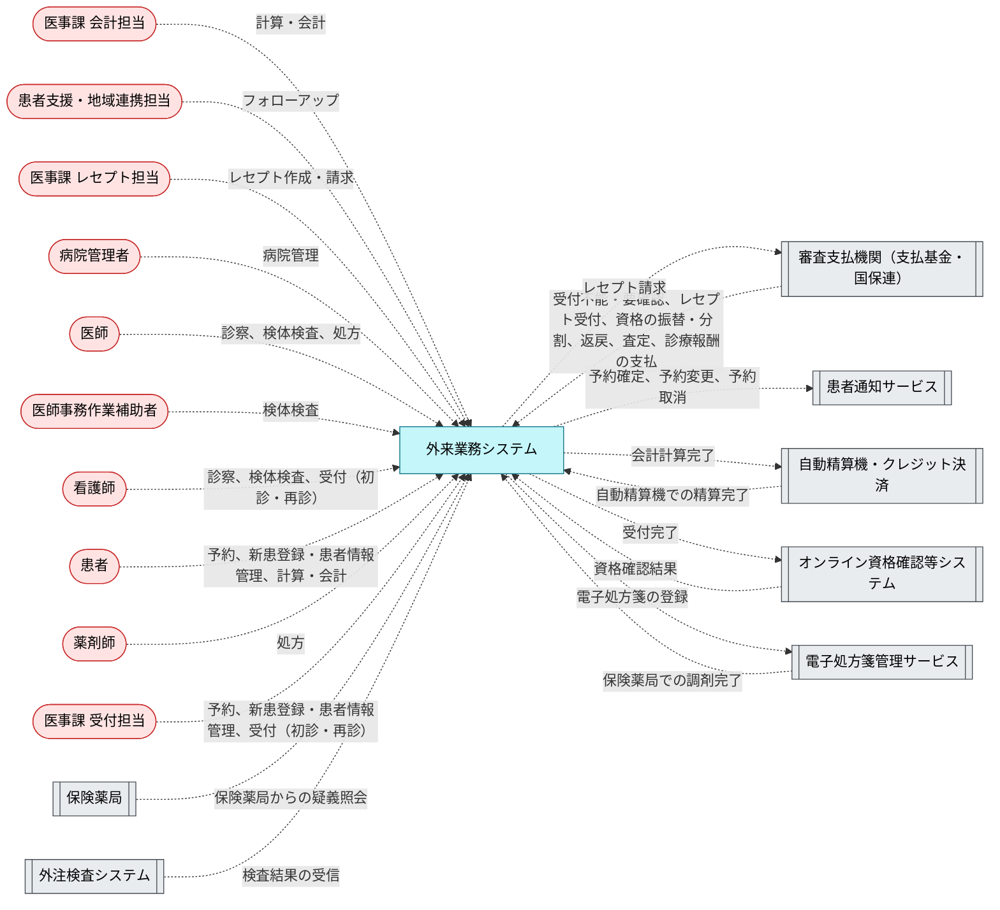

## 3. 要求

要求を目的ごとにまとめる。「BUC」はその要求が動機付ける業務で、[5. ユーザージャーニー](#5-ユーザージャーニー) にその業務フローがある。次の図は目的、要求、BUC のつながりである。「やらないこと」の枠にある要求は [4. やらないこと](#4-やらないこと) に載せている。

```mermaid
%% rdra-ish diagram=requirement scope=whole model=samples/clinic-ops
%% kinds: requirement goal buc
%% omitted: actor nfr quality constraint business flow usecase event system entity
flowchart LR
  requirement__ReqChangeAppointmentAtDesk[/"予約の変更・取消を電話と窓口で受け付ける"\]:::requirement
  requirement__ReqEligibilityEveryVisit[/"受付のたびに保険資格を確認する"\]:::requirement
  requirement__ReqFollowUpAfterVisit[/"診察後の連絡と再診予約をケアプランで追う"\]:::requirement
  requirement__ReqHandOffAfterConsultation[/"診察終了で受診を会計計算へ引き渡す"\]:::requirement
  requirement__ReqInquiryBeforeDispense[/"疑わしい処方は医師への照会が済むまで調剤しない"\]:::requirement
  requirement__ReqMonthlyClaimByTenth[/"前月分のレセプトを翌月10日までに請求する"\]:::requirement
  requirement__ReqPayAfterConsultation[/"会計は診察の後に一度で行う"\]:::requirement
  requirement__ReqProxyOrderNeedsPhysician[/"代行入力されたオーダは医師が確定するまで実施しない"\]:::requirement
  requirement__ReqRegisterEPrescription[/"院外処方箋を電子処方箋管理サービスへ登録し、保険薬局を指定しない"\]:::requirement
  requirement__ReqRegisterWithEligibility[/"新患登録で保険情報と限度額情報をオンライン資格確認から取り込む"\]:::requirement
  requirement__ReqResolveAuditFindings[/"監査で見つかった問題を管理者が解決するまで追う"\]:::requirement
  requirement__ReqResubmitReturned[/"返戻レセプトを訂正して再請求する"\]:::requirement
  requirement__ReqSwiftCheckIn[/"再来患者は情報を入力し直さずに受付・案内される"\]:::requirement
  goal__SafeCare[/"診療の抜けと誤りを実施前に止める<br/>処方・オーダの確認漏れと診察後の連絡漏れの件数: 月20件 → 月5件以下"/]:::goal
  %% desc goal__SafeCare: 処方やオーダの確認漏れ、診察後の連絡漏れは、患者の安全と継続した治療を損なう。
  goal__ShortWait[/"受付から診察までの待ち時間を短くする<br/>受付から診察開始までの中央値: 45分 → 30分"/]:::goal
  %% desc goal__ShortWait: 受付後に診察室へ案内されるまでの待ちが長いと、患者が帰ってしまう。
  goal__TimelyClaims[/"会計から請求までの遅れと返戻を減らす<br/>請求したレセプトのうち返戻になった割合: 3% → 1%"/]:::goal
  %% desc goal__TimelyClaims: 診察後の会計や請求に漏れや遅れがあると、収入が遅れ、返戻の訂正に事務の手間がかかる。
  buc__BucAppointmentScheduling["予約"]:::buc
  %% desc buc__BucAppointmentScheduling: 予約検索、仮押さえ、予約確定、変更、取消、通知を扱う。予約枠と予約レコードを同時に更新する UC は専用 API を持ち、予約通知は AppointmentNoticeApi に分ける。予約済みの患者は、来院前に `BucVisitCheckIn` の一括照会の対象になる。
  buc__BucBillingClaims["レセプト作成・請求"]:::buc
  %% desc buc__BucBillingClaims: レセプト（患者 × 診療月 × 保険者）の作成・院内点検・請求と、審査支払機関（支払基金・国保連）からの受付不能・返戻・査定・支払への対応を扱う。前月分は翌月10日までに請求し、受付不能・要確認は11日・12日に再送する。返戻は訂正して当月分と併せて再請求できるが、査定は再請求できず再審査請求で争う。資格が変わったレセプトは審査支払機関が振替・分割するので返戻にならないが、負担割合が異なる変更や公費の分割はできず返戻になる。支払は診療の翌々月。期間のうち DSL で表せないもの（10日、11・12日、5日〜月末、3か月、翌々月）はタイマーとコメントで示す。
  buc__BucClinicalEncounter["診察"]:::buc
  %% desc buc__BucClinicalEncounter: 診療記録を開き、バイタル、診断、署名、診察終了までを扱う。診察終了 `CompleteConsultation` で予約は「計算待ち」になり、会計は計算受付へ移る。他院紹介では医師が診療情報提供書を作成・送信する。検査オーダは診察中に医師が出し、署名の後に診察終了とする。署名イベント `EvEncounterSigned` はカルテのコスト情報の登録とケアプラン作成を、診察終了イベント `EvConsultationCompleted` は計算・会計を起動する。
  buc__BucFollowupCare["フォローアップ"]:::buc
  %% desc buc__BucFollowupCare: 診療後のケアプラン作成、患者連絡、患者応答確認、再診予約、ケアプラン終了を扱う。
  buc__BucOrdersResults["検体検査"]:::buc
  %% desc buc__BucOrdersResults: 検査オーダーから結果確認、重要結果通知までを扱う。医師事務作業補助者や看護師がオーダを代行入力した場合、医師が確定するまで看護師は採血しない（保助看法 第37条）。この規則は `OrderConfirmedByPhysician` 条件と `forbidden(ClinicalOrder, status == collected, physician_confirmed == false)` で検証する。外注検査の結果は外注検査システムから届く。採血管ラベルの発行と実施内容（コスト）の登録が会計計算の入力になる。実施入力のコストは `Charge.origin` が `performed` で、カルテ由来（`chart`）や選定療養費（`selectedfee`）のコストと発生元で区別される。
  buc__BucPatientOnboarding["新患登録・患者情報管理"]:::buc
  %% desc buc__BucPatientOnboarding: 新患登録から問診送付までを扱う。新患登録では、オンライン資格確認で得た保険情報と、患者が同意した場合の限度額情報（適用区分）を `InsurancePolicy` に登録する。負担割合 `burden_ratio` と限度額適用区分 `limit_category` は actor が選ぶ値ではなく保険者が決める値なので、variation 型の属性として持つ。
  buc__BucPrescriptionFulfillment["処方"]:::buc
  %% desc buc__BucPrescriptionFulfillment: 処方オーダから院外処方箋の発行、院内処方の調剤・監査・服薬指導・交付、疑義照会までを扱う。院外処方箋は電子処方箋管理サービスへ登録し、患者が選ぶ保険薬局で調剤される。病院は特定の保険薬局を指示しない（療担規則 第2条の5）ので、`Prescription` は薬局を持たない。使用期間は交付日を含めて4日以内で、日数は DSL で数えられないためタイマーで期限切れにする。薬剤師は疑わしい点があれば医師に問い合わせ、回答までは調剤しない。
  buc__BucStaffAdministration["病院管理"]:::buc
  %% desc buc__BucStaffAdministration: 病院運営のマスタ（診療枠・診察室）と監査の業務を扱う。
  buc__BucVisitCheckIn["受付（初診・再診）"]:::buc
  %% desc buc__BucVisitCheckIn: 到着確認、資格確認、紹介状の受付、診察室への案内を扱う。療養担当規則 第3条により受付のたびに資格を確認するので、`CheckInPatient` は必ずオンライン資格確認を伴い `EligibilityCheck` を作る。結果は 有効・無効・該当資格なし の 3 通りで、無効と該当資格なしは再確認へ戻る。システムが答えられない場合は被保険者資格申立書かシステム障害時モードで確認する。来院前には予約済み患者の一括照会を行う。受付では支払を受けない（会計は `BucVisitPayment`）。
  buc__BucVisitPayment["計算・会計"]:::buc
  %% desc buc__BucVisitPayment: 診察の後の会計計算入力、患者の呼出、会計窓口または自動精算機での精算、領収証・明細書の交付を扱う。一部負担金は負担割合で計算し、限度額情報があれば窓口での支払は自己負担限度額までになる（`CopayCappedAtLimit`）。紹介状なしの初診で除外に当たらない場合は選定療養費を自費の Charge として算定する（`UnreferredFirstVisit`）。金額は病院の設定 `SelectedTreatmentFeeSetting` に置き、モデルは数値を持たない。
  subgraph group_out_of_scope["やらないこと"]
    requirement__ReqNoOnlineConsultation[/"オンライン診療は対象外とする"\]:::requirement
  end
  goal__SafeCare --> requirement__ReqFollowUpAfterVisit
  %% derived goal__SafeCare -> requirement__ReqFollowUpAfterVisit via requirement__ReqFollowUpAfterVisit
  goal__SafeCare --> requirement__ReqInquiryBeforeDispense
  %% derived goal__SafeCare -> requirement__ReqInquiryBeforeDispense via requirement__ReqInquiryBeforeDispense
  goal__SafeCare --> requirement__ReqProxyOrderNeedsPhysician
  %% derived goal__SafeCare -> requirement__ReqProxyOrderNeedsPhysician via requirement__ReqProxyOrderNeedsPhysician
  goal__SafeCare --> requirement__ReqRegisterEPrescription
  %% derived goal__SafeCare -> requirement__ReqRegisterEPrescription via requirement__ReqRegisterEPrescription
  goal__ShortWait --> requirement__ReqChangeAppointmentAtDesk
  %% derived goal__ShortWait -> requirement__ReqChangeAppointmentAtDesk via requirement__ReqChangeAppointmentAtDesk
  goal__ShortWait --> requirement__ReqEligibilityEveryVisit
  %% derived goal__ShortWait -> requirement__ReqEligibilityEveryVisit via requirement__ReqEligibilityEveryVisit
  goal__ShortWait --> requirement__ReqRegisterWithEligibility
  %% derived goal__ShortWait -> requirement__ReqRegisterWithEligibility via requirement__ReqRegisterWithEligibility
  goal__ShortWait --> requirement__ReqSwiftCheckIn
  %% derived goal__ShortWait -> requirement__ReqSwiftCheckIn via requirement__ReqSwiftCheckIn
  goal__TimelyClaims --> requirement__ReqHandOffAfterConsultation
  %% derived goal__TimelyClaims -> requirement__ReqHandOffAfterConsultation via requirement__ReqHandOffAfterConsultation
  goal__TimelyClaims --> requirement__ReqMonthlyClaimByTenth
  %% derived goal__TimelyClaims -> requirement__ReqMonthlyClaimByTenth via requirement__ReqMonthlyClaimByTenth
  goal__TimelyClaims --> requirement__ReqPayAfterConsultation
  %% derived goal__TimelyClaims -> requirement__ReqPayAfterConsultation via requirement__ReqPayAfterConsultation
  goal__TimelyClaims --> requirement__ReqResolveAuditFindings
  %% derived goal__TimelyClaims -> requirement__ReqResolveAuditFindings via requirement__ReqResolveAuditFindings
  goal__TimelyClaims --> requirement__ReqResubmitReturned
  %% derived goal__TimelyClaims -> requirement__ReqResubmitReturned via requirement__ReqResubmitReturned
  requirement__ReqChangeAppointmentAtDesk --> buc__BucAppointmentScheduling
  requirement__ReqEligibilityEveryVisit --> buc__BucVisitCheckIn
  requirement__ReqFollowUpAfterVisit --> buc__BucFollowupCare
  requirement__ReqHandOffAfterConsultation --> buc__BucClinicalEncounter
  requirement__ReqInquiryBeforeDispense --> buc__BucPrescriptionFulfillment
  requirement__ReqMonthlyClaimByTenth --> buc__BucBillingClaims
  requirement__ReqNoOnlineConsultation -.-> buc__BucClinicalEncounter
  requirement__ReqPayAfterConsultation --> buc__BucVisitPayment
  requirement__ReqProxyOrderNeedsPhysician --> buc__BucOrdersResults
  requirement__ReqRegisterEPrescription --> buc__BucPrescriptionFulfillment
  requirement__ReqRegisterWithEligibility --> buc__BucPatientOnboarding
  requirement__ReqResolveAuditFindings --> buc__BucStaffAdministration
  requirement__ReqResubmitReturned --> buc__BucBillingClaims
  requirement__ReqSwiftCheckIn --> buc__BucVisitCheckIn
  classDef requirement fill:#fff3bf,stroke:#e67700,color:#000;
  classDef goal fill:#fff3bf,stroke:#e67700,color:#000;
  classDef buc fill:#d3f9d8,stroke:#2b8a3e,color:#000;
```

### 診療の抜けと誤りを実施前に止める

| ID | 要求 | 優先度 | 関係者 | 目的 | 受け入れ条件 | 出典 | BUC |
|---|---|---|---|---|---|---|---|
| `ReqFollowUpAfterVisit` | 診察後の連絡と再診予約をケアプランで追う | must | ケアコーディネーター | 診療の抜けと誤りを実施前に止める | 署名された受診ごとにケアプランが作られ、患者の応答と再診予約を経て終了する。 | モデルの想定（一次資料なし） | フォローアップ |
| `ReqInquiryBeforeDispense` | 疑わしい処方は医師への照会が済むまで調剤しない | must | 薬剤師 | 診療の抜けと誤りを実施前に止める | 疑義照会中の処方箋は、医師が回答するまで調剤・監査に進まない。 | 確かめた後でなければ調剤してはならない (egov-yakuzaishihou-335AC0000000146.txt:202) | 処方 |
| `ReqProxyOrderNeedsPhysician` | 代行入力されたオーダは医師が確定するまで実施しない | must | 看護師 | 診療の抜けと誤りを実施前に止める | 医師が確定していない代行入力オーダの検体は採取されない。 | 代行入力（代行オーダー） (mhlw-2020-dairi-nyuuryoku.txt:71-79, :15); 主治の医師又は歯科医師の指示 (egov-hokanhou-323AC0000000203.txt:311) | 検体検査 |
| `ReqRegisterEPrescription` | 院外処方箋を電子処方箋管理サービスへ登録し、保険薬局を指定しない | must | 医師 | 診療の抜けと誤りを実施前に止める | 院外処方箋は紙を印刷する場合も電子処方箋管理サービスへ登録され、処方箋は薬局を持たない。 | 電子処方箋管理サービス (mhlw-denshi-shohousen-unyou.txt:28-30); 特定の保険薬局において調剤を受けるべき旨の指示等を行つてはならない (egov-ryotan-kisoku-332M50000100015.txt:49) | 処方 |

### 受付から診察までの待ち時間を短くする

| ID | 要求 | 優先度 | 関係者 | 目的 | 受け入れ条件 | 出典 | BUC |
|---|---|---|---|---|---|---|---|
| `ReqChangeAppointmentAtDesk` | 予約の変更・取消を電話と窓口で受け付ける | must | 医事課 受付担当 | 受付から診察までの待ち時間を短くする | 受付担当が予約の変更・取消を入力すると、患者に通知が届く。 | sapporo-city-hosp-yoyaku.md:102, :118; yokohama-cu-urahp-c16010-shiyousyo.txt:196-197 | 予約 |
| `ReqEligibilityEveryVisit` | 受付のたびに保険資格を確認する | must | 医事課 受付担当 | 受付から診察までの待ち時間を短くする | 受付は必ずオンライン資格確認を伴い、確認できない場合は被保険者資格申立書かシステム障害時モードで確認する。 | 保険医療機関及び保険医療養担当規則 第3条 (egov-ryotan-kisoku-332M50000100015.txt:80) | 受付（初診・再診） |
| `ReqRegisterWithEligibility` | 新患登録で保険情報と限度額情報をオンライン資格確認から取り込む | must | 医事課 受付担当 | 受付から診察までの待ち時間を短くする | 保険情報は手入力せずオンライン資格確認の結果を登録し、限度額情報は患者が同意した場合だけ取得する。 | 新患登録 (mhlw-2024-hyojun-denshi-karte-gyomuflow.txt:46, :51); 新患登録 (koseikan-2024-iji-shiyousyo.txt:92) | 新患登録・患者情報管理 |
| `ReqSwiftCheckIn` | 再来患者は情報を入力し直さずに受付・案内される | must | 医事課 受付担当 | 受付から診察までの待ち時間を短くする | 再来患者は 1 回の確認操作で受付され、診察室へ案内される。 | モデルの想定（一次資料なし） | 受付（初診・再診） |

### 会計から請求までの遅れと返戻を減らす

| ID | 要求 | 優先度 | 関係者 | 目的 | 受け入れ条件 | 出典 | BUC |
|---|---|---|---|---|---|---|---|
| `ReqHandOffAfterConsultation` | 診察終了で受診を会計計算へ引き渡す | must | 医師 | 会計から請求までの遅れと返戻を減らす | 診察終了の後、予約は計算待ちになり、会計計算入力より前に完了しない。 | 診察終了後 (sendai-iji-gairai-shiyousyo.txt:176); 計算受付 (mhlw-2024-hyojun-denshi-karte-gyomuflow.txt:141) | 診察 |
| `ReqMonthlyClaimByTenth` | 前月分のレセプトを翌月10日までに請求する | must | 医事課 レセプト担当 | 会計から請求までの遅れと返戻を減らす | 前月分のレセプトは院内点検の後、毎月5日から10日の間に審査支払機関へ請求される。 | 各月分について翌月十日まで (egov-seikyu-meirei-351M50000100036.txt:55); 請求可能期間 5日～10日 (ssk-online-seikyu-sousa-tejunsho.txt:748) | レセプト作成・請求 |
| `ReqPayAfterConsultation` | 会計は診察の後に一度で行う | must | 医事課 会計担当 | 会計から請求までの遅れと返戻を減らす | 受付では支払を受けず、会計計算入力の後に窓口または自動精算機で精算し、領収証を交付する。 | 標準型電子カルテ 業務フロー: 計算受付・会計受付 (mhlw-2024-hyojun-denshi-karte-gyomuflow.txt:141-144) | 計算・会計 |
| `ReqResolveAuditFindings` | 監査で見つかった問題を管理者が解決するまで追う | must | 病院管理者 | 会計から請求までの遅れと返戻を減らす | 監査指摘は管理端末から解決されるまで未解決として残る。 | モデルの想定（一次資料なし） | 病院管理 |
| `ReqResubmitReturned` | 返戻レセプトを訂正して再請求する | must | 医事課 レセプト担当 | 会計から請求までの遅れと返戻を減らす | 返戻は3か月以内に取り込まれ、訂正して当月分と併せて再請求される。査定は再請求せず再審査請求で争う。 | 返戻ファイルを修正し、当月請求のレセプトと併せて再請求 (mhlw-online-henrei-saiseikyu.txt:105-111, :119) | レセプト作成・請求 |

## 4. やらないこと

| ID | 内容 | 理由 |
|---|---|---|
| `ReqNoOnlineConsultation` | オンライン診療は対象外とする | 診察は来院して受ける前提で業務を分けているため、ビデオ通話による受付・診察・会計は扱わない。 |

## 5. ユーザージャーニー

次の図は業務の流れである。業務ごとに BUC をまとめ、ある BUC から次の BUC への引き渡しを、引き渡すイベントのラベルで示す。

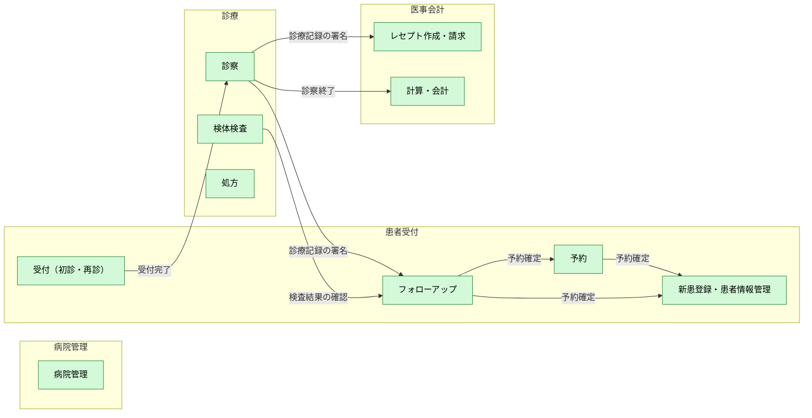

この後の節は BUC ごとの業務フローである。手順、分岐、例外と、各手順を担う UC を示す。業務フローを持たない BUC（病院管理）は載せていない。

### 新患登録・患者情報管理

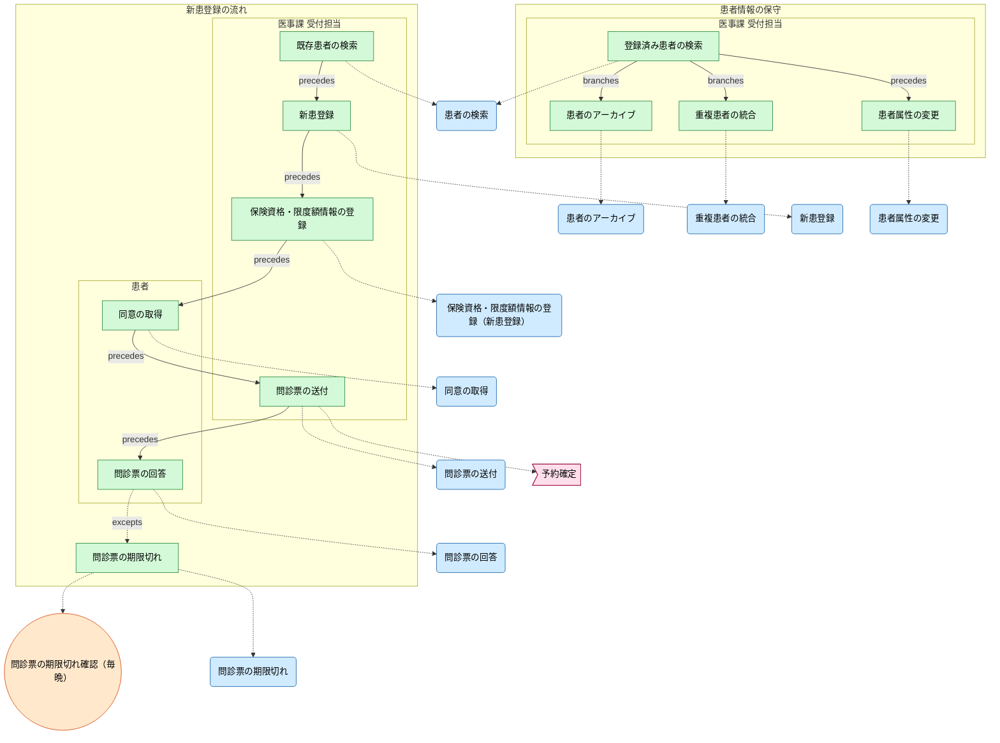

### 予約

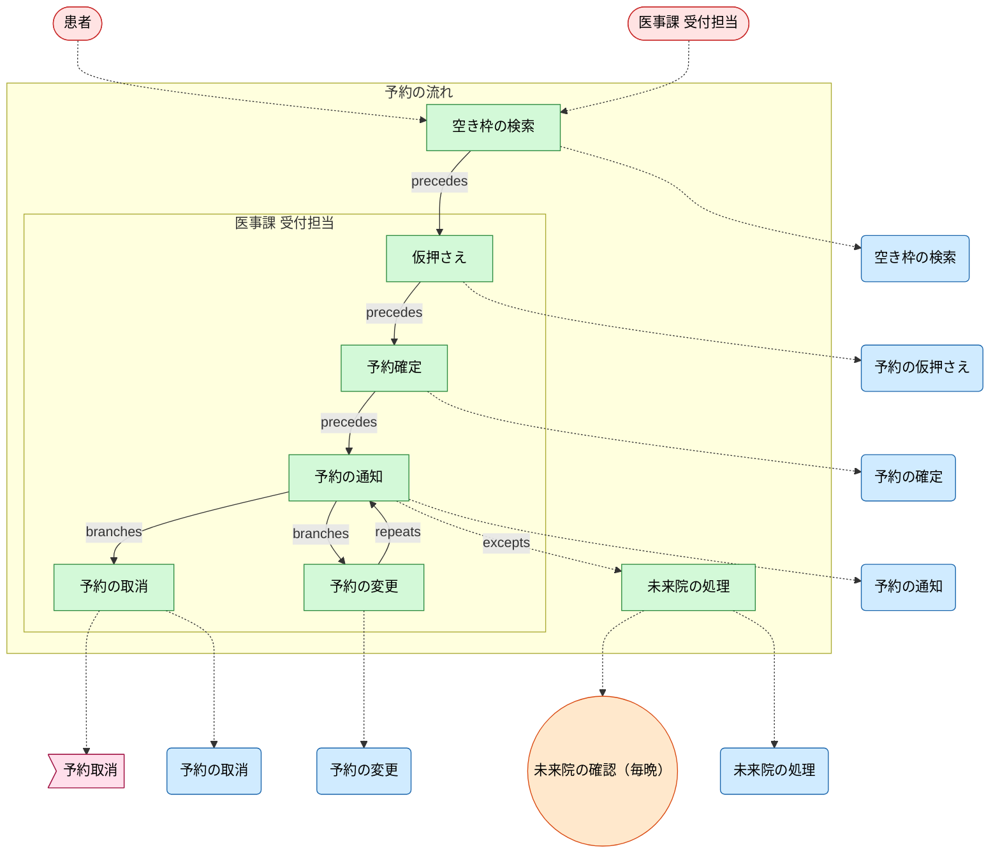

### 受付（初診・再診）

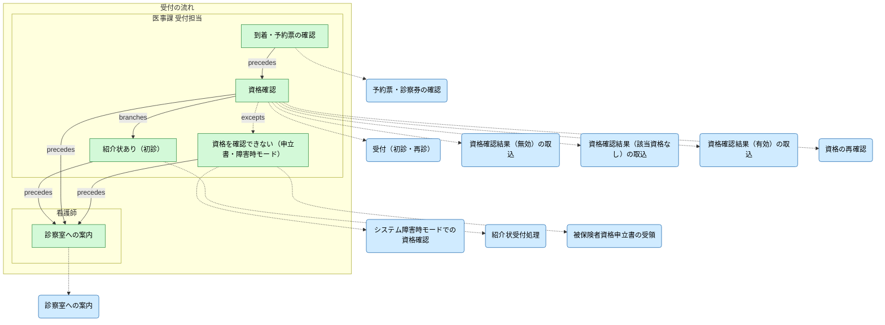

### 診察

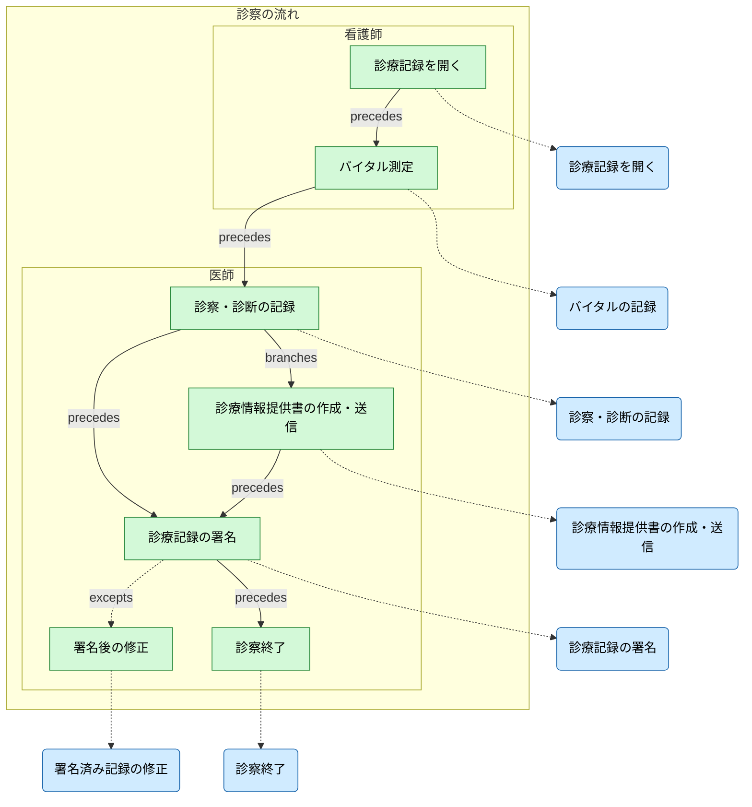

### 検体検査

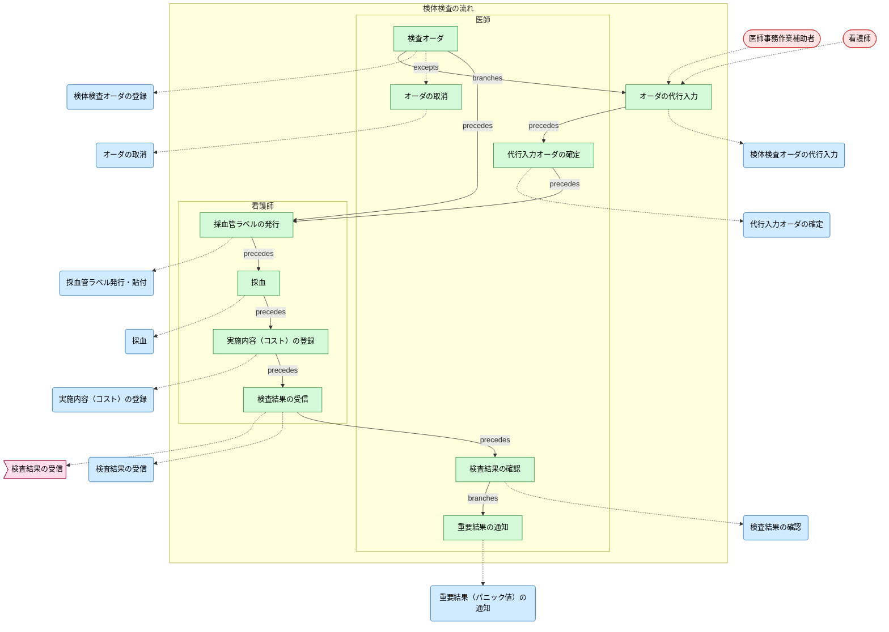

### 処方

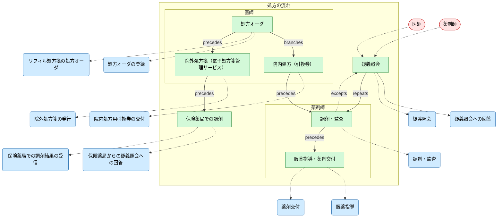

### 計算・会計

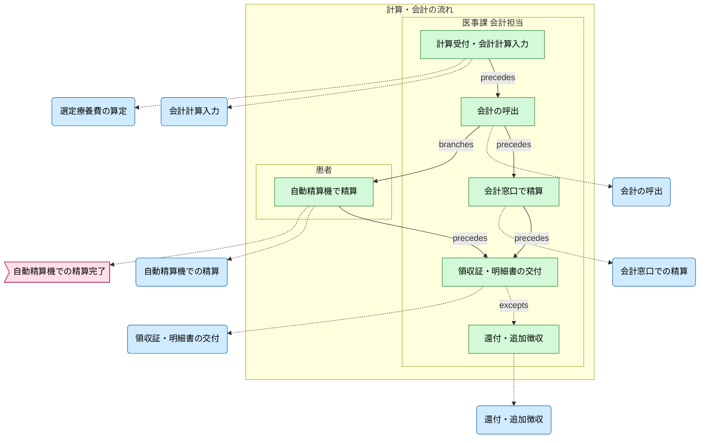

### レセプト作成・請求

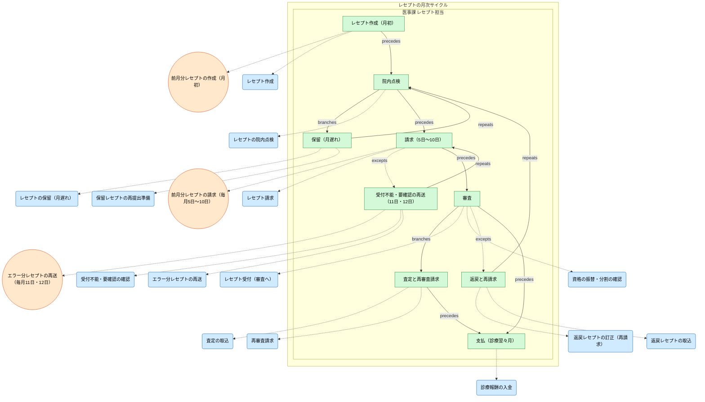

### フォローアップ

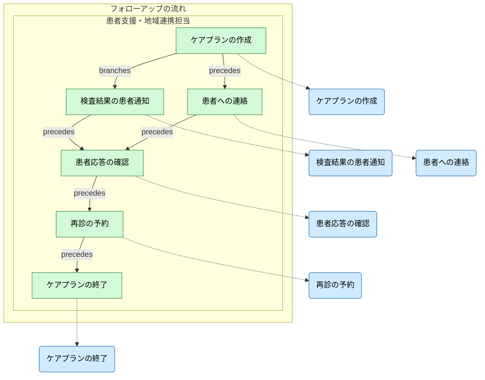

## 6. ビジネスルール（受け入れ条件）

`list --kind rule --format markdown` の出力である。各行が、システムが守る業務規則で、受け入れ試験の条件になる。

| kind | label | entities | rule | applies_to | site |
| --- | --- | --- | --- | --- | --- |
| condition | 振替・分割の対象外（負担割合の相違・公費） |  |  | RecordClaimReturn | samples/clinic-ops/buc/buc_billing_claims.rdra:178 |
| condition | 医師が確定したオーダ | ClinicalOrder | ClinicalOrder.physician_confirmed == true, ClinicalOrder.status == オーダ済 | CollectSpecimen | samples/clinic-ops/buc/buc_orders_results.rdra:111 |
| condition | 予約済みの患者 | Appointment | (Appointment.status == 予約済).along(InsurancePolicy, PatientAccount, Appointment) | BatchVerifyEligibility | samples/clinic-ops/buc/buc_visit_checkin.rdra:106 |
| condition | 窓口負担は負担割合で計算し、限度額情報があれば限度額までとする |  |  | CalculateVisitBill | samples/clinic-ops/buc/buc_visit_payment.rdra:73 |
| condition | 紹介状なしの初診で、除外に当たらない | Charge\|Appointment | Charge.kind == 選定療養（自費）, Appointment.referral == 紹介状なし初診 | ApplySelectedTreatmentFee | samples/clinic-ops/buc/buc_visit_payment.rdra:92 |
| invariant | 受付済の予約には受付時刻が記録されている | Appointment | when Appointment.status == 受付済 then Appointment.checked_in_at == present |  | samples/clinic-ops/shared/entities.rdra:430 |
| invariant | 完了した予約には完了時刻が記録されている | Appointment | when Appointment.status == 完了 then Appointment.completed_at == present |  | samples/clinic-ops/shared/entities.rdra:432 |
| invariant | 署名済の診療記録には署名時刻が記録されている | Encounter | when Encounter.status == 署名済 then Encounter.signed_at == present |  | samples/clinic-ops/shared/entities.rdra:434 |
| invariant | 結果が出たオーダには結果日時が記録されている | ClinicalOrder | when ClinicalOrder.status == 結果受信 then ClinicalOrder.resulted_at == present |  | samples/clinic-ops/shared/entities.rdra:436 |
| invariant | 発行済の処方箋には送信日時が記録されている | Prescription | when Prescription.status == 院外処方箋発行済 then Prescription.sent_at == present |  | samples/clinic-ops/shared/entities.rdra:438 |
| invariant | 支払済のレセプトには支払日時が記録されている | ClaimStatement | when ClaimStatement.status == 支払済 then ClaimStatement.paid_at == present |  | samples/clinic-ops/shared/entities.rdra:440 |
| forbidden | 訂正した返戻は、再請求の前に返戻理由を消す | ClaimStatement | ClaimStatement.status == 支払済 AND ClaimStatement.return_reason == present |  | samples/clinic-ops/shared/entities.rdra:442 |
| forbidden | 医師事務作業補助者が入力したオーダは、医師が確定してから検体を採取する | ClinicalOrder | ClinicalOrder.status == 採取済 AND ClinicalOrder.physician_confirmed == false |  | samples/clinic-ops/shared/entities.rdra:445 |

## 7. 非機能要件

| id | label | metric | target | window | slo | availability | resilience | audit | logging | retention | privacy | description |
| --- | --- | --- | --- | --- | --- | --- | --- | --- | --- | --- | --- | --- |
| ScheduleLookupLatency | 予約枠検索の応答時間 | p95_latency_ms | <=500 | 5m | 99.5% | multi_az | retryable |  |  |  |  |  |

| id | label | metric | target | window | slo | availability | resilience | audit | logging | retention | privacy | description |
| --- | --- | --- | --- | --- | --- | --- | --- | --- | --- | --- | --- | --- |
| BillingAuditTrail | 会計の監査証跡 |  |  |  |  |  |  | enabled |  | 7y |  |  |
| NoPharmacySteering | 特定の保険薬局において調剤を受けるべき旨の指示等を行わない |  |  |  |  |  |  | enabled |  |  |  |  |
| PatientDataPrivacy | 患者情報の保護 |  |  |  |  |  |  |  | structured | 10y | restricted |  |
