# Food Permit Ops 設計書

<!-- derived-from ../../docs/language-reference.md -->
<!-- derived-from ../../docs/cli-reference.md -->

`scripts/gen-clinic-ops-docs.py` が `samples/food-permit-ops/` のモデルから CLI を通して生成する。図・表・説明文を手で直さず、`.rdra` を直して `scripts/check-sample-artifacts.sh` を実行する。題材は日本の保健所の食品営業許可業務（事前相談と営業の種類の判定、許可申請、施設検査、許可・不許可、有効期間と更新、変更・承継・廃業の届出、営業届出、監視指導と不利益処分）で、審査請求の中身・食品表示・輸入食品・食中毒調査・他法令の許可は対象外。業務規則は `.rdra` の `//` コメントに一次資料の出典（ファイル名:行）を付けている。

この文書は実装するエンジニア向けである。構造、処理、仕様の順に読む。

1. BUC ごとのロバストネス図で、画面・制御・エンティティの構造をつかむ。
2. UC ごとのシーケンス図で、ガードと書き込みの順序をつかむ。
3. 状態モデル、データモデル、規則、CRUD と権限で仕様を確かめる。

要求と成功指標は [PRD](prd.md) にある。

## 1. 概要

対象は都道府県・保健所設置市・特別区の保健所が行う食品の営業許可業務である。業務を 8 の BUC に分け、内部システムは `PermitLedgerSystem`（営業許可台帳システム）1 つにまとめている。国の食品衛生申請等システムは外部システムとしてイベントでつなぐ。

業務の骨格は食品衛生法 55 条の許可と、行政手続法の審査・処分の手続である。期間（有効期間、営業停止の期間、審査請求期間、公表期間）はタイマーで表し、期間が過ぎたときに起きること（失効・停止の終了・処分の確定・公表の終了）を状態で表す。標準処理期間は過ぎても状態が変わらないので NFR にしている。

| 論点 | このモデル |
|---|---|
| 許可・届出・不要 | 営業の種類で決まる。許可は施行令35条の32業種、届出は法57条、どちらも要らない営業は施行令35条の2 |
| 申請 | 窓口（紙）と電子申請（食品衛生申請等システム）が同じ状態を通る。手数料は条例で、電子申請でも別途納め、還付しない |
| 審査 | 施設検査は自治体の運用（法令の明文はない）。基準に合わなければ改善して再検査。合えば許可しなければならず、不許可には理由を示す |
| 有効期間と更新 | 5年以上で自治体が定める。満了前に継続の申請と施設検査をし、満了すれば失効して新規扱い |
| 届出 | 営業届出には施設基準も更新もない。変更・承継・廃業は届け出る |
| 処分 | 取消は聴聞、停止と整備改善命令は弁明の機会。計測で確かめた技術的基準の不充足に従えと命じる処分は意見陳述を省ける。理由を示し、審査請求（3月）を教示する |

### システムコンテキスト図

システムを使う actor と、イベントでつながる外部システムを示す。actor からシステムへの線は、actor が担う BUC の UC が呼ぶ API から導出される。

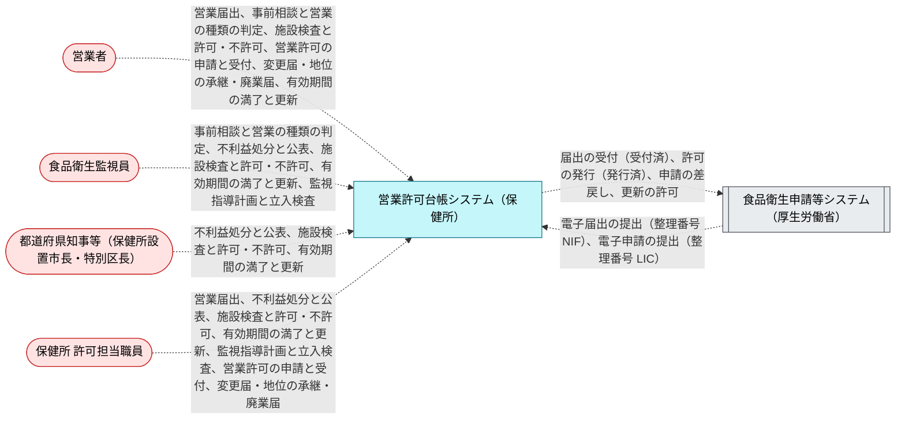

## 2. BUC ごとの構造と処理

各節は BUC の説明、ロバストネス図、画面遷移図、UC の表、UC ごとのシーケンス図の順に並ぶ。ロバストネス図では actor が画面を使い、画面が制御（UC が呼ぶ API、API がなければ UC 自身）を呼び、制御がエンティティを読み書きする。画面遷移図（`diagram --kind screen --buc <Buc>`）の実線は `navigates` で宣言した遷移で、ラベルは遷移を起こす UC である。点線の「業務上の順番」は宣言がない所を業務フローから補ったもので、同じ担当者のレーンで続く手順が表示する画面の順を示し、実際の画面遷移ではない。遷移も業務上の順番もない BUC では画面遷移図を省く。表の「ガード」は UC に効く条件で、式は [5. 規則](#5-規則) にある。

### 2.1 事前相談と営業の種類の判定

営業者は施設の工事の前に図面を持って保健所に相談する。食品衛生監視員は営業の内容から、許可が要るか（施行令35条の32業種）、届出でよいか、どちらも要らないか（施行令35条の2）を判定し、許可業種なら施設基準と食品衛生責任者を説明する。

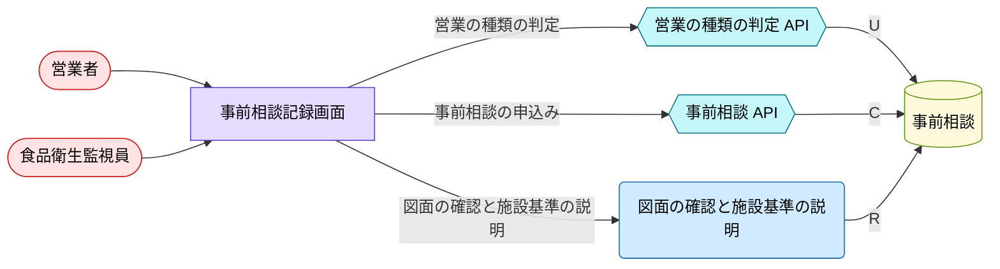

| UC | 説明 | 画面 | 制御 | ガード |
|---|---|---|---|---|
| 事前相談の申込み<br>`RequestConsultation` | 営業者が施設の図面と営業の内容を持って保健所に相談する。相談で営業の種類を伝える。 | `ConsultationScreen` | `ConsultationApi` | （なし） |
| 図面の確認と施設基準の説明<br>`ReviewFloorPlan` | 食品衛生監視員が図面を施設基準（共通基準・業種別基準）と照らし、足りない設備と、食品衛生責任者の資格（調理師・栄養士等か講習会の受講）を説明する（参照のみ）。 | `ConsultationScreen` | `ReviewFloorPlan` | （なし） |
| 営業の種類の判定<br>`ClassifyBusiness` | 営業の種類から、許可が必要か、届出が必要か、どちらも要らないかを判定する。結果は営業の種類で決まり、監視員が選ぶものではない（各結果に条件）。 | `ConsultationScreen` | `ClassificationApi` | 許可業種（施行令35条）である、届出業種である、届出も要らない営業（施行令35条の2）である |

<details><summary>事前相談の申込み（RequestConsultation）のシーケンス図</summary>

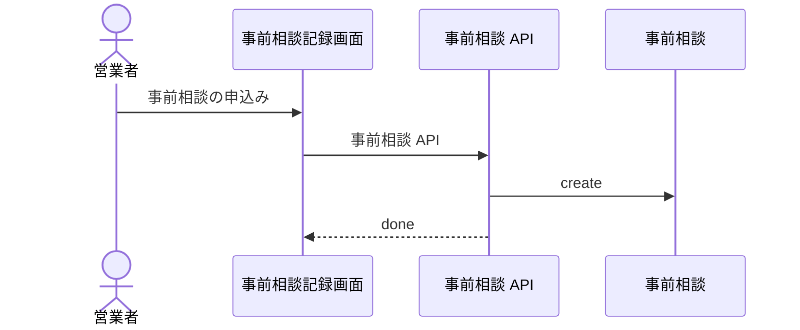

</details>

<details><summary>図面の確認と施設基準の説明（ReviewFloorPlan）のシーケンス図</summary>

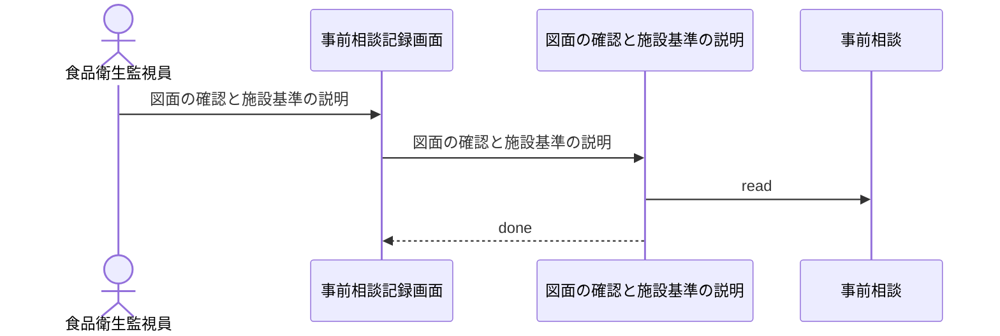

</details>

<details><summary>営業の種類の判定（ClassifyBusiness）のシーケンス図</summary>

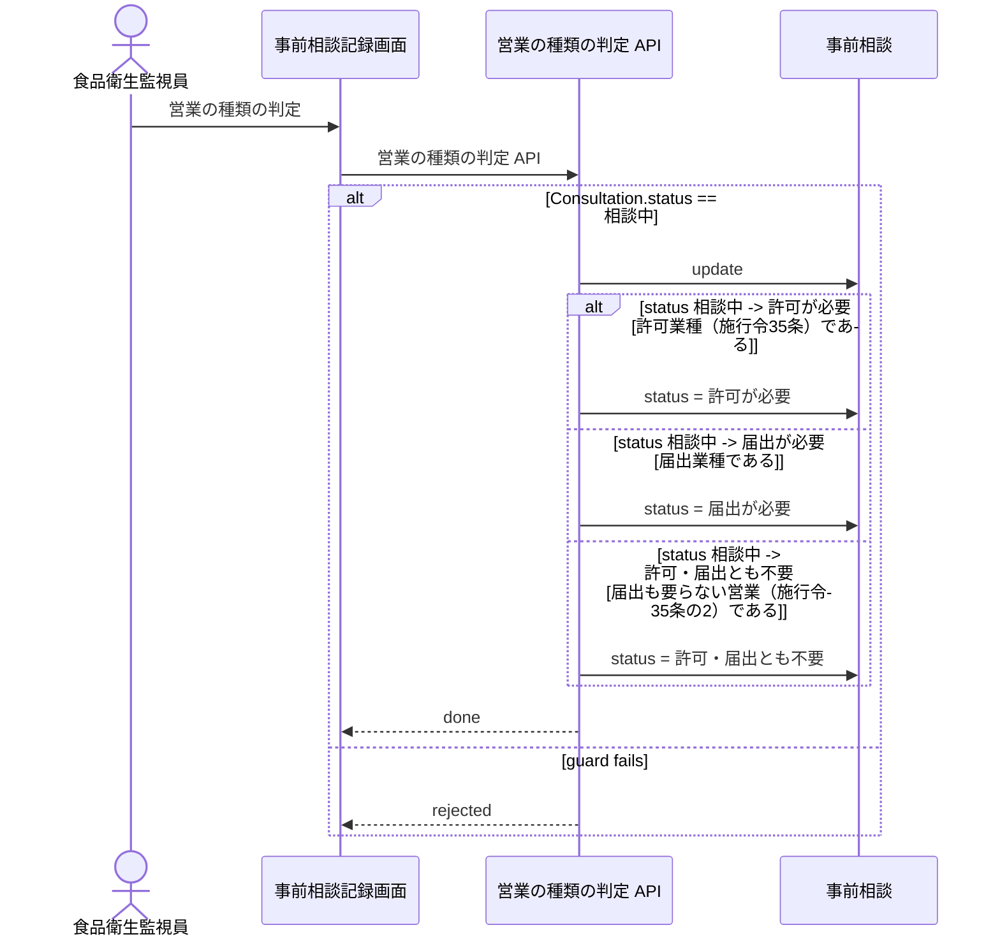

</details>

### 2.2 営業許可の申請と受付

営業者は開店の2〜3週間前（東京都は工事完成の10日前ころ）に、申請書と図面を保健所の窓口に出すか、食品衛生申請等システムで電子申請し、条例の手数料を納める。保健所は記載事項と添付書類を確かめ、足りなければ補正を求め（差戻し）、整えば施設検査に進める（検査待）。申請者は差戻しの間に取り下げられる。

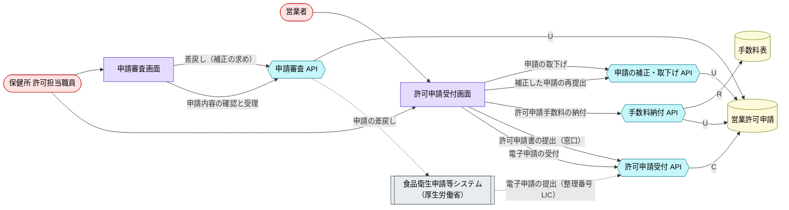

#### 画面遷移図

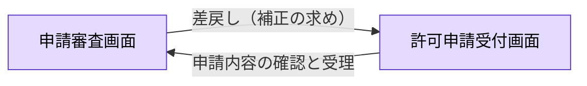

| UC | 説明 | 画面 | 制御 | ガード |
|---|---|---|---|---|
| 許可申請書の提出（窓口）<br>`SubmitCounterApplication` | 営業者が許可申請書（新規）に図面と食品衛生責任者の資格を証する書類を添えて、保健所の窓口に出す。 | `ApplicationScreen` | `ApplicationIntakeApi` | （なし） |
| 電子申請の受付<br>`ReceiveOnlineApplication` | 食品衛生申請等システムで提出された新規の許可申請を、管轄の保健所の確認待ち（申請内容確認待）として受け付ける。 | `ApplicationScreen` | `ApplicationIntakeApi` | （なし） |
| 許可申請手数料の納付<br>`PayPermitFee` | 営業者が条例の手数料を保健所に納める（電子申請でも別途納付）。納めた手数料は還付されない。 | `ApplicationScreen` | `FeePaymentApi` | 申請が確認待か差戻し中である |
| 申請内容の確認と受理<br>`ReviewApplication` | 許可担当が記載事項（営業者・施設・営業の種類・食品衛生責任者・図面・欠格事由の有無）と手数料の納付を確かめ、施設検査に進める（検査待）。 | `ApplicationReviewScreen` | `ApplicationReviewApi` | 手数料が納められている |
| 差戻し（補正の求め）<br>`ReturnApplication` | 記載の誤りや添付書類の不足があれば、期間を定めて補正を求め、申請を差し戻す。電子申請では申請者の依頼による差戻しもある。 | `ApplicationReviewScreen` | `ApplicationReviewApi` | （なし） |
| 補正した申請の再提出<br>`ResubmitApplication` | 営業者が差戻しを受けて申請を直し、再び確認待にする。 | `ApplicationScreen` | `ApplicationAmendApi` | （なし） |
| 申請の取下げ<br>`WithdrawApplication` | 営業者が許可・不許可の前に申請を取り下げる。電子申請は保健所の差戻しを受けてから取り下げる。手数料は戻らない。 | `ApplicationScreen` | `ApplicationAmendApi` | 窓口（紙）で出した申請である |

<details><summary>許可申請書の提出（窓口）（SubmitCounterApplication）のシーケンス図</summary>

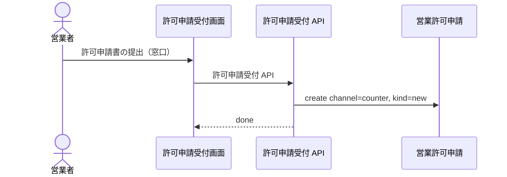

</details>

<details><summary>電子申請の受付（ReceiveOnlineApplication）のシーケンス図</summary>

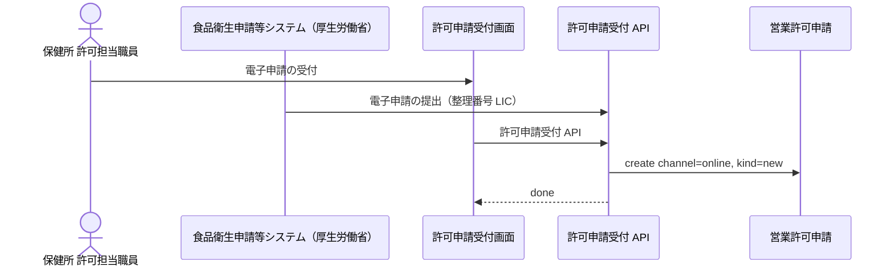

</details>

<details><summary>許可申請手数料の納付（PayPermitFee）のシーケンス図</summary>

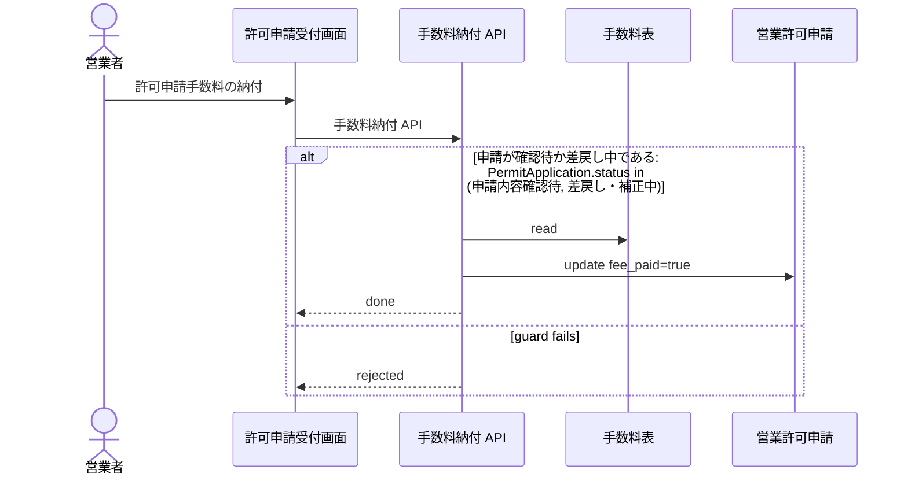

</details>

<details><summary>申請内容の確認と受理（ReviewApplication）のシーケンス図</summary>

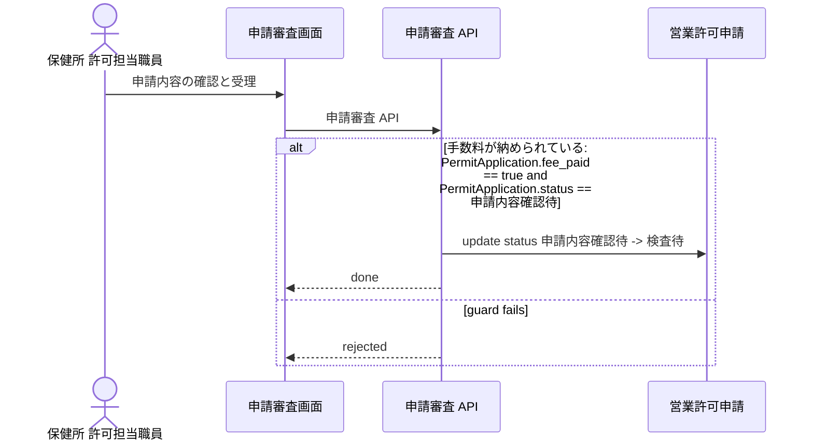

</details>

<details><summary>差戻し（補正の求め）（ReturnApplication）のシーケンス図</summary>

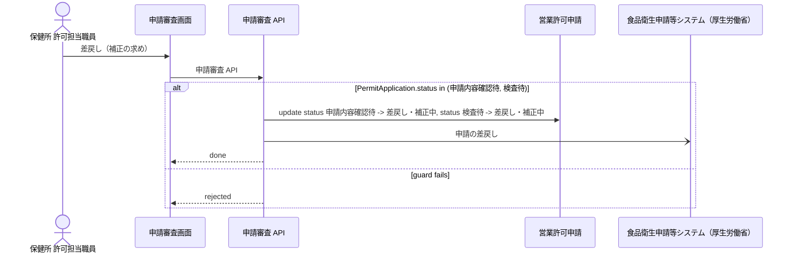

</details>

<details><summary>補正した申請の再提出（ResubmitApplication）のシーケンス図</summary>

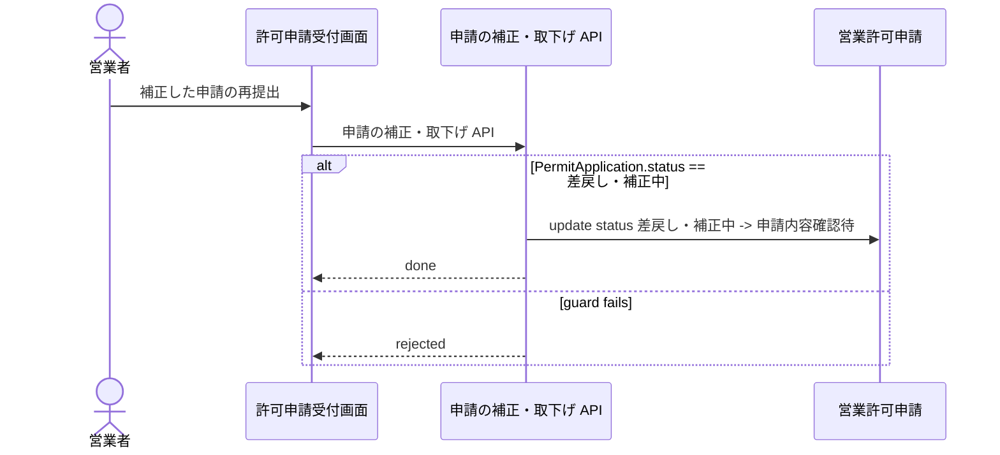

</details>

<details><summary>申請の取下げ（WithdrawApplication）のシーケンス図</summary>

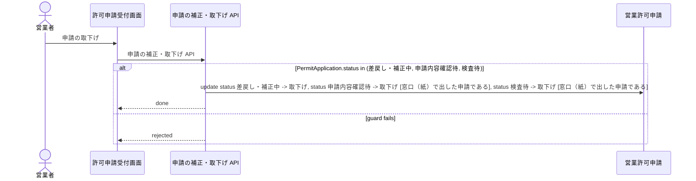

</details>

### 2.3 施設検査と許可・不許可

食品衛生監視員が施設を検査し、施設基準に合わなければ改善を指示して再検査する。行政庁は基準に合うと認めれば許可しなければならず、合わなければ理由を示して不許可にする。許可すると台帳に登録して許可証を交付し、営業者は許可証を掲示して営業を始める。食品衛生責任者が申請時に未定なら、許可後速やかに定める。

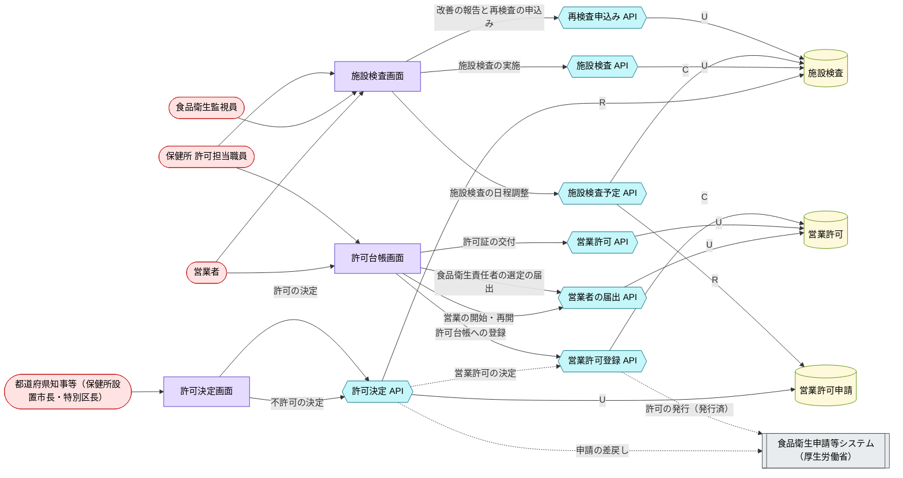

#### 画面遷移図

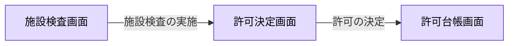

| UC | 説明 | 画面 | 制御 | ガード |
|---|---|---|---|---|
| 施設検査の日程調整<br>`ScheduleInspection` | 手数料の納付を確かめた検査待の申請について、施設検査の日を決める。 | `InspectionScreen` | `InspectionScheduleApi` | 申請が検査待で、まだ検査の予定がない |
| 施設検査の実施<br>`ConductInspection` | 食品衛生監視員が施設を施設基準（共通基準・業種別基準）と照らし、衛生管理計画を確かめる。合わなければ改善を指示する。 | `InspectionScreen` | `InspectionApi` | （なし） |
| 改善の報告と再検査の申込み<br>`RequestReinspection` | 営業者が指示された箇所を直し、再検査を申し込む。 | `InspectionScreen` | `ReinspectionApi` | （なし） |
| 許可の決定<br>`GrantPermit` | 施設検査で施設基準に合うと認めた新規の申請に許可を与え、有効期間（5年以上）を付ける。 | `DecisionScreen` | `DecisionApi` | 施設検査で施設基準に適合した、新規の申請である |
| 不許可の決定<br>`DenyPermit` | 施設基準に合わないか、補正に応じないか、欠格事由に当たる申請を、理由を示し、審査請求ができることを書面で教えて拒否する。 | `DecisionScreen` | `DecisionApi` | （なし） |
| 許可台帳への登録<br>`RegisterPermit` | 許可の決定を受けて許可番号を付け、許可台帳に登録する。電子申請ではシステムの表示を発行済にする。 | `PermitLedgerScreen` | `PermitRegistrationApi` | （なし） |
| 許可証の交付<br>`IssueCertificate` | 許可証を営業者に交付する。 | `PermitLedgerScreen` | `PermitApi` | 許可が有効である |
| 食品衛生責任者の選定の届出<br>`AppointHygieneManager` | 申請時に食品衛生責任者を定めていなかった営業者が、許可後に定めて（講習会を受けて）届け出る。 | `PermitLedgerScreen` | `OperatorPermitApi` | 許可が有効である |
| 営業の開始・再開<br>`StartBusiness` | 営業者が許可証を掲示して営業を始める。営業停止の期間が終わった後の再開も同じ。 | `PermitLedgerScreen` | `OperatorPermitApi` | 許可が有効で、許可証の交付を受けている |

<details><summary>施設検査の日程調整（ScheduleInspection）のシーケンス図</summary>

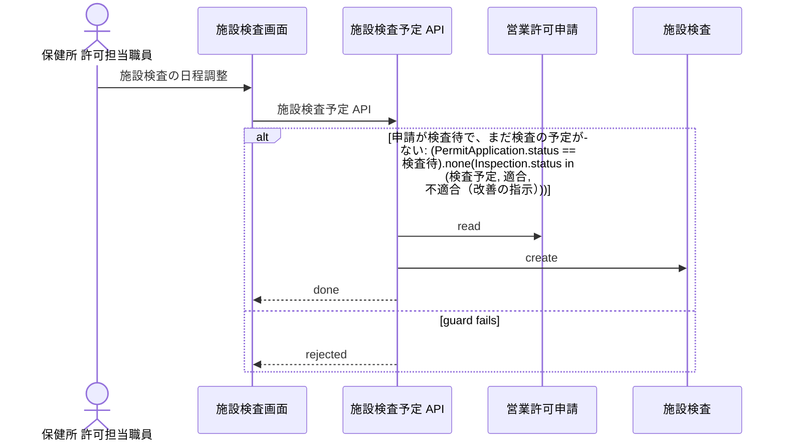

</details>

<details><summary>施設検査の実施（ConductInspection）のシーケンス図</summary>

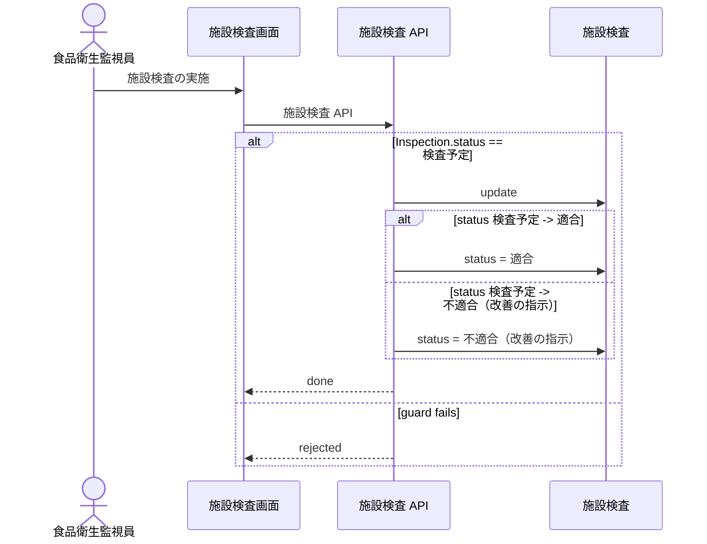

</details>

<details><summary>改善の報告と再検査の申込み（RequestReinspection）のシーケンス図</summary>

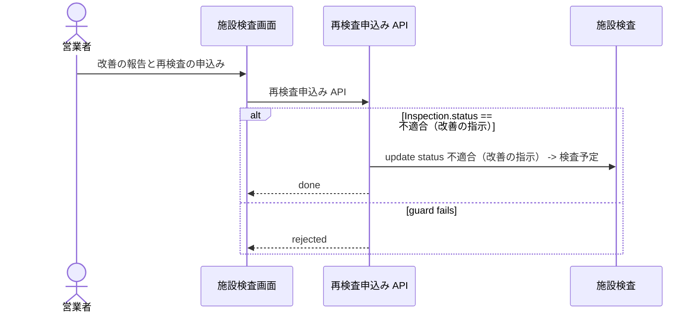

</details>

<details><summary>許可の決定（GrantPermit）のシーケンス図</summary>

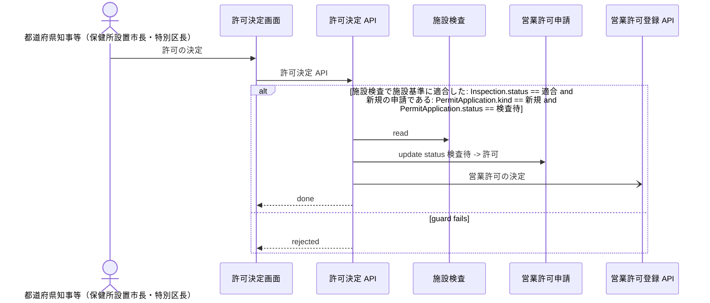

</details>

<details><summary>不許可の決定（DenyPermit）のシーケンス図</summary>

```mermaid
%% rdra-ish diagram=sequence scope=usecase:DenyPermit model=samples/food-permit-ops
%% kinds: actor screen api entity extsystem
%% omitted: nfr buc step medium permission event
sequenceDiagram
  actor actor__PermitAuthority as 都道府県知事等（保健所設置市長・特別区長）
  participant screen__DecisionScreen as 許可決定画面
  participant api__DecisionApi as 許可決定 API
  participant entity__Inspection as 施設検査
  participant entity__PermitApplication as 営業許可申請
  participant extsystem__FoodSanitationSystem as 食品衛生申請等システム（厚生労働省）
  actor__PermitAuthority ->> screen__DecisionScreen: 不許可の決定
  screen__DecisionScreen ->> api__DecisionApi: 許可決定 API
  alt PermitApplication.status in (検査待, 差戻し・補正中)
    api__DecisionApi ->> entity__Inspection: read
    api__DecisionApi ->> entity__PermitApplication: update status 検査待 -> 不許可, status 差戻し・補正中 -> 不許可, reason_shown=true
    api__DecisionApi -) extsystem__FoodSanitationSystem: 申請の差戻し
    api__DecisionApi -->> screen__DecisionScreen: done
  else guard fails
    api__DecisionApi -->> screen__DecisionScreen: rejected
  end
```

</details>

<details><summary>許可台帳への登録（RegisterPermit）のシーケンス図</summary>

```mermaid
%% rdra-ish diagram=sequence scope=usecase:RegisterPermit model=samples/food-permit-ops
%% kinds: actor usecase screen api entity extsystem
%% omitted: buc step medium permission event
sequenceDiagram
  actor actor__PermitClerk as 保健所 許可担当職員
  participant usecase__GrantPermit as 許可の決定
  participant screen__PermitLedgerScreen as 許可台帳画面
  participant api__PermitRegistrationApi as 営業許可登録 API
  participant entity__BusinessPermit as 営業許可
  participant extsystem__FoodSanitationSystem as 食品衛生申請等システム（厚生労働省）
  actor__PermitClerk ->> screen__PermitLedgerScreen: 許可台帳への登録
  usecase__GrantPermit ->> api__PermitRegistrationApi: 営業許可の決定
  screen__PermitLedgerScreen ->> api__PermitRegistrationApi: 営業許可登録 API
  api__PermitRegistrationApi ->> entity__BusinessPermit: create
  api__PermitRegistrationApi -) extsystem__FoodSanitationSystem: 許可の発行（発行済）
  api__PermitRegistrationApi -->> screen__PermitLedgerScreen: done
```

</details>

<details><summary>許可証の交付（IssueCertificate）のシーケンス図</summary>

```mermaid
%% rdra-ish diagram=sequence scope=usecase:IssueCertificate model=samples/food-permit-ops
%% kinds: actor screen api entity
%% omitted: buc step medium permission condition
sequenceDiagram
  actor actor__PermitClerk as 保健所 許可担当職員
  participant screen__PermitLedgerScreen as 許可台帳画面
  participant api__PermitApi as 営業許可 API
  participant entity__BusinessPermit as 営業許可
  actor__PermitClerk ->> screen__PermitLedgerScreen: 許可証の交付
  screen__PermitLedgerScreen ->> api__PermitApi: 営業許可 API
  alt 許可が有効である: BusinessPermit.status == 有効
    api__PermitApi ->> entity__BusinessPermit: update certificate_issued=true
    api__PermitApi -->> screen__PermitLedgerScreen: done
  else guard fails
    api__PermitApi -->> screen__PermitLedgerScreen: rejected
  end
```

</details>

<details><summary>食品衛生責任者の選定の届出（AppointHygieneManager）のシーケンス図</summary>

```mermaid
%% rdra-ish diagram=sequence scope=usecase:AppointHygieneManager model=samples/food-permit-ops
%% kinds: actor screen api entity
%% omitted: buc step medium permission condition
sequenceDiagram
  actor actor__BusinessOperator as 営業者
  participant screen__PermitLedgerScreen as 許可台帳画面
  participant api__OperatorPermitApi as 営業者の届出 API
  participant entity__BusinessPermit as 営業許可
  actor__BusinessOperator ->> screen__PermitLedgerScreen: 食品衛生責任者の選定の届出
  screen__PermitLedgerScreen ->> api__OperatorPermitApi: 営業者の届出 API
  alt 許可が有効である: BusinessPermit.status == 有効
    api__OperatorPermitApi ->> entity__BusinessPermit: update hygiene_manager_appointed=true
    api__OperatorPermitApi -->> screen__PermitLedgerScreen: done
  else guard fails
    api__OperatorPermitApi -->> screen__PermitLedgerScreen: rejected
  end
```

</details>

<details><summary>営業の開始・再開（StartBusiness）のシーケンス図</summary>

```mermaid
%% rdra-ish diagram=sequence scope=usecase:StartBusiness model=samples/food-permit-ops
%% kinds: actor screen api entity
%% omitted: buc step medium permission condition
sequenceDiagram
  actor actor__BusinessOperator as 営業者
  participant screen__PermitLedgerScreen as 許可台帳画面
  participant api__OperatorPermitApi as 営業者の届出 API
  participant entity__BusinessPermit as 営業許可
  actor__BusinessOperator ->> screen__PermitLedgerScreen: 営業の開始・再開
  screen__PermitLedgerScreen ->> api__OperatorPermitApi: 営業者の届出 API
  alt 許可が有効で、許可証の交付を受けている: BusinessPermit.status == 有効, BusinessPermit.certificate_issued == true
    api__OperatorPermitApi ->> entity__BusinessPermit: update operating=true
    api__OperatorPermitApi -->> screen__PermitLedgerScreen: done
  else guard fails
    api__OperatorPermitApi -->> screen__PermitLedgerScreen: rejected
  end
```

</details>

### 2.4 有効期間の満了と更新

許可には5年以上の有効期間が付く。満了の前に保健所が通知し（静岡市は2か月前）、営業者は満了前に継続（更新）の申請をする。更新でも施設検査があり、満了日までに許可を終える。更新しないまま満了すると許可は失効し、営業を続けると無許可営業になる。失効した許可は更新できず、新規の申請からやり直す。

```mermaid
%% rdra-ish diagram=robustness scope=buc:BucRenewal model=samples/food-permit-ops
%% kinds: actor extsystem screen timer api usecase entity
%% omitted: buc step medium permission event condition
flowchart LR
  actor__BusinessOperator(["営業者"]):::actor
  actor__FoodSanitationInspector(["食品衛生監視員"]):::actor
  actor__PermitAuthority(["都道府県知事等（保健所設置市長・特別区長）"]):::actor
  actor__PermitClerk(["保健所 許可担当職員"]):::actor
  extsystem__FoodSanitationSystem[["食品衛生申請等システム（厚生労働省）"]]:::extsystem
  screen__InspectionScreen["施設検査画面"]:::screen
  screen__PermitLedgerScreen["許可台帳画面"]:::screen
  screen__RenewalScreen["更新申請画面"]:::screen
  timer__ExpiryNoticeDue(("満了通知の発送（有効期間満了の2か月前）")):::timer
  timer__PermitTermEnd(("有効期間の満了（5年以上、自治体が定める）")):::timer
  api__DecisionApi{{"許可決定 API"}}:::api
  api__InspectionApi{{"施設検査 API"}}:::api
  api__InspectionScheduleApi{{"施設検査予定 API"}}:::api
  api__PermitTermApi{{"有効期間 API"}}:::api
  api__RenewalApi{{"更新申請 API"}}:::api
  usecase__SendExpiryNotice("満了通知の発送"):::usecase
  entity__BusinessPermit[("営業許可")]:::entity
  entity__Inspection[("施設検査")]:::entity
  entity__PermitApplication[("営業許可申請")]:::entity
  actor__BusinessOperator --> screen__RenewalScreen
  actor__FoodSanitationInspector --> screen__InspectionScreen
  actor__PermitAuthority --> screen__InspectionScreen
  actor__PermitClerk --> screen__InspectionScreen
  actor__PermitClerk --> screen__PermitLedgerScreen
  api__DecisionApi -->|R| entity__Inspection
  api__DecisionApi -->|U| entity__PermitApplication
  api__DecisionApi -.->|更新の許可| api__PermitTermApi
  api__DecisionApi -.->|更新の許可| extsystem__FoodSanitationSystem
  api__InspectionApi -->|U| entity__Inspection
  api__InspectionScheduleApi -->|C| entity__Inspection
  api__InspectionScheduleApi -->|R| entity__PermitApplication
  api__PermitTermApi -->|U| entity__BusinessPermit
  api__RenewalApi -->|C| entity__PermitApplication
  api__RenewalApi -->|R| entity__BusinessPermit
  screen__InspectionScreen -->|施設検査の実施| api__InspectionApi
  screen__InspectionScreen -->|施設検査の日程調整| api__InspectionScheduleApi
  screen__InspectionScreen -->|更新の許可の決定| api__DecisionApi
  screen__PermitLedgerScreen -->|有効期間の更新| api__PermitTermApi
  screen__PermitLedgerScreen -->|満了通知の発送| api__PermitTermApi
  screen__PermitLedgerScreen -->|満了通知の発送| usecase__SendExpiryNotice
  screen__RenewalScreen -->|継続（更新）の申請| api__RenewalApi
  timer__ExpiryNoticeDue -.-> api__PermitTermApi
  timer__ExpiryNoticeDue -.-> usecase__SendExpiryNotice
  timer__PermitTermEnd -.-> api__PermitTermApi
  usecase__SendExpiryNotice -->|R| entity__BusinessPermit
  classDef actor fill:#ffe3e3,stroke:#c92a2a,color:#000;
  classDef extsystem fill:#e9ecef,stroke:#495057,color:#000;
  classDef screen fill:#e5dbff,stroke:#5f3dc4,color:#000;
  classDef timer fill:#ffe8cc,stroke:#d9480f,color:#000;
  classDef api fill:#c5f6fa,stroke:#0b7285,color:#000;
  classDef usecase fill:#d0ebff,stroke:#1864ab,color:#000;
  classDef entity fill:#fff9db,stroke:#5c940d,color:#000;
```

#### 画面遷移図

```mermaid
%% rdra-ish diagram=screen scope=buc:BucRenewal model=samples/food-permit-ops
%% kinds: screen
%% omitted: usecase field
flowchart LR
  screen__InspectionScreen["施設検査画面"]:::screen
  screen__PermitLedgerScreen["許可台帳画面"]:::screen
  screen__RenewalScreen["更新申請画面"]:::screen
  screen__PermitLedgerScreen -->|満了通知の発送| screen__RenewalScreen
  screen__RenewalScreen -->|継続（更新）の申請| screen__InspectionScreen
  %% via screen__PermitLedgerScreen -> screen__RenewalScreen usecase__SendExpiryNotice
  %% via screen__RenewalScreen -> screen__InspectionScreen usecase__ApplyRenewal
  classDef screen fill:#e5dbff,stroke:#5f3dc4,color:#000;
```

| UC | 説明 | 画面 | 制御 | ガード |
|---|---|---|---|---|
| 満了通知の発送<br>`SendExpiryNotice` | 有効期間が満了する前に、許可営業者に満了の時期と更新の手続を知らせる。 | `PermitLedgerScreen` | `PermitTermApi` | （なし） |
| 継続（更新）の申請<br>`ApplyRenewal` | 有効な許可の営業者が、満了の前に継続の許可を申請する（窓口・電子）。手数料と施設検査は新規と同じ手順で進む。 | `RenewalScreen` | `RenewalApi` | （なし） |
| 更新の許可の決定<br>`RenewPermit` | 施設検査で施設基準に合うと認めた継続の申請に、許可がまだ有効なうちに許可を与える。 | `InspectionScreen` | `DecisionApi` | 施設検査で施設基準に適合した、継続（更新）の申請である |
| 有効期間の更新<br>`ExtendPermitTerm` | 更新の許可を受けて、台帳の有効期間を新しい期間に書き換え、満了通知の記録を消す。 | `PermitLedgerScreen` | `PermitTermApi` | （なし） |
| 有効期間の満了による失効<br>`ExpirePermit` | 更新されないまま有効期間が満了した許可を失効させる。営業者は営業をやめ、続けるなら新規の許可を受ける。 | （なし） | `PermitTermApi` | （なし） |

<details><summary>満了通知の発送（SendExpiryNotice）のシーケンス図</summary>

```mermaid
%% rdra-ish diagram=sequence scope=usecase:SendExpiryNotice model=samples/food-permit-ops
%% kinds: actor timer screen api usecase entity
%% omitted: buc step medium permission
sequenceDiagram
  actor actor__PermitClerk as 保健所 許可担当職員
  participant timer__ExpiryNoticeDue as 満了通知の発送（有効期間満了の2か月前）
  participant screen__PermitLedgerScreen as 許可台帳画面
  participant api__PermitTermApi as 有効期間 API
  participant usecase__SendExpiryNotice as 満了通知の発送
  participant entity__BusinessPermit as 営業許可
  actor__PermitClerk ->> screen__PermitLedgerScreen: 満了通知の発送
  timer__ExpiryNoticeDue ->> api__PermitTermApi: 満了通知の発送（有効期間満了の2か月前）
  screen__PermitLedgerScreen ->> api__PermitTermApi: 有効期間 API
  screen__PermitLedgerScreen ->> usecase__SendExpiryNotice: 満了通知の発送
  api__PermitTermApi ->> entity__BusinessPermit: update
  usecase__SendExpiryNotice ->> entity__BusinessPermit: read
  api__PermitTermApi -->> screen__PermitLedgerScreen: done
```

</details>

<details><summary>継続（更新）の申請（ApplyRenewal）のシーケンス図</summary>

```mermaid
%% rdra-ish diagram=sequence scope=usecase:ApplyRenewal model=samples/food-permit-ops
%% kinds: actor screen api entity
%% omitted: buc step medium permission
sequenceDiagram
  actor actor__BusinessOperator as 営業者
  participant screen__RenewalScreen as 更新申請画面
  participant api__RenewalApi as 更新申請 API
  participant entity__BusinessPermit as 営業許可
  participant entity__PermitApplication as 営業許可申請
  actor__BusinessOperator ->> screen__RenewalScreen: 継続（更新）の申請
  screen__RenewalScreen ->> api__RenewalApi: 更新申請 API
  api__RenewalApi ->> entity__BusinessPermit: read
  api__RenewalApi ->> entity__PermitApplication: create kind=renewal
  api__RenewalApi -->> screen__RenewalScreen: done
```

</details>

<details><summary>更新の許可の決定（RenewPermit）のシーケンス図</summary>

```mermaid
%% rdra-ish diagram=sequence scope=usecase:RenewPermit model=samples/food-permit-ops
%% kinds: actor screen api entity extsystem
%% omitted: buc step medium permission event condition
sequenceDiagram
  actor actor__PermitAuthority as 都道府県知事等（保健所設置市長・特別区長）
  participant screen__InspectionScreen as 施設検査画面
  participant api__DecisionApi as 許可決定 API
  participant entity__Inspection as 施設検査
  participant entity__PermitApplication as 営業許可申請
  participant api__PermitTermApi as 有効期間 API
  participant extsystem__FoodSanitationSystem as 食品衛生申請等システム（厚生労働省）
  actor__PermitAuthority ->> screen__InspectionScreen: 更新の許可の決定
  screen__InspectionScreen ->> api__DecisionApi: 許可決定 API
  alt 継続（更新）の申請である: PermitApplication.kind == 継続（更新） and 施設検査で施設基準に適合した: Inspection.status == 適合 and PermitApplication.status == 検査待
    api__DecisionApi ->> entity__Inspection: read
    api__DecisionApi ->> entity__PermitApplication: update status 検査待 -> 許可
    api__DecisionApi -) api__PermitTermApi: 更新の許可
    api__DecisionApi -) extsystem__FoodSanitationSystem: 更新の許可
    api__DecisionApi -->> screen__InspectionScreen: done
  else guard fails
    api__DecisionApi -->> screen__InspectionScreen: rejected
  end
```

</details>

<details><summary>有効期間の更新（ExtendPermitTerm）のシーケンス図</summary>

```mermaid
%% rdra-ish diagram=sequence scope=usecase:ExtendPermitTerm model=samples/food-permit-ops
%% kinds: actor usecase screen api entity
%% omitted: buc step medium permission event
sequenceDiagram
  actor actor__PermitClerk as 保健所 許可担当職員
  participant usecase__RenewPermit as 更新の許可の決定
  participant screen__PermitLedgerScreen as 許可台帳画面
  participant api__PermitTermApi as 有効期間 API
  participant entity__BusinessPermit as 営業許可
  actor__PermitClerk ->> screen__PermitLedgerScreen: 有効期間の更新
  usecase__RenewPermit ->> api__PermitTermApi: 更新の許可
  screen__PermitLedgerScreen ->> api__PermitTermApi: 有効期間 API
  alt BusinessPermit.status == 有効
    api__PermitTermApi ->> entity__BusinessPermit: update status 有効 -> 有効
    api__PermitTermApi -->> screen__PermitLedgerScreen: done
  else guard fails
    api__PermitTermApi -->> screen__PermitLedgerScreen: rejected
  end
```

</details>

<details><summary>有効期間の満了による失効（ExpirePermit）のシーケンス図</summary>

```mermaid
%% rdra-ish diagram=sequence scope=usecase:ExpirePermit model=samples/food-permit-ops
%% kinds: timer api entity
%% omitted: buc step
sequenceDiagram
  participant timer__PermitTermEnd as 有効期間の満了（5年以上、自治体が定める）
  participant api__PermitTermApi as 有効期間 API
  participant entity__BusinessPermit as 営業許可
  timer__PermitTermEnd ->> api__PermitTermApi: 有効期間の満了（5年以上、自治体が定める）
  alt BusinessPermit.status in (有効, 営業停止中)
    api__PermitTermApi ->> entity__BusinessPermit: update status 有効 -> 失効（有効期間満了）, status 営業停止中 -> 失効（有効期間満了）, operating=false
    api__PermitTermApi -->> timer__PermitTermEnd: done
  else guard fails
    api__PermitTermApi -->> timer__PermitTermEnd: rejected
  end
```

</details>

### 2.5 変更届・地位の承継・廃業届

許可営業者は申請書の記載事項が変わったら速やかに（東京都は10日以内）変更届を出す。移転や営業者の交代は変更ではなく新規の申請になる。営業の譲渡・相続・合併・分割では許可営業者の地位が承継され、承継した者が遅滞なく届け出る。廃業したら許可証を添えて廃業届を出す。

```mermaid
%% rdra-ish diagram=robustness scope=buc:BucPermitChanges model=samples/food-permit-ops
%% kinds: actor screen api entity
%% omitted: buc step medium permission condition
flowchart LR
  actor__BusinessOperator(["営業者"]):::actor
  actor__PermitClerk(["保健所 許可担当職員"]):::actor
  screen__PermitNoticeScreen["許可後の届出画面"]:::screen
  api__ChangeNoticeApi{{"変更届 API"}}:::api
  api__ChangeReviewApi{{"変更届確認 API"}}:::api
  api__ClosureApi{{"廃業届 API"}}:::api
  api__SuccessionApi{{"地位承継届 API"}}:::api
  api__SuccessionReviewApi{{"地位承継届受理 API"}}:::api
  entity__BusinessPermit[("営業許可")]:::entity
  entity__ChangeNotice[("変更届")]:::entity
  entity__SuccessionNotice[("地位承継届")]:::entity
  actor__BusinessOperator --> screen__PermitNoticeScreen
  actor__PermitClerk --> screen__PermitNoticeScreen
  api__ChangeNoticeApi -->|C| entity__ChangeNotice
  api__ChangeNoticeApi -->|R| entity__BusinessPermit
  api__ChangeReviewApi -->|U| entity__ChangeNotice
  api__ClosureApi -->|U| entity__BusinessPermit
  api__SuccessionApi -->|C| entity__SuccessionNotice
  api__SuccessionApi -->|R| entity__BusinessPermit
  api__SuccessionReviewApi -->|U| entity__SuccessionNotice
  screen__PermitNoticeScreen -->|地位承継届の受理| api__SuccessionReviewApi
  screen__PermitNoticeScreen -->|地位承継届の提出| api__SuccessionApi
  screen__PermitNoticeScreen -->|変更届の提出| api__ChangeNoticeApi
  screen__PermitNoticeScreen -->|変更届の確認| api__ChangeReviewApi
  screen__PermitNoticeScreen -->|廃業届の提出| api__ClosureApi
  classDef actor fill:#ffe3e3,stroke:#c92a2a,color:#000;
  classDef screen fill:#e5dbff,stroke:#5f3dc4,color:#000;
  classDef api fill:#c5f6fa,stroke:#0b7285,color:#000;
  classDef entity fill:#fff9db,stroke:#5c940d,color:#000;
```

| UC | 説明 | 画面 | 制御 | ガード |
|---|---|---|---|---|
| 変更届の提出<br>`FileChangeNotice` | 許可営業者が、申請書の記載事項（営業者の氏名・住所、施設の名称、食品衛生責任者など）や設備の変更を届け出る。 | `PermitNoticeScreen` | `ChangeNoticeApi` | 許可が終わっていない（有効か停止中） |
| 変更届の確認<br>`ReviewChangeNotice` | 許可担当が変更の内容を確かめ、届出で足りるか、新規の許可申請が必要かを判断する。 | `PermitNoticeScreen` | `ChangeReviewApi` | （なし） |
| 地位承継届の提出<br>`FileSuccessionNotice` | 営業を譲り受けた者、相続人、合併・分割で営業を承継した法人が、承継を証する書面を添えて届け出る。 | `PermitNoticeScreen` | `SuccessionApi` | 許可が終わっていない（有効か停止中） |
| 地位承継届の受理<br>`AcceptSuccessionNotice` | 許可担当が承継を証する書面を確かめ、台帳の営業者を書き換える。 | `PermitNoticeScreen` | `SuccessionReviewApi` | （なし） |
| 廃業届の提出<br>`FileClosureNotice` | 許可営業者が営業をやめた日から10日以内に、許可証を添えて廃業を届け出る。許可はここで終わる。 | `PermitNoticeScreen` | `ClosureApi` | （なし） |

<details><summary>変更届の提出（FileChangeNotice）のシーケンス図</summary>

```mermaid
%% rdra-ish diagram=sequence scope=usecase:FileChangeNotice model=samples/food-permit-ops
%% kinds: actor screen api entity
%% omitted: buc step medium permission condition
sequenceDiagram
  actor actor__BusinessOperator as 営業者
  participant screen__PermitNoticeScreen as 許可後の届出画面
  participant api__ChangeNoticeApi as 変更届 API
  participant entity__BusinessPermit as 営業許可
  participant entity__ChangeNotice as 変更届
  actor__BusinessOperator ->> screen__PermitNoticeScreen: 変更届の提出
  screen__PermitNoticeScreen ->> api__ChangeNoticeApi: 変更届 API
  alt 許可が終わっていない（有効か停止中）: BusinessPermit.status in (有効, 営業停止中)
    api__ChangeNoticeApi ->> entity__BusinessPermit: read
    api__ChangeNoticeApi ->> entity__ChangeNotice: create
    api__ChangeNoticeApi -->> screen__PermitNoticeScreen: done
  else guard fails
    api__ChangeNoticeApi -->> screen__PermitNoticeScreen: rejected
  end
```

</details>

<details><summary>変更届の確認（ReviewChangeNotice）のシーケンス図</summary>

```mermaid
%% rdra-ish diagram=sequence scope=usecase:ReviewChangeNotice model=samples/food-permit-ops
%% kinds: actor screen api entity
%% omitted: buc step medium permission
sequenceDiagram
  actor actor__PermitClerk as 保健所 許可担当職員
  participant screen__PermitNoticeScreen as 許可後の届出画面
  participant api__ChangeReviewApi as 変更届確認 API
  participant entity__ChangeNotice as 変更届
  actor__PermitClerk ->> screen__PermitNoticeScreen: 変更届の確認
  screen__PermitNoticeScreen ->> api__ChangeReviewApi: 変更届確認 API
  alt ChangeNotice.status == 受付
    api__ChangeReviewApi ->> entity__ChangeNotice: update
    alt status 受付 -> 受理
      api__ChangeReviewApi ->> entity__ChangeNotice: status = 受理
    else status 受付 -> 新規申請が必要
      api__ChangeReviewApi ->> entity__ChangeNotice: status = 新規申請が必要
    end
    api__ChangeReviewApi -->> screen__PermitNoticeScreen: done
  else guard fails
    api__ChangeReviewApi -->> screen__PermitNoticeScreen: rejected
  end
```

</details>

<details><summary>地位承継届の提出（FileSuccessionNotice）のシーケンス図</summary>

```mermaid
%% rdra-ish diagram=sequence scope=usecase:FileSuccessionNotice model=samples/food-permit-ops
%% kinds: actor screen api entity
%% omitted: buc step medium permission condition
sequenceDiagram
  actor actor__BusinessOperator as 営業者
  participant screen__PermitNoticeScreen as 許可後の届出画面
  participant api__SuccessionApi as 地位承継届 API
  participant entity__BusinessPermit as 営業許可
  participant entity__SuccessionNotice as 地位承継届
  actor__BusinessOperator ->> screen__PermitNoticeScreen: 地位承継届の提出
  screen__PermitNoticeScreen ->> api__SuccessionApi: 地位承継届 API
  alt 許可が終わっていない（有効か停止中）: BusinessPermit.status in (有効, 営業停止中)
    api__SuccessionApi ->> entity__BusinessPermit: read
    api__SuccessionApi ->> entity__SuccessionNotice: create
    api__SuccessionApi -->> screen__PermitNoticeScreen: done
  else guard fails
    api__SuccessionApi -->> screen__PermitNoticeScreen: rejected
  end
```

</details>

<details><summary>地位承継届の受理（AcceptSuccessionNotice）のシーケンス図</summary>

```mermaid
%% rdra-ish diagram=sequence scope=usecase:AcceptSuccessionNotice model=samples/food-permit-ops
%% kinds: actor screen api entity
%% omitted: buc step medium permission
sequenceDiagram
  actor actor__PermitClerk as 保健所 許可担当職員
  participant screen__PermitNoticeScreen as 許可後の届出画面
  participant api__SuccessionReviewApi as 地位承継届受理 API
  participant entity__SuccessionNotice as 地位承継届
  actor__PermitClerk ->> screen__PermitNoticeScreen: 地位承継届の受理
  screen__PermitNoticeScreen ->> api__SuccessionReviewApi: 地位承継届受理 API
  alt SuccessionNotice.status == 受付
    api__SuccessionReviewApi ->> entity__SuccessionNotice: update status 受付 -> 受理
    api__SuccessionReviewApi -->> screen__PermitNoticeScreen: done
  else guard fails
    api__SuccessionReviewApi -->> screen__PermitNoticeScreen: rejected
  end
```

</details>

<details><summary>廃業届の提出（FileClosureNotice）のシーケンス図</summary>

```mermaid
%% rdra-ish diagram=sequence scope=usecase:FileClosureNotice model=samples/food-permit-ops
%% kinds: actor screen api entity
%% omitted: buc step medium permission
sequenceDiagram
  actor actor__BusinessOperator as 営業者
  participant screen__PermitNoticeScreen as 許可後の届出画面
  participant api__ClosureApi as 廃業届 API
  participant entity__BusinessPermit as 営業許可
  actor__BusinessOperator ->> screen__PermitNoticeScreen: 廃業届の提出
  screen__PermitNoticeScreen ->> api__ClosureApi: 廃業届 API
  alt BusinessPermit.status in (有効, 営業停止中)
    api__ClosureApi ->> entity__BusinessPermit: update status 有効 -> 廃業, status 営業停止中 -> 廃業, operating=false, certificate_issued=false
    api__ClosureApi -->> screen__PermitNoticeScreen: done
  else guard fails
    api__ClosureApi -->> screen__PermitNoticeScreen: rejected
  end
```

</details>

### 2.6 営業届出

許可業種でも届出不要の営業でもない営業は、あらかじめ営業所の名称・所在地などを届け出る。許可と違って施設基準はなく、施設検査も手数料も更新もない。届出営業者も食品衛生責任者を定め、廃業したら届け出る。

```mermaid
%% rdra-ish diagram=robustness scope=buc:BucBusinessNotification model=samples/food-permit-ops
%% kinds: actor extsystem screen api entity
%% omitted: buc step medium permission event
flowchart LR
  actor__BusinessOperator(["営業者"]):::actor
  actor__PermitClerk(["保健所 許可担当職員"]):::actor
  extsystem__FoodSanitationSystem[["食品衛生申請等システム（厚生労働省）"]]:::extsystem
  screen__NotificationScreen["営業届画面"]:::screen
  api__NotificationApi{{"営業届 API"}}:::api
  api__NotificationReviewApi{{"営業届受付 API"}}:::api
  entity__BusinessNotification[("営業届")]:::entity
  actor__BusinessOperator --> screen__NotificationScreen
  actor__PermitClerk --> screen__NotificationScreen
  api__NotificationApi -->|C| entity__BusinessNotification
  api__NotificationReviewApi -->|U| entity__BusinessNotification
  api__NotificationReviewApi -.->|届出の受付（受付済）| extsystem__FoodSanitationSystem
  extsystem__FoodSanitationSystem -.->|電子届出の提出（整理番号 NIF）| api__NotificationApi
  screen__NotificationScreen -->|営業届の受付| api__NotificationReviewApi
  screen__NotificationScreen -->|営業届の提出（窓口）| api__NotificationApi
  screen__NotificationScreen -->|届出営業の廃業届| api__NotificationReviewApi
  screen__NotificationScreen -->|電子届出の受付| api__NotificationApi
  classDef actor fill:#ffe3e3,stroke:#c92a2a,color:#000;
  classDef extsystem fill:#e9ecef,stroke:#495057,color:#000;
  classDef screen fill:#e5dbff,stroke:#5f3dc4,color:#000;
  classDef api fill:#c5f6fa,stroke:#0b7285,color:#000;
  classDef entity fill:#fff9db,stroke:#5c940d,color:#000;
```

| UC | 説明 | 画面 | 制御 | ガード |
|---|---|---|---|---|
| 営業届の提出（窓口）<br>`SubmitCounterNotification` | 営業者が営業を始める前に、保健所の窓口に営業届を出す。 | `NotificationScreen` | `NotificationApi` | （なし） |
| 電子届出の受付<br>`ReceiveOnlineNotification` | 食品衛生申請等システムで出された営業届を、届出内容確認待として受け付ける。 | `NotificationScreen` | `NotificationApi` | （なし） |
| 営業届の受付<br>`AcceptNotification` | 許可担当が記載を確かめて受け付ける。施設基準による審査と施設検査はない。 | `NotificationScreen` | `NotificationReviewApi` | （なし） |
| 届出営業の廃業届<br>`FileNotificationClosure` | 届出営業者が営業をやめたことを届け出る。 | `NotificationScreen` | `NotificationReviewApi` | （なし） |

<details><summary>営業届の提出（窓口）（SubmitCounterNotification）のシーケンス図</summary>

```mermaid
%% rdra-ish diagram=sequence scope=usecase:SubmitCounterNotification model=samples/food-permit-ops
%% kinds: actor screen api entity
%% omitted: buc step medium permission
sequenceDiagram
  actor actor__BusinessOperator as 営業者
  participant screen__NotificationScreen as 営業届画面
  participant api__NotificationApi as 営業届 API
  participant entity__BusinessNotification as 営業届
  actor__BusinessOperator ->> screen__NotificationScreen: 営業届の提出（窓口）
  screen__NotificationScreen ->> api__NotificationApi: 営業届 API
  api__NotificationApi ->> entity__BusinessNotification: create channel=counter
  api__NotificationApi -->> screen__NotificationScreen: done
```

</details>

<details><summary>電子届出の受付（ReceiveOnlineNotification）のシーケンス図</summary>

```mermaid
%% rdra-ish diagram=sequence scope=usecase:ReceiveOnlineNotification model=samples/food-permit-ops
%% kinds: actor extsystem screen api entity
%% omitted: buc step medium permission event
sequenceDiagram
  actor actor__PermitClerk as 保健所 許可担当職員
  participant extsystem__FoodSanitationSystem as 食品衛生申請等システム（厚生労働省）
  participant screen__NotificationScreen as 営業届画面
  participant api__NotificationApi as 営業届 API
  participant entity__BusinessNotification as 営業届
  actor__PermitClerk ->> screen__NotificationScreen: 電子届出の受付
  extsystem__FoodSanitationSystem ->> api__NotificationApi: 電子届出の提出（整理番号 NIF）
  screen__NotificationScreen ->> api__NotificationApi: 営業届 API
  api__NotificationApi ->> entity__BusinessNotification: create channel=online
  api__NotificationApi -->> screen__NotificationScreen: done
```

</details>

<details><summary>営業届の受付（AcceptNotification）のシーケンス図</summary>

```mermaid
%% rdra-ish diagram=sequence scope=usecase:AcceptNotification model=samples/food-permit-ops
%% kinds: actor screen api entity extsystem
%% omitted: buc step medium permission event
sequenceDiagram
  actor actor__PermitClerk as 保健所 許可担当職員
  participant screen__NotificationScreen as 営業届画面
  participant api__NotificationReviewApi as 営業届受付 API
  participant entity__BusinessNotification as 営業届
  participant extsystem__FoodSanitationSystem as 食品衛生申請等システム（厚生労働省）
  actor__PermitClerk ->> screen__NotificationScreen: 営業届の受付
  screen__NotificationScreen ->> api__NotificationReviewApi: 営業届受付 API
  alt BusinessNotification.status == 届出内容確認待
    api__NotificationReviewApi ->> entity__BusinessNotification: update status 届出内容確認待 -> 受付済
    api__NotificationReviewApi -) extsystem__FoodSanitationSystem: 届出の受付（受付済）
    api__NotificationReviewApi -->> screen__NotificationScreen: done
  else guard fails
    api__NotificationReviewApi -->> screen__NotificationScreen: rejected
  end
```

</details>

<details><summary>届出営業の廃業届（FileNotificationClosure）のシーケンス図</summary>

```mermaid
%% rdra-ish diagram=sequence scope=usecase:FileNotificationClosure model=samples/food-permit-ops
%% kinds: actor screen api entity
%% omitted: buc step medium permission
sequenceDiagram
  actor actor__BusinessOperator as 営業者
  participant screen__NotificationScreen as 営業届画面
  participant api__NotificationReviewApi as 営業届受付 API
  participant entity__BusinessNotification as 営業届
  actor__BusinessOperator ->> screen__NotificationScreen: 届出営業の廃業届
  screen__NotificationScreen ->> api__NotificationReviewApi: 営業届受付 API
  alt BusinessNotification.status == 受付済
    api__NotificationReviewApi ->> entity__BusinessNotification: update status 受付済 -> 廃業
    api__NotificationReviewApi -->> screen__NotificationScreen: done
  else guard fails
    api__NotificationReviewApi -->> screen__NotificationScreen: rejected
  end
```

</details>

### 2.7 監視指導計画と立入検査

都道府県知事等は毎年度、翌年度の監視指導計画を定めて公表し、計画に沿って食品衛生監視員に営業の場所を立入検査させる。違反を見つけたら、処分の起案に回す。

```mermaid
%% rdra-ish diagram=robustness scope=buc:BucMonitoring model=samples/food-permit-ops
%% kinds: actor screen timer api entity
%% omitted: buc step medium permission event condition
flowchart LR
  actor__FoodSanitationInspector(["食品衛生監視員"]):::actor
  actor__PermitClerk(["保健所 許可担当職員"]):::actor
  screen__MonitoringPlanScreen["監視指導計画画面"]:::screen
  screen__SiteVisitScreen["立入検査画面"]:::screen
  timer__AnnualPlanning(("翌年度の監視指導計画の策定（毎年度）")):::timer
  api__MonitoringPlanApi{{"監視指導計画 API"}}:::api
  api__MonitoringPlanPublishApi{{"監視指導計画公表 API"}}:::api
  api__SiteVisitApi{{"立入検査予定 API"}}:::api
  api__SiteVisitResultApi{{"立入検査結果 API"}}:::api
  entity__MonitoringPlan[("監視指導計画")]:::entity
  entity__SiteVisit[("立入検査")]:::entity
  actor__FoodSanitationInspector --> screen__SiteVisitScreen
  actor__PermitClerk --> screen__MonitoringPlanScreen
  api__MonitoringPlanApi -->|C| entity__MonitoringPlan
  api__MonitoringPlanPublishApi -->|U| entity__MonitoringPlan
  api__SiteVisitApi -->|C| entity__SiteVisit
  api__SiteVisitApi -->|R| entity__MonitoringPlan
  api__SiteVisitResultApi -->|U| entity__SiteVisit
  screen__MonitoringPlanScreen -->|監視指導計画の公表| api__MonitoringPlanPublishApi
  screen__MonitoringPlanScreen -->|監視指導計画の策定| api__MonitoringPlanApi
  screen__SiteVisitScreen -->|立入検査の予定| api__SiteVisitApi
  screen__SiteVisitScreen -->|違反なしの記録| api__SiteVisitResultApi
  screen__SiteVisitScreen -->|違反の記録| api__SiteVisitResultApi
  timer__AnnualPlanning -.-> api__MonitoringPlanApi
  classDef actor fill:#ffe3e3,stroke:#c92a2a,color:#000;
  classDef screen fill:#e5dbff,stroke:#5f3dc4,color:#000;
  classDef timer fill:#ffe8cc,stroke:#d9480f,color:#000;
  classDef api fill:#c5f6fa,stroke:#0b7285,color:#000;
  classDef entity fill:#fff9db,stroke:#5c940d,color:#000;
```

#### 画面遷移図

```mermaid
%% rdra-ish diagram=screen scope=buc:BucMonitoring model=samples/food-permit-ops
%% kinds: screen
%% omitted: usecase field
flowchart LR
  screen__MonitoringPlanScreen["監視指導計画画面"]:::screen
  screen__SiteVisitScreen["立入検査画面"]:::screen
  screen__MonitoringPlanScreen -->|立入検査の予定| screen__SiteVisitScreen
  %% via screen__MonitoringPlanScreen -> screen__SiteVisitScreen usecase__ScheduleSiteVisit
  classDef screen fill:#e5dbff,stroke:#5f3dc4,color:#000;
```

| UC | 説明 | 画面 | 制御 | ガード |
|---|---|---|---|---|
| 監視指導計画の策定<br>`DraftMonitoringPlan` | 重点的に監視指導する項目、自主的な衛生管理の指導、関係機関との連携を定めた翌年度の計画を作る。 | `MonitoringPlanScreen` | `MonitoringPlanApi` | （なし） |
| 監視指導計画の公表<br>`PublishMonitoringPlan` | 定めた計画を公表し、厚生労働大臣と内閣総理大臣に報告する。 | `MonitoringPlanScreen` | `MonitoringPlanPublishApi` | （なし） |
| 立入検査の予定<br>`ScheduleSiteVisit` | 公表した計画の重点項目と件数に沿って、立入検査する施設を決める。 | `SiteVisitScreen` | `SiteVisitApi` | 監視指導計画が公表されている |
| 違反なしの記録<br>`RecordCompliance` | 立入検査で違反がなかったことを記録する。 | `SiteVisitScreen` | `SiteVisitResultApi` | （なし） |
| 違反の記録<br>`RecordViolation` | 立入検査で施設基準違反などを見つけたことを記録し、不利益処分の起案に回す。 | `SiteVisitScreen` | `SiteVisitResultApi` | （なし） |

<details><summary>監視指導計画の策定（DraftMonitoringPlan）のシーケンス図</summary>

```mermaid
%% rdra-ish diagram=sequence scope=usecase:DraftMonitoringPlan model=samples/food-permit-ops
%% kinds: actor timer screen api entity
%% omitted: buc step medium permission
sequenceDiagram
  actor actor__PermitClerk as 保健所 許可担当職員
  participant timer__AnnualPlanning as 翌年度の監視指導計画の策定（毎年度）
  participant screen__MonitoringPlanScreen as 監視指導計画画面
  participant api__MonitoringPlanApi as 監視指導計画 API
  participant entity__MonitoringPlan as 監視指導計画
  actor__PermitClerk ->> screen__MonitoringPlanScreen: 監視指導計画の策定
  timer__AnnualPlanning ->> api__MonitoringPlanApi: 翌年度の監視指導計画の策定（毎年度）
  screen__MonitoringPlanScreen ->> api__MonitoringPlanApi: 監視指導計画 API
  api__MonitoringPlanApi ->> entity__MonitoringPlan: create
  api__MonitoringPlanApi -->> screen__MonitoringPlanScreen: done
```

</details>

<details><summary>監視指導計画の公表（PublishMonitoringPlan）のシーケンス図</summary>

```mermaid
%% rdra-ish diagram=sequence scope=usecase:PublishMonitoringPlan model=samples/food-permit-ops
%% kinds: actor screen api entity
%% omitted: buc step medium permission
sequenceDiagram
  actor actor__PermitClerk as 保健所 許可担当職員
  participant screen__MonitoringPlanScreen as 監視指導計画画面
  participant api__MonitoringPlanPublishApi as 監視指導計画公表 API
  participant entity__MonitoringPlan as 監視指導計画
  actor__PermitClerk ->> screen__MonitoringPlanScreen: 監視指導計画の公表
  screen__MonitoringPlanScreen ->> api__MonitoringPlanPublishApi: 監視指導計画公表 API
  alt MonitoringPlan.status == 策定中
    api__MonitoringPlanPublishApi ->> entity__MonitoringPlan: update status 策定中 -> 公表済
    api__MonitoringPlanPublishApi -->> screen__MonitoringPlanScreen: done
  else guard fails
    api__MonitoringPlanPublishApi -->> screen__MonitoringPlanScreen: rejected
  end
```

</details>

<details><summary>立入検査の予定（ScheduleSiteVisit）のシーケンス図</summary>

```mermaid
%% rdra-ish diagram=sequence scope=usecase:ScheduleSiteVisit model=samples/food-permit-ops
%% kinds: actor screen api entity
%% omitted: buc step medium permission condition
sequenceDiagram
  actor actor__FoodSanitationInspector as 食品衛生監視員
  participant screen__SiteVisitScreen as 立入検査画面
  participant api__SiteVisitApi as 立入検査予定 API
  participant entity__MonitoringPlan as 監視指導計画
  participant entity__SiteVisit as 立入検査
  actor__FoodSanitationInspector ->> screen__SiteVisitScreen: 立入検査の予定
  screen__SiteVisitScreen ->> api__SiteVisitApi: 立入検査予定 API
  alt 監視指導計画が公表されている: MonitoringPlan.status == 公表済
    api__SiteVisitApi ->> entity__MonitoringPlan: read
    api__SiteVisitApi ->> entity__SiteVisit: create
    api__SiteVisitApi -->> screen__SiteVisitScreen: done
  else guard fails
    api__SiteVisitApi -->> screen__SiteVisitScreen: rejected
  end
```

</details>

<details><summary>違反なしの記録（RecordCompliance）のシーケンス図</summary>

```mermaid
%% rdra-ish diagram=sequence scope=usecase:RecordCompliance model=samples/food-permit-ops
%% kinds: actor screen api entity
%% omitted: buc step medium permission
sequenceDiagram
  actor actor__FoodSanitationInspector as 食品衛生監視員
  participant screen__SiteVisitScreen as 立入検査画面
  participant api__SiteVisitResultApi as 立入検査結果 API
  participant entity__SiteVisit as 立入検査
  actor__FoodSanitationInspector ->> screen__SiteVisitScreen: 違反なしの記録
  screen__SiteVisitScreen ->> api__SiteVisitResultApi: 立入検査結果 API
  alt SiteVisit.status == 予定
    api__SiteVisitResultApi ->> entity__SiteVisit: update status 予定 -> 違反なし
    api__SiteVisitResultApi -->> screen__SiteVisitScreen: done
  else guard fails
    api__SiteVisitResultApi -->> screen__SiteVisitScreen: rejected
  end
```

</details>

<details><summary>違反の記録（RecordViolation）のシーケンス図</summary>

```mermaid
%% rdra-ish diagram=sequence scope=usecase:RecordViolation model=samples/food-permit-ops
%% kinds: actor screen api entity
%% omitted: buc step medium permission event
sequenceDiagram
  actor actor__FoodSanitationInspector as 食品衛生監視員
  participant screen__SiteVisitScreen as 立入検査画面
  participant api__SiteVisitResultApi as 立入検査結果 API
  participant entity__SiteVisit as 立入検査
  participant api__DispositionDraftApi as 処分起案 API
  actor__FoodSanitationInspector ->> screen__SiteVisitScreen: 違反の記録
  screen__SiteVisitScreen ->> api__SiteVisitResultApi: 立入検査結果 API
  alt SiteVisit.status == 予定
    api__SiteVisitResultApi ->> entity__SiteVisit: update status 予定 -> 違反あり
    api__SiteVisitResultApi -) api__DispositionDraftApi: 立入検査での違反の発見
    api__SiteVisitResultApi -->> screen__SiteVisitScreen: done
  else guard fails
    api__SiteVisitResultApi -->> screen__SiteVisitScreen: rejected
  end
```

</details>

### 2.8 不利益処分と公表

施設基準違反などで、行政庁は施設の整備改善を命じ、営業を停止し、許可を取り消す。取消の前には聴聞、ほかは弁明の機会を与える。ただし計測などで確かめた技術的基準の不充足に基準どおりにせよと命じる処分は、意見陳述を省ける。処分は理由を示して書面で行い、審査請求ができることを教える。違反者は公表する（練馬区は7日以上）。停止は定めた期間が過ぎると終わる。

```mermaid
%% rdra-ish diagram=robustness scope=buc:BucDisposition model=samples/food-permit-ops
%% kinds: actor screen timer api entity
%% omitted: buc step medium permission event condition
flowchart LR
  actor__FoodSanitationInspector(["食品衛生監視員"]):::actor
  actor__PermitAuthority(["都道府県知事等（保健所設置市長・特別区長）"]):::actor
  actor__PermitClerk(["保健所 許可担当職員"]):::actor
  screen__DispositionScreen["不利益処分画面"]:::screen
  screen__OpinionProcedureScreen["聴聞・弁明画面"]:::screen
  screen__PermitLedgerScreen["許可台帳画面"]:::screen
  timer__AppealPeriodEnd(("審査請求期間の経過（処分を知った日の翌日から3月）")):::timer
  timer__PublicationPeriodEnd(("公表期間の経過（7日間以上）")):::timer
  timer__SuspensionTermEnd(("営業停止期間の満了（処分で定めた期間）")):::timer
  api__DispositionApi{{"処分決定 API"}}:::api
  api__DispositionDraftApi{{"処分起案 API"}}:::api
  api__OpinionProcedureApi{{"意見陳述 API"}}:::api
  api__PermitApi{{"営業許可 API"}}:::api
  api__PublicationApi{{"公表 API"}}:::api
  entity__BusinessPermit[("営業許可")]:::entity
  entity__Disposition[("不利益処分")]:::entity
  actor__FoodSanitationInspector --> screen__DispositionScreen
  actor__PermitAuthority --> screen__DispositionScreen
  actor__PermitClerk --> screen__DispositionScreen
  actor__PermitClerk --> screen__OpinionProcedureScreen
  actor__PermitClerk --> screen__PermitLedgerScreen
  api__DispositionApi -->|U| entity__Disposition
  api__DispositionApi -.->|不利益処分の決定| api__PublicationApi
  api__DispositionApi -.->|営業停止の決定| api__PermitApi
  api__DispositionApi -.->|許可の取消の決定| api__PermitApi
  api__DispositionDraftApi -->|C| entity__Disposition
  api__DispositionDraftApi -->|R| entity__BusinessPermit
  api__OpinionProcedureApi -->|U| entity__Disposition
  api__PermitApi -->|U| entity__BusinessPermit
  api__PublicationApi -->|U| entity__Disposition
  screen__DispositionScreen -->|処分の起案| api__DispositionDraftApi
  screen__DispositionScreen -->|処分を見送る| api__DispositionApi
  screen__DispositionScreen -->|営業停止の決定| api__DispositionApi
  screen__DispositionScreen -->|施設の整備改善命令| api__DispositionApi
  screen__DispositionScreen -->|許可の取消の決定| api__DispositionApi
  screen__DispositionScreen -->|違反の公表| api__PublicationApi
  screen__OpinionProcedureScreen -->|弁明書の受理| api__OpinionProcedureApi
  screen__OpinionProcedureScreen -->|聴聞の実施| api__OpinionProcedureApi
  screen__OpinionProcedureScreen -->|聴聞・弁明の通知| api__OpinionProcedureApi
  screen__PermitLedgerScreen -->|許可台帳への取消の記録| api__PermitApi
  screen__PermitLedgerScreen -->|許可台帳への営業停止の記録| api__PermitApi
  timer__AppealPeriodEnd -.-> api__DispositionApi
  timer__PublicationPeriodEnd -.-> api__PublicationApi
  timer__SuspensionTermEnd -.-> api__PermitApi
  classDef actor fill:#ffe3e3,stroke:#c92a2a,color:#000;
  classDef screen fill:#e5dbff,stroke:#5f3dc4,color:#000;
  classDef timer fill:#ffe8cc,stroke:#d9480f,color:#000;
  classDef api fill:#c5f6fa,stroke:#0b7285,color:#000;
  classDef entity fill:#fff9db,stroke:#5c940d,color:#000;
```

#### 画面遷移図

```mermaid
%% rdra-ish diagram=screen scope=buc:BucDisposition model=samples/food-permit-ops
%% kinds: screen
%% omitted: usecase field
flowchart LR
  screen__DispositionScreen["不利益処分画面"]:::screen
  screen__OpinionProcedureScreen["聴聞・弁明画面"]:::screen
  screen__PermitLedgerScreen["許可台帳画面"]:::screen
  screen__DispositionScreen -->|営業停止の決定| screen__PermitLedgerScreen
  screen__DispositionScreen -->|聴聞・弁明の通知| screen__OpinionProcedureScreen
  screen__OpinionProcedureScreen -->|聴聞の実施| screen__DispositionScreen
  %% via screen__DispositionScreen -> screen__OpinionProcedureScreen usecase__NotifyOpinionProcedure
  %% via screen__DispositionScreen -> screen__PermitLedgerScreen usecase__DecideSuspension
  %% via screen__OpinionProcedureScreen -> screen__DispositionScreen usecase__HoldHearing
  classDef screen fill:#e5dbff,stroke:#5f3dc4,color:#000;
```

| UC | 説明 | 画面 | 制御 | ガード |
|---|---|---|---|---|
| 処分の起案<br>`ProposeDisposition` | 食品衛生監視員が違反の事実と処分基準から、処分の種類（整備改善命令・停止・取消）と意見陳述の手続（聴聞・弁明・省略）を起案する。 | `DispositionScreen` | `DispositionDraftApi` | 取消ではない処分である、施設の整備改善命令である |
| 聴聞・弁明の通知<br>`NotifyOpinionProcedure` | 予定する処分の内容と根拠条項、原因となる事実、聴聞の期日または弁明書の提出期限を、名あて人に書面で通知する。 | `OpinionProcedureScreen` | `OpinionProcedureApi` | 意見陳述の手続を執る処分である |
| 聴聞の実施<br>`HoldHearing` | 聴聞の期日に名あて人の意見を聴き、記録する。取消の前には必ず行う。 | `OpinionProcedureScreen` | `OpinionProcedureApi` | 聴聞を執る処分である |
| 弁明書の受理<br>`ReceiveExplanation` | 停止や整備改善命令の前に、名あて人の弁明書を受け取る。期限までに出なければ、弁明の機会を与えたものとして手続を終える。 | `OpinionProcedureScreen` | `OpinionProcedureApi` | 弁明の機会を与える処分である |
| 許可の取消の決定<br>`DecideRevocation` | 聴聞を経て許可を取り消すと決める。理由を示し、審査請求ができることを書面で教える。営業者は取消から2年は新たな許可を受けられないことがある。 | `DispositionScreen` | `DispositionApi` | 聴聞を執る処分である、許可の取消である |
| 営業停止の決定<br>`DecideSuspension` | 弁明の機会を経て、期間を定めて営業を停止すると決める。理由を示し、審査請求ができることを書面で教える。 | `DispositionScreen` | `DispositionApi` | 営業の停止である |
| 許可台帳への取消の記録<br>`RevokePermit` | 取消の決定を台帳に記録し、許可を終わらせる。営業者は営業をやめる。 | `PermitLedgerScreen` | `PermitApi` | （なし） |
| 許可台帳への営業停止の記録<br>`SuspendBusiness` | 停止の決定を台帳に記録する。営業者は停止の期間、営業をやめる。 | `PermitLedgerScreen` | `PermitApi` | （なし） |
| 施設の整備改善命令<br>`OrderImprovement` | 施設基準に合わない設備の改善を命じる。計測などで確かめた不充足なら意見陳述を省いて命じられる。 | `DispositionScreen` | `DispositionApi` | 施設の整備改善命令である、意見陳述を省く処分である |
| 処分を見送る<br>`DropDisposition` | 意見陳述の結果、処分しないと決める。 | `DispositionScreen` | `DispositionApi` | （なし） |
| 営業停止期間の満了<br>`LiftSuspension` | 停止の期間が過ぎ、営業停止を終える。営業者は許可証を掲示して営業を再開できる。 | （なし） | `PermitApi` | （なし） |
| 審査請求期間の経過<br>`FinalizeDisposition` | 審査請求のないまま3月が過ぎたことを記録する。審査請求と訴訟の中身は対象外。 | （なし） | `DispositionApi` | （なし） |
| 違反の公表<br>`PublishViolation` | 処分を受けた営業者の名称、施設、処分の理由と内容をホームページと掲示場で公表する。 | `DispositionScreen` | `PublicationApi` | 処分が決定していて、まだ公表していない |
| 公表の終了<br>`EndPublication` | 公表期間（処分の翌日から7日以上）が過ぎたら公表をやめる。 | （なし） | `PublicationApi` | 公表中である |

<details><summary>処分の起案（ProposeDisposition）のシーケンス図</summary>

```mermaid
%% rdra-ish diagram=sequence scope=usecase:ProposeDisposition model=samples/food-permit-ops
%% kinds: actor usecase screen api entity
%% omitted: buc step medium permission event condition
sequenceDiagram
  actor actor__FoodSanitationInspector as 食品衛生監視員
  participant usecase__RecordViolation as 違反の記録
  participant screen__DispositionScreen as 不利益処分画面
  participant api__DispositionDraftApi as 処分起案 API
  participant entity__BusinessPermit as 営業許可
  participant entity__Disposition as 不利益処分
  actor__FoodSanitationInspector ->> screen__DispositionScreen: 処分の起案
  usecase__RecordViolation ->> api__DispositionDraftApi: 立入検査での違反の発見
  screen__DispositionScreen ->> api__DispositionDraftApi: 処分起案 API
  api__DispositionDraftApi ->> entity__BusinessPermit: read
  api__DispositionDraftApi ->> entity__Disposition: create procedure in (聴聞, 弁明の機会の付与 [取消ではない処分である], 意見陳述の省略（行政手続法13条2項3号） [施設の整備改善命令である])
  api__DispositionDraftApi -->> screen__DispositionScreen: done
```

</details>

<details><summary>聴聞・弁明の通知（NotifyOpinionProcedure）のシーケンス図</summary>

```mermaid
%% rdra-ish diagram=sequence scope=usecase:NotifyOpinionProcedure model=samples/food-permit-ops
%% kinds: actor screen api entity
%% omitted: buc step medium permission condition
sequenceDiagram
  actor actor__PermitClerk as 保健所 許可担当職員
  participant screen__OpinionProcedureScreen as 聴聞・弁明画面
  participant api__OpinionProcedureApi as 意見陳述 API
  participant entity__Disposition as 不利益処分
  actor__PermitClerk ->> screen__OpinionProcedureScreen: 聴聞・弁明の通知
  screen__OpinionProcedureScreen ->> api__OpinionProcedureApi: 意見陳述 API
  alt 意見陳述の手続を執る処分である: Disposition.procedure in (聴聞, 弁明の機会の付与) and Disposition.status == 処分案
    api__OpinionProcedureApi ->> entity__Disposition: update status 処分案 -> 意見陳述の通知済
    api__OpinionProcedureApi -->> screen__OpinionProcedureScreen: done
  else guard fails
    api__OpinionProcedureApi -->> screen__OpinionProcedureScreen: rejected
  end
```

</details>

<details><summary>聴聞の実施（HoldHearing）のシーケンス図</summary>

```mermaid
%% rdra-ish diagram=sequence scope=usecase:HoldHearing model=samples/food-permit-ops
%% kinds: actor screen api entity
%% omitted: buc step medium permission condition
sequenceDiagram
  actor actor__PermitClerk as 保健所 許可担当職員
  participant screen__OpinionProcedureScreen as 聴聞・弁明画面
  participant api__OpinionProcedureApi as 意見陳述 API
  participant entity__Disposition as 不利益処分
  actor__PermitClerk ->> screen__OpinionProcedureScreen: 聴聞の実施
  screen__OpinionProcedureScreen ->> api__OpinionProcedureApi: 意見陳述 API
  alt 聴聞を執る処分である: Disposition.procedure == 聴聞 and Disposition.status == 意見陳述の通知済
    api__OpinionProcedureApi ->> entity__Disposition: update status 意見陳述の通知済 -> 意見陳述の手続終了
    api__OpinionProcedureApi -->> screen__OpinionProcedureScreen: done
  else guard fails
    api__OpinionProcedureApi -->> screen__OpinionProcedureScreen: rejected
  end
```

</details>

<details><summary>弁明書の受理（ReceiveExplanation）のシーケンス図</summary>

```mermaid
%% rdra-ish diagram=sequence scope=usecase:ReceiveExplanation model=samples/food-permit-ops
%% kinds: actor screen api entity
%% omitted: buc step medium permission condition
sequenceDiagram
  actor actor__PermitClerk as 保健所 許可担当職員
  participant screen__OpinionProcedureScreen as 聴聞・弁明画面
  participant api__OpinionProcedureApi as 意見陳述 API
  participant entity__Disposition as 不利益処分
  actor__PermitClerk ->> screen__OpinionProcedureScreen: 弁明書の受理
  screen__OpinionProcedureScreen ->> api__OpinionProcedureApi: 意見陳述 API
  alt 弁明の機会を与える処分である: Disposition.procedure == 弁明の機会の付与 and Disposition.status == 意見陳述の通知済
    api__OpinionProcedureApi ->> entity__Disposition: update status 意見陳述の通知済 -> 意見陳述の手続終了
    api__OpinionProcedureApi -->> screen__OpinionProcedureScreen: done
  else guard fails
    api__OpinionProcedureApi -->> screen__OpinionProcedureScreen: rejected
  end
```

</details>

<details><summary>許可の取消の決定（DecideRevocation）のシーケンス図</summary>

```mermaid
%% rdra-ish diagram=sequence scope=usecase:DecideRevocation model=samples/food-permit-ops
%% kinds: actor screen api entity
%% omitted: buc step medium permission event condition
sequenceDiagram
  actor actor__PermitAuthority as 都道府県知事等（保健所設置市長・特別区長）
  participant screen__DispositionScreen as 不利益処分画面
  participant api__DispositionApi as 処分決定 API
  participant entity__Disposition as 不利益処分
  participant api__PublicationApi as 公表 API
  participant api__PermitApi as 営業許可 API
  actor__PermitAuthority ->> screen__DispositionScreen: 許可の取消の決定
  screen__DispositionScreen ->> api__DispositionApi: 処分決定 API
  alt 聴聞を執る処分である: Disposition.procedure == 聴聞 and 許可の取消である: Disposition.kind == 許可の取消 and Disposition.status == 意見陳述の手続終了
    api__DispositionApi ->> entity__Disposition: update status 意見陳述の手続終了 -> 処分決定, reason_shown=true
    api__DispositionApi -) api__PublicationApi: 不利益処分の決定
    api__DispositionApi -) api__PermitApi: 許可の取消の決定
    api__DispositionApi -->> screen__DispositionScreen: done
  else guard fails
    api__DispositionApi -->> screen__DispositionScreen: rejected
  end
```

</details>

<details><summary>営業停止の決定（DecideSuspension）のシーケンス図</summary>

```mermaid
%% rdra-ish diagram=sequence scope=usecase:DecideSuspension model=samples/food-permit-ops
%% kinds: actor screen api entity
%% omitted: buc step medium permission event condition
sequenceDiagram
  actor actor__PermitAuthority as 都道府県知事等（保健所設置市長・特別区長）
  participant screen__DispositionScreen as 不利益処分画面
  participant api__DispositionApi as 処分決定 API
  participant entity__Disposition as 不利益処分
  participant api__PublicationApi as 公表 API
  participant api__PermitApi as 営業許可 API
  actor__PermitAuthority ->> screen__DispositionScreen: 営業停止の決定
  screen__DispositionScreen ->> api__DispositionApi: 処分決定 API
  alt 営業の停止である: Disposition.kind == 営業の停止 and Disposition.status == 意見陳述の手続終了
    api__DispositionApi ->> entity__Disposition: update status 意見陳述の手続終了 -> 処分決定, reason_shown=true
    api__DispositionApi -) api__PublicationApi: 不利益処分の決定
    api__DispositionApi -) api__PermitApi: 営業停止の決定
    api__DispositionApi -->> screen__DispositionScreen: done
  else guard fails
    api__DispositionApi -->> screen__DispositionScreen: rejected
  end
```

</details>

<details><summary>許可台帳への取消の記録（RevokePermit）のシーケンス図</summary>

```mermaid
%% rdra-ish diagram=sequence scope=usecase:RevokePermit model=samples/food-permit-ops
%% kinds: actor usecase screen api entity
%% omitted: buc step medium permission event
sequenceDiagram
  actor actor__PermitClerk as 保健所 許可担当職員
  participant usecase__DecideRevocation as 許可の取消の決定
  participant screen__PermitLedgerScreen as 許可台帳画面
  participant api__PermitApi as 営業許可 API
  participant entity__BusinessPermit as 営業許可
  actor__PermitClerk ->> screen__PermitLedgerScreen: 許可台帳への取消の記録
  usecase__DecideRevocation ->> api__PermitApi: 許可の取消の決定
  screen__PermitLedgerScreen ->> api__PermitApi: 営業許可 API
  alt BusinessPermit.status in (有効, 営業停止中)
    api__PermitApi ->> entity__BusinessPermit: update status 有効 -> 取消, status 営業停止中 -> 取消, operating=false
    api__PermitApi -->> screen__PermitLedgerScreen: done
  else guard fails
    api__PermitApi -->> screen__PermitLedgerScreen: rejected
  end
```

</details>

<details><summary>許可台帳への営業停止の記録（SuspendBusiness）のシーケンス図</summary>

```mermaid
%% rdra-ish diagram=sequence scope=usecase:SuspendBusiness model=samples/food-permit-ops
%% kinds: actor usecase screen api entity
%% omitted: buc step medium permission event
sequenceDiagram
  actor actor__PermitClerk as 保健所 許可担当職員
  participant usecase__DecideSuspension as 営業停止の決定
  participant screen__PermitLedgerScreen as 許可台帳画面
  participant api__PermitApi as 営業許可 API
  participant entity__BusinessPermit as 営業許可
  actor__PermitClerk ->> screen__PermitLedgerScreen: 許可台帳への営業停止の記録
  usecase__DecideSuspension ->> api__PermitApi: 営業停止の決定
  screen__PermitLedgerScreen ->> api__PermitApi: 営業許可 API
  alt BusinessPermit.status == 有効
    api__PermitApi ->> entity__BusinessPermit: update status 有効 -> 営業停止中, operating=false
    api__PermitApi -->> screen__PermitLedgerScreen: done
  else guard fails
    api__PermitApi -->> screen__PermitLedgerScreen: rejected
  end
```

</details>

<details><summary>施設の整備改善命令（OrderImprovement）のシーケンス図</summary>

```mermaid
%% rdra-ish diagram=sequence scope=usecase:OrderImprovement model=samples/food-permit-ops
%% kinds: actor screen api entity
%% omitted: buc step medium permission event condition
sequenceDiagram
  actor actor__PermitAuthority as 都道府県知事等（保健所設置市長・特別区長）
  participant screen__DispositionScreen as 不利益処分画面
  participant api__DispositionApi as 処分決定 API
  participant entity__Disposition as 不利益処分
  participant api__PublicationApi as 公表 API
  actor__PermitAuthority ->> screen__DispositionScreen: 施設の整備改善命令
  screen__DispositionScreen ->> api__DispositionApi: 処分決定 API
  alt 施設の整備改善命令である: Disposition.kind == 施設の整備改善命令 and Disposition.status in (意見陳述の手続終了, 処分案)
    api__DispositionApi ->> entity__Disposition: update status 意見陳述の手続終了 -> 処分決定, status 処分案 -> 処分決定 [意見陳述を省く処分である], reason_shown=true
    api__DispositionApi -) api__PublicationApi: 不利益処分の決定
    api__DispositionApi -->> screen__DispositionScreen: done
  else guard fails
    api__DispositionApi -->> screen__DispositionScreen: rejected
  end
```

</details>

<details><summary>処分を見送る（DropDisposition）のシーケンス図</summary>

```mermaid
%% rdra-ish diagram=sequence scope=usecase:DropDisposition model=samples/food-permit-ops
%% kinds: actor screen api entity
%% omitted: buc step medium permission
sequenceDiagram
  actor actor__PermitAuthority as 都道府県知事等（保健所設置市長・特別区長）
  participant screen__DispositionScreen as 不利益処分画面
  participant api__DispositionApi as 処分決定 API
  participant entity__Disposition as 不利益処分
  actor__PermitAuthority ->> screen__DispositionScreen: 処分を見送る
  screen__DispositionScreen ->> api__DispositionApi: 処分決定 API
  alt Disposition.status == 意見陳述の手続終了
    api__DispositionApi ->> entity__Disposition: update status 意見陳述の手続終了 -> 処分しない
    api__DispositionApi -->> screen__DispositionScreen: done
  else guard fails
    api__DispositionApi -->> screen__DispositionScreen: rejected
  end
```

</details>

<details><summary>営業停止期間の満了（LiftSuspension）のシーケンス図</summary>

```mermaid
%% rdra-ish diagram=sequence scope=usecase:LiftSuspension model=samples/food-permit-ops
%% kinds: timer api entity
%% omitted: buc step
sequenceDiagram
  participant timer__SuspensionTermEnd as 営業停止期間の満了（処分で定めた期間）
  participant api__PermitApi as 営業許可 API
  participant entity__BusinessPermit as 営業許可
  timer__SuspensionTermEnd ->> api__PermitApi: 営業停止期間の満了（処分で定めた期間）
  alt BusinessPermit.status == 営業停止中
    api__PermitApi ->> entity__BusinessPermit: update status 営業停止中 -> 有効
    api__PermitApi -->> timer__SuspensionTermEnd: done
  else guard fails
    api__PermitApi -->> timer__SuspensionTermEnd: rejected
  end
```

</details>

<details><summary>審査請求期間の経過（FinalizeDisposition）のシーケンス図</summary>

```mermaid
%% rdra-ish diagram=sequence scope=usecase:FinalizeDisposition model=samples/food-permit-ops
%% kinds: timer api entity
%% omitted: buc step
sequenceDiagram
  participant timer__AppealPeriodEnd as 審査請求期間の経過（処分を知った日の翌日から3月）
  participant api__DispositionApi as 処分決定 API
  participant entity__Disposition as 不利益処分
  timer__AppealPeriodEnd ->> api__DispositionApi: 審査請求期間の経過（処分を知った日の翌日から3月）
  alt Disposition.status == 処分決定
    api__DispositionApi ->> entity__Disposition: update status 処分決定 -> 確定（審査請求期間の経過）
    api__DispositionApi -->> timer__AppealPeriodEnd: done
  else guard fails
    api__DispositionApi -->> timer__AppealPeriodEnd: rejected
  end
```

</details>

<details><summary>違反の公表（PublishViolation）のシーケンス図</summary>

```mermaid
%% rdra-ish diagram=sequence scope=usecase:PublishViolation model=samples/food-permit-ops
%% kinds: actor usecase screen api entity
%% omitted: buc step medium permission event condition
sequenceDiagram
  actor actor__PermitClerk as 保健所 許可担当職員
  participant usecase__DecideRevocation as 許可の取消の決定
  participant usecase__DecideSuspension as 営業停止の決定
  participant usecase__OrderImprovement as 施設の整備改善命令
  participant screen__DispositionScreen as 不利益処分画面
  participant api__PublicationApi as 公表 API
  participant entity__Disposition as 不利益処分
  actor__PermitClerk ->> screen__DispositionScreen: 違反の公表
  usecase__DecideRevocation ->> api__PublicationApi: 不利益処分の決定
  usecase__DecideSuspension ->> api__PublicationApi: 不利益処分の決定
  usecase__OrderImprovement ->> api__PublicationApi: 不利益処分の決定
  screen__DispositionScreen ->> api__PublicationApi: 公表 API
  alt 処分が決定していて、まだ公表していない: Disposition.status in (処分決定, 確定（審査請求期間の経過）), Disposition.publication == 未公表
    api__PublicationApi ->> entity__Disposition: update publication=published
    api__PublicationApi -->> screen__DispositionScreen: done
  else guard fails
    api__PublicationApi -->> screen__DispositionScreen: rejected
  end
```

</details>

<details><summary>公表の終了（EndPublication）のシーケンス図</summary>

```mermaid
%% rdra-ish diagram=sequence scope=usecase:EndPublication model=samples/food-permit-ops
%% kinds: timer api entity
%% omitted: buc step condition
sequenceDiagram
  participant timer__PublicationPeriodEnd as 公表期間の経過（7日間以上）
  participant api__PublicationApi as 公表 API
  participant entity__Disposition as 不利益処分
  timer__PublicationPeriodEnd ->> api__PublicationApi: 公表期間の経過（7日間以上）
  alt 公表中である: Disposition.publication == 公表中
    api__PublicationApi ->> entity__Disposition: update publication=ended
    api__PublicationApi -->> timer__PublicationPeriodEnd: done
  else guard fails
    api__PublicationApi -->> timer__PublicationPeriodEnd: rejected
  end
```

</details>

## 3. 状態モデル

状態モデルを持つエンティティごとに、状態図（`diagram --kind state --entity <Entity>`）を示す。遷移のラベルは状態を動かす UC のラベルで、`[...]` はその遷移を守る条件である。主なライフサイクルには、到達可能な状態の表（`states --format table --entity <Entity>`）を付ける。表の `INITIAL` は作成直後、`TERMINAL` は抜け出さない状態、`VIA` はその状態に至る UC である。

### 営業届（BusinessNotification）

```mermaid
%% rdra-ish diagram=state scope=entity:BusinessNotification model=samples/food-permit-ops
%% kinds: statemodel state usecase
%% omitted: (none)
%% set-only: Disposition.publication (Enum a `sets` writes and no `transitions` drive: a state axis of check, not a state model)
%% legend: stateunreachable = no reachable state holds it, statedeadlock = an instance cannot leave it, stateend = no transition out
stateDiagram-v2
  state "BusinessNotification.status" as statemodel__BusinessNotification_status {
    [*] --> state__BusinessNotification_submitted
    state "届出内容確認待" as state__BusinessNotification_submitted
    state "受付済" as state__BusinessNotification_accepted
    state "廃業" as state__BusinessNotification_closed
    %% transition usecase__AcceptNotification
    state__BusinessNotification_submitted --> state__BusinessNotification_accepted : 営業届の受付
    %% transition usecase__FileNotificationClosure
    state__BusinessNotification_accepted --> state__BusinessNotification_closed : 届出営業の廃業届
    state__BusinessNotification_closed --> [*]
  }
  classDef stateend fill:#dfd,stroke:#383,color:#141
  class state__BusinessNotification_closed stateend
```

### 営業許可（BusinessPermit）

```mermaid
%% rdra-ish diagram=state scope=entity:BusinessPermit model=samples/food-permit-ops
%% kinds: statemodel state usecase
%% omitted: (none)
%% set-only: Disposition.publication (Enum a `sets` writes and no `transitions` drive: a state axis of check, not a state model)
%% legend: stateunreachable = no reachable state holds it, statedeadlock = an instance cannot leave it, stateend = no transition out
stateDiagram-v2
  state "BusinessPermit.status" as statemodel__BusinessPermit_status {
    [*] --> state__BusinessPermit_valid
    state "有効" as state__BusinessPermit_valid
    state "営業停止中" as state__BusinessPermit_suspended
    state "失効（有効期間満了）" as state__BusinessPermit_expired
    state "取消" as state__BusinessPermit_revoked
    state "廃業" as state__BusinessPermit_closed
    %% transition usecase__ExtendPermitTerm
    state__BusinessPermit_valid --> state__BusinessPermit_valid : 有効期間の更新
    %% transition usecase__SuspendBusiness
    state__BusinessPermit_valid --> state__BusinessPermit_suspended : 許可台帳への営業停止の記録
    %% transition usecase__ExpirePermit
    state__BusinessPermit_valid --> state__BusinessPermit_expired : 有効期間の満了による失効
    %% transition usecase__RevokePermit
    state__BusinessPermit_valid --> state__BusinessPermit_revoked : 許可台帳への取消の記録
    %% transition usecase__FileClosureNotice
    state__BusinessPermit_valid --> state__BusinessPermit_closed : 廃業届の提出
    %% transition usecase__LiftSuspension
    state__BusinessPermit_suspended --> state__BusinessPermit_valid : 営業停止期間の満了
    %% transition usecase__ExpirePermit
    state__BusinessPermit_suspended --> state__BusinessPermit_expired : 有効期間の満了による失効
    %% transition usecase__RevokePermit
    state__BusinessPermit_suspended --> state__BusinessPermit_revoked : 許可台帳への取消の記録
    %% transition usecase__FileClosureNotice
    state__BusinessPermit_suspended --> state__BusinessPermit_closed : 廃業届の提出
    state__BusinessPermit_expired --> [*]
    state__BusinessPermit_revoked --> [*]
    state__BusinessPermit_closed --> [*]
  }
  classDef stateend fill:#dfd,stroke:#383,color:#141
  class state__BusinessPermit_expired stateend
  class state__BusinessPermit_revoked stateend
  class state__BusinessPermit_closed stateend
```

<details><summary>到達可能な状態の表</summary>

```text
Entity: BusinessPermit (営業許可)
  axes: status[valid|suspended|expired|revoked|closed], operating[false|true], certificate_issued[false|true], hygiene_manager_appointed[false|true]
  labels: status[valid=有効|suspended=営業停止中|expired=失効（有効期間満了）|revoked=取消|closed=廃業]

  STATUS     OPERATING  CERTIFICATE_ISSUED  HYGIENE_MANAGER_APPOINTED  INITIAL  TERMINAL  VIA
  ─────────  ─────────  ──────────────────  ─────────────────────────  ───────  ────────  ──────────────────────────────────────────────────────────────────────────────────────────────────────────────────────────────────────────────────────────────────────────────────────────────────────────────────────────────────────────────────────────────────────────────────────────────
  valid      false      false               false                      yes      no        BucDisposition/LiftSuspension, BucDisposition/SuspendBusiness, BucInspectionDecision/RegisterPermit, BucRenewal/SendExpiryNotice
  revoked    false      false               false                      no       yes       BucDisposition/LiftSuspension, BucDisposition/RevokePermit, BucDisposition/SuspendBusiness, BucInspectionDecision/RegisterPermit, BucRenewal/SendExpiryNotice
  suspended  false      false               false                      no       no        BucDisposition/LiftSuspension, BucDisposition/SuspendBusiness, BucInspectionDecision/RegisterPermit, BucRenewal/SendExpiryNotice
  closed     false      false               false                      no       yes       BucDisposition/LiftSuspension, BucDisposition/SuspendBusiness, BucInspectionDecision/IssueCertificate, BucInspectionDecision/RegisterPermit, BucInspectionDecision/StartBusiness, BucPermitChanges/FileClosureNotice, BucRenewal/SendExpiryNotice
  expired    false      false               false                      no       yes       BucDisposition/LiftSuspension, BucDisposition/SuspendBusiness, BucInspectionDecision/RegisterPermit, BucRenewal/ExpirePermit, BucRenewal/SendExpiryNotice
  valid      false      false               true                       no       no        BucDisposition/LiftSuspension, BucDisposition/SuspendBusiness, BucInspectionDecision/AppointHygieneManager, BucInspectionDecision/RegisterPermit, BucRenewal/SendExpiryNotice
  valid      false      true                false                      no       no        BucDisposition/LiftSuspension, BucDisposition/SuspendBusiness, BucInspectionDecision/IssueCertificate, BucInspectionDecision/RegisterPermit, BucInspectionDecision/StartBusiness, BucRenewal/SendExpiryNotice
  revoked    false      false               true                       no       yes       BucDisposition/LiftSuspension, BucDisposition/RevokePermit, BucDisposition/SuspendBusiness, BucInspectionDecision/AppointHygieneManager, BucInspectionDecision/RegisterPermit, BucRenewal/SendExpiryNotice
  suspended  false      false               true                       no       no        BucDisposition/LiftSuspension, BucDisposition/SuspendBusiness, BucInspectionDecision/AppointHygieneManager, BucInspectionDecision/RegisterPermit, BucRenewal/SendExpiryNotice
  closed     false      false               true                       no       yes       BucDisposition/LiftSuspension, BucDisposition/SuspendBusiness, BucInspectionDecision/AppointHygieneManager, BucInspectionDecision/IssueCertificate, BucInspectionDecision/RegisterPermit, BucInspectionDecision/StartBusiness, BucPermitChanges/FileClosureNotice, BucRenewal/SendExpiryNotice
  expired    false      false               true                       no       yes       BucDisposition/LiftSuspension, BucDisposition/SuspendBusiness, BucInspectionDecision/AppointHygieneManager, BucInspectionDecision/RegisterPermit, BucRenewal/ExpirePermit, BucRenewal/SendExpiryNotice
  valid      false      true                true                       no       no        BucDisposition/LiftSuspension, BucDisposition/SuspendBusiness, BucInspectionDecision/AppointHygieneManager, BucInspectionDecision/IssueCertificate, BucInspectionDecision/RegisterPermit, BucInspectionDecision/StartBusiness, BucRenewal/SendExpiryNotice
  revoked    false      true                false                      no       yes       BucDisposition/LiftSuspension, BucDisposition/RevokePermit, BucDisposition/SuspendBusiness, BucInspectionDecision/IssueCertificate, BucInspectionDecision/RegisterPermit, BucInspectionDecision/StartBusiness, BucRenewal/SendExpiryNotice
  suspended  false      true                false                      no       no        BucDisposition/LiftSuspension, BucDisposition/SuspendBusiness, BucInspectionDecision/IssueCertificate, BucInspectionDecision/RegisterPermit, BucInspectionDecision/StartBusiness, BucRenewal/SendExpiryNotice
  expired    false      true                false                      no       yes       BucDisposition/LiftSuspension, BucDisposition/SuspendBusiness, BucInspectionDecision/IssueCertificate, BucInspectionDecision/RegisterPermit, BucInspectionDecision/StartBusiness, BucRenewal/ExpirePermit, BucRenewal/SendExpiryNotice
  valid      true       true                false                      no       no        BucDisposition/LiftSuspension, BucDisposition/SuspendBusiness, BucInspectionDecision/IssueCertificate, BucInspectionDecision/RegisterPermit, BucInspectionDecision/StartBusiness, BucRenewal/SendExpiryNotice
  revoked    false      true                true                       no       yes       BucDisposition/LiftSuspension, BucDisposition/RevokePermit, BucDisposition/SuspendBusiness, BucInspectionDecision/AppointHygieneManager, BucInspectionDecision/IssueCertificate, BucInspectionDecision/RegisterPermit, BucInspectionDecision/StartBusiness, BucRenewal/SendExpiryNotice
  suspended  false      true                true                       no       no        BucDisposition/LiftSuspension, BucDisposition/SuspendBusiness, BucInspectionDecision/AppointHygieneManager, BucInspectionDecision/IssueCertificate, BucInspectionDecision/RegisterPermit, BucInspectionDecision/StartBusiness, BucRenewal/SendExpiryNotice
  expired    false      true                true                       no       yes       BucDisposition/LiftSuspension, BucDisposition/SuspendBusiness, BucInspectionDecision/AppointHygieneManager, BucInspectionDecision/IssueCertificate, BucInspectionDecision/RegisterPermit, BucInspectionDecision/StartBusiness, BucRenewal/ExpirePermit, BucRenewal/SendExpiryNotice
  valid      true       true                true                       no       no        BucDisposition/LiftSuspension, BucDisposition/SuspendBusiness, BucInspectionDecision/AppointHygieneManager, BucInspectionDecision/IssueCertificate, BucInspectionDecision/RegisterPermit, BucInspectionDecision/StartBusiness, BucRenewal/SendExpiryNotice

  reachable: 20 / bound: 40
```

</details>

### 変更届（ChangeNotice）

```mermaid
%% rdra-ish diagram=state scope=entity:ChangeNotice model=samples/food-permit-ops
%% kinds: statemodel state usecase
%% omitted: (none)
%% set-only: Disposition.publication (Enum a `sets` writes and no `transitions` drive: a state axis of check, not a state model)
%% legend: stateunreachable = no reachable state holds it, statedeadlock = an instance cannot leave it, stateend = no transition out
stateDiagram-v2
  state "ChangeNotice.status" as statemodel__ChangeNotice_status {
    [*] --> state__ChangeNotice_received
    state "受付" as state__ChangeNotice_received
    state "受理" as state__ChangeNotice_accepted
    state "新規申請が必要" as state__ChangeNotice_new_application_required
    %% transition usecase__ReviewChangeNotice
    state__ChangeNotice_received --> state__ChangeNotice_accepted : 変更届の確認
    %% transition usecase__ReviewChangeNotice
    state__ChangeNotice_received --> state__ChangeNotice_new_application_required : 変更届の確認
    state__ChangeNotice_accepted --> [*]
    state__ChangeNotice_new_application_required --> [*]
  }
  classDef stateend fill:#dfd,stroke:#383,color:#141
  class state__ChangeNotice_accepted stateend
  class state__ChangeNotice_new_application_required stateend
```

### 事前相談（Consultation）

```mermaid
%% rdra-ish diagram=state scope=entity:Consultation model=samples/food-permit-ops
%% kinds: statemodel state usecase
%% omitted: (none)
%% set-only: Disposition.publication (Enum a `sets` writes and no `transitions` drive: a state axis of check, not a state model)
%% legend: stateunreachable = no reachable state holds it, statedeadlock = an instance cannot leave it, stateend = no transition out
stateDiagram-v2
  state "Consultation.status" as statemodel__Consultation_status {
    [*] --> state__Consultation_open
    state "相談中" as state__Consultation_open
    state "許可が必要" as state__Consultation_permit_required
    state "届出が必要" as state__Consultation_notification_required
    state "許可・届出とも不要" as state__Consultation_exempt
    %% transition usecase__ClassifyBusiness
    state__Consultation_open --> state__Consultation_permit_required : 営業の種類の判定 [許可業種（施行令35条）である]
    %% transition usecase__ClassifyBusiness
    state__Consultation_open --> state__Consultation_notification_required : 営業の種類の判定 [届出業種である]
    %% transition usecase__ClassifyBusiness
    state__Consultation_open --> state__Consultation_exempt : 営業の種類の判定 [届出も要らない営業（施行令35条の2）である]
    state__Consultation_permit_required --> [*]
    state__Consultation_notification_required --> [*]
    state__Consultation_exempt --> [*]
  }
  classDef stateend fill:#dfd,stroke:#383,color:#141
  class state__Consultation_permit_required stateend
  class state__Consultation_notification_required stateend
  class state__Consultation_exempt stateend
```

### 不利益処分（Disposition）

```mermaid
%% rdra-ish diagram=state scope=entity:Disposition model=samples/food-permit-ops
%% kinds: statemodel state usecase
%% omitted: (none)
%% set-only: Disposition.publication (Enum a `sets` writes and no `transitions` drive: a state axis of check, not a state model)
%% legend: stateunreachable = no reachable state holds it, statedeadlock = an instance cannot leave it, stateend = no transition out
stateDiagram-v2
  state "Disposition.status" as statemodel__Disposition_status {
    [*] --> state__Disposition_proposed
    state "処分案" as state__Disposition_proposed
    state "意見陳述の通知済" as state__Disposition_notified
    state "意見陳述の手続終了" as state__Disposition_heard
    state "処分決定" as state__Disposition_decided
    state "確定（審査請求期間の経過）" as state__Disposition_finalized
    state "処分しない" as state__Disposition_dropped
    %% transition usecase__NotifyOpinionProcedure
    state__Disposition_proposed --> state__Disposition_notified : 聴聞・弁明の通知 [意見陳述の手続を執る処分である]
    %% transition usecase__OrderImprovement
    state__Disposition_proposed --> state__Disposition_decided : 施設の整備改善命令 [施設の整備改善命令である, 意見陳述を省く処分である]
    %% transition usecase__HoldHearing
    state__Disposition_notified --> state__Disposition_heard : 聴聞の実施 [聴聞を執る処分である]
    %% transition usecase__ReceiveExplanation
    state__Disposition_notified --> state__Disposition_heard : 弁明書の受理 [弁明の機会を与える処分である]
    %% transition usecase__DecideRevocation
    state__Disposition_heard --> state__Disposition_decided : 許可の取消の決定 [聴聞を執る処分である, 許可の取消である]
    %% transition usecase__DecideSuspension
    state__Disposition_heard --> state__Disposition_decided : 営業停止の決定 [営業の停止である]
    %% transition usecase__OrderImprovement
    state__Disposition_heard --> state__Disposition_decided : 施設の整備改善命令 [施設の整備改善命令である]
    %% transition usecase__DropDisposition
    state__Disposition_heard --> state__Disposition_dropped : 処分を見送る
    %% transition usecase__FinalizeDisposition
    state__Disposition_decided --> state__Disposition_finalized : 審査請求期間の経過
    state__Disposition_finalized --> [*]
    state__Disposition_dropped --> [*]
  }
  classDef stateend fill:#dfd,stroke:#383,color:#141
  class state__Disposition_finalized stateend
  class state__Disposition_dropped stateend
```

<details><summary>到達可能な状態の表</summary>

```text
Entity: Disposition (不利益処分)
  axes: kind[improvement_order|suspension|revocation], procedure[hearing|explanation|omitted], status[proposed|notified|heard|decided|finalized|dropped], reason_shown[false|true], publication[unpublished|published|ended]
  labels: status[proposed=処分案|notified=意見陳述の通知済|heard=意見陳述の手続終了|decided=処分決定|finalized=確定（審査請求期間の経過）|dropped=処分しない], publication[unpublished=未公表|published=公表中|ended=公表終了]

  KIND               PROCEDURE    STATUS     REASON_SHOWN  PUBLICATION  INITIAL  TERMINAL  VIA
  ─────────────────  ───────────  ─────────  ────────────  ───────────  ───────  ────────  ────────────────────────────────────────────────────────────────────────────────────────────────────────────────────────────────────────────────────────────────────────────────────────────────────────────────────────────────────────────────
  improvement_order  hearing      proposed   false         unpublished  yes      no        BucDisposition/ProposeDisposition
  suspension         hearing      proposed   false         unpublished  yes      no        BucDisposition/ProposeDisposition
  revocation         hearing      proposed   false         unpublished  yes      no        BucDisposition/ProposeDisposition
  improvement_order  explanation  proposed   false         unpublished  yes      no        BucDisposition/ProposeDisposition
  suspension         explanation  proposed   false         unpublished  yes      no        BucDisposition/ProposeDisposition
  improvement_order  omitted      proposed   false         unpublished  yes      no        BucDisposition/ProposeDisposition
  improvement_order  hearing      notified   false         unpublished  no       no        BucDisposition/NotifyOpinionProcedure, BucDisposition/ProposeDisposition
  suspension         hearing      notified   false         unpublished  no       no        BucDisposition/NotifyOpinionProcedure, BucDisposition/ProposeDisposition
  revocation         hearing      notified   false         unpublished  no       no        BucDisposition/NotifyOpinionProcedure, BucDisposition/ProposeDisposition
  improvement_order  explanation  notified   false         unpublished  no       no        BucDisposition/NotifyOpinionProcedure, BucDisposition/ProposeDisposition
  suspension         explanation  notified   false         unpublished  no       no        BucDisposition/NotifyOpinionProcedure, BucDisposition/ProposeDisposition
  improvement_order  omitted      decided    true          unpublished  no       no        BucDisposition/OrderImprovement, BucDisposition/ProposeDisposition
  improvement_order  hearing      heard      false         unpublished  no       no        BucDisposition/HoldHearing, BucDisposition/NotifyOpinionProcedure, BucDisposition/ProposeDisposition
  suspension         hearing      heard      false         unpublished  no       no        BucDisposition/HoldHearing, BucDisposition/NotifyOpinionProcedure, BucDisposition/ProposeDisposition
  revocation         hearing      heard      false         unpublished  no       no        BucDisposition/HoldHearing, BucDisposition/NotifyOpinionProcedure, BucDisposition/ProposeDisposition
  improvement_order  explanation  heard      false         unpublished  no       no        BucDisposition/NotifyOpinionProcedure, BucDisposition/ProposeDisposition, BucDisposition/ReceiveExplanation
  suspension         explanation  heard      false         unpublished  no       no        BucDisposition/NotifyOpinionProcedure, BucDisposition/ProposeDisposition, BucDisposition/ReceiveExplanation
  improvement_order  omitted      finalized  true          unpublished  no       no        BucDisposition/FinalizeDisposition, BucDisposition/OrderImprovement, BucDisposition/ProposeDisposition
  improvement_order  omitted      decided    true          published    no       no        BucDisposition/OrderImprovement, BucDisposition/ProposeDisposition, BucDisposition/PublishViolation
  improvement_order  hearing      decided    true          unpublished  no       no        BucDisposition/HoldHearing, BucDisposition/NotifyOpinionProcedure, BucDisposition/OrderImprovement, BucDisposition/ProposeDisposition
  improvement_order  hearing      dropped    false         unpublished  no       yes       BucDisposition/DropDisposition, BucDisposition/HoldHearing, BucDisposition/NotifyOpinionProcedure, BucDisposition/ProposeDisposition
  suspension         hearing      decided    true          unpublished  no       no        BucDisposition/DecideSuspension, BucDisposition/HoldHearing, BucDisposition/NotifyOpinionProcedure, BucDisposition/ProposeDisposition
  suspension         hearing      dropped    false         unpublished  no       yes       BucDisposition/DropDisposition, BucDisposition/HoldHearing, BucDisposition/NotifyOpinionProcedure, BucDisposition/ProposeDisposition
  revocation         hearing      decided    true          unpublished  no       no        BucDisposition/DecideRevocation, BucDisposition/HoldHearing, BucDisposition/NotifyOpinionProcedure, BucDisposition/ProposeDisposition
  revocation         hearing      dropped    false         unpublished  no       yes       BucDisposition/DropDisposition, BucDisposition/HoldHearing, BucDisposition/NotifyOpinionProcedure, BucDisposition/ProposeDisposition
  improvement_order  explanation  decided    true          unpublished  no       no        BucDisposition/NotifyOpinionProcedure, BucDisposition/OrderImprovement, BucDisposition/ProposeDisposition, BucDisposition/ReceiveExplanation
  improvement_order  explanation  dropped    false         unpublished  no       yes       BucDisposition/DropDisposition, BucDisposition/NotifyOpinionProcedure, BucDisposition/ProposeDisposition, BucDisposition/ReceiveExplanation
  suspension         explanation  decided    true          unpublished  no       no        BucDisposition/DecideSuspension, BucDisposition/NotifyOpinionProcedure, BucDisposition/ProposeDisposition, BucDisposition/ReceiveExplanation
  suspension         explanation  dropped    false         unpublished  no       yes       BucDisposition/DropDisposition, BucDisposition/NotifyOpinionProcedure, BucDisposition/ProposeDisposition, BucDisposition/ReceiveExplanation
  improvement_order  omitted      finalized  true          published    no       no        BucDisposition/FinalizeDisposition, BucDisposition/OrderImprovement, BucDisposition/ProposeDisposition, BucDisposition/PublishViolation
  improvement_order  omitted      decided    true          ended        no       no        BucDisposition/EndPublication, BucDisposition/OrderImprovement, BucDisposition/ProposeDisposition, BucDisposition/PublishViolation
  improvement_order  hearing      finalized  true          unpublished  no       no        BucDisposition/FinalizeDisposition, BucDisposition/HoldHearing, BucDisposition/NotifyOpinionProcedure, BucDisposition/OrderImprovement, BucDisposition/ProposeDisposition
  improvement_order  hearing      decided    true          published    no       no        BucDisposition/HoldHearing, BucDisposition/NotifyOpinionProcedure, BucDisposition/OrderImprovement, BucDisposition/ProposeDisposition, BucDisposition/PublishViolation
  suspension         hearing      finalized  true          unpublished  no       no        BucDisposition/DecideSuspension, BucDisposition/FinalizeDisposition, BucDisposition/HoldHearing, BucDisposition/NotifyOpinionProcedure, BucDisposition/ProposeDisposition
  suspension         hearing      decided    true          published    no       no        BucDisposition/DecideSuspension, BucDisposition/HoldHearing, BucDisposition/NotifyOpinionProcedure, BucDisposition/ProposeDisposition, BucDisposition/PublishViolation
  revocation         hearing      finalized  true          unpublished  no       no        BucDisposition/DecideRevocation, BucDisposition/FinalizeDisposition, BucDisposition/HoldHearing, BucDisposition/NotifyOpinionProcedure, BucDisposition/ProposeDisposition
  revocation         hearing      decided    true          published    no       no        BucDisposition/DecideRevocation, BucDisposition/HoldHearing, BucDisposition/NotifyOpinionProcedure, BucDisposition/ProposeDisposition, BucDisposition/PublishViolation
  improvement_order  explanation  finalized  true          unpublished  no       no        BucDisposition/FinalizeDisposition, BucDisposition/NotifyOpinionProcedure, BucDisposition/OrderImprovement, BucDisposition/ProposeDisposition, BucDisposition/ReceiveExplanation
  improvement_order  explanation  decided    true          published    no       no        BucDisposition/NotifyOpinionProcedure, BucDisposition/OrderImprovement, BucDisposition/ProposeDisposition, BucDisposition/PublishViolation, BucDisposition/ReceiveExplanation
  suspension         explanation  finalized  true          unpublished  no       no        BucDisposition/DecideSuspension, BucDisposition/FinalizeDisposition, BucDisposition/NotifyOpinionProcedure, BucDisposition/ProposeDisposition, BucDisposition/ReceiveExplanation
  suspension         explanation  decided    true          published    no       no        BucDisposition/DecideSuspension, BucDisposition/NotifyOpinionProcedure, BucDisposition/ProposeDisposition, BucDisposition/PublishViolation, BucDisposition/ReceiveExplanation
  improvement_order  omitted      finalized  true          ended        no       yes       BucDisposition/EndPublication, BucDisposition/FinalizeDisposition, BucDisposition/OrderImprovement, BucDisposition/ProposeDisposition, BucDisposition/PublishViolation
  improvement_order  hearing      finalized  true          published    no       no        BucDisposition/FinalizeDisposition, BucDisposition/HoldHearing, BucDisposition/NotifyOpinionProcedure, BucDisposition/OrderImprovement, BucDisposition/ProposeDisposition, BucDisposition/PublishViolation
  improvement_order  hearing      decided    true          ended        no       no        BucDisposition/EndPublication, BucDisposition/HoldHearing, BucDisposition/NotifyOpinionProcedure, BucDisposition/OrderImprovement, BucDisposition/ProposeDisposition, BucDisposition/PublishViolation
  suspension         hearing      finalized  true          published    no       no        BucDisposition/DecideSuspension, BucDisposition/FinalizeDisposition, BucDisposition/HoldHearing, BucDisposition/NotifyOpinionProcedure, BucDisposition/ProposeDisposition, BucDisposition/PublishViolation
  suspension         hearing      decided    true          ended        no       no        BucDisposition/DecideSuspension, BucDisposition/EndPublication, BucDisposition/HoldHearing, BucDisposition/NotifyOpinionProcedure, BucDisposition/ProposeDisposition, BucDisposition/PublishViolation
  revocation         hearing      finalized  true          published    no       no        BucDisposition/DecideRevocation, BucDisposition/FinalizeDisposition, BucDisposition/HoldHearing, BucDisposition/NotifyOpinionProcedure, BucDisposition/ProposeDisposition, BucDisposition/PublishViolation
  revocation         hearing      decided    true          ended        no       no        BucDisposition/DecideRevocation, BucDisposition/EndPublication, BucDisposition/HoldHearing, BucDisposition/NotifyOpinionProcedure, BucDisposition/ProposeDisposition, BucDisposition/PublishViolation
  improvement_order  explanation  finalized  true          published    no       no        BucDisposition/FinalizeDisposition, BucDisposition/NotifyOpinionProcedure, BucDisposition/OrderImprovement, BucDisposition/ProposeDisposition, BucDisposition/PublishViolation, BucDisposition/ReceiveExplanation
  improvement_order  explanation  decided    true          ended        no       no        BucDisposition/EndPublication, BucDisposition/NotifyOpinionProcedure, BucDisposition/OrderImprovement, BucDisposition/ProposeDisposition, BucDisposition/PublishViolation, BucDisposition/ReceiveExplanation
  suspension         explanation  finalized  true          published    no       no        BucDisposition/DecideSuspension, BucDisposition/FinalizeDisposition, BucDisposition/NotifyOpinionProcedure, BucDisposition/ProposeDisposition, BucDisposition/PublishViolation, BucDisposition/ReceiveExplanation
  suspension         explanation  decided    true          ended        no       no        BucDisposition/DecideSuspension, BucDisposition/EndPublication, BucDisposition/NotifyOpinionProcedure, BucDisposition/ProposeDisposition, BucDisposition/PublishViolation, BucDisposition/ReceiveExplanation
  improvement_order  hearing      finalized  true          ended        no       yes       BucDisposition/EndPublication, BucDisposition/FinalizeDisposition, BucDisposition/HoldHearing, BucDisposition/NotifyOpinionProcedure, BucDisposition/OrderImprovement, BucDisposition/ProposeDisposition, BucDisposition/PublishViolation
  suspension         hearing      finalized  true          ended        no       yes       BucDisposition/DecideSuspension, BucDisposition/EndPublication, BucDisposition/FinalizeDisposition, BucDisposition/HoldHearing, BucDisposition/NotifyOpinionProcedure, BucDisposition/ProposeDisposition, BucDisposition/PublishViolation
  revocation         hearing      finalized  true          ended        no       yes       BucDisposition/DecideRevocation, BucDisposition/EndPublication, BucDisposition/FinalizeDisposition, BucDisposition/HoldHearing, BucDisposition/NotifyOpinionProcedure, BucDisposition/ProposeDisposition, BucDisposition/PublishViolation
  improvement_order  explanation  finalized  true          ended        no       yes       BucDisposition/EndPublication, BucDisposition/FinalizeDisposition, BucDisposition/NotifyOpinionProcedure, BucDisposition/OrderImprovement, BucDisposition/ProposeDisposition, BucDisposition/PublishViolation, BucDisposition/ReceiveExplanation
  suspension         explanation  finalized  true          ended        no       yes       BucDisposition/DecideSuspension, BucDisposition/EndPublication, BucDisposition/FinalizeDisposition, BucDisposition/NotifyOpinionProcedure, BucDisposition/ProposeDisposition, BucDisposition/PublishViolation, BucDisposition/ReceiveExplanation

  reachable: 57 / bound: 324
```

</details>

### 施設検査（Inspection）

```mermaid
%% rdra-ish diagram=state scope=entity:Inspection model=samples/food-permit-ops
%% kinds: statemodel state usecase
%% omitted: (none)
%% set-only: Disposition.publication (Enum a `sets` writes and no `transitions` drive: a state axis of check, not a state model)
%% legend: stateunreachable = no reachable state holds it, statedeadlock = an instance cannot leave it, stateend = no transition out
stateDiagram-v2
  state "Inspection.status" as statemodel__Inspection_status {
    [*] --> state__Inspection_scheduled
    state "検査予定" as state__Inspection_scheduled
    state "適合" as state__Inspection_passed
    state "不適合（改善の指示）" as state__Inspection_failed
    %% transition usecase__ConductInspection
    state__Inspection_scheduled --> state__Inspection_passed : 施設検査の実施
    %% transition usecase__ConductInspection
    state__Inspection_scheduled --> state__Inspection_failed : 施設検査の実施
    %% transition usecase__RequestReinspection
    state__Inspection_failed --> state__Inspection_scheduled : 改善の報告と再検査の申込み
    state__Inspection_passed --> [*]
  }
  classDef stateend fill:#dfd,stroke:#383,color:#141
  class state__Inspection_passed stateend
```

### 監視指導計画（MonitoringPlan）

```mermaid
%% rdra-ish diagram=state scope=entity:MonitoringPlan model=samples/food-permit-ops
%% kinds: statemodel state usecase
%% omitted: (none)
%% set-only: Disposition.publication (Enum a `sets` writes and no `transitions` drive: a state axis of check, not a state model)
%% legend: stateunreachable = no reachable state holds it, statedeadlock = an instance cannot leave it, stateend = no transition out
stateDiagram-v2
  state "MonitoringPlan.status" as statemodel__MonitoringPlan_status {
    [*] --> state__MonitoringPlan_drafted
    state "策定中" as state__MonitoringPlan_drafted
    state "公表済" as state__MonitoringPlan_published
    %% transition usecase__PublishMonitoringPlan
    state__MonitoringPlan_drafted --> state__MonitoringPlan_published : 監視指導計画の公表
    state__MonitoringPlan_published --> [*]
  }
  classDef stateend fill:#dfd,stroke:#383,color:#141
  class state__MonitoringPlan_published stateend
```

### 営業許可申請（PermitApplication）

```mermaid
%% rdra-ish diagram=state scope=entity:PermitApplication model=samples/food-permit-ops
%% kinds: statemodel state usecase
%% omitted: (none)
%% set-only: Disposition.publication (Enum a `sets` writes and no `transitions` drive: a state axis of check, not a state model)
%% legend: stateunreachable = no reachable state holds it, statedeadlock = an instance cannot leave it, stateend = no transition out
stateDiagram-v2
  state "PermitApplication.status" as statemodel__PermitApplication_status {
    [*] --> state__PermitApplication_submitted
    state "申請内容確認待" as state__PermitApplication_submitted
    state "差戻し・補正中" as state__PermitApplication_returned
    state "検査待" as state__PermitApplication_awaiting_inspection
    state "許可" as state__PermitApplication_approved
    state "不許可" as state__PermitApplication_denied
    state "取下げ" as state__PermitApplication_withdrawn
    %% transition usecase__ReturnApplication
    state__PermitApplication_submitted --> state__PermitApplication_returned : 差戻し（補正の求め）
    %% transition usecase__ReviewApplication
    state__PermitApplication_submitted --> state__PermitApplication_awaiting_inspection : 申請内容の確認と受理 [手数料が納められている]
    %% transition usecase__WithdrawApplication
    state__PermitApplication_submitted --> state__PermitApplication_withdrawn : 申請の取下げ [窓口（紙）で出した申請である]
    %% transition usecase__ResubmitApplication
    state__PermitApplication_returned --> state__PermitApplication_submitted : 補正した申請の再提出
    %% transition usecase__DenyPermit
    state__PermitApplication_returned --> state__PermitApplication_denied : 不許可の決定
    %% transition usecase__WithdrawApplication
    state__PermitApplication_returned --> state__PermitApplication_withdrawn : 申請の取下げ
    %% transition usecase__ReturnApplication
    state__PermitApplication_awaiting_inspection --> state__PermitApplication_returned : 差戻し（補正の求め）
    %% transition usecase__GrantPermit
    state__PermitApplication_awaiting_inspection --> state__PermitApplication_approved : 許可の決定 [施設検査で施設基準に適合した, 新規の申請である]
    %% transition usecase__RenewPermit
    state__PermitApplication_awaiting_inspection --> state__PermitApplication_approved : 更新の許可の決定 [継続（更新）の申請である, 施設検査で施設基準に適合した]
    %% transition usecase__DenyPermit
    state__PermitApplication_awaiting_inspection --> state__PermitApplication_denied : 不許可の決定
    %% transition usecase__WithdrawApplication
    state__PermitApplication_awaiting_inspection --> state__PermitApplication_withdrawn : 申請の取下げ [窓口（紙）で出した申請である]
    state__PermitApplication_approved --> [*]
    state__PermitApplication_denied --> [*]
    state__PermitApplication_withdrawn --> [*]
  }
  classDef stateend fill:#dfd,stroke:#383,color:#141
  class state__PermitApplication_approved stateend
  class state__PermitApplication_denied stateend
  class state__PermitApplication_withdrawn stateend
```

<details><summary>到達可能な状態の表</summary>

```text
Entity: PermitApplication (営業許可申請)
  axes: kind[new|renewal], channel[counter|online], status[submitted|returned|awaiting_inspection|approved|denied|withdrawn], fee_paid[false|true], reason_shown[false|true]
  labels: status[submitted=申請内容確認待|returned=差戻し・補正中|awaiting_inspection=検査待|approved=許可|denied=不許可|withdrawn=取下げ]

  KIND     CHANNEL  STATUS               FEE_PAID  REASON_SHOWN  INITIAL  TERMINAL  VIA
  ───────  ───────  ───────────────────  ────────  ────────────  ───────  ────────  ────────────────────────────────────────────────────────────────────────────────────────────────────────────────────────────────────────────────────────────────────────────────────────────────────────────────────────────────────────────────────
  renewal  counter  submitted            false     false         yes      no        BucPermitApplication/ResubmitApplication, BucPermitApplication/ReturnApplication, BucRenewal/ApplyRenewal
  renewal  online   submitted            false     false         yes      no        BucPermitApplication/ResubmitApplication, BucPermitApplication/ReturnApplication, BucRenewal/ApplyRenewal
  new      online   submitted            false     false         yes      no        BucPermitApplication/ReceiveOnlineApplication, BucPermitApplication/ResubmitApplication, BucPermitApplication/ReturnApplication
  new      counter  submitted            false     false         yes      no        BucPermitApplication/ResubmitApplication, BucPermitApplication/ReturnApplication, BucPermitApplication/SubmitCounterApplication
  renewal  counter  returned             false     false         no       no        BucPermitApplication/ResubmitApplication, BucPermitApplication/ReturnApplication, BucRenewal/ApplyRenewal
  renewal  counter  withdrawn            false     false         no       yes       BucPermitApplication/ResubmitApplication, BucPermitApplication/ReturnApplication, BucPermitApplication/WithdrawApplication, BucRenewal/ApplyRenewal
  renewal  counter  submitted            true      false         no       no        BucPermitApplication/PayPermitFee, BucPermitApplication/ResubmitApplication, BucPermitApplication/ReturnApplication, BucPermitApplication/ReviewApplication, BucRenewal/ApplyRenewal
  renewal  online   returned             false     false         no       no        BucPermitApplication/ResubmitApplication, BucPermitApplication/ReturnApplication, BucRenewal/ApplyRenewal
  renewal  online   submitted            true      false         no       no        BucPermitApplication/PayPermitFee, BucPermitApplication/ResubmitApplication, BucPermitApplication/ReturnApplication, BucPermitApplication/ReviewApplication, BucRenewal/ApplyRenewal
  new      online   returned             false     false         no       no        BucPermitApplication/ReceiveOnlineApplication, BucPermitApplication/ResubmitApplication, BucPermitApplication/ReturnApplication
  new      online   submitted            true      false         no       no        BucPermitApplication/PayPermitFee, BucPermitApplication/ReceiveOnlineApplication, BucPermitApplication/ResubmitApplication, BucPermitApplication/ReturnApplication, BucPermitApplication/ReviewApplication
  new      counter  returned             false     false         no       no        BucPermitApplication/ResubmitApplication, BucPermitApplication/ReturnApplication, BucPermitApplication/SubmitCounterApplication
  new      counter  withdrawn            false     false         no       yes       BucPermitApplication/ResubmitApplication, BucPermitApplication/ReturnApplication, BucPermitApplication/SubmitCounterApplication, BucPermitApplication/WithdrawApplication
  new      counter  submitted            true      false         no       no        BucPermitApplication/PayPermitFee, BucPermitApplication/ResubmitApplication, BucPermitApplication/ReturnApplication, BucPermitApplication/ReviewApplication, BucPermitApplication/SubmitCounterApplication
  renewal  counter  denied               false     true          no       yes       BucInspectionDecision/DenyPermit, BucPermitApplication/ResubmitApplication, BucPermitApplication/ReturnApplication, BucRenewal/ApplyRenewal
  renewal  counter  returned             true      false         no       no        BucPermitApplication/PayPermitFee, BucPermitApplication/ResubmitApplication, BucPermitApplication/ReturnApplication, BucPermitApplication/ReviewApplication, BucRenewal/ApplyRenewal
  renewal  counter  awaiting_inspection  true      false         no       no        BucPermitApplication/PayPermitFee, BucPermitApplication/ResubmitApplication, BucPermitApplication/ReturnApplication, BucPermitApplication/ReviewApplication, BucRenewal/ApplyRenewal
  renewal  counter  withdrawn            true      false         no       yes       BucPermitApplication/PayPermitFee, BucPermitApplication/ResubmitApplication, BucPermitApplication/ReturnApplication, BucPermitApplication/ReviewApplication, BucPermitApplication/WithdrawApplication, BucRenewal/ApplyRenewal
  renewal  online   denied               false     true          no       yes       BucInspectionDecision/DenyPermit, BucPermitApplication/ResubmitApplication, BucPermitApplication/ReturnApplication, BucRenewal/ApplyRenewal
  renewal  online   withdrawn            false     false         no       yes       BucPermitApplication/ResubmitApplication, BucPermitApplication/ReturnApplication, BucPermitApplication/WithdrawApplication, BucRenewal/ApplyRenewal
  renewal  online   returned             true      false         no       no        BucPermitApplication/PayPermitFee, BucPermitApplication/ResubmitApplication, BucPermitApplication/ReturnApplication, BucPermitApplication/ReviewApplication, BucRenewal/ApplyRenewal
  renewal  online   awaiting_inspection  true      false         no       no        BucPermitApplication/PayPermitFee, BucPermitApplication/ResubmitApplication, BucPermitApplication/ReturnApplication, BucPermitApplication/ReviewApplication, BucRenewal/ApplyRenewal
  new      online   denied               false     true          no       yes       BucInspectionDecision/DenyPermit, BucPermitApplication/ReceiveOnlineApplication, BucPermitApplication/ResubmitApplication, BucPermitApplication/ReturnApplication
  new      online   withdrawn            false     false         no       yes       BucPermitApplication/ReceiveOnlineApplication, BucPermitApplication/ResubmitApplication, BucPermitApplication/ReturnApplication, BucPermitApplication/WithdrawApplication
  new      online   returned             true      false         no       no        BucPermitApplication/PayPermitFee, BucPermitApplication/ReceiveOnlineApplication, BucPermitApplication/ResubmitApplication, BucPermitApplication/ReturnApplication, BucPermitApplication/ReviewApplication
  new      online   awaiting_inspection  true      false         no       no        BucPermitApplication/PayPermitFee, BucPermitApplication/ReceiveOnlineApplication, BucPermitApplication/ResubmitApplication, BucPermitApplication/ReturnApplication, BucPermitApplication/ReviewApplication
  new      counter  denied               false     true          no       yes       BucInspectionDecision/DenyPermit, BucPermitApplication/ResubmitApplication, BucPermitApplication/ReturnApplication, BucPermitApplication/SubmitCounterApplication
  new      counter  returned             true      false         no       no        BucPermitApplication/PayPermitFee, BucPermitApplication/ResubmitApplication, BucPermitApplication/ReturnApplication, BucPermitApplication/ReviewApplication, BucPermitApplication/SubmitCounterApplication
  new      counter  awaiting_inspection  true      false         no       no        BucPermitApplication/PayPermitFee, BucPermitApplication/ResubmitApplication, BucPermitApplication/ReturnApplication, BucPermitApplication/ReviewApplication, BucPermitApplication/SubmitCounterApplication
  new      counter  withdrawn            true      false         no       yes       BucPermitApplication/PayPermitFee, BucPermitApplication/ResubmitApplication, BucPermitApplication/ReturnApplication, BucPermitApplication/ReviewApplication, BucPermitApplication/SubmitCounterApplication, BucPermitApplication/WithdrawApplication
  renewal  counter  denied               true      true          no       yes       BucInspectionDecision/DenyPermit, BucPermitApplication/PayPermitFee, BucPermitApplication/ResubmitApplication, BucPermitApplication/ReturnApplication, BucPermitApplication/ReviewApplication, BucRenewal/ApplyRenewal
  renewal  online   denied               true      true          no       yes       BucInspectionDecision/DenyPermit, BucPermitApplication/PayPermitFee, BucPermitApplication/ResubmitApplication, BucPermitApplication/ReturnApplication, BucPermitApplication/ReviewApplication, BucRenewal/ApplyRenewal
  renewal  online   withdrawn            true      false         no       yes       BucPermitApplication/PayPermitFee, BucPermitApplication/ResubmitApplication, BucPermitApplication/ReturnApplication, BucPermitApplication/ReviewApplication, BucPermitApplication/WithdrawApplication, BucRenewal/ApplyRenewal
  new      online   denied               true      true          no       yes       BucInspectionDecision/DenyPermit, BucPermitApplication/PayPermitFee, BucPermitApplication/ReceiveOnlineApplication, BucPermitApplication/ResubmitApplication, BucPermitApplication/ReturnApplication, BucPermitApplication/ReviewApplication
  new      online   withdrawn            true      false         no       yes       BucPermitApplication/PayPermitFee, BucPermitApplication/ReceiveOnlineApplication, BucPermitApplication/ResubmitApplication, BucPermitApplication/ReturnApplication, BucPermitApplication/ReviewApplication, BucPermitApplication/WithdrawApplication
  new      counter  denied               true      true          no       yes       BucInspectionDecision/DenyPermit, BucPermitApplication/PayPermitFee, BucPermitApplication/ResubmitApplication, BucPermitApplication/ReturnApplication, BucPermitApplication/ReviewApplication, BucPermitApplication/SubmitCounterApplication
  renewal  counter  approved             true      false         no       yes       BucPermitApplication/PayPermitFee, BucPermitApplication/ResubmitApplication, BucPermitApplication/ReturnApplication, BucPermitApplication/ReviewApplication, BucRenewal/ApplyRenewal, BucRenewal/RenewPermit
  renewal  online   approved             true      false         no       yes       BucPermitApplication/PayPermitFee, BucPermitApplication/ResubmitApplication, BucPermitApplication/ReturnApplication, BucPermitApplication/ReviewApplication, BucRenewal/ApplyRenewal, BucRenewal/RenewPermit
  new      online   approved             true      false         no       yes       BucInspectionDecision/GrantPermit, BucPermitApplication/PayPermitFee, BucPermitApplication/ReceiveOnlineApplication, BucPermitApplication/ResubmitApplication, BucPermitApplication/ReturnApplication, BucPermitApplication/ReviewApplication
  new      counter  approved             true      false         no       yes       BucInspectionDecision/GrantPermit, BucPermitApplication/PayPermitFee, BucPermitApplication/ResubmitApplication, BucPermitApplication/ReturnApplication, BucPermitApplication/ReviewApplication, BucPermitApplication/SubmitCounterApplication

  reachable: 40 / bound: 96
```

</details>

### 立入検査（SiteVisit）

```mermaid
%% rdra-ish diagram=state scope=entity:SiteVisit model=samples/food-permit-ops
%% kinds: statemodel state usecase
%% omitted: (none)
%% set-only: Disposition.publication (Enum a `sets` writes and no `transitions` drive: a state axis of check, not a state model)
%% legend: stateunreachable = no reachable state holds it, statedeadlock = an instance cannot leave it, stateend = no transition out
stateDiagram-v2
  state "SiteVisit.status" as statemodel__SiteVisit_status {
    [*] --> state__SiteVisit_planned
    state "予定" as state__SiteVisit_planned
    state "違反なし" as state__SiteVisit_compliant
    state "違反あり" as state__SiteVisit_violation
    %% transition usecase__RecordCompliance
    state__SiteVisit_planned --> state__SiteVisit_compliant : 違反なしの記録
    %% transition usecase__RecordViolation
    state__SiteVisit_planned --> state__SiteVisit_violation : 違反の記録
    state__SiteVisit_compliant --> [*]
    state__SiteVisit_violation --> [*]
  }
  classDef stateend fill:#dfd,stroke:#383,color:#141
  class state__SiteVisit_compliant stateend
  class state__SiteVisit_violation stateend
```

### 地位承継届（SuccessionNotice）

```mermaid
%% rdra-ish diagram=state scope=entity:SuccessionNotice model=samples/food-permit-ops
%% kinds: statemodel state usecase
%% omitted: (none)
%% set-only: Disposition.publication (Enum a `sets` writes and no `transitions` drive: a state axis of check, not a state model)
%% legend: stateunreachable = no reachable state holds it, statedeadlock = an instance cannot leave it, stateend = no transition out
stateDiagram-v2
  state "SuccessionNotice.status" as statemodel__SuccessionNotice_status {
    [*] --> state__SuccessionNotice_received
    state "受付" as state__SuccessionNotice_received
    state "受理" as state__SuccessionNotice_accepted
    %% transition usecase__AcceptSuccessionNotice
    state__SuccessionNotice_received --> state__SuccessionNotice_accepted : 地位承継届の受理
    state__SuccessionNotice_accepted --> [*]
  }
  classDef stateend fill:#dfd,stroke:#383,color:#141
  class state__SuccessionNotice_accepted stateend
```

## 4. データモデル

ER 図はエンティティと外部キーを示す。列の一覧は `list --kind entity --format markdown` の出力である。

```mermaid
%% rdra-ish diagram=er scope=whole model=samples/food-permit-ops
%% kinds: entity
%% omitted: (none)
erDiagram
  BusinessNotification {
    Int id PK
    NotifiedBusinessType business_type
    SubmissionChannel channel
    Enum status
  }
  BusinessPermit {
    Int id PK
    String permit_no
    PermitBusinessType business_type
    Date valid_until
    Enum status
    Bool operating
    Bool certificate_issued
    Bool hygiene_manager_appointed
  }
  ChangeNotice {
    Int id PK
    Enum status
    Int businesspermit_id FK
  }
  Consultation {
    Int id PK
    BusinessType business_type
    Enum status
  }
  Disposition {
    Int id PK
    DispositionKind kind
    OpinionProcedure procedure
    Enum status
    Bool reason_shown
    Enum publication
    Int businesspermit_id FK
  }
  FeeSchedule {
    Int id PK
    PermitBusinessType business_type
    Money new_fee
    Money renewal_fee
  }
  Inspection {
    Int id PK
    Date inspected_on
    Enum status
    Int permitapplication_id FK
  }
  MonitoringPlan {
    Int id PK
    String fiscal_year
    Enum status
  }
  PermitApplication {
    Int id PK
    ApplicationKind kind
    SubmissionChannel channel
    PermitBusinessType business_type
    Enum status
    Bool fee_paid
    Bool reason_shown
  }
  SiteVisit {
    Int id PK
    Enum status
    Int monitoringplan_id FK
  }
  SuccessionNotice {
    Int id PK
    SuccessionCause cause
    Enum status
    Int businesspermit_id FK
  }
  SiteVisit }o--|| MonitoringPlan : ""
  Disposition }o--|| BusinessPermit : ""
  Inspection ||--|| PermitApplication : ""
  ChangeNotice }o--|| BusinessPermit : ""
  SuccessionNotice }o--|| BusinessPermit : ""
```

<details><summary>エンティティの列の一覧</summary>

| entity_id | entity_label | column_name | column_type | is_pk | is_unique | is_indexed | is_fk | fk_target | fk_optional | fk_on_delete | fk_on_update | is_nullable | default_val | check_constraints | is_soft_delete | is_history | is_tenant_scope | derived_expr |
| --- | --- | --- | --- | --- | --- | --- | --- | --- | --- | --- | --- | --- | --- | --- | --- | --- | --- | --- |
| BusinessNotification | 営業届 | id | Int | true | false | false | false |  | false |  |  | false |  |  | false | false | false |  |
| BusinessNotification | 営業届 | business_type | NotifiedBusinessType | false | false | false | false |  | false |  |  | false |  |  | false | false | false |  |
| BusinessNotification | 営業届 | channel | SubmissionChannel | false | false | false | false |  | false |  |  | false |  |  | false | false | false |  |
| BusinessNotification | 営業届 | status | Enum | false | false | false | false |  | false |  |  | false | submitted |  | false | false | false |  |
| BusinessPermit | 営業許可 | id | Int | true | false | false | false |  | false |  |  | false |  |  | false | false | false |  |
| BusinessPermit | 営業許可 | permit_no | String | false | false | false | false |  | false |  |  | false |  |  | false | false | false |  |
| BusinessPermit | 営業許可 | business_type | PermitBusinessType | false | false | false | false |  | false |  |  | false |  |  | false | false | false |  |
| BusinessPermit | 営業許可 | valid_until | Date | false | false | false | false |  | false |  |  | false |  |  | false | false | false |  |
| BusinessPermit | 営業許可 | status | Enum | false | false | false | false |  | false |  |  | false | valid |  | false | false | false |  |
| BusinessPermit | 営業許可 | operating | Bool | false | false | false | false |  | false |  |  | false | false |  | false | false | false |  |
| BusinessPermit | 営業許可 | certificate_issued | Bool | false | false | false | false |  | false |  |  | false | false |  | false | false | false |  |
| BusinessPermit | 営業許可 | hygiene_manager_appointed | Bool | false | false | false | false |  | false |  |  | false | false |  | false | false | false |  |
| ChangeNotice | 変更届 | id | Int | true | false | false | false |  | false |  |  | false |  |  | false | false | false |  |
| ChangeNotice | 変更届 | status | Enum | false | false | false | false |  | false |  |  | false | received |  | false | false | false |  |
| ChangeNotice | 変更届 | businesspermit_id | Int | false | false | false | true | BusinessPermit | false |  |  | false |  |  | false | false | false |  |
| Consultation | 事前相談 | id | Int | true | false | false | false |  | false |  |  | false |  |  | false | false | false |  |
| Consultation | 事前相談 | business_type | BusinessType | false | false | false | false |  | false |  |  | false |  |  | false | false | false |  |
| Consultation | 事前相談 | status | Enum | false | false | false | false |  | false |  |  | false | open |  | false | false | false |  |
| Disposition | 不利益処分 | id | Int | true | false | false | false |  | false |  |  | false |  |  | false | false | false |  |
| Disposition | 不利益処分 | kind | DispositionKind | false | false | false | false |  | false |  |  | false |  |  | false | false | false |  |
| Disposition | 不利益処分 | procedure | OpinionProcedure | false | false | false | false |  | false |  |  | false |  |  | false | false | false |  |
| Disposition | 不利益処分 | status | Enum | false | false | false | false |  | false |  |  | false | proposed |  | false | false | false |  |
| Disposition | 不利益処分 | reason_shown | Bool | false | false | false | false |  | false |  |  | false | false |  | false | false | false |  |
| Disposition | 不利益処分 | publication | Enum | false | false | false | false |  | false |  |  | false | unpublished |  | false | false | false |  |
| Disposition | 不利益処分 | businesspermit_id | Int | false | false | false | true | BusinessPermit | false |  |  | false |  |  | false | false | false |  |
| FeeSchedule | 手数料表 | id | Int | true | false | false | false |  | false |  |  | false |  |  | false | false | false |  |
| FeeSchedule | 手数料表 | business_type | PermitBusinessType | false | false | false | false |  | false |  |  | false |  |  | false | false | false |  |
| FeeSchedule | 手数料表 | new_fee | Money | false | false | false | false |  | false |  |  | false |  |  | false | false | false |  |
| FeeSchedule | 手数料表 | renewal_fee | Money | false | false | false | false |  | false |  |  | false |  |  | false | false | false |  |
| Inspection | 施設検査 | id | Int | true | false | false | false |  | false |  |  | false |  |  | false | false | false |  |
| Inspection | 施設検査 | inspected_on | Date | false | false | false | false |  | false |  |  | false |  |  | false | false | false |  |
| Inspection | 施設検査 | status | Enum | false | false | false | false |  | false |  |  | false | scheduled |  | false | false | false |  |
| Inspection | 施設検査 | permitapplication_id | Int | false | true | false | true | PermitApplication | false |  |  | false |  |  | false | false | false |  |
| MonitoringPlan | 監視指導計画 | id | Int | true | false | false | false |  | false |  |  | false |  |  | false | false | false |  |
| MonitoringPlan | 監視指導計画 | fiscal_year | String | false | false | false | false |  | false |  |  | false |  |  | false | false | false |  |
| MonitoringPlan | 監視指導計画 | status | Enum | false | false | false | false |  | false |  |  | false | drafted |  | false | false | false |  |
| PermitApplication | 営業許可申請 | id | Int | true | false | false | false |  | false |  |  | false |  |  | false | false | false |  |
| PermitApplication | 営業許可申請 | kind | ApplicationKind | false | false | false | false |  | false |  |  | false |  |  | false | false | false |  |
| PermitApplication | 営業許可申請 | channel | SubmissionChannel | false | false | false | false |  | false |  |  | false |  |  | false | false | false |  |
| PermitApplication | 営業許可申請 | business_type | PermitBusinessType | false | false | false | false |  | false |  |  | false |  |  | false | false | false |  |
| PermitApplication | 営業許可申請 | status | Enum | false | false | false | false |  | false |  |  | false | submitted |  | false | false | false |  |
| PermitApplication | 営業許可申請 | fee_paid | Bool | false | false | false | false |  | false |  |  | false | false |  | false | false | false |  |
| PermitApplication | 営業許可申請 | reason_shown | Bool | false | false | false | false |  | false |  |  | false | false |  | false | false | false |  |
| SiteVisit | 立入検査 | id | Int | true | false | false | false |  | false |  |  | false |  |  | false | false | false |  |
| SiteVisit | 立入検査 | status | Enum | false | false | false | false |  | false |  |  | false | planned |  | false | false | false |  |
| SiteVisit | 立入検査 | monitoringplan_id | Int | false | false | false | true | MonitoringPlan | false |  |  | false |  |  | false | false | false |  |
| SuccessionNotice | 地位承継届 | id | Int | true | false | false | false |  | false |  |  | false |  |  | false | false | false |  |
| SuccessionNotice | 地位承継届 | cause | SuccessionCause | false | false | false | false |  | false |  |  | false |  |  | false | false | false |  |
| SuccessionNotice | 地位承継届 | status | Enum | false | false | false | false |  | false |  |  | false | received |  | false | false | false |  |
| SuccessionNotice | 地位承継届 | businesspermit_id | Int | false | false | false | true | BusinessPermit | false |  |  | false |  |  | false | false | false |  |

</details>

## 5. 規則

`list --kind rule --format markdown` の出力である。`condition` は UC を守る条件、それ以外は状態検証（`rdra-ish check` と `verify`）が確かめる制約である。値はラベルで書いている。

| kind | label | entities | rule | applies_to | site |
| --- | --- | --- | --- | --- | --- |
| condition | 許可業種（施行令35条）である | Consultation | Consultation.business_type in (飲食店営業, 食肉販売業, 菓子製造業) | ClassifyBusiness | samples/food-permit-ops/buc/buc_consultation.rdra:69 |
| condition | 届出業種である | Consultation | Consultation.business_type in (弁当販売業（届出）, 野菜果物販売業（届出）) | ClassifyBusiness | samples/food-permit-ops/buc/buc_consultation.rdra:72 |
| condition | 届出も要らない営業（施行令35条の2）である | Consultation | Consultation.business_type == 常温で保存できる包装食品の販売（届出不要） | ClassifyBusiness | samples/food-permit-ops/buc/buc_consultation.rdra:75 |
| condition | 取消ではない処分である | Disposition | Disposition.kind in (施設の整備改善命令, 営業の停止) | ProposeDisposition | samples/food-permit-ops/buc/buc_disposition.rdra:130 |
| condition | 施設の整備改善命令である | Disposition | Disposition.kind == 施設の整備改善命令 | OrderImprovement\|ProposeDisposition | samples/food-permit-ops/buc/buc_disposition.rdra:133 |
| condition | 意見陳述の手続を執る処分である | Disposition | Disposition.procedure in (聴聞, 弁明の機会の付与) | NotifyOpinionProcedure | samples/food-permit-ops/buc/buc_disposition.rdra:142 |
| condition | 聴聞を執る処分である | Disposition | Disposition.procedure == 聴聞 | DecideRevocation\|HoldHearing | samples/food-permit-ops/buc/buc_disposition.rdra:150 |
| condition | 弁明の機会を与える処分である | Disposition | Disposition.procedure == 弁明の機会の付与 | ReceiveExplanation | samples/food-permit-ops/buc/buc_disposition.rdra:159 |
| condition | 許可の取消である | Disposition | Disposition.kind == 許可の取消 | DecideRevocation | samples/food-permit-ops/buc/buc_disposition.rdra:176 |
| condition | 営業の停止である | Disposition | Disposition.kind == 営業の停止 | DecideSuspension | samples/food-permit-ops/buc/buc_disposition.rdra:187 |
| condition | 意見陳述を省く処分である | Disposition | Disposition.procedure == 意見陳述の省略（行政手続法13条2項3号） | OrderImprovement | samples/food-permit-ops/buc/buc_disposition.rdra:213 |
| condition | 処分が決定していて、まだ公表していない | Disposition | Disposition.status in (処分決定, 確定（審査請求期間の経過）), Disposition.publication == 未公表 | PublishViolation | samples/food-permit-ops/buc/buc_disposition.rdra:238 |
| condition | 公表中である | Disposition | Disposition.publication == 公表中 | EndPublication | samples/food-permit-ops/buc/buc_disposition.rdra:247 |
| forbidden | 許可の取消の前に聴聞を行う | Disposition | Disposition.kind == 許可の取消 AND Disposition.procedure != hearing |  | samples/food-permit-ops/buc/buc_disposition.rdra:365 |
| forbidden | 意見陳述を省けるのは技術的基準に従うよう命じる処分だけ | Disposition | Disposition.procedure == 意見陳述の省略（行政手続法13条2項3号） AND Disposition.kind != improvement_order |  | samples/food-permit-ops/buc/buc_disposition.rdra:367 |
| invariant | 不利益処分は理由を示して行う | Disposition | when Disposition.status in (decided, finalized) then Disposition.reason_shown == true |  | samples/food-permit-ops/buc/buc_disposition.rdra:369 |
| forbidden | 処分を決める前に公表しない | Disposition | Disposition.publication != unpublished AND Disposition.status not in (decided, finalized) |  | samples/food-permit-ops/buc/buc_disposition.rdra:371 |
| forbidden | 営業停止中は営業しない | BusinessPermit | BusinessPermit.status == 営業停止中 AND BusinessPermit.operating == true |  | samples/food-permit-ops/buc/buc_disposition.rdra:375 |
| forbidden | 許可なく営業しない（失効・取消・廃業の後の営業は無許可営業） | BusinessPermit | BusinessPermit.operating == true AND BusinessPermit.status in (expired, revoked, closed) |  | samples/food-permit-ops/buc/buc_disposition.rdra:379 |
| after | 停止を命じた許可では営業していない | BusinessPermit | BusinessPermit.status == 営業停止中 AND BusinessPermit.operating == false | SuspendBusiness | samples/food-permit-ops/buc/buc_disposition.rdra:381 |
| condition | 申請が検査待で、まだ検査の予定がない | PermitApplication\|Inspection | (PermitApplication.status == 検査待).none(Inspection.status in (検査予定, 適合, 不適合（改善の指示）)) | ScheduleInspection | samples/food-permit-ops/buc/buc_inspection_decision.rdra:120 |
| condition | 施設検査で施設基準に適合した | Inspection | Inspection.status == 適合 | GrantPermit\|RenewPermit | samples/food-permit-ops/buc/buc_inspection_decision.rdra:144 |
| condition | 新規の申請である | PermitApplication | PermitApplication.kind == 新規 | GrantPermit | samples/food-permit-ops/buc/buc_inspection_decision.rdra:148 |
| condition | 許可が有効である | BusinessPermit | BusinessPermit.status == 有効 | AppointHygieneManager\|IssueCertificate | samples/food-permit-ops/buc/buc_inspection_decision.rdra:173 |
| condition | 許可が有効で、許可証の交付を受けている | BusinessPermit | BusinessPermit.status == 有効, BusinessPermit.certificate_issued == true | StartBusiness | samples/food-permit-ops/buc/buc_inspection_decision.rdra:187 |
| forbidden | 施設基準に適合しない施設には許可しない | PermitApplication\|Inspection | PermitApplication.status == 許可 AND Inspection.status != 適合 |  | samples/food-permit-ops/buc/buc_inspection_decision.rdra:293 |
| invariant | 不許可には理由を同時に示す | PermitApplication | when PermitApplication.status == 不許可 then PermitApplication.reason_shown == true |  | samples/food-permit-ops/buc/buc_inspection_decision.rdra:295 |
| invariant | 手数料を納めた申請だけが検査と許可に進む | PermitApplication | when PermitApplication.status in (awaiting_inspection, approved) then PermitApplication.fee_paid == true |  | samples/food-permit-ops/buc/buc_inspection_decision.rdra:298 |
| invariant | 許可証の交付を受けてから営業する | BusinessPermit | when BusinessPermit.operating == true then BusinessPermit.certificate_issued == true |  | samples/food-permit-ops/buc/buc_inspection_decision.rdra:301 |
| condition | 監視指導計画が公表されている | MonitoringPlan | MonitoringPlan.status == 公表済 | ScheduleSiteVisit | samples/food-permit-ops/buc/buc_monitoring.rdra:84 |
| condition | 申請が確認待か差戻し中である | PermitApplication | PermitApplication.status in (申請内容確認待, 差戻し・補正中) | PayPermitFee | samples/food-permit-ops/buc/buc_permit_application.rdra:108 |
| condition | 手数料が納められている | PermitApplication | PermitApplication.fee_paid == true | ReviewApplication | samples/food-permit-ops/buc/buc_permit_application.rdra:117 |
| condition | 窓口（紙）で出した申請である | PermitApplication | PermitApplication.channel == 保健所の窓口（紙） | WithdrawApplication | samples/food-permit-ops/buc/buc_permit_application.rdra:140 |
| condition | 許可が終わっていない（有効か停止中） | BusinessPermit | BusinessPermit.status in (有効, 営業停止中) | FileChangeNotice\|FileSuccessionNotice | samples/food-permit-ops/buc/buc_permit_changes.rdra:82 |
| condition | 継続（更新）の申請である | PermitApplication | PermitApplication.kind == 継続（更新） | RenewPermit | samples/food-permit-ops/buc/buc_renewal.rdra:85 |
| after | 失効した許可は更新できない | BusinessPermit | BusinessPermit.status == 有効 | ExtendPermitTerm | samples/food-permit-ops/buc/buc_renewal.rdra:170 |

## 6. CRUD と権限

### API とエンティティの CRUD

`csv --kind api-matrix --format markdown` の出力である。1 つの API が多くのエンティティを書き換えていないか、参照の API と書き込みの API が混ざっていないかを見る。

| Api | BusinessNotification | BusinessPermit | ChangeNotice | Consultation | Disposition | FeeSchedule | Inspection | MonitoringPlan | PermitApplication | SiteVisit | SuccessionNotice |
| --- | --- | --- | --- | --- | --- | --- | --- | --- | --- | --- | --- |
| ApplicationAmendApi |  |  |  |  |  |  |  |  | U |  |  |
| ApplicationIntakeApi |  |  |  |  |  |  |  |  | C |  |  |
| ApplicationReviewApi |  |  |  |  |  |  |  |  | U |  |  |
| ChangeNoticeApi |  | R | C |  |  |  |  |  |  |  |  |
| ChangeReviewApi |  |  | U |  |  |  |  |  |  |  |  |
| ClassificationApi |  |  |  | U |  |  |  |  |  |  |  |
| ClosureApi |  | U |  |  |  |  |  |  |  |  |  |
| ConsultationApi |  |  |  | C |  |  |  |  |  |  |  |
| DecisionApi |  |  |  |  |  |  | R |  | U |  |  |
| DispositionApi |  |  |  |  | U |  |  |  |  |  |  |
| DispositionDraftApi |  | R |  |  | C |  |  |  |  |  |  |
| FeePaymentApi |  |  |  |  |  | R |  |  | U |  |  |
| InspectionApi |  |  |  |  |  |  | U |  |  |  |  |
| InspectionScheduleApi |  |  |  |  |  |  | C |  | R |  |  |
| MonitoringPlanApi |  |  |  |  |  |  |  | C |  |  |  |
| MonitoringPlanPublishApi |  |  |  |  |  |  |  | U |  |  |  |
| NotificationApi | C |  |  |  |  |  |  |  |  |  |  |
| NotificationReviewApi | U |  |  |  |  |  |  |  |  |  |  |
| OperatorPermitApi |  | U |  |  |  |  |  |  |  |  |  |
| OpinionProcedureApi |  |  |  |  | U |  |  |  |  |  |  |
| PermitApi |  | U |  |  |  |  |  |  |  |  |  |
| PermitRegistrationApi |  | C |  |  |  |  |  |  |  |  |  |
| PermitTermApi |  | U |  |  |  |  |  |  |  |  |  |
| PublicationApi |  |  |  |  | U |  |  |  |  |  |  |
| ReinspectionApi |  |  |  |  |  |  | U |  |  |  |  |
| RenewalApi |  | R |  |  |  |  |  |  | C |  |  |
| SiteVisitApi |  |  |  |  |  |  |  | R |  | C |  |
| SiteVisitResultApi |  |  |  |  |  |  |  |  |  | U |  |
| SuccessionApi |  | R |  |  |  |  |  |  |  |  | C |
| SuccessionReviewApi |  |  |  |  |  |  |  |  |  |  | U |

### actor の権限割当

`list --kind actor-permission-audit --format markdown` の出力である。`missing` は actor が実行する UC/API に必要な権限が付いていないこと、`excess` は付いているが実行経路で使われない権限を示す。

| actor_id | actor_label | permission_id | permission_label | assigned | required | status | required_usecase_ids | required_api_paths |
| --- | --- | --- | --- | --- | --- | --- | --- | --- |
| BusinessOperator | 営業者 | ApplicationSubmit | 許可申請・届出の提出 | true | true | ok | ApplyRenewal\|AppointHygieneManager\|FileChangeNotice\|FileClosureNotice\|FileNotificationClosure\|FileSuccessionNotice\|RequestReinspection\|ResubmitApplication\|StartBusiness\|SubmitCounterApplication\|SubmitCounterNotification\|WithdrawApplication | ApplyRenewal->RenewalApi\|ResubmitApplication->ApplicationAmendApi\|WithdrawApplication->ApplicationAmendApi |
| BusinessOperator | 営業者 | ConsultationRequest | 事前相談の申込み | true | true | ok | RequestConsultation |  |
| BusinessOperator | 営業者 | FeePay | 手数料の納付 | true | true | ok | PayPermitFee | PayPermitFee->FeePaymentApi |
| FoodSanitationInspector | 食品衛生監視員 | BusinessClassify | 営業の種類の判定 | true | true | ok | ClassifyBusiness\|ReviewFloorPlan | ClassifyBusiness->ClassificationApi |
| FoodSanitationInspector | 食品衛生監視員 | DispositionPropose | 処分の起案 | true | true | ok | ProposeDisposition |  |
| FoodSanitationInspector | 食品衛生監視員 | FacilityInspect | 施設検査・立入検査 | true | true | ok | ConductInspection\|RecordCompliance\|RecordViolation\|ScheduleSiteVisit | ConductInspection->InspectionApi\|RecordCompliance->SiteVisitResultApi\|RecordViolation->SiteVisitResultApi\|ScheduleSiteVisit->SiteVisitApi |
| PermitAuthority | 都道府県知事等（保健所設置市長・特別区長） | DispositionDecide | 不利益処分の決定 | true | true | ok | DecideRevocation\|DecideSuspension\|DropDisposition\|OrderImprovement |  |
| PermitAuthority | 都道府県知事等（保健所設置市長・特別区長） | PermitDecide | 許可・不許可の決定 | true | true | ok | DenyPermit\|GrantPermit\|RenewPermit | DenyPermit->DecisionApi\|GrantPermit->DecisionApi\|RenewPermit->DecisionApi |
| PermitClerk | 保健所 許可担当職員 | ApplicationReview | 申請・届出の受付と審査 | true | true | ok | AcceptNotification\|AcceptSuccessionNotice\|ReceiveOnlineApplication\|ReceiveOnlineNotification\|ReturnApplication\|ReviewApplication\|ReviewChangeNotice\|ScheduleInspection | ReturnApplication->ApplicationReviewApi\|ReviewApplication->ApplicationReviewApi |
| PermitClerk | 保健所 許可担当職員 | MonitoringPlanManage | 監視指導計画の策定 | true | true | ok | DraftMonitoringPlan\|PublishMonitoringPlan |  |
| PermitClerk | 保健所 許可担当職員 | OpinionProcedureManage | 聴聞・弁明の手続 | true | true | ok | HoldHearing\|NotifyOpinionProcedure\|ReceiveExplanation | HoldHearing->OpinionProcedureApi\|NotifyOpinionProcedure->OpinionProcedureApi\|ReceiveExplanation->OpinionProcedureApi |
| PermitClerk | 保健所 許可担当職員 | PermitRegister | 許可台帳と許可証の管理 | true | true | ok | ExtendPermitTerm\|IssueCertificate\|RegisterPermit\|RevokePermit\|SendExpiryNotice\|SuspendBusiness |  |
| PermitClerk | 保健所 許可担当職員 | ViolationPublish | 違反の公表 | true | true | ok | PublishViolation | PublishViolation->PublicationApi |

## 7. 非機能要件と制約

### 非機能要件

| id | label | metric | target | window | slo | availability | resilience | audit | logging | retention | privacy | description |
| --- | --- | --- | --- | --- | --- | --- | --- | --- | --- | --- | --- | --- |
| StandardProcessingPeriod | 標準処理期間（申請の到達から許可・不許可まで15開庁日） | processing_days | <=15 | 1 application | 98% |  |  |  |  |  |  |  |

### 制約

| id | label | metric | target | window | slo | availability | resilience | audit | logging | retention | privacy | description |
| --- | --- | --- | --- | --- | --- | --- | --- | --- | --- | --- | --- | --- |
| DispositionRecord | 処分の手続の記録 |  |  |  |  |  |  | enabled | structured | 10y |  |  |
| PermitLedgerAudit | 許可台帳と処分の記録 |  |  |  |  |  |  | enabled |  | 10y |  |  |

## 8. イベント連携

UC と外部システムが出すイベントと、それが起動する UC・BUC・外部システム、タイマーが起動する UC を示す。イベントの契約は AsyncAPI として [`out/asyncapi.json`](out/asyncapi.json) に出力している（`export --kind asyncapi`）。HTTP の契約（`path`・`method`）を持つ API がないので、OpenAPI は出力していない。

```mermaid
%% rdra-ish diagram=event scope=whole model=samples/food-permit-ops
%% kinds: event usecase extsystem buc timer
%% omitted: state transitions
flowchart LR
  event__EvApplicationReturned>"申請の差戻し"]:::event
  usecase__DenyPermit("不許可の決定"):::usecase
  %% desc usecase__DenyPermit: 施設基準に合わないか、補正に応じないか、欠格事由に当たる申請を、理由を示し、審査請求ができることを書面で教えて拒否する。
  usecase__DenyPermit -.-> event__EvApplicationReturned
  usecase__ReturnApplication("差戻し（補正の求め）"):::usecase
  %% desc usecase__ReturnApplication: 記載の誤りや添付書類の不足があれば、期間を定めて補正を求め、申請を差し戻す。電子申請では申請者の依頼による差戻しもある。
  usecase__ReturnApplication -.-> event__EvApplicationReturned
  extsystem__FoodSanitationSystem[["食品衛生申請等システム（厚生労働省）"]]:::extsystem
  event__EvApplicationReturned -.-> extsystem__FoodSanitationSystem
  event__EvDispositionDecided>"不利益処分の決定"]:::event
  usecase__DecideRevocation("許可の取消の決定"):::usecase
  %% desc usecase__DecideRevocation: 聴聞を経て許可を取り消すと決める。理由を示し、審査請求ができることを書面で教える。営業者は取消から2年は新たな許可を受けられないことがある。
  usecase__DecideRevocation -.-> event__EvDispositionDecided
  usecase__DecideSuspension("営業停止の決定"):::usecase
  %% desc usecase__DecideSuspension: 弁明の機会を経て、期間を定めて営業を停止すると決める。理由を示し、審査請求ができることを書面で教える。
  usecase__DecideSuspension -.-> event__EvDispositionDecided
  usecase__OrderImprovement("施設の整備改善命令"):::usecase
  %% desc usecase__OrderImprovement: 施設基準に合わない設備の改善を命じる。計測などで確かめた不充足なら意見陳述を省いて命じられる。
  usecase__OrderImprovement -.-> event__EvDispositionDecided
  usecase__PublishViolation("違反の公表"):::usecase
  %% desc usecase__PublishViolation: 処分を受けた営業者の名称、施設、処分の理由と内容をホームページと掲示場で公表する。
  event__EvDispositionDecided -.-> usecase__PublishViolation
  event__EvNotificationAccepted>"届出の受付（受付済）"]:::event
  usecase__AcceptNotification("営業届の受付"):::usecase
  %% desc usecase__AcceptNotification: 許可担当が記載を確かめて受け付ける。施設基準による審査と施設検査はない。
  usecase__AcceptNotification -.-> event__EvNotificationAccepted
  event__EvNotificationAccepted -.-> extsystem__FoodSanitationSystem
  event__EvOnlineApplicationSubmitted>"電子申請の提出（整理番号 LIC）"]:::event
  extsystem__FoodSanitationSystem -.-> event__EvOnlineApplicationSubmitted
  usecase__ReceiveOnlineApplication("電子申請の受付"):::usecase
  %% desc usecase__ReceiveOnlineApplication: 食品衛生申請等システムで提出された新規の許可申請を、管轄の保健所の確認待ち（申請内容確認待）として受け付ける。
  event__EvOnlineApplicationSubmitted -.-> usecase__ReceiveOnlineApplication
  buc__BucPermitApplication["営業許可の申請と受付"]:::buc
  %% desc buc__BucPermitApplication: 営業者は開店の2〜3週間前（東京都は工事完成の10日前ころ）に、申請書と図面を保健所の窓口に出すか、食品衛生申請等システムで電子申請し、条例の手数料を納める。保健所は記載事項と添付書類を確かめ、足りなければ補正を求め（差戻し）、整えば施設検査に進める（検査待）。申請者は差戻しの間に取り下げられる。
  event__EvOnlineApplicationSubmitted -.-> buc__BucPermitApplication
  event__EvOnlineNotificationSubmitted>"電子届出の提出（整理番号 NIF）"]:::event
  extsystem__FoodSanitationSystem -.-> event__EvOnlineNotificationSubmitted
  usecase__ReceiveOnlineNotification("電子届出の受付"):::usecase
  %% desc usecase__ReceiveOnlineNotification: 食品衛生申請等システムで出された営業届を、届出内容確認待として受け付ける。
  event__EvOnlineNotificationSubmitted -.-> usecase__ReceiveOnlineNotification
  buc__BucBusinessNotification["営業届出"]:::buc
  %% desc buc__BucBusinessNotification: 許可業種でも届出不要の営業でもない営業は、あらかじめ営業所の名称・所在地などを届け出る。許可と違って施設基準はなく、施設検査も手数料も更新もない。届出営業者も食品衛生責任者を定め、廃業したら届け出る。
  event__EvOnlineNotificationSubmitted -.-> buc__BucBusinessNotification
  event__EvPermitGranted>"営業許可の決定"]:::event
  usecase__GrantPermit("許可の決定"):::usecase
  %% desc usecase__GrantPermit: 施設検査で施設基準に合うと認めた新規の申請に許可を与え、有効期間（5年以上）を付ける。
  usecase__GrantPermit -.-> event__EvPermitGranted
  usecase__RegisterPermit("許可台帳への登録"):::usecase
  %% desc usecase__RegisterPermit: 許可の決定を受けて許可番号を付け、許可台帳に登録する。電子申請ではシステムの表示を発行済にする。
  event__EvPermitGranted -.-> usecase__RegisterPermit
  event__EvPermitIssued>"許可の発行（発行済）"]:::event
  usecase__RegisterPermit -.-> event__EvPermitIssued
  event__EvPermitIssued -.-> extsystem__FoodSanitationSystem
  event__EvRenewalGranted>"更新の許可"]:::event
  usecase__RenewPermit("更新の許可の決定"):::usecase
  %% desc usecase__RenewPermit: 施設検査で施設基準に合うと認めた継続の申請に、許可がまだ有効なうちに許可を与える。
  usecase__RenewPermit -.-> event__EvRenewalGranted
  usecase__ExtendPermitTerm("有効期間の更新"):::usecase
  %% desc usecase__ExtendPermitTerm: 更新の許可を受けて、台帳の有効期間を新しい期間に書き換え、満了通知の記録を消す。
  event__EvRenewalGranted -.-> usecase__ExtendPermitTerm
  event__EvRenewalGranted -.-> extsystem__FoodSanitationSystem
  event__EvRevocationDecided>"許可の取消の決定"]:::event
  usecase__DecideRevocation -.-> event__EvRevocationDecided
  usecase__RevokePermit("許可台帳への取消の記録"):::usecase
  %% desc usecase__RevokePermit: 取消の決定を台帳に記録し、許可を終わらせる。営業者は営業をやめる。
  event__EvRevocationDecided -.-> usecase__RevokePermit
  event__EvSuspensionDecided>"営業停止の決定"]:::event
  usecase__DecideSuspension -.-> event__EvSuspensionDecided
  usecase__SuspendBusiness("許可台帳への営業停止の記録"):::usecase
  %% desc usecase__SuspendBusiness: 停止の決定を台帳に記録する。営業者は停止の期間、営業をやめる。
  event__EvSuspensionDecided -.-> usecase__SuspendBusiness
  event__EvViolationFound>"立入検査での違反の発見"]:::event
  usecase__RecordViolation("違反の記録"):::usecase
  %% desc usecase__RecordViolation: 立入検査で施設基準違反などを見つけたことを記録し、不利益処分の起案に回す。
  usecase__RecordViolation -.-> event__EvViolationFound
  usecase__ProposeDisposition("処分の起案"):::usecase
  %% desc usecase__ProposeDisposition: 食品衛生監視員が違反の事実と処分基準から、処分の種類（整備改善命令・停止・取消）と意見陳述の手続（聴聞・弁明・省略）を起案する。
  event__EvViolationFound -.-> usecase__ProposeDisposition
  buc__BucDisposition["不利益処分と公表"]:::buc
  %% desc buc__BucDisposition: 施設基準違反などで、行政庁は施設の整備改善を命じ、営業を停止し、許可を取り消す。取消の前には聴聞、ほかは弁明の機会を与える。ただし計測などで確かめた技術的基準の不充足に基準どおりにせよと命じる処分は、意見陳述を省ける。処分は理由を示して書面で行い、審査請求ができることを教える。違反者は公表する（練馬区は7日以上）。停止は定めた期間が過ぎると終わる。
  event__EvViolationFound -.-> buc__BucDisposition
  timer__AnnualPlanning(("翌年度の監視指導計画の策定（毎年度）")):::timer
  usecase__DraftMonitoringPlan("監視指導計画の策定"):::usecase
  %% desc usecase__DraftMonitoringPlan: 重点的に監視指導する項目、自主的な衛生管理の指導、関係機関との連携を定めた翌年度の計画を作る。
  timer__AnnualPlanning -.-> usecase__DraftMonitoringPlan
  timer__AppealPeriodEnd(("審査請求期間の経過（処分を知った日の翌日から3月）")):::timer
  usecase__FinalizeDisposition("審査請求期間の経過"):::usecase
  %% desc usecase__FinalizeDisposition: 審査請求のないまま3月が過ぎたことを記録する。審査請求と訴訟の中身は対象外。
  timer__AppealPeriodEnd -.-> usecase__FinalizeDisposition
  timer__ExpiryNoticeDue(("満了通知の発送（有効期間満了の2か月前）")):::timer
  usecase__SendExpiryNotice("満了通知の発送"):::usecase
  %% desc usecase__SendExpiryNotice: 有効期間が満了する前に、許可営業者に満了の時期と更新の手続を知らせる。
  timer__ExpiryNoticeDue -.-> usecase__SendExpiryNotice
  timer__PermitTermEnd(("有効期間の満了（5年以上、自治体が定める）")):::timer
  usecase__ExpirePermit("有効期間の満了による失効"):::usecase
  %% desc usecase__ExpirePermit: 更新されないまま有効期間が満了した許可を失効させる。営業者は営業をやめ、続けるなら新規の許可を受ける。
  timer__PermitTermEnd -.-> usecase__ExpirePermit
  timer__PublicationPeriodEnd(("公表期間の経過（7日間以上）")):::timer
  usecase__EndPublication("公表の終了"):::usecase
  %% desc usecase__EndPublication: 公表期間（処分の翌日から7日以上）が過ぎたら公表をやめる。
  timer__PublicationPeriodEnd -.-> usecase__EndPublication
  timer__SuspensionTermEnd(("営業停止期間の満了（処分で定めた期間）")):::timer
  usecase__LiftSuspension("営業停止期間の満了"):::usecase
  %% desc usecase__LiftSuspension: 停止の期間が過ぎ、営業停止を終える。営業者は許可証を掲示して営業を再開できる。
  timer__SuspensionTermEnd -.-> usecase__LiftSuspension
  classDef event fill:#ffdeeb,stroke:#a61e4d,color:#000;
  classDef usecase fill:#d0ebff,stroke:#1864ab,color:#000;
  classDef extsystem fill:#e9ecef,stroke:#495057,color:#000;
  classDef buc fill:#d3f9d8,stroke:#2b8a3e,color:#000;
  classDef timer fill:#ffe8cc,stroke:#d9480f,color:#000;
```

## 9. 付録

RDRA の層ごとの図である。設計の読み順には入れていない。

- BUC 別の UC複合図: [事前相談と営業の種類の判定](out/buc/usecase_consultation.mmd), [営業許可の申請と受付](out/buc/usecase_permit_application.mmd), [施設検査と許可・不許可](out/buc/usecase_inspection_decision.mmd), [有効期間の満了と更新](out/buc/usecase_renewal.mmd), [変更届・地位の承継・廃業届](out/buc/usecase_permit_changes.mmd), [営業届出](out/buc/usecase_business_notification.mmd), [監視指導計画と立入検査](out/buc/usecase_monitoring.mmd), [不利益処分と公表](out/buc/usecase_disposition.mmd)
- 不利益処分と公表 BUC の RDRA 全体図: [`out/rdra_buc_disposition.mmd`](out/rdra_buc_disposition.mmd)

<details><summary>業務の流れ図（ビジネスコンテキスト）</summary>

```mermaid
%% rdra-ish diagram=business scope=whole model=samples/food-permit-ops
%% kinds: business buc
%% omitted: actor requirement nfr flow step timer medium permission usecase screen event api entity condition
flowchart LR
  subgraph business__AfterPermit["許可後・届出の手続"]
    %% desc business__AfterPermit: 変更届、地位の承継、廃業届と、許可の要らない営業の営業届出。
    buc__BucBusinessNotification["営業届出"]:::buc
    %% desc buc__BucBusinessNotification: 許可業種でも届出不要の営業でもない営業は、あらかじめ営業所の名称・所在地などを届け出る。許可と違って施設基準はなく、施設検査も手数料も更新もない。届出営業者も食品衛生責任者を定め、廃業したら届け出る。
    buc__BucPermitChanges["変更届・地位の承継・廃業届"]:::buc
    %% desc buc__BucPermitChanges: 許可営業者は申請書の記載事項が変わったら速やかに（東京都は10日以内）変更届を出す。移転や営業者の交代は変更ではなく新規の申請になる。営業の譲渡・相続・合併・分割では許可営業者の地位が承継され、承継した者が遅滞なく届け出る。廃業したら許可証を添えて廃業届を出す。
  end
  subgraph business__Licensing["営業許可"]
    %% desc business__Licensing: 事前相談と営業の種類の判定、許可申請の受付と審査、施設検査、許可・不許可、有効期間の満了と更新。
    buc__BucConsultation["事前相談と営業の種類の判定"]:::buc
    %% desc buc__BucConsultation: 営業者は施設の工事の前に図面を持って保健所に相談する。食品衛生監視員は営業の内容から、許可が要るか（施行令35条の32業種）、届出でよいか、どちらも要らないか（施行令35条の2）を判定し、許可業種なら施設基準と食品衛生責任者を説明する。
    buc__BucInspectionDecision["施設検査と許可・不許可"]:::buc
    %% desc buc__BucInspectionDecision: 食品衛生監視員が施設を検査し、施設基準に合わなければ改善を指示して再検査する。行政庁は基準に合うと認めれば許可しなければならず、合わなければ理由を示して不許可にする。許可すると台帳に登録して許可証を交付し、営業者は許可証を掲示して営業を始める。食品衛生責任者が申請時に未定なら、許可後速やかに定める。
    buc__BucPermitApplication["営業許可の申請と受付"]:::buc
    %% desc buc__BucPermitApplication: 営業者は開店の2〜3週間前（東京都は工事完成の10日前ころ）に、申請書と図面を保健所の窓口に出すか、食品衛生申請等システムで電子申請し、条例の手数料を納める。保健所は記載事項と添付書類を確かめ、足りなければ補正を求め（差戻し）、整えば施設検査に進める（検査待）。申請者は差戻しの間に取り下げられる。
    buc__BucRenewal["有効期間の満了と更新"]:::buc
    %% desc buc__BucRenewal: 許可には5年以上の有効期間が付く。満了の前に保健所が通知し（静岡市は2か月前）、営業者は満了前に継続（更新）の申請をする。更新でも施設検査があり、満了日までに許可を終える。更新しないまま満了すると許可は失効し、営業を続けると無許可営業になる。失効した許可は更新できず、新規の申請からやり直す。
  end
  subgraph business__Supervision["監視指導と行政処分"]
    %% desc business__Supervision: 監視指導計画と立入検査、整備改善命令・営業停止・許可取消と、その前の聴聞・弁明、違反の公表。
    buc__BucDisposition["不利益処分と公表"]:::buc
    %% desc buc__BucDisposition: 施設基準違反などで、行政庁は施設の整備改善を命じ、営業を停止し、許可を取り消す。取消の前には聴聞、ほかは弁明の機会を与える。ただし計測などで確かめた技術的基準の不充足に基準どおりにせよと命じる処分は、意見陳述を省ける。処分は理由を示して書面で行い、審査請求ができることを教える。違反者は公表する（練馬区は7日以上）。停止は定めた期間が過ぎると終わる。
    buc__BucMonitoring["監視指導計画と立入検査"]:::buc
    %% desc buc__BucMonitoring: 都道府県知事等は毎年度、翌年度の監視指導計画を定めて公表し、計画に沿って食品衛生監視員に営業の場所を立入検査させる。違反を見つけたら、処分の起案に回す。
  end
  buc__BucMonitoring -->|立入検査での違反の発見| buc__BucDisposition
  %% derived buc__BucMonitoring -> buc__BucDisposition via event__EvViolationFound
  classDef business fill:#d3f9d8,stroke:#2b8a3e,color:#000;
  classDef buc fill:#d3f9d8,stroke:#2b8a3e,color:#000;
```

</details>

<details><summary>全画面の画面遷移図</summary>

```mermaid
%% rdra-ish diagram=screen scope=whole model=samples/food-permit-ops
%% kinds: screen
%% omitted: usecase field
flowchart LR
  screen__ApplicationReviewScreen["申請審査画面"]:::screen
  screen__ApplicationScreen["許可申請受付画面"]:::screen
  screen__ConsultationScreen["事前相談記録画面"]:::screen
  screen__DecisionScreen["許可決定画面"]:::screen
  screen__DispositionScreen["不利益処分画面"]:::screen
  screen__InspectionScreen["施設検査画面"]:::screen
  screen__MonitoringPlanScreen["監視指導計画画面"]:::screen
  screen__NotificationScreen["営業届画面"]:::screen
  screen__OpinionProcedureScreen["聴聞・弁明画面"]:::screen
  screen__PermitLedgerScreen["許可台帳画面"]:::screen
  screen__PermitNoticeScreen["許可後の届出画面"]:::screen
  screen__RenewalScreen["更新申請画面"]:::screen
  screen__SiteVisitScreen["立入検査画面"]:::screen
  screen__ApplicationReviewScreen -->|差戻し（補正の求め）| screen__ApplicationScreen
  screen__ApplicationReviewScreen -->|申請内容の確認と受理| screen__InspectionScreen
  screen__ApplicationScreen -->|申請内容の確認と受理| screen__ApplicationReviewScreen
  screen__ConsultationScreen -->|営業の種類の判定| screen__ApplicationScreen
  screen__ConsultationScreen -->|営業の種類の判定| screen__NotificationScreen
  screen__DecisionScreen -->|許可の決定| screen__PermitLedgerScreen
  screen__DispositionScreen -->|営業停止の決定| screen__PermitLedgerScreen
  screen__DispositionScreen -->|聴聞・弁明の通知| screen__OpinionProcedureScreen
  screen__InspectionScreen -->|施設検査の実施| screen__DecisionScreen
  screen__MonitoringPlanScreen -->|立入検査の予定| screen__SiteVisitScreen
  screen__OpinionProcedureScreen -->|聴聞の実施| screen__DispositionScreen
  screen__PermitLedgerScreen -->|変更届の提出| screen__PermitNoticeScreen
  screen__PermitLedgerScreen -->|満了通知の発送| screen__RenewalScreen
  screen__PermitNoticeScreen -->|地位承継届の受理| screen__PermitLedgerScreen
  screen__RenewalScreen -->|継続（更新）の申請| screen__InspectionScreen
  screen__SiteVisitScreen -->|違反の記録| screen__DispositionScreen
  %% via screen__ApplicationReviewScreen -> screen__ApplicationScreen usecase__ReturnApplication
  %% via screen__ApplicationReviewScreen -> screen__InspectionScreen usecase__ReviewApplication
  %% via screen__ApplicationScreen -> screen__ApplicationReviewScreen usecase__ReviewApplication
  %% via screen__ConsultationScreen -> screen__ApplicationScreen usecase__ClassifyBusiness
  %% via screen__ConsultationScreen -> screen__NotificationScreen usecase__ClassifyBusiness
  %% via screen__DecisionScreen -> screen__PermitLedgerScreen usecase__GrantPermit
  %% via screen__DispositionScreen -> screen__OpinionProcedureScreen usecase__NotifyOpinionProcedure
  %% via screen__DispositionScreen -> screen__PermitLedgerScreen usecase__DecideSuspension
  %% via screen__InspectionScreen -> screen__DecisionScreen usecase__ConductInspection
  %% via screen__MonitoringPlanScreen -> screen__SiteVisitScreen usecase__ScheduleSiteVisit
  %% via screen__OpinionProcedureScreen -> screen__DispositionScreen usecase__HoldHearing
  %% via screen__PermitLedgerScreen -> screen__PermitNoticeScreen usecase__FileChangeNotice
  %% via screen__PermitLedgerScreen -> screen__RenewalScreen usecase__SendExpiryNotice
  %% via screen__PermitNoticeScreen -> screen__PermitLedgerScreen usecase__AcceptSuccessionNotice
  %% via screen__RenewalScreen -> screen__InspectionScreen usecase__ApplyRenewal
  %% via screen__SiteVisitScreen -> screen__DispositionScreen usecase__RecordViolation
  classDef screen fill:#e5dbff,stroke:#5f3dc4,color:#000;
```

</details>
