# Food Permit Ops PRD

<!-- derived-from ../../docs/language-reference.md -->
<!-- derived-from ../../docs/cli-reference.md -->

`scripts/gen-clinic-ops-docs.py` が `samples/food-permit-ops/` のモデルから CLI を通して生成する。図・表・説明文を手で直さず、`.rdra` を直して `scripts/check-sample-artifacts.sh` を実行する。題材は日本の保健所の食品営業許可業務（事前相談と営業の種類の判定、許可申請、施設検査、許可・不許可、有効期間と更新、変更・承継・廃業の届出、営業届出、監視指導と不利益処分）で、審査請求の中身・食品表示・輸入食品・食中毒調査・他法令の許可は対象外。業務規則は `.rdra` の `//` コメントに一次資料の出典（ファイル名:行）を付けている。

この文書はプロダクトマネージャー向けである。なぜ作るか、誰のためか、何を満たせばよいかを示す。画面・API・データの設計は [設計書](design-doc.md) にある。

## 1. 背景と目的

成功指標の現状値と目標値はモデルが置いた想定の数字で、一次資料はない。実際の保健所で使うときは、その自治体の実績で置き換える。

### 不利益処分を手続どおりに行う

取消は聴聞、停止と改善命令は弁明の機会を経て、理由を示して行う。手続を欠いた処分は取り消されうる。

| 指標 | 現状 | 目標 | 期間 |
|---|---|---|---|
| 意見陳述の手続または理由の提示を欠いた不利益処分の件数 | 年1件 | 年0件 | 年次 |

### 無許可営業をなくす

有効期間が満了した許可や取り消された許可で営業を続けると無許可営業になる。満了前の通知と更新、停止・取消の後の確認で、許可のない営業を残さない。

| 指標 | 現状 | 目標 | 期間 |
|---|---|---|---|
| 有効な許可のない営業を立入検査で見つけた件数 | 年12件 | 年0件 | 年次 |

### 開店予定日までに許可する

申請者は開店の2〜3週間前に申請する。標準処理期間のうちに施設検査と許可を終えないと、開店が遅れる。

| 指標 | 現状 | 目標 | 期間 |
|---|---|---|---|
| 標準処理期間（15開庁日）内に許可・不許可を決めた申請の割合 | 85% | 98% | 四半期 |

## 2. 対象ユーザー

| 利用者 | 役割 |
|---|---|
| 営業者 | 飲食店などの営業を営もうとする者と、許可・届出を受けて営業する者。事前相談をし、許可を申請し、手数料を納め、施設検査を受け、許可後は変更・承継・廃業を届け出る。 |
| 食品衛生監視員 | 事前相談で図面を見て営業の種類を判定し、許可前と更新前の施設検査、計画に沿った立入検査を行い、違反を見つけたら処分を起案する。 |
| 都道府県知事等（保健所設置市長・特別区長） | 許可・不許可と、整備改善命令・営業停止・許可取消の処分を決める行政庁。 |
| 保健所 許可担当職員 | 許可申請・届出の受付と審査、差戻し、許可台帳と許可証、聴聞・弁明の事務、処分の公表、監視指導計画の取りまとめを行う。 |

### 誰がどの業務に関わるか

`list --kind buc-roles --format markdown` の出力である。`担当` は利用者がその BUC の UC を行うこと、`イベント送信` と `イベント受信` は外部システムがその BUC とイベントをやり取りすることを示す。

| role | kind | 営業届出 | 変更届・地位の承継・廃業届 | 事前相談と営業の種類の判定 | 施設検査と許可・不許可 | 営業許可の申請と受付 | 有効期間の満了と更新 | 不利益処分と公表 | 監視指導計画と立入検査 |
| --- | --- | --- | --- | --- | --- | --- | --- | --- | --- |
| 営業者 | actor | 担当 | 担当 | 担当 | 担当 | 担当 | 担当 |  |  |
| 食品衛生監視員 | actor |  |  | 担当 | 担当 |  | 担当 | 担当 | 担当 |
| 都道府県知事等（保健所設置市長・特別区長） | actor |  |  |  | 担当 |  | 担当 | 担当 |  |
| 保健所 許可担当職員 | actor | 担当 | 担当 |  | 担当 | 担当 | 担当 | 担当 | 担当 |
| 食品衛生申請等システム（厚生労働省） | extsystem | イベント送信、イベント受信 |  |  | イベント受信 | イベント送信、イベント受信 | イベント受信 |  |  |

### システムコンテキスト図

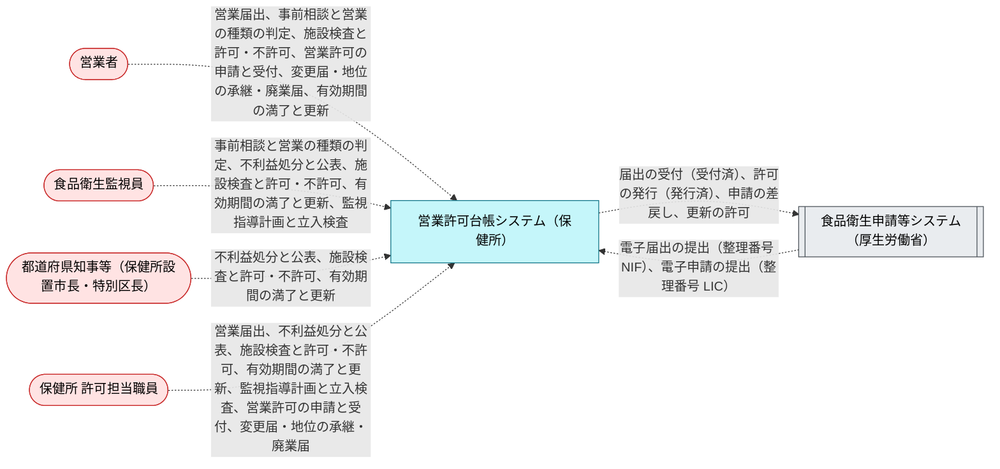

## 3. 要求

要求を目的ごとにまとめる。「BUC」はその要求が動機付ける業務で、[5. ユーザージャーニー](#5-ユーザージャーニー) にその業務フローがある。次の図は目的、要求、BUC のつながりである。「やらないこと」の枠にある要求は [4. やらないこと](#4-やらないこと) に載せている。

```mermaid
%% rdra-ish diagram=requirement scope=whole model=samples/food-permit-ops
%% kinds: requirement goal buc
%% omitted: nfr quality constraint business flow usecase event system entity
flowchart LR
  requirement__ReqClassifyBeforeConstruction[/"工事の前に営業の種類を判定し、許可業種なら施設基準を説明する"\]:::requirement
  requirement__ReqDueProcessDisposition[/"不利益処分は処分基準に沿い、意見陳述の手続と理由の提示を経て行う"\]:::requirement
  requirement__ReqFeeNotRefunded[/"納めた手数料は、取下げ・不許可でも還付しない"\]:::requirement
  requirement__ReqHygieneManagerAfterPermit[/"申請時に食品衛生責任者が未定なら、許可後速やかに定めさせる"\]:::requirement
  requirement__ReqKeepLedgerCurrent[/"許可後の変更・承継・廃業を届出で台帳に反映する"\]:::requirement
  requirement__ReqNotificationWithoutStandard[/"届出は施設基準・施設検査・手数料・更新なしで受け付ける"\]:::requirement
  requirement__ReqPermitOnlyCompliantFacility[/"施設基準に適合した施設にだけ許可し、不許可には理由を示す"\]:::requirement
  requirement__ReqPlannedMonitoring[/"毎年度の計画を公表し、計画に沿って立入検査する"\]:::requirement
  requirement__ReqPublishViolations[/"処分を決めた違反を一定期間公表する"\]:::requirement
  requirement__ReqReceiveBothChannels[/"窓口と電子申請を同じ手順で受け付け、不備は補正を求める"\]:::requirement
  requirement__ReqRenewBeforeExpiry[/"満了の前に通知し、満了日までに更新を終える。失効した許可は新規扱いとする"\]:::requirement
  requirement__ReqStopOperationOnSanction[/"停止中と、取消・失効・廃業の後は営業させない"\]:::requirement
  goal__DueProcess[/"不利益処分を手続どおりに行う<br/>意見陳述の手続または理由の提示を欠いた不利益処分の件数: 年1件 → 年0件"/]:::goal
  %% desc goal__DueProcess: 取消は聴聞、停止と改善命令は弁明の機会を経て、理由を示して行う。手続を欠いた処分は取り消されうる。
  goal__NoUnlicensedOperation[/"無許可営業をなくす<br/>有効な許可のない営業を立入検査で見つけた件数: 年12件 → 年0件"/]:::goal
  %% desc goal__NoUnlicensedOperation: 有効期間が満了した許可や取り消された許可で営業を続けると無許可営業になる。満了前の通知と更新、停止・取消の後の確認で、許可のない営業を残さない。
  goal__TimelyDecision[/"開店予定日までに許可する<br/>標準処理期間（15開庁日）内に許可・不許可を決めた申請の割合: 85% → 98%"/]:::goal
  %% desc goal__TimelyDecision: 申請者は開店の2〜3週間前に申請する。標準処理期間のうちに施設検査と許可を終えないと、開店が遅れる。
  buc__BucBusinessNotification["営業届出"]:::buc
  %% desc buc__BucBusinessNotification: 許可業種でも届出不要の営業でもない営業は、あらかじめ営業所の名称・所在地などを届け出る。許可と違って施設基準はなく、施設検査も手数料も更新もない。届出営業者も食品衛生責任者を定め、廃業したら届け出る。
  buc__BucConsultation["事前相談と営業の種類の判定"]:::buc
  %% desc buc__BucConsultation: 営業者は施設の工事の前に図面を持って保健所に相談する。食品衛生監視員は営業の内容から、許可が要るか（施行令35条の32業種）、届出でよいか、どちらも要らないか（施行令35条の2）を判定し、許可業種なら施設基準と食品衛生責任者を説明する。
  buc__BucDisposition["不利益処分と公表"]:::buc
  %% desc buc__BucDisposition: 施設基準違反などで、行政庁は施設の整備改善を命じ、営業を停止し、許可を取り消す。取消の前には聴聞、ほかは弁明の機会を与える。ただし計測などで確かめた技術的基準の不充足に基準どおりにせよと命じる処分は、意見陳述を省ける。処分は理由を示して書面で行い、審査請求ができることを教える。違反者は公表する（練馬区は7日以上）。停止は定めた期間が過ぎると終わる。
  buc__BucInspectionDecision["施設検査と許可・不許可"]:::buc
  %% desc buc__BucInspectionDecision: 食品衛生監視員が施設を検査し、施設基準に合わなければ改善を指示して再検査する。行政庁は基準に合うと認めれば許可しなければならず、合わなければ理由を示して不許可にする。許可すると台帳に登録して許可証を交付し、営業者は許可証を掲示して営業を始める。食品衛生責任者が申請時に未定なら、許可後速やかに定める。
  buc__BucMonitoring["監視指導計画と立入検査"]:::buc
  %% desc buc__BucMonitoring: 都道府県知事等は毎年度、翌年度の監視指導計画を定めて公表し、計画に沿って食品衛生監視員に営業の場所を立入検査させる。違反を見つけたら、処分の起案に回す。
  buc__BucPermitApplication["営業許可の申請と受付"]:::buc
  %% desc buc__BucPermitApplication: 営業者は開店の2〜3週間前（東京都は工事完成の10日前ころ）に、申請書と図面を保健所の窓口に出すか、食品衛生申請等システムで電子申請し、条例の手数料を納める。保健所は記載事項と添付書類を確かめ、足りなければ補正を求め（差戻し）、整えば施設検査に進める（検査待）。申請者は差戻しの間に取り下げられる。
  buc__BucPermitChanges["変更届・地位の承継・廃業届"]:::buc
  %% desc buc__BucPermitChanges: 許可営業者は申請書の記載事項が変わったら速やかに（東京都は10日以内）変更届を出す。移転や営業者の交代は変更ではなく新規の申請になる。営業の譲渡・相続・合併・分割では許可営業者の地位が承継され、承継した者が遅滞なく届け出る。廃業したら許可証を添えて廃業届を出す。
  buc__BucRenewal["有効期間の満了と更新"]:::buc
  %% desc buc__BucRenewal: 許可には5年以上の有効期間が付く。満了の前に保健所が通知し（静岡市は2か月前）、営業者は満了前に継続（更新）の申請をする。更新でも施設検査があり、満了日までに許可を終える。更新しないまま満了すると許可は失効し、営業を続けると無許可営業になる。失効した許可は更新できず、新規の申請からやり直す。
  subgraph group_out_of_scope["やらないこと"]
    requirement__ReqNoAppealContents[/"審査請求と訴訟の中身は対象外とする"\]:::requirement
    requirement__ReqNoFoodLabeling[/"食品表示は対象外とする"\]:::requirement
    requirement__ReqNoFoodPoisoningInvestigation[/"食中毒の調査と、59条の廃棄命令は対象外とする"\]:::requirement
    requirement__ReqNoImportedFood[/"輸入食品の届出は対象外とする"\]:::requirement
    requirement__ReqNoOtherPermits[/"他法令の許可・届出は対象外とする"\]:::requirement
  end
  goal__DueProcess --> requirement__ReqDueProcessDisposition
  %% derived goal__DueProcess -> requirement__ReqDueProcessDisposition via requirement__ReqDueProcessDisposition
  goal__DueProcess --> requirement__ReqPublishViolations
  %% derived goal__DueProcess -> requirement__ReqPublishViolations via requirement__ReqPublishViolations
  goal__NoUnlicensedOperation --> requirement__ReqClassifyBeforeConstruction
  %% derived goal__NoUnlicensedOperation -> requirement__ReqClassifyBeforeConstruction via requirement__ReqClassifyBeforeConstruction
  goal__NoUnlicensedOperation --> requirement__ReqHygieneManagerAfterPermit
  %% derived goal__NoUnlicensedOperation -> requirement__ReqHygieneManagerAfterPermit via requirement__ReqHygieneManagerAfterPermit
  goal__NoUnlicensedOperation --> requirement__ReqKeepLedgerCurrent
  %% derived goal__NoUnlicensedOperation -> requirement__ReqKeepLedgerCurrent via requirement__ReqKeepLedgerCurrent
  goal__NoUnlicensedOperation --> requirement__ReqPermitOnlyCompliantFacility
  %% derived goal__NoUnlicensedOperation -> requirement__ReqPermitOnlyCompliantFacility via requirement__ReqPermitOnlyCompliantFacility
  goal__NoUnlicensedOperation --> requirement__ReqPlannedMonitoring
  %% derived goal__NoUnlicensedOperation -> requirement__ReqPlannedMonitoring via requirement__ReqPlannedMonitoring
  goal__NoUnlicensedOperation --> requirement__ReqRenewBeforeExpiry
  %% derived goal__NoUnlicensedOperation -> requirement__ReqRenewBeforeExpiry via requirement__ReqRenewBeforeExpiry
  goal__NoUnlicensedOperation --> requirement__ReqStopOperationOnSanction
  %% derived goal__NoUnlicensedOperation -> requirement__ReqStopOperationOnSanction via requirement__ReqStopOperationOnSanction
  goal__TimelyDecision --> requirement__ReqClassifyBeforeConstruction
  %% derived goal__TimelyDecision -> requirement__ReqClassifyBeforeConstruction via requirement__ReqClassifyBeforeConstruction
  goal__TimelyDecision --> requirement__ReqFeeNotRefunded
  %% derived goal__TimelyDecision -> requirement__ReqFeeNotRefunded via requirement__ReqFeeNotRefunded
  goal__TimelyDecision --> requirement__ReqNotificationWithoutStandard
  %% derived goal__TimelyDecision -> requirement__ReqNotificationWithoutStandard via requirement__ReqNotificationWithoutStandard
  goal__TimelyDecision --> requirement__ReqPermitOnlyCompliantFacility
  %% derived goal__TimelyDecision -> requirement__ReqPermitOnlyCompliantFacility via requirement__ReqPermitOnlyCompliantFacility
  goal__TimelyDecision --> requirement__ReqReceiveBothChannels
  %% derived goal__TimelyDecision -> requirement__ReqReceiveBothChannels via requirement__ReqReceiveBothChannels
  requirement__ReqClassifyBeforeConstruction --> buc__BucConsultation
  requirement__ReqDueProcessDisposition --> buc__BucDisposition
  requirement__ReqFeeNotRefunded --> buc__BucPermitApplication
  requirement__ReqHygieneManagerAfterPermit --> buc__BucInspectionDecision
  requirement__ReqKeepLedgerCurrent --> buc__BucPermitChanges
  requirement__ReqNoAppealContents -.-> buc__BucDisposition
  requirement__ReqNoFoodLabeling -.-> buc__BucConsultation
  requirement__ReqNoFoodPoisoningInvestigation -.-> buc__BucDisposition
  requirement__ReqNoImportedFood -.-> buc__BucConsultation
  requirement__ReqNoOtherPermits -.-> buc__BucConsultation
  requirement__ReqNotificationWithoutStandard --> buc__BucBusinessNotification
  requirement__ReqPermitOnlyCompliantFacility --> buc__BucInspectionDecision
  requirement__ReqPlannedMonitoring --> buc__BucMonitoring
  requirement__ReqPublishViolations --> buc__BucDisposition
  requirement__ReqReceiveBothChannels --> buc__BucPermitApplication
  requirement__ReqRenewBeforeExpiry --> buc__BucRenewal
  requirement__ReqStopOperationOnSanction --> buc__BucDisposition
  classDef requirement fill:#fff3bf,stroke:#e67700,color:#000;
  classDef goal fill:#fff3bf,stroke:#e67700,color:#000;
  classDef buc fill:#d3f9d8,stroke:#2b8a3e,color:#000;
```

### 不利益処分を手続どおりに行う

| ID | 要求 | 優先度 | 関係者 | 目的 | 受け入れ条件 | 出典 | BUC |
|---|---|---|---|---|---|---|---|
| `ReqDueProcessDisposition` | 不利益処分は処分基準に沿い、意見陳述の手続と理由の提示を経て行う | must | 営業者、都道府県知事等 | 不利益処分を手続どおりに行う | 取消はすべて聴聞を経ており、意見陳述を省いた処分は整備改善命令だけで、決定した処分には理由が示されている。 | 処分基準 (egov-gyousei-tetsuzukihou-405AC0000000088.txt:197); 取消は聴聞、ほかは弁明の機会の付与 (egov-gyousei-tetsuzukihou-405AC0000000088.txt:207, :216); 技術的基準への適合を命じる処分の例外 (egov-gyousei-tetsuzukihou-405AC0000000088.txt:224); 理由の提示 (egov-gyousei-tetsuzukihou-405AC0000000088.txt:231) | 不利益処分と公表 |
| `ReqPublishViolations` | 処分を決めた違反を一定期間公表する | should | 保健所 許可担当職員 | 不利益処分を手続どおりに行う | 公表は処分の決定の後に始まり、期間が過ぎると終わる。 | 違反した者の名称等を公表 (egov-shokuhin-eiseihou-322AC0000000233.txt:473); 7日間をくだらない期間 (nerima-ku-ihan-kouhyou.md:42) | 不利益処分と公表 |

### 無許可営業をなくす

| ID | 要求 | 優先度 | 関係者 | 目的 | 受け入れ条件 | 出典 | BUC |
|---|---|---|---|---|---|---|---|
| `ReqClassifyBeforeConstruction` | 工事の前に営業の種類を判定し、許可業種なら施設基準を説明する | should | 営業者、食品衛生監視員 | 無許可営業をなくす、開店予定日までに許可する | 相談ごとに、許可・届出・不要のいずれかが営業の種類から一意に決まる。 | 工事をはじめる前に…相談 (osaka-city-eigyou-kyoka-tetsuzuki.md:88); 業種の選択に関すること (mhlw-shinsei-system-index.md:233); 一施設一許可 (mhlw-eigyou-kisei-qa.txt:131) | 事前相談と営業の種類の判定 |
| `ReqHygieneManagerAfterPermit` | 申請時に食品衛生責任者が未定なら、許可後速やかに定めさせる | should | 営業者 | 無許可営業をなくす | 有効な許可で食品衛生責任者のいない状態は、いずれ責任者の選定か許可の終了に至る。 | 食品衛生責任者を定めること (egov-shokuhin-eiseihou-shikoukisoku-323M40000100023.txt:3220); 営業の許可後速やかに (mhlw-2019-seishokuhatsu1227-2-sekou.txt:431, :435) | 施設検査と許可・不許可 |
| `ReqKeepLedgerCurrent` | 許可後の変更・承継・廃業を届出で台帳に反映する | must | 営業者、保健所 許可担当職員 | 無許可営業をなくす | 変更届と地位承継届は終わっていない許可にだけ出され、廃業した許可では営業していない。 | 変更の届出 (egov-shokuhin-eiseihou-shikoukisoku-323M40000100023.txt:950); 地位の承継 (egov-shokuhin-eiseihou-322AC0000000233.txt:412-413); 廃業の届出 (egov-shokuhin-eiseihou-shikoukisoku-323M40000100023.txt:952) | 変更届・地位の承継・廃業届 |
| `ReqPermitOnlyCompliantFacility` | 施設基準に適合した施設にだけ許可し、不許可には理由を示す | must | 営業者、食品衛生監視員、都道府県知事等 | 無許可営業をなくす、開店予定日までに許可する | 許可した申請の施設検査は適合であり、不許可の申請には理由が示されている。 | 基準に合うと認めるときは、許可をしなければならない (egov-shokuhin-eiseihou-322AC0000000233.txt:402); 理由の提示 (egov-gyousei-tetsuzukihou-405AC0000000088.txt:176); 改善後、再検査 (tokyo-minamitama-kyoka-kigen-manryou.md:226) | 施設検査と許可・不許可 |
| `ReqPlannedMonitoring` | 毎年度の計画を公表し、計画に沿って立入検査する | must | 食品衛生監視員、保健所 許可担当職員 | 無許可営業をなくす | 立入検査は公表済の計画の下でだけ予定される。 | 監視指導計画 (egov-shokuhin-eiseihou-322AC0000000233.txt:181, :192); 計画の定めるところにより監視指導 (egov-shokuhin-eiseihou-322AC0000000233.txt:236) | 監視指導計画と立入検査 |
| `ReqRenewBeforeExpiry` | 満了の前に通知し、満了日までに更新を終える。失効した許可は新規扱いとする | must | 営業者、保健所 許可担当職員 | 無許可営業をなくす | 有効期間を書き換えるのは有効な許可だけで、失効した許可では営業していない。 | 五年を下らない有効期間 (egov-shokuhin-eiseihou-322AC0000000233.txt:410); 満了通知書 (shizuoka-city-kyoka-kikan-manryou.md:37); 満了日までに手続きを完了 (osaka-city-eigyou-kyoka-tetsuzuki.md:63); 期限を過ぎて営業すると無許可営業 (shizuoka-city-kyoka-kikan-manryou.md:36) | 有効期間の満了と更新 |
| `ReqStopOperationOnSanction` | 停止中と、取消・失効・廃業の後は営業させない | must | 都道府県知事等、食品衛生監視員 | 無許可営業をなくす | 停止中・取消・失効・廃業の許可には営業中の記録がない。 | 営業の禁止・停止 (egov-shokuhin-eiseihou-322AC0000000233.txt:429, :432); 無許可営業 (shizuoka-city-kyoka-kikan-manryou.md:36; egov-shokuhin-eiseihou-322AC0000000233.txt:542) | 不利益処分と公表 |

### 開店予定日までに許可する

| ID | 要求 | 優先度 | 関係者 | 目的 | 受け入れ条件 | 出典 | BUC |
|---|---|---|---|---|---|---|---|
| `ReqClassifyBeforeConstruction` | 工事の前に営業の種類を判定し、許可業種なら施設基準を説明する | should | 営業者、食品衛生監視員 | 無許可営業をなくす、開店予定日までに許可する | 相談ごとに、許可・届出・不要のいずれかが営業の種類から一意に決まる。 | 工事をはじめる前に…相談 (osaka-city-eigyou-kyoka-tetsuzuki.md:88); 業種の選択に関すること (mhlw-shinsei-system-index.md:233); 一施設一許可 (mhlw-eigyou-kisei-qa.txt:131) | 事前相談と営業の種類の判定 |
| `ReqFeeNotRefunded` | 納めた手数料は、取下げ・不許可でも還付しない | must | 営業者 | 開店予定日までに許可する | 取下げ・不許可の申請にも手数料の納付の記録が残り、還付の手続はない。 | 既納の手数料は、還付しない (osaka-pref-shokuhin-eiseihou-sekou-jourei.md:40) | 営業許可の申請と受付 |
| `ReqNotificationWithoutStandard` | 届出は施設基準・施設検査・手数料・更新なしで受け付ける | must | 営業者 | 開店予定日までに許可する | 営業届は確認だけで受付済になり、有効期間による失効がない。 | 届出 (egov-shokuhin-eiseihou-322AC0000000233.txt:415); 要件（施設基準）はありません (mhlw-eigyou-todoke-sousetsu-shousai.txt:10); 更新の必要はありません (mhlw-eigyou-todoke-sousetsu-shousai.txt:11) | 営業届出 |
| `ReqPermitOnlyCompliantFacility` | 施設基準に適合した施設にだけ許可し、不許可には理由を示す | must | 営業者、食品衛生監視員、都道府県知事等 | 無許可営業をなくす、開店予定日までに許可する | 許可した申請の施設検査は適合であり、不許可の申請には理由が示されている。 | 基準に合うと認めるときは、許可をしなければならない (egov-shokuhin-eiseihou-322AC0000000233.txt:402); 理由の提示 (egov-gyousei-tetsuzukihou-405AC0000000088.txt:176); 改善後、再検査 (tokyo-minamitama-kyoka-kigen-manryou.md:226) | 施設検査と許可・不許可 |
| `ReqReceiveBothChannels` | 窓口と電子申請を同じ手順で受け付け、不備は補正を求める | must | 営業者、保健所 許可担当職員 | 開店予定日までに許可する | 窓口と電子のどちらの申請も、手数料の納付を確かめてから検査待になり、差戻しの間に取り下げられる。 | 申請書の記載事項 (egov-shokuhin-eiseihou-shikoukisoku-323M40000100023.txt:874-888); 補正を求め、又は…拒否 (egov-gyousei-tetsuzukihou-405AC0000000088.txt:173); 電子申請の状態と差戻し・取下げ (i2fas-faq.md:95, :106, :108) | 営業許可の申請と受付 |

## 4. やらないこと

| ID | 内容 | 理由 |
|---|---|---|
| `ReqNoAppealContents` | 審査請求と訴訟の中身は対象外とする | 審査請求ができる期間（処分を知った日の翌日から3月）とその教示だけを扱い、期間の経過で処分を確定として記録する。審査請求の審理、裁決、取消訴訟は審査庁・裁判所の手続で、調査もしていない。 |
| `ReqNoFoodLabeling` | 食品表示は対象外とする | 食品表示は食品表示法の手続で、営業の許可とは別の監視の対象になる。調査もしていない。 |
| `ReqNoFoodPoisoningInvestigation` | 食中毒の調査と、59条の廃棄命令は対象外とする | 食中毒の調査（法63条以降・施行令36〜37条）と、食品の廃棄・危害除去の命令（59条）は、許可の業務ではなく事件への対応で、調査もしていない。処分としては停止・取消と同じ手続を通る。 |
| `ReqNoImportedFood` | 輸入食品の届出は対象外とする | 輸入の営業は営業届出も要らず（施行令35条の2）、輸入の届出は検疫所が受ける国の手続で、保健所の許可業務ではない。判定では届出不要の一つとして扱うだけにする。 |
| `ReqNoOtherPermits` | 他法令の許可・届出は対象外とする | 深夜酒類提供の届出、風俗営業の許可、酒類の販売免許、防火の届出は、警察・税務署・消防の手続で、食品衛生法の許可と同時に進んでも互いの要件にはならない。調査もしていない。 |

## 5. ユーザージャーニー

次の図は業務の流れである。業務ごとに BUC をまとめ、ある BUC から次の BUC への引き渡しを、引き渡すイベントのラベルで示す。

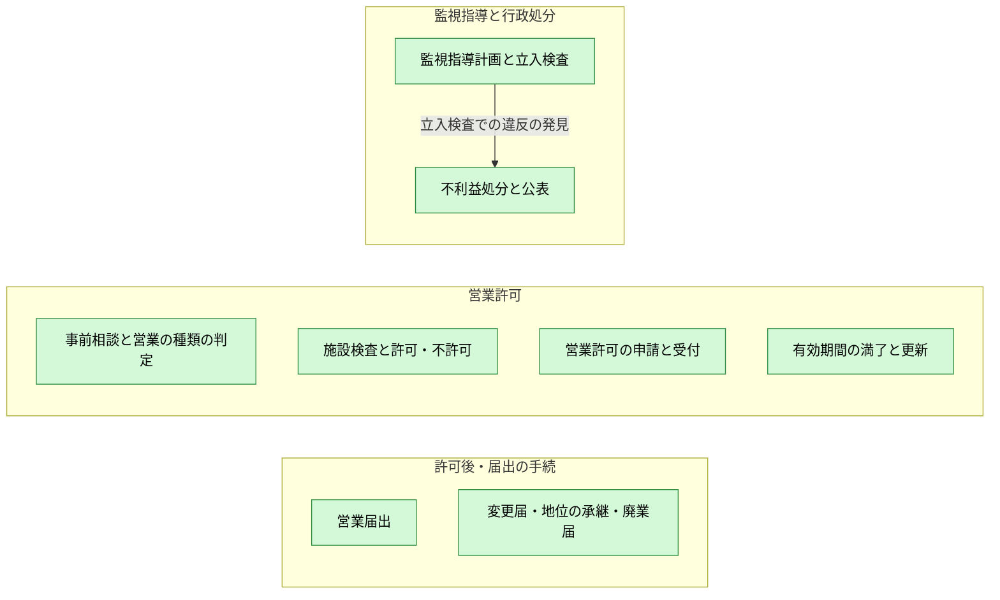

この後の節は BUC ごとの業務フローである。手順、分岐、例外と、各手順を担う UC を示す。

### 事前相談と営業の種類の判定

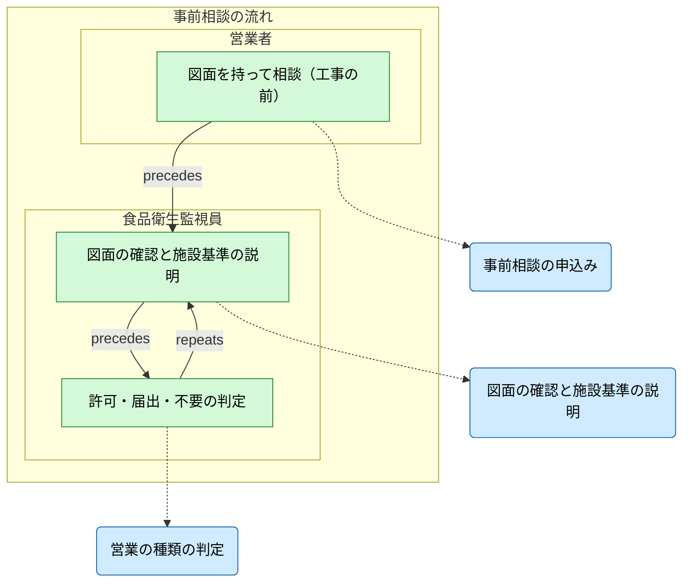

### 営業許可の申請と受付

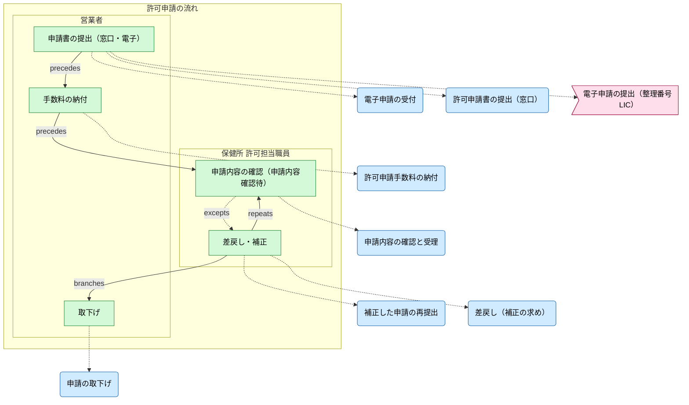

### 施設検査と許可・不許可

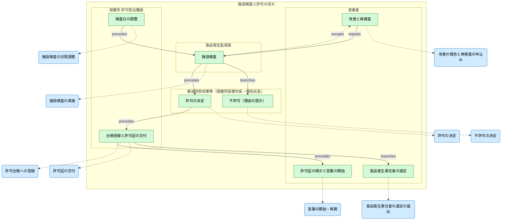

### 有効期間の満了と更新

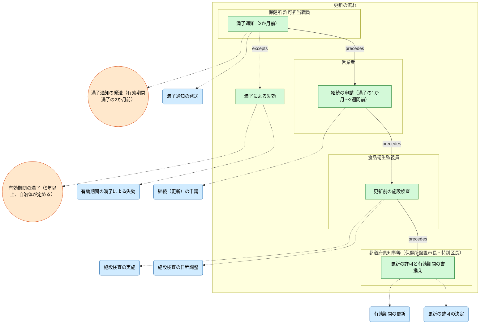

### 変更届・地位の承継・廃業届

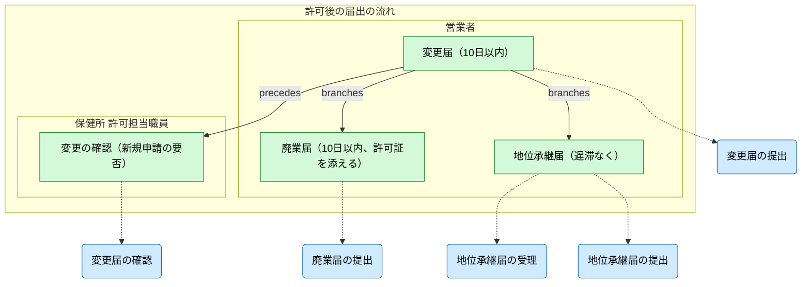

### 営業届出

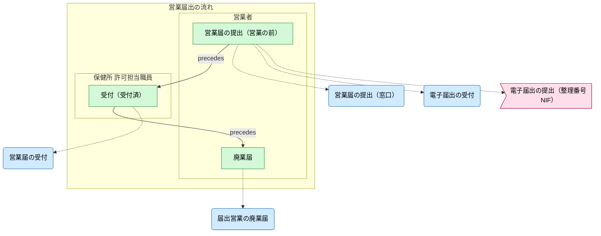

### 監視指導計画と立入検査

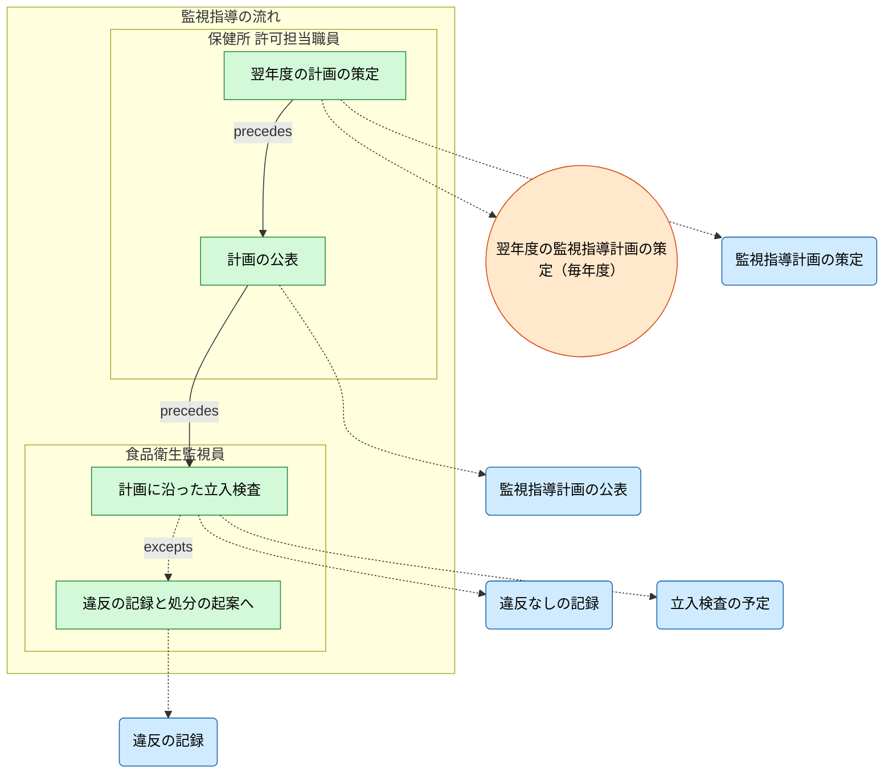

### 不利益処分と公表

```mermaid
%% rdra-ish diagram=flow scope=buc:BucDisposition model=samples/food-permit-ops
%% kinds: flow step lane timer usecase event
%% omitted: buc
flowchart TD
  subgraph flow__DispositionFlow["不利益処分の流れ"]
    step__AppealPeriodStep["審査請求期間（3月）の経過"]:::step
    step__SuspensionEndStep["停止期間の満了"]:::step
    subgraph lane__DispositionFlow__FoodSanitationInspector["食品衛生監視員"]
      %% lane lane__DispositionFlow__FoodSanitationInspector: actor__FoodSanitationInspector
      step__ProposeStep["処分の起案（処分基準）"]:::step
    end
    subgraph lane__DispositionFlow__PermitAuthority["都道府県知事等（保健所設置市長・特別区長）"]
      %% lane lane__DispositionFlow__PermitAuthority: actor__PermitAuthority
      step__DecideStep["処分の決定（理由の提示・教示）"]:::step
      step__DropStep["処分の見送り"]:::step
      step__OmittedStep["意見陳述を省いた整備改善命令"]:::step
    end
    subgraph lane__DispositionFlow__PermitClerk["保健所 許可担当職員"]
      %% lane lane__DispositionFlow__PermitClerk: actor__PermitClerk
      step__OpinionNoticeStep["聴聞・弁明の通知"]:::step
      step__OpinionStep["聴聞の実施・弁明書の受理"]:::step
      step__PublishStep["違反の公表（7日以上）"]:::step
    end
  end
  timer__AppealPeriodEnd(("審査請求期間の経過（処分を知った日の翌日から3月）")):::timer
  timer__PublicationPeriodEnd(("公表期間の経過（7日間以上）")):::timer
  timer__SuspensionTermEnd(("営業停止期間の満了（処分で定めた期間）")):::timer
  usecase__DecideRevocation("許可の取消の決定"):::usecase
  %% desc usecase__DecideRevocation: 聴聞を経て許可を取り消すと決める。理由を示し、審査請求ができることを書面で教える。営業者は取消から2年は新たな許可を受けられないことがある。
  usecase__DecideSuspension("営業停止の決定"):::usecase
  %% desc usecase__DecideSuspension: 弁明の機会を経て、期間を定めて営業を停止すると決める。理由を示し、審査請求ができることを書面で教える。
  usecase__DropDisposition("処分を見送る"):::usecase
  %% desc usecase__DropDisposition: 意見陳述の結果、処分しないと決める。
  usecase__EndPublication("公表の終了"):::usecase
  %% desc usecase__EndPublication: 公表期間（処分の翌日から7日以上）が過ぎたら公表をやめる。
  usecase__FinalizeDisposition("審査請求期間の経過"):::usecase
  %% desc usecase__FinalizeDisposition: 審査請求のないまま3月が過ぎたことを記録する。審査請求と訴訟の中身は対象外。
  usecase__HoldHearing("聴聞の実施"):::usecase
  %% desc usecase__HoldHearing: 聴聞の期日に名あて人の意見を聴き、記録する。取消の前には必ず行う。
  usecase__LiftSuspension("営業停止期間の満了"):::usecase
  %% desc usecase__LiftSuspension: 停止の期間が過ぎ、営業停止を終える。営業者は許可証を掲示して営業を再開できる。
  usecase__NotifyOpinionProcedure("聴聞・弁明の通知"):::usecase
  %% desc usecase__NotifyOpinionProcedure: 予定する処分の内容と根拠条項、原因となる事実、聴聞の期日または弁明書の提出期限を、名あて人に書面で通知する。
  usecase__OrderImprovement("施設の整備改善命令"):::usecase
  %% desc usecase__OrderImprovement: 施設基準に合わない設備の改善を命じる。計測などで確かめた不充足なら意見陳述を省いて命じられる。
  usecase__ProposeDisposition("処分の起案"):::usecase
  %% desc usecase__ProposeDisposition: 食品衛生監視員が違反の事実と処分基準から、処分の種類（整備改善命令・停止・取消）と意見陳述の手続（聴聞・弁明・省略）を起案する。
  usecase__PublishViolation("違反の公表"):::usecase
  %% desc usecase__PublishViolation: 処分を受けた営業者の名称、施設、処分の理由と内容をホームページと掲示場で公表する。
  usecase__ReceiveExplanation("弁明書の受理"):::usecase
  %% desc usecase__ReceiveExplanation: 停止や整備改善命令の前に、名あて人の弁明書を受け取る。期限までに出なければ、弁明の機会を与えたものとして手続を終える。
  usecase__RevokePermit("許可台帳への取消の記録"):::usecase
  %% desc usecase__RevokePermit: 取消の決定を台帳に記録し、許可を終わらせる。営業者は営業をやめる。
  usecase__SuspendBusiness("許可台帳への営業停止の記録"):::usecase
  %% desc usecase__SuspendBusiness: 停止の決定を台帳に記録する。営業者は停止の期間、営業をやめる。
  event__EvViolationFound>"立入検査での違反の発見"]:::event
  step__AppealPeriodStep -.-> timer__AppealPeriodEnd
  step__AppealPeriodStep -.-> usecase__FinalizeDisposition
  step__DecideStep -.-> usecase__DecideRevocation
  step__DecideStep -.-> usecase__DecideSuspension
  step__DecideStep -.-> usecase__OrderImprovement
  step__DecideStep -.-> usecase__RevokePermit
  step__DecideStep -.-> usecase__SuspendBusiness
  step__DecideStep -->|precedes| step__AppealPeriodStep
  step__DecideStep -->|precedes| step__PublishStep
  step__DecideStep -->|precedes| step__SuspensionEndStep
  step__DropStep -.-> usecase__DropDisposition
  step__OmittedStep -.-> usecase__OrderImprovement
  step__OpinionNoticeStep -.-> usecase__NotifyOpinionProcedure
  step__OpinionNoticeStep -->|precedes| step__OpinionStep
  step__OpinionStep -->|branches| step__DropStep
  step__OpinionStep -.-> usecase__HoldHearing
  step__OpinionStep -.-> usecase__ReceiveExplanation
  step__OpinionStep -->|precedes| step__DecideStep
  step__ProposeStep -->|branches| step__OmittedStep
  step__ProposeStep -.-> event__EvViolationFound
  step__ProposeStep -.-> usecase__ProposeDisposition
  step__ProposeStep -->|precedes| step__OpinionNoticeStep
  step__PublishStep -.-> timer__PublicationPeriodEnd
  step__PublishStep -.-> usecase__EndPublication
  step__PublishStep -.-> usecase__PublishViolation
  step__SuspensionEndStep -.-> timer__SuspensionTermEnd
  step__SuspensionEndStep -.-> usecase__LiftSuspension
  classDef flow fill:#d3f9d8,stroke:#2b8a3e,color:#000;
  classDef step fill:#d3f9d8,stroke:#2b8a3e,color:#000;
  classDef lane fill:#d3f9d8,stroke:#2b8a3e,color:#000;
  classDef timer fill:#ffe8cc,stroke:#d9480f,color:#000;
  classDef usecase fill:#d0ebff,stroke:#1864ab,color:#000;
  classDef event fill:#ffdeeb,stroke:#a61e4d,color:#000;
```

## 6. ビジネスルール（受け入れ条件）

`list --kind rule --format markdown` の出力である。各行が、システムが守る業務規則で、受け入れ試験の条件になる。

| kind | label | entities | rule | applies_to | site |
| --- | --- | --- | --- | --- | --- |
| condition | 許可業種（施行令35条）である | Consultation | Consultation.business_type in (飲食店営業, 食肉販売業, 菓子製造業) | ClassifyBusiness | samples/food-permit-ops/buc/buc_consultation.rdra:69 |
| condition | 届出業種である | Consultation | Consultation.business_type in (弁当販売業（届出）, 野菜果物販売業（届出）) | ClassifyBusiness | samples/food-permit-ops/buc/buc_consultation.rdra:72 |
| condition | 届出も要らない営業（施行令35条の2）である | Consultation | Consultation.business_type == 常温で保存できる包装食品の販売（届出不要） | ClassifyBusiness | samples/food-permit-ops/buc/buc_consultation.rdra:75 |
| condition | 取消ではない処分である | Disposition | Disposition.kind in (施設の整備改善命令, 営業の停止) | ProposeDisposition | samples/food-permit-ops/buc/buc_disposition.rdra:130 |
| condition | 施設の整備改善命令である | Disposition | Disposition.kind == 施設の整備改善命令 | OrderImprovement\|ProposeDisposition | samples/food-permit-ops/buc/buc_disposition.rdra:133 |
| condition | 意見陳述の手続を執る処分である | Disposition | Disposition.procedure in (聴聞, 弁明の機会の付与) | NotifyOpinionProcedure | samples/food-permit-ops/buc/buc_disposition.rdra:142 |
| condition | 聴聞を執る処分である | Disposition | Disposition.procedure == 聴聞 | DecideRevocation\|HoldHearing | samples/food-permit-ops/buc/buc_disposition.rdra:150 |
| condition | 弁明の機会を与える処分である | Disposition | Disposition.procedure == 弁明の機会の付与 | ReceiveExplanation | samples/food-permit-ops/buc/buc_disposition.rdra:159 |
| condition | 許可の取消である | Disposition | Disposition.kind == 許可の取消 | DecideRevocation | samples/food-permit-ops/buc/buc_disposition.rdra:176 |
| condition | 営業の停止である | Disposition | Disposition.kind == 営業の停止 | DecideSuspension | samples/food-permit-ops/buc/buc_disposition.rdra:187 |
| condition | 意見陳述を省く処分である | Disposition | Disposition.procedure == 意見陳述の省略（行政手続法13条2項3号） | OrderImprovement | samples/food-permit-ops/buc/buc_disposition.rdra:213 |
| condition | 処分が決定している | Disposition | Disposition.status in (処分決定, 確定（審査請求期間の経過）) | PublishViolation | samples/food-permit-ops/buc/buc_disposition.rdra:238 |
| forbidden | 許可の取消の前に聴聞を行う | Disposition | Disposition.kind == 許可の取消 AND Disposition.procedure != hearing |  | samples/food-permit-ops/buc/buc_disposition.rdra:361 |
| forbidden | 意見陳述を省けるのは技術的基準に従うよう命じる処分だけ | Disposition | Disposition.procedure == 意見陳述の省略（行政手続法13条2項3号） AND Disposition.kind != improvement_order |  | samples/food-permit-ops/buc/buc_disposition.rdra:363 |
| invariant | 不利益処分は理由を示して行う | Disposition | when Disposition.status in (decided, finalized) then Disposition.reason_shown == true |  | samples/food-permit-ops/buc/buc_disposition.rdra:365 |
| forbidden | 処分を決める前に公表しない | Disposition | Disposition.publication in (published, ended) AND Disposition.status not in (decided, finalized) |  | samples/food-permit-ops/buc/buc_disposition.rdra:367 |
| forbidden | 公表対象外は処分しないと決めたものだけ | Disposition | Disposition.publication == 公表対象外 AND Disposition.status != dropped |  | samples/food-permit-ops/buc/buc_disposition.rdra:369 |
| forbidden | 営業停止中は営業しない | BusinessPermit | BusinessPermit.status == 営業停止中 AND BusinessPermit.operating == true |  | samples/food-permit-ops/buc/buc_disposition.rdra:373 |
| forbidden | 許可なく営業しない（失効・取消・廃業の後の営業は無許可営業） | BusinessPermit | BusinessPermit.operating == true AND BusinessPermit.status in (expired, revoked, closed) |  | samples/food-permit-ops/buc/buc_disposition.rdra:377 |
| after | 停止を命じた許可では営業していない | BusinessPermit | BusinessPermit.status == 営業停止中 AND BusinessPermit.operating == false | SuspendBusiness | samples/food-permit-ops/buc/buc_disposition.rdra:379 |
| condition | 申請が検査待で、まだ検査の予定がない | PermitApplication\|Inspection | (PermitApplication.status == 検査待).none(Inspection.status in (検査予定, 適合, 不適合（改善の指示）)) | ScheduleInspection | samples/food-permit-ops/buc/buc_inspection_decision.rdra:120 |
| condition | 施設検査で施設基準に適合した | Inspection | Inspection.status == 適合 | GrantPermit\|RenewPermit | samples/food-permit-ops/buc/buc_inspection_decision.rdra:144 |
| condition | 新規の申請である | PermitApplication | PermitApplication.kind == 新規 | GrantPermit | samples/food-permit-ops/buc/buc_inspection_decision.rdra:148 |
| condition | 許可が有効である | BusinessPermit | BusinessPermit.status == 有効 | AppointHygieneManager\|IssueCertificate | samples/food-permit-ops/buc/buc_inspection_decision.rdra:173 |
| condition | 許可が有効で、許可証の交付を受けている | BusinessPermit | BusinessPermit.status == 有効, BusinessPermit.certificate_issued == true | StartBusiness | samples/food-permit-ops/buc/buc_inspection_decision.rdra:193 |
| forbidden | 施設基準に適合しない施設には許可しない | PermitApplication\|Inspection | PermitApplication.status == 許可 AND Inspection.status != 適合 |  | samples/food-permit-ops/buc/buc_inspection_decision.rdra:299 |
| invariant | 不許可には理由を同時に示す | PermitApplication | when PermitApplication.status == 不許可 then PermitApplication.reason_shown == true |  | samples/food-permit-ops/buc/buc_inspection_decision.rdra:301 |
| invariant | 手数料を納めた申請だけが検査と許可に進む | PermitApplication | when PermitApplication.status in (awaiting_inspection, approved) then PermitApplication.fee_paid == true |  | samples/food-permit-ops/buc/buc_inspection_decision.rdra:304 |
| invariant | 許可証の交付を受けてから営業する | BusinessPermit | when BusinessPermit.operating == true then BusinessPermit.certificate_issued == true |  | samples/food-permit-ops/buc/buc_inspection_decision.rdra:307 |
| condition | 監視指導計画が公表されている | MonitoringPlan | MonitoringPlan.status == 公表済 | ScheduleSiteVisit | samples/food-permit-ops/buc/buc_monitoring.rdra:84 |
| condition | 申請が確認待か差戻し中である | PermitApplication | PermitApplication.status in (申請内容確認待, 差戻し・補正中) | PayPermitFee | samples/food-permit-ops/buc/buc_permit_application.rdra:108 |
| condition | 手数料が納められている | PermitApplication | PermitApplication.fee_paid == true | ReviewApplication | samples/food-permit-ops/buc/buc_permit_application.rdra:117 |
| condition | 窓口（紙）で出した申請である | PermitApplication | PermitApplication.channel == 保健所の窓口（紙） | WithdrawApplication | samples/food-permit-ops/buc/buc_permit_application.rdra:140 |
| condition | 許可が終わっていない（有効か停止中） | BusinessPermit | BusinessPermit.status in (有効, 営業停止中) | FileChangeNotice\|FileSuccessionNotice | samples/food-permit-ops/buc/buc_permit_changes.rdra:82 |
| condition | 継続（更新）の申請である | PermitApplication | PermitApplication.kind == 継続（更新） | RenewPermit | samples/food-permit-ops/buc/buc_renewal.rdra:85 |
| after | 失効した許可は更新できない | BusinessPermit | BusinessPermit.status == 有効 | ExtendPermitTerm | samples/food-permit-ops/buc/buc_renewal.rdra:170 |

## 7. 非機能要件

| id | label | metric | target | window | slo | availability | resilience | audit | logging | retention | privacy | description |
| --- | --- | --- | --- | --- | --- | --- | --- | --- | --- | --- | --- | --- |
| StandardProcessingPeriod | 標準処理期間（申請の到達から許可・不許可まで15開庁日） | processing_days | <=15 | 1 application | 98% |  |  |  |  |  |  |  |

| id | label | metric | target | window | slo | availability | resilience | audit | logging | retention | privacy | description |
| --- | --- | --- | --- | --- | --- | --- | --- | --- | --- | --- | --- | --- |
| DispositionRecord | 処分の手続の記録 |  |  |  |  |  |  | enabled | structured | 10y |  |  |
| PermitLedgerAudit | 許可台帳と処分の記録 |  |  |  |  |  |  | enabled |  | 10y |  |  |
