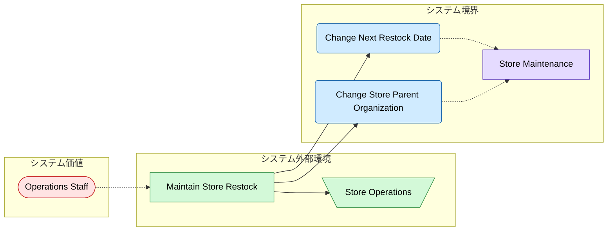
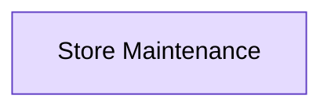

# 店舗補充管理 設計 Step 2: Screens

<!-- constrained-by ../../../docs/incremental-modeling.md#stage-2-screens -->
<!-- derived-from ./requirements-analysis.md -->

この文書は Step 2 時点の RDRA DSL 設計サンプルです。clinic-ops の設計書と同じく、レビューに必要な生成物は本文へ埋め込みます。

## 1. 設計目的

usecase ごとに、担当者が操作する画面を追加する。

## 2. モデル構成

| 分類 | 対象 | 役割 |
|---|---|---|
| Screen | `StoreMaintenanceScreen` | 店舗の補充予定と担当組織を確認しながら更新する |
| Displays | `ChangeNextRestockDate -> StoreMaintenanceScreen` | 補充予定日の変更を店舗メンテナンス画面で行う |
| Displays | `ChangeStoreParentOrganization -> StoreMaintenanceScreen` | 担当組織の変更を同じ画面で行う |

## 3. 設計判断

| 判断 | 理由 |
|---|---|
| entity より先に画面を置く | 画面は usecase と並ぶシステム境界で、アクターが目にして操作するものを先に固めるため |
| 画面を 1 つにまとめる | 担当者は同じ店舗を見ながら補充予定と担当組織を見直すため |
| shows と field はまだ置かない | 画面が示す entity と項目の対応は、entity を置く次 step で結ぶため |

## 4. 生成成果物

生成コマンド例:

```sh
rdra-ish check samples/incremental-order/step-2-screens/src
rdra-ish diagram samples/incremental-order/step-2-screens/src --kind rdra --format mermaid --buc BucStoreRestock --out samples/incremental-order/step-2-screens/out/object_graph_buc_store_restock
rdra-ish diagram samples/incremental-order/step-2-screens/src --kind screen --format mermaid --buc BucStoreRestock --out samples/incremental-order/step-2-screens/out/screen
```

### 4.1 RDRA Layered Graph 図

生成コマンド:

```sh
rdra-ish diagram samples/incremental-order/step-2-screens/src --kind rdra --format mermaid --buc BucStoreRestock --out samples/incremental-order/step-2-screens/out/object_graph_buc_store_restock
```

<!-- embed: out/object_graph_buc_store_restock.mmd -->


### 4.2 画面遷移図

生成コマンド:

```sh
rdra-ish diagram samples/incremental-order/step-2-screens/src --kind screen --format mermaid --buc BucStoreRestock --out samples/incremental-order/step-2-screens/out/screen
```

<!-- embed: out/screen.mmd -->


## 5. レビュー観点

- 補充予定日変更と担当組織変更を同じ画面で行ってよいか。
- 店舗一覧など、店舗メンテナンス画面へ遷移する前の画面が必要か。
- イベントやタイマーで始まり、画面を持たない usecase がないか。

## 6. 承認条件

| 観点 | 承認条件 |
|---|---|
| 要求 | requirements-analysis.md の Must 要求を説明できる |
| 設計 | この step で追加した DSL 要素の責務を説明できる |
| 生成物 | 埋め込み成果物が現在の DSL から生成されている |
| 次 step | 次に具体化する情報と、まだ具体化しない情報を区別できる |

## Summary

<!-- derived-from #2-モデル構成 -->
<!-- derived-from #3-設計判断 -->
<!-- derived-from #4-生成成果物 -->

Step 2 の設計は、usecase ごとの画面を追加するための最小 DSL と生成成果物を提示する。
