# Insurance Claim Ops 設計書

<!-- derived-from ../../docs/language-reference.md -->
<!-- derived-from ../../docs/cli-reference.md -->

`scripts/gen-clinic-ops-docs.py` が `samples/insurance-claim-ops/` のモデルから CLI を通して生成する。図・表・説明文を手で直さず、`.rdra` を直して `scripts/check-sample-artifacts.sh` を実行する。題材は日本の損害保険会社（自動車保険）の損害サービス部門の保険金支払業務（事故受付と初期対応、損害調査と過失の判断、修理見積と着工の承認、示談代行、自賠責の損害調査、保険金の請求、支払・不払の決定と支払、請求権代位による求償、苦情と ADR）で、保険料・引受、損害額の算定の中身、調停・訴訟、自賠責の異議申立と紛争処理、残存物代位は対象外。業務規則は `.rdra` の `//` コメントに一次資料の出典（ファイル名:行）を付けている。

この文書は実装するエンジニア向けである。構造、処理、仕様の順に読む。

1. BUC ごとのロバストネス図で、画面・制御・エンティティの構造をつかむ。
2. UC ごとのシーケンス図で、ガードと書き込みの順序をつかむ。
3. 状態モデル、データモデル、規則、CRUD と権限で仕様を確かめる。

要求と成功指標は [PRD](prd.md) にある。

## 1. 概要

対象は損害保険会社の損害サービス部門が行う自動車保険の保険金支払業務である。業務を 9 の BUC に分け、内部システムは `ClaimSystem`（保険金支払システム）1 つにまとめている。損保料率機構（自賠責損害調査事務所）、そんぽADRセンター、自動車事故情報交換システムは外部システムとしてイベントでつなぐ。契約者・被保険者、被害者、代理店、修理工場、アジャスターはアクターとして業務フローに現れる。

業務の骨格は約款の支払時期（請求完了日を含めて30日、特別な照会・調査で60〜180日）と、監督指針・損保協会ガイドラインの支払管理である。期間（支払期限、請求権の時効、求償する債権の時効）はタイマーで表し、期間が過ぎたときに起きること（遅延利息の起算・時効消滅）を状態で表す。

| 論点 | このモデル |
|---|---|
| 事故の通知 | 契約者は遅滞なく保険会社か代理店に通知する。保険会社は担保種目ごとに担当者を決めて案内し、請求の手続と書類を説明する |
| 損害確認 | アジャスターが損害調査をし、過失割合を裁判例で検討して賠償責任を判断する。修理は修理費の協定と着工の承認の後 |
| 示談代行 | 賠償責任のある対人・対物賠償の事故で、被保険者と被害者の同意を得て行う。過失ゼロでは行わない |
| 自賠責 | 一括払いでは自賠責の請求書類を損保料率機構に送り、その調査結果に基づいて支払額を決める |
| 支払期限 | 請求完了日を含めて30日。特別な照会・調査は事由により60・90・120・180日に延ばし、確認事項と時期を通知する。過ぎれば遅延利息 |
| 決裁 | 支払と不払いで決裁権限に差がある。不正請求の疑いがある請求は上位の決裁者が決める。不払いは根拠となる約款の条項と調査結果を説明してから通知する |
| 支払後 | 払った額を限度に被保険者の損害賠償請求権が移り（請求権代位）、相手方に求償する |
| 苦情と ADR | 了解が得られなければ相談機関を案内する。そんぽADRセンターの特別調停案は会社が受諾する |

### システムコンテキスト図

システムを使う actor と、イベントでつながる外部システムを示す。actor からシステムへの線は、actor が担う BUC の UC が呼ぶ API から導出される。

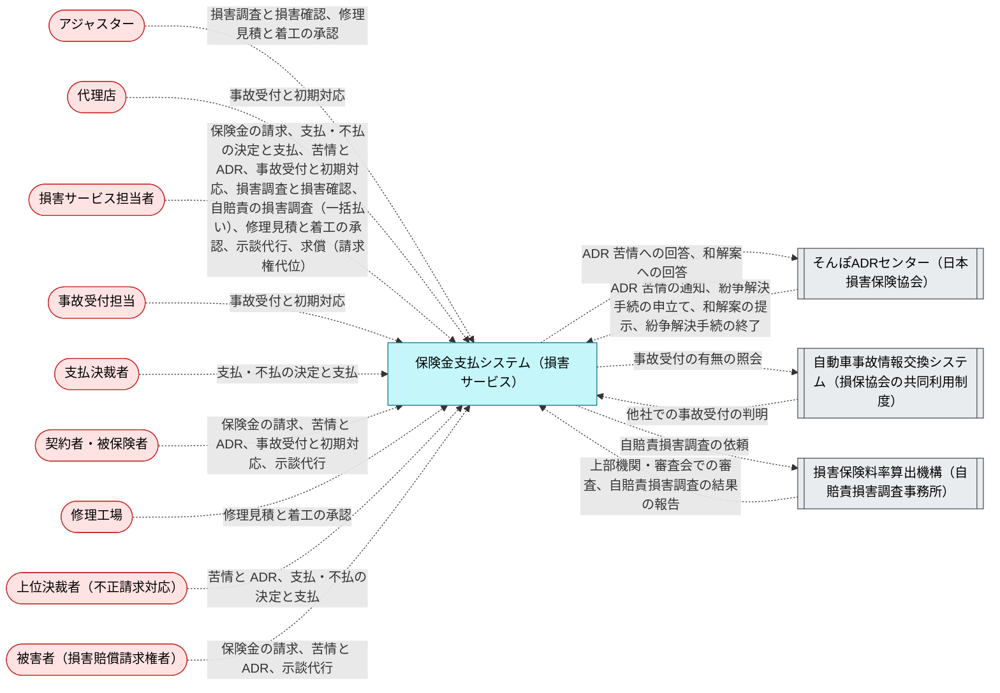

## 2. BUC ごとの構造と処理

各節は BUC の説明、ロバストネス図、画面遷移図、UC の表、UC ごとのシーケンス図の順に並ぶ。ロバストネス図では actor が画面を使い、画面が制御（UC が呼ぶ API、API がなければ UC 自身）を呼び、制御がエンティティを読み書きする。画面遷移図（`diagram --kind screen --buc <Buc>`）の実線は `navigates` で宣言した遷移で、ラベルは遷移を起こす UC である。点線の「業務上の順番」は宣言がない所を業務フローから補ったもので、同じ担当者のレーンで続く手順が表示する画面の順を示し、実際の画面遷移ではない。遷移も業務上の順番もない BUC では画面遷移図を省く。表の「ガード」は UC に効く条件で、式は [5. 規則](#5-規則) にある。

### 2.1 事故受付と初期対応

契約者・被保険者は事故を知ったら遅滞なく保険会社か代理店に通知する。保険会社は契約内容・重複契約・事故状況・傷害を確かめ、警察への届出を案内し、担保種目ごとに担当者を決めて所属・氏名・連絡先を知らせ、請求の手続と必要な書類を説明する。車両事故・対物事故は、他社での事故受付の有無を共同利用制度で照会する。

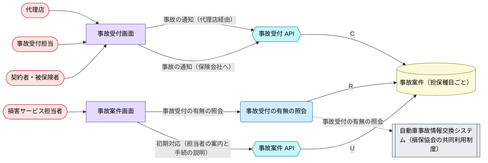

#### 画面遷移図

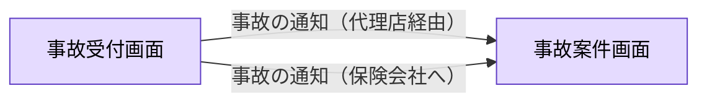

| UC | 説明 | 画面 | 制御 | ガード |
|---|---|---|---|---|
| 事故の通知（保険会社へ）<br>`ReportAccident` | 契約者・被保険者が事故の日時・場所・概要を事故受付センターに直ちに通知し、事故の状況・被害者・証人・損害賠償の請求の内容を遅滞なく知らせる。 | `AccidentReportScreen` | `CaseCreateApi` | （なし） |
| 事故の通知（代理店経由）<br>`RelayAccidentReport` | 代理店が契約者から事故の連絡を受け、保険会社の事故受付に取り次ぐ。 | `AccidentReportScreen` | `CaseCreateApi` | （なし） |
| 初期対応（担当者の案内と手続の説明）<br>`RespondInitially` | 担保種目ごとに担当者を決め、所属部署・氏名・連絡先を案内する。警察への届出と交通事故証明書、損害の防止、無断で責任を認めないことを説明し、支払の対象になりうる保険金と請求の手続を説明する。 | `CaseScreen` | `CaseApi` | （なし） |
| 事故受付の有無の照会<br>`QueryAccidentExchange` | 車両事故・対物事故について、同じ事故が他社で受け付けられていないかを自動車事故情報交換システムで照会する。 | `CaseScreen` | `QueryAccidentExchange` | （なし） |

<details><summary>事故の通知（保険会社へ）（ReportAccident）のシーケンス図</summary>

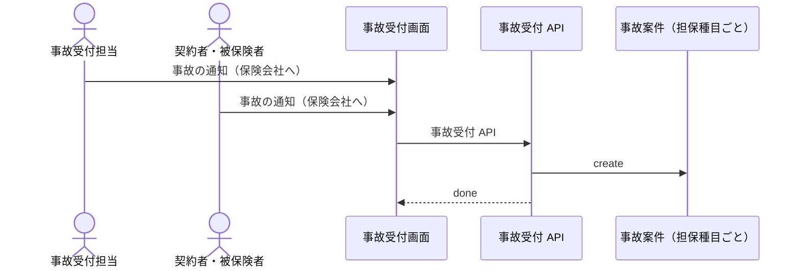

</details>

<details><summary>事故の通知（代理店経由）（RelayAccidentReport）のシーケンス図</summary>

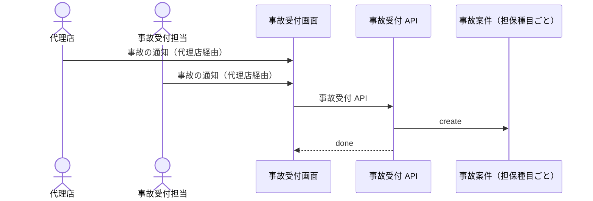

</details>

<details><summary>初期対応（担当者の案内と手続の説明）（RespondInitially）のシーケンス図</summary>

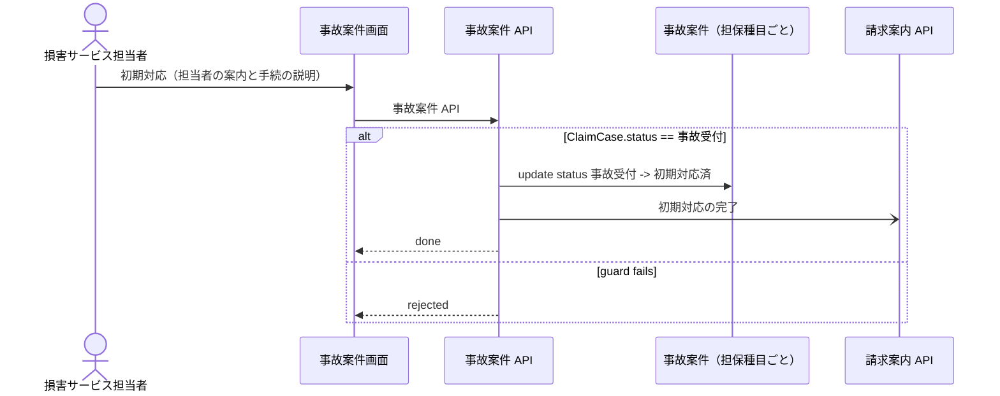

</details>

<details><summary>事故受付の有無の照会（QueryAccidentExchange）のシーケンス図</summary>

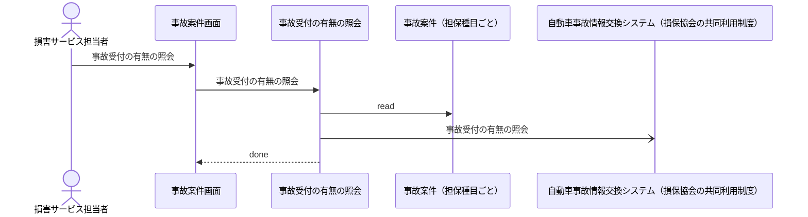

</details>

### 2.2 損害調査と損害確認

立証責任がどちらにあっても、保険会社は必要な損害調査をする。アジャスターが事故の原因と状況、損傷と事故の関係、損害額を調べ、契約者と被害者の認識が違えば現場で実地調査をする。過失割合は過去の裁判例を基準に検討し、賠償責任があるかを判断する。調査の報告と、賠償の事故では過失の判断を経て、損害を確定する。

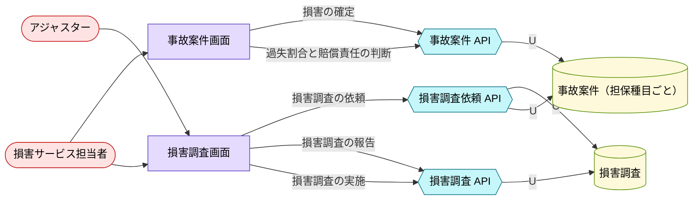

#### 画面遷移図

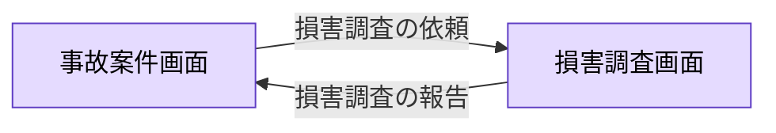

| UC | 説明 | 画面 | 制御 | ガード |
|---|---|---|---|---|
| 損害調査の依頼<br>`RequestInvestigation` | 担当者が事案の特性に応じた調査の手法（書類・写真、現場の実地調査、専門家の見解）を選び、アジャスターに損害調査を依頼する。 | `InvestigationScreen` | `InvestigationCreateApi` | （なし） |
| 損害調査の実施<br>`ConductSurvey` | アジャスターが事故の原因と状況、損傷部位と事故の関係、損害額を調べる。契約者と被害者の認識が違えば事故現場を調べる。 | `InvestigationScreen` | `InvestigationApi` | （なし） |
| 損害調査の報告<br>`ReportSurvey` | アジャスターが調査の結果を報告する。法的・医学的・工学的な判断を要する事案は専門家の見解を添える。 | `InvestigationScreen` | `InvestigationApi` | （なし） |
| 過失割合と賠償責任の判断<br>`DetermineFault` | 過去の裁判例を基準に過失割合を検討し、被保険者に法律上の損害賠償責任があるか、過失ゼロかを判断する。 | `CaseScreen` | `CaseApi` | 事故案件を調査しているか、損害を確定した |
| 損害の確定<br>`AssessDamage` | 調査の報告を受けて損害を確定する。賠償の事故では過失を判断した後に、示談代行をしたときは示談の成立か終了の後に確定する。 | `CaseScreen` | `CaseApi` | 損害調査の報告がある、車両・人身傷害の事故である、賠償責任の有無を判断している、示談が成立したか、示談代行を終えた |

<details><summary>損害調査の依頼（RequestInvestigation）のシーケンス図</summary>

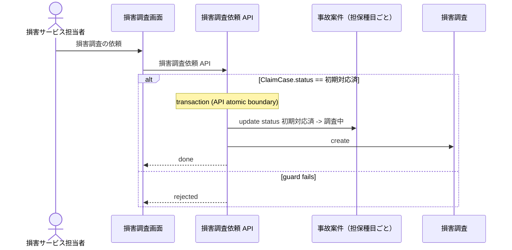

</details>

<details><summary>損害調査の実施（ConductSurvey）のシーケンス図</summary>

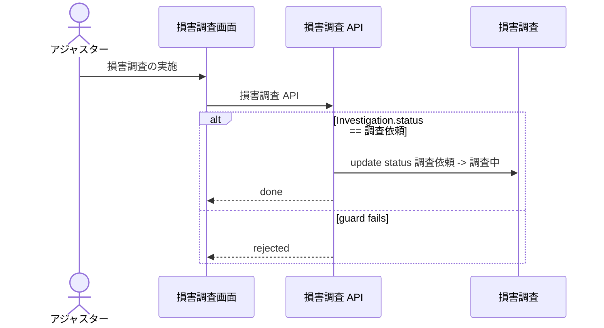

</details>

<details><summary>損害調査の報告（ReportSurvey）のシーケンス図</summary>

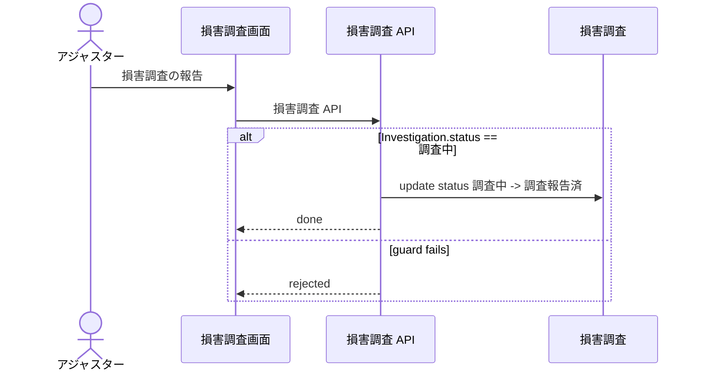

</details>

<details><summary>過失割合と賠償責任の判断（DetermineFault）のシーケンス図</summary>

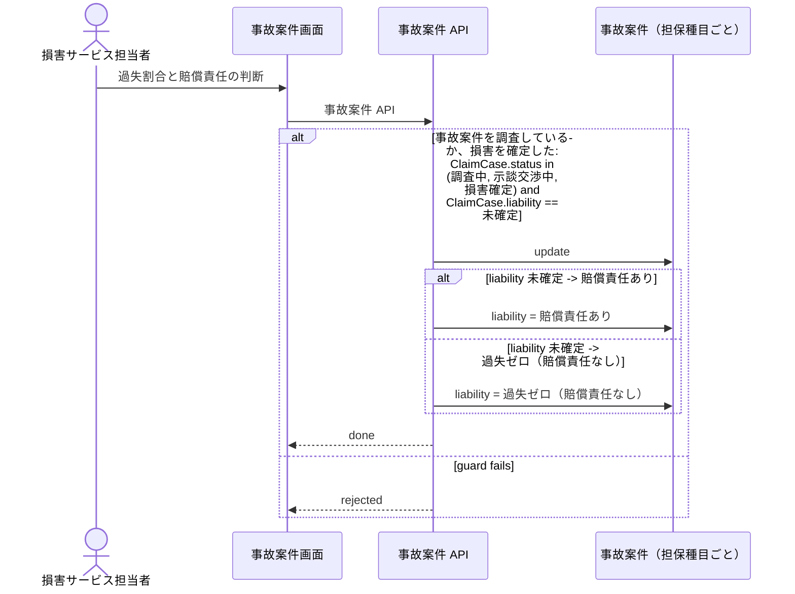

</details>

<details><summary>損害の確定（AssessDamage）のシーケンス図</summary>

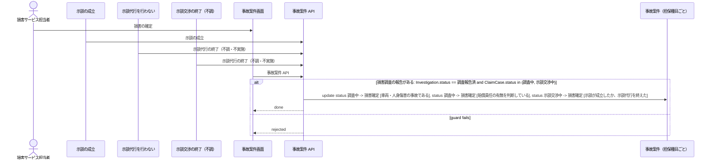

</details>

### 2.3 修理見積と着工の承認

損害車両は修理工場に入る。修理工場は見積書と写真を出し、アジャスターが損害額と損傷・事故の関係を確かめて修理費を協定する。保険の対象を修理するには、応急の仮手当を除き、あらかじめ保険会社の承認を得る。承認の前に着工すると、保険金の一部または全部が払われないことがある。

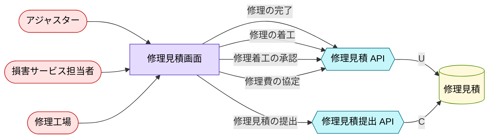

| UC | 説明 | 画面 | 制御 | ガード |
|---|---|---|---|---|
| 修理見積の提出<br>`SubmitRepairEstimate` | 修理工場が損害車両の修理見積書と写真を保険会社に出す。 | `RepairScreen` | `RepairEstimateCreateApi` | 車両・対物賠償の事故である |
| 修理費の協定<br>`AgreeRepairCost` | アジャスターが損傷と事故の関係、修理の方法と部品交換の要否を確かめ、修理工場と修理費を協定する。 | `RepairScreen` | `RepairEstimateApi` | （なし） |
| 修理着工の承認<br>`ApproveRepairStart` | 協定した修理費で修理に着工することを、保険会社が承認する。 | `RepairScreen` | `RepairEstimateApi` | 修理費を協定した |
| 修理の着工<br>`StartRepair` | 修理工場が保険会社の承認を受けて修理に着工する。 | `RepairScreen` | `RepairEstimateApi` | 修理着工を承認した |
| 修理の完了<br>`CompleteRepair` | 修理工場が修理を終える。 | `RepairScreen` | `RepairEstimateApi` | （なし） |

<details><summary>修理見積の提出（SubmitRepairEstimate）のシーケンス図</summary>

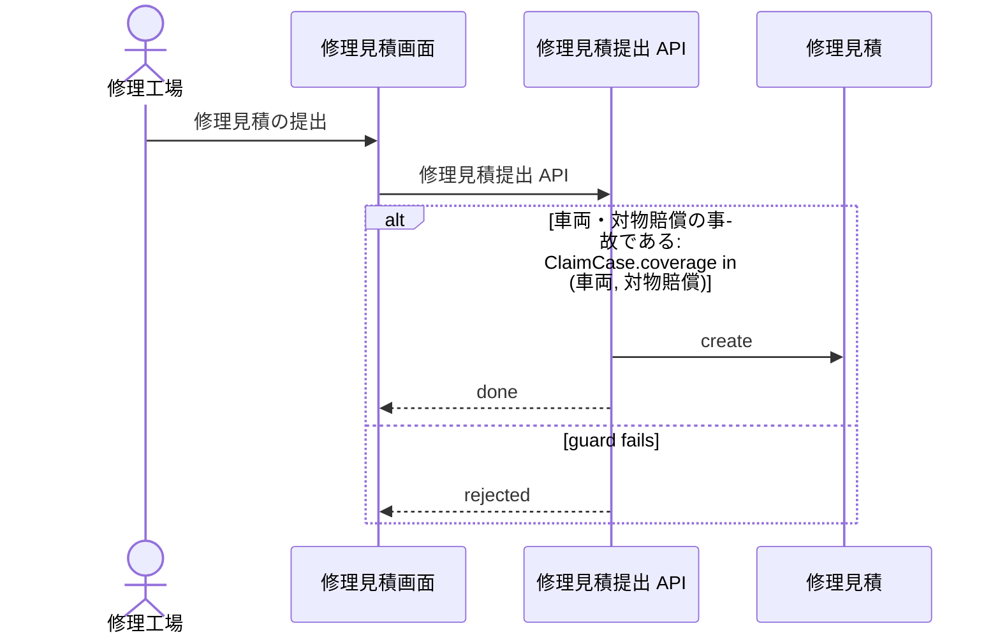

</details>

<details><summary>修理費の協定（AgreeRepairCost）のシーケンス図</summary>

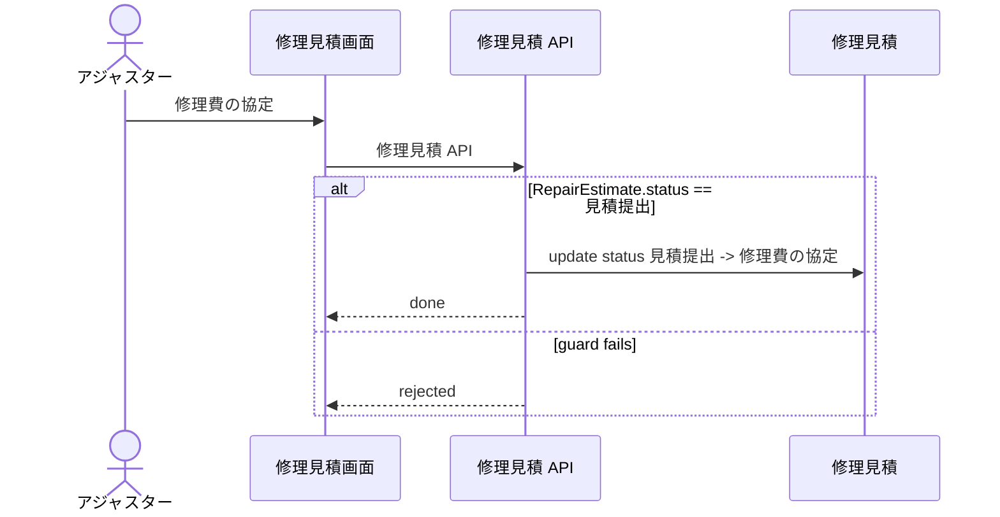

</details>

<details><summary>修理着工の承認（ApproveRepairStart）のシーケンス図</summary>

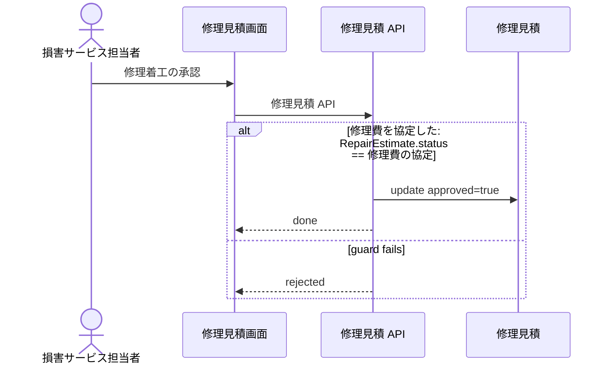

</details>

<details><summary>修理の着工（StartRepair）のシーケンス図</summary>

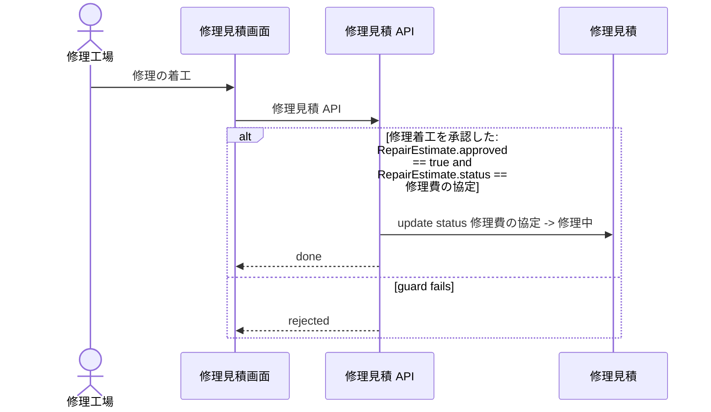

</details>

<details><summary>修理の完了（CompleteRepair）のシーケンス図</summary>

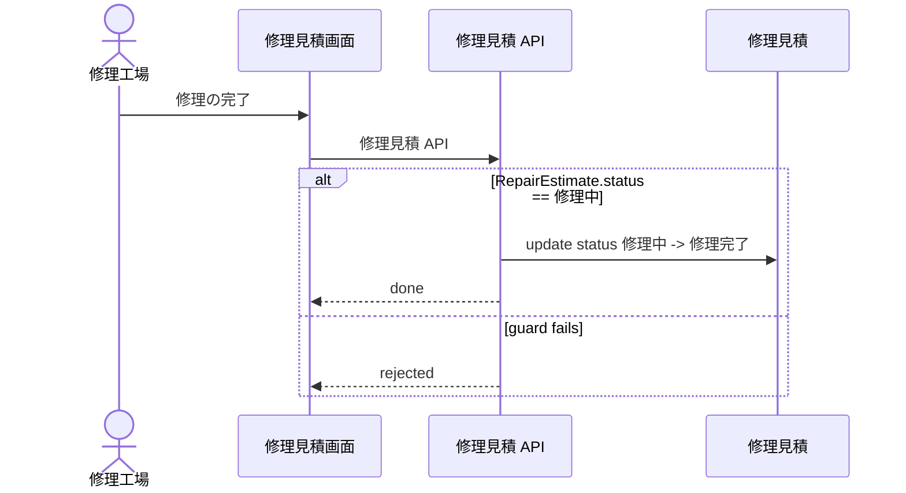

</details>

### 2.4 示談代行

対人・対物賠償の事故で被保険者に賠償責任があるとき、保険会社は被保険者の同意を得て、被保険者のために被害者と折衝し示談する（当会社による解決）。被害者が保険会社と直接折衝することに同意しないとき、被保険者に賠償責任がない（過失ゼロ）とき、賠償額が保険金額を明らかに超えるときなどは行わない。示談が成立すれば示談書が賠償の保険金の請求書類になる。

```mermaid
%% rdra-ish diagram=robustness scope=buc:BucSettlement model=samples/insurance-claim-ops
%% kinds: actor screen api entity
%% omitted: buc step medium permission event condition
flowchart LR
  actor__ClaimHandler(["損害サービス担当者"]):::actor
  actor__PolicyHolder(["契約者・被保険者"]):::actor
  actor__Victim(["被害者（損害賠償請求権者）"]):::actor
  screen__SettlementScreen["示談画面"]:::screen
  api__SettlementApi{{"示談 API"}}:::api
  api__SettlementCreateApi{{"示談代行開始 API"}}:::api
  entity__ClaimCase[("事故案件（担保種目ごと）")]:::entity
  entity__Settlement[("示談（示談代行）")]:::entity
  actor__ClaimHandler --> screen__SettlementScreen
  actor__PolicyHolder --> screen__SettlementScreen
  actor__Victim --> screen__SettlementScreen
  api__SettlementApi -->|U| entity__Settlement
  api__SettlementCreateApi -->|C| entity__Settlement
  api__SettlementCreateApi -->|U| entity__ClaimCase
  screen__SettlementScreen -->|示談の成立| api__SettlementApi
  screen__SettlementScreen -->|示談交渉の終了（不調）| api__SettlementApi
  screen__SettlementScreen -->|示談交渉の開始| api__SettlementApi
  screen__SettlementScreen -->|示談代行の開始| api__SettlementCreateApi
  screen__SettlementScreen -->|示談代行を行わない| api__SettlementApi
  screen__SettlementScreen -->|被保険者の同意| api__SettlementApi
  screen__SettlementScreen -->|被害者の同意| api__SettlementApi
  classDef actor fill:#ffe3e3,stroke:#c92a2a,color:#000;
  classDef screen fill:#e5dbff,stroke:#5f3dc4,color:#000;
  classDef api fill:#c5f6fa,stroke:#0b7285,color:#000;
  classDef entity fill:#fff9db,stroke:#5c940d,color:#000;
```

| UC | 説明 | 画面 | 制御 | ガード |
|---|---|---|---|---|
| 示談代行の開始<br>`OpenSettlement` | 対人・対物賠償の事故で、被保険者に賠償責任があると判断した案件について、示談代行の手続を開き、契約者と被害者の同意を確かめにいく。 | `SettlementScreen` | `SettlementCreateApi` | 対人・対物賠償の事故で、被保険者に賠償責任がある |
| 被保険者の同意<br>`RecordInsuredConsent` | 被保険者が保険会社の解決条件に同意し、保険会社が被保険者のために示談交渉をすることに同意する。 | `SettlementScreen` | `SettlementApi` | 示談代行の同意を確かめている |
| 被害者の同意<br>`RecordVictimConsent` | 被害者が加害者側の保険会社と直接折衝することに同意する。 | `SettlementScreen` | `SettlementApi` | 示談代行の同意を確かめている |
| 示談交渉の開始<br>`BeginNegotiation` | 双方の同意を得て、保険会社が加害者の窓口として被害者と交渉を始める。 | `SettlementScreen` | `SettlementApi` | 被保険者と被害者がともに同意している |
| 示談代行を行わない<br>`DeclineSettlementService` | 被害者が同意しない、被保険者が協力しない、賠償額が保険金額を明らかに超えるなど、約款の定める場合に示談代行を行わないと決め、契約者に伝える。 | `SettlementScreen` | `SettlementApi` | （なし） |
| 示談の成立<br>`AgreeSettlement` | 示談案を提示し、被害者と合意して示談書を取り交わす。賠償の保険金の請求権がこのとき発生する。 | `SettlementScreen` | `SettlementApi` | （なし） |
| 示談交渉の終了（不調）<br>`EndNegotiationUnresolved` | 示談がまとまらず、調停または訴訟に移る。調停・訴訟の中身は対象外。 | `SettlementScreen` | `SettlementApi` | （なし） |

<details><summary>示談代行の開始（OpenSettlement）のシーケンス図</summary>

```mermaid
%% rdra-ish diagram=sequence scope=usecase:OpenSettlement model=samples/insurance-claim-ops
%% kinds: actor screen api entity
%% omitted: buc step medium permission condition
sequenceDiagram
  actor actor__ClaimHandler as 損害サービス担当者
  participant screen__SettlementScreen as 示談画面
  participant api__SettlementCreateApi as 示談代行開始 API
  participant entity__ClaimCase as 事故案件（担保種目ごと）
  participant entity__Settlement as 示談（示談代行）
  actor__ClaimHandler ->> screen__SettlementScreen: 示談代行の開始
  screen__SettlementScreen ->> api__SettlementCreateApi: 示談代行開始 API
  alt 対人・対物賠償の事故で、被保険者に賠償責任がある: ClaimCase.coverage in (対人賠償, 対物賠償), ClaimCase.liability == 賠償責任あり and ClaimCase.status == 調査中
    Note over api__SettlementCreateApi: transaction (API atomic boundary)
    api__SettlementCreateApi ->> entity__ClaimCase: update status 調査中 -> 示談交渉中
    api__SettlementCreateApi ->> entity__Settlement: create
    api__SettlementCreateApi -->> screen__SettlementScreen: done
  else guard fails
    api__SettlementCreateApi -->> screen__SettlementScreen: rejected
  end
```

</details>

<details><summary>被保険者の同意（RecordInsuredConsent）のシーケンス図</summary>

```mermaid
%% rdra-ish diagram=sequence scope=usecase:RecordInsuredConsent model=samples/insurance-claim-ops
%% kinds: actor screen api entity
%% omitted: buc step medium permission condition
sequenceDiagram
  actor actor__PolicyHolder as 契約者・被保険者
  participant screen__SettlementScreen as 示談画面
  participant api__SettlementApi as 示談 API
  participant entity__Settlement as 示談（示談代行）
  actor__PolicyHolder ->> screen__SettlementScreen: 被保険者の同意
  screen__SettlementScreen ->> api__SettlementApi: 示談 API
  alt 示談代行の同意を確かめている: Settlement.status == 同意の確認中
    api__SettlementApi ->> entity__Settlement: update insured_consent=true
    api__SettlementApi -->> screen__SettlementScreen: done
  else guard fails
    api__SettlementApi -->> screen__SettlementScreen: rejected
  end
```

</details>

<details><summary>被害者の同意（RecordVictimConsent）のシーケンス図</summary>

```mermaid
%% rdra-ish diagram=sequence scope=usecase:RecordVictimConsent model=samples/insurance-claim-ops
%% kinds: actor screen api entity
%% omitted: buc step medium permission condition
sequenceDiagram
  actor actor__Victim as 被害者（損害賠償請求権者）
  participant screen__SettlementScreen as 示談画面
  participant api__SettlementApi as 示談 API
  participant entity__Settlement as 示談（示談代行）
  actor__Victim ->> screen__SettlementScreen: 被害者の同意
  screen__SettlementScreen ->> api__SettlementApi: 示談 API
  alt 示談代行の同意を確かめている: Settlement.status == 同意の確認中
    api__SettlementApi ->> entity__Settlement: update victim_consent=true
    api__SettlementApi -->> screen__SettlementScreen: done
  else guard fails
    api__SettlementApi -->> screen__SettlementScreen: rejected
  end
```

</details>

<details><summary>示談交渉の開始（BeginNegotiation）のシーケンス図</summary>

```mermaid
%% rdra-ish diagram=sequence scope=usecase:BeginNegotiation model=samples/insurance-claim-ops
%% kinds: actor screen api entity
%% omitted: buc step medium permission condition
sequenceDiagram
  actor actor__ClaimHandler as 損害サービス担当者
  participant screen__SettlementScreen as 示談画面
  participant api__SettlementApi as 示談 API
  participant entity__Settlement as 示談（示談代行）
  actor__ClaimHandler ->> screen__SettlementScreen: 示談交渉の開始
  screen__SettlementScreen ->> api__SettlementApi: 示談 API
  alt 被保険者と被害者がともに同意している: Settlement.insured_consent == true, Settlement.victim_consent == true and Settlement.status == 同意の確認中
    api__SettlementApi ->> entity__Settlement: update status 同意の確認中 -> 示談交渉中
    api__SettlementApi -->> screen__SettlementScreen: done
  else guard fails
    api__SettlementApi -->> screen__SettlementScreen: rejected
  end
```

</details>

<details><summary>示談代行を行わない（DeclineSettlementService）のシーケンス図</summary>

```mermaid
%% rdra-ish diagram=sequence scope=usecase:DeclineSettlementService model=samples/insurance-claim-ops
%% kinds: actor screen api entity
%% omitted: buc step medium permission event
sequenceDiagram
  actor actor__ClaimHandler as 損害サービス担当者
  participant screen__SettlementScreen as 示談画面
  participant api__SettlementApi as 示談 API
  participant entity__Settlement as 示談（示談代行）
  participant api__CaseApi as 事故案件 API
  actor__ClaimHandler ->> screen__SettlementScreen: 示談代行を行わない
  screen__SettlementScreen ->> api__SettlementApi: 示談 API
  alt Settlement.status == 同意の確認中
    api__SettlementApi ->> entity__Settlement: update status 同意の確認中 -> 示談代行を行わない
    api__SettlementApi -) api__CaseApi: 示談代行の終了（不調・不実施）
    api__SettlementApi -->> screen__SettlementScreen: done
  else guard fails
    api__SettlementApi -->> screen__SettlementScreen: rejected
  end
```

</details>

<details><summary>示談の成立（AgreeSettlement）のシーケンス図</summary>

```mermaid
%% rdra-ish diagram=sequence scope=usecase:AgreeSettlement model=samples/insurance-claim-ops
%% kinds: actor screen api entity
%% omitted: buc step medium permission event
sequenceDiagram
  actor actor__ClaimHandler as 損害サービス担当者
  participant screen__SettlementScreen as 示談画面
  participant api__SettlementApi as 示談 API
  participant entity__Settlement as 示談（示談代行）
  participant api__CaseApi as 事故案件 API
  actor__ClaimHandler ->> screen__SettlementScreen: 示談の成立
  screen__SettlementScreen ->> api__SettlementApi: 示談 API
  alt Settlement.status == 示談交渉中
    api__SettlementApi ->> entity__Settlement: update status 示談交渉中 -> 示談成立
    api__SettlementApi -) api__CaseApi: 示談の成立
    api__SettlementApi -->> screen__SettlementScreen: done
  else guard fails
    api__SettlementApi -->> screen__SettlementScreen: rejected
  end
```

</details>

<details><summary>示談交渉の終了（不調）（EndNegotiationUnresolved）のシーケンス図</summary>

```mermaid
%% rdra-ish diagram=sequence scope=usecase:EndNegotiationUnresolved model=samples/insurance-claim-ops
%% kinds: actor screen api entity
%% omitted: buc step medium permission event
sequenceDiagram
  actor actor__ClaimHandler as 損害サービス担当者
  participant screen__SettlementScreen as 示談画面
  participant api__SettlementApi as 示談 API
  participant entity__Settlement as 示談（示談代行）
  participant api__CaseApi as 事故案件 API
  actor__ClaimHandler ->> screen__SettlementScreen: 示談交渉の終了（不調）
  screen__SettlementScreen ->> api__SettlementApi: 示談 API
  alt Settlement.status == 示談交渉中
    api__SettlementApi ->> entity__Settlement: update status 示談交渉中 -> 不調（調停・訴訟へ）
    api__SettlementApi -) api__CaseApi: 示談代行の終了（不調・不実施）
    api__SettlementApi -->> screen__SettlementScreen: done
  else guard fails
    api__SettlementApi -->> screen__SettlementScreen: rejected
  end
```

</details>

### 2.5 自賠責の損害調査（一括払い）

人身の事故では、任意保険の会社が自賠責保険の部分を含めて保険金を払う（一括払い）。契約者・被害者に説明して同意を確かめ、自賠責の請求書類を損保料率機構の自賠責損害調査事務所に送る。判断が難しい事案は地区本部・本部、特定事案は審査会で審査され、結果が保険会社に報告される。保険会社はその結果に基づいて支払額を決める。同意がなければ、加害者請求・被害者請求・仮渡金の手続を案内する。

```mermaid
%% rdra-ish diagram=robustness scope=buc:BucJibaiseki model=samples/insurance-claim-ops
%% kinds: actor extsystem screen api entity
%% omitted: buc step medium permission event condition
flowchart LR
  actor__ClaimHandler(["損害サービス担当者"]):::actor
  extsystem__Giroj[["損害保険料率算出機構（自賠責損害調査事務所）"]]:::extsystem
  screen__JibaisekiScreen["自賠責損害調査画面"]:::screen
  api__JibaisekiSurveyApi{{"自賠責損害調査 API"}}:::api
  api__JibaisekiSurveyCreateApi{{"自賠責損害調査依頼 API"}}:::api
  entity__JibaisekiSurvey[("自賠責損害調査")]:::entity
  actor__ClaimHandler --> screen__JibaisekiScreen
  api__JibaisekiSurveyApi -->|U| entity__JibaisekiSurvey
  api__JibaisekiSurveyCreateApi -->|C| entity__JibaisekiSurvey
  api__JibaisekiSurveyCreateApi -.->|自賠責損害調査の依頼| extsystem__Giroj
  extsystem__Giroj -.->|上部機関・審査会での審査| api__JibaisekiSurveyApi
  extsystem__Giroj -.->|自賠責損害調査の結果の報告| api__JibaisekiSurveyApi
  screen__JibaisekiScreen -->|自賠責損害調査の依頼| api__JibaisekiSurveyCreateApi
  classDef actor fill:#ffe3e3,stroke:#c92a2a,color:#000;
  classDef extsystem fill:#e9ecef,stroke:#495057,color:#000;
  classDef screen fill:#e5dbff,stroke:#5f3dc4,color:#000;
  classDef api fill:#c5f6fa,stroke:#0b7285,color:#000;
  classDef entity fill:#fff9db,stroke:#5c940d,color:#000;
```

| UC | 説明 | 画面 | 制御 | ガード |
|---|---|---|---|---|
| 自賠責損害調査の依頼<br>`SendJibaisekiSurvey` | 一括払いに同意を得た人身の事故について、自賠責の請求書類を確かめて損保料率機構の自賠責損害調査事務所に送る。 | `JibaisekiScreen` | `JibaisekiSurveyCreateApi` | 対人賠償・人身傷害の事故である |
| 上部機関・審査会での審査の記録<br>`RecordJibaisekiEscalation` | 損保料率機構から、事案が地区本部・本部または審査会の審査に回ったと知らせを受けて記録する。 | （なし） | `JibaisekiSurveyApi` | （なし） |
| 自賠責損害調査の結果の受領<br>`RecordJibaisekiResult` | 損保料率機構の調査結果（有無責、後遺障害の等級、重過失減額の有無）を受け取り、支払額の決定に使う。 | （なし） | `JibaisekiSurveyApi` | （なし） |

<details><summary>自賠責損害調査の依頼（SendJibaisekiSurvey）のシーケンス図</summary>

```mermaid
%% rdra-ish diagram=sequence scope=usecase:SendJibaisekiSurvey model=samples/insurance-claim-ops
%% kinds: actor screen api entity extsystem
%% omitted: buc step medium permission event condition
sequenceDiagram
  actor actor__ClaimHandler as 損害サービス担当者
  participant screen__JibaisekiScreen as 自賠責損害調査画面
  participant api__JibaisekiSurveyCreateApi as 自賠責損害調査依頼 API
  participant entity__JibaisekiSurvey as 自賠責損害調査
  participant extsystem__Giroj as 損害保険料率算出機構（自賠責損害調査事務所）
  actor__ClaimHandler ->> screen__JibaisekiScreen: 自賠責損害調査の依頼
  screen__JibaisekiScreen ->> api__JibaisekiSurveyCreateApi: 自賠責損害調査依頼 API
  alt 対人賠償・人身傷害の事故である: ClaimCase.coverage in (対人賠償, 人身傷害)
    api__JibaisekiSurveyCreateApi ->> entity__JibaisekiSurvey: create
    api__JibaisekiSurveyCreateApi -) extsystem__Giroj: 自賠責損害調査の依頼
    api__JibaisekiSurveyCreateApi -->> screen__JibaisekiScreen: done
  else guard fails
    api__JibaisekiSurveyCreateApi -->> screen__JibaisekiScreen: rejected
  end
```

</details>

<details><summary>上部機関・審査会での審査の記録（RecordJibaisekiEscalation）のシーケンス図</summary>

```mermaid
%% rdra-ish diagram=sequence scope=usecase:RecordJibaisekiEscalation model=samples/insurance-claim-ops
%% kinds: extsystem api entity
%% omitted: buc step event
sequenceDiagram
  participant extsystem__Giroj as 損害保険料率算出機構（自賠責損害調査事務所）
  participant api__JibaisekiSurveyApi as 自賠責損害調査 API
  participant entity__JibaisekiSurvey as 自賠責損害調査
  extsystem__Giroj ->> api__JibaisekiSurveyApi: 上部機関・審査会での審査
  alt JibaisekiSurvey.status == 調査事務所へ送付
    api__JibaisekiSurveyApi ->> entity__JibaisekiSurvey: update status 調査事務所へ送付 -> 地区本部・本部・審査会で審査中
    api__JibaisekiSurveyApi -->> extsystem__Giroj: done
  else guard fails
    api__JibaisekiSurveyApi -->> extsystem__Giroj: rejected
  end
```

</details>

<details><summary>自賠責損害調査の結果の受領（RecordJibaisekiResult）のシーケンス図</summary>

```mermaid
%% rdra-ish diagram=sequence scope=usecase:RecordJibaisekiResult model=samples/insurance-claim-ops
%% kinds: extsystem api entity
%% omitted: buc step event
sequenceDiagram
  participant extsystem__Giroj as 損害保険料率算出機構（自賠責損害調査事務所）
  participant api__JibaisekiSurveyApi as 自賠責損害調査 API
  participant entity__JibaisekiSurvey as 自賠責損害調査
  extsystem__Giroj ->> api__JibaisekiSurveyApi: 自賠責損害調査の結果の報告
  alt JibaisekiSurvey.status in (調査事務所へ送付, 地区本部・本部・審査会で審査中)
    api__JibaisekiSurveyApi ->> entity__JibaisekiSurvey: update status 調査事務所へ送付 -> 調査結果の報告受領, status 地区本部・本部・審査会で審査中 -> 調査結果の報告受領
    api__JibaisekiSurveyApi -->> extsystem__Giroj: done
  else guard fails
    api__JibaisekiSurveyApi -->> extsystem__Giroj: rejected
  end
```

</details>

### 2.6 保険金の請求

保険会社は請求の手続と必要な書類を案内する。自動車保険では、請求の前に次の契約の等級がどう変わるかを説明して、請求の意思を確かめる。請求者（被保険者・保険金請求権者、直接請求の被害者）が書類を出し終えた日が請求完了日で、支払期限はこの日から数える。賠償の保険金は示談書などで賠償額が決まってから請求できる。請求権は発生の翌日から3年で時効にかかる。請求を取り下げるときは理由を記録する。

```mermaid
%% rdra-ish diagram=robustness scope=buc:BucClaim model=samples/insurance-claim-ops
%% kinds: actor screen timer api entity
%% omitted: buc step medium permission event condition
flowchart LR
  actor__ClaimHandler(["損害サービス担当者"]):::actor
  actor__PolicyHolder(["契約者・被保険者"]):::actor
  actor__Victim(["被害者（損害賠償請求権者）"]):::actor
  screen__ClaimFormScreen["請求書類の提出画面"]:::screen
  screen__ClaimScreen["保険金請求画面"]:::screen
  timer__ClaimLimitation(("保険金請求権の時効（請求権が発生した時の翌日から3年）")):::timer
  api__ClaimApi{{"保険金請求 API"}}:::api
  api__ClaimCreateApi{{"請求案内 API"}}:::api
  api__ClaimSubmitApi{{"請求書類提出 API"}}:::api
  entity__Claim[("保険金請求")]:::entity
  actor__ClaimHandler --> screen__ClaimScreen
  actor__PolicyHolder --> screen__ClaimFormScreen
  actor__PolicyHolder --> screen__ClaimScreen
  actor__Victim --> screen__ClaimFormScreen
  api__ClaimApi -->|U| entity__Claim
  api__ClaimCreateApi -->|C| entity__Claim
  api__ClaimSubmitApi -->|U| entity__Claim
  screen__ClaimFormScreen -->|請求書類の提出| api__ClaimSubmitApi
  screen__ClaimScreen -->|等級の変動の説明と請求意思の確認| api__ClaimApi
  screen__ClaimScreen -->|請求の取下げ| api__ClaimApi
  screen__ClaimScreen -->|請求完了の確認| api__ClaimApi
  screen__ClaimScreen -->|請求書類の案内と送付| api__ClaimCreateApi
  timer__ClaimLimitation -.-> api__ClaimApi
  classDef actor fill:#ffe3e3,stroke:#c92a2a,color:#000;
  classDef screen fill:#e5dbff,stroke:#5f3dc4,color:#000;
  classDef timer fill:#ffe8cc,stroke:#d9480f,color:#000;
  classDef api fill:#c5f6fa,stroke:#0b7285,color:#000;
  classDef entity fill:#fff9db,stroke:#5c940d,color:#000;
```

#### 画面遷移図

```mermaid
%% rdra-ish diagram=screen scope=buc:BucClaim model=samples/insurance-claim-ops
%% kinds: screen
%% omitted: usecase field
flowchart LR
  screen__ClaimFormScreen["請求書類の提出画面"]:::screen
  screen__ClaimScreen["保険金請求画面"]:::screen
  screen__ClaimFormScreen -->|請求書類の提出| screen__ClaimScreen
  %% via screen__ClaimFormScreen -> screen__ClaimScreen usecase__SubmitClaim
  classDef screen fill:#e5dbff,stroke:#5f3dc4,color:#000;
```

| UC | 説明 | 画面 | 制御 | ガード |
|---|---|---|---|---|
| 請求書類の案内と送付<br>`SendClaimForms` | 担当者が請求者に請求の手続を説明し、請求書と、交通事故証明書・診断書・見積書・示談書など必要な書類を案内して送る。 | `ClaimScreen` | `ClaimCreateApi` | （なし） |
| 等級の変動の説明と請求意思の確認<br>`ConfirmClaimIntent` | 保険金を請求すると次の契約の等級が下がる（3等級ダウン事故は1件につき3等級）ことを説明し、それでも請求するかを確かめる。 | `ClaimScreen` | `ClaimApi` | 請求の案内をした段階である |
| 請求書類の提出<br>`SubmitClaim` | 請求者が保険会社の求める請求書類を出す。賠償の保険金では、示談書と、賠償金を払ったか被害者が承諾したことを示す書類を添える。 | `ClaimFormScreen` | `ClaimSubmitApi` | 等級の変動を説明して請求の意思を確かめた |
| 請求完了の確認<br>`CompleteClaim` | 担当者が必要な書類がそろったことを確かめ、請求完了日を記録して受領を連絡する。支払期限（30日）がこの日から始まる。 | `ClaimScreen` | `ClaimApi` | （なし） |
| 請求の取下げ<br>`WithdrawClaim` | 請求者が請求を取り下げる。担当者は理由・日付・方法・確認先を記録する。 | `ClaimScreen` | `ClaimApi` | （なし） |
| 請求権の時効による消滅<br>`TimeBarClaim` | 請求が完了しないまま、請求権が発生した時の翌日から3年が過ぎ、請求権が時効で消える。 | （なし） | `ClaimApi` | （なし） |

<details><summary>請求書類の案内と送付（SendClaimForms）のシーケンス図</summary>

```mermaid
%% rdra-ish diagram=sequence scope=usecase:SendClaimForms model=samples/insurance-claim-ops
%% kinds: actor usecase screen api entity
%% omitted: buc step medium permission event
sequenceDiagram
  actor actor__ClaimHandler as 損害サービス担当者
  participant usecase__RespondInitially as 初期対応（担当者の案内と手続の説明）
  participant screen__ClaimScreen as 保険金請求画面
  participant api__ClaimCreateApi as 請求案内 API
  participant entity__Claim as 保険金請求
  actor__ClaimHandler ->> screen__ClaimScreen: 請求書類の案内と送付
  usecase__RespondInitially ->> api__ClaimCreateApi: 初期対応の完了
  screen__ClaimScreen ->> api__ClaimCreateApi: 請求案内 API
  api__ClaimCreateApi ->> entity__Claim: create
  api__ClaimCreateApi -->> screen__ClaimScreen: done
```

</details>

<details><summary>等級の変動の説明と請求意思の確認（ConfirmClaimIntent）のシーケンス図</summary>

```mermaid
%% rdra-ish diagram=sequence scope=usecase:ConfirmClaimIntent model=samples/insurance-claim-ops
%% kinds: actor screen api entity
%% omitted: buc step medium permission condition
sequenceDiagram
  actor actor__ClaimHandler as 損害サービス担当者
  participant screen__ClaimScreen as 保険金請求画面
  participant api__ClaimApi as 保険金請求 API
  participant entity__Claim as 保険金請求
  actor__ClaimHandler ->> screen__ClaimScreen: 等級の変動の説明と請求意思の確認
  screen__ClaimScreen ->> api__ClaimApi: 保険金請求 API
  alt 請求の案内をした段階である: Claim.status == 請求の案内済
    api__ClaimApi ->> entity__Claim: update grade_explained=true
    api__ClaimApi -->> screen__ClaimScreen: done
  else guard fails
    api__ClaimApi -->> screen__ClaimScreen: rejected
  end
```

</details>

<details><summary>請求書類の提出（SubmitClaim）のシーケンス図</summary>

```mermaid
%% rdra-ish diagram=sequence scope=usecase:SubmitClaim model=samples/insurance-claim-ops
%% kinds: actor screen api entity
%% omitted: buc step medium permission condition
sequenceDiagram
  actor actor__PolicyHolder as 契約者・被保険者
  actor actor__Victim as 被害者（損害賠償請求権者）
  participant screen__ClaimFormScreen as 請求書類の提出画面
  participant api__ClaimSubmitApi as 請求書類提出 API
  participant entity__Claim as 保険金請求
  actor__PolicyHolder ->> screen__ClaimFormScreen: 請求書類の提出
  actor__Victim ->> screen__ClaimFormScreen: 請求書類の提出
  screen__ClaimFormScreen ->> api__ClaimSubmitApi: 請求書類提出 API
  alt 等級の変動を説明して請求の意思を確かめた: Claim.grade_explained == true and Claim.status == 請求の案内済
    api__ClaimSubmitApi ->> entity__Claim: update status 請求の案内済 -> 請求書類の提出
    api__ClaimSubmitApi -->> screen__ClaimFormScreen: done
  else guard fails
    api__ClaimSubmitApi -->> screen__ClaimFormScreen: rejected
  end
```

</details>

<details><summary>請求完了の確認（CompleteClaim）のシーケンス図</summary>

```mermaid
%% rdra-ish diagram=sequence scope=usecase:CompleteClaim model=samples/insurance-claim-ops
%% kinds: actor screen api entity
%% omitted: buc step medium permission
sequenceDiagram
  actor actor__ClaimHandler as 損害サービス担当者
  participant screen__ClaimScreen as 保険金請求画面
  participant api__ClaimApi as 保険金請求 API
  participant entity__Claim as 保険金請求
  actor__ClaimHandler ->> screen__ClaimScreen: 請求完了の確認
  screen__ClaimScreen ->> api__ClaimApi: 保険金請求 API
  alt Claim.status == 請求書類の提出 and Claim.period == 未起算
    api__ClaimApi ->> entity__Claim: update status 請求書類の提出 -> 請求完了, period 未起算 -> 30日の期間中, completed_on=set
    api__ClaimApi -->> screen__ClaimScreen: done
  else guard fails
    api__ClaimApi -->> screen__ClaimScreen: rejected
  end
```

</details>

<details><summary>請求の取下げ（WithdrawClaim）のシーケンス図</summary>

```mermaid
%% rdra-ish diagram=sequence scope=usecase:WithdrawClaim model=samples/insurance-claim-ops
%% kinds: actor screen api entity
%% omitted: buc step medium permission event
sequenceDiagram
  actor actor__PolicyHolder as 契約者・被保険者
  participant screen__ClaimScreen as 保険金請求画面
  participant api__ClaimApi as 保険金請求 API
  participant entity__Claim as 保険金請求
  participant api__CaseApi as 事故案件 API
  actor__PolicyHolder ->> screen__ClaimScreen: 請求の取下げ
  screen__ClaimScreen ->> api__ClaimApi: 保険金請求 API
  alt Claim.status in (請求の案内済, 請求書類の提出, 請求完了) and Claim.period in (未起算, 30日の期間中, 延長期間中, 期限経過)
    api__ClaimApi ->> entity__Claim: update status 請求の案内済 -> 取下げ, status 請求書類の提出 -> 取下げ, status 請求完了 -> 取下げ, period 未起算 -> 期限の管理を終了, period 30日の期間中 -> 期限の管理を終了, period 延長期間中 -> 期限の管理を終了, period 期限経過 -> 期限の管理を終了
    api__ClaimApi -) api__CaseApi: 請求の取下げ
    api__ClaimApi -->> screen__ClaimScreen: done
  else guard fails
    api__ClaimApi -->> screen__ClaimScreen: rejected
  end
```

</details>

<details><summary>請求権の時効による消滅（TimeBarClaim）のシーケンス図</summary>

```mermaid
%% rdra-ish diagram=sequence scope=usecase:TimeBarClaim model=samples/insurance-claim-ops
%% kinds: timer api entity
%% omitted: buc step
sequenceDiagram
  participant timer__ClaimLimitation as 保険金請求権の時効（請求権が発生した時の翌日から3年）
  participant api__ClaimApi as 保険金請求 API
  participant entity__Claim as 保険金請求
  timer__ClaimLimitation ->> api__ClaimApi: 保険金請求権の時効（請求権が発生した時の翌日から3年）
  alt Claim.status in (請求の案内済, 請求書類の提出) and Claim.period == 未起算
    api__ClaimApi ->> entity__Claim: update status 請求の案内済 -> 時効消滅, status 請求書類の提出 -> 時効消滅, period 未起算 -> 期限の管理を終了
    api__ClaimApi -->> timer__ClaimLimitation: done
  else guard fails
    api__ClaimApi -->> timer__ClaimLimitation: rejected
  end
```

</details>

### 2.7 支払・不払の決定と支払

請求完了日を含めて30日以内に、支払事由・免責事由・損害額・契約の効力の確認を終えて払う。特別な照会や調査が要るときは、確認する事項と終える時期を通知して、事由に応じて60〜180日まで延ばせる。決裁権限は支払と不払いで差があり、不正請求の疑いがある事案は上位の決裁者が決める。払えないときは、根拠となる約款の条項と調査の結果を説明して通知する。期限を過ぎて払うときは遅延利息を付ける。同じ請求に二度は払わない。

```mermaid
%% rdra-ish diagram=robustness scope=buc:BucPayment model=samples/insurance-claim-ops
%% kinds: actor extsystem screen timer api entity
%% omitted: buc step medium permission event condition
flowchart LR
  actor__ClaimHandler(["損害サービス担当者"]):::actor
  actor__PaymentApprover(["支払決裁者"]):::actor
  actor__SeniorApprover(["上位決裁者（不正請求対応）"]):::actor
  extsystem__AccidentInfoExchange[["自動車事故情報交換システム（損保協会の共同利用制度）"]]:::extsystem
  screen__ClaimScreen["保険金請求画面"]:::screen
  screen__DecisionScreen["支払査定画面"]:::screen
  screen__PaymentScreen["支払画面"]:::screen
  timer__PaymentDeadline(("支払期限の到来（請求完了日を含めて30日、延長時は事由により60・90・120・180日）")):::timer
  api__CaseApi{{"事故案件 API"}}:::api
  api__ClaimApi{{"保険金請求 API"}}:::api
  api__DecisionApi{{"支払査定 API"}}:::api
  api__PaymentApi{{"支払完了連絡 API"}}:::api
  api__PaymentCreateApi{{"保険金支払 API"}}:::api
  entity__Claim[("保険金請求")]:::entity
  entity__ClaimCase[("事故案件（担保種目ごと）")]:::entity
  entity__Payment[("保険金の支払")]:::entity
  actor__ClaimHandler --> screen__ClaimScreen
  actor__ClaimHandler --> screen__DecisionScreen
  actor__ClaimHandler --> screen__PaymentScreen
  actor__PaymentApprover --> screen__DecisionScreen
  actor__SeniorApprover --> screen__DecisionScreen
  api__CaseApi -->|U| entity__ClaimCase
  api__ClaimApi -->|U| entity__Claim
  api__DecisionApi -->|U| entity__Claim
  api__DecisionApi -.->|不払いの通知| api__CaseApi
  api__PaymentApi -->|U| entity__Payment
  api__PaymentCreateApi -->|C| entity__Payment
  api__PaymentCreateApi -->|U| entity__Claim
  api__PaymentCreateApi -.->|保険金の支払| api__CaseApi
  extsystem__AccidentInfoExchange -.->|他社での事故受付の判明| api__DecisionApi
  screen__ClaimScreen -->|支払期限の延長と通知| api__ClaimApi
  screen__ClaimScreen -->|請求完了の確認| api__ClaimApi
  screen__DecisionScreen -->|不払いの理由の説明| api__DecisionApi
  screen__DecisionScreen -->|不払いの通知| api__DecisionApi
  screen__DecisionScreen -->|不正請求の疑いの登録| api__DecisionApi
  screen__DecisionScreen -->|支払・不払の決裁| api__DecisionApi
  screen__DecisionScreen -->|疑義事案の支払・不払の決裁| api__DecisionApi
  screen__PaymentScreen -->|保険金の支払| api__PaymentCreateApi
  screen__PaymentScreen -->|支払完了の連絡| api__PaymentApi
  timer__PaymentDeadline -.-> api__ClaimApi
  classDef actor fill:#ffe3e3,stroke:#c92a2a,color:#000;
  classDef extsystem fill:#e9ecef,stroke:#495057,color:#000;
  classDef screen fill:#e5dbff,stroke:#5f3dc4,color:#000;
  classDef timer fill:#ffe8cc,stroke:#d9480f,color:#000;
  classDef api fill:#c5f6fa,stroke:#0b7285,color:#000;
  classDef entity fill:#fff9db,stroke:#5c940d,color:#000;
```

#### 画面遷移図

```mermaid
%% rdra-ish diagram=screen scope=buc:BucPayment model=samples/insurance-claim-ops
%% kinds: screen
%% omitted: usecase field
flowchart LR
  screen__ClaimScreen["保険金請求画面"]:::screen
  screen__DecisionScreen["支払査定画面"]:::screen
  screen__PaymentScreen["支払画面"]:::screen
  screen__ClaimScreen -->|不正請求の疑いの登録| screen__DecisionScreen
  screen__DecisionScreen -->|支払・不払の決裁| screen__PaymentScreen
  screen__DecisionScreen -->|疑義事案の支払・不払の決裁| screen__PaymentScreen
  %% via screen__ClaimScreen -> screen__DecisionScreen usecase__FlagSuspectedFraud
  %% via screen__DecisionScreen -> screen__PaymentScreen usecase__DecideClaim
  %% via screen__DecisionScreen -> screen__PaymentScreen usecase__DecideSuspectedClaim
  classDef screen fill:#e5dbff,stroke:#5f3dc4,color:#000;
```

| UC | 説明 | 画面 | 制御 | ガード |
|---|---|---|---|---|
| 支払期限の延長と通知<br>`ExtendPaymentPeriod` | 特別な照会または調査が欠かせないとき、延長事由（被災地の調査60日、鑑定等の照会90日、後遺障害の照会120日、警察等の照会180日、国外の調査180日）を選び、確認する事項と終える時期を請求者に通知する。 | `ClaimScreen` | `ClaimApi` | 請求完了の後、支払・不払を決める前である |
| 不正請求の疑いの登録<br>`FlagSuspectedFraud` | 事故状況・因果関係・修理や治療の内容に不自然な点があるか、他社での事故受付が分かったとき、請求を疑義事案として登録し、深く調べる。 | `DecisionScreen` | `DecisionApi` | 請求書類の提出から決裁の前である |
| 支払・不払の決裁<br>`DecideClaim` | 支払決裁者が調査の結果と請求書類から、保険金を支払うか、免責・解除などで支払わないかを決める。 | `DecisionScreen` | `DecisionApi` | 不正請求の疑いがない |
| 疑義事案の支払・不払の決裁<br>`DecideSuspectedClaim` | 不正請求の疑いがある請求を、上位の決裁者（不正請求への対応を専門とする担当）が決める。 | `DecisionScreen` | `DecisionApi` | 不正請求の疑いがある |
| 不払いの理由の説明<br>`ExplainDenialReason` | 支払わない根拠となる約款の条項と、調査で確かめた事実を、契約者等と被害者に説明する。 | `DecisionScreen` | `DecisionApi` | 不払いを決めた |
| 不払いの通知<br>`NotifyDenial` | 理由を説明したうえで、支払わないことを書面で通知する。了解が得られなければ、そんぽADRセンターなどの相談機関を案内する。 | `DecisionScreen` | `DecisionApi` | 不払いの理由を説明した |
| 保険金の支払<br>`PayClaim` | 支払金額と内訳（主たる保険金と特約・費用保険金）、算定の理由を説明して、被保険者・被害者・修理工場に払う。期限を過ぎていれば遅延利息を加える。 | `PaymentScreen` | `PaymentCreateApi` | 支払済みの案件は再度支払わない |
| 支払完了の連絡<br>`NotifyPaymentCompleted` | 保険金を払ったことと支払手続が終わったことを請求者に連絡する。 | `PaymentScreen` | `PaymentApi` | （なし） |
| 支払期限の経過<br>`MarkPaymentOverdue` | 支払期限（30日、延長したときは延長の日数）を過ぎても支払・不払の通知をしていない請求に、遅延利息の起算を記録する。 | （なし） | `ClaimApi` | （なし） |
| 事故案件の完了<br>`CloseCase` | 請求の支払・不払の通知・取下げを受けて、事故案件を完了にする。過失の判断が残っていれば先に済ませる。 | （なし） | `CaseApi` | 賠償責任の有無を判断している |

<details><summary>支払期限の延長と通知（ExtendPaymentPeriod）のシーケンス図</summary>

```mermaid
%% rdra-ish diagram=sequence scope=usecase:ExtendPaymentPeriod model=samples/insurance-claim-ops
%% kinds: actor screen api entity
%% omitted: buc step medium permission condition
sequenceDiagram
  actor actor__ClaimHandler as 損害サービス担当者
  participant screen__ClaimScreen as 保険金請求画面
  participant api__ClaimApi as 保険金請求 API
  participant entity__Claim as 保険金請求
  actor__ClaimHandler ->> screen__ClaimScreen: 支払期限の延長と通知
  screen__ClaimScreen ->> api__ClaimApi: 保険金請求 API
  alt 請求完了の後、支払・不払を決める前である: Claim.status == 請求完了 and Claim.period == 30日の期間中
    api__ClaimApi ->> entity__Claim: update period 30日の期間中 -> 延長期間中, extension in (災害救助法の被災地域での調査（60日）, 医療機関・専門機関の診断・鑑定の照会（90日）, 後遺障害の診断・認定審査の照会（120日）, 警察・検察・消防等の捜査・調査結果の照会（180日）, 日本国外での調査（180日）)
    api__ClaimApi -->> screen__ClaimScreen: done
  else guard fails
    api__ClaimApi -->> screen__ClaimScreen: rejected
  end
```

</details>

<details><summary>不正請求の疑いの登録（FlagSuspectedFraud）のシーケンス図</summary>

```mermaid
%% rdra-ish diagram=sequence scope=usecase:FlagSuspectedFraud model=samples/insurance-claim-ops
%% kinds: actor extsystem screen api entity
%% omitted: buc step medium permission event condition
sequenceDiagram
  actor actor__ClaimHandler as 損害サービス担当者
  participant extsystem__AccidentInfoExchange as 自動車事故情報交換システム（損保協会の共同利用制度）
  participant screen__DecisionScreen as 支払査定画面
  participant api__DecisionApi as 支払査定 API
  participant entity__Claim as 保険金請求
  actor__ClaimHandler ->> screen__DecisionScreen: 不正請求の疑いの登録
  extsystem__AccidentInfoExchange ->> api__DecisionApi: 他社での事故受付の判明
  screen__DecisionScreen ->> api__DecisionApi: 支払査定 API
  alt 請求書類の提出から決裁の前である: Claim.status in (請求書類の提出, 請求完了)
    api__DecisionApi ->> entity__Claim: update fraud_suspected=true
    api__DecisionApi -->> screen__DecisionScreen: done
  else guard fails
    api__DecisionApi -->> screen__DecisionScreen: rejected
  end
```

</details>

<details><summary>支払・不払の決裁（DecideClaim）のシーケンス図</summary>

```mermaid
%% rdra-ish diagram=sequence scope=usecase:DecideClaim model=samples/insurance-claim-ops
%% kinds: actor screen api entity
%% omitted: buc step medium permission condition
sequenceDiagram
  actor actor__PaymentApprover as 支払決裁者
  participant screen__DecisionScreen as 支払査定画面
  participant api__DecisionApi as 支払査定 API
  participant entity__Claim as 保険金請求
  actor__PaymentApprover ->> screen__DecisionScreen: 支払・不払の決裁
  screen__DecisionScreen ->> api__DecisionApi: 支払査定 API
  alt 不正請求の疑いがない: Claim.fraud_suspected == false and Claim.status == 請求完了
    api__DecisionApi ->> entity__Claim: update
    alt status 請求完了 -> 支払決定
      api__DecisionApi ->> entity__Claim: status = 支払決定
    else status 請求完了 -> 不払決定
      api__DecisionApi ->> entity__Claim: status = 不払決定
    end
    api__DecisionApi -->> screen__DecisionScreen: done
  else guard fails
    api__DecisionApi -->> screen__DecisionScreen: rejected
  end
```

</details>

<details><summary>疑義事案の支払・不払の決裁（DecideSuspectedClaim）のシーケンス図</summary>

```mermaid
%% rdra-ish diagram=sequence scope=usecase:DecideSuspectedClaim model=samples/insurance-claim-ops
%% kinds: actor screen api entity
%% omitted: buc step medium permission condition
sequenceDiagram
  actor actor__SeniorApprover as 上位決裁者（不正請求対応）
  participant screen__DecisionScreen as 支払査定画面
  participant api__DecisionApi as 支払査定 API
  participant entity__Claim as 保険金請求
  actor__SeniorApprover ->> screen__DecisionScreen: 疑義事案の支払・不払の決裁
  screen__DecisionScreen ->> api__DecisionApi: 支払査定 API
  alt 不正請求の疑いがある: Claim.fraud_suspected == true and Claim.status == 請求完了
    api__DecisionApi ->> entity__Claim: update senior_approved=true
    alt status 請求完了 -> 支払決定
      api__DecisionApi ->> entity__Claim: status = 支払決定
    else status 請求完了 -> 不払決定
      api__DecisionApi ->> entity__Claim: status = 不払決定
    end
    api__DecisionApi -->> screen__DecisionScreen: done
  else guard fails
    api__DecisionApi -->> screen__DecisionScreen: rejected
  end
```

</details>

<details><summary>不払いの理由の説明（ExplainDenialReason）のシーケンス図</summary>

```mermaid
%% rdra-ish diagram=sequence scope=usecase:ExplainDenialReason model=samples/insurance-claim-ops
%% kinds: actor screen api entity
%% omitted: buc step medium permission condition
sequenceDiagram
  actor actor__ClaimHandler as 損害サービス担当者
  participant screen__DecisionScreen as 支払査定画面
  participant api__DecisionApi as 支払査定 API
  participant entity__Claim as 保険金請求
  actor__ClaimHandler ->> screen__DecisionScreen: 不払いの理由の説明
  screen__DecisionScreen ->> api__DecisionApi: 支払査定 API
  alt 不払いを決めた: Claim.status == 不払決定
    api__DecisionApi ->> entity__Claim: update reason_explained=true
    api__DecisionApi -->> screen__DecisionScreen: done
  else guard fails
    api__DecisionApi -->> screen__DecisionScreen: rejected
  end
```

</details>

<details><summary>不払いの通知（NotifyDenial）のシーケンス図</summary>

```mermaid
%% rdra-ish diagram=sequence scope=usecase:NotifyDenial model=samples/insurance-claim-ops
%% kinds: actor screen api entity
%% omitted: buc step medium permission event condition
sequenceDiagram
  actor actor__ClaimHandler as 損害サービス担当者
  participant screen__DecisionScreen as 支払査定画面
  participant api__DecisionApi as 支払査定 API
  participant entity__Claim as 保険金請求
  participant api__ComplaintCreateApi as 苦情受付 API
  participant api__CaseApi as 事故案件 API
  actor__ClaimHandler ->> screen__DecisionScreen: 不払いの通知
  screen__DecisionScreen ->> api__DecisionApi: 支払査定 API
  alt 不払いの理由を説明した: Claim.reason_explained == true and Claim.status == 不払決定 and Claim.period in (30日の期間中, 延長期間中, 期限経過)
    api__DecisionApi ->> entity__Claim: update status 不払決定 -> 不払通知済, period 30日の期間中 -> 期限の管理を終了, period 延長期間中 -> 期限の管理を終了, period 期限経過 -> 期限の管理を終了
    api__DecisionApi -) api__ComplaintCreateApi: 不払いの通知
    api__DecisionApi -) api__CaseApi: 不払いの通知
    api__DecisionApi -->> screen__DecisionScreen: done
  else guard fails
    api__DecisionApi -->> screen__DecisionScreen: rejected
  end
```

</details>

<details><summary>保険金の支払（PayClaim）のシーケンス図</summary>

```mermaid
%% rdra-ish diagram=sequence scope=usecase:PayClaim model=samples/insurance-claim-ops
%% kinds: actor screen api entity
%% omitted: buc step medium permission event condition
sequenceDiagram
  actor actor__ClaimHandler as 損害サービス担当者
  participant screen__PaymentScreen as 支払画面
  participant api__PaymentCreateApi as 保険金支払 API
  participant entity__Claim as 保険金請求
  participant entity__Payment as 保険金の支払
  participant api__CaseApi as 事故案件 API
  participant api__SubrogationCreateApi as 求償開始 API
  actor__ClaimHandler ->> screen__PaymentScreen: 保険金の支払
  screen__PaymentScreen ->> api__PaymentCreateApi: 保険金支払 API
  alt 支払済みの案件は再度支払わない: (Claim.status == 支払決定).none(Payment) and Claim.period in (30日の期間中, 延長期間中, 期限経過)
    Note over api__PaymentCreateApi: transaction (API atomic boundary)
    api__PaymentCreateApi ->> entity__Claim: update status 支払決定 -> 支払済, period 30日の期間中 -> 期限の管理を終了, period 延長期間中 -> 期限の管理を終了, period 期限経過 -> 期限の管理を終了
    api__PaymentCreateApi ->> entity__Payment: create late_interest=Claim.late_interest_due
    api__PaymentCreateApi -) api__CaseApi: 保険金の支払
    api__PaymentCreateApi -) api__SubrogationCreateApi: 保険金の支払
    api__PaymentCreateApi -->> screen__PaymentScreen: done
  else guard fails
    api__PaymentCreateApi -->> screen__PaymentScreen: rejected
  end
```

</details>

<details><summary>支払完了の連絡（NotifyPaymentCompleted）のシーケンス図</summary>

```mermaid
%% rdra-ish diagram=sequence scope=usecase:NotifyPaymentCompleted model=samples/insurance-claim-ops
%% kinds: actor screen api entity
%% omitted: buc step medium permission
sequenceDiagram
  actor actor__ClaimHandler as 損害サービス担当者
  participant screen__PaymentScreen as 支払画面
  participant api__PaymentApi as 支払完了連絡 API
  participant entity__Payment as 保険金の支払
  actor__ClaimHandler ->> screen__PaymentScreen: 支払完了の連絡
  screen__PaymentScreen ->> api__PaymentApi: 支払完了連絡 API
  alt Payment.status == 支払手続
    api__PaymentApi ->> entity__Payment: update status 支払手続 -> 支払完了の連絡済
    api__PaymentApi -->> screen__PaymentScreen: done
  else guard fails
    api__PaymentApi -->> screen__PaymentScreen: rejected
  end
```

</details>

<details><summary>支払期限の経過（MarkPaymentOverdue）のシーケンス図</summary>

```mermaid
%% rdra-ish diagram=sequence scope=usecase:MarkPaymentOverdue model=samples/insurance-claim-ops
%% kinds: timer api entity
%% omitted: buc step
sequenceDiagram
  participant timer__PaymentDeadline as 支払期限の到来（請求完了日を含めて30日、延長時は事由により60・90・120・180日）
  participant api__ClaimApi as 保険金請求 API
  participant entity__Claim as 保険金請求
  timer__PaymentDeadline ->> api__ClaimApi: 支払期限の到来（請求完了日を含めて30日、延長時は事由により60・90・120・180日）
  alt Claim.period in (30日の期間中, 延長期間中)
    api__ClaimApi ->> entity__Claim: update period 30日の期間中 -> 期限経過, period 延長期間中 -> 期限経過, late_interest_due=true
    api__ClaimApi -->> timer__PaymentDeadline: done
  else guard fails
    api__ClaimApi -->> timer__PaymentDeadline: rejected
  end
```

</details>

<details><summary>事故案件の完了（CloseCase）のシーケンス図</summary>

```mermaid
%% rdra-ish diagram=sequence scope=usecase:CloseCase model=samples/insurance-claim-ops
%% kinds: usecase api entity
%% omitted: buc step event condition
sequenceDiagram
  participant usecase__NotifyDenial as 不払いの通知
  participant usecase__PayClaim as 保険金の支払
  participant usecase__WithdrawClaim as 請求の取下げ
  participant api__CaseApi as 事故案件 API
  participant entity__ClaimCase as 事故案件（担保種目ごと）
  usecase__NotifyDenial ->> api__CaseApi: 不払いの通知
  usecase__PayClaim ->> api__CaseApi: 保険金の支払
  usecase__WithdrawClaim ->> api__CaseApi: 請求の取下げ
  alt 賠償責任の有無を判断している: ClaimCase.liability in (賠償責任あり, 過失ゼロ（賠償責任なし）) and ClaimCase.status == 損害確定
    api__CaseApi ->> entity__ClaimCase: update status 損害確定 -> 完了
    api__CaseApi -->> usecase__NotifyDenial: done
  else guard fails
    api__CaseApi -->> usecase__NotifyDenial: rejected
  end
```

</details>

### 2.8 求償（請求権代位）

保険会社は保険金を払うと、払った額と被保険者の債権の額のいずれか少ない額を限度に、被保険者が相手方に持つ損害賠償請求権を当然に取得する（請求権代位）。被保険者の残りの債権が優先する。保険会社は相手方（とその保険会社）に求償し、回収するか断念する。相手方への請求権は、損害と加害者を知った時から3年（人身損害は5年）で時効にかかる。

```mermaid
%% rdra-ish diagram=robustness scope=buc:BucSubrogation model=samples/insurance-claim-ops
%% kinds: actor screen timer api entity
%% omitted: buc step medium permission event condition
flowchart LR
  actor__ClaimHandler(["損害サービス担当者"]):::actor
  screen__SubrogationScreen["求償画面"]:::screen
  timer__SubrogationLimitation(("求償する債権の時効（損害と加害者を知った時から3年、人身損害は5年）")):::timer
  api__SubrogationApi{{"求償 API"}}:::api
  api__SubrogationCreateApi{{"求償開始 API"}}:::api
  entity__Subrogation[("求償（請求権代位）")]:::entity
  actor__ClaimHandler --> screen__SubrogationScreen
  api__SubrogationApi -->|U| entity__Subrogation
  api__SubrogationCreateApi -->|C| entity__Subrogation
  screen__SubrogationScreen -->|求償の回収| api__SubrogationApi
  screen__SubrogationScreen -->|求償の断念| api__SubrogationApi
  screen__SubrogationScreen -->|求償の開始| api__SubrogationCreateApi
  timer__SubrogationLimitation -.-> api__SubrogationApi
  classDef actor fill:#ffe3e3,stroke:#c92a2a,color:#000;
  classDef screen fill:#e5dbff,stroke:#5f3dc4,color:#000;
  classDef timer fill:#ffe8cc,stroke:#d9480f,color:#000;
  classDef api fill:#c5f6fa,stroke:#0b7285,color:#000;
  classDef entity fill:#fff9db,stroke:#5c940d,color:#000;
```

| UC | 説明 | 画面 | 制御 | ガード |
|---|---|---|---|---|
| 求償の開始<br>`StartSubrogation` | 保険金を払った請求について、被保険者から移った損害賠償請求権の額（払った額と被保険者の債権のいずれか少ない額）を確かめ、相手方への求償を始める。 | `SubrogationScreen` | `SubrogationCreateApi` | 保険金を支払った請求で、まだ求償していない |
| 求償の回収<br>`RecoverSubrogation` | 相手方またはその保険会社から求償した額を回収する。 | `SubrogationScreen` | `SubrogationApi` | （なし） |
| 求償の断念<br>`AbandonSubrogation` | 相手方に資力がないなど、回収の見込みがないときに求償をやめる。 | `SubrogationScreen` | `SubrogationApi` | （なし） |
| 求償する債権の時効<br>`LapseSubrogation` | 相手方への損害賠償請求権が時効（3年、人身損害は5年）にかかり、求償を終える。 | （なし） | `SubrogationApi` | （なし） |

<details><summary>求償の開始（StartSubrogation）のシーケンス図</summary>

```mermaid
%% rdra-ish diagram=sequence scope=usecase:StartSubrogation model=samples/insurance-claim-ops
%% kinds: actor usecase screen api entity
%% omitted: buc step medium permission event condition
sequenceDiagram
  actor actor__ClaimHandler as 損害サービス担当者
  participant usecase__PayClaim as 保険金の支払
  participant screen__SubrogationScreen as 求償画面
  participant api__SubrogationCreateApi as 求償開始 API
  participant entity__Subrogation as 求償（請求権代位）
  actor__ClaimHandler ->> screen__SubrogationScreen: 求償の開始
  usecase__PayClaim ->> api__SubrogationCreateApi: 保険金の支払
  screen__SubrogationScreen ->> api__SubrogationCreateApi: 求償開始 API
  alt 保険金を支払った請求で、まだ求償していない: (Claim.status == 支払済).none(Subrogation)
    api__SubrogationCreateApi ->> entity__Subrogation: create
    api__SubrogationCreateApi -->> screen__SubrogationScreen: done
  else guard fails
    api__SubrogationCreateApi -->> screen__SubrogationScreen: rejected
  end
```

</details>

<details><summary>求償の回収（RecoverSubrogation）のシーケンス図</summary>

```mermaid
%% rdra-ish diagram=sequence scope=usecase:RecoverSubrogation model=samples/insurance-claim-ops
%% kinds: actor screen api entity
%% omitted: buc step medium permission
sequenceDiagram
  actor actor__ClaimHandler as 損害サービス担当者
  participant screen__SubrogationScreen as 求償画面
  participant api__SubrogationApi as 求償 API
  participant entity__Subrogation as 求償（請求権代位）
  actor__ClaimHandler ->> screen__SubrogationScreen: 求償の回収
  screen__SubrogationScreen ->> api__SubrogationApi: 求償 API
  alt Subrogation.status == 求償中
    api__SubrogationApi ->> entity__Subrogation: update status 求償中 -> 回収
    api__SubrogationApi -->> screen__SubrogationScreen: done
  else guard fails
    api__SubrogationApi -->> screen__SubrogationScreen: rejected
  end
```

</details>

<details><summary>求償の断念（AbandonSubrogation）のシーケンス図</summary>

```mermaid
%% rdra-ish diagram=sequence scope=usecase:AbandonSubrogation model=samples/insurance-claim-ops
%% kinds: actor screen api entity
%% omitted: buc step medium permission
sequenceDiagram
  actor actor__ClaimHandler as 損害サービス担当者
  participant screen__SubrogationScreen as 求償画面
  participant api__SubrogationApi as 求償 API
  participant entity__Subrogation as 求償（請求権代位）
  actor__ClaimHandler ->> screen__SubrogationScreen: 求償の断念
  screen__SubrogationScreen ->> api__SubrogationApi: 求償 API
  alt Subrogation.status == 求償中
    api__SubrogationApi ->> entity__Subrogation: update status 求償中 -> 回収の断念
    api__SubrogationApi -->> screen__SubrogationScreen: done
  else guard fails
    api__SubrogationApi -->> screen__SubrogationScreen: rejected
  end
```

</details>

<details><summary>求償する債権の時効（LapseSubrogation）のシーケンス図</summary>

```mermaid
%% rdra-ish diagram=sequence scope=usecase:LapseSubrogation model=samples/insurance-claim-ops
%% kinds: timer api entity
%% omitted: buc step
sequenceDiagram
  participant timer__SubrogationLimitation as 求償する債権の時効（損害と加害者を知った時から3年、人身損害は5年）
  participant api__SubrogationApi as 求償 API
  participant entity__Subrogation as 求償（請求権代位）
  timer__SubrogationLimitation ->> api__SubrogationApi: 求償する債権の時効（損害と加害者を知った時から3年、人身損害は5年）
  alt Subrogation.status == 求償中
    api__SubrogationApi ->> entity__Subrogation: update status 求償中 -> 時効消滅
    api__SubrogationApi -->> timer__SubrogationLimitation: done
  else guard fails
    api__SubrogationApi -->> timer__SubrogationLimitation: rejected
  end
```

</details>

### 2.9 苦情と ADR

支払えないことや支払の内容に了解が得られないとき、保険会社はそんぽADRセンターなどの相談機関を案内する。損害保険会社は指定紛争解決機関と手続実施基本契約を結んでいる。センターは苦情を会社に通知して対応を求め、60日たっても解決しなければ紛争解決手続を案内する。紛争解決手続では原則4か月以内に和解案を作り、特別調停案は会社が受諾しなければならない。自賠責の支払の紛争は対象外。

```mermaid
%% rdra-ish diagram=robustness scope=buc:BucComplaint model=samples/insurance-claim-ops
%% kinds: actor extsystem screen api entity
%% omitted: nfr buc step medium permission event condition
flowchart LR
  actor__ClaimHandler(["損害サービス担当者"]):::actor
  actor__PolicyHolder(["契約者・被保険者"]):::actor
  actor__SeniorApprover(["上位決裁者（不正請求対応）"]):::actor
  actor__Victim(["被害者（損害賠償請求権者）"]):::actor
  extsystem__SonpoAdrCenter[["そんぽADRセンター（日本損害保険協会）"]]:::extsystem
  screen__ComplaintScreen["苦情・ADR 画面"]:::screen
  api__ComplaintApi{{"苦情・ADR API"}}:::api
  api__ComplaintCreateApi{{"苦情受付 API"}}:::api
  entity__Complaint[("苦情・紛争")]:::entity
  actor__ClaimHandler --> screen__ComplaintScreen
  actor__PolicyHolder --> screen__ComplaintScreen
  actor__SeniorApprover --> screen__ComplaintScreen
  actor__Victim --> screen__ComplaintScreen
  api__ComplaintApi -.->|ADR 苦情への回答| extsystem__SonpoAdrCenter
  api__ComplaintApi -->|U| entity__Complaint
  api__ComplaintApi -.->|和解案への回答| extsystem__SonpoAdrCenter
  api__ComplaintCreateApi -->|C| entity__Complaint
  extsystem__SonpoAdrCenter -.->|ADR 苦情の通知| api__ComplaintApi
  extsystem__SonpoAdrCenter -.->|和解案の提示| api__ComplaintApi
  extsystem__SonpoAdrCenter -.->|紛争解決手続の申立て| api__ComplaintApi
  extsystem__SonpoAdrCenter -.->|紛争解決手続の終了| api__ComplaintApi
  screen__ComplaintScreen -->|ADR 苦情への対応| api__ComplaintApi
  screen__ComplaintScreen -->|和解案の受諾| api__ComplaintApi
  screen__ComplaintScreen -->|和解案を受諾しない| api__ComplaintApi
  screen__ComplaintScreen -->|相談機関の案内| api__ComplaintApi
  screen__ComplaintScreen -->|苦情の申出| api__ComplaintCreateApi
  screen__ComplaintScreen -->|苦情の解決| api__ComplaintApi
  classDef actor fill:#ffe3e3,stroke:#c92a2a,color:#000;
  classDef extsystem fill:#e9ecef,stroke:#495057,color:#000;
  classDef screen fill:#e5dbff,stroke:#5f3dc4,color:#000;
  classDef api fill:#c5f6fa,stroke:#0b7285,color:#000;
  classDef entity fill:#fff9db,stroke:#5c940d,color:#000;
```

| UC | 説明 | 画面 | 制御 | ガード |
|---|---|---|---|---|
| 苦情の申出<br>`FileComplaint` | 契約者・被保険者または被害者が、支払・不払や対応について保険会社に苦情を申し出る。 | `ComplaintScreen` | `ComplaintCreateApi` | （なし） |
| 苦情の解決<br>`ResolveComplaint` | 事実を確かめ直し、説明して苦情を解決する。 | `ComplaintScreen` | `ComplaintApi` | （なし） |
| 相談機関の案内<br>`GuideToAdr` | 了解が得られない申出人に、そんぽADRセンターなどの相談機関を案内する。 | `ComplaintScreen` | `ComplaintApi` | 苦情を受け付けて解決していない |
| ADR 苦情の受付<br>`RecordAdrComplaint` | そんぽADRセンターから苦情の通知を受け、対応を始める。 | （なし） | `ComplaintApi` | （なし） |
| ADR 苦情への対応<br>`AnswerAdrComplaint` | 申出人と話し合って苦情を解決し、センターに結果を回答する。 | `ComplaintScreen` | `ComplaintApi` | （なし） |
| 紛争解決手続の申立ての受付<br>`RecordDisputeFiled` | 申出人が紛争解決手続を申し立てたと、センターから知らせを受ける。 | （なし） | `ComplaintApi` | （なし） |
| 和解案の受領<br>`RecordProposal` | 手続実施委員から和解案を受け取る。和解案が特別調停案かを記録する。 | （なし） | `ComplaintApi` | （なし） |
| 和解案の受諾<br>`AcceptProposal` | 和解案を受け入れ、和解を成立させる。 | `ComplaintScreen` | `ComplaintApi` | （なし） |
| 和解案を受諾しない<br>`RejectProposal` | 特別調停案でない和解案を受け入れないと回答する。特別調停案は受諾しなければならない。 | `ComplaintScreen` | `ComplaintApi` | 特別調停案ではない和解案である |
| 紛争解決手続の終了<br>`RecordDisputeTerminated` | 和解の見込みがないとして手続が終わったと知らせを受ける。申出人は通知から1月以内に提訴すれば時効の完成が猶予される。 | （なし） | `ComplaintApi` | （なし） |

<details><summary>苦情の申出（FileComplaint）のシーケンス図</summary>

```mermaid
%% rdra-ish diagram=sequence scope=usecase:FileComplaint model=samples/insurance-claim-ops
%% kinds: actor usecase screen api entity
%% omitted: buc step medium permission event
sequenceDiagram
  actor actor__PolicyHolder as 契約者・被保険者
  actor actor__Victim as 被害者（損害賠償請求権者）
  participant usecase__NotifyDenial as 不払いの通知
  participant screen__ComplaintScreen as 苦情・ADR 画面
  participant api__ComplaintCreateApi as 苦情受付 API
  participant entity__Complaint as 苦情・紛争
  actor__PolicyHolder ->> screen__ComplaintScreen: 苦情の申出
  actor__Victim ->> screen__ComplaintScreen: 苦情の申出
  usecase__NotifyDenial ->> api__ComplaintCreateApi: 不払いの通知
  screen__ComplaintScreen ->> api__ComplaintCreateApi: 苦情受付 API
  api__ComplaintCreateApi ->> entity__Complaint: create
  api__ComplaintCreateApi -->> screen__ComplaintScreen: done
```

</details>

<details><summary>苦情の解決（ResolveComplaint）のシーケンス図</summary>

```mermaid
%% rdra-ish diagram=sequence scope=usecase:ResolveComplaint model=samples/insurance-claim-ops
%% kinds: actor screen api entity
%% omitted: buc step medium permission
sequenceDiagram
  actor actor__ClaimHandler as 損害サービス担当者
  participant screen__ComplaintScreen as 苦情・ADR 画面
  participant api__ComplaintApi as 苦情・ADR API
  participant entity__Complaint as 苦情・紛争
  actor__ClaimHandler ->> screen__ComplaintScreen: 苦情の解決
  screen__ComplaintScreen ->> api__ComplaintApi: 苦情・ADR API
  alt Complaint.status == 苦情受付
    api__ComplaintApi ->> entity__Complaint: update status 苦情受付 -> 解決
    api__ComplaintApi -->> screen__ComplaintScreen: done
  else guard fails
    api__ComplaintApi -->> screen__ComplaintScreen: rejected
  end
```

</details>

<details><summary>相談機関の案内（GuideToAdr）のシーケンス図</summary>

```mermaid
%% rdra-ish diagram=sequence scope=usecase:GuideToAdr model=samples/insurance-claim-ops
%% kinds: actor screen api entity
%% omitted: buc step medium permission condition
sequenceDiagram
  actor actor__ClaimHandler as 損害サービス担当者
  participant screen__ComplaintScreen as 苦情・ADR 画面
  participant api__ComplaintApi as 苦情・ADR API
  participant entity__Complaint as 苦情・紛争
  actor__ClaimHandler ->> screen__ComplaintScreen: 相談機関の案内
  screen__ComplaintScreen ->> api__ComplaintApi: 苦情・ADR API
  alt 苦情を受け付けて解決していない: Complaint.status == 苦情受付
    api__ComplaintApi ->> entity__Complaint: update adr_guided=true
    api__ComplaintApi -->> screen__ComplaintScreen: done
  else guard fails
    api__ComplaintApi -->> screen__ComplaintScreen: rejected
  end
```

</details>

<details><summary>ADR 苦情の受付（RecordAdrComplaint）のシーケンス図</summary>

```mermaid
%% rdra-ish diagram=sequence scope=usecase:RecordAdrComplaint model=samples/insurance-claim-ops
%% kinds: extsystem api entity
%% omitted: buc step event
sequenceDiagram
  participant extsystem__SonpoAdrCenter as そんぽADRセンター（日本損害保険協会）
  participant api__ComplaintApi as 苦情・ADR API
  participant entity__Complaint as 苦情・紛争
  extsystem__SonpoAdrCenter ->> api__ComplaintApi: ADR 苦情の通知
  alt Complaint.status == 苦情受付
    api__ComplaintApi ->> entity__Complaint: update status 苦情受付 -> ADR 苦情解決手続中
    api__ComplaintApi -->> extsystem__SonpoAdrCenter: done
  else guard fails
    api__ComplaintApi -->> extsystem__SonpoAdrCenter: rejected
  end
```

</details>

<details><summary>ADR 苦情への対応（AnswerAdrComplaint）のシーケンス図</summary>

```mermaid
%% rdra-ish diagram=sequence scope=usecase:AnswerAdrComplaint model=samples/insurance-claim-ops
%% kinds: actor screen api entity extsystem
%% omitted: buc step medium permission event
sequenceDiagram
  actor actor__ClaimHandler as 損害サービス担当者
  participant screen__ComplaintScreen as 苦情・ADR 画面
  participant api__ComplaintApi as 苦情・ADR API
  participant entity__Complaint as 苦情・紛争
  participant extsystem__SonpoAdrCenter as そんぽADRセンター（日本損害保険協会）
  actor__ClaimHandler ->> screen__ComplaintScreen: ADR 苦情への対応
  screen__ComplaintScreen ->> api__ComplaintApi: 苦情・ADR API
  alt Complaint.status == ADR 苦情解決手続中
    api__ComplaintApi ->> entity__Complaint: update status ADR 苦情解決手続中 -> 解決
    api__ComplaintApi -) extsystem__SonpoAdrCenter: ADR 苦情への回答
    api__ComplaintApi -->> screen__ComplaintScreen: done
  else guard fails
    api__ComplaintApi -->> screen__ComplaintScreen: rejected
  end
```

</details>

<details><summary>紛争解決手続の申立ての受付（RecordDisputeFiled）のシーケンス図</summary>

```mermaid
%% rdra-ish diagram=sequence scope=usecase:RecordDisputeFiled model=samples/insurance-claim-ops
%% kinds: extsystem api entity
%% omitted: buc step event
sequenceDiagram
  participant extsystem__SonpoAdrCenter as そんぽADRセンター（日本損害保険協会）
  participant api__ComplaintApi as 苦情・ADR API
  participant entity__Complaint as 苦情・紛争
  extsystem__SonpoAdrCenter ->> api__ComplaintApi: 紛争解決手続の申立て
  alt Complaint.status in (苦情受付, ADR 苦情解決手続中)
    api__ComplaintApi ->> entity__Complaint: update status 苦情受付 -> ADR 紛争解決手続中, status ADR 苦情解決手続中 -> ADR 紛争解決手続中
    api__ComplaintApi -->> extsystem__SonpoAdrCenter: done
  else guard fails
    api__ComplaintApi -->> extsystem__SonpoAdrCenter: rejected
  end
```

</details>

<details><summary>和解案の受領（RecordProposal）のシーケンス図</summary>

```mermaid
%% rdra-ish diagram=sequence scope=usecase:RecordProposal model=samples/insurance-claim-ops
%% kinds: extsystem api entity
%% omitted: nfr buc step event
sequenceDiagram
  participant extsystem__SonpoAdrCenter as そんぽADRセンター（日本損害保険協会）
  participant api__ComplaintApi as 苦情・ADR API
  participant entity__Complaint as 苦情・紛争
  extsystem__SonpoAdrCenter ->> api__ComplaintApi: 和解案の提示
  alt Complaint.status == ADR 紛争解決手続中
    api__ComplaintApi ->> entity__Complaint: update status ADR 紛争解決手続中 -> 和解案の提示, proposal in (和解案, 特別調停案)
    api__ComplaintApi -->> extsystem__SonpoAdrCenter: done
  else guard fails
    api__ComplaintApi -->> extsystem__SonpoAdrCenter: rejected
  end
```

</details>

<details><summary>和解案の受諾（AcceptProposal）のシーケンス図</summary>

```mermaid
%% rdra-ish diagram=sequence scope=usecase:AcceptProposal model=samples/insurance-claim-ops
%% kinds: actor screen api entity extsystem
%% omitted: buc step medium permission event
sequenceDiagram
  actor actor__SeniorApprover as 上位決裁者（不正請求対応）
  participant screen__ComplaintScreen as 苦情・ADR 画面
  participant api__ComplaintApi as 苦情・ADR API
  participant entity__Complaint as 苦情・紛争
  participant extsystem__SonpoAdrCenter as そんぽADRセンター（日本損害保険協会）
  actor__SeniorApprover ->> screen__ComplaintScreen: 和解案の受諾
  screen__ComplaintScreen ->> api__ComplaintApi: 苦情・ADR API
  alt Complaint.status == 和解案の提示
    api__ComplaintApi ->> entity__Complaint: update status 和解案の提示 -> 和解成立
    api__ComplaintApi -) extsystem__SonpoAdrCenter: 和解案への回答
    api__ComplaintApi -->> screen__ComplaintScreen: done
  else guard fails
    api__ComplaintApi -->> screen__ComplaintScreen: rejected
  end
```

</details>

<details><summary>和解案を受諾しない（RejectProposal）のシーケンス図</summary>

```mermaid
%% rdra-ish diagram=sequence scope=usecase:RejectProposal model=samples/insurance-claim-ops
%% kinds: actor screen api entity extsystem
%% omitted: buc step medium permission event condition
sequenceDiagram
  actor actor__SeniorApprover as 上位決裁者（不正請求対応）
  participant screen__ComplaintScreen as 苦情・ADR 画面
  participant api__ComplaintApi as 苦情・ADR API
  participant entity__Complaint as 苦情・紛争
  participant extsystem__SonpoAdrCenter as そんぽADRセンター（日本損害保険協会）
  actor__SeniorApprover ->> screen__ComplaintScreen: 和解案を受諾しない
  screen__ComplaintScreen ->> api__ComplaintApi: 苦情・ADR API
  alt 特別調停案ではない和解案である: Complaint.proposal == 和解案 and Complaint.status == 和解案の提示
    api__ComplaintApi ->> entity__Complaint: update status 和解案の提示 -> 和解案を受諾しない
    api__ComplaintApi -) extsystem__SonpoAdrCenter: 和解案への回答
    api__ComplaintApi -->> screen__ComplaintScreen: done
  else guard fails
    api__ComplaintApi -->> screen__ComplaintScreen: rejected
  end
```

</details>

<details><summary>紛争解決手続の終了（RecordDisputeTerminated）のシーケンス図</summary>

```mermaid
%% rdra-ish diagram=sequence scope=usecase:RecordDisputeTerminated model=samples/insurance-claim-ops
%% kinds: extsystem api entity
%% omitted: buc step event
sequenceDiagram
  participant extsystem__SonpoAdrCenter as そんぽADRセンター（日本損害保険協会）
  participant api__ComplaintApi as 苦情・ADR API
  participant entity__Complaint as 苦情・紛争
  extsystem__SonpoAdrCenter ->> api__ComplaintApi: 紛争解決手続の終了
  alt Complaint.status in (ADR 紛争解決手続中, 和解案の提示)
    api__ComplaintApi ->> entity__Complaint: update status ADR 紛争解決手続中 -> 手続終了（不調）, status 和解案の提示 -> 手続終了（不調）
    api__ComplaintApi -->> extsystem__SonpoAdrCenter: done
  else guard fails
    api__ComplaintApi -->> extsystem__SonpoAdrCenter: rejected
  end
```

</details>

## 3. 状態モデル

状態モデルを持つエンティティごとに、状態図（`diagram --kind state --entity <Entity>`）を示す。遷移のラベルは状態を動かす UC のラベルで、`[...]` はその遷移を守る条件である。主なライフサイクルには、到達可能な状態の表（`states --format table --entity <Entity>`）を付ける。表の `INITIAL` は作成直後、`TERMINAL` は抜け出さない状態、`VIA` はその状態に至る UC である。

### 保険金請求（Claim）

```mermaid
%% rdra-ish diagram=state scope=entity:Claim model=samples/insurance-claim-ops
%% kinds: statemodel state usecase
%% omitted: (none)
%% legend: stateunreachable = no reachable state holds it, statedeadlock = an instance cannot leave it, stateend = no transition out
stateDiagram-v2
  state "Claim.period" as statemodel__Claim_period {
    [*] --> state__Claim_period_not_started
    state "未起算" as state__Claim_period_not_started
    state "30日の期間中" as state__Claim_period_running
    state "延長期間中" as state__Claim_period_extended
    state "期限経過" as state__Claim_period_overdue
    state "期限の管理を終了" as state__Claim_period_ended
    %% transition usecase__CompleteClaim
    state__Claim_period_not_started --> state__Claim_period_running : 請求完了の確認
    %% transition usecase__TimeBarClaim
    state__Claim_period_not_started --> state__Claim_period_ended : 請求権の時効による消滅
    %% transition usecase__WithdrawClaim
    state__Claim_period_not_started --> state__Claim_period_ended : 請求の取下げ
    %% transition usecase__ExtendPaymentPeriod
    state__Claim_period_running --> state__Claim_period_extended : 支払期限の延長と通知 [請求完了の後、支払・不払を決める前である]
    %% transition usecase__MarkPaymentOverdue
    state__Claim_period_running --> state__Claim_period_overdue : 支払期限の経過
    %% transition usecase__NotifyDenial
    state__Claim_period_running --> state__Claim_period_ended : 不払いの通知 [不払いの理由を説明した]
    %% transition usecase__PayClaim
    state__Claim_period_running --> state__Claim_period_ended : 保険金の支払 [支払済みの案件は再度支払わない]
    %% transition usecase__WithdrawClaim
    state__Claim_period_running --> state__Claim_period_ended : 請求の取下げ
    %% transition usecase__MarkPaymentOverdue
    state__Claim_period_extended --> state__Claim_period_overdue : 支払期限の経過
    %% transition usecase__NotifyDenial
    state__Claim_period_extended --> state__Claim_period_ended : 不払いの通知 [不払いの理由を説明した]
    %% transition usecase__PayClaim
    state__Claim_period_extended --> state__Claim_period_ended : 保険金の支払 [支払済みの案件は再度支払わない]
    %% transition usecase__WithdrawClaim
    state__Claim_period_extended --> state__Claim_period_ended : 請求の取下げ
    %% transition usecase__NotifyDenial
    state__Claim_period_overdue --> state__Claim_period_ended : 不払いの通知 [不払いの理由を説明した]
    %% transition usecase__PayClaim
    state__Claim_period_overdue --> state__Claim_period_ended : 保険金の支払 [支払済みの案件は再度支払わない]
    %% transition usecase__WithdrawClaim
    state__Claim_period_overdue --> state__Claim_period_ended : 請求の取下げ
    state__Claim_period_ended --> [*]
  }
  state "Claim.status" as statemodel__Claim_status {
    [*] --> state__Claim_status_guided
    state "請求の案内済" as state__Claim_status_guided
    state "請求書類の提出" as state__Claim_status_submitted
    state "請求完了" as state__Claim_status_completed
    state "支払決定" as state__Claim_status_decided_payment
    state "不払決定" as state__Claim_status_decided_denial
    state "支払済" as state__Claim_status_paid
    state "不払通知済" as state__Claim_status_denial_notified
    state "取下げ" as state__Claim_status_withdrawn
    state "時効消滅" as state__Claim_status_time_barred
    %% transition usecase__SubmitClaim
    state__Claim_status_guided --> state__Claim_status_submitted : 請求書類の提出 [等級の変動を説明して請求の意思を確かめた]
    %% transition usecase__WithdrawClaim
    state__Claim_status_guided --> state__Claim_status_withdrawn : 請求の取下げ
    %% transition usecase__TimeBarClaim
    state__Claim_status_guided --> state__Claim_status_time_barred : 請求権の時効による消滅
    %% transition usecase__CompleteClaim
    state__Claim_status_submitted --> state__Claim_status_completed : 請求完了の確認
    %% transition usecase__WithdrawClaim
    state__Claim_status_submitted --> state__Claim_status_withdrawn : 請求の取下げ
    %% transition usecase__TimeBarClaim
    state__Claim_status_submitted --> state__Claim_status_time_barred : 請求権の時効による消滅
    %% transition usecase__DecideClaim
    state__Claim_status_completed --> state__Claim_status_decided_payment : 支払・不払の決裁 [不正請求の疑いがない]
    %% transition usecase__DecideSuspectedClaim
    state__Claim_status_completed --> state__Claim_status_decided_payment : 疑義事案の支払・不払の決裁 [不正請求の疑いがある]
    %% transition usecase__DecideClaim
    state__Claim_status_completed --> state__Claim_status_decided_denial : 支払・不払の決裁 [不正請求の疑いがない]
    %% transition usecase__DecideSuspectedClaim
    state__Claim_status_completed --> state__Claim_status_decided_denial : 疑義事案の支払・不払の決裁 [不正請求の疑いがある]
    %% transition usecase__WithdrawClaim
    state__Claim_status_completed --> state__Claim_status_withdrawn : 請求の取下げ
    %% transition usecase__PayClaim
    state__Claim_status_decided_payment --> state__Claim_status_paid : 保険金の支払 [支払済みの案件は再度支払わない]
    %% transition usecase__NotifyDenial
    state__Claim_status_decided_denial --> state__Claim_status_denial_notified : 不払いの通知 [不払いの理由を説明した]
    state__Claim_status_paid --> [*]
    state__Claim_status_denial_notified --> [*]
    state__Claim_status_withdrawn --> [*]
    state__Claim_status_time_barred --> [*]
  }
  classDef stateend fill:#dfd,stroke:#383,color:#141
  class state__Claim_period_ended stateend
  class state__Claim_status_paid stateend
  class state__Claim_status_denial_notified stateend
  class state__Claim_status_withdrawn stateend
  class state__Claim_status_time_barred stateend
```

<details><summary>到達可能な状態の表</summary>

```text
Entity: Claim (保険金請求)
  axes: completed_on[null|present], status[guided|submitted|completed|decided_payment|decided_denial|paid|denial_notified|withdrawn|time_barred], period[not_started|running|extended|overdue|ended], grade_explained[false|true], fraud_suspected[false|true], senior_approved[false|true], reason_explained[false|true], late_interest_due[false|true]
  labels: status[guided=請求の案内済|submitted=請求書類の提出|completed=請求完了|decided_payment=支払決定|decided_denial=不払決定|paid=支払済|denial_notified=不払通知済|withdrawn=取下げ|time_barred=時効消滅], period[not_started=未起算|running=30日の期間中|extended=延長期間中|overdue=期限経過|ended=期限の管理を終了]

  COMPLETED_ON  STATUS           PERIOD       GRADE_EXPLAINED  FRAUD_SUSPECTED  SENIOR_APPROVED  REASON_EXPLAINED  LATE_INTEREST_DUE  INITIAL  TERMINAL  VIA
  ────────────  ───────────────  ───────────  ───────────────  ───────────────  ───────────────  ────────────────  ─────────────────  ───────  ────────  ──────────────────────────────────────────────────────────────────────────────────────────────────────────────────────────────────────────────────────────────────────────────────────────────────────────────────────────────────────────────────────────────────────────────────────────
  null          guided           not_started  false            false            false            false             false              yes      no        BucClaim/SendClaimForms
  null          withdrawn        ended        false            false            false            false             false              no       yes       BucClaim/SendClaimForms, BucClaim/WithdrawClaim
  null          time_barred      ended        false            false            false            false             false              no       yes       BucClaim/SendClaimForms, BucClaim/TimeBarClaim
  null          guided           not_started  true             false            false            false             false              no       no        BucClaim/ConfirmClaimIntent, BucClaim/SendClaimForms
  null          submitted        not_started  true             false            false            false             false              no       no        BucClaim/ConfirmClaimIntent, BucClaim/SendClaimForms, BucClaim/SubmitClaim
  null          withdrawn        ended        true             false            false            false             false              no       yes       BucClaim/ConfirmClaimIntent, BucClaim/SendClaimForms, BucClaim/SubmitClaim, BucClaim/WithdrawClaim
  null          time_barred      ended        true             false            false            false             false              no       yes       BucClaim/ConfirmClaimIntent, BucClaim/SendClaimForms, BucClaim/SubmitClaim, BucClaim/TimeBarClaim
  present       completed        running      true             false            false            false             false              no       no        BucClaim/CompleteClaim, BucClaim/ConfirmClaimIntent, BucClaim/SendClaimForms, BucClaim/SubmitClaim
  null          submitted        not_started  true             true             false            false             false              no       no        BucClaim/ConfirmClaimIntent, BucClaim/SendClaimForms, BucClaim/SubmitClaim, BucPayment/FlagSuspectedFraud
  present       withdrawn        ended        true             false            false            false             false              no       yes       BucClaim/CompleteClaim, BucClaim/ConfirmClaimIntent, BucClaim/SendClaimForms, BucClaim/SubmitClaim, BucClaim/WithdrawClaim, BucPayment/ExtendPaymentPeriod
  present       completed        extended     true             false            false            false             false              no       no        BucClaim/CompleteClaim, BucClaim/ConfirmClaimIntent, BucClaim/SendClaimForms, BucClaim/SubmitClaim, BucPayment/ExtendPaymentPeriod
  present       decided_payment  running      true             false            false            false             false              no       no        BucClaim/CompleteClaim, BucClaim/ConfirmClaimIntent, BucClaim/SendClaimForms, BucClaim/SubmitClaim, BucPayment/DecideClaim
  present       decided_denial   running      true             false            false            false             false              no       no        BucClaim/CompleteClaim, BucClaim/ConfirmClaimIntent, BucClaim/SendClaimForms, BucClaim/SubmitClaim, BucPayment/DecideClaim
  present       completed        overdue      true             false            false            false             true               no       no        BucClaim/CompleteClaim, BucClaim/ConfirmClaimIntent, BucClaim/SendClaimForms, BucClaim/SubmitClaim, BucPayment/ExtendPaymentPeriod, BucPayment/MarkPaymentOverdue
  present       completed        running      true             true             false            false             false              no       no        BucClaim/CompleteClaim, BucClaim/ConfirmClaimIntent, BucClaim/SendClaimForms, BucClaim/SubmitClaim, BucPayment/FlagSuspectedFraud
  null          withdrawn        ended        true             true             false            false             false              no       yes       BucClaim/ConfirmClaimIntent, BucClaim/SendClaimForms, BucClaim/SubmitClaim, BucClaim/WithdrawClaim, BucPayment/FlagSuspectedFraud
  null          time_barred      ended        true             true             false            false             false              no       yes       BucClaim/ConfirmClaimIntent, BucClaim/SendClaimForms, BucClaim/SubmitClaim, BucClaim/TimeBarClaim, BucPayment/FlagSuspectedFraud
  present       decided_payment  extended     true             false            false            false             false              no       no        BucClaim/CompleteClaim, BucClaim/ConfirmClaimIntent, BucClaim/SendClaimForms, BucClaim/SubmitClaim, BucPayment/DecideClaim, BucPayment/ExtendPaymentPeriod
  present       decided_denial   extended     true             false            false            false             false              no       no        BucClaim/CompleteClaim, BucClaim/ConfirmClaimIntent, BucClaim/SendClaimForms, BucClaim/SubmitClaim, BucPayment/DecideClaim, BucPayment/ExtendPaymentPeriod
  present       completed        extended     true             true             false            false             false              no       no        BucClaim/CompleteClaim, BucClaim/ConfirmClaimIntent, BucClaim/SendClaimForms, BucClaim/SubmitClaim, BucPayment/ExtendPaymentPeriod, BucPayment/FlagSuspectedFraud
  present       paid             ended        true             false            false            false             false              no       yes       BucClaim/CompleteClaim, BucClaim/ConfirmClaimIntent, BucClaim/SendClaimForms, BucClaim/SubmitClaim, BucPayment/DecideClaim, BucPayment/ExtendPaymentPeriod, BucPayment/PayClaim
  present       decided_payment  overdue      true             false            false            false             true               no       no        BucClaim/CompleteClaim, BucClaim/ConfirmClaimIntent, BucClaim/SendClaimForms, BucClaim/SubmitClaim, BucPayment/DecideClaim, BucPayment/ExtendPaymentPeriod, BucPayment/MarkPaymentOverdue
  present       decided_denial   overdue      true             false            false            false             true               no       no        BucClaim/CompleteClaim, BucClaim/ConfirmClaimIntent, BucClaim/SendClaimForms, BucClaim/SubmitClaim, BucPayment/DecideClaim, BucPayment/ExtendPaymentPeriod, BucPayment/MarkPaymentOverdue
  present       decided_denial   running      true             false            false            true              false              no       no        BucClaim/CompleteClaim, BucClaim/ConfirmClaimIntent, BucClaim/SendClaimForms, BucClaim/SubmitClaim, BucPayment/DecideClaim, BucPayment/ExplainDenialReason
  present       withdrawn        ended        true             false            false            false             true               no       yes       BucClaim/CompleteClaim, BucClaim/ConfirmClaimIntent, BucClaim/SendClaimForms, BucClaim/SubmitClaim, BucClaim/WithdrawClaim, BucPayment/ExtendPaymentPeriod, BucPayment/MarkPaymentOverdue
  present       completed        overdue      true             true             false            false             true               no       no        BucClaim/CompleteClaim, BucClaim/ConfirmClaimIntent, BucClaim/SendClaimForms, BucClaim/SubmitClaim, BucPayment/ExtendPaymentPeriod, BucPayment/FlagSuspectedFraud, BucPayment/MarkPaymentOverdue
  present       withdrawn        ended        true             true             false            false             false              no       yes       BucClaim/CompleteClaim, BucClaim/ConfirmClaimIntent, BucClaim/SendClaimForms, BucClaim/SubmitClaim, BucClaim/WithdrawClaim, BucPayment/ExtendPaymentPeriod, BucPayment/FlagSuspectedFraud
  present       decided_payment  running      true             true             true             false             false              no       no        BucClaim/CompleteClaim, BucClaim/ConfirmClaimIntent, BucClaim/SendClaimForms, BucClaim/SubmitClaim, BucPayment/DecideSuspectedClaim, BucPayment/FlagSuspectedFraud
  present       decided_denial   running      true             true             true             false             false              no       no        BucClaim/CompleteClaim, BucClaim/ConfirmClaimIntent, BucClaim/SendClaimForms, BucClaim/SubmitClaim, BucPayment/DecideSuspectedClaim, BucPayment/FlagSuspectedFraud
  present       decided_denial   extended     true             false            false            true              false              no       no        BucClaim/CompleteClaim, BucClaim/ConfirmClaimIntent, BucClaim/SendClaimForms, BucClaim/SubmitClaim, BucPayment/DecideClaim, BucPayment/ExplainDenialReason, BucPayment/ExtendPaymentPeriod
  present       decided_payment  extended     true             true             true             false             false              no       no        BucClaim/CompleteClaim, BucClaim/ConfirmClaimIntent, BucClaim/SendClaimForms, BucClaim/SubmitClaim, BucPayment/DecideSuspectedClaim, BucPayment/ExtendPaymentPeriod, BucPayment/FlagSuspectedFraud
  present       decided_denial   extended     true             true             true             false             false              no       no        BucClaim/CompleteClaim, BucClaim/ConfirmClaimIntent, BucClaim/SendClaimForms, BucClaim/SubmitClaim, BucPayment/DecideSuspectedClaim, BucPayment/ExtendPaymentPeriod, BucPayment/FlagSuspectedFraud
  present       paid             ended        true             false            false            false             true               no       yes       BucClaim/CompleteClaim, BucClaim/ConfirmClaimIntent, BucClaim/SendClaimForms, BucClaim/SubmitClaim, BucPayment/DecideClaim, BucPayment/ExtendPaymentPeriod, BucPayment/MarkPaymentOverdue, BucPayment/PayClaim
  present       decided_denial   overdue      true             false            false            true              true               no       no        BucClaim/CompleteClaim, BucClaim/ConfirmClaimIntent, BucClaim/SendClaimForms, BucClaim/SubmitClaim, BucPayment/DecideClaim, BucPayment/ExplainDenialReason, BucPayment/ExtendPaymentPeriod, BucPayment/MarkPaymentOverdue
  present       denial_notified  ended        true             false            false            true              false              no       yes       BucClaim/CompleteClaim, BucClaim/ConfirmClaimIntent, BucClaim/SendClaimForms, BucClaim/SubmitClaim, BucPayment/DecideClaim, BucPayment/ExplainDenialReason, BucPayment/ExtendPaymentPeriod, BucPayment/NotifyDenial
  present       withdrawn        ended        true             true             false            false             true               no       yes       BucClaim/CompleteClaim, BucClaim/ConfirmClaimIntent, BucClaim/SendClaimForms, BucClaim/SubmitClaim, BucClaim/WithdrawClaim, BucPayment/ExtendPaymentPeriod, BucPayment/FlagSuspectedFraud, BucPayment/MarkPaymentOverdue
  present       decided_payment  overdue      true             true             true             false             true               no       no        BucClaim/CompleteClaim, BucClaim/ConfirmClaimIntent, BucClaim/SendClaimForms, BucClaim/SubmitClaim, BucPayment/DecideSuspectedClaim, BucPayment/ExtendPaymentPeriod, BucPayment/FlagSuspectedFraud, BucPayment/MarkPaymentOverdue
  present       decided_denial   overdue      true             true             true             false             true               no       no        BucClaim/CompleteClaim, BucClaim/ConfirmClaimIntent, BucClaim/SendClaimForms, BucClaim/SubmitClaim, BucPayment/DecideSuspectedClaim, BucPayment/ExtendPaymentPeriod, BucPayment/FlagSuspectedFraud, BucPayment/MarkPaymentOverdue
  present       paid             ended        true             true             true             false             false              no       yes       BucClaim/CompleteClaim, BucClaim/ConfirmClaimIntent, BucClaim/SendClaimForms, BucClaim/SubmitClaim, BucPayment/DecideSuspectedClaim, BucPayment/ExtendPaymentPeriod, BucPayment/FlagSuspectedFraud, BucPayment/PayClaim
  present       decided_denial   running      true             true             true             true              false              no       no        BucClaim/CompleteClaim, BucClaim/ConfirmClaimIntent, BucClaim/SendClaimForms, BucClaim/SubmitClaim, BucPayment/DecideSuspectedClaim, BucPayment/ExplainDenialReason, BucPayment/FlagSuspectedFraud
  present       decided_denial   extended     true             true             true             true              false              no       no        BucClaim/CompleteClaim, BucClaim/ConfirmClaimIntent, BucClaim/SendClaimForms, BucClaim/SubmitClaim, BucPayment/DecideSuspectedClaim, BucPayment/ExplainDenialReason, BucPayment/ExtendPaymentPeriod, BucPayment/FlagSuspectedFraud
  present       denial_notified  ended        true             false            false            true              true               no       yes       BucClaim/CompleteClaim, BucClaim/ConfirmClaimIntent, BucClaim/SendClaimForms, BucClaim/SubmitClaim, BucPayment/DecideClaim, BucPayment/ExplainDenialReason, BucPayment/ExtendPaymentPeriod, BucPayment/MarkPaymentOverdue, BucPayment/NotifyDenial
  present       paid             ended        true             true             true             false             true               no       yes       BucClaim/CompleteClaim, BucClaim/ConfirmClaimIntent, BucClaim/SendClaimForms, BucClaim/SubmitClaim, BucPayment/DecideSuspectedClaim, BucPayment/ExtendPaymentPeriod, BucPayment/FlagSuspectedFraud, BucPayment/MarkPaymentOverdue, BucPayment/PayClaim
  present       decided_denial   overdue      true             true             true             true              true               no       no        BucClaim/CompleteClaim, BucClaim/ConfirmClaimIntent, BucClaim/SendClaimForms, BucClaim/SubmitClaim, BucPayment/DecideSuspectedClaim, BucPayment/ExplainDenialReason, BucPayment/ExtendPaymentPeriod, BucPayment/FlagSuspectedFraud, BucPayment/MarkPaymentOverdue
  present       denial_notified  ended        true             true             true             true              false              no       yes       BucClaim/CompleteClaim, BucClaim/ConfirmClaimIntent, BucClaim/SendClaimForms, BucClaim/SubmitClaim, BucPayment/DecideSuspectedClaim, BucPayment/ExplainDenialReason, BucPayment/ExtendPaymentPeriod, BucPayment/FlagSuspectedFraud, BucPayment/NotifyDenial
  present       denial_notified  ended        true             true             true             true              true               no       yes       BucClaim/CompleteClaim, BucClaim/ConfirmClaimIntent, BucClaim/SendClaimForms, BucClaim/SubmitClaim, BucPayment/DecideSuspectedClaim, BucPayment/ExplainDenialReason, BucPayment/ExtendPaymentPeriod, BucPayment/FlagSuspectedFraud, BucPayment/MarkPaymentOverdue, BucPayment/NotifyDenial

  reachable: 46 / bound: 2880
```

</details>

### 事故案件（担保種目ごと）（ClaimCase）

```mermaid
%% rdra-ish diagram=state scope=entity:ClaimCase model=samples/insurance-claim-ops
%% kinds: statemodel state usecase
%% omitted: (none)
%% legend: stateunreachable = no reachable state holds it, statedeadlock = an instance cannot leave it, stateend = no transition out
stateDiagram-v2
  state "ClaimCase.liability" as statemodel__ClaimCase_liability {
    [*] --> state__ClaimCase_liability_undetermined
    state "未確定" as state__ClaimCase_liability_undetermined
    state "賠償責任あり" as state__ClaimCase_liability_at_fault
    state "過失ゼロ（賠償責任なし）" as state__ClaimCase_liability_no_fault
    %% transition usecase__DetermineFault
    state__ClaimCase_liability_undetermined --> state__ClaimCase_liability_at_fault : 過失割合と賠償責任の判断 [事故案件を調査しているか、損害を確定した]
    %% transition usecase__DetermineFault
    state__ClaimCase_liability_undetermined --> state__ClaimCase_liability_no_fault : 過失割合と賠償責任の判断 [事故案件を調査しているか、損害を確定した]
    state__ClaimCase_liability_at_fault --> [*]
    state__ClaimCase_liability_no_fault --> [*]
  }
  state "ClaimCase.status" as statemodel__ClaimCase_status {
    [*] --> state__ClaimCase_status_received
    state "事故受付" as state__ClaimCase_status_received
    state "初期対応済" as state__ClaimCase_status_responded
    state "調査中" as state__ClaimCase_status_investigating
    state "示談交渉中" as state__ClaimCase_status_negotiating
    state "損害確定" as state__ClaimCase_status_assessed
    state "完了" as state__ClaimCase_status_closed
    %% transition usecase__RespondInitially
    state__ClaimCase_status_received --> state__ClaimCase_status_responded : 初期対応（担当者の案内と手続の説明）
    %% transition usecase__RequestInvestigation
    state__ClaimCase_status_responded --> state__ClaimCase_status_investigating : 損害調査の依頼
    %% transition usecase__OpenSettlement
    state__ClaimCase_status_investigating --> state__ClaimCase_status_negotiating : 示談代行の開始 [対人・対物賠償の事故で、被保険者に賠償責任がある]
    %% transition usecase__AssessDamage
    state__ClaimCase_status_investigating --> state__ClaimCase_status_assessed : 損害の確定 [損害調査の報告がある, 車両・人身傷害の事故である]
    %% transition usecase__AssessDamage
    state__ClaimCase_status_investigating --> state__ClaimCase_status_assessed : 損害の確定 [損害調査の報告がある, 賠償責任の有無を判断している]
    %% transition usecase__AssessDamage
    state__ClaimCase_status_negotiating --> state__ClaimCase_status_assessed : 損害の確定 [損害調査の報告がある, 示談が成立したか、示談代行を終えた]
    %% transition usecase__CloseCase
    state__ClaimCase_status_assessed --> state__ClaimCase_status_closed : 事故案件の完了 [賠償責任の有無を判断している]
    state__ClaimCase_status_closed --> [*]
  }
  classDef stateend fill:#dfd,stroke:#383,color:#141
  class state__ClaimCase_liability_at_fault stateend
  class state__ClaimCase_liability_no_fault stateend
  class state__ClaimCase_status_closed stateend
```

<details><summary>到達可能な状態の表</summary>

```text
Entity: ClaimCase (事故案件（担保種目ごと）)
  axes: coverage[bodily_liability|property_liability|vehicle|personal_injury], status[received|responded|investigating|negotiating|assessed|closed], liability[undetermined|at_fault|no_fault]
  labels: status[received=事故受付|responded=初期対応済|investigating=調査中|negotiating=示談交渉中|assessed=損害確定|closed=完了], liability[undetermined=未確定|at_fault=賠償責任あり|no_fault=過失ゼロ（賠償責任なし）]

  COVERAGE            STATUS         LIABILITY     INITIAL  TERMINAL  VIA
  ──────────────────  ─────────────  ────────────  ───────  ────────  ──────────────────────────────────────────────────────────────────────────────────────────────────────────────────────────────────────────────────────────────────────────────────────────────────────────────────────────────────────────────
  bodily_liability    received       undetermined  yes      no        BucIntake/RelayAccidentReport, BucIntake/ReportAccident
  property_liability  received       undetermined  yes      no        BucIntake/RelayAccidentReport, BucIntake/ReportAccident
  vehicle             received       undetermined  yes      no        BucIntake/RelayAccidentReport, BucIntake/ReportAccident
  personal_injury     received       undetermined  yes      no        BucIntake/RelayAccidentReport, BucIntake/ReportAccident
  bodily_liability    responded      undetermined  no       no        BucIntake/RelayAccidentReport, BucIntake/ReportAccident, BucIntake/RespondInitially
  property_liability  responded      undetermined  no       no        BucIntake/RelayAccidentReport, BucIntake/ReportAccident, BucIntake/RespondInitially
  vehicle             responded      undetermined  no       no        BucIntake/RelayAccidentReport, BucIntake/ReportAccident, BucIntake/RespondInitially
  personal_injury     responded      undetermined  no       no        BucIntake/RelayAccidentReport, BucIntake/ReportAccident, BucIntake/RespondInitially
  bodily_liability    investigating  undetermined  no       no        BucIntake/RelayAccidentReport, BucIntake/ReportAccident, BucIntake/RespondInitially, BucInvestigation/RequestInvestigation
  property_liability  investigating  undetermined  no       no        BucIntake/RelayAccidentReport, BucIntake/ReportAccident, BucIntake/RespondInitially, BucInvestigation/RequestInvestigation
  vehicle             investigating  undetermined  no       no        BucIntake/RelayAccidentReport, BucIntake/ReportAccident, BucIntake/RespondInitially, BucInvestigation/RequestInvestigation
  personal_injury     investigating  undetermined  no       no        BucIntake/RelayAccidentReport, BucIntake/ReportAccident, BucIntake/RespondInitially, BucInvestigation/RequestInvestigation
  bodily_liability    investigating  at_fault      no       no        BucIntake/RelayAccidentReport, BucIntake/ReportAccident, BucIntake/RespondInitially, BucInvestigation/DetermineFault, BucInvestigation/RequestInvestigation
  bodily_liability    investigating  no_fault      no       no        BucIntake/RelayAccidentReport, BucIntake/ReportAccident, BucIntake/RespondInitially, BucInvestigation/DetermineFault, BucInvestigation/RequestInvestigation
  property_liability  investigating  at_fault      no       no        BucIntake/RelayAccidentReport, BucIntake/ReportAccident, BucIntake/RespondInitially, BucInvestigation/DetermineFault, BucInvestigation/RequestInvestigation
  property_liability  investigating  no_fault      no       no        BucIntake/RelayAccidentReport, BucIntake/ReportAccident, BucIntake/RespondInitially, BucInvestigation/DetermineFault, BucInvestigation/RequestInvestigation
  vehicle             investigating  at_fault      no       no        BucIntake/RelayAccidentReport, BucIntake/ReportAccident, BucIntake/RespondInitially, BucInvestigation/DetermineFault, BucInvestigation/RequestInvestigation
  vehicle             investigating  no_fault      no       no        BucIntake/RelayAccidentReport, BucIntake/ReportAccident, BucIntake/RespondInitially, BucInvestigation/DetermineFault, BucInvestigation/RequestInvestigation
  personal_injury     investigating  at_fault      no       no        BucIntake/RelayAccidentReport, BucIntake/ReportAccident, BucIntake/RespondInitially, BucInvestigation/DetermineFault, BucInvestigation/RequestInvestigation
  personal_injury     investigating  no_fault      no       no        BucIntake/RelayAccidentReport, BucIntake/ReportAccident, BucIntake/RespondInitially, BucInvestigation/DetermineFault, BucInvestigation/RequestInvestigation
  bodily_liability    negotiating    at_fault      no       no        BucIntake/RelayAccidentReport, BucIntake/ReportAccident, BucIntake/RespondInitially, BucInvestigation/DetermineFault, BucInvestigation/RequestInvestigation, BucSettlement/OpenSettlement
  property_liability  negotiating    at_fault      no       no        BucIntake/RelayAccidentReport, BucIntake/ReportAccident, BucIntake/RespondInitially, BucInvestigation/DetermineFault, BucInvestigation/RequestInvestigation, BucSettlement/OpenSettlement
  vehicle             assessed       undetermined  no       no        BucIntake/RelayAccidentReport, BucIntake/ReportAccident, BucIntake/RespondInitially, BucInvestigation/AssessDamage, BucInvestigation/RequestInvestigation
  personal_injury     assessed       undetermined  no       no        BucIntake/RelayAccidentReport, BucIntake/ReportAccident, BucIntake/RespondInitially, BucInvestigation/AssessDamage, BucInvestigation/RequestInvestigation
  bodily_liability    assessed       at_fault      no       no        BucIntake/RelayAccidentReport, BucIntake/ReportAccident, BucIntake/RespondInitially, BucInvestigation/AssessDamage, BucInvestigation/DetermineFault, BucInvestigation/RequestInvestigation, BucSettlement/OpenSettlement
  bodily_liability    assessed       no_fault      no       no        BucIntake/RelayAccidentReport, BucIntake/ReportAccident, BucIntake/RespondInitially, BucInvestigation/AssessDamage, BucInvestigation/DetermineFault, BucInvestigation/RequestInvestigation
  property_liability  assessed       at_fault      no       no        BucIntake/RelayAccidentReport, BucIntake/ReportAccident, BucIntake/RespondInitially, BucInvestigation/AssessDamage, BucInvestigation/DetermineFault, BucInvestigation/RequestInvestigation, BucSettlement/OpenSettlement
  property_liability  assessed       no_fault      no       no        BucIntake/RelayAccidentReport, BucIntake/ReportAccident, BucIntake/RespondInitially, BucInvestigation/AssessDamage, BucInvestigation/DetermineFault, BucInvestigation/RequestInvestigation
  vehicle             assessed       at_fault      no       no        BucIntake/RelayAccidentReport, BucIntake/ReportAccident, BucIntake/RespondInitially, BucInvestigation/AssessDamage, BucInvestigation/DetermineFault, BucInvestigation/RequestInvestigation
  vehicle             assessed       no_fault      no       no        BucIntake/RelayAccidentReport, BucIntake/ReportAccident, BucIntake/RespondInitially, BucInvestigation/AssessDamage, BucInvestigation/DetermineFault, BucInvestigation/RequestInvestigation
  personal_injury     assessed       at_fault      no       no        BucIntake/RelayAccidentReport, BucIntake/ReportAccident, BucIntake/RespondInitially, BucInvestigation/AssessDamage, BucInvestigation/DetermineFault, BucInvestigation/RequestInvestigation
  personal_injury     assessed       no_fault      no       no        BucIntake/RelayAccidentReport, BucIntake/ReportAccident, BucIntake/RespondInitially, BucInvestigation/AssessDamage, BucInvestigation/DetermineFault, BucInvestigation/RequestInvestigation
  bodily_liability    closed         at_fault      no       yes       BucIntake/RelayAccidentReport, BucIntake/ReportAccident, BucIntake/RespondInitially, BucInvestigation/AssessDamage, BucInvestigation/DetermineFault, BucInvestigation/RequestInvestigation, BucPayment/CloseCase, BucSettlement/OpenSettlement
  bodily_liability    closed         no_fault      no       yes       BucIntake/RelayAccidentReport, BucIntake/ReportAccident, BucIntake/RespondInitially, BucInvestigation/AssessDamage, BucInvestigation/DetermineFault, BucInvestigation/RequestInvestigation, BucPayment/CloseCase
  property_liability  closed         at_fault      no       yes       BucIntake/RelayAccidentReport, BucIntake/ReportAccident, BucIntake/RespondInitially, BucInvestigation/AssessDamage, BucInvestigation/DetermineFault, BucInvestigation/RequestInvestigation, BucPayment/CloseCase, BucSettlement/OpenSettlement
  property_liability  closed         no_fault      no       yes       BucIntake/RelayAccidentReport, BucIntake/ReportAccident, BucIntake/RespondInitially, BucInvestigation/AssessDamage, BucInvestigation/DetermineFault, BucInvestigation/RequestInvestigation, BucPayment/CloseCase
  vehicle             closed         at_fault      no       yes       BucIntake/RelayAccidentReport, BucIntake/ReportAccident, BucIntake/RespondInitially, BucInvestigation/AssessDamage, BucInvestigation/DetermineFault, BucInvestigation/RequestInvestigation, BucPayment/CloseCase
  vehicle             closed         no_fault      no       yes       BucIntake/RelayAccidentReport, BucIntake/ReportAccident, BucIntake/RespondInitially, BucInvestigation/AssessDamage, BucInvestigation/DetermineFault, BucInvestigation/RequestInvestigation, BucPayment/CloseCase
  personal_injury     closed         at_fault      no       yes       BucIntake/RelayAccidentReport, BucIntake/ReportAccident, BucIntake/RespondInitially, BucInvestigation/AssessDamage, BucInvestigation/DetermineFault, BucInvestigation/RequestInvestigation, BucPayment/CloseCase
  personal_injury     closed         no_fault      no       yes       BucIntake/RelayAccidentReport, BucIntake/ReportAccident, BucIntake/RespondInitially, BucInvestigation/AssessDamage, BucInvestigation/DetermineFault, BucInvestigation/RequestInvestigation, BucPayment/CloseCase

  reachable: 40 / bound: 72
```

</details>

### 苦情・紛争（Complaint）

```mermaid
%% rdra-ish diagram=state scope=entity:Complaint model=samples/insurance-claim-ops
%% kinds: statemodel state usecase
%% omitted: (none)
%% legend: stateunreachable = no reachable state holds it, statedeadlock = an instance cannot leave it, stateend = no transition out
stateDiagram-v2
  state "Complaint.status" as statemodel__Complaint_status {
    [*] --> state__Complaint_received
    state "苦情受付" as state__Complaint_received
    state "解決" as state__Complaint_resolved
    state "ADR 苦情解決手続中" as state__Complaint_adr_complaint
    state "ADR 紛争解決手続中" as state__Complaint_adr_dispute
    state "和解案の提示" as state__Complaint_proposal_received
    state "和解成立" as state__Complaint_settled
    state "和解案を受諾しない" as state__Complaint_rejected
    state "手続終了（不調）" as state__Complaint_terminated
    %% transition usecase__ResolveComplaint
    state__Complaint_received --> state__Complaint_resolved : 苦情の解決
    %% transition usecase__RecordAdrComplaint
    state__Complaint_received --> state__Complaint_adr_complaint : ADR 苦情の受付
    %% transition usecase__RecordDisputeFiled
    state__Complaint_received --> state__Complaint_adr_dispute : 紛争解決手続の申立ての受付
    %% transition usecase__AnswerAdrComplaint
    state__Complaint_adr_complaint --> state__Complaint_resolved : ADR 苦情への対応
    %% transition usecase__RecordDisputeFiled
    state__Complaint_adr_complaint --> state__Complaint_adr_dispute : 紛争解決手続の申立ての受付
    %% transition usecase__RecordProposal
    state__Complaint_adr_dispute --> state__Complaint_proposal_received : 和解案の受領
    %% transition usecase__RecordDisputeTerminated
    state__Complaint_adr_dispute --> state__Complaint_terminated : 紛争解決手続の終了
    %% transition usecase__AcceptProposal
    state__Complaint_proposal_received --> state__Complaint_settled : 和解案の受諾
    %% transition usecase__RejectProposal
    state__Complaint_proposal_received --> state__Complaint_rejected : 和解案を受諾しない [特別調停案ではない和解案である]
    %% transition usecase__RecordDisputeTerminated
    state__Complaint_proposal_received --> state__Complaint_terminated : 紛争解決手続の終了
    state__Complaint_resolved --> [*]
    state__Complaint_settled --> [*]
    state__Complaint_rejected --> [*]
    state__Complaint_terminated --> [*]
  }
  classDef stateend fill:#dfd,stroke:#383,color:#141
  class state__Complaint_resolved stateend
  class state__Complaint_settled stateend
  class state__Complaint_rejected stateend
  class state__Complaint_terminated stateend
```

### 損害調査（Investigation）

```mermaid
%% rdra-ish diagram=state scope=entity:Investigation model=samples/insurance-claim-ops
%% kinds: statemodel state usecase
%% omitted: (none)
%% legend: stateunreachable = no reachable state holds it, statedeadlock = an instance cannot leave it, stateend = no transition out
stateDiagram-v2
  state "Investigation.status" as statemodel__Investigation_status {
    [*] --> state__Investigation_requested
    state "調査依頼" as state__Investigation_requested
    state "調査中" as state__Investigation_surveying
    state "調査報告済" as state__Investigation_reported
    %% transition usecase__ConductSurvey
    state__Investigation_requested --> state__Investigation_surveying : 損害調査の実施
    %% transition usecase__ReportSurvey
    state__Investigation_surveying --> state__Investigation_reported : 損害調査の報告
    state__Investigation_reported --> [*]
  }
  classDef stateend fill:#dfd,stroke:#383,color:#141
  class state__Investigation_reported stateend
```

### 自賠責損害調査（JibaisekiSurvey）

```mermaid
%% rdra-ish diagram=state scope=entity:JibaisekiSurvey model=samples/insurance-claim-ops
%% kinds: statemodel state usecase
%% omitted: (none)
%% legend: stateunreachable = no reachable state holds it, statedeadlock = an instance cannot leave it, stateend = no transition out
stateDiagram-v2
  state "JibaisekiSurvey.status" as statemodel__JibaisekiSurvey_status {
    [*] --> state__JibaisekiSurvey_sent
    state "調査事務所へ送付" as state__JibaisekiSurvey_sent
    state "地区本部・本部・審査会で審査中" as state__JibaisekiSurvey_under_review
    state "調査結果の報告受領" as state__JibaisekiSurvey_reported
    %% transition usecase__RecordJibaisekiEscalation
    state__JibaisekiSurvey_sent --> state__JibaisekiSurvey_under_review : 上部機関・審査会での審査の記録
    %% transition usecase__RecordJibaisekiResult
    state__JibaisekiSurvey_sent --> state__JibaisekiSurvey_reported : 自賠責損害調査の結果の受領
    %% transition usecase__RecordJibaisekiResult
    state__JibaisekiSurvey_under_review --> state__JibaisekiSurvey_reported : 自賠責損害調査の結果の受領
    state__JibaisekiSurvey_reported --> [*]
  }
  classDef stateend fill:#dfd,stroke:#383,color:#141
  class state__JibaisekiSurvey_reported stateend
```

### 保険金の支払（Payment）

```mermaid
%% rdra-ish diagram=state scope=entity:Payment model=samples/insurance-claim-ops
%% kinds: statemodel state usecase
%% omitted: (none)
%% legend: stateunreachable = no reachable state holds it, statedeadlock = an instance cannot leave it, stateend = no transition out
stateDiagram-v2
  state "Payment.status" as statemodel__Payment_status {
    [*] --> state__Payment_instructed
    state "支払手続" as state__Payment_instructed
    state "支払完了の連絡済" as state__Payment_completed
    %% transition usecase__NotifyPaymentCompleted
    state__Payment_instructed --> state__Payment_completed : 支払完了の連絡
    state__Payment_completed --> [*]
  }
  classDef stateend fill:#dfd,stroke:#383,color:#141
  class state__Payment_completed stateend
```

### 修理見積（RepairEstimate）

```mermaid
%% rdra-ish diagram=state scope=entity:RepairEstimate model=samples/insurance-claim-ops
%% kinds: statemodel state usecase
%% omitted: (none)
%% legend: stateunreachable = no reachable state holds it, statedeadlock = an instance cannot leave it, stateend = no transition out
stateDiagram-v2
  state "RepairEstimate.status" as statemodel__RepairEstimate_status {
    [*] --> state__RepairEstimate_submitted
    state "見積提出" as state__RepairEstimate_submitted
    state "修理費の協定" as state__RepairEstimate_agreed
    state "修理中" as state__RepairEstimate_repairing
    state "修理完了" as state__RepairEstimate_completed
    %% transition usecase__AgreeRepairCost
    state__RepairEstimate_submitted --> state__RepairEstimate_agreed : 修理費の協定
    %% transition usecase__StartRepair
    state__RepairEstimate_agreed --> state__RepairEstimate_repairing : 修理の着工 [修理着工を承認した]
    %% transition usecase__CompleteRepair
    state__RepairEstimate_repairing --> state__RepairEstimate_completed : 修理の完了
    state__RepairEstimate_completed --> [*]
  }
  classDef stateend fill:#dfd,stroke:#383,color:#141
  class state__RepairEstimate_completed stateend
```

### 示談（示談代行）（Settlement）

```mermaid
%% rdra-ish diagram=state scope=entity:Settlement model=samples/insurance-claim-ops
%% kinds: statemodel state usecase
%% omitted: (none)
%% legend: stateunreachable = no reachable state holds it, statedeadlock = an instance cannot leave it, stateend = no transition out
stateDiagram-v2
  state "Settlement.status" as statemodel__Settlement_status {
    [*] --> state__Settlement_consent_pending
    state "同意の確認中" as state__Settlement_consent_pending
    state "示談交渉中" as state__Settlement_negotiating
    state "示談成立" as state__Settlement_agreed
    state "不調（調停・訴訟へ）" as state__Settlement_failed
    state "示談代行を行わない" as state__Settlement_declined
    %% transition usecase__BeginNegotiation
    state__Settlement_consent_pending --> state__Settlement_negotiating : 示談交渉の開始 [被保険者と被害者がともに同意している]
    %% transition usecase__DeclineSettlementService
    state__Settlement_consent_pending --> state__Settlement_declined : 示談代行を行わない
    %% transition usecase__AgreeSettlement
    state__Settlement_negotiating --> state__Settlement_agreed : 示談の成立
    %% transition usecase__EndNegotiationUnresolved
    state__Settlement_negotiating --> state__Settlement_failed : 示談交渉の終了（不調）
    state__Settlement_agreed --> [*]
    state__Settlement_failed --> [*]
    state__Settlement_declined --> [*]
  }
  classDef stateend fill:#dfd,stroke:#383,color:#141
  class state__Settlement_agreed stateend
  class state__Settlement_failed stateend
  class state__Settlement_declined stateend
```

<details><summary>到達可能な状態の表</summary>

```text
Entity: Settlement (示談（示談代行）)
  axes: status[consent_pending|negotiating|agreed|failed|declined], insured_consent[false|true], victim_consent[false|true]
  labels: status[consent_pending=同意の確認中|negotiating=示談交渉中|agreed=示談成立|failed=不調（調停・訴訟へ）|declined=示談代行を行わない]

  STATUS           INSURED_CONSENT  VICTIM_CONSENT  INITIAL  TERMINAL  VIA
  ───────────────  ───────────────  ──────────────  ───────  ────────  ───────────────────────────────────────────────────────────────────────────────────────────────────────────────────────────────────────────────────────────────────────────
  consent_pending  false            false           yes      no        BucSettlement/OpenSettlement
  declined         false            false           no       yes       BucSettlement/DeclineSettlementService, BucSettlement/OpenSettlement
  consent_pending  true             false           no       no        BucSettlement/OpenSettlement, BucSettlement/RecordInsuredConsent
  consent_pending  false            true            no       no        BucSettlement/OpenSettlement, BucSettlement/RecordVictimConsent
  declined         true             false           no       yes       BucSettlement/DeclineSettlementService, BucSettlement/OpenSettlement, BucSettlement/RecordInsuredConsent
  consent_pending  true             true            no       no        BucSettlement/OpenSettlement, BucSettlement/RecordInsuredConsent, BucSettlement/RecordVictimConsent
  declined         false            true            no       yes       BucSettlement/DeclineSettlementService, BucSettlement/OpenSettlement, BucSettlement/RecordVictimConsent
  negotiating      true             true            no       no        BucSettlement/BeginNegotiation, BucSettlement/OpenSettlement, BucSettlement/RecordInsuredConsent, BucSettlement/RecordVictimConsent
  declined         true             true            no       yes       BucSettlement/DeclineSettlementService, BucSettlement/OpenSettlement, BucSettlement/RecordInsuredConsent, BucSettlement/RecordVictimConsent
  agreed           true             true            no       yes       BucSettlement/AgreeSettlement, BucSettlement/BeginNegotiation, BucSettlement/OpenSettlement, BucSettlement/RecordInsuredConsent, BucSettlement/RecordVictimConsent
  failed           true             true            no       yes       BucSettlement/BeginNegotiation, BucSettlement/EndNegotiationUnresolved, BucSettlement/OpenSettlement, BucSettlement/RecordInsuredConsent, BucSettlement/RecordVictimConsent

  reachable: 11 / bound: 20
```

</details>

### 求償（請求権代位）（Subrogation）

```mermaid
%% rdra-ish diagram=state scope=entity:Subrogation model=samples/insurance-claim-ops
%% kinds: statemodel state usecase
%% omitted: (none)
%% legend: stateunreachable = no reachable state holds it, statedeadlock = an instance cannot leave it, stateend = no transition out
stateDiagram-v2
  state "Subrogation.status" as statemodel__Subrogation_status {
    [*] --> state__Subrogation_open
    state "求償中" as state__Subrogation_open
    state "回収" as state__Subrogation_recovered
    state "回収の断念" as state__Subrogation_abandoned
    state "時効消滅" as state__Subrogation_time_barred
    %% transition usecase__RecoverSubrogation
    state__Subrogation_open --> state__Subrogation_recovered : 求償の回収
    %% transition usecase__AbandonSubrogation
    state__Subrogation_open --> state__Subrogation_abandoned : 求償の断念
    %% transition usecase__LapseSubrogation
    state__Subrogation_open --> state__Subrogation_time_barred : 求償する債権の時効
    state__Subrogation_recovered --> [*]
    state__Subrogation_abandoned --> [*]
    state__Subrogation_time_barred --> [*]
  }
  classDef stateend fill:#dfd,stroke:#383,color:#141
  class state__Subrogation_recovered stateend
  class state__Subrogation_abandoned stateend
  class state__Subrogation_time_barred stateend
```

## 4. データモデル

ER 図はエンティティと外部キーを示す。列の一覧は `list --kind entity --format markdown` の出力である。

```mermaid
%% rdra-ish diagram=er scope=whole model=samples/insurance-claim-ops
%% kinds: entity
%% omitted: (none)
erDiagram
  Claim {
    Int id PK
    Date completed_on
    Enum status
    Enum period
    ExtensionReason extension
    Bool grade_explained
    Bool fraud_suspected
    Bool senior_approved
    Bool reason_explained
    Bool late_interest_due
    Int claimcase_id FK
  }
  ClaimCase {
    Int id PK
    DateTime accident_at
    Coverage coverage
    Enum status
    Enum liability
  }
  Complaint {
    Int id PK
    AdrProposal proposal
    Enum status
    Bool adr_guided
    Int claimcase_id FK
  }
  Investigation {
    Int id PK
    SurveyMethod method
    Enum status
    Int claimcase_id FK
  }
  JibaisekiSurvey {
    Int id PK
    Enum status
    Int claimcase_id FK
  }
  Payment {
    Int id PK
    Payee payee
    Enum status
    Bool late_interest
    Int claim_id FK
  }
  RepairEstimate {
    Int id PK
    Money amount
    Enum status
    Bool approved
    Int claimcase_id FK
  }
  Settlement {
    Int id PK
    Enum status
    Bool insured_consent
    Bool victim_consent
    Int claimcase_id FK
  }
  Subrogation {
    Int id PK
    Enum status
    Int claim_id FK
  }
  Investigation ||--|| ClaimCase : ""
  RepairEstimate }o--|| ClaimCase : ""
  Settlement ||--|| ClaimCase : ""
  JibaisekiSurvey }o--|| ClaimCase : ""
  Claim }o--|| ClaimCase : ""
  Payment ||--|| Claim : ""
  Subrogation ||--|| Claim : ""
  Complaint }o--|| ClaimCase : ""
```

<details><summary>エンティティの列の一覧</summary>

| entity_id | entity_label | column_name | column_type | is_pk | is_unique | is_indexed | is_fk | fk_target | fk_optional | fk_on_delete | fk_on_update | is_nullable | default_val | check_constraints | is_soft_delete | is_history | is_tenant_scope | derived_expr |
| --- | --- | --- | --- | --- | --- | --- | --- | --- | --- | --- | --- | --- | --- | --- | --- | --- | --- | --- |
| Claim | 保険金請求 | id | Int | true | false | false | false |  | false |  |  | false |  |  | false | false | false |  |
| Claim | 保険金請求 | completed_on | Date | false | false | false | false |  | false |  |  | true |  |  | false | false | false |  |
| Claim | 保険金請求 | status | Enum | false | false | false | false |  | false |  |  | false | guided |  | false | false | false |  |
| Claim | 保険金請求 | period | Enum | false | false | false | false |  | false |  |  | false | not_started |  | false | false | false |  |
| Claim | 保険金請求 | extension | ExtensionReason | false | false | false | false |  | false |  |  | false |  |  | false | false | false |  |
| Claim | 保険金請求 | grade_explained | Bool | false | false | false | false |  | false |  |  | false | false |  | false | false | false |  |
| Claim | 保険金請求 | fraud_suspected | Bool | false | false | false | false |  | false |  |  | false | false |  | false | false | false |  |
| Claim | 保険金請求 | senior_approved | Bool | false | false | false | false |  | false |  |  | false | false |  | false | false | false |  |
| Claim | 保険金請求 | reason_explained | Bool | false | false | false | false |  | false |  |  | false | false |  | false | false | false |  |
| Claim | 保険金請求 | late_interest_due | Bool | false | false | false | false |  | false |  |  | false | false |  | false | false | false |  |
| Claim | 保険金請求 | claimcase_id | Int | false | false | false | true | ClaimCase | false |  |  | false |  |  | false | false | false |  |
| ClaimCase | 事故案件（担保種目ごと） | id | Int | true | false | false | false |  | false |  |  | false |  |  | false | false | false |  |
| ClaimCase | 事故案件（担保種目ごと） | accident_at | DateTime | false | false | false | false |  | false |  |  | false |  |  | false | false | false |  |
| ClaimCase | 事故案件（担保種目ごと） | coverage | Coverage | false | false | false | false |  | false |  |  | false |  |  | false | false | false |  |
| ClaimCase | 事故案件（担保種目ごと） | status | Enum | false | false | false | false |  | false |  |  | false | received |  | false | false | false |  |
| ClaimCase | 事故案件（担保種目ごと） | liability | Enum | false | false | false | false |  | false |  |  | false | undetermined |  | false | false | false |  |
| Complaint | 苦情・紛争 | id | Int | true | false | false | false |  | false |  |  | false |  |  | false | false | false |  |
| Complaint | 苦情・紛争 | proposal | AdrProposal | false | false | false | false |  | false |  |  | false |  |  | false | false | false |  |
| Complaint | 苦情・紛争 | status | Enum | false | false | false | false |  | false |  |  | false | received |  | false | false | false |  |
| Complaint | 苦情・紛争 | adr_guided | Bool | false | false | false | false |  | false |  |  | false | false |  | false | false | false |  |
| Complaint | 苦情・紛争 | claimcase_id | Int | false | false | false | true | ClaimCase | false |  |  | false |  |  | false | false | false |  |
| Investigation | 損害調査 | id | Int | true | false | false | false |  | false |  |  | false |  |  | false | false | false |  |
| Investigation | 損害調査 | method | SurveyMethod | false | false | false | false |  | false |  |  | false |  |  | false | false | false |  |
| Investigation | 損害調査 | status | Enum | false | false | false | false |  | false |  |  | false | requested |  | false | false | false |  |
| Investigation | 損害調査 | claimcase_id | Int | false | true | false | true | ClaimCase | false |  |  | false |  |  | false | false | false |  |
| JibaisekiSurvey | 自賠責損害調査 | id | Int | true | false | false | false |  | false |  |  | false |  |  | false | false | false |  |
| JibaisekiSurvey | 自賠責損害調査 | status | Enum | false | false | false | false |  | false |  |  | false | sent |  | false | false | false |  |
| JibaisekiSurvey | 自賠責損害調査 | claimcase_id | Int | false | false | false | true | ClaimCase | false |  |  | false |  |  | false | false | false |  |
| Payment | 保険金の支払 | id | Int | true | false | false | false |  | false |  |  | false |  |  | false | false | false |  |
| Payment | 保険金の支払 | payee | Payee | false | false | false | false |  | false |  |  | false |  |  | false | false | false |  |
| Payment | 保険金の支払 | status | Enum | false | false | false | false |  | false |  |  | false | instructed |  | false | false | false |  |
| Payment | 保険金の支払 | late_interest | Bool | false | false | false | false |  | false |  |  | false | false |  | false | false | false |  |
| Payment | 保険金の支払 | claim_id | Int | false | true | false | true | Claim | false |  |  | false |  |  | false | false | false |  |
| RepairEstimate | 修理見積 | id | Int | true | false | false | false |  | false |  |  | false |  |  | false | false | false |  |
| RepairEstimate | 修理見積 | amount | Money | false | false | false | false |  | false |  |  | false |  |  | false | false | false |  |
| RepairEstimate | 修理見積 | status | Enum | false | false | false | false |  | false |  |  | false | submitted |  | false | false | false |  |
| RepairEstimate | 修理見積 | approved | Bool | false | false | false | false |  | false |  |  | false | false |  | false | false | false |  |
| RepairEstimate | 修理見積 | claimcase_id | Int | false | false | false | true | ClaimCase | false |  |  | false |  |  | false | false | false |  |
| Settlement | 示談（示談代行） | id | Int | true | false | false | false |  | false |  |  | false |  |  | false | false | false |  |
| Settlement | 示談（示談代行） | status | Enum | false | false | false | false |  | false |  |  | false | consent_pending |  | false | false | false |  |
| Settlement | 示談（示談代行） | insured_consent | Bool | false | false | false | false |  | false |  |  | false | false |  | false | false | false |  |
| Settlement | 示談（示談代行） | victim_consent | Bool | false | false | false | false |  | false |  |  | false | false |  | false | false | false |  |
| Settlement | 示談（示談代行） | claimcase_id | Int | false | true | false | true | ClaimCase | false |  |  | false |  |  | false | false | false |  |
| Subrogation | 求償（請求権代位） | id | Int | true | false | false | false |  | false |  |  | false |  |  | false | false | false |  |
| Subrogation | 求償（請求権代位） | status | Enum | false | false | false | false |  | false |  |  | false | open |  | false | false | false |  |
| Subrogation | 求償（請求権代位） | claim_id | Int | false | true | false | true | Claim | false |  |  | false |  |  | false | false | false |  |

</details>

## 5. 規則

`list --kind rule --format markdown` の出力である。`condition` は UC を守る条件、それ以外は状態検証（`rdra-ish check` と `verify`）が確かめる制約である。値はラベルで書いている。

| kind | label | entities | rule | applies_to | site |
| --- | --- | --- | --- | --- | --- |
| condition | 請求の案内をした段階である | Claim | Claim.status == 請求の案内済 | ConfirmClaimIntent | samples/insurance-claim-ops/buc/buc_claim.rdra:92 |
| condition | 等級の変動を説明して請求の意思を確かめた | Claim | Claim.grade_explained == true | SubmitClaim | samples/insurance-claim-ops/buc/buc_claim.rdra:101 |
| forbidden | 等級の変動を説明してから請求の意思を確かめる | Claim | Claim.grade_explained == false AND Claim.status not in (請求の案内済, 取下げ, 時効消滅) |  | samples/insurance-claim-ops/buc/buc_claim.rdra:212 |
| forbidden | 請求完了から支払・通知までは支払期限を管理する | Claim | Claim.status in (請求完了, 支払決定, 不払決定) AND Claim.period in (未起算, 期限の管理を終了) |  | samples/insurance-claim-ops/buc/buc_claim.rdra:214 |
| condition | 苦情を受け付けて解決していない | Complaint | Complaint.status == 苦情受付 | GuideToAdr | samples/insurance-claim-ops/buc/buc_complaint.rdra:97 |
| condition | 特別調停案ではない和解案である | Complaint | Complaint.proposal == 和解案 | RejectProposal | samples/insurance-claim-ops/buc/buc_complaint.rdra:139 |
| forbidden | 特別調停案は会社が受諾する | Complaint | Complaint.proposal == 特別調停案 AND Complaint.status == 和解案を受諾しない |  | samples/insurance-claim-ops/buc/buc_complaint.rdra:230 |
| condition | 事故案件を調査しているか、損害を確定した | ClaimCase | ClaimCase.status in (調査中, 示談交渉中, 損害確定) | DetermineFault | samples/insurance-claim-ops/buc/buc_investigation.rdra:87 |
| condition | 損害調査の報告がある | Investigation | Investigation.status == 調査報告済 | AssessDamage | samples/insurance-claim-ops/buc/buc_investigation.rdra:103 |
| condition | 車両・人身傷害の事故である | ClaimCase | ClaimCase.coverage in (車両, 人身傷害) | AssessDamage | samples/insurance-claim-ops/buc/buc_investigation.rdra:107 |
| condition | 賠償責任の有無を判断している | ClaimCase | ClaimCase.liability in (賠償責任あり, 過失ゼロ（賠償責任なし）) | AssessDamage\|CloseCase | samples/insurance-claim-ops/buc/buc_investigation.rdra:110 |
| condition | 示談が成立したか、示談代行を終えた | Settlement | Settlement.status in (示談成立, 不調（調停・訴訟へ）, 示談代行を行わない) | AssessDamage | samples/insurance-claim-ops/buc/buc_investigation.rdra:114 |
| forbidden | 損害調査の報告の前に損害を確定しない | ClaimCase\|Investigation | ClaimCase.status in (損害確定, 完了) AND Investigation.status != 調査報告済 |  | samples/insurance-claim-ops/buc/buc_investigation.rdra:185 |
| forbidden | 賠償の事故は賠償責任を判断してから損害を確定する | ClaimCase | ClaimCase.liability == 未確定 AND ClaimCase.status in (損害確定, 完了) AND ClaimCase.coverage in (対人賠償, 対物賠償) |  | samples/insurance-claim-ops/buc/buc_investigation.rdra:187 |
| condition | 対人賠償・人身傷害の事故である | ClaimCase | ClaimCase.coverage in (対人賠償, 人身傷害) | SendJibaisekiSurvey | samples/insurance-claim-ops/buc/buc_jibaiseki.rdra:55 |
| forbidden | 自賠責の損害調査は人身の事故だけ | JibaisekiSurvey\|ClaimCase | ClaimCase.coverage in (対物賠償, 車両) |  | samples/insurance-claim-ops/buc/buc_jibaiseki.rdra:112 |
| condition | 請求完了の後、支払・不払を決める前である | Claim | Claim.status == 請求完了 | ExtendPaymentPeriod | samples/insurance-claim-ops/buc/buc_payment.rdra:109 |
| condition | 請求書類の提出から決裁の前である | Claim | Claim.status in (請求書類の提出, 請求完了) | FlagSuspectedFraud | samples/insurance-claim-ops/buc/buc_payment.rdra:121 |
| condition | 不正請求の疑いがない | Claim | Claim.fraud_suspected == false | DecideClaim | samples/insurance-claim-ops/buc/buc_payment.rdra:131 |
| condition | 不正請求の疑いがある | Claim | Claim.fraud_suspected == true | DecideSuspectedClaim | samples/insurance-claim-ops/buc/buc_payment.rdra:141 |
| condition | 不払いを決めた | Claim | Claim.status == 不払決定 | ExplainDenialReason | samples/insurance-claim-ops/buc/buc_payment.rdra:149 |
| condition | 不払いの理由を説明した | Claim | Claim.reason_explained == true | NotifyDenial | samples/insurance-claim-ops/buc/buc_payment.rdra:161 |
| condition | 支払済みの案件は再度支払わない | Claim | (Claim.status == 支払決定).none(Payment) | PayClaim | samples/insurance-claim-ops/buc/buc_payment.rdra:178 |
| forbidden | 不正請求の疑いがある請求は上位の決裁者が決める | Claim | Claim.fraud_suspected == true AND Claim.senior_approved == false AND Claim.status in (支払決定, 不払決定, 支払済, 不払通知済) |  | samples/insurance-claim-ops/buc/buc_payment.rdra:324 |
| invariant | 不払いは理由を説明してから通知する | Claim | when Claim.status == 不払通知済 then Claim.reason_explained == true |  | samples/insurance-claim-ops/buc/buc_payment.rdra:326 |
| quantifier | 支払済みの請求には支払の記録がある | Claim\|Payment | when Claim.status == 支払済 then has Payment |  | samples/insurance-claim-ops/buc/buc_payment.rdra:328 |
| forbidden | 支払期限を過ぎた支払には遅延利息を付ける | Payment\|Claim | Claim.late_interest_due == true AND Payment.late_interest == false |  | samples/insurance-claim-ops/buc/buc_payment.rdra:330 |
| after | 支払ったら支払期限の管理を終える | Claim | Claim.status == 支払済 AND Claim.period == 期限の管理を終了 | PayClaim | samples/insurance-claim-ops/buc/buc_payment.rdra:332 |
| condition | 車両・対物賠償の事故である | ClaimCase | ClaimCase.coverage in (車両, 対物賠償) | SubmitRepairEstimate | samples/insurance-claim-ops/buc/buc_repair.rdra:62 |
| condition | 修理費を協定した | RepairEstimate | RepairEstimate.status == 修理費の協定 | ApproveRepairStart | samples/insurance-claim-ops/buc/buc_repair.rdra:75 |
| condition | 修理着工を承認した | RepairEstimate | RepairEstimate.approved == true | StartRepair | samples/insurance-claim-ops/buc/buc_repair.rdra:83 |
| forbidden | 修理着工は事前承認の後 | RepairEstimate | RepairEstimate.approved == false AND RepairEstimate.status in (修理中, 修理完了) |  | samples/insurance-claim-ops/buc/buc_repair.rdra:151 |
| forbidden | 修理見積は車両・対物賠償の事故だけ | RepairEstimate\|ClaimCase | ClaimCase.coverage in (対人賠償, 人身傷害) |  | samples/insurance-claim-ops/buc/buc_repair.rdra:153 |
| condition | 対人・対物賠償の事故で、被保険者に賠償責任がある | ClaimCase | ClaimCase.coverage in (対人賠償, 対物賠償), ClaimCase.liability == 賠償責任あり | OpenSettlement | samples/insurance-claim-ops/buc/buc_settlement.rdra:84 |
| condition | 示談代行の同意を確かめている | Settlement | Settlement.status == 同意の確認中 | RecordInsuredConsent\|RecordVictimConsent | samples/insurance-claim-ops/buc/buc_settlement.rdra:97 |
| condition | 被保険者と被害者がともに同意している | Settlement | Settlement.insured_consent == true, Settlement.victim_consent == true | BeginNegotiation | samples/insurance-claim-ops/buc/buc_settlement.rdra:106 |
| forbidden | 被害者の同意なく示談代行しない | Settlement | Settlement.victim_consent == false AND Settlement.status in (示談交渉中, 示談成立) |  | samples/insurance-claim-ops/buc/buc_settlement.rdra:209 |
| forbidden | 被保険者の同意なく示談代行しない | Settlement | Settlement.insured_consent == false AND Settlement.status in (示談交渉中, 示談成立) |  | samples/insurance-claim-ops/buc/buc_settlement.rdra:211 |
| forbidden | 過失ゼロなら示談代行しない | Settlement\|ClaimCase | Settlement.status in (示談交渉中, 示談成立) AND ClaimCase.liability == 過失ゼロ（賠償責任なし） |  | samples/insurance-claim-ops/buc/buc_settlement.rdra:214 |
| forbidden | 示談代行は対人・対物賠償の事故だけ | Settlement\|ClaimCase | ClaimCase.coverage in (車両, 人身傷害) |  | samples/insurance-claim-ops/buc/buc_settlement.rdra:217 |
| condition | 保険金を支払った請求で、まだ求償していない | Claim | (Claim.status == 支払済).none(Subrogation) | StartSubrogation | samples/insurance-claim-ops/buc/buc_subrogation.rdra:59 |
| forbidden | 支払後に求償権が移る | Subrogation\|Claim | Claim.status != 支払済 |  | samples/insurance-claim-ops/buc/buc_subrogation.rdra:125 |
| after | 求償は保険金を支払った請求についてだけ始める | Claim | Claim.status == 支払済 | StartSubrogation | samples/insurance-claim-ops/buc/buc_subrogation.rdra:127 |

## 6. CRUD と権限

### API とエンティティの CRUD

`csv --kind api-matrix --format markdown` の出力である。1 つの API が多くのエンティティを書き換えていないか、参照の API と書き込みの API が混ざっていないかを見る。

| Api | Claim | ClaimCase | Complaint | Investigation | JibaisekiSurvey | Payment | RepairEstimate | Settlement | Subrogation |
| --- | --- | --- | --- | --- | --- | --- | --- | --- | --- |
| CaseApi |  | U |  |  |  |  |  |  |  |
| CaseCreateApi |  | C |  |  |  |  |  |  |  |
| ClaimApi | U |  |  |  |  |  |  |  |  |
| ClaimCreateApi | C |  |  |  |  |  |  |  |  |
| ClaimSubmitApi | U |  |  |  |  |  |  |  |  |
| ComplaintApi |  |  | U |  |  |  |  |  |  |
| ComplaintCreateApi |  |  | C |  |  |  |  |  |  |
| DecisionApi | U |  |  |  |  |  |  |  |  |
| InvestigationApi |  |  |  | U |  |  |  |  |  |
| InvestigationCreateApi |  | U |  | C |  |  |  |  |  |
| JibaisekiSurveyApi |  |  |  |  | U |  |  |  |  |
| JibaisekiSurveyCreateApi |  |  |  |  | C |  |  |  |  |
| PaymentApi |  |  |  |  |  | U |  |  |  |
| PaymentCreateApi | U |  |  |  |  | C |  |  |  |
| RepairEstimateApi |  |  |  |  |  |  | U |  |  |
| RepairEstimateCreateApi |  |  |  |  |  |  | C |  |  |
| SettlementApi |  |  |  |  |  |  |  | U |  |
| SettlementCreateApi |  | U |  |  |  |  |  | C |  |
| SubrogationApi |  |  |  |  |  |  |  |  | U |
| SubrogationCreateApi |  |  |  |  |  |  |  |  | C |

### actor の権限割当

`list --kind actor-permission-audit --format markdown` の出力である。`missing` は actor が実行する UC/API に必要な権限が付いていないこと、`excess` は付いているが実行経路で使われない権限を示す。

| actor_id | actor_label | permission_id | permission_label | assigned | required | status | required_usecase_ids | required_api_paths |
| --- | --- | --- | --- | --- | --- | --- | --- | --- |
| Adjuster | アジャスター | DamageSurvey | 損害調査 | true | true | ok | AgreeRepairCost\|ConductSurvey\|ReportSurvey | ConductSurvey->InvestigationApi\|ReportSurvey->InvestigationApi |
| Agent | 代理店 | AccidentReport | 事故の通知 | true | true | ok | RelayAccidentReport | RelayAccidentReport->CaseCreateApi |
| ClaimHandler | 損害サービス担当者 | CaseHandle | 事故案件の担当 | true | true | ok | AbandonSubrogation\|AgreeSettlement\|ApproveRepairStart\|AssessDamage\|BeginNegotiation\|CompleteClaim\|ConfirmClaimIntent\|DeclineSettlementService\|DetermineFault\|EndNegotiationUnresolved\|ExplainDenialReason\|ExtendPaymentPeriod\|FlagSuspectedFraud\|NotifyDenial\|NotifyPaymentCompleted\|OpenSettlement\|PayClaim\|QueryAccidentExchange\|RecoverSubrogation\|RequestInvestigation\|RespondInitially\|SendClaimForms\|SendJibaisekiSurvey\|StartSubrogation | AssessDamage->CaseApi\|DetermineFault->CaseApi\|NotifyPaymentCompleted->PaymentApi\|OpenSettlement->SettlementCreateApi\|PayClaim->PaymentCreateApi\|RequestInvestigation->InvestigationCreateApi\|RespondInitially->CaseApi\|SendClaimForms->ClaimCreateApi\|SendJibaisekiSurvey->JibaisekiSurveyCreateApi\|StartSubrogation->SubrogationCreateApi |
| ClaimHandler | 損害サービス担当者 | ComplaintHandle | 苦情・ADR の対応 | true | true | ok | AnswerAdrComplaint\|GuideToAdr\|ResolveComplaint |  |
| ClaimReceptionist | 事故受付担当 | AccidentReport | 事故の通知 | true | true | ok | RelayAccidentReport\|ReportAccident | RelayAccidentReport->CaseCreateApi\|ReportAccident->CaseCreateApi |
| PaymentApprover | 支払決裁者 | PaymentDecide | 支払・不払の決裁 | true | true | ok | DecideClaim |  |
| PolicyHolder | 契約者・被保険者 | AccidentReport | 事故の通知 | true | true | ok | ReportAccident | ReportAccident->CaseCreateApi |
| PolicyHolder | 契約者・被保険者 | ClaimSubmit | 保険金の請求 | true | true | ok | SubmitClaim\|WithdrawClaim | SubmitClaim->ClaimSubmitApi |
| PolicyHolder | 契約者・被保険者 | ComplaintFile | 苦情の申出 | true | true | ok | FileComplaint | FileComplaint->ComplaintCreateApi |
| PolicyHolder | 契約者・被保険者 | ConsentGive | 示談代行への同意 | true | true | ok | RecordInsuredConsent |  |
| RepairShop | 修理工場 | RepairEstimateSubmit | 修理見積の提出と着工 | true | true | ok | CompleteRepair\|StartRepair\|SubmitRepairEstimate | SubmitRepairEstimate->RepairEstimateCreateApi |
| SeniorApprover | 上位決裁者（不正請求対応） | ComplaintHandle | 苦情・ADR の対応 | true | true | ok | AcceptProposal\|RejectProposal |  |
| SeniorApprover | 上位決裁者（不正請求対応） | SuspectedClaimDecide | 疑義事案の決裁 | true | true | ok | DecideSuspectedClaim |  |
| Victim | 被害者（損害賠償請求権者） | ClaimSubmit | 保険金の請求 | true | true | ok | SubmitClaim | SubmitClaim->ClaimSubmitApi |
| Victim | 被害者（損害賠償請求権者） | ComplaintFile | 苦情の申出 | true | true | ok | FileComplaint | FileComplaint->ComplaintCreateApi |
| Victim | 被害者（損害賠償請求権者） | ConsentGive | 示談代行への同意 | true | true | ok | RecordVictimConsent |  |

## 7. 非機能要件と制約

### 非機能要件

| id | label | metric | target | window | slo | availability | resilience | audit | logging | retention | privacy | description |
| --- | --- | --- | --- | --- | --- | --- | --- | --- | --- | --- | --- | --- |
| AdrProposalTarget | ADR の和解案の作成（申立ての受付から原則4か月以内） | proposal_months | <=4 | 1 dispute | 原則 |  |  |  |  |  |  |  |

### 制約

| id | label | metric | target | window | slo | availability | resilience | audit | logging | retention | privacy | description |
| --- | --- | --- | --- | --- | --- | --- | --- | --- | --- | --- | --- | --- |
| DenialReview | 不払いの事後検証 |  |  |  |  |  |  | enabled |  | 10y |  |  |
| PaymentAudit | 支払・不払と取下げの記録 |  |  |  |  |  |  | enabled | structured | 10y |  |  |

## 8. イベント連携

UC と外部システムが出すイベントと、それが起動する UC・BUC・外部システム、タイマーが起動する UC を示す。イベントの契約は AsyncAPI として [`out/asyncapi.json`](out/asyncapi.json) に出力している（`export --kind asyncapi`）。HTTP の契約（`path`・`method`）を持つ API がないので、OpenAPI は出力していない。

```mermaid
%% rdra-ish diagram=event scope=whole model=samples/insurance-claim-ops
%% kinds: event usecase extsystem buc timer
%% omitted: state transitions
flowchart LR
  event__EvAccidentQueried>"事故受付の有無の照会"]:::event
  usecase__QueryAccidentExchange("事故受付の有無の照会"):::usecase
  %% desc usecase__QueryAccidentExchange: 車両事故・対物事故について、同じ事故が他社で受け付けられていないかを自動車事故情報交換システムで照会する。
  usecase__QueryAccidentExchange -.-> event__EvAccidentQueried
  extsystem__AccidentInfoExchange[["自動車事故情報交換システム（損保協会の共同利用制度）"]]:::extsystem
  event__EvAccidentQueried -.-> extsystem__AccidentInfoExchange
  event__EvAdrComplaintAnswered>"ADR 苦情への回答"]:::event
  usecase__AnswerAdrComplaint("ADR 苦情への対応"):::usecase
  %% desc usecase__AnswerAdrComplaint: 申出人と話し合って苦情を解決し、センターに結果を回答する。
  usecase__AnswerAdrComplaint -.-> event__EvAdrComplaintAnswered
  extsystem__SonpoAdrCenter[["そんぽADRセンター（日本損害保険協会）"]]:::extsystem
  event__EvAdrComplaintAnswered -.-> extsystem__SonpoAdrCenter
  event__EvAdrComplaintNotified>"ADR 苦情の通知"]:::event
  extsystem__SonpoAdrCenter -.-> event__EvAdrComplaintNotified
  usecase__RecordAdrComplaint("ADR 苦情の受付"):::usecase
  %% desc usecase__RecordAdrComplaint: そんぽADRセンターから苦情の通知を受け、対応を始める。
  event__EvAdrComplaintNotified -.-> usecase__RecordAdrComplaint
  event__EvAdrDisputeFiled>"紛争解決手続の申立て"]:::event
  extsystem__SonpoAdrCenter -.-> event__EvAdrDisputeFiled
  usecase__RecordDisputeFiled("紛争解決手続の申立ての受付"):::usecase
  %% desc usecase__RecordDisputeFiled: 申出人が紛争解決手続を申し立てたと、センターから知らせを受ける。
  event__EvAdrDisputeFiled -.-> usecase__RecordDisputeFiled
  event__EvAdrDisputeTerminated>"紛争解決手続の終了"]:::event
  extsystem__SonpoAdrCenter -.-> event__EvAdrDisputeTerminated
  usecase__RecordDisputeTerminated("紛争解決手続の終了"):::usecase
  %% desc usecase__RecordDisputeTerminated: 和解の見込みがないとして手続が終わったと知らせを受ける。申出人は通知から1月以内に提訴すれば時効の完成が猶予される。
  event__EvAdrDisputeTerminated -.-> usecase__RecordDisputeTerminated
  event__EvAdrProposalAnswered>"和解案への回答"]:::event
  usecase__AcceptProposal("和解案の受諾"):::usecase
  %% desc usecase__AcceptProposal: 和解案を受け入れ、和解を成立させる。
  usecase__AcceptProposal -.-> event__EvAdrProposalAnswered
  usecase__RejectProposal("和解案を受諾しない"):::usecase
  %% desc usecase__RejectProposal: 特別調停案でない和解案を受け入れないと回答する。特別調停案は受諾しなければならない。
  usecase__RejectProposal -.-> event__EvAdrProposalAnswered
  event__EvAdrProposalAnswered -.-> extsystem__SonpoAdrCenter
  event__EvAdrProposalPresented>"和解案の提示"]:::event
  extsystem__SonpoAdrCenter -.-> event__EvAdrProposalPresented
  usecase__RecordProposal("和解案の受領"):::usecase
  %% desc usecase__RecordProposal: 手続実施委員から和解案を受け取る。和解案が特別調停案かを記録する。
  event__EvAdrProposalPresented -.-> usecase__RecordProposal
  event__EvClaimPaid>"保険金の支払"]:::event
  usecase__PayClaim("保険金の支払"):::usecase
  %% desc usecase__PayClaim: 支払金額と内訳（主たる保険金と特約・費用保険金）、算定の理由を説明して、被保険者・被害者・修理工場に払う。期限を過ぎていれば遅延利息を加える。
  usecase__PayClaim -.-> event__EvClaimPaid
  usecase__CloseCase("事故案件の完了"):::usecase
  %% desc usecase__CloseCase: 請求の支払・不払の通知・取下げを受けて、事故案件を完了にする。過失の判断が残っていれば先に済ませる。
  event__EvClaimPaid -.-> usecase__CloseCase
  usecase__StartSubrogation("求償の開始"):::usecase
  %% desc usecase__StartSubrogation: 保険金を払った請求について、被保険者から移った損害賠償請求権の額（払った額と被保険者の債権のいずれか少ない額）を確かめ、相手方への求償を始める。
  event__EvClaimPaid -.-> usecase__StartSubrogation
  buc__BucSubrogation["求償（請求権代位）"]:::buc
  %% desc buc__BucSubrogation: 保険会社は保険金を払うと、払った額と被保険者の債権の額のいずれか少ない額を限度に、被保険者が相手方に持つ損害賠償請求権を当然に取得する（請求権代位）。被保険者の残りの債権が優先する。保険会社は相手方（とその保険会社）に求償し、回収するか断念する。相手方への請求権は、損害と加害者を知った時から3年（人身損害は5年）で時効にかかる。
  event__EvClaimPaid -.-> buc__BucSubrogation
  event__EvClaimWithdrawn>"請求の取下げ"]:::event
  usecase__WithdrawClaim("請求の取下げ"):::usecase
  %% desc usecase__WithdrawClaim: 請求者が請求を取り下げる。担当者は理由・日付・方法・確認先を記録する。
  usecase__WithdrawClaim -.-> event__EvClaimWithdrawn
  event__EvClaimWithdrawn -.-> usecase__CloseCase
  event__EvDenialNotified>"不払いの通知"]:::event
  usecase__NotifyDenial("不払いの通知"):::usecase
  %% desc usecase__NotifyDenial: 理由を説明したうえで、支払わないことを書面で通知する。了解が得られなければ、そんぽADRセンターなどの相談機関を案内する。
  usecase__NotifyDenial -.-> event__EvDenialNotified
  event__EvDenialNotified -.-> usecase__CloseCase
  usecase__FileComplaint("苦情の申出"):::usecase
  %% desc usecase__FileComplaint: 契約者・被保険者または被害者が、支払・不払や対応について保険会社に苦情を申し出る。
  event__EvDenialNotified -.-> usecase__FileComplaint
  event__EvDuplicateAccidentFound>"他社での事故受付の判明"]:::event
  extsystem__AccidentInfoExchange -.-> event__EvDuplicateAccidentFound
  usecase__FlagSuspectedFraud("不正請求の疑いの登録"):::usecase
  %% desc usecase__FlagSuspectedFraud: 事故状況・因果関係・修理や治療の内容に不自然な点があるか、他社での事故受付が分かったとき、請求を疑義事案として登録し、深く調べる。
  event__EvDuplicateAccidentFound -.-> usecase__FlagSuspectedFraud
  event__EvInitialResponded>"初期対応の完了"]:::event
  usecase__RespondInitially("初期対応（担当者の案内と手続の説明）"):::usecase
  %% desc usecase__RespondInitially: 担保種目ごとに担当者を決め、所属部署・氏名・連絡先を案内する。警察への届出と交通事故証明書、損害の防止、無断で責任を認めないことを説明し、支払の対象になりうる保険金と請求の手続を説明する。
  usecase__RespondInitially -.-> event__EvInitialResponded
  usecase__SendClaimForms("請求書類の案内と送付"):::usecase
  %% desc usecase__SendClaimForms: 担当者が請求者に請求の手続を説明し、請求書と、交通事故証明書・診断書・見積書・示談書など必要な書類を案内して送る。
  event__EvInitialResponded -.-> usecase__SendClaimForms
  event__EvJibaisekiSurveyEscalated>"上部機関・審査会での審査"]:::event
  extsystem__Giroj[["損害保険料率算出機構（自賠責損害調査事務所）"]]:::extsystem
  extsystem__Giroj -.-> event__EvJibaisekiSurveyEscalated
  usecase__RecordJibaisekiEscalation("上部機関・審査会での審査の記録"):::usecase
  %% desc usecase__RecordJibaisekiEscalation: 損保料率機構から、事案が地区本部・本部または審査会の審査に回ったと知らせを受けて記録する。
  event__EvJibaisekiSurveyEscalated -.-> usecase__RecordJibaisekiEscalation
  event__EvJibaisekiSurveyReported>"自賠責損害調査の結果の報告"]:::event
  extsystem__Giroj -.-> event__EvJibaisekiSurveyReported
  usecase__RecordJibaisekiResult("自賠責損害調査の結果の受領"):::usecase
  %% desc usecase__RecordJibaisekiResult: 損保料率機構の調査結果（有無責、後遺障害の等級、重過失減額の有無）を受け取り、支払額の決定に使う。
  event__EvJibaisekiSurveyReported -.-> usecase__RecordJibaisekiResult
  event__EvJibaisekiSurveyRequested>"自賠責損害調査の依頼"]:::event
  usecase__SendJibaisekiSurvey("自賠責損害調査の依頼"):::usecase
  %% desc usecase__SendJibaisekiSurvey: 一括払いに同意を得た人身の事故について、自賠責の請求書類を確かめて損保料率機構の自賠責損害調査事務所に送る。
  usecase__SendJibaisekiSurvey -.-> event__EvJibaisekiSurveyRequested
  event__EvJibaisekiSurveyRequested -.-> extsystem__Giroj
  event__EvSettlementAgreed>"示談の成立"]:::event
  usecase__AgreeSettlement("示談の成立"):::usecase
  %% desc usecase__AgreeSettlement: 示談案を提示し、被害者と合意して示談書を取り交わす。賠償の保険金の請求権がこのとき発生する。
  usecase__AgreeSettlement -.-> event__EvSettlementAgreed
  usecase__AssessDamage("損害の確定"):::usecase
  %% desc usecase__AssessDamage: 調査の報告を受けて損害を確定する。賠償の事故では過失を判断した後に、示談代行をしたときは示談の成立か終了の後に確定する。
  event__EvSettlementAgreed -.-> usecase__AssessDamage
  event__EvSettlementEnded>"示談代行の終了（不調・不実施）"]:::event
  usecase__DeclineSettlementService("示談代行を行わない"):::usecase
  %% desc usecase__DeclineSettlementService: 被害者が同意しない、被保険者が協力しない、賠償額が保険金額を明らかに超えるなど、約款の定める場合に示談代行を行わないと決め、契約者に伝える。
  usecase__DeclineSettlementService -.-> event__EvSettlementEnded
  usecase__EndNegotiationUnresolved("示談交渉の終了（不調）"):::usecase
  %% desc usecase__EndNegotiationUnresolved: 示談がまとまらず、調停または訴訟に移る。調停・訴訟の中身は対象外。
  usecase__EndNegotiationUnresolved -.-> event__EvSettlementEnded
  event__EvSettlementEnded -.-> usecase__AssessDamage
  timer__ClaimLimitation(("保険金請求権の時効（請求権が発生した時の翌日から3年）")):::timer
  usecase__TimeBarClaim("請求権の時効による消滅"):::usecase
  %% desc usecase__TimeBarClaim: 請求が完了しないまま、請求権が発生した時の翌日から3年が過ぎ、請求権が時効で消える。
  timer__ClaimLimitation -.-> usecase__TimeBarClaim
  timer__PaymentDeadline(("支払期限の到来（請求完了日を含めて30日、延長時は事由により60・90・120・180日）")):::timer
  usecase__MarkPaymentOverdue("支払期限の経過"):::usecase
  %% desc usecase__MarkPaymentOverdue: 支払期限（30日、延長したときは延長の日数）を過ぎても支払・不払の通知をしていない請求に、遅延利息の起算を記録する。
  timer__PaymentDeadline -.-> usecase__MarkPaymentOverdue
  timer__SubrogationLimitation(("求償する債権の時効（損害と加害者を知った時から3年、人身損害は5年）")):::timer
  usecase__LapseSubrogation("求償する債権の時効"):::usecase
  %% desc usecase__LapseSubrogation: 相手方への損害賠償請求権が時効（3年、人身損害は5年）にかかり、求償を終える。
  timer__SubrogationLimitation -.-> usecase__LapseSubrogation
  classDef event fill:#ffdeeb,stroke:#a61e4d,color:#000;
  classDef usecase fill:#d0ebff,stroke:#1864ab,color:#000;
  classDef extsystem fill:#e9ecef,stroke:#495057,color:#000;
  classDef buc fill:#d3f9d8,stroke:#2b8a3e,color:#000;
  classDef timer fill:#ffe8cc,stroke:#d9480f,color:#000;
```

## 9. 付録

RDRA の層ごとの図である。設計の読み順には入れていない。

- BUC 別の UC複合図: [事故受付と初期対応](out/buc/usecase_intake.mmd), [損害調査と損害確認](out/buc/usecase_investigation.mmd), [修理見積と着工の承認](out/buc/usecase_repair.mmd), [示談代行](out/buc/usecase_settlement.mmd), [自賠責の損害調査（一括払い）](out/buc/usecase_jibaiseki.mmd), [保険金の請求](out/buc/usecase_claim.mmd), [支払・不払の決定と支払](out/buc/usecase_payment.mmd), [求償（請求権代位）](out/buc/usecase_subrogation.mmd), [苦情と ADR](out/buc/usecase_complaint.mmd)
- 支払・不払の決定と支払 BUC の RDRA 全体図: [`out/rdra_buc_payment.mmd`](out/rdra_buc_payment.mmd)

<details><summary>業務の流れ図（ビジネスコンテキスト）</summary>

```mermaid
%% rdra-ish diagram=business scope=whole model=samples/insurance-claim-ops
%% kinds: business buc
%% omitted: actor requirement nfr flow step timer medium permission usecase screen event api entity condition
flowchart LR
  subgraph business__ClaimHandling["事故対応と損害確認"]
    %% desc business__ClaimHandling: 事故受付、初期対応、損害調査と過失の判断、修理見積と着工の承認、示談代行、自賠責の損害調査。
    buc__BucIntake["事故受付と初期対応"]:::buc
    %% desc buc__BucIntake: 契約者・被保険者は事故を知ったら遅滞なく保険会社か代理店に通知する。保険会社は契約内容・重複契約・事故状況・傷害を確かめ、警察への届出を案内し、担保種目ごとに担当者を決めて所属・氏名・連絡先を知らせ、請求の手続と必要な書類を説明する。車両事故・対物事故は、他社での事故受付の有無を共同利用制度で照会する。
    buc__BucInvestigation["損害調査と損害確認"]:::buc
    %% desc buc__BucInvestigation: 立証責任がどちらにあっても、保険会社は必要な損害調査をする。アジャスターが事故の原因と状況、損傷と事故の関係、損害額を調べ、契約者と被害者の認識が違えば現場で実地調査をする。過失割合は過去の裁判例を基準に検討し、賠償責任があるかを判断する。調査の報告と、賠償の事故では過失の判断を経て、損害を確定する。
    buc__BucJibaiseki["自賠責の損害調査（一括払い）"]:::buc
    %% desc buc__BucJibaiseki: 人身の事故では、任意保険の会社が自賠責保険の部分を含めて保険金を払う（一括払い）。契約者・被害者に説明して同意を確かめ、自賠責の請求書類を損保料率機構の自賠責損害調査事務所に送る。判断が難しい事案は地区本部・本部、特定事案は審査会で審査され、結果が保険会社に報告される。保険会社はその結果に基づいて支払額を決める。同意がなければ、加害者請求・被害者請求・仮渡金の手続を案内する。
    buc__BucRepair["修理見積と着工の承認"]:::buc
    %% desc buc__BucRepair: 損害車両は修理工場に入る。修理工場は見積書と写真を出し、アジャスターが損害額と損傷・事故の関係を確かめて修理費を協定する。保険の対象を修理するには、応急の仮手当を除き、あらかじめ保険会社の承認を得る。承認の前に着工すると、保険金の一部または全部が払われないことがある。
    buc__BucSettlement["示談代行"]:::buc
    %% desc buc__BucSettlement: 対人・対物賠償の事故で被保険者に賠償責任があるとき、保険会社は被保険者の同意を得て、被保険者のために被害者と折衝し示談する（当会社による解決）。被害者が保険会社と直接折衝することに同意しないとき、被保険者に賠償責任がない（過失ゼロ）とき、賠償額が保険金額を明らかに超えるときなどは行わない。示談が成立すれば示談書が賠償の保険金の請求書類になる。
  end
  subgraph business__ClaimPayment["保険金の請求と支払"]
    %% desc business__ClaimPayment: 保険金請求の案内と請求完了、支払期限とその延長、支払・不払の決裁と通知、支払、請求権代位による求償。
    buc__BucClaim["保険金の請求"]:::buc
    %% desc buc__BucClaim: 保険会社は請求の手続と必要な書類を案内する。自動車保険では、請求の前に次の契約の等級がどう変わるかを説明して、請求の意思を確かめる。請求者（被保険者・保険金請求権者、直接請求の被害者）が書類を出し終えた日が請求完了日で、支払期限はこの日から数える。賠償の保険金は示談書などで賠償額が決まってから請求できる。請求権は発生の翌日から3年で時効にかかる。請求を取り下げるときは理由を記録する。
    buc__BucPayment["支払・不払の決定と支払"]:::buc
    %% desc buc__BucPayment: 請求完了日を含めて30日以内に、支払事由・免責事由・損害額・契約の効力の確認を終えて払う。特別な照会や調査が要るときは、確認する事項と終える時期を通知して、事由に応じて60〜180日まで延ばせる。決裁権限は支払と不払いで差があり、不正請求の疑いがある事案は上位の決裁者が決める。払えないときは、根拠となる約款の条項と調査の結果を説明して通知する。期限を過ぎて払うときは遅延利息を付ける。同じ請求に二度は払わない。
    buc__BucSubrogation["求償（請求権代位）"]:::buc
    %% desc buc__BucSubrogation: 保険会社は保険金を払うと、払った額と被保険者の債権の額のいずれか少ない額を限度に、被保険者が相手方に持つ損害賠償請求権を当然に取得する（請求権代位）。被保険者の残りの債権が優先する。保険会社は相手方（とその保険会社）に求償し、回収するか断念する。相手方への請求権は、損害と加害者を知った時から3年（人身損害は5年）で時効にかかる。
  end
  subgraph business__CustomerRedress["苦情と紛争解決"]
    %% desc business__CustomerRedress: 保険会社への苦情と、そんぽADRセンターの苦情解決手続・紛争解決手続への対応。
    buc__BucComplaint["苦情と ADR"]:::buc
    %% desc buc__BucComplaint: 支払えないことや支払の内容に了解が得られないとき、保険会社はそんぽADRセンターなどの相談機関を案内する。損害保険会社は指定紛争解決機関と手続実施基本契約を結んでいる。センターは苦情を会社に通知して対応を求め、60日たっても解決しなければ紛争解決手続を案内する。紛争解決手続では原則4か月以内に和解案を作り、特別調停案は会社が受諾しなければならない。自賠責の支払の紛争は対象外。
  end
  buc__BucClaim -->|請求の取下げ| buc__BucPayment
  %% derived buc__BucClaim -> buc__BucPayment via event__EvClaimWithdrawn
  buc__BucIntake -->|初期対応の完了| buc__BucClaim
  %% derived buc__BucIntake -> buc__BucClaim via event__EvInitialResponded
  buc__BucPayment -->|不払いの通知| buc__BucComplaint
  %% derived buc__BucPayment -> buc__BucComplaint via event__EvDenialNotified
  buc__BucPayment -->|保険金の支払| buc__BucSubrogation
  %% derived buc__BucPayment -> buc__BucSubrogation via event__EvClaimPaid
  buc__BucSettlement -->|示談の成立| buc__BucInvestigation
  %% derived buc__BucSettlement -> buc__BucInvestigation via event__EvSettlementAgreed
  buc__BucSettlement -->|示談代行の終了（不調・不実施）| buc__BucInvestigation
  %% derived buc__BucSettlement -> buc__BucInvestigation via event__EvSettlementEnded
  classDef business fill:#d3f9d8,stroke:#2b8a3e,color:#000;
  classDef buc fill:#d3f9d8,stroke:#2b8a3e,color:#000;
```

</details>

<details><summary>全画面の画面遷移図</summary>

```mermaid
%% rdra-ish diagram=screen scope=whole model=samples/insurance-claim-ops
%% kinds: screen
%% omitted: usecase field
flowchart LR
  screen__AccidentReportScreen["事故受付画面"]:::screen
  screen__CaseScreen["事故案件画面"]:::screen
  screen__ClaimFormScreen["請求書類の提出画面"]:::screen
  screen__ClaimScreen["保険金請求画面"]:::screen
  screen__ComplaintScreen["苦情・ADR 画面"]:::screen
  screen__DecisionScreen["支払査定画面"]:::screen
  screen__InvestigationScreen["損害調査画面"]:::screen
  screen__JibaisekiScreen["自賠責損害調査画面"]:::screen
  screen__PaymentScreen["支払画面"]:::screen
  screen__RepairScreen["修理見積画面"]:::screen
  screen__SettlementScreen["示談画面"]:::screen
  screen__SubrogationScreen["求償画面"]:::screen
  screen__AccidentReportScreen -->|事故の通知（代理店経由）| screen__CaseScreen
  screen__AccidentReportScreen -->|事故の通知（保険会社へ）| screen__CaseScreen
  screen__CaseScreen -->|修理見積の提出| screen__RepairScreen
  screen__CaseScreen -->|損害調査の依頼| screen__InvestigationScreen
  screen__CaseScreen -->|示談代行の開始| screen__SettlementScreen
  screen__CaseScreen -->|自賠責損害調査の依頼| screen__JibaisekiScreen
  screen__CaseScreen -->|請求書類の案内と送付| screen__ClaimScreen
  screen__ClaimFormScreen -->|請求書類の提出| screen__ClaimScreen
  screen__ClaimScreen -->|不正請求の疑いの登録| screen__DecisionScreen
  screen__DecisionScreen -->|支払・不払の決裁| screen__PaymentScreen
  screen__DecisionScreen -->|疑義事案の支払・不払の決裁| screen__PaymentScreen
  screen__DecisionScreen -->|苦情の申出| screen__ComplaintScreen
  screen__InvestigationScreen -->|損害調査の報告| screen__CaseScreen
  screen__PaymentScreen -->|保険金の支払| screen__CaseScreen
  screen__PaymentScreen -->|求償の開始| screen__SubrogationScreen
  screen__SettlementScreen -->|示談の成立| screen__CaseScreen
  %% via screen__AccidentReportScreen -> screen__CaseScreen usecase__RelayAccidentReport
  %% via screen__AccidentReportScreen -> screen__CaseScreen usecase__ReportAccident
  %% via screen__CaseScreen -> screen__ClaimScreen usecase__SendClaimForms
  %% via screen__CaseScreen -> screen__InvestigationScreen usecase__RequestInvestigation
  %% via screen__CaseScreen -> screen__JibaisekiScreen usecase__SendJibaisekiSurvey
  %% via screen__CaseScreen -> screen__RepairScreen usecase__SubmitRepairEstimate
  %% via screen__CaseScreen -> screen__SettlementScreen usecase__OpenSettlement
  %% via screen__ClaimFormScreen -> screen__ClaimScreen usecase__SubmitClaim
  %% via screen__ClaimScreen -> screen__DecisionScreen usecase__FlagSuspectedFraud
  %% via screen__DecisionScreen -> screen__ComplaintScreen usecase__FileComplaint
  %% via screen__DecisionScreen -> screen__PaymentScreen usecase__DecideClaim
  %% via screen__DecisionScreen -> screen__PaymentScreen usecase__DecideSuspectedClaim
  %% via screen__InvestigationScreen -> screen__CaseScreen usecase__ReportSurvey
  %% via screen__PaymentScreen -> screen__CaseScreen usecase__PayClaim
  %% via screen__PaymentScreen -> screen__SubrogationScreen usecase__StartSubrogation
  %% via screen__SettlementScreen -> screen__CaseScreen usecase__AgreeSettlement
  classDef screen fill:#e5dbff,stroke:#5f3dc4,color:#000;
```

</details>
