# Insurance Claim Ops PRD

<!-- derived-from ../../docs/language-reference.md -->
<!-- derived-from ../../docs/cli-reference.md -->

`scripts/gen-clinic-ops-docs.py` が `samples/insurance-claim-ops/` のモデルから CLI を通して生成する。図・表・説明文を手で直さず、`.rdra` を直して `scripts/check-sample-artifacts.sh` を実行する。題材は日本の損害保険会社（自動車保険）の損害サービス部門の保険金支払業務（事故受付と初期対応、損害調査と過失の判断、修理見積と着工の承認、示談代行、自賠責の損害調査、保険金の請求、支払・不払の決定と支払、請求権代位による求償、苦情と ADR）で、保険料・引受、損害額の算定の中身、調停・訴訟、自賠責の異議申立と紛争処理、残存物代位は対象外。業務規則は `.rdra` の `//` コメントに一次資料の出典（ファイル名:行）を付けている。

この文書はプロダクトマネージャー向けである。なぜ作るか、誰のためか、何を満たせばよいかを示す。画面・API・データの設計は [設計書](design-doc.md) にある。

## 1. 背景と目的

成功指標の現状値と目標値はモデルが置いた想定の数字で、一次資料はない。実際の損害保険会社で使うときは、その会社の実績で置き換える。

### 不払いを理由とともに説明し、納得を得る

支払えないときは、根拠となる約款の条項と調査の結果を説明してから通知し、了解が得られなければ ADR を案内する。

| 指標 | 現状 | 目標 | 期間 |
|---|---|---|---|
| 不払通知のうち、そんぽADRセンターの紛争解決手続に進んだ割合 | 1.5% | 0.5% | 年次 |

### 払うべき保険金を漏れなく払う

支払うべき保険金を、請求がないからといって払わずにおかない。不正な請求には払わず、同じ請求に二度払わない。

| 指標 | 現状 | 目標 | 期間 |
|---|---|---|---|
| 支払済み事案の点検で見つかった支払漏れ・二重払いの件数 | 年30件 | 年0件 | 年次 |

### 支払期限のうちに支払・不払を決めて知らせる

請求完了日から30日（延長したときは延長の日数）のうちに確認を終え、支払うか、支払わない理由を知らせる。期限を過ぎると遅延利息が付く。

| 指標 | 現状 | 目標 | 期間 |
|---|---|---|---|
| 支払期限のうちに支払または不払通知を済ませた請求の割合 | 96% | 99% | 四半期 |

## 2. 対象ユーザー

| 利用者 | 役割 |
|---|---|
| アジャスター | 日本損害保険協会に登録された損害調査の担い手。事故の原因と状況、損傷と事故の関係、損害額を調べ、修理工場と修理費を協定する。 |
| 代理店 | 契約者から事故の連絡を受け、保険会社の事故受付に取り次ぐ。支払の判断には関わらない。 |
| 損害サービス担当者 | 担保種目ごとの担当者。初期対応、調査の手配、示談交渉、請求書類の確認、延長の通知、不払いの説明、支払、求償、苦情の対応を行う。 |
| 事故受付担当 | 事故の連絡を受け、契約内容・重複契約・事故状況・傷害を確かめ、警察への届出を案内する。 |
| 支払決裁者 | 調査結果と請求書類から、保険金を支払うか支払わないかを決裁する。 |
| 契約者・被保険者 | 事故を通知し、示談代行に同意し、保険金を請求する。請求の前に、等級の変動の説明を受けて請求の意思を決める。苦情を申し出る。 |
| 修理工場 | 損害車両の修理見積を出し、アジャスターと修理費を協定し、保険会社の承認を受けてから修理に着工する。 |
| 上位決裁者（不正請求対応） | 不正請求の疑いがある請求の支払・不払を決裁する。そんぽADRセンターの和解案に応じるかを決める。 |
| 被害者（損害賠償請求権者） | 加害者側の保険会社と折衝することに同意するかを決め、示談に応じ、直接請求権に基づいて保険金を請求する。苦情を申し出る。 |

### 誰がどの業務に関わるか

`list --kind buc-roles --format markdown` の出力である。`担当` は利用者がその BUC の UC を行うこと、`イベント送信` と `イベント受信` は外部システムがその BUC とイベントをやり取りすることを示す。

| role | kind | 事故受付と初期対応 | 損害調査と損害確認 | 自賠責の損害調査（一括払い） | 修理見積と着工の承認 | 示談代行 | 保険金の請求 | 支払・不払の決定と支払 | 求償（請求権代位） | 苦情と ADR |
| --- | --- | --- | --- | --- | --- | --- | --- | --- | --- | --- |
| アジャスター | actor |  | 担当 |  | 担当 |  |  |  |  |  |
| 代理店 | actor | 担当 |  |  |  |  |  |  |  |  |
| 損害サービス担当者 | actor | 担当 | 担当 | 担当 | 担当 | 担当 | 担当 | 担当 | 担当 | 担当 |
| 事故受付担当 | actor | 担当 |  |  |  |  |  |  |  |  |
| 支払決裁者 | actor |  |  |  |  |  |  | 担当 |  |  |
| 契約者・被保険者 | actor | 担当 |  |  |  | 担当 | 担当 |  |  | 担当 |
| 修理工場 | actor |  |  |  | 担当 |  |  |  |  |  |
| 上位決裁者（不正請求対応） | actor |  |  |  |  |  |  | 担当 |  | 担当 |
| 被害者（損害賠償請求権者） | actor |  |  |  |  | 担当 | 担当 |  |  | 担当 |
| 自動車事故情報交換システム（損保協会の共同利用制度） | extsystem | イベント受信 |  |  |  |  |  | イベント送信 |  |  |
| 損害保険料率算出機構（自賠責損害調査事務所） | extsystem |  |  | イベント送信、イベント受信 |  |  |  |  |  |  |
| そんぽADRセンター（日本損害保険協会） | extsystem |  |  |  |  |  |  |  |  | イベント送信、イベント受信 |

### システムコンテキスト図

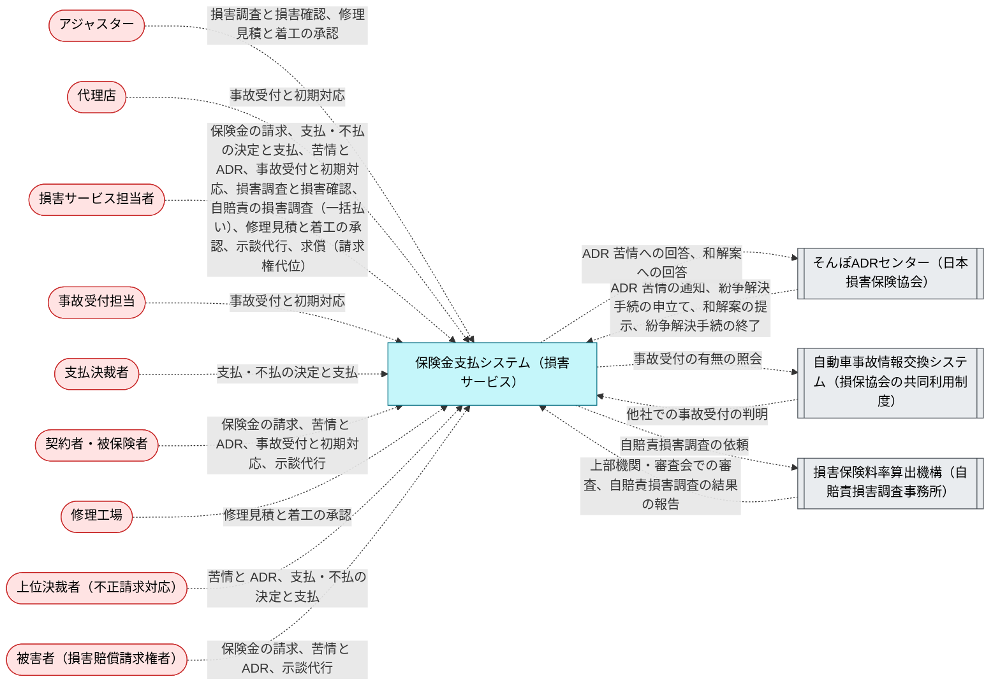

## 3. 要求

要求を目的ごとにまとめる。「BUC」はその要求が動機付ける業務で、[5. ユーザージャーニー](#5-ユーザージャーニー) にその業務フローがある。次の図は目的、要求、BUC のつながりである。「やらないこと」の枠にある要求は [4. やらないこと](#4-やらないこと) に載せている。

```mermaid
%% rdra-ish diagram=requirement scope=whole model=samples/insurance-claim-ops
%% kinds: requirement goal buc
%% omitted: nfr quality constraint business flow usecase event system entity
flowchart LR
  requirement__ReqAdrParticipation[/"了解を得られない申出人に相談機関を案内し、そんぽADRセンターの手続に応じ、特別調停案は受諾する"\]:::requirement
  requirement__ReqClaimGuidance[/"請求の手続と書類を案内し、等級の変動を説明してから請求の意思を確かめる"\]:::requirement
  requirement__ReqExplainDenial[/"不払いは、根拠となる約款の条項と調査の結果を説明してから通知する"\]:::requirement
  requirement__ReqInvestigateBeforeDecision[/"立証責任にかかわらず損害調査をし、その報告に基づいて損害を確定する"\]:::requirement
  requirement__ReqJibaisekiSurvey[/"人身の事故の自賠責部分は、損保料率機構の調査結果に基づいて支払額を決める"\]:::requirement
  requirement__ReqNoDoublePayment[/"同じ請求に二度払わない"\]:::requirement
  requirement__ReqPayWithinPeriod[/"請求完了日から30日（延長時は事由ごとの日数）のうちに支払・不払を決めて知らせ、過ぎたら遅延利息を付ける"\]:::requirement
  requirement__ReqPromptIntake[/"事故の通知を受けたら、担保種目ごとの担当者と請求の手続を速やかに案内する"\]:::requirement
  requirement__ReqRepairApproval[/"修理は、アジャスターが修理費を協定し、保険会社が着工を承認してから行う"\]:::requirement
  requirement__ReqSeniorApprovalForSuspicion[/"不正請求の疑いがある請求は、上位の決裁者か不正請求対応の担当者が決裁する"\]:::requirement
  requirement__ReqSettlementWithConsent[/"示談代行は、賠償責任のある対人・対物賠償の事故で、被保険者と被害者の同意を得て行う"\]:::requirement
  requirement__ReqSubrogateAfterPayment[/"保険金を払った後に、移った請求権で相手方に求償し、時効の前に回収か断念を決める"\]:::requirement
  goal__FairDenial[/"不払いを理由とともに説明し、納得を得る<br/>不払通知のうち、そんぽADRセンターの紛争解決手続に進んだ割合: 1.5% → 0.5%"/]:::goal
  %% desc goal__FairDenial: 支払えないときは、根拠となる約款の条項と調査の結果を説明してから通知し、了解が得られなければ ADR を案内する。
  goal__NoMissedPayment[/"払うべき保険金を漏れなく払う<br/>支払済み事案の点検で見つかった支払漏れ・二重払いの件数: 年30件 → 年0件"/]:::goal
  %% desc goal__NoMissedPayment: 支払うべき保険金を、請求がないからといって払わずにおかない。不正な請求には払わず、同じ請求に二度払わない。
  goal__TimelyPayment[/"支払期限のうちに支払・不払を決めて知らせる<br/>支払期限のうちに支払または不払通知を済ませた請求の割合: 96% → 99%"/]:::goal
  %% desc goal__TimelyPayment: 請求完了日から30日（延長したときは延長の日数）のうちに確認を終え、支払うか、支払わない理由を知らせる。期限を過ぎると遅延利息が付く。
  buc__BucClaim["保険金の請求"]:::buc
  %% desc buc__BucClaim: 保険会社は請求の手続と必要な書類を案内する。自動車保険では、請求の前に次の契約の等級がどう変わるかを説明して、請求の意思を確かめる。請求者（被保険者・保険金請求権者、直接請求の被害者）が書類を出し終えた日が請求完了日で、支払期限はこの日から数える。賠償の保険金は示談書などで賠償額が決まってから請求できる。請求権は発生の翌日から3年で時効にかかる。請求を取り下げるときは理由を記録する。
  buc__BucComplaint["苦情と ADR"]:::buc
  %% desc buc__BucComplaint: 支払えないことや支払の内容に了解が得られないとき、保険会社はそんぽADRセンターなどの相談機関を案内する。損害保険会社は指定紛争解決機関と手続実施基本契約を結んでいる。センターは苦情を会社に通知して対応を求め、60日たっても解決しなければ紛争解決手続を案内する。紛争解決手続では原則4か月以内に和解案を作り、特別調停案は会社が受諾しなければならない。自賠責の支払の紛争は対象外。
  buc__BucIntake["事故受付と初期対応"]:::buc
  %% desc buc__BucIntake: 契約者・被保険者は事故を知ったら遅滞なく保険会社か代理店に通知する。保険会社は契約内容・重複契約・事故状況・傷害を確かめ、警察への届出を案内し、担保種目ごとに担当者を決めて所属・氏名・連絡先を知らせ、請求の手続と必要な書類を説明する。車両事故・対物事故は、他社での事故受付の有無を共同利用制度で照会する。
  buc__BucInvestigation["損害調査と損害確認"]:::buc
  %% desc buc__BucInvestigation: 立証責任がどちらにあっても、保険会社は必要な損害調査をする。アジャスターが事故の原因と状況、損傷と事故の関係、損害額を調べ、契約者と被害者の認識が違えば現場で実地調査をする。過失割合は過去の裁判例を基準に検討し、賠償責任があるかを判断する。調査の報告と、賠償の事故では過失の判断を経て、損害を確定する。
  buc__BucJibaiseki["自賠責の損害調査（一括払い）"]:::buc
  %% desc buc__BucJibaiseki: 人身の事故では、任意保険の会社が自賠責保険の部分を含めて保険金を払う（一括払い）。契約者・被害者に説明して同意を確かめ、自賠責の請求書類を損保料率機構の自賠責損害調査事務所に送る。判断が難しい事案は地区本部・本部、特定事案は審査会で審査され、結果が保険会社に報告される。保険会社はその結果に基づいて支払額を決める。同意がなければ、加害者請求・被害者請求・仮渡金の手続を案内する。
  buc__BucPayment["支払・不払の決定と支払"]:::buc
  %% desc buc__BucPayment: 請求完了日を含めて30日以内に、支払事由・免責事由・損害額・契約の効力の確認を終えて払う。特別な照会や調査が要るときは、確認する事項と終える時期を通知して、事由に応じて60〜180日まで延ばせる。決裁権限は支払と不払いで差があり、不正請求の疑いがある事案は上位の決裁者が決める。払えないときは、根拠となる約款の条項と調査の結果を説明して通知する。期限を過ぎて払うときは遅延利息を付ける。同じ請求に二度は払わない。
  buc__BucRepair["修理見積と着工の承認"]:::buc
  %% desc buc__BucRepair: 損害車両は修理工場に入る。修理工場は見積書と写真を出し、アジャスターが損害額と損傷・事故の関係を確かめて修理費を協定する。保険の対象を修理するには、応急の仮手当を除き、あらかじめ保険会社の承認を得る。承認の前に着工すると、保険金の一部または全部が払われないことがある。
  buc__BucSettlement["示談代行"]:::buc
  %% desc buc__BucSettlement: 対人・対物賠償の事故で被保険者に賠償責任があるとき、保険会社は被保険者の同意を得て、被保険者のために被害者と折衝し示談する（当会社による解決）。被害者が保険会社と直接折衝することに同意しないとき、被保険者に賠償責任がない（過失ゼロ）とき、賠償額が保険金額を明らかに超えるときなどは行わない。示談が成立すれば示談書が賠償の保険金の請求書類になる。
  buc__BucSubrogation["求償（請求権代位）"]:::buc
  %% desc buc__BucSubrogation: 保険会社は保険金を払うと、払った額と被保険者の債権の額のいずれか少ない額を限度に、被保険者が相手方に持つ損害賠償請求権を当然に取得する（請求権代位）。被保険者の残りの債権が優先する。保険会社は相手方（とその保険会社）に求償し、回収するか断念する。相手方への請求権は、損害と加害者を知った時から3年（人身損害は5年）で時効にかかる。
  subgraph group_out_of_scope["やらないこと"]
    requirement__ReqNoInterimPayment[/"内払と付随的な保険金の算定は対象外とする"\]:::requirement
    requirement__ReqNoJibaisekiDispute[/"自賠責の異議申立と紛争処理は対象外とする"\]:::requirement
    requirement__ReqNoLitigation[/"調停・訴訟の中身は対象外とする"\]:::requirement
    requirement__ReqNoLossCalculation[/"人身損害・物損の損害額の算定の中身は対象外とする"\]:::requirement
    requirement__ReqNoRescission[/"重大事由による解除と告知義務違反は対象外とする"\]:::requirement
    requirement__ReqNoSalvage[/"残存物代位と全損時の契約の扱いは対象外とする"\]:::requirement
    requirement__ReqNoUnderwriting[/"保険料・引受・等級の算定は対象外とする"\]:::requirement
  end
  goal__FairDenial --> requirement__ReqAdrParticipation
  %% derived goal__FairDenial -> requirement__ReqAdrParticipation via requirement__ReqAdrParticipation
  goal__FairDenial --> requirement__ReqExplainDenial
  %% derived goal__FairDenial -> requirement__ReqExplainDenial via requirement__ReqExplainDenial
  goal__FairDenial --> requirement__ReqSettlementWithConsent
  %% derived goal__FairDenial -> requirement__ReqSettlementWithConsent via requirement__ReqSettlementWithConsent
  goal__NoMissedPayment --> requirement__ReqClaimGuidance
  %% derived goal__NoMissedPayment -> requirement__ReqClaimGuidance via requirement__ReqClaimGuidance
  goal__NoMissedPayment --> requirement__ReqInvestigateBeforeDecision
  %% derived goal__NoMissedPayment -> requirement__ReqInvestigateBeforeDecision via requirement__ReqInvestigateBeforeDecision
  goal__NoMissedPayment --> requirement__ReqJibaisekiSurvey
  %% derived goal__NoMissedPayment -> requirement__ReqJibaisekiSurvey via requirement__ReqJibaisekiSurvey
  goal__NoMissedPayment --> requirement__ReqNoDoublePayment
  %% derived goal__NoMissedPayment -> requirement__ReqNoDoublePayment via requirement__ReqNoDoublePayment
  goal__NoMissedPayment --> requirement__ReqRepairApproval
  %% derived goal__NoMissedPayment -> requirement__ReqRepairApproval via requirement__ReqRepairApproval
  goal__NoMissedPayment --> requirement__ReqSeniorApprovalForSuspicion
  %% derived goal__NoMissedPayment -> requirement__ReqSeniorApprovalForSuspicion via requirement__ReqSeniorApprovalForSuspicion
  goal__NoMissedPayment --> requirement__ReqSubrogateAfterPayment
  %% derived goal__NoMissedPayment -> requirement__ReqSubrogateAfterPayment via requirement__ReqSubrogateAfterPayment
  goal__TimelyPayment --> requirement__ReqPayWithinPeriod
  %% derived goal__TimelyPayment -> requirement__ReqPayWithinPeriod via requirement__ReqPayWithinPeriod
  goal__TimelyPayment --> requirement__ReqPromptIntake
  %% derived goal__TimelyPayment -> requirement__ReqPromptIntake via requirement__ReqPromptIntake
  requirement__ReqAdrParticipation --> buc__BucComplaint
  requirement__ReqClaimGuidance --> buc__BucClaim
  requirement__ReqExplainDenial --> buc__BucPayment
  requirement__ReqInvestigateBeforeDecision --> buc__BucInvestigation
  requirement__ReqJibaisekiSurvey --> buc__BucJibaiseki
  requirement__ReqNoDoublePayment --> buc__BucPayment
  requirement__ReqNoInterimPayment -.-> buc__BucPayment
  requirement__ReqNoJibaisekiDispute -.-> buc__BucJibaiseki
  requirement__ReqNoLitigation -.-> buc__BucSettlement
  requirement__ReqNoLossCalculation -.-> buc__BucInvestigation
  requirement__ReqNoRescission -.-> buc__BucPayment
  requirement__ReqNoSalvage -.-> buc__BucSubrogation
  requirement__ReqNoUnderwriting -.-> buc__BucClaim
  requirement__ReqPayWithinPeriod --> buc__BucPayment
  requirement__ReqPromptIntake --> buc__BucIntake
  requirement__ReqRepairApproval --> buc__BucRepair
  requirement__ReqSeniorApprovalForSuspicion --> buc__BucPayment
  requirement__ReqSettlementWithConsent --> buc__BucSettlement
  requirement__ReqSubrogateAfterPayment --> buc__BucSubrogation
  classDef requirement fill:#fff3bf,stroke:#e67700,color:#000;
  classDef goal fill:#fff3bf,stroke:#e67700,color:#000;
  classDef buc fill:#d3f9d8,stroke:#2b8a3e,color:#000;
```

### 不払いを理由とともに説明し、納得を得る

| ID | 要求 | 優先度 | 関係者 | 目的 | 受け入れ条件 | 出典 | BUC |
|---|---|---|---|---|---|---|---|
| `ReqAdrParticipation` | 了解を得られない申出人に相談機関を案内し、そんぽADRセンターの手続に応じ、特別調停案は受諾する | must | 契約者・被保険者、被害者、上位決裁者（不正請求対応） | 不払いを理由とともに説明し、納得を得る | 特別調停案を受諾しなかった紛争はない。 | 相談機関の案内 (sonpo-2026-shiharai-guideline.txt:538-544); 手続実施基本契約 (egov-hoken-gyouhou-407AC0000000105.txt:3492); 苦情の通知 (egov-hoken-gyouhou-407AC0000000105.txt:8835); 特別調停案 (egov-hoken-gyouhou-407AC0000000105.txt:8806); 苦情解決手続 60日 (sonpo-adr-kujou.md:111); 紛争解決手続 4か月 (sonpo-adr-hunsou.md:111) | 苦情と ADR |
| `ReqExplainDenial` | 不払いは、根拠となる約款の条項と調査の結果を説明してから通知する | must | 契約者・被保険者、被害者 | 不払いを理由とともに説明し、納得を得る | 不払いを通知した請求は、すべて理由を説明している。 | 不払いの理由の説明 (sonpo-2026-shiharai-guideline.txt:529-532); 約款等の根拠条文の記載 (fsa-2026-kantoku-shishin-ins.txt:8501-8502); 自賠責の不払いの書面 (egov-jibaihou-330AC0000000097.txt:190) | 支払・不払の決定と支払 |
| `ReqSettlementWithConsent` | 示談代行は、賠償責任のある対人・対物賠償の事故で、被保険者と被害者の同意を得て行う | must | 契約者・被保険者、被害者 | 不払いを理由とともに説明し、納得を得る | 交渉中・成立した示談はすべて被保険者と被害者が同意しており、過失ゼロの事故と車両・人身傷害の事故には示談代行がない。 | 当会社による解決 (tokiomarine-2025-tap-yakkan.txt:2490); 被害者の不同意では行わない (tokiomarine-2025-tap-yakkan.txt:2504); 過失ゼロでは示談代行できない (tokiomarine-faq-2119.md:111); 契約者の同意を得たうえで示談交渉 (sonpo-2026-shiharai-guideline.txt:358-359) | 示談代行 |

### 払うべき保険金を漏れなく払う

| ID | 要求 | 優先度 | 関係者 | 目的 | 受け入れ条件 | 出典 | BUC |
|---|---|---|---|---|---|---|---|
| `ReqClaimGuidance` | 請求の手続と書類を案内し、等級の変動を説明してから請求の意思を確かめる | must | 契約者・被保険者、損害サービス担当者 | 払うべき保険金を漏れなく払う | 提出された請求はすべて等級の変動の説明を経ており、請求完了から支払・通知までは支払期限が動いている。 | 請求手続の説明と書類の送付 (sonpo-2026-shiharai-guideline.txt:343); 等級の変動の説明と請求意思の確認 (sonpo-2026-shiharai-guideline.txt:496-497); 請求書類 (tokiomarine-2025-tap-yakkan.txt:4585-4596); 請求完了日 (tokiomarine-2025-tap-yakkan.txt:4666) | 保険金の請求 |
| `ReqInvestigateBeforeDecision` | 立証責任にかかわらず損害調査をし、その報告に基づいて損害を確定する | must | 損害サービス担当者、アジャスター | 払うべき保険金を漏れなく払う | 損害が確定した事故案件には報告済みの損害調査があり、賠償の事故は賠償責任が判断されている。 | 立証責任にかかわらない調査 (sonpo-2026-shiharai-guideline.txt:277-278); 認識の相違は現場で実地調査 (sonpo-2026-shiharai-guideline.txt:388-390); 専門家の見解 (sonpo-2026-shiharai-guideline.txt:427-428); アジャスターの業務 (sonpo-2024-adjuster-seido-gaiyou.txt:4, :11) | 損害調査と損害確認 |
| `ReqJibaisekiSurvey` | 人身の事故の自賠責部分は、損保料率機構の調査結果に基づいて支払額を決める | must | 被害者、損害サービス担当者 | 払うべき保険金を漏れなく払う | 自賠責の損害調査は対人賠償・人身傷害の事故にだけあり、結果を受け取るまで調査中として扱う。 | 一括払いの説明と同意 (sonpo-2026-shiharai-guideline.txt:403-405); 調査事務所への送付 (mlit-jibaiseki-procedure.md:58); 調査結果に基づく支払額の決定 (giroj-survey-system.md:103); 支払基準 (egov-jibaihou-330AC0000000097.txt:180) | 自賠責の損害調査（一括払い） |
| `ReqNoDoublePayment` | 同じ請求に二度払わない | must | 支払決裁者 | 払うべき保険金を漏れなく払う | 支払済みの請求には支払の記録が一つだけある。 | 支払済み事案の点検 (sonpo-2026-shiharai-guideline.txt:170) | 支払・不払の決定と支払 |
| `ReqRepairApproval` | 修理は、アジャスターが修理費を協定し、保険会社が着工を承認してから行う | must | 修理工場、アジャスター | 払うべき保険金を漏れなく払う | 修理中・修理完了の見積はすべて着工の承認を受けている。 | 修理着工の事前承認 (tokiomarine-2025-tap-yakkan.txt:4499-4501); 承認前の着工は払わないことがある (tokiomarine-2025-tap-yakkan.txt:1555-1557); 技術アジャスター (sonpo-2024-adjuster-seido-gaiyou.txt:11); 兼業代理店の不正な修理費見積り (fsa-2026-kantoku-shishin-ins.txt:8202) | 修理見積と着工の承認 |
| `ReqSeniorApprovalForSuspicion` | 不正請求の疑いがある請求は、上位の決裁者か不正請求対応の担当者が決裁する | must | 支払決裁者、上位決裁者（不正請求対応） | 払うべき保険金を漏れなく払う | 疑義事案として登録された請求の支払・不払は、すべて上位の決裁を経ている。 | 上位の決裁権限 (fsa-2026-kantoku-shishin-ins.txt:8378-8382); 疑義事案の深度ある調査 (fsa-2026-kantoku-shishin-ins.txt:8440-8441); 不正請求が疑われる事案の精査 (sonpo-2026-shiharai-guideline.txt:285-286) | 支払・不払の決定と支払 |
| `ReqSubrogateAfterPayment` | 保険金を払った後に、移った請求権で相手方に求償し、時効の前に回収か断念を決める | should | 損害サービス担当者 | 払うべき保険金を漏れなく払う | 求償は支払済みの請求にだけあり、すべて回収・断念・時効のどれかで終わる。 | 請求権代位 (egov-hokenhou-420AC0000000056.txt:214); 債権の移転 (tokiomarine-2025-tap-yakkan.txt:5188-5194); 被保険者の債権の優先 (edesign-2024-jidousha-yakkan.txt:3476); 不法行為の時効 (egov-minpou-129AC0000000089.txt:4676, :4681) | 求償（請求権代位） |

### 支払期限のうちに支払・不払を決めて知らせる

| ID | 要求 | 優先度 | 関係者 | 目的 | 受け入れ条件 | 出典 | BUC |
|---|---|---|---|---|---|---|---|
| `ReqPayWithinPeriod` | 請求完了日から30日（延長時は事由ごとの日数）のうちに支払・不払を決めて知らせ、過ぎたら遅延利息を付ける | must | 契約者・被保険者、被害者 | 支払期限のうちに支払・不払を決めて知らせる | 請求完了した請求はいずれ支払・不払に至り、支払期限を過ぎた支払には遅延利息が付いている。 | 支払時期 30日 (tokiomarine-2025-tap-yakkan.txt:4633); 延長の日数と通知 (tokiomarine-2025-tap-yakkan.txt:4648-4668); 相当の期間 (egov-hokenhou-420AC0000000056.txt:182); 遅延利息の起算日の管理 (sonpo-2026-shiharai-guideline.txt:490-491) | 支払・不払の決定と支払 |
| `ReqPromptIntake` | 事故の通知を受けたら、担保種目ごとの担当者と請求の手続を速やかに案内する | must | 契約者・被保険者、事故受付担当 | 支払期限のうちに支払・不払を決めて知らせる | 受け付けた事故案件はすべて担当者が決まり、請求の手続を案内している。 | 事故発生の通知 (egov-hokenhou-420AC0000000056.txt:153; tokiomarine-2025-tap-yakkan.txt:4479); 担当者の案内 (sonpo-2026-shiharai-guideline.txt:338, :340); 請求手続の説明と書類の送付 (sonpo-2026-shiharai-guideline.txt:343) | 事故受付と初期対応 |

## 4. やらないこと

| ID | 内容 | 理由 |
|---|---|---|
| `ReqNoInterimPayment` | 内払と付随的な保険金の算定は対象外とする | 支払は請求ごとに一度とし、総損害額の確定前の内払と、臨時費用・代車費用などの付随的な保険金の内訳は扱わない。支払漏れを防ぐ点検は目標（NoMissedPayment）にだけ残す。 |
| `ReqNoJibaisekiDispute` | 自賠責の異議申立と紛争処理は対象外とする | 自賠責の支払に関する異議申立（審査会）と自賠責保険・共済紛争処理機構の手続は、保険会社の外で進むので扱わない。加害者請求・被害者請求・仮渡金の手続そのものも、案内することだけを記述に残す。 |
| `ReqNoLitigation` | 調停・訴訟の中身は対象外とする | 示談がまとまらないときは調停・訴訟に移ることだけを記録する。弁護士の選任、調停・訴訟の手続、判決と和解の中身はモデルにせず、調査もしていない。 |
| `ReqNoLossCalculation` | 人身損害・物損の損害額の算定の中身は対象外とする | 損害額の算定（自賠責の支払基準、任意保険の支払基準、過失相殺の計算）は調査の結果として扱い、算定の手順はモデルにしない。調査もしていない。 |
| `ReqNoRescission` | 重大事由による解除と告知義務違反は対象外とする | 不正請求の疑いは上位の決裁までを扱い、詐欺を理由とする契約の解除とその通知、告知義務違反の判断はモデルにしない。 |
| `ReqNoSalvage` | 残存物代位と全損時の契約の扱いは対象外とする | 車両の全損で保険会社が車の所有権を取得すること（残存物代位）と、全損で契約が終わるかどうかは扱わない。後者は一次資料で条を見つけていない。 |
| `ReqNoUnderwriting` | 保険料・引受・等級の算定は対象外とする | 等級は請求の前に変動を説明することだけを扱う。次の契約の等級と保険料の計算、告知義務違反による解除、全損で契約が終わるかどうか（約款の条を見つけていない）はモデルにしない。 |

## 5. ユーザージャーニー

次の図は業務の流れである。業務ごとに BUC をまとめ、ある BUC から次の BUC への引き渡しを、引き渡すイベントのラベルで示す。

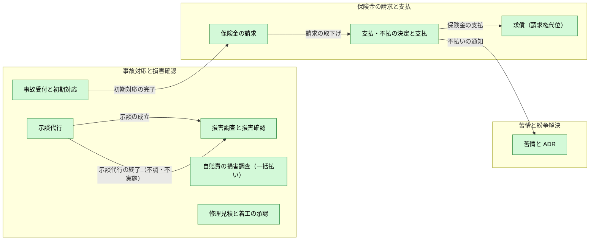

この後の節は BUC ごとの業務フローである。手順、分岐、例外と、各手順を担う UC を示す。

### 事故受付と初期対応

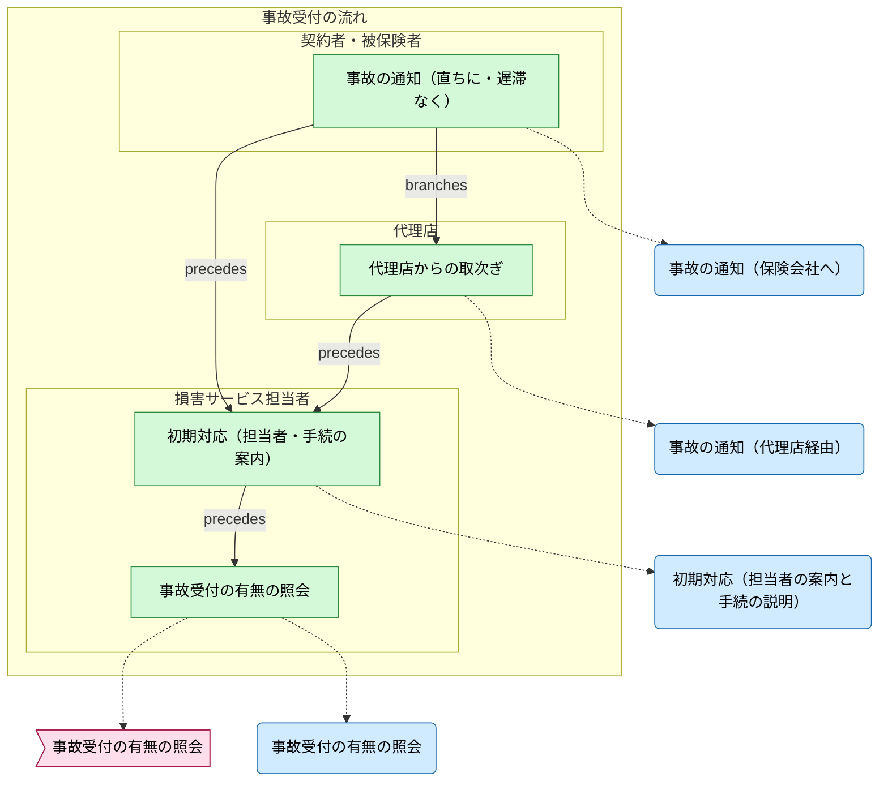

### 損害調査と損害確認

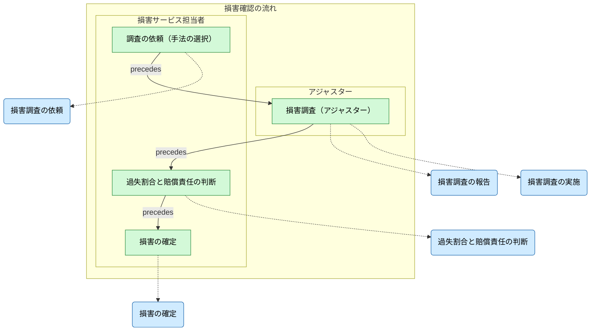

### 修理見積と着工の承認

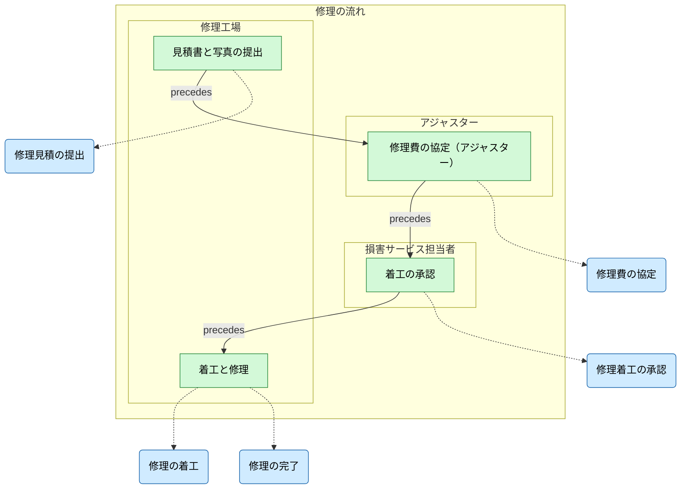

### 示談代行

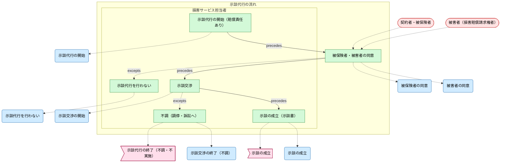

### 自賠責の損害調査（一括払い）

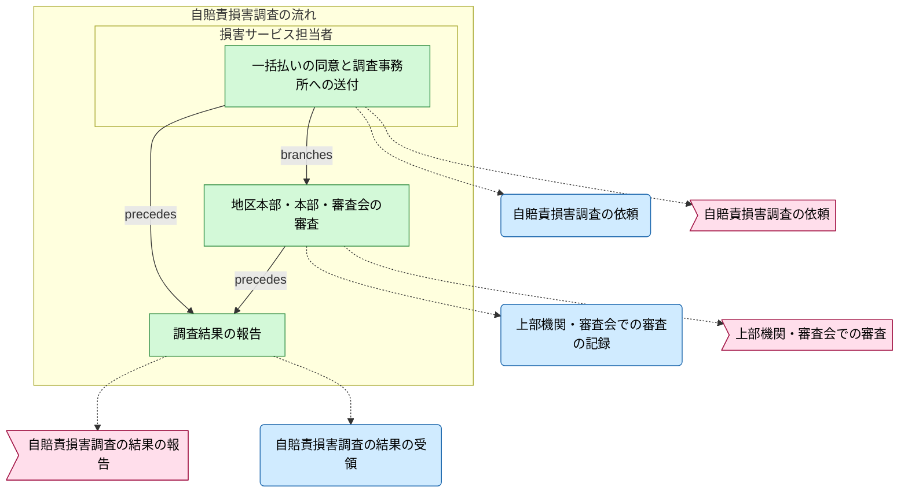

### 保険金の請求

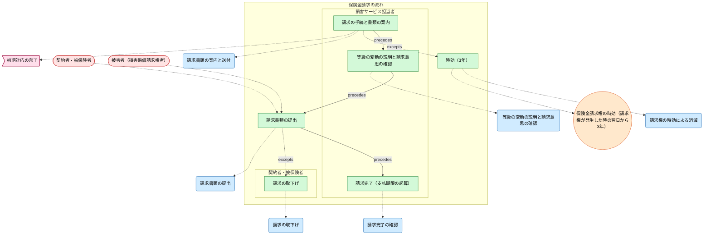

### 支払・不払の決定と支払

```mermaid
%% rdra-ish diagram=flow scope=buc:BucPayment model=samples/insurance-claim-ops
%% kinds: flow step lane timer usecase event
%% omitted: buc
flowchart TD
  subgraph flow__PaymentFlow["支払・不払の流れ"]
    step__CloseStep["事故案件の完了"]:::step
    step__OverdueStep["期限の経過（遅延利息）"]:::step
    subgraph lane__PaymentFlow__ClaimHandler["損害サービス担当者"]
      %% lane lane__PaymentFlow__ClaimHandler: actor__ClaimHandler
      step__ConfirmStep["確認（請求完了日を含めて30日）"]:::step
      step__DenialStep["不払いの理由の説明と通知"]:::step
      step__ExtendStep["延長と通知（60〜180日）"]:::step
      step__PayStep["支払と完了の連絡"]:::step
      step__SuspicionStep["疑義事案の登録"]:::step
    end
    subgraph lane__PaymentFlow__PaymentApprover["支払決裁者"]
      %% lane lane__PaymentFlow__PaymentApprover: actor__PaymentApprover
      step__DecisionStep["支払・不払の決裁"]:::step
    end
    subgraph lane__PaymentFlow__SeniorApprover["上位決裁者（不正請求対応）"]
      %% lane lane__PaymentFlow__SeniorApprover: actor__SeniorApprover
      step__SeniorDecisionStep["上位の決裁"]:::step
    end
  end
  timer__PaymentDeadline(("支払期限の到来（請求完了日を含めて30日、延長時は事由により60・90・120・180日）")):::timer
  usecase__CloseCase("事故案件の完了"):::usecase
  %% desc usecase__CloseCase: 請求の支払・不払の通知・取下げを受けて、事故案件を完了にする。過失の判断が残っていれば先に済ませる。
  usecase__CompleteClaim("請求完了の確認"):::usecase
  %% desc usecase__CompleteClaim: 担当者が必要な書類がそろったことを確かめ、請求完了日を記録して受領を連絡する。支払期限（30日）がこの日から始まる。
  usecase__DecideClaim("支払・不払の決裁"):::usecase
  %% desc usecase__DecideClaim: 支払決裁者が調査の結果と請求書類から、保険金を支払うか、免責・解除などで支払わないかを決める。
  usecase__DecideSuspectedClaim("疑義事案の支払・不払の決裁"):::usecase
  %% desc usecase__DecideSuspectedClaim: 不正請求の疑いがある請求を、上位の決裁者（不正請求への対応を専門とする担当）が決める。
  usecase__ExplainDenialReason("不払いの理由の説明"):::usecase
  %% desc usecase__ExplainDenialReason: 支払わない根拠となる約款の条項と、調査で確かめた事実を、契約者等と被害者に説明する。
  usecase__ExtendPaymentPeriod("支払期限の延長と通知"):::usecase
  %% desc usecase__ExtendPaymentPeriod: 特別な照会または調査が欠かせないとき、延長事由（被災地の調査60日、鑑定等の照会90日、後遺障害の照会120日、警察等の照会180日、国外の調査180日）を選び、確認する事項と終える時期を請求者に通知する。
  usecase__FlagSuspectedFraud("不正請求の疑いの登録"):::usecase
  %% desc usecase__FlagSuspectedFraud: 事故状況・因果関係・修理や治療の内容に不自然な点があるか、他社での事故受付が分かったとき、請求を疑義事案として登録し、深く調べる。
  usecase__MarkPaymentOverdue("支払期限の経過"):::usecase
  %% desc usecase__MarkPaymentOverdue: 支払期限（30日、延長したときは延長の日数）を過ぎても支払・不払の通知をしていない請求に、遅延利息の起算を記録する。
  usecase__NotifyDenial("不払いの通知"):::usecase
  %% desc usecase__NotifyDenial: 理由を説明したうえで、支払わないことを書面で通知する。了解が得られなければ、そんぽADRセンターなどの相談機関を案内する。
  usecase__NotifyPaymentCompleted("支払完了の連絡"):::usecase
  %% desc usecase__NotifyPaymentCompleted: 保険金を払ったことと支払手続が終わったことを請求者に連絡する。
  usecase__PayClaim("保険金の支払"):::usecase
  %% desc usecase__PayClaim: 支払金額と内訳（主たる保険金と特約・費用保険金）、算定の理由を説明して、被保険者・被害者・修理工場に払う。期限を過ぎていれば遅延利息を加える。
  event__EvDuplicateAccidentFound>"他社での事故受付の判明"]:::event
  step__CloseStep -.-> usecase__CloseCase
  step__ConfirmStep -->|branches| step__ExtendStep
  step__ConfirmStep -->|branches| step__SuspicionStep
  step__ConfirmStep -.-> usecase__CompleteClaim
  step__ConfirmStep -.->|excepts| step__OverdueStep
  step__ConfirmStep -->|precedes| step__DecisionStep
  step__DecisionStep -->|branches| step__DenialStep
  step__DecisionStep -.-> usecase__DecideClaim
  step__DecisionStep -->|precedes| step__PayStep
  step__DenialStep -.-> usecase__ExplainDenialReason
  step__DenialStep -.-> usecase__NotifyDenial
  step__DenialStep -->|precedes| step__CloseStep
  step__ExtendStep -.-> usecase__ExtendPaymentPeriod
  step__ExtendStep -->|precedes| step__DecisionStep
  step__OverdueStep -.-> timer__PaymentDeadline
  step__OverdueStep -.-> usecase__MarkPaymentOverdue
  step__PayStep -.-> usecase__NotifyPaymentCompleted
  step__PayStep -.-> usecase__PayClaim
  step__PayStep -->|precedes| step__CloseStep
  step__SeniorDecisionStep -->|branches| step__DenialStep
  step__SeniorDecisionStep -.-> usecase__DecideSuspectedClaim
  step__SeniorDecisionStep -->|precedes| step__PayStep
  step__SuspicionStep -.-> event__EvDuplicateAccidentFound
  step__SuspicionStep -.-> usecase__FlagSuspectedFraud
  step__SuspicionStep -->|precedes| step__SeniorDecisionStep
  classDef flow fill:#d3f9d8,stroke:#2b8a3e,color:#000;
  classDef step fill:#d3f9d8,stroke:#2b8a3e,color:#000;
  classDef lane fill:#d3f9d8,stroke:#2b8a3e,color:#000;
  classDef timer fill:#ffe8cc,stroke:#d9480f,color:#000;
  classDef usecase fill:#d0ebff,stroke:#1864ab,color:#000;
  classDef event fill:#ffdeeb,stroke:#a61e4d,color:#000;
```

### 求償（請求権代位）

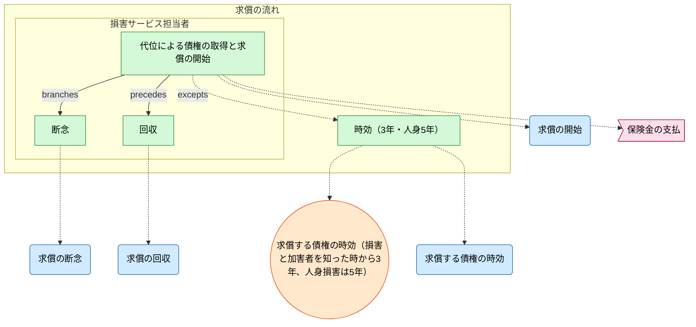

### 苦情と ADR

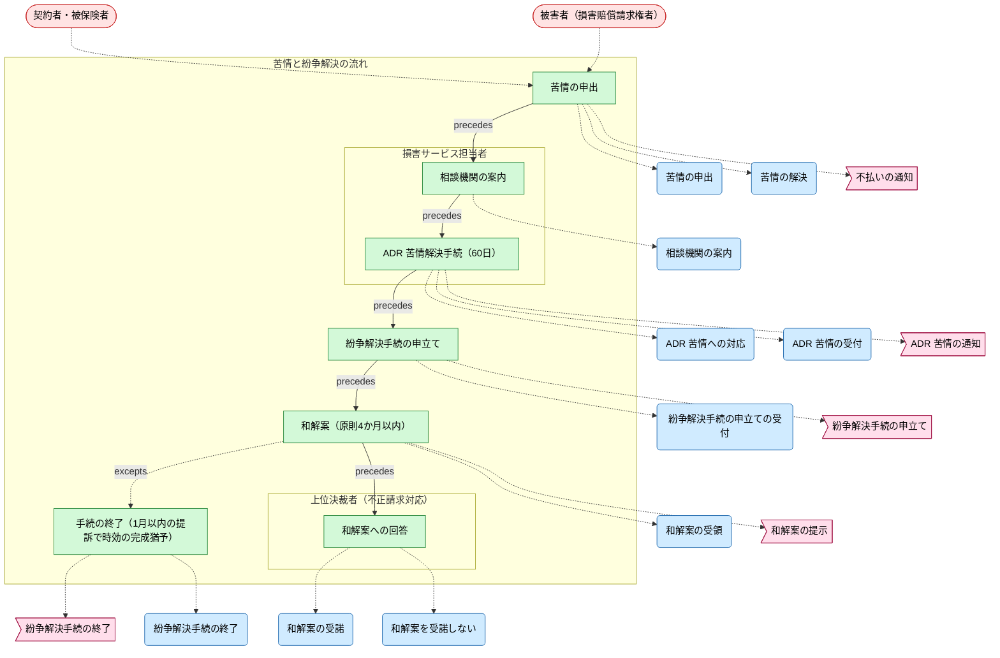

## 6. ビジネスルール（受け入れ条件）

`list --kind rule --format markdown` の出力である。各行が、システムが守る業務規則で、受け入れ試験の条件になる。

| kind | label | entities | rule | applies_to | site |
| --- | --- | --- | --- | --- | --- |
| condition | 請求の案内をした段階である | Claim | Claim.status == 請求の案内済 | ConfirmClaimIntent | samples/insurance-claim-ops/buc/buc_claim.rdra:92 |
| condition | 等級の変動を説明して請求の意思を確かめた | Claim | Claim.grade_explained == true | SubmitClaim | samples/insurance-claim-ops/buc/buc_claim.rdra:101 |
| condition | 車両・人身傷害の事故の請求である | ClaimCase | ClaimCase.coverage in (車両, 人身傷害) | CompleteClaim | samples/insurance-claim-ops/buc/buc_claim.rdra:113 |
| condition | 示談が成立している | Settlement | (Settlement.status == 示談成立).along(Claim, ClaimCase, Settlement) | CompleteClaim | samples/insurance-claim-ops/buc/buc_claim.rdra:116 |
| forbidden | 賠償の請求は示談書がそろってから完了する | Claim\|Settlement | Claim.status == 請求完了 AND Settlement.status != 示談成立 |  | samples/insurance-claim-ops/buc/buc_claim.rdra:219 |
| forbidden | 等級の変動を説明してから請求の意思を確かめる | Claim | Claim.grade_explained == false AND Claim.status not in (請求の案内済, 取下げ, 時効消滅) |  | samples/insurance-claim-ops/buc/buc_claim.rdra:221 |
| forbidden | 請求完了から支払・通知までは支払期限を管理する | Claim | Claim.status in (請求完了, 支払決定, 不払決定) AND Claim.period in (未起算, 期限の管理を終了) |  | samples/insurance-claim-ops/buc/buc_claim.rdra:223 |
| condition | 苦情を受け付けて解決していない | Complaint | Complaint.status == 苦情受付 | GuideToAdr | samples/insurance-claim-ops/buc/buc_complaint.rdra:97 |
| condition | 特別調停案ではない和解案である | Complaint | Complaint.proposal == 和解案 | RejectProposal | samples/insurance-claim-ops/buc/buc_complaint.rdra:139 |
| forbidden | 特別調停案は会社が受諾する | Complaint | Complaint.proposal == 特別調停案 AND Complaint.status == 和解案を受諾しない |  | samples/insurance-claim-ops/buc/buc_complaint.rdra:230 |
| condition | 事故案件を調査しているか、損害を確定した | ClaimCase | ClaimCase.status in (調査中, 示談交渉中, 損害確定) | DetermineFault | samples/insurance-claim-ops/buc/buc_investigation.rdra:87 |
| condition | 損害調査の報告がある | Investigation | Investigation.status == 調査報告済 | AssessDamage | samples/insurance-claim-ops/buc/buc_investigation.rdra:103 |
| condition | 車両・人身傷害の事故である | ClaimCase | ClaimCase.coverage in (車両, 人身傷害) | AssessDamage | samples/insurance-claim-ops/buc/buc_investigation.rdra:107 |
| condition | 賠償責任の有無を判断している | ClaimCase | ClaimCase.liability in (賠償責任あり, 過失ゼロ（賠償責任なし）) | AssessDamage\|CloseCase | samples/insurance-claim-ops/buc/buc_investigation.rdra:110 |
| condition | 示談が成立したか、示談代行を終えた | Settlement | Settlement.status in (示談成立, 不調（調停・訴訟へ）, 示談代行を行わない) | AssessDamage | samples/insurance-claim-ops/buc/buc_investigation.rdra:114 |
| forbidden | 損害調査の報告の前に損害を確定しない | ClaimCase\|Investigation | ClaimCase.status in (損害確定, 完了) AND Investigation.status != 調査報告済 |  | samples/insurance-claim-ops/buc/buc_investigation.rdra:185 |
| forbidden | 賠償の事故は賠償責任を判断してから損害を確定する | ClaimCase | ClaimCase.liability == 未確定 AND ClaimCase.status in (損害確定, 完了) AND ClaimCase.coverage in (対人賠償, 対物賠償) |  | samples/insurance-claim-ops/buc/buc_investigation.rdra:187 |
| condition | 対人賠償・人身傷害の事故である | ClaimCase | ClaimCase.coverage in (対人賠償, 人身傷害) | SendJibaisekiSurvey | samples/insurance-claim-ops/buc/buc_jibaiseki.rdra:55 |
| forbidden | 自賠責の損害調査は人身の事故だけ | JibaisekiSurvey\|ClaimCase | ClaimCase.coverage in (対物賠償, 車両) |  | samples/insurance-claim-ops/buc/buc_jibaiseki.rdra:112 |
| condition | 請求完了の後、支払・不払を決める前である | Claim | Claim.status == 請求完了 | ExtendPaymentPeriod | samples/insurance-claim-ops/buc/buc_payment.rdra:109 |
| condition | 請求書類の提出から決裁の前である | Claim | Claim.status in (請求書類の提出, 請求完了) | FlagSuspectedFraud | samples/insurance-claim-ops/buc/buc_payment.rdra:121 |
| condition | 不正請求の疑いがない | Claim | Claim.fraud_suspected == false | DecideClaim | samples/insurance-claim-ops/buc/buc_payment.rdra:131 |
| condition | 不正請求の疑いがある | Claim | Claim.fraud_suspected == true | DecideSuspectedClaim | samples/insurance-claim-ops/buc/buc_payment.rdra:141 |
| condition | 不払いを決めた | Claim | Claim.status == 不払決定 | ExplainDenialReason | samples/insurance-claim-ops/buc/buc_payment.rdra:149 |
| condition | 不払いの理由を説明した | Claim | Claim.reason_explained == true | NotifyDenial | samples/insurance-claim-ops/buc/buc_payment.rdra:161 |
| condition | 支払済みの案件は再度支払わない | Claim | (Claim.status == 支払決定).none(Payment) | PayClaim | samples/insurance-claim-ops/buc/buc_payment.rdra:178 |
| forbidden | 不正請求の疑いがある請求は上位の決裁者が決める | Claim | Claim.fraud_suspected == true AND Claim.senior_approved == false AND Claim.status in (支払決定, 不払決定, 支払済, 不払通知済) |  | samples/insurance-claim-ops/buc/buc_payment.rdra:324 |
| invariant | 不払いは理由を説明してから通知する | Claim | when Claim.status == 不払通知済 then Claim.reason_explained == true |  | samples/insurance-claim-ops/buc/buc_payment.rdra:326 |
| quantifier | 支払済みの請求には支払の記録がある | Claim\|Payment | when Claim.status == 支払済 then has Payment |  | samples/insurance-claim-ops/buc/buc_payment.rdra:328 |
| forbidden | 支払期限を過ぎた支払には遅延利息を付ける | Payment\|Claim | Claim.late_interest_due == true AND Payment.late_interest == false |  | samples/insurance-claim-ops/buc/buc_payment.rdra:330 |
| after | 支払ったら支払期限の管理を終える | Claim | Claim.status == 支払済 AND Claim.period == 期限の管理を終了 | PayClaim | samples/insurance-claim-ops/buc/buc_payment.rdra:332 |
| condition | 車両・対物賠償の事故である | ClaimCase | ClaimCase.coverage in (車両, 対物賠償) | SubmitRepairEstimate | samples/insurance-claim-ops/buc/buc_repair.rdra:62 |
| condition | 修理費を協定した | RepairEstimate | RepairEstimate.status == 修理費の協定 | ApproveRepairStart | samples/insurance-claim-ops/buc/buc_repair.rdra:75 |
| condition | 修理着工を承認した | RepairEstimate | RepairEstimate.approved == true | StartRepair | samples/insurance-claim-ops/buc/buc_repair.rdra:83 |
| forbidden | 修理着工は事前承認の後 | RepairEstimate | RepairEstimate.approved == false AND RepairEstimate.status in (修理中, 修理完了) |  | samples/insurance-claim-ops/buc/buc_repair.rdra:151 |
| forbidden | 修理見積は車両・対物賠償の事故だけ | RepairEstimate\|ClaimCase | ClaimCase.coverage in (対人賠償, 人身傷害) |  | samples/insurance-claim-ops/buc/buc_repair.rdra:153 |
| condition | 対人・対物賠償の事故で、被保険者に賠償責任がある | ClaimCase | ClaimCase.coverage in (対人賠償, 対物賠償), ClaimCase.liability == 賠償責任あり | OpenSettlement | samples/insurance-claim-ops/buc/buc_settlement.rdra:85 |
| condition | 示談代行の同意を確かめている | Settlement | Settlement.status == 同意の確認中 | RecordInsuredConsent\|RecordVictimConsent | samples/insurance-claim-ops/buc/buc_settlement.rdra:98 |
| condition | 被保険者と被害者がともに同意している | Settlement | Settlement.insured_consent == true, Settlement.victim_consent == true | BeginNegotiation | samples/insurance-claim-ops/buc/buc_settlement.rdra:107 |
| forbidden | 被害者の同意なく示談代行しない | Settlement | Settlement.victim_consent == false AND Settlement.status in (示談交渉中, 示談成立) |  | samples/insurance-claim-ops/buc/buc_settlement.rdra:210 |
| forbidden | 被保険者の同意なく示談代行しない | Settlement | Settlement.insured_consent == false AND Settlement.status in (示談交渉中, 示談成立) |  | samples/insurance-claim-ops/buc/buc_settlement.rdra:212 |
| forbidden | 過失ゼロなら示談代行しない | Settlement\|ClaimCase | Settlement.status in (示談交渉中, 示談成立) AND ClaimCase.liability == 過失ゼロ（賠償責任なし） |  | samples/insurance-claim-ops/buc/buc_settlement.rdra:215 |
| forbidden | 示談代行は対人・対物賠償の事故だけ | Settlement\|ClaimCase | ClaimCase.coverage in (車両, 人身傷害) |  | samples/insurance-claim-ops/buc/buc_settlement.rdra:218 |
| condition | 保険金を支払った請求で、まだ求償していない | Claim | (Claim.status == 支払済).none(Subrogation) | StartSubrogation | samples/insurance-claim-ops/buc/buc_subrogation.rdra:59 |
| forbidden | 支払後に求償権が移る | Subrogation\|Claim | Claim.status != 支払済 |  | samples/insurance-claim-ops/buc/buc_subrogation.rdra:125 |
| after | 求償は保険金を支払った請求についてだけ始める | Claim | Claim.status == 支払済 | StartSubrogation | samples/insurance-claim-ops/buc/buc_subrogation.rdra:127 |

## 7. 非機能要件

| id | label | metric | target | window | slo | availability | resilience | audit | logging | retention | privacy | description |
| --- | --- | --- | --- | --- | --- | --- | --- | --- | --- | --- | --- | --- |
| AdrProposalTarget | ADR の和解案の作成（申立ての受付から原則4か月以内） | proposal_months | <=4 | 1 dispute | 原則 |  |  |  |  |  |  |  |

| id | label | metric | target | window | slo | availability | resilience | audit | logging | retention | privacy | description |
| --- | --- | --- | --- | --- | --- | --- | --- | --- | --- | --- | --- | --- |
| DenialReview | 不払いの事後検証 |  |  |  |  |  |  | enabled |  | 10y |  |  |
| PaymentAudit | 支払・不払と取下げの記録 |  |  |  |  |  |  | enabled | structured | 10y |  |  |
