# Patent Ops 設計書

<!-- derived-from ../../docs/language-reference.md -->
<!-- derived-from ../../docs/cli-reference.md -->

`scripts/gen-clinic-ops-docs.py` が `samples/patent-ops/` のモデルから CLI を通して生成する。図・表・説明文を手で直さず、`.rdra` を直して `scripts/check-sample-artifacts.sh` を実行する。題材は日本の企業の特許出願業務（発明届出、出願可否の判断、特許事務所への依頼、出願と方式審査、審査請求、拒絶理由通知への応答、特許料と年金、相当の利益）で、外国出願・審判の中身・意匠と商標は対象外。業務規則は `.rdra` の `//` コメントに一次資料の出典（ファイル名:行）を付けている。

この文書は実装するエンジニア向けである。構造、処理、仕様の順に読む。

1. BUC ごとのロバストネス図で、画面・制御・エンティティの構造をつかむ。
2. UC ごとのシーケンス図で、ガードと書き込みの順序をつかむ。
3. 状態モデル、データモデル、規則、CRUD と権限で仕様を確かめる。

要求と成功指標は [PRD](prd.md) にある。

## 1. 概要

対象は企業の知的財産部が社外の特許事務所と進める特許出願業務である。業務を 9 の BUC に分け、内部システムは `IpManagementSystem`（知財管理システム）1 つにまとめている。特許事務所の弁理士はアクターとして業務フローに現れ、特許庁は外部システムとしてイベントでつなぐ。

業務の骨格は法定の期限である。期限は状態ではなくタイマー（期限管理）で表し、期限が過ぎたときに法が起こすこと（取下げ擬制・却下・消滅）を状態で表す。

| 論点 | このモデル |
|---|---|
| 権利の帰属 | 職務発明は職務発明規程により特許を受ける権利が発生時から会社に帰属する。職務発明でない発明は譲渡を受ける |
| 出願前 | 先行技術調査の後、発明審査委員会が出願・ノウハウとして秘匿・不出願を決める。出願書類は発明者の確認を経て承認する |
| 方式 | 手続補正指令には発送日から2月以内に補正する。しなければ却下される |
| 審査請求 | 出願から3年以内。なければ取下げ擬制で、故意でなければ回復できる。早期審査は審査請求済みが要件 |
| 中間処理 | 拒絶理由通知の応答期間は60日。期間内の延長（2か月）と期間経過後の延長（2か月）はどちらか一度。最後の拒絶理由通知への補正は限定される |
| 登録と維持 | 特許査定から30日以内に第1〜3年分を納付して設定登録。第4年以後は前年以前に納付し、6月以内なら割増特許料で追納できる。追納しなければ遡って消滅する |

### システムコンテキスト図

システムを使う actor と、イベントでつながる外部システムを示す。actor からシステムへの線は、actor が担う BUC の UC が呼ぶ API から導出される。

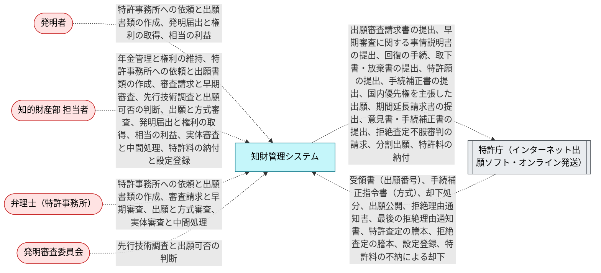

## 2. BUC ごとの構造と処理

各節は BUC の説明、ロバストネス図、画面遷移図、UC の表、UC ごとのシーケンス図の順に並ぶ。ロバストネス図では actor が画面を使い、画面が制御（UC が呼ぶ API、API がなければ UC 自身）を呼び、制御がエンティティを読み書きする。画面遷移図（`diagram --kind screen --buc <Buc>`）の実線は `navigates` で宣言した遷移で、ラベルは遷移を起こす UC である。点線の「業務上の順番」は宣言がない所を業務フローから補ったもので、同じ担当者のレーンで続く手順が表示する画面の順を示し、実際の画面遷移ではない。遷移も業務上の順番もない BUC では画面遷移図を省く。表の「ガード」は UC に効く条件で、式は [5. 規則](#5-規則) にある。

### 2.1 発明届出と権利の取得

発明者が発明届出書を出し、知的財産部が付番して記載を確かめ、不備があれば差し戻す。職務発明は職務発明規程により特許を受ける権利が発生した時から会社に帰属し、職務発明に当たらない発明は個別の譲渡で取得する（`EmployeeInvention`・`NonEmployeeInvention`）。

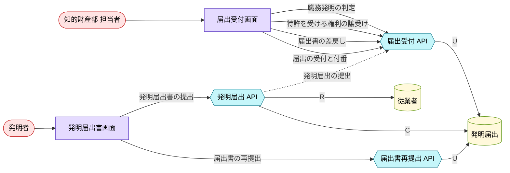

#### 画面遷移図

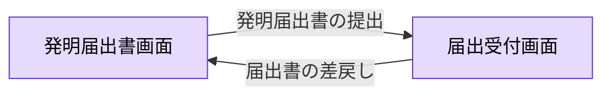

| UC | 説明 | 画面 | 制御 | ガード |
|---|---|---|---|---|
| 発明届出書の提出<br>`SubmitInventionDisclosure` | 発明者が発明届出書を出す。届出は受付待ちになる。 | `DisclosureFormScreen` | `SubmitDisclosureApi` | （なし） |
| 届出の受付と付番<br>`AcceptDisclosure` | 知的財産部が付番し、記載に不備がなければ受け付ける。 | `DisclosureReviewScreen` | `DisclosureReviewApi` | （なし） |
| 届出書の差戻し<br>`ReturnDisclosure` | 記載に不備がある届出書を発明者に差し戻す。 | `DisclosureReviewScreen` | `DisclosureReviewApi` | （なし） |
| 届出書の再提出<br>`ResubmitDisclosure` | 発明者が不備を直した届出書を出し直す。 | `DisclosureFormScreen` | `ResubmitDisclosureApi` | （なし） |
| 職務発明の判定<br>`JudgeEmployeeInvention` | 職務発明と判定し、規程により会社が発生時から特許を受ける権利を持つことを記録する。 | `DisclosureReviewScreen` | `DisclosureReviewApi` | 職務発明である |
| 特許を受ける権利の譲受け<br>`AcquireRightsByAssignment` | 職務発明に当たらない発明について、発明者から特許を受ける権利の譲渡を受ける。 | `DisclosureReviewScreen` | `DisclosureReviewApi` | 職務発明に当たらない |

<details><summary>発明届出書の提出（SubmitInventionDisclosure）のシーケンス図</summary>

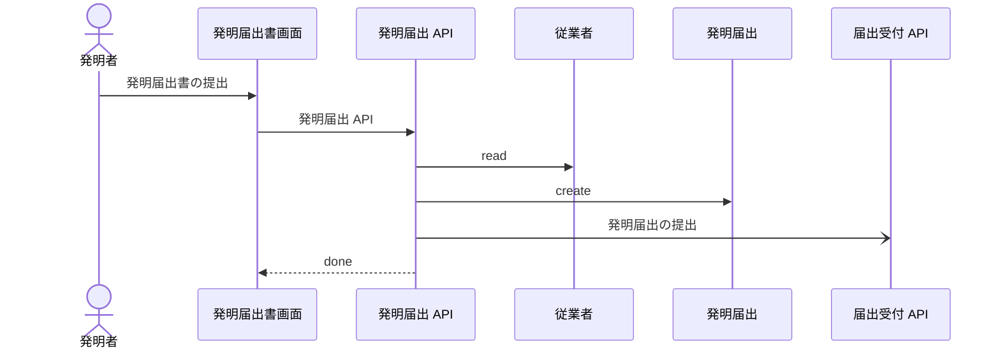

</details>

<details><summary>届出の受付と付番（AcceptDisclosure）のシーケンス図</summary>

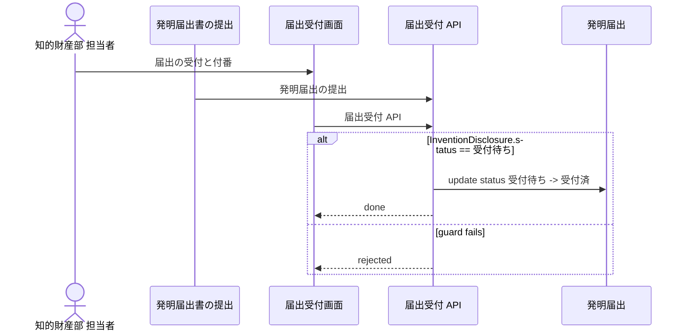

</details>

<details><summary>届出書の差戻し（ReturnDisclosure）のシーケンス図</summary>

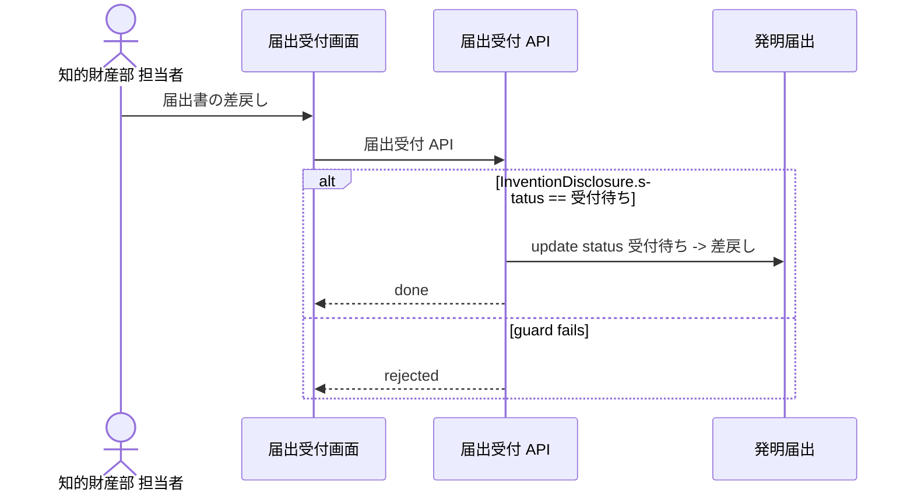

</details>

<details><summary>届出書の再提出（ResubmitDisclosure）のシーケンス図</summary>

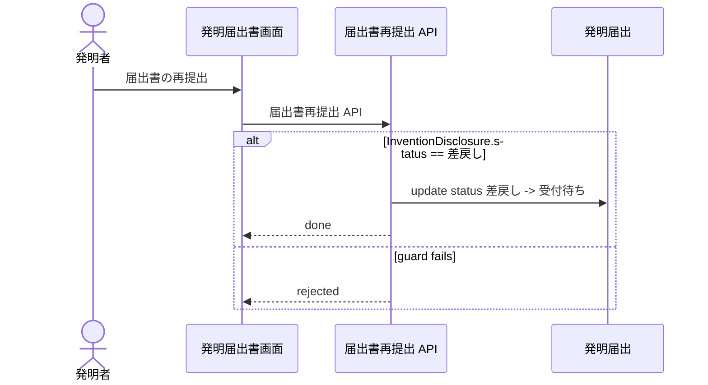

</details>

<details><summary>職務発明の判定（JudgeEmployeeInvention）のシーケンス図</summary>

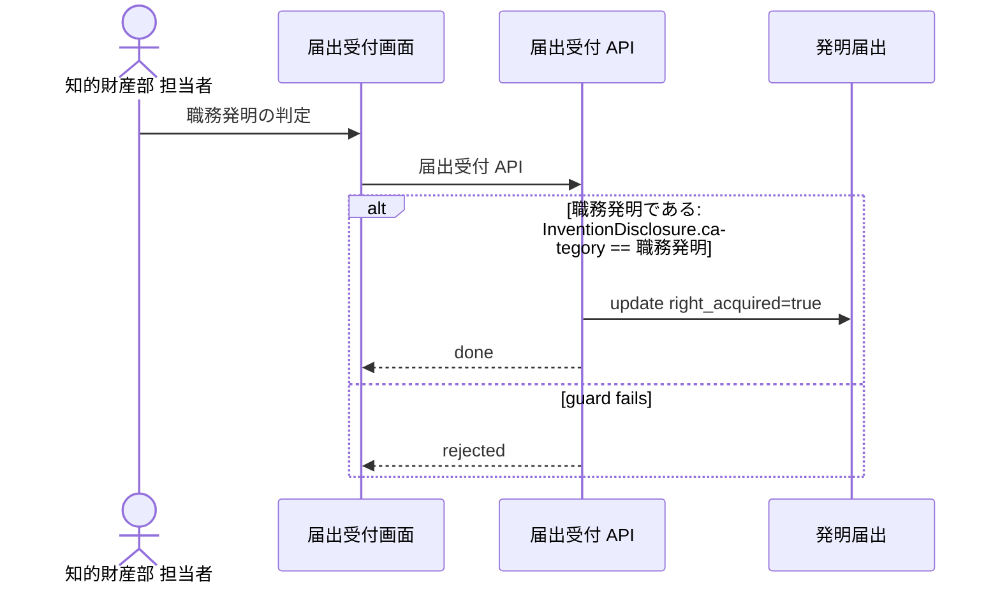

</details>

<details><summary>特許を受ける権利の譲受け（AcquireRightsByAssignment）のシーケンス図</summary>

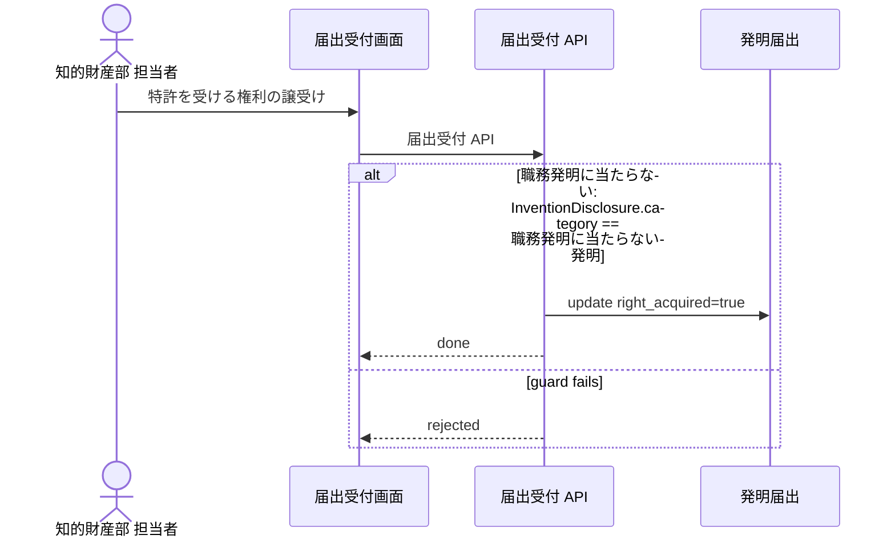

</details>

### 2.2 先行技術調査と出願可否の判断

受け付けた発明について先行技術を調べ、発明審査委員会が出願する、ノウハウとして秘匿する、出願しないのいずれかに決める。会社が特許を受ける権利を取得していない発明は出願と決めない（`RightsAcquired`）。決定は発明者に知らせる。

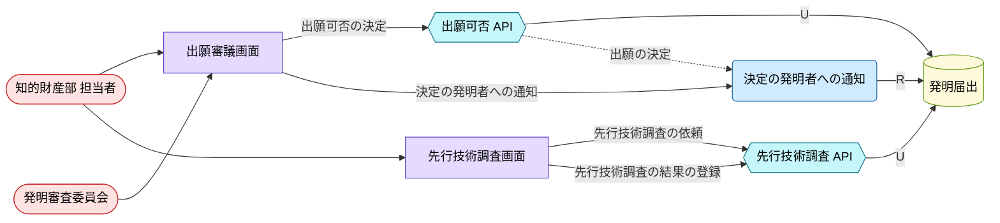

#### 画面遷移図

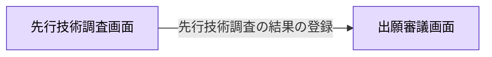

| UC | 説明 | 画面 | 制御 | ガード |
|---|---|---|---|---|
| 先行技術調査の依頼<br>`RequestPriorArtSearch` | 受け付けた発明の先行技術調査を依頼し、届出を調査中にする。 | `PriorArtSearchScreen` | `PriorArtSearchApi` | （なし） |
| 先行技術調査の結果の登録<br>`RecordPriorArtSearch` | 調査の結果を届出に記録し、調査済にする。 | `PriorArtSearchScreen` | `PriorArtSearchApi` | （なし） |
| 出願可否の決定<br>`DecideFiling` | 発明審査委員会が、出願する、ノウハウとして秘匿する、出願しないのいずれかに決める。出願と決められるのは、会社が権利を持つ発明だけである。 | `FilingDecisionScreen` | `FilingDecisionApi` | 会社が特許を受ける権利を取得している |
| 決定の発明者への通知<br>`NotifyInventorOfDecision` | 決定を発明者に知らせる（参照のみ）。 | `FilingDecisionScreen` | `NotifyInventorOfDecision` | （なし） |

<details><summary>先行技術調査の依頼（RequestPriorArtSearch）のシーケンス図</summary>

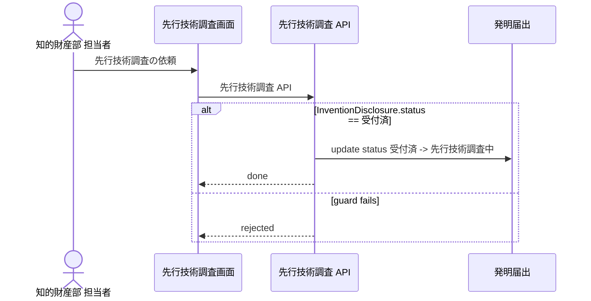

</details>

<details><summary>先行技術調査の結果の登録（RecordPriorArtSearch）のシーケンス図</summary>

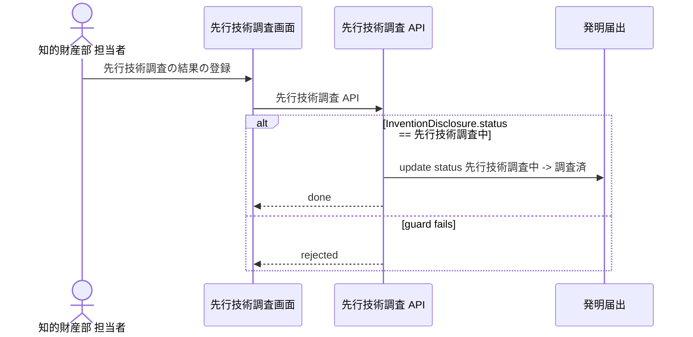

</details>

<details><summary>出願可否の決定（DecideFiling）のシーケンス図</summary>

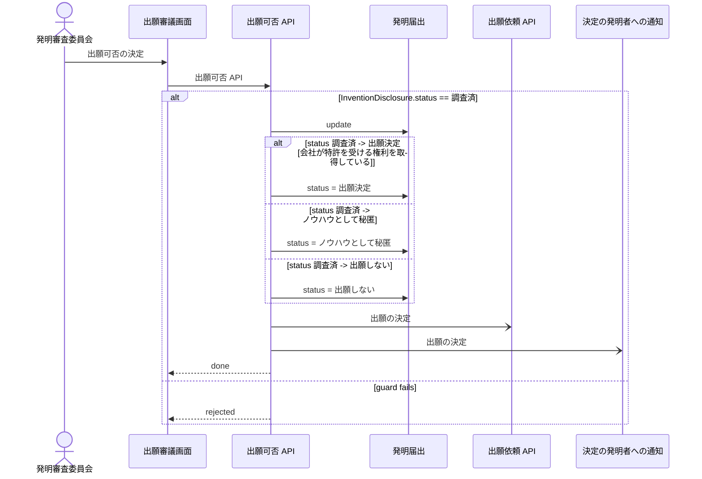

</details>

<details><summary>決定の発明者への通知（NotifyInventorOfDecision）のシーケンス図</summary>

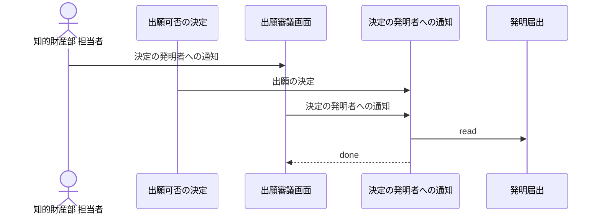

</details>

### 2.3 特許事務所への依頼と出願書類の作成

出願と決まった発明について特許事務所に明細書の作成を依頼し、納品された出願書類（願書・明細書・特許請求の範囲・要約書・図面）を発明者と知的財産部が確かめ、修正を依頼し、承認する。発明者の確認を経ない書類は承認しない（`InventorChecked`）。

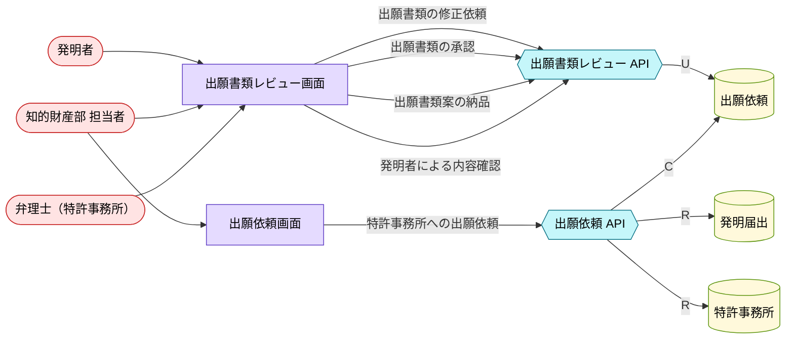

#### 画面遷移図

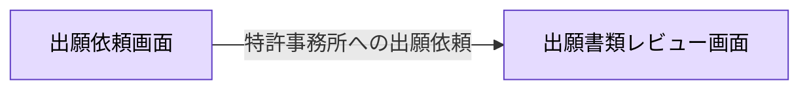

| UC | 説明 | 画面 | 制御 | ガード |
|---|---|---|---|---|
| 特許事務所への出願依頼<br>`RequestDrafting` | 出願と決まった発明の届出をもとに、特許事務所へ明細書の作成と出願を依頼する。 | `DraftingOrderScreen` | `DraftingOrderApi` | 出願と決まった発明である |
| 出願書類案の納品<br>`SubmitDraft` | 弁理士が出願書類の案を納品する。修正の依頼を受けた案も出し直す。 | `DraftReviewScreen` | `DraftReviewApi` | （なし） |
| 発明者による内容確認<br>`ConfirmDraftByInventor` | 発明者が案の技術内容を確かめ、確認済にする。 | `DraftReviewScreen` | `DraftReviewApi` | 案が納品されている |
| 出願書類の修正依頼<br>`RequestDraftRevision` | 知的財産部が案の修正を弁理士に依頼する。発明者の確認はやり直しになる。 | `DraftReviewScreen` | `DraftReviewApi` | （なし） |
| 出願書類の承認<br>`ApproveDraft` | 発明者の確認を経た案を知的財産部が承認し、出願を指示する。 | `DraftReviewScreen` | `DraftReviewApi` | 発明者が内容を確認している |

<details><summary>特許事務所への出願依頼（RequestDrafting）のシーケンス図</summary>

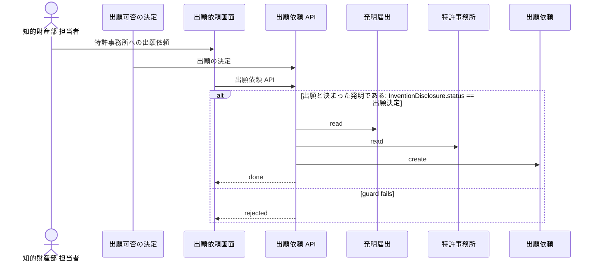

</details>

<details><summary>出願書類案の納品（SubmitDraft）のシーケンス図</summary>

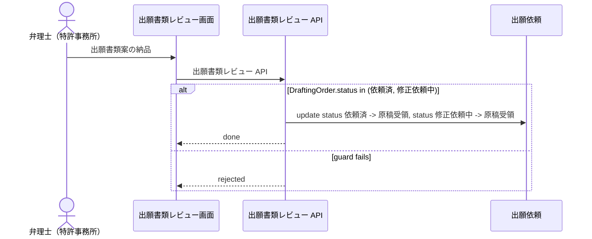

</details>

<details><summary>発明者による内容確認（ConfirmDraftByInventor）のシーケンス図</summary>

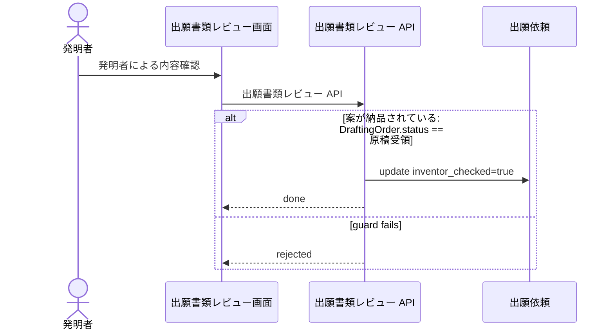

</details>

<details><summary>出願書類の修正依頼（RequestDraftRevision）のシーケンス図</summary>

```mermaid
%% rdra-ish diagram=sequence scope=usecase:RequestDraftRevision model=samples/patent-ops
%% kinds: actor screen api entity
%% omitted: buc step medium permission
sequenceDiagram
  actor actor__IpStaff as 知的財産部 担当者
  participant screen__DraftReviewScreen as 出願書類レビュー画面
  participant api__DraftReviewApi as 出願書類レビュー API
  participant entity__DraftingOrder as 出願依頼
  actor__IpStaff ->> screen__DraftReviewScreen: 出願書類の修正依頼
  screen__DraftReviewScreen ->> api__DraftReviewApi: 出願書類レビュー API
  alt DraftingOrder.status == 原稿受領
    api__DraftReviewApi ->> entity__DraftingOrder: update status 原稿受領 -> 修正依頼中, inventor_checked=false
    api__DraftReviewApi -->> screen__DraftReviewScreen: done
  else guard fails
    api__DraftReviewApi -->> screen__DraftReviewScreen: rejected
  end
```

</details>

<details><summary>出願書類の承認（ApproveDraft）のシーケンス図</summary>

```mermaid
%% rdra-ish diagram=sequence scope=usecase:ApproveDraft model=samples/patent-ops
%% kinds: actor screen api entity
%% omitted: buc step medium permission event condition
sequenceDiagram
  actor actor__IpStaff as 知的財産部 担当者
  participant screen__DraftReviewScreen as 出願書類レビュー画面
  participant api__DraftReviewApi as 出願書類レビュー API
  participant entity__DraftingOrder as 出願依頼
  participant api__FilingApi as 出願 API
  actor__IpStaff ->> screen__DraftReviewScreen: 出願書類の承認
  screen__DraftReviewScreen ->> api__DraftReviewApi: 出願書類レビュー API
  alt 発明者が内容を確認している: DraftingOrder.inventor_checked == true and DraftingOrder.status == 原稿受領
    api__DraftReviewApi ->> entity__DraftingOrder: update status 原稿受領 -> 出願承認済
    api__DraftReviewApi -) api__FilingApi: 出願書類の承認
    api__DraftReviewApi -->> screen__DraftReviewScreen: done
  else guard fails
    api__DraftReviewApi -->> screen__DraftReviewScreen: rejected
  end
```

</details>

### 2.4 出願と方式審査

承認された出願書類を弁理士がインターネット出願ソフトで出願し、受領書の出願番号と出願日を記録する。方式の不備には手続補正指令書が届き、発送日から2月以内に手続補正書を出さなければ出願は却下される。出願から1年6月で出願公開される。先の出願から1年以内なら国内優先権を主張でき、先の出願は1年4月で取り下げたものとみなされる。

```mermaid
%% rdra-ish diagram=robustness scope=buc:BucFilingFormality model=samples/patent-ops
%% kinds: actor extsystem screen timer api usecase entity
%% omitted: buc step medium permission event condition
flowchart LR
  actor__IpStaff(["知的財産部 担当者"]):::actor
  actor__PatentAttorney(["弁理士（特許事務所）"]):::actor
  extsystem__Jpo[["特許庁（インターネット出願ソフト・オンライン発送）"]]:::extsystem
  screen__ApplicationDocketScreen["出願案件・期限管理画面"]:::screen
  screen__FilingScreen["出願画面"]:::screen
  timer__FormalityAmendmentDeadline(("手続補正書の提出期限（指令書の発送日から2月）")):::timer
  timer__PriorityBaseDeadline(("先の出願の取下げ擬制（先の出願から1年4月）")):::timer
  timer__PriorityClaimDeadline(("国内優先権の主張期限（先の出願から1年）")):::timer
  timer__PublicationCheck(("出願公開の確認（出願から1年6月）")):::timer
  api__ApplicationDocketApi{{"出願案件 API"}}:::api
  api__FilingApi{{"出願 API"}}:::api
  api__FormalityApi{{"方式補正 API"}}:::api
  api__PriorityBaseApi{{"先の出願の取下げ擬制 API"}}:::api
  api__PriorityClaimApi{{"国内優先権 API"}}:::api
  usecase__RecordFilingReceipt("出願番号・出願日の記録"):::usecase
  entity__DraftingOrder[("出願依頼")]:::entity
  entity__FeeSchedule[("料金表")]:::entity
  entity__PatentApplication[("特許出願")]:::entity
  entity__PriorityClaim[("国内優先権の主張")]:::entity
  actor__IpStaff --> screen__ApplicationDocketScreen
  actor__PatentAttorney --> screen__ApplicationDocketScreen
  actor__PatentAttorney --> screen__FilingScreen
  api__ApplicationDocketApi -->|U| entity__PatentApplication
  api__FilingApi -->|C| entity__PatentApplication
  api__FilingApi -->|R| entity__FeeSchedule
  api__FilingApi -->|U| entity__DraftingOrder
  api__FilingApi -.->|特許願の提出| extsystem__Jpo
  api__FormalityApi -->|U| entity__PatentApplication
  api__FormalityApi -.->|手続補正書の提出| extsystem__Jpo
  api__PriorityBaseApi -->|U| entity__PatentApplication
  api__PriorityClaimApi -->|C| entity__PriorityClaim
  api__PriorityClaimApi -->|U| entity__PatentApplication
  api__PriorityClaimApi -.->|国内優先権を主張した出願| extsystem__Jpo
  extsystem__Jpo -.->|出願公開| api__ApplicationDocketApi
  extsystem__Jpo -.->|却下処分| api__ApplicationDocketApi
  extsystem__Jpo -.->|受領書（出願番号）| usecase__RecordFilingReceipt
  extsystem__Jpo -.->|手続補正指令書（方式）| api__FormalityApi
  screen__ApplicationDocketScreen -->|出願の却下の記録| api__ApplicationDocketApi
  screen__ApplicationDocketScreen -->|出願公開の記録| api__ApplicationDocketApi
  screen__ApplicationDocketScreen -->|出願番号・出願日の記録| usecase__RecordFilingReceipt
  screen__ApplicationDocketScreen -->|手続補正指令書の受領| api__FormalityApi
  screen__ApplicationDocketScreen -->|手続補正書の提出| api__FormalityApi
  screen__FilingScreen -->|国内優先権の主張| api__PriorityClaimApi
  screen__FilingScreen -->|電子出願| api__FilingApi
  timer__FormalityAmendmentDeadline -.-> api__FormalityApi
  timer__PriorityBaseDeadline -.-> api__PriorityBaseApi
  timer__PriorityClaimDeadline -.-> api__PriorityClaimApi
  timer__PublicationCheck -.-> api__ApplicationDocketApi
  usecase__RecordFilingReceipt -->|R| entity__PatentApplication
  classDef actor fill:#ffe3e3,stroke:#c92a2a,color:#000;
  classDef extsystem fill:#e9ecef,stroke:#495057,color:#000;
  classDef screen fill:#e5dbff,stroke:#5f3dc4,color:#000;
  classDef timer fill:#ffe8cc,stroke:#d9480f,color:#000;
  classDef api fill:#c5f6fa,stroke:#0b7285,color:#000;
  classDef usecase fill:#d0ebff,stroke:#1864ab,color:#000;
  classDef entity fill:#fff9db,stroke:#5c940d,color:#000;
```

#### 画面遷移図

```mermaid
%% rdra-ish diagram=screen scope=buc:BucFilingFormality model=samples/patent-ops
%% kinds: screen
%% omitted: usecase field
flowchart LR
  screen__ApplicationDocketScreen["出願案件・期限管理画面"]:::screen
  screen__FilingScreen["出願画面"]:::screen
  screen__FilingScreen -->|電子出願| screen__ApplicationDocketScreen
  %% via screen__FilingScreen -> screen__ApplicationDocketScreen usecase__FileApplication
  classDef screen fill:#e5dbff,stroke:#5f3dc4,color:#000;
```

| UC | 説明 | 画面 | 制御 | ガード |
|---|---|---|---|---|
| 電子出願<br>`FileApplication` | 承認された出願書類を、代理人の弁理士がインターネット出願ソフトで特許庁に出す。 | `FilingScreen` | `FilingApi` | 出願書類が承認されている |
| 出願番号・出願日の記録<br>`RecordFilingReceipt` | 受領書の出願番号と出願日を記録する。 | `ApplicationDocketScreen` | `RecordFilingReceipt` | （なし） |
| 手続補正指令書の受領<br>`ReceiveFormalityOrder` | 方式の不備を指摘する手続補正指令書を受け取り、出願を補正待ちにする。 | `ApplicationDocketScreen` | `FormalityApi` | （なし） |
| 手続補正書の提出<br>`SubmitFormalityAmendment` | 指令書の発送日から2月以内に手続補正書を出す。 | `ApplicationDocketScreen` | `FormalityApi` | （なし） |
| 出願の却下の記録<br>`RecordDismissal` | 補正がなく出願が却下されたことを記録する。 | `ApplicationDocketScreen` | `ApplicationDocketApi` | （なし） |
| 出願公開の記録<br>`RecordPublication` | 出願から1年6月で出願が公開されたことを記録する。 | `ApplicationDocketScreen` | `ApplicationDocketApi` | 出願が係属している |
| 国内優先権の主張<br>`ClaimDomesticPriority` | 改良発明をまとめた後の出願で、1年以内の先の出願に基づく優先権を主張する。 | `FilingScreen` | `PriorityClaimApi` | 先の出願が係属し、査定を受けていない |
| 先の出願の取下げ擬制<br>`DeemPriorityBaseWithdrawn` | 優先権の基礎とした先の出願が、その出願から1年4月で取り下げたものとみなされたことを記録する。 | （なし） | `PriorityBaseApi` | 国内優先権の基礎とされ、まだ係属している出願である |

<details><summary>電子出願（FileApplication）のシーケンス図</summary>

```mermaid
%% rdra-ish diagram=sequence scope=usecase:FileApplication model=samples/patent-ops
%% kinds: actor usecase screen api entity extsystem
%% omitted: buc step medium permission event condition
sequenceDiagram
  actor actor__PatentAttorney as 弁理士（特許事務所）
  participant usecase__ApproveDraft as 出願書類の承認
  participant screen__FilingScreen as 出願画面
  participant api__FilingApi as 出願 API
  participant entity__FeeSchedule as 料金表
  participant entity__DraftingOrder as 出願依頼
  participant entity__PatentApplication as 特許出願
  participant extsystem__Jpo as 特許庁（インターネット出願ソフト・オンライン発送）
  participant api__RewardApi as 相当の利益 API
  actor__PatentAttorney ->> screen__FilingScreen: 電子出願
  usecase__ApproveDraft ->> api__FilingApi: 出願書類の承認
  screen__FilingScreen ->> api__FilingApi: 出願 API
  alt 出願書類が承認されている: DraftingOrder.status == 出願承認済
    api__FilingApi ->> entity__FeeSchedule: read
    Note over api__FilingApi: transaction (API atomic boundary)
    api__FilingApi ->> entity__DraftingOrder: update status 出願承認済 -> 出願済
    api__FilingApi ->> entity__PatentApplication: create
    api__FilingApi -) extsystem__Jpo: 特許願の提出
    api__FilingApi -) api__RewardApi: 特許願の提出
    api__FilingApi -->> screen__FilingScreen: done
  else guard fails
    api__FilingApi -->> screen__FilingScreen: rejected
  end
```

</details>

<details><summary>出願番号・出願日の記録（RecordFilingReceipt）のシーケンス図</summary>

```mermaid
%% rdra-ish diagram=sequence scope=usecase:RecordFilingReceipt model=samples/patent-ops
%% kinds: actor extsystem screen usecase entity
%% omitted: buc step medium permission event
sequenceDiagram
  actor actor__IpStaff as 知的財産部 担当者
  participant extsystem__Jpo as 特許庁（インターネット出願ソフト・オンライン発送）
  participant screen__ApplicationDocketScreen as 出願案件・期限管理画面
  participant usecase__RecordFilingReceipt as 出願番号・出願日の記録
  participant entity__PatentApplication as 特許出願
  actor__IpStaff ->> screen__ApplicationDocketScreen: 出願番号・出願日の記録
  extsystem__Jpo ->> usecase__RecordFilingReceipt: 受領書（出願番号）
  screen__ApplicationDocketScreen ->> usecase__RecordFilingReceipt: 出願番号・出願日の記録
  usecase__RecordFilingReceipt ->> entity__PatentApplication: read
  usecase__RecordFilingReceipt -->> screen__ApplicationDocketScreen: done
```

</details>

<details><summary>手続補正指令書の受領（ReceiveFormalityOrder）のシーケンス図</summary>

```mermaid
%% rdra-ish diagram=sequence scope=usecase:ReceiveFormalityOrder model=samples/patent-ops
%% kinds: actor extsystem screen api entity
%% omitted: buc step medium permission event
sequenceDiagram
  actor actor__PatentAttorney as 弁理士（特許事務所）
  participant extsystem__Jpo as 特許庁（インターネット出願ソフト・オンライン発送）
  participant screen__ApplicationDocketScreen as 出願案件・期限管理画面
  participant api__FormalityApi as 方式補正 API
  participant entity__PatentApplication as 特許出願
  actor__PatentAttorney ->> screen__ApplicationDocketScreen: 手続補正指令書の受領
  extsystem__Jpo ->> api__FormalityApi: 手続補正指令書（方式）
  screen__ApplicationDocketScreen ->> api__FormalityApi: 方式補正 API
  alt PatentApplication.status == 出願済（方式審査）
    api__FormalityApi ->> entity__PatentApplication: update status 出願済（方式審査） -> 手続補正指令への対応中
    api__FormalityApi -->> screen__ApplicationDocketScreen: done
  else guard fails
    api__FormalityApi -->> screen__ApplicationDocketScreen: rejected
  end
```

</details>

<details><summary>手続補正書の提出（SubmitFormalityAmendment）のシーケンス図</summary>

```mermaid
%% rdra-ish diagram=sequence scope=usecase:SubmitFormalityAmendment model=samples/patent-ops
%% kinds: actor timer screen api entity extsystem
%% omitted: buc step medium permission event
sequenceDiagram
  actor actor__PatentAttorney as 弁理士（特許事務所）
  participant timer__FormalityAmendmentDeadline as 手続補正書の提出期限（指令書の発送日から2月）
  participant screen__ApplicationDocketScreen as 出願案件・期限管理画面
  participant api__FormalityApi as 方式補正 API
  participant entity__PatentApplication as 特許出願
  participant extsystem__Jpo as 特許庁（インターネット出願ソフト・オンライン発送）
  actor__PatentAttorney ->> screen__ApplicationDocketScreen: 手続補正書の提出
  timer__FormalityAmendmentDeadline ->> api__FormalityApi: 手続補正書の提出期限（指令書の発送日から2月）
  screen__ApplicationDocketScreen ->> api__FormalityApi: 方式補正 API
  alt PatentApplication.status == 手続補正指令への対応中
    api__FormalityApi ->> entity__PatentApplication: update status 手続補正指令への対応中 -> 出願済（方式審査）
    api__FormalityApi -) extsystem__Jpo: 手続補正書の提出
    api__FormalityApi -->> screen__ApplicationDocketScreen: done
  else guard fails
    api__FormalityApi -->> screen__ApplicationDocketScreen: rejected
  end
```

</details>

<details><summary>出願の却下の記録（RecordDismissal）のシーケンス図</summary>

```mermaid
%% rdra-ish diagram=sequence scope=usecase:RecordDismissal model=samples/patent-ops
%% kinds: actor extsystem screen api entity
%% omitted: buc step medium permission event
sequenceDiagram
  actor actor__IpStaff as 知的財産部 担当者
  participant extsystem__Jpo as 特許庁（インターネット出願ソフト・オンライン発送）
  participant screen__ApplicationDocketScreen as 出願案件・期限管理画面
  participant api__ApplicationDocketApi as 出願案件 API
  participant entity__PatentApplication as 特許出願
  actor__IpStaff ->> screen__ApplicationDocketScreen: 出願の却下の記録
  extsystem__Jpo ->> api__ApplicationDocketApi: 却下処分
  screen__ApplicationDocketScreen ->> api__ApplicationDocketApi: 出願案件 API
  alt PatentApplication.status == 手続補正指令への対応中
    api__ApplicationDocketApi ->> entity__PatentApplication: update status 手続補正指令への対応中 -> 却下
    api__ApplicationDocketApi -->> screen__ApplicationDocketScreen: done
  else guard fails
    api__ApplicationDocketApi -->> screen__ApplicationDocketScreen: rejected
  end
```

</details>

<details><summary>出願公開の記録（RecordPublication）のシーケンス図</summary>

```mermaid
%% rdra-ish diagram=sequence scope=usecase:RecordPublication model=samples/patent-ops
%% kinds: actor extsystem timer screen api entity
%% omitted: buc step medium permission event condition
sequenceDiagram
  actor actor__IpStaff as 知的財産部 担当者
  participant extsystem__Jpo as 特許庁（インターネット出願ソフト・オンライン発送）
  participant timer__PublicationCheck as 出願公開の確認（出願から1年6月）
  participant screen__ApplicationDocketScreen as 出願案件・期限管理画面
  participant api__ApplicationDocketApi as 出願案件 API
  participant entity__PatentApplication as 特許出願
  actor__IpStaff ->> screen__ApplicationDocketScreen: 出願公開の記録
  extsystem__Jpo ->> api__ApplicationDocketApi: 出願公開
  timer__PublicationCheck ->> api__ApplicationDocketApi: 出願公開の確認（出願から1年6月）
  screen__ApplicationDocketScreen ->> api__ApplicationDocketApi: 出願案件 API
  alt 出願が係属している: PatentApplication.status not in (却下, 取下げ・放棄, 取下げ擬制（審査請求なし）, 取下げ擬制（国内優先権の基礎）, 設定登録済)
    api__ApplicationDocketApi ->> entity__PatentApplication: update published_at=set
    api__ApplicationDocketApi -->> screen__ApplicationDocketScreen: done
  else guard fails
    api__ApplicationDocketApi -->> screen__ApplicationDocketScreen: rejected
  end
```

</details>

<details><summary>国内優先権の主張（ClaimDomesticPriority）のシーケンス図</summary>

```mermaid
%% rdra-ish diagram=sequence scope=usecase:ClaimDomesticPriority model=samples/patent-ops
%% kinds: actor timer screen api entity extsystem
%% omitted: buc step medium permission event condition
sequenceDiagram
  actor actor__PatentAttorney as 弁理士（特許事務所）
  participant timer__PriorityClaimDeadline as 国内優先権の主張期限（先の出願から1年）
  participant screen__FilingScreen as 出願画面
  participant api__PriorityClaimApi as 国内優先権 API
  participant entity__PatentApplication as 特許出願
  participant entity__PriorityClaim as 国内優先権の主張
  participant extsystem__Jpo as 特許庁（インターネット出願ソフト・オンライン発送）
  actor__PatentAttorney ->> screen__FilingScreen: 国内優先権の主張
  timer__PriorityClaimDeadline ->> api__PriorityClaimApi: 国内優先権の主張期限（先の出願から1年）
  screen__FilingScreen ->> api__PriorityClaimApi: 国内優先権 API
  alt 先の出願が係属し、査定を受けていない: PatentApplication.status in (出願済（方式審査）, 手続補正指令への対応中, 審査請求済（審査中）)
    Note over api__PriorityClaimApi: transaction (API atomic boundary)
    api__PriorityClaimApi ->> entity__PatentApplication: update priority_base=true
    api__PriorityClaimApi ->> entity__PriorityClaim: create
    api__PriorityClaimApi -) extsystem__Jpo: 国内優先権を主張した出願
    api__PriorityClaimApi -->> screen__FilingScreen: done
  else guard fails
    api__PriorityClaimApi -->> screen__FilingScreen: rejected
  end
```

</details>

<details><summary>先の出願の取下げ擬制（DeemPriorityBaseWithdrawn）のシーケンス図</summary>

```mermaid
%% rdra-ish diagram=sequence scope=usecase:DeemPriorityBaseWithdrawn model=samples/patent-ops
%% kinds: timer api entity
%% omitted: buc step condition
sequenceDiagram
  participant timer__PriorityBaseDeadline as 先の出願の取下げ擬制（先の出願から1年4月）
  participant api__PriorityBaseApi as 先の出願の取下げ擬制 API
  participant entity__PatentApplication as 特許出願
  timer__PriorityBaseDeadline ->> api__PriorityBaseApi: 先の出願の取下げ擬制（先の出願から1年4月）
  alt 国内優先権の基礎とされ、まだ係属している出願である: PatentApplication.priority_base == true, PatentApplication.status not in (特許査定, 拒絶査定の確定, 設定登録済, 却下, 取下げ擬制（審査請求なし）, 取下げ擬制（国内優先権の基礎）, 取下げ・放棄) and PatentApplication.status in (出願済（方式審査）, 審査請求済（審査中）)
    api__PriorityBaseApi ->> entity__PatentApplication: update status 出願済（方式審査） -> 取下げ擬制（国内優先権の基礎）, status 審査請求済（審査中） -> 取下げ擬制（国内優先権の基礎）
    api__PriorityBaseApi -->> timer__PriorityBaseDeadline: done
  else guard fails
    api__PriorityBaseApi -->> timer__PriorityBaseDeadline: rejected
  end
```

</details>

### 2.5 審査請求と早期審査

出願は審査請求がなければ審査されない。知的財産部は期限の前に審査請求の要否を決め、弁理士が出願から3年以内に請求する。請求がなければ出願は取り下げたものとみなされ、故意でなければ回復できる。審査請求をした出願は早期審査を申し出られる。出願は係属している間、取り下げ・放棄できる。

```mermaid
%% rdra-ish diagram=robustness scope=buc:BucExaminationRequest model=samples/patent-ops
%% kinds: actor extsystem screen timer api usecase entity
%% omitted: buc step medium permission event condition
flowchart LR
  actor__IpStaff(["知的財産部 担当者"]):::actor
  actor__PatentAttorney(["弁理士（特許事務所）"]):::actor
  extsystem__Jpo[["特許庁（インターネット出願ソフト・オンライン発送）"]]:::extsystem
  screen__ExaminationRequestScreen["審査請求画面"]:::screen
  timer__ExamRequestDeadline(("審査請求期限（出願から3年）")):::timer
  timer__ExamRequestReview(("審査請求要否の検討（審査請求期限の前）")):::timer
  api__ApplicationDocketApi{{"出願案件 API"}}:::api
  api__ExaminationRequestApi{{"審査請求 API"}}:::api
  api__WithdrawalApi{{"取下げ・放棄 API"}}:::api
  usecase__DecideExaminationRequest("審査請求要否の判断"):::usecase
  entity__FeeSchedule[("料金表")]:::entity
  entity__PatentApplication[("特許出願")]:::entity
  actor__IpStaff --> screen__ExaminationRequestScreen
  actor__PatentAttorney --> screen__ExaminationRequestScreen
  api__ApplicationDocketApi -->|U| entity__PatentApplication
  api__ExaminationRequestApi -->|R| entity__FeeSchedule
  api__ExaminationRequestApi -->|U| entity__PatentApplication
  api__ExaminationRequestApi -.->|出願審査請求書の提出| extsystem__Jpo
  api__ExaminationRequestApi -.->|回復の手続| extsystem__Jpo
  api__ExaminationRequestApi -.->|早期審査に関する事情説明書の提出| extsystem__Jpo
  api__WithdrawalApi -->|U| entity__PatentApplication
  api__WithdrawalApi -.->|取下書・放棄書の提出| extsystem__Jpo
  screen__ExaminationRequestScreen -->|出願の取下げ・放棄| api__WithdrawalApi
  screen__ExaminationRequestScreen -->|出願審査の請求| api__ExaminationRequestApi
  screen__ExaminationRequestScreen -->|審査請求の回復| api__ExaminationRequestApi
  screen__ExaminationRequestScreen -->|審査請求要否の判断| usecase__DecideExaminationRequest
  screen__ExaminationRequestScreen -->|早期審査の申出| api__ExaminationRequestApi
  timer__ExamRequestDeadline -.-> api__ApplicationDocketApi
  timer__ExamRequestDeadline -.-> api__ExaminationRequestApi
  timer__ExamRequestReview -.-> usecase__DecideExaminationRequest
  usecase__DecideExaminationRequest -->|R| entity__PatentApplication
  classDef actor fill:#ffe3e3,stroke:#c92a2a,color:#000;
  classDef extsystem fill:#e9ecef,stroke:#495057,color:#000;
  classDef screen fill:#e5dbff,stroke:#5f3dc4,color:#000;
  classDef timer fill:#ffe8cc,stroke:#d9480f,color:#000;
  classDef api fill:#c5f6fa,stroke:#0b7285,color:#000;
  classDef usecase fill:#d0ebff,stroke:#1864ab,color:#000;
  classDef entity fill:#fff9db,stroke:#5c940d,color:#000;
```

| UC | 説明 | 画面 | 制御 | ガード |
|---|---|---|---|---|
| 審査請求要否の判断<br>`DecideExaminationRequest` | 期限の前に、審査請求をするかを決める（参照のみ）。 | `ExaminationRequestScreen` | `DecideExaminationRequest` | （なし） |
| 出願審査の請求<br>`RequestExamination` | 出願から3年以内に出願審査請求書を出す。 | `ExaminationRequestScreen` | `ExaminationRequestApi` | （なし） |
| 早期審査の申出<br>`RequestAcceleratedExamination` | 審査請求をした出願について、早期審査に関する事情説明書を出す。 | `ExaminationRequestScreen` | `ExaminationRequestApi` | 審査請求をした出願である |
| 審査請求期間の経過<br>`DeemWithdrawnNoRequest` | 出願から3年以内に審査請求がなかった出願を、取り下げたものとみなされたとして記録する。 | （なし） | `ApplicationDocketApi` | （なし） |
| 審査請求の回復<br>`RestoreExaminationRequest` | 期間内に請求できなかったことが故意でないとき、回復理由書とともに審査請求をする。 | `ExaminationRequestScreen` | `ExaminationRequestApi` | （なし） |
| 出願の取下げ・放棄<br>`WithdrawApplication` | 係属している出願を取り下げる、または放棄する。 | `ExaminationRequestScreen` | `WithdrawalApi` | （なし） |

<details><summary>審査請求要否の判断（DecideExaminationRequest）のシーケンス図</summary>

```mermaid
%% rdra-ish diagram=sequence scope=usecase:DecideExaminationRequest model=samples/patent-ops
%% kinds: actor timer screen usecase entity
%% omitted: buc step medium permission
sequenceDiagram
  actor actor__IpStaff as 知的財産部 担当者
  participant timer__ExamRequestReview as 審査請求要否の検討（審査請求期限の前）
  participant screen__ExaminationRequestScreen as 審査請求画面
  participant usecase__DecideExaminationRequest as 審査請求要否の判断
  participant entity__PatentApplication as 特許出願
  actor__IpStaff ->> screen__ExaminationRequestScreen: 審査請求要否の判断
  timer__ExamRequestReview ->> usecase__DecideExaminationRequest: 審査請求要否の検討（審査請求期限の前）
  screen__ExaminationRequestScreen ->> usecase__DecideExaminationRequest: 審査請求要否の判断
  usecase__DecideExaminationRequest ->> entity__PatentApplication: read
  usecase__DecideExaminationRequest -->> screen__ExaminationRequestScreen: done
```

</details>

<details><summary>出願審査の請求（RequestExamination）のシーケンス図</summary>

```mermaid
%% rdra-ish diagram=sequence scope=usecase:RequestExamination model=samples/patent-ops
%% kinds: actor timer screen api entity extsystem
%% omitted: buc step medium permission event
sequenceDiagram
  actor actor__PatentAttorney as 弁理士（特許事務所）
  participant timer__ExamRequestDeadline as 審査請求期限（出願から3年）
  participant screen__ExaminationRequestScreen as 審査請求画面
  participant api__ExaminationRequestApi as 審査請求 API
  participant entity__FeeSchedule as 料金表
  participant entity__PatentApplication as 特許出願
  participant extsystem__Jpo as 特許庁（インターネット出願ソフト・オンライン発送）
  actor__PatentAttorney ->> screen__ExaminationRequestScreen: 出願審査の請求
  timer__ExamRequestDeadline ->> api__ExaminationRequestApi: 審査請求期限（出願から3年）
  screen__ExaminationRequestScreen ->> api__ExaminationRequestApi: 審査請求 API
  alt PatentApplication.status == 出願済（方式審査）
    api__ExaminationRequestApi ->> entity__FeeSchedule: read
    api__ExaminationRequestApi ->> entity__PatentApplication: update status 出願済（方式審査） -> 審査請求済（審査中）, exam_requested_at=set
    api__ExaminationRequestApi -) extsystem__Jpo: 出願審査請求書の提出
    api__ExaminationRequestApi -->> screen__ExaminationRequestScreen: done
  else guard fails
    api__ExaminationRequestApi -->> screen__ExaminationRequestScreen: rejected
  end
```

</details>

<details><summary>早期審査の申出（RequestAcceleratedExamination）のシーケンス図</summary>

```mermaid
%% rdra-ish diagram=sequence scope=usecase:RequestAcceleratedExamination model=samples/patent-ops
%% kinds: actor screen api entity extsystem
%% omitted: buc step medium permission event condition
sequenceDiagram
  actor actor__PatentAttorney as 弁理士（特許事務所）
  participant screen__ExaminationRequestScreen as 審査請求画面
  participant api__ExaminationRequestApi as 審査請求 API
  participant entity__FeeSchedule as 料金表
  participant entity__PatentApplication as 特許出願
  participant extsystem__Jpo as 特許庁（インターネット出願ソフト・オンライン発送）
  actor__PatentAttorney ->> screen__ExaminationRequestScreen: 早期審査の申出
  screen__ExaminationRequestScreen ->> api__ExaminationRequestApi: 審査請求 API
  alt 審査請求をした出願である: PatentApplication.status == 審査請求済（審査中）, PatentApplication.exam_requested_at == present
    api__ExaminationRequestApi ->> entity__FeeSchedule: read
    api__ExaminationRequestApi ->> entity__PatentApplication: update accelerated=true
    api__ExaminationRequestApi -) extsystem__Jpo: 早期審査に関する事情説明書の提出
    api__ExaminationRequestApi -->> screen__ExaminationRequestScreen: done
  else guard fails
    api__ExaminationRequestApi -->> screen__ExaminationRequestScreen: rejected
  end
```

</details>

<details><summary>審査請求期間の経過（DeemWithdrawnNoRequest）のシーケンス図</summary>

```mermaid
%% rdra-ish diagram=sequence scope=usecase:DeemWithdrawnNoRequest model=samples/patent-ops
%% kinds: timer api entity
%% omitted: buc step
sequenceDiagram
  participant timer__ExamRequestDeadline as 審査請求期限（出願から3年）
  participant api__ApplicationDocketApi as 出願案件 API
  participant entity__PatentApplication as 特許出願
  timer__ExamRequestDeadline ->> api__ApplicationDocketApi: 審査請求期限（出願から3年）
  alt PatentApplication.status == 出願済（方式審査）
    api__ApplicationDocketApi ->> entity__PatentApplication: update status 出願済（方式審査） -> 取下げ擬制（審査請求なし）
    api__ApplicationDocketApi -->> timer__ExamRequestDeadline: done
  else guard fails
    api__ApplicationDocketApi -->> timer__ExamRequestDeadline: rejected
  end
```

</details>

<details><summary>審査請求の回復（RestoreExaminationRequest）のシーケンス図</summary>

```mermaid
%% rdra-ish diagram=sequence scope=usecase:RestoreExaminationRequest model=samples/patent-ops
%% kinds: actor screen api entity extsystem
%% omitted: buc step medium permission event
sequenceDiagram
  actor actor__PatentAttorney as 弁理士（特許事務所）
  participant screen__ExaminationRequestScreen as 審査請求画面
  participant api__ExaminationRequestApi as 審査請求 API
  participant entity__FeeSchedule as 料金表
  participant entity__PatentApplication as 特許出願
  participant extsystem__Jpo as 特許庁（インターネット出願ソフト・オンライン発送）
  actor__PatentAttorney ->> screen__ExaminationRequestScreen: 審査請求の回復
  screen__ExaminationRequestScreen ->> api__ExaminationRequestApi: 審査請求 API
  alt PatentApplication.status == 取下げ擬制（審査請求なし）
    api__ExaminationRequestApi ->> entity__FeeSchedule: read
    api__ExaminationRequestApi ->> entity__PatentApplication: update status 取下げ擬制（審査請求なし） -> 審査請求済（審査中）, exam_requested_at=set
    api__ExaminationRequestApi -) extsystem__Jpo: 回復の手続
    api__ExaminationRequestApi -->> screen__ExaminationRequestScreen: done
  else guard fails
    api__ExaminationRequestApi -->> screen__ExaminationRequestScreen: rejected
  end
```

</details>

<details><summary>出願の取下げ・放棄（WithdrawApplication）のシーケンス図</summary>

```mermaid
%% rdra-ish diagram=sequence scope=usecase:WithdrawApplication model=samples/patent-ops
%% kinds: actor screen api entity extsystem
%% omitted: buc step medium permission event
sequenceDiagram
  actor actor__PatentAttorney as 弁理士（特許事務所）
  participant screen__ExaminationRequestScreen as 審査請求画面
  participant api__WithdrawalApi as 取下げ・放棄 API
  participant entity__PatentApplication as 特許出願
  participant extsystem__Jpo as 特許庁（インターネット出願ソフト・オンライン発送）
  actor__PatentAttorney ->> screen__ExaminationRequestScreen: 出願の取下げ・放棄
  screen__ExaminationRequestScreen ->> api__WithdrawalApi: 取下げ・放棄 API
  alt PatentApplication.status in (出願済（方式審査）, 審査請求済（審査中）)
    api__WithdrawalApi ->> entity__PatentApplication: update status 出願済（方式審査） -> 取下げ・放棄, status 審査請求済（審査中） -> 取下げ・放棄
    api__WithdrawalApi -) extsystem__Jpo: 取下書・放棄書の提出
    api__WithdrawalApi -->> screen__ExaminationRequestScreen: done
  else guard fails
    api__WithdrawalApi -->> screen__ExaminationRequestScreen: rejected
  end
```

</details>

### 2.6 実体審査と中間処理

審査官は拒絶理由を見つけなければ特許査定をし、見つければ拒絶理由通知で意見書を出す機会を与える。弁理士が知的財産部の方針で意見書・補正書を作って応答期間（国内居住者は発送日から60日）内に出し、期間内の請求で2か月、期間経過後2か月以内の請求でも2か月延長できる（両方はできない、`exclusive`）。最後の拒絶理由通知への補正は請求項の削除・減縮・誤記の訂正・釈明に限る（`FirstNoticeOnly`）。拒絶査定には謄本の送達から3月以内に審判を請求できる（審判の中身は対象外）。分割出願は補正できる時期・特許査定から30日・最初の拒絶査定から3月にできる。

```mermaid
%% rdra-ish diagram=robustness scope=buc:BucOfficeAction model=samples/patent-ops
%% kinds: actor extsystem screen timer api usecase entity
%% omitted: buc step medium permission event condition
flowchart LR
  actor__IpStaff(["知的財産部 担当者"]):::actor
  actor__PatentAttorney(["弁理士（特許事務所）"]):::actor
  extsystem__Jpo[["特許庁（インターネット出願ソフト・オンライン発送）"]]:::extsystem
  screen__DecisionScreen["査定画面"]:::screen
  screen__OfficeActionScreen["中間処理画面"]:::screen
  screen__ResponseDraftScreen["応答案画面"]:::screen
  timer__AppealDeadline(("拒絶査定不服審判の請求期限（謄本の送達から3月）")):::timer
  timer__LateExtensionDeadline(("期間経過後の延長請求の期限（応答期間の経過から2か月）")):::timer
  timer__ResponseDeadline(("拒絶理由通知の応答期限（発送日から60日、延長で2か月）")):::timer
  api__AppealApi{{"審判請求 API"}}:::api
  api__DecisionApi{{"査定 API"}}:::api
  api__DivisionalApi{{"分割出願 API"}}:::api
  api__OfficeActionApi{{"中間処理 API"}}:::api
  api__OfficeActionIntakeApi{{"拒絶理由通知の受付 API"}}:::api
  api__ResponseFilingApi{{"応答提出 API"}}:::api
  usecase__CloseOfficeActionDocket("中間処理案件の終了"):::usecase
  usecase__ExpireResponseTerm("応答期間の経過"):::usecase
  usecase__InstructResponse("応答方針の指示"):::usecase
  usecase__LapseResponse("応答なしでの期間満了"):::usecase
  entity__DivisionalFiling[("分割出願")]:::entity
  entity__OfficeAction[("拒絶理由通知")]:::entity
  entity__PatentApplication[("特許出願")]:::entity
  actor__IpStaff --> screen__DecisionScreen
  actor__IpStaff --> screen__OfficeActionScreen
  actor__PatentAttorney --> screen__DecisionScreen
  actor__PatentAttorney --> screen__OfficeActionScreen
  actor__PatentAttorney --> screen__ResponseDraftScreen
  api__AppealApi -->|U| entity__PatentApplication
  api__AppealApi -.->|拒絶査定不服審判の請求| extsystem__Jpo
  api__DecisionApi -->|U| entity__PatentApplication
  api__DivisionalApi -->|C| entity__DivisionalFiling
  api__DivisionalApi -.->|分割出願| extsystem__Jpo
  api__OfficeActionApi -->|U| entity__OfficeAction
  api__OfficeActionApi -.->|期間延長請求書の提出| extsystem__Jpo
  api__OfficeActionIntakeApi -->|C| entity__OfficeAction
  api__OfficeActionIntakeApi -->|R| entity__PatentApplication
  api__ResponseFilingApi -->|U| entity__OfficeAction
  api__ResponseFilingApi -.->|意見書・手続補正書の提出| extsystem__Jpo
  extsystem__Jpo -.->|拒絶査定の謄本| api__DecisionApi
  extsystem__Jpo -.->|拒絶査定の謄本| usecase__CloseOfficeActionDocket
  extsystem__Jpo -.->|拒絶理由通知書| api__OfficeActionIntakeApi
  extsystem__Jpo -.->|最後の拒絶理由通知書| api__ResponseFilingApi
  extsystem__Jpo -.->|特許査定の謄本| api__DecisionApi
  extsystem__Jpo -.->|特許査定の謄本| usecase__CloseOfficeActionDocket
  screen__DecisionScreen -->|拒絶査定の受領| api__DecisionApi
  screen__DecisionScreen -->|拒絶査定不服審判の請求| api__AppealApi
  screen__DecisionScreen -->|特許査定の受領| api__DecisionApi
  screen__OfficeActionScreen -->|中間処理案件の終了| usecase__CloseOfficeActionDocket
  screen__OfficeActionScreen -->|分割出願| api__DivisionalApi
  screen__OfficeActionScreen -->|応答方針の指示| usecase__InstructResponse
  screen__OfficeActionScreen -->|応答期間の延長請求| api__OfficeActionApi
  screen__OfficeActionScreen -->|拒絶理由通知の受領| api__OfficeActionIntakeApi
  screen__OfficeActionScreen -->|最後の拒絶理由通知の受領| api__ResponseFilingApi
  screen__OfficeActionScreen -->|期間経過後の延長請求| api__OfficeActionApi
  screen__ResponseDraftScreen -->|意見書・補正書の提出| api__ResponseFilingApi
  screen__ResponseDraftScreen -->|意見書・補正書案の作成| api__OfficeActionApi
  timer__AppealDeadline -.-> api__AppealApi
  timer__AppealDeadline -.-> api__DecisionApi
  timer__LateExtensionDeadline -.-> usecase__LapseResponse
  timer__ResponseDeadline -.-> api__ResponseFilingApi
  timer__ResponseDeadline -.-> usecase__ExpireResponseTerm
  usecase__CloseOfficeActionDocket -->|R| entity__PatentApplication
  usecase__CloseOfficeActionDocket -->|U| entity__OfficeAction
  usecase__ExpireResponseTerm -->|U| entity__OfficeAction
  usecase__InstructResponse -->|R| entity__OfficeAction
  usecase__InstructResponse -->|R| entity__PatentApplication
  usecase__LapseResponse -->|U| entity__OfficeAction
  classDef actor fill:#ffe3e3,stroke:#c92a2a,color:#000;
  classDef extsystem fill:#e9ecef,stroke:#495057,color:#000;
  classDef screen fill:#e5dbff,stroke:#5f3dc4,color:#000;
  classDef timer fill:#ffe8cc,stroke:#d9480f,color:#000;
  classDef api fill:#c5f6fa,stroke:#0b7285,color:#000;
  classDef usecase fill:#d0ebff,stroke:#1864ab,color:#000;
  classDef entity fill:#fff9db,stroke:#5c940d,color:#000;
```

#### 画面遷移図

```mermaid
%% rdra-ish diagram=screen scope=buc:BucOfficeAction model=samples/patent-ops
%% kinds: screen
%% omitted: usecase field
flowchart LR
  screen__DecisionScreen["査定画面"]:::screen
  screen__OfficeActionScreen["中間処理画面"]:::screen
  screen__ResponseDraftScreen["応答案画面"]:::screen
  screen__OfficeActionScreen -->|応答方針の指示| screen__ResponseDraftScreen
  screen__OfficeActionScreen -->|拒絶査定の受領| screen__DecisionScreen
  screen__ResponseDraftScreen -->|意見書・補正書の提出| screen__OfficeActionScreen
  %% via screen__OfficeActionScreen -> screen__DecisionScreen usecase__ReceiveDecisionOfRejection
  %% via screen__OfficeActionScreen -> screen__ResponseDraftScreen usecase__InstructResponse
  %% via screen__ResponseDraftScreen -> screen__OfficeActionScreen usecase__FileResponse
  classDef screen fill:#e5dbff,stroke:#5f3dc4,color:#000;
```

| UC | 説明 | 画面 | 制御 | ガード |
|---|---|---|---|---|
| 拒絶理由通知の受領<br>`ReceiveOfficeAction` | 拒絶理由通知書を受け取り、応答期間の管理を始める。 | `OfficeActionScreen` | `OfficeActionIntakeApi` | 出願が審査中である |
| 応答方針の指示<br>`InstructResponse` | 知的財産部が発明者と相談し、弁理士に応答の方針を伝える（参照のみ）。 | `OfficeActionScreen` | `InstructResponse` | （なし） |
| 意見書・補正書案の作成<br>`DraftResponse` | 弁理士が意見書と、必要なら補正書の案を作る。補正の範囲は、限定のない補正か、請求項の削除・減縮・誤記の訂正・釈明に限った補正（または意見書だけ）かを選ぶ。最後の拒絶理由通知には限った補正だけが使える。 | `ResponseDraftScreen` | `OfficeActionApi` | 最初の拒絶理由通知である |
| 応答期間の延長請求<br>`RequestTermExtension` | 応答期間内に期間延長請求書を出し、2か月延長する。 | `OfficeActionScreen` | `OfficeActionApi` | 応答期間内で、まだ延長していない |
| 応答期間の経過<br>`ExpireResponseTerm` | 応答のないまま応答期間が過ぎたことを記録する。その後2か月は期間経過後の延長を請求できる。 | （なし） | `ExpireResponseTerm` | （なし） |
| 期間経過後の延長請求<br>`RequestLateExtension` | 応答期間の経過後2か月以内に延長を請求し、2か月の応答期間を得る。 | `OfficeActionScreen` | `OfficeActionApi` | 期間内に延長していない |
| 応答なしでの期間満了<br>`LapseResponse` | 期間経過後の延長も請求できなくなったことを記録する。 | （なし） | `LapseResponse` | （なし） |
| 意見書・補正書の提出<br>`FileResponse` | 知的財産部が確かめた案を弁理士が特許庁に出す。 | `ResponseDraftScreen` | `ResponseFilingApi` | （なし） |
| 最後の拒絶理由通知の受領<br>`ReceiveFinalOfficeAction` | 応答の後に最後の拒絶理由通知書を受け取り、補正の範囲が限られた応答期間を始める。 | `OfficeActionScreen` | `ResponseFilingApi` | （なし） |
| 特許査定の受領<br>`ReceiveDecisionToGrant` | 特許査定の謄本を受け取る。特許料の納付期限（30日）が始まる。 | `DecisionScreen` | `DecisionApi` | （なし） |
| 拒絶査定の受領<br>`ReceiveDecisionOfRejection` | 拒絶査定の謄本を受け取る。審判請求の期限（3月）が始まる。 | `DecisionScreen` | `DecisionApi` | （なし） |
| 拒絶査定不服審判の請求<br>`RequestAppeal` | 審判を請求する。審判の中身はこのモデルの対象外で、出願はここで審判に引き渡される。 | `DecisionScreen` | `AppealApi` | （なし） |
| 拒絶査定の確定<br>`FinalizeRejection` | 審判請求がないまま3月が過ぎ、拒絶査定が確定したことを記録する。 | （なし） | `DecisionApi` | （なし） |
| 中間処理案件の終了<br>`CloseOfficeActionDocket` | 査定・取下げで出願の審査が終わった後、応答済の拒絶理由通知の案件を閉じる。 | `OfficeActionScreen` | `CloseOfficeActionDocket` | 出願の審査が終わっている |
| 分割出願<br>`FileDivisionalApplication` | 補正できる時期、特許査定の謄本から30日、最初の拒絶査定の謄本から3月の間に、出願の一部を新たな出願にする。 | `OfficeActionScreen` | `DivisionalApi` | 分割できる時期である |

<details><summary>拒絶理由通知の受領（ReceiveOfficeAction）のシーケンス図</summary>

```mermaid
%% rdra-ish diagram=sequence scope=usecase:ReceiveOfficeAction model=samples/patent-ops
%% kinds: actor extsystem screen api entity
%% omitted: buc step medium permission event condition
sequenceDiagram
  actor actor__PatentAttorney as 弁理士（特許事務所）
  participant extsystem__Jpo as 特許庁（インターネット出願ソフト・オンライン発送）
  participant screen__OfficeActionScreen as 中間処理画面
  participant api__OfficeActionIntakeApi as 拒絶理由通知の受付 API
  participant entity__PatentApplication as 特許出願
  participant entity__OfficeAction as 拒絶理由通知
  actor__PatentAttorney ->> screen__OfficeActionScreen: 拒絶理由通知の受領
  extsystem__Jpo ->> api__OfficeActionIntakeApi: 拒絶理由通知書
  screen__OfficeActionScreen ->> api__OfficeActionIntakeApi: 拒絶理由通知の受付 API
  alt 出願が審査中である: PatentApplication.status == 審査請求済（審査中）
    api__OfficeActionIntakeApi ->> entity__PatentApplication: read
    api__OfficeActionIntakeApi ->> entity__OfficeAction: create kind=first
    api__OfficeActionIntakeApi -->> screen__OfficeActionScreen: done
  else guard fails
    api__OfficeActionIntakeApi -->> screen__OfficeActionScreen: rejected
  end
```

</details>

<details><summary>応答方針の指示（InstructResponse）のシーケンス図</summary>

```mermaid
%% rdra-ish diagram=sequence scope=usecase:InstructResponse model=samples/patent-ops
%% kinds: actor screen usecase entity
%% omitted: buc step medium permission
sequenceDiagram
  actor actor__IpStaff as 知的財産部 担当者
  participant screen__OfficeActionScreen as 中間処理画面
  participant usecase__InstructResponse as 応答方針の指示
  participant entity__OfficeAction as 拒絶理由通知
  participant entity__PatentApplication as 特許出願
  actor__IpStaff ->> screen__OfficeActionScreen: 応答方針の指示
  screen__OfficeActionScreen ->> usecase__InstructResponse: 応答方針の指示
  usecase__InstructResponse ->> entity__OfficeAction: read
  usecase__InstructResponse ->> entity__PatentApplication: read
  usecase__InstructResponse -->> screen__OfficeActionScreen: done
```

</details>

<details><summary>意見書・補正書案の作成（DraftResponse）のシーケンス図</summary>

```mermaid
%% rdra-ish diagram=sequence scope=usecase:DraftResponse model=samples/patent-ops
%% kinds: actor screen api entity
%% omitted: buc step medium permission condition
sequenceDiagram
  actor actor__PatentAttorney as 弁理士（特許事務所）
  participant screen__ResponseDraftScreen as 応答案画面
  participant api__OfficeActionApi as 中間処理 API
  participant entity__OfficeAction as 拒絶理由通知
  actor__PatentAttorney ->> screen__ResponseDraftScreen: 意見書・補正書案の作成
  screen__ResponseDraftScreen ->> api__OfficeActionApi: 中間処理 API
  alt OfficeAction.status == 応答期間中
    api__OfficeActionApi ->> entity__OfficeAction: update status 応答期間中 -> 応答案作成済, amendment in (限定のない補正 [最初の拒絶理由通知である], 意見書のみ、または削除・減縮・誤記の訂正・釈明に限る補正)
    api__OfficeActionApi -->> screen__ResponseDraftScreen: done
  else guard fails
    api__OfficeActionApi -->> screen__ResponseDraftScreen: rejected
  end
```

</details>

<details><summary>応答期間の延長請求（RequestTermExtension）のシーケンス図</summary>

```mermaid
%% rdra-ish diagram=sequence scope=usecase:RequestTermExtension model=samples/patent-ops
%% kinds: actor screen api entity extsystem
%% omitted: buc step medium permission event condition
sequenceDiagram
  actor actor__PatentAttorney as 弁理士（特許事務所）
  participant screen__OfficeActionScreen as 中間処理画面
  participant api__OfficeActionApi as 中間処理 API
  participant entity__OfficeAction as 拒絶理由通知
  participant extsystem__Jpo as 特許庁（インターネット出願ソフト・オンライン発送）
  actor__PatentAttorney ->> screen__OfficeActionScreen: 応答期間の延長請求
  screen__OfficeActionScreen ->> api__OfficeActionApi: 中間処理 API
  alt 応答期間内で、まだ延長していない: OfficeAction.status == 応答期間中, OfficeAction.extended == false, OfficeAction.late_extended == false
    api__OfficeActionApi ->> entity__OfficeAction: update extended=true
    api__OfficeActionApi -) extsystem__Jpo: 期間延長請求書の提出
    api__OfficeActionApi -->> screen__OfficeActionScreen: done
  else guard fails
    api__OfficeActionApi -->> screen__OfficeActionScreen: rejected
  end
```

</details>

<details><summary>応答期間の経過（ExpireResponseTerm）のシーケンス図</summary>

```mermaid
%% rdra-ish diagram=sequence scope=usecase:ExpireResponseTerm model=samples/patent-ops
%% kinds: timer usecase entity
%% omitted: buc step
sequenceDiagram
  participant timer__ResponseDeadline as 拒絶理由通知の応答期限（発送日から60日、延長で2か月）
  participant usecase__ExpireResponseTerm as 応答期間の経過
  participant entity__OfficeAction as 拒絶理由通知
  timer__ResponseDeadline ->> usecase__ExpireResponseTerm: 拒絶理由通知の応答期限（発送日から60日、延長で2か月）
  alt OfficeAction.status in (応答期間中, 応答案作成済)
    usecase__ExpireResponseTerm ->> entity__OfficeAction: update status 応答期間中 -> 期間経過（延長請求可）, status 応答案作成済 -> 期間経過（延長請求可）
    usecase__ExpireResponseTerm -->> timer__ResponseDeadline: done
  else guard fails
    usecase__ExpireResponseTerm -->> timer__ResponseDeadline: rejected
  end
```

</details>

<details><summary>期間経過後の延長請求（RequestLateExtension）のシーケンス図</summary>

```mermaid
%% rdra-ish diagram=sequence scope=usecase:RequestLateExtension model=samples/patent-ops
%% kinds: actor screen api entity extsystem
%% omitted: buc step medium permission event condition
sequenceDiagram
  actor actor__PatentAttorney as 弁理士（特許事務所）
  participant screen__OfficeActionScreen as 中間処理画面
  participant api__OfficeActionApi as 中間処理 API
  participant entity__OfficeAction as 拒絶理由通知
  participant extsystem__Jpo as 特許庁（インターネット出願ソフト・オンライン発送）
  actor__PatentAttorney ->> screen__OfficeActionScreen: 期間経過後の延長請求
  screen__OfficeActionScreen ->> api__OfficeActionApi: 中間処理 API
  alt 期間内に延長していない: OfficeAction.extended == false and OfficeAction.status == 期間経過（延長請求可）
    api__OfficeActionApi ->> entity__OfficeAction: update status 期間経過（延長請求可） -> 応答期間中, late_extended=true
    api__OfficeActionApi -) extsystem__Jpo: 期間延長請求書の提出
    api__OfficeActionApi -->> screen__OfficeActionScreen: done
  else guard fails
    api__OfficeActionApi -->> screen__OfficeActionScreen: rejected
  end
```

</details>

<details><summary>応答なしでの期間満了（LapseResponse）のシーケンス図</summary>

```mermaid
%% rdra-ish diagram=sequence scope=usecase:LapseResponse model=samples/patent-ops
%% kinds: timer usecase entity
%% omitted: buc step
sequenceDiagram
  participant timer__LateExtensionDeadline as 期間経過後の延長請求の期限（応答期間の経過から2か月）
  participant usecase__LapseResponse as 応答なしでの期間満了
  participant entity__OfficeAction as 拒絶理由通知
  timer__LateExtensionDeadline ->> usecase__LapseResponse: 期間経過後の延長請求の期限（応答期間の経過から2か月）
  alt OfficeAction.status == 期間経過（延長請求可）
    usecase__LapseResponse ->> entity__OfficeAction: update status 期間経過（延長請求可） -> 応答なしで期間満了
    usecase__LapseResponse -->> timer__LateExtensionDeadline: done
  else guard fails
    usecase__LapseResponse -->> timer__LateExtensionDeadline: rejected
  end
```

</details>

<details><summary>意見書・補正書の提出（FileResponse）のシーケンス図</summary>

```mermaid
%% rdra-ish diagram=sequence scope=usecase:FileResponse model=samples/patent-ops
%% kinds: actor timer screen api entity extsystem
%% omitted: buc step medium permission event
sequenceDiagram
  actor actor__PatentAttorney as 弁理士（特許事務所）
  participant timer__ResponseDeadline as 拒絶理由通知の応答期限（発送日から60日、延長で2か月）
  participant screen__ResponseDraftScreen as 応答案画面
  participant api__ResponseFilingApi as 応答提出 API
  participant entity__OfficeAction as 拒絶理由通知
  participant extsystem__Jpo as 特許庁（インターネット出願ソフト・オンライン発送）
  actor__PatentAttorney ->> screen__ResponseDraftScreen: 意見書・補正書の提出
  timer__ResponseDeadline ->> api__ResponseFilingApi: 拒絶理由通知の応答期限（発送日から60日、延長で2か月）
  screen__ResponseDraftScreen ->> api__ResponseFilingApi: 応答提出 API
  alt OfficeAction.status == 応答案作成済
    api__ResponseFilingApi ->> entity__OfficeAction: update status 応答案作成済 -> 応答済
    api__ResponseFilingApi -) extsystem__Jpo: 意見書・手続補正書の提出
    api__ResponseFilingApi -->> screen__ResponseDraftScreen: done
  else guard fails
    api__ResponseFilingApi -->> screen__ResponseDraftScreen: rejected
  end
```

</details>

<details><summary>最後の拒絶理由通知の受領（ReceiveFinalOfficeAction）のシーケンス図</summary>

```mermaid
%% rdra-ish diagram=sequence scope=usecase:ReceiveFinalOfficeAction model=samples/patent-ops
%% kinds: actor extsystem screen api entity
%% omitted: buc step medium permission event
sequenceDiagram
  actor actor__PatentAttorney as 弁理士（特許事務所）
  participant extsystem__Jpo as 特許庁（インターネット出願ソフト・オンライン発送）
  participant screen__OfficeActionScreen as 中間処理画面
  participant api__ResponseFilingApi as 応答提出 API
  participant entity__OfficeAction as 拒絶理由通知
  actor__PatentAttorney ->> screen__OfficeActionScreen: 最後の拒絶理由通知の受領
  extsystem__Jpo ->> api__ResponseFilingApi: 最後の拒絶理由通知書
  screen__OfficeActionScreen ->> api__ResponseFilingApi: 応答提出 API
  alt OfficeAction.status == 応答済
    api__ResponseFilingApi ->> entity__OfficeAction: update status 応答済 -> 応答期間中, kind=final, extended=false, late_extended=false, amendment=limited
    api__ResponseFilingApi -->> screen__OfficeActionScreen: done
  else guard fails
    api__ResponseFilingApi -->> screen__OfficeActionScreen: rejected
  end
```

</details>

<details><summary>特許査定の受領（ReceiveDecisionToGrant）のシーケンス図</summary>

```mermaid
%% rdra-ish diagram=sequence scope=usecase:ReceiveDecisionToGrant model=samples/patent-ops
%% kinds: actor extsystem screen api entity
%% omitted: buc step medium permission event
sequenceDiagram
  actor actor__IpStaff as 知的財産部 担当者
  participant extsystem__Jpo as 特許庁（インターネット出願ソフト・オンライン発送）
  participant screen__DecisionScreen as 査定画面
  participant api__DecisionApi as 査定 API
  participant entity__PatentApplication as 特許出願
  actor__IpStaff ->> screen__DecisionScreen: 特許査定の受領
  extsystem__Jpo ->> api__DecisionApi: 特許査定の謄本
  screen__DecisionScreen ->> api__DecisionApi: 査定 API
  alt PatentApplication.status == 審査請求済（審査中）
    api__DecisionApi ->> entity__PatentApplication: update status 審査請求済（審査中） -> 特許査定
    api__DecisionApi -->> screen__DecisionScreen: done
  else guard fails
    api__DecisionApi -->> screen__DecisionScreen: rejected
  end
```

</details>

<details><summary>拒絶査定の受領（ReceiveDecisionOfRejection）のシーケンス図</summary>

```mermaid
%% rdra-ish diagram=sequence scope=usecase:ReceiveDecisionOfRejection model=samples/patent-ops
%% kinds: actor extsystem screen api entity
%% omitted: buc step medium permission event
sequenceDiagram
  actor actor__IpStaff as 知的財産部 担当者
  participant extsystem__Jpo as 特許庁（インターネット出願ソフト・オンライン発送）
  participant screen__DecisionScreen as 査定画面
  participant api__DecisionApi as 査定 API
  participant entity__PatentApplication as 特許出願
  actor__IpStaff ->> screen__DecisionScreen: 拒絶査定の受領
  extsystem__Jpo ->> api__DecisionApi: 拒絶査定の謄本
  screen__DecisionScreen ->> api__DecisionApi: 査定 API
  alt PatentApplication.status == 審査請求済（審査中）
    api__DecisionApi ->> entity__PatentApplication: update status 審査請求済（審査中） -> 拒絶査定
    api__DecisionApi -->> screen__DecisionScreen: done
  else guard fails
    api__DecisionApi -->> screen__DecisionScreen: rejected
  end
```

</details>

<details><summary>拒絶査定不服審判の請求（RequestAppeal）のシーケンス図</summary>

```mermaid
%% rdra-ish diagram=sequence scope=usecase:RequestAppeal model=samples/patent-ops
%% kinds: actor timer screen api entity extsystem
%% omitted: buc step medium permission event
sequenceDiagram
  actor actor__PatentAttorney as 弁理士（特許事務所）
  participant timer__AppealDeadline as 拒絶査定不服審判の請求期限（謄本の送達から3月）
  participant screen__DecisionScreen as 査定画面
  participant api__AppealApi as 審判請求 API
  participant entity__PatentApplication as 特許出願
  participant extsystem__Jpo as 特許庁（インターネット出願ソフト・オンライン発送）
  actor__PatentAttorney ->> screen__DecisionScreen: 拒絶査定不服審判の請求
  timer__AppealDeadline ->> api__AppealApi: 拒絶査定不服審判の請求期限（謄本の送達から3月）
  screen__DecisionScreen ->> api__AppealApi: 審判請求 API
  alt PatentApplication.status == 拒絶査定
    api__AppealApi ->> entity__PatentApplication: update status 拒絶査定 -> 拒絶査定不服審判を請求
    api__AppealApi -) extsystem__Jpo: 拒絶査定不服審判の請求
    api__AppealApi -->> screen__DecisionScreen: done
  else guard fails
    api__AppealApi -->> screen__DecisionScreen: rejected
  end
```

</details>

<details><summary>拒絶査定の確定（FinalizeRejection）のシーケンス図</summary>

```mermaid
%% rdra-ish diagram=sequence scope=usecase:FinalizeRejection model=samples/patent-ops
%% kinds: timer api entity
%% omitted: buc step
sequenceDiagram
  participant timer__AppealDeadline as 拒絶査定不服審判の請求期限（謄本の送達から3月）
  participant api__DecisionApi as 査定 API
  participant entity__PatentApplication as 特許出願
  timer__AppealDeadline ->> api__DecisionApi: 拒絶査定不服審判の請求期限（謄本の送達から3月）
  alt PatentApplication.status == 拒絶査定
    api__DecisionApi ->> entity__PatentApplication: update status 拒絶査定 -> 拒絶査定の確定
    api__DecisionApi -->> timer__AppealDeadline: done
  else guard fails
    api__DecisionApi -->> timer__AppealDeadline: rejected
  end
```

</details>

<details><summary>中間処理案件の終了（CloseOfficeActionDocket）のシーケンス図</summary>

```mermaid
%% rdra-ish diagram=sequence scope=usecase:CloseOfficeActionDocket model=samples/patent-ops
%% kinds: actor extsystem screen usecase entity
%% omitted: buc step medium permission event condition
sequenceDiagram
  actor actor__IpStaff as 知的財産部 担当者
  participant extsystem__Jpo as 特許庁（インターネット出願ソフト・オンライン発送）
  participant screen__OfficeActionScreen as 中間処理画面
  participant usecase__CloseOfficeActionDocket as 中間処理案件の終了
  participant entity__PatentApplication as 特許出願
  participant entity__OfficeAction as 拒絶理由通知
  actor__IpStaff ->> screen__OfficeActionScreen: 中間処理案件の終了
  extsystem__Jpo ->> usecase__CloseOfficeActionDocket: 特許査定の謄本
  extsystem__Jpo ->> usecase__CloseOfficeActionDocket: 拒絶査定の謄本
  screen__OfficeActionScreen ->> usecase__CloseOfficeActionDocket: 中間処理案件の終了
  alt 出願の審査が終わっている: PatentApplication.status not in (出願済（方式審査）, 手続補正指令への対応中, 審査請求済（審査中）) and OfficeAction.status == 応答済
    usecase__CloseOfficeActionDocket ->> entity__PatentApplication: read
    usecase__CloseOfficeActionDocket ->> entity__OfficeAction: update status 応答済 -> 案件終了
    usecase__CloseOfficeActionDocket -->> screen__OfficeActionScreen: done
  else guard fails
    usecase__CloseOfficeActionDocket -->> screen__OfficeActionScreen: rejected
  end
```

</details>

<details><summary>分割出願（FileDivisionalApplication）のシーケンス図</summary>

```mermaid
%% rdra-ish diagram=sequence scope=usecase:FileDivisionalApplication model=samples/patent-ops
%% kinds: actor screen api entity extsystem
%% omitted: buc step medium permission event condition
sequenceDiagram
  actor actor__PatentAttorney as 弁理士（特許事務所）
  participant screen__OfficeActionScreen as 中間処理画面
  participant api__DivisionalApi as 分割出願 API
  participant entity__DivisionalFiling as 分割出願
  participant extsystem__Jpo as 特許庁（インターネット出願ソフト・オンライン発送）
  actor__PatentAttorney ->> screen__OfficeActionScreen: 分割出願
  screen__OfficeActionScreen ->> api__DivisionalApi: 分割出願 API
  alt 分割できる時期である: PatentApplication.status in (出願済（方式審査）, 審査請求済（審査中）, 特許査定, 拒絶査定)
    api__DivisionalApi ->> entity__DivisionalFiling: create
    api__DivisionalApi -) extsystem__Jpo: 分割出願
    api__DivisionalApi -->> screen__OfficeActionScreen: done
  else guard fails
    api__DivisionalApi -->> screen__OfficeActionScreen: rejected
  end
```

</details>

### 2.7 特許料の納付と設定登録

特許査定の謄本の送達から30日以内（請求で30日延長できる）に第1〜3年分の特許料を一時に納付すると、特許権の設定の登録がされ、特許権が発生する。納付しなければ設定登録されず、手続は却下される（`FirstFeesPaid`・`FirstFeesUnpaid`）。

```mermaid
%% rdra-ish diagram=robustness scope=buc:BucRegistration model=samples/patent-ops
%% kinds: actor extsystem screen timer api usecase entity
%% omitted: buc step medium permission event condition
flowchart LR
  actor__IpStaff(["知的財産部 担当者"]):::actor
  extsystem__Jpo[["特許庁（インターネット出願ソフト・オンライン発送）"]]:::extsystem
  screen__FeePaymentScreen["特許料納付画面"]:::screen
  timer__FirstFeeDeadline(("第1〜3年分の特許料の納付期限（査定謄本の送達から30日）")):::timer
  api__FeePaymentApi{{"特許料納付 API"}}:::api
  api__RegistrationApi{{"設定登録 API"}}:::api
  usecase__RecordRegistrationDismissal("特許料の不納による却下の記録"):::usecase
  entity__FeeSchedule[("料金表")]:::entity
  entity__Patent[("特許権")]:::entity
  entity__PatentApplication[("特許出願")]:::entity
  actor__IpStaff --> screen__FeePaymentScreen
  api__FeePaymentApi -->|R| entity__FeeSchedule
  api__FeePaymentApi -->|U| entity__PatentApplication
  api__FeePaymentApi -.->|期間延長請求書の提出| extsystem__Jpo
  api__FeePaymentApi -.->|特許料の納付| extsystem__Jpo
  api__RegistrationApi -->|C| entity__Patent
  api__RegistrationApi -->|U| entity__PatentApplication
  extsystem__Jpo -.->|特許料の不納による却下| usecase__RecordRegistrationDismissal
  extsystem__Jpo -.->|設定登録| api__RegistrationApi
  screen__FeePaymentScreen -->|特許料の不納による却下の記録| usecase__RecordRegistrationDismissal
  screen__FeePaymentScreen -->|第1〜3年分の特許料の納付| api__FeePaymentApi
  screen__FeePaymentScreen -->|納付期間の延長請求| api__FeePaymentApi
  screen__FeePaymentScreen -->|設定登録の記録| api__RegistrationApi
  timer__FirstFeeDeadline -.-> api__FeePaymentApi
  usecase__RecordRegistrationDismissal -->|U| entity__PatentApplication
  classDef actor fill:#ffe3e3,stroke:#c92a2a,color:#000;
  classDef extsystem fill:#e9ecef,stroke:#495057,color:#000;
  classDef screen fill:#e5dbff,stroke:#5f3dc4,color:#000;
  classDef timer fill:#ffe8cc,stroke:#d9480f,color:#000;
  classDef api fill:#c5f6fa,stroke:#0b7285,color:#000;
  classDef usecase fill:#d0ebff,stroke:#1864ab,color:#000;
  classDef entity fill:#fff9db,stroke:#5c940d,color:#000;
```

| UC | 説明 | 画面 | 制御 | ガード |
|---|---|---|---|---|
| 第1〜3年分の特許料の納付<br>`PayFirstAnnuities` | 特許査定の謄本の送達から30日以内に、第1〜3年分の特許料を一時に納付する。 | `FeePaymentScreen` | `FeePaymentApi` | 特許査定を受けた出願である |
| 納付期間の延長請求<br>`RequestFeePaymentExtension` | 第1〜3年分の特許料の納付期間を、30日以内に限り延長するよう請求する。 | `FeePaymentScreen` | `FeePaymentApi` | 特許査定を受けた出願である、納付期間をまだ延長していない |
| 設定登録の記録<br>`RecordRegistration` | 設定登録で特許権が発生したことを記録し、第4年分からの年金管理を始める。 | `FeePaymentScreen` | `RegistrationApi` | 第1〜3年分の特許料を納付している |
| 特許料の不納による却下の記録<br>`RecordRegistrationDismissal` | 納付期間内に特許料を納めず、手続が却下されたことを記録する。 | `FeePaymentScreen` | `RecordRegistrationDismissal` | 第1〜3年分の特許料を納付していない |

<details><summary>第1〜3年分の特許料の納付（PayFirstAnnuities）のシーケンス図</summary>

```mermaid
%% rdra-ish diagram=sequence scope=usecase:PayFirstAnnuities model=samples/patent-ops
%% kinds: actor timer screen api entity extsystem
%% omitted: buc step medium permission event
sequenceDiagram
  actor actor__IpStaff as 知的財産部 担当者
  participant timer__FirstFeeDeadline as 第1〜3年分の特許料の納付期限（査定謄本の送達から30日）
  participant screen__FeePaymentScreen as 特許料納付画面
  participant api__FeePaymentApi as 特許料納付 API
  participant entity__FeeSchedule as 料金表
  participant entity__PatentApplication as 特許出願
  participant extsystem__Jpo as 特許庁（インターネット出願ソフト・オンライン発送）
  actor__IpStaff ->> screen__FeePaymentScreen: 第1〜3年分の特許料の納付
  timer__FirstFeeDeadline ->> api__FeePaymentApi: 第1〜3年分の特許料の納付期限（査定謄本の送達から30日）
  screen__FeePaymentScreen ->> api__FeePaymentApi: 特許料納付 API
  alt 特許査定を受けた出願である: PatentApplication.status == 特許査定
    api__FeePaymentApi ->> entity__FeeSchedule: read
    api__FeePaymentApi ->> entity__PatentApplication: update first_fees_paid=true
    api__FeePaymentApi -) extsystem__Jpo: 特許料の納付
    api__FeePaymentApi -->> screen__FeePaymentScreen: done
  else guard fails
    api__FeePaymentApi -->> screen__FeePaymentScreen: rejected
  end
```

</details>

<details><summary>納付期間の延長請求（RequestFeePaymentExtension）のシーケンス図</summary>

```mermaid
%% rdra-ish diagram=sequence scope=usecase:RequestFeePaymentExtension model=samples/patent-ops
%% kinds: actor screen api entity extsystem
%% omitted: buc step medium permission event condition
sequenceDiagram
  actor actor__IpStaff as 知的財産部 担当者
  participant screen__FeePaymentScreen as 特許料納付画面
  participant api__FeePaymentApi as 特許料納付 API
  participant entity__FeeSchedule as 料金表
  participant entity__PatentApplication as 特許出願
  participant extsystem__Jpo as 特許庁（インターネット出願ソフト・オンライン発送）
  actor__IpStaff ->> screen__FeePaymentScreen: 納付期間の延長請求
  screen__FeePaymentScreen ->> api__FeePaymentApi: 特許料納付 API
  alt 特許査定を受けた出願である: PatentApplication.status == 特許査定 and 納付期間をまだ延長していない: PatentApplication.status == 特許査定, PatentApplication.fee_period_extended == false
    api__FeePaymentApi ->> entity__FeeSchedule: read
    api__FeePaymentApi ->> entity__PatentApplication: update fee_period_extended=true
    api__FeePaymentApi -) extsystem__Jpo: 期間延長請求書の提出
    api__FeePaymentApi -->> screen__FeePaymentScreen: done
  else guard fails
    api__FeePaymentApi -->> screen__FeePaymentScreen: rejected
  end
```

</details>

<details><summary>設定登録の記録（RecordRegistration）のシーケンス図</summary>

```mermaid
%% rdra-ish diagram=sequence scope=usecase:RecordRegistration model=samples/patent-ops
%% kinds: actor extsystem screen api entity
%% omitted: buc step medium permission event condition
sequenceDiagram
  actor actor__IpStaff as 知的財産部 担当者
  participant extsystem__Jpo as 特許庁（インターネット出願ソフト・オンライン発送）
  participant screen__FeePaymentScreen as 特許料納付画面
  participant api__RegistrationApi as 設定登録 API
  participant entity__PatentApplication as 特許出願
  participant entity__Patent as 特許権
  actor__IpStaff ->> screen__FeePaymentScreen: 設定登録の記録
  extsystem__Jpo ->> api__RegistrationApi: 設定登録
  screen__FeePaymentScreen ->> api__RegistrationApi: 設定登録 API
  alt 第1〜3年分の特許料を納付している: PatentApplication.first_fees_paid == true and PatentApplication.status == 特許査定
    Note over api__RegistrationApi: transaction (API atomic boundary)
    api__RegistrationApi ->> entity__PatentApplication: update status 特許査定 -> 設定登録済
    api__RegistrationApi ->> entity__Patent: create next_year_paid=true
    api__RegistrationApi -->> screen__FeePaymentScreen: done
  else guard fails
    api__RegistrationApi -->> screen__FeePaymentScreen: rejected
  end
```

</details>

<details><summary>特許料の不納による却下の記録（RecordRegistrationDismissal）のシーケンス図</summary>

```mermaid
%% rdra-ish diagram=sequence scope=usecase:RecordRegistrationDismissal model=samples/patent-ops
%% kinds: actor extsystem screen usecase entity
%% omitted: buc step medium permission event condition
sequenceDiagram
  actor actor__IpStaff as 知的財産部 担当者
  participant extsystem__Jpo as 特許庁（インターネット出願ソフト・オンライン発送）
  participant screen__FeePaymentScreen as 特許料納付画面
  participant usecase__RecordRegistrationDismissal as 特許料の不納による却下の記録
  participant entity__PatentApplication as 特許出願
  actor__IpStaff ->> screen__FeePaymentScreen: 特許料の不納による却下の記録
  extsystem__Jpo ->> usecase__RecordRegistrationDismissal: 特許料の不納による却下
  screen__FeePaymentScreen ->> usecase__RecordRegistrationDismissal: 特許料の不納による却下の記録
  alt 第1〜3年分の特許料を納付していない: PatentApplication.first_fees_paid == false and PatentApplication.status == 特許査定
    usecase__RecordRegistrationDismissal ->> entity__PatentApplication: update status 特許査定 -> 却下
    usecase__RecordRegistrationDismissal -->> screen__FeePaymentScreen: done
  else guard fails
    usecase__RecordRegistrationDismissal -->> screen__FeePaymentScreen: rejected
  end
```

</details>

### 2.8 年金管理と権利の維持

設定登録の後、第4年以後の特許料（年金）を前年以前に納付する。知的財産部は登録後3年目・6年目などに維持の要否を調べ、維持しない権利は納付をやめる。納付期限を過ぎても6月以内なら同額の割増特許料とともに追納でき、追納しなければ特許権は期限の経過の時に遡って消滅する。故意でなければ回復できる。特許権は放棄でき、出願から20年で満了する。

```mermaid
%% rdra-ish diagram=robustness scope=buc:BucAnnuity model=samples/patent-ops
%% kinds: actor extsystem screen timer api usecase entity
%% omitted: buc step medium permission event condition
flowchart LR
  actor__IpStaff(["知的財産部 担当者"]):::actor
  extsystem__Jpo[["特許庁（インターネット出願ソフト・オンライン発送）"]]:::extsystem
  screen__AnnuityScreen["年金管理画面"]:::screen
  screen__MaintenanceReviewScreen["権利維持要否画面"]:::screen
  timer__AnnuityDueDate(("第4年以後の特許料の納付期限（前年以前）")):::timer
  timer__LatePaymentDeadline(("追納期限（納付期限の経過から6月）")):::timer
  timer__MaintenanceReview(("権利維持要否の調査（登録後3年目・6年目）")):::timer
  timer__TermExpiry(("存続期間の満了（出願から20年）")):::timer
  api__AnnuityApi{{"年金 API"}}:::api
  api__MaintenanceApi{{"権利維持 API"}}:::api
  usecase__ReviewMaintenance("権利維持要否の調査"):::usecase
  entity__FeeSchedule[("料金表")]:::entity
  entity__InventionDisclosure[("発明届出")]:::entity
  entity__Patent[("特許権")]:::entity
  actor__IpStaff --> screen__AnnuityScreen
  actor__IpStaff --> screen__MaintenanceReviewScreen
  api__AnnuityApi -->|R| entity__FeeSchedule
  api__AnnuityApi -->|U| entity__Patent
  api__AnnuityApi -.->|回復の手続| extsystem__Jpo
  api__AnnuityApi -.->|特許料の納付| extsystem__Jpo
  api__MaintenanceApi -->|U| entity__Patent
  api__MaintenanceApi -.->|取下書・放棄書の提出| extsystem__Jpo
  screen__AnnuityScreen -->|年金の納付| api__AnnuityApi
  screen__AnnuityScreen -->|特許権の回復| api__AnnuityApi
  screen__AnnuityScreen -->|追納| api__AnnuityApi
  screen__MaintenanceReviewScreen -->|権利を維持しない決定| api__MaintenanceApi
  screen__MaintenanceReviewScreen -->|権利維持要否の調査| usecase__ReviewMaintenance
  screen__MaintenanceReviewScreen -->|特許権の放棄| api__MaintenanceApi
  timer__AnnuityDueDate -.-> api__AnnuityApi
  timer__LatePaymentDeadline -.-> api__AnnuityApi
  timer__MaintenanceReview -.-> usecase__ReviewMaintenance
  timer__TermExpiry -.-> api__AnnuityApi
  usecase__ReviewMaintenance -->|R| entity__InventionDisclosure
  usecase__ReviewMaintenance -->|R| entity__Patent
  classDef actor fill:#ffe3e3,stroke:#c92a2a,color:#000;
  classDef extsystem fill:#e9ecef,stroke:#495057,color:#000;
  classDef screen fill:#e5dbff,stroke:#5f3dc4,color:#000;
  classDef timer fill:#ffe8cc,stroke:#d9480f,color:#000;
  classDef api fill:#c5f6fa,stroke:#0b7285,color:#000;
  classDef usecase fill:#d0ebff,stroke:#1864ab,color:#000;
  classDef entity fill:#fff9db,stroke:#5c940d,color:#000;
```

#### 画面遷移図

```mermaid
%% rdra-ish diagram=screen scope=buc:BucAnnuity model=samples/patent-ops
%% kinds: screen
%% omitted: usecase field
flowchart LR
  screen__AnnuityScreen["年金管理画面"]:::screen
  screen__MaintenanceReviewScreen["権利維持要否画面"]:::screen
  screen__MaintenanceReviewScreen -->|権利維持要否の調査| screen__AnnuityScreen
  %% via screen__MaintenanceReviewScreen -> screen__AnnuityScreen usecase__ReviewMaintenance
  classDef screen fill:#e5dbff,stroke:#5f3dc4,color:#000;
```

| UC | 説明 | 画面 | 制御 | ガード |
|---|---|---|---|---|
| 権利維持要否の調査<br>`ReviewMaintenance` | 発明者と事業部門に権利の活用状況を聞き、維持の要否を調べる（参照のみ）。 | `MaintenanceReviewScreen` | `ReviewMaintenance` | （なし） |
| 権利を維持しない決定<br>`DecideToLetLapse` | 維持しないと決め、以後の年金を納めない。 | `MaintenanceReviewScreen` | `MaintenanceApi` | 特許権が存続している |
| 年金の納付<br>`PayAnnuity` | 次の年の特許料を納付期限までに納付する。 | `AnnuityScreen` | `AnnuityApi` | 存続中で、維持すると決めた権利の次の年が未納 |
| 納付年度の更新<br>`RollOverAnnuityYear` | 納付済の年が始まり、次の年の特許料が未納になる。 | （なし） | `AnnuityApi` | 存続中で、次の年が納付済 |
| 納付期限の経過<br>`EnterGracePeriod` | 次の年の特許料を納めないまま納付期限が過ぎ、追納期間に入る。 | （なし） | `AnnuityApi` | 次の年が未納 |
| 追納<br>`PayLateAnnuity` | 追納期間内に、特許料と同額の割増特許料を納付する。 | `AnnuityScreen` | `AnnuityApi` | 維持すると決めた権利である |
| 追納期間の経過による消滅<br>`LapseUnpaidPatent` | 追納期間が過ぎ、特許権が納付期限の経過の時に遡って消滅したことを記録する。 | （なし） | `AnnuityApi` | （なし） |
| 特許権の回復<br>`RestorePatent` | 納付しなかったことが故意でないとき、特許料と割増特許料を納めて特許権を回復する。 | `AnnuityScreen` | `AnnuityApi` | （なし） |
| 特許権の放棄<br>`AbandonPatent` | 特許権を放棄する。専用実施権者・質権者があればその承諾を得る。 | `MaintenanceReviewScreen` | `MaintenanceApi` | （なし） |
| 存続期間の満了<br>`ExpirePatentTerm` | 出願から20年で特許権の存続期間が満了したことを記録する。 | （なし） | `AnnuityApi` | （なし） |

<details><summary>権利維持要否の調査（ReviewMaintenance）のシーケンス図</summary>

```mermaid
%% rdra-ish diagram=sequence scope=usecase:ReviewMaintenance model=samples/patent-ops
%% kinds: actor timer screen usecase entity
%% omitted: buc step medium permission
sequenceDiagram
  actor actor__IpStaff as 知的財産部 担当者
  participant timer__MaintenanceReview as 権利維持要否の調査（登録後3年目・6年目）
  participant screen__MaintenanceReviewScreen as 権利維持要否画面
  participant usecase__ReviewMaintenance as 権利維持要否の調査
  participant entity__Patent as 特許権
  participant entity__InventionDisclosure as 発明届出
  actor__IpStaff ->> screen__MaintenanceReviewScreen: 権利維持要否の調査
  timer__MaintenanceReview ->> usecase__ReviewMaintenance: 権利維持要否の調査（登録後3年目・6年目）
  screen__MaintenanceReviewScreen ->> usecase__ReviewMaintenance: 権利維持要否の調査
  usecase__ReviewMaintenance ->> entity__Patent: read
  usecase__ReviewMaintenance ->> entity__InventionDisclosure: read
  usecase__ReviewMaintenance -->> screen__MaintenanceReviewScreen: done
```

</details>

<details><summary>権利を維持しない決定（DecideToLetLapse）のシーケンス図</summary>

```mermaid
%% rdra-ish diagram=sequence scope=usecase:DecideToLetLapse model=samples/patent-ops
%% kinds: actor screen api entity
%% omitted: buc step medium permission condition
sequenceDiagram
  actor actor__IpStaff as 知的財産部 担当者
  participant screen__MaintenanceReviewScreen as 権利維持要否画面
  participant api__MaintenanceApi as 権利維持 API
  participant entity__Patent as 特許権
  actor__IpStaff ->> screen__MaintenanceReviewScreen: 権利を維持しない決定
  screen__MaintenanceReviewScreen ->> api__MaintenanceApi: 権利維持 API
  alt 特許権が存続している: Patent.status == 存続中
    api__MaintenanceApi ->> entity__Patent: update maintain=false
    api__MaintenanceApi -->> screen__MaintenanceReviewScreen: done
  else guard fails
    api__MaintenanceApi -->> screen__MaintenanceReviewScreen: rejected
  end
```

</details>

<details><summary>年金の納付（PayAnnuity）のシーケンス図</summary>

```mermaid
%% rdra-ish diagram=sequence scope=usecase:PayAnnuity model=samples/patent-ops
%% kinds: actor timer screen api entity extsystem
%% omitted: buc step medium permission event condition
sequenceDiagram
  actor actor__IpStaff as 知的財産部 担当者
  participant timer__AnnuityDueDate as 第4年以後の特許料の納付期限（前年以前）
  participant screen__AnnuityScreen as 年金管理画面
  participant api__AnnuityApi as 年金 API
  participant entity__FeeSchedule as 料金表
  participant entity__Patent as 特許権
  participant extsystem__Jpo as 特許庁（インターネット出願ソフト・オンライン発送）
  actor__IpStaff ->> screen__AnnuityScreen: 年金の納付
  timer__AnnuityDueDate ->> api__AnnuityApi: 第4年以後の特許料の納付期限（前年以前）
  screen__AnnuityScreen ->> api__AnnuityApi: 年金 API
  alt 存続中で、維持すると決めた権利の次の年が未納: Patent.status == 存続中, Patent.maintain == true, Patent.next_year_paid == false
    api__AnnuityApi ->> entity__FeeSchedule: read
    api__AnnuityApi ->> entity__Patent: update next_year_paid=true, last_payment=regular, surcharge=null
    api__AnnuityApi -) extsystem__Jpo: 特許料の納付
    api__AnnuityApi -->> screen__AnnuityScreen: done
  else guard fails
    api__AnnuityApi -->> screen__AnnuityScreen: rejected
  end
```

</details>

<details><summary>納付年度の更新（RollOverAnnuityYear）のシーケンス図</summary>

```mermaid
%% rdra-ish diagram=sequence scope=usecase:RollOverAnnuityYear model=samples/patent-ops
%% kinds: timer api entity
%% omitted: buc step condition
sequenceDiagram
  participant timer__AnnuityDueDate as 第4年以後の特許料の納付期限（前年以前）
  participant api__AnnuityApi as 年金 API
  participant entity__FeeSchedule as 料金表
  participant entity__Patent as 特許権
  timer__AnnuityDueDate ->> api__AnnuityApi: 第4年以後の特許料の納付期限（前年以前）
  alt 存続中で、次の年が納付済: Patent.status == 存続中, Patent.next_year_paid == true
    api__AnnuityApi ->> entity__FeeSchedule: read
    api__AnnuityApi ->> entity__Patent: update next_year_paid=false
    api__AnnuityApi -->> timer__AnnuityDueDate: done
  else guard fails
    api__AnnuityApi -->> timer__AnnuityDueDate: rejected
  end
```

</details>

<details><summary>納付期限の経過（EnterGracePeriod）のシーケンス図</summary>

```mermaid
%% rdra-ish diagram=sequence scope=usecase:EnterGracePeriod model=samples/patent-ops
%% kinds: timer api entity
%% omitted: buc step condition
sequenceDiagram
  participant timer__AnnuityDueDate as 第4年以後の特許料の納付期限（前年以前）
  participant api__AnnuityApi as 年金 API
  participant entity__FeeSchedule as 料金表
  participant entity__Patent as 特許権
  timer__AnnuityDueDate ->> api__AnnuityApi: 第4年以後の特許料の納付期限（前年以前）
  alt 次の年が未納: Patent.next_year_paid == false and Patent.status == 存続中
    api__AnnuityApi ->> entity__FeeSchedule: read
    api__AnnuityApi ->> entity__Patent: update status 存続中 -> 追納期間中
    api__AnnuityApi -->> timer__AnnuityDueDate: done
  else guard fails
    api__AnnuityApi -->> timer__AnnuityDueDate: rejected
  end
```

</details>

<details><summary>追納（PayLateAnnuity）のシーケンス図</summary>

```mermaid
%% rdra-ish diagram=sequence scope=usecase:PayLateAnnuity model=samples/patent-ops
%% kinds: actor timer screen api entity extsystem
%% omitted: buc step medium permission event condition
sequenceDiagram
  actor actor__IpStaff as 知的財産部 担当者
  participant timer__LatePaymentDeadline as 追納期限（納付期限の経過から6月）
  participant screen__AnnuityScreen as 年金管理画面
  participant api__AnnuityApi as 年金 API
  participant entity__FeeSchedule as 料金表
  participant entity__Patent as 特許権
  participant extsystem__Jpo as 特許庁（インターネット出願ソフト・オンライン発送）
  actor__IpStaff ->> screen__AnnuityScreen: 追納
  timer__LatePaymentDeadline ->> api__AnnuityApi: 追納期限（納付期限の経過から6月）
  screen__AnnuityScreen ->> api__AnnuityApi: 年金 API
  alt 維持すると決めた権利である: Patent.maintain == true and Patent.status == 追納期間中
    api__AnnuityApi ->> entity__FeeSchedule: read
    api__AnnuityApi ->> entity__Patent: update status 追納期間中 -> 存続中, last_payment=late, surcharge=set
    api__AnnuityApi -) extsystem__Jpo: 特許料の納付
    api__AnnuityApi -->> screen__AnnuityScreen: done
  else guard fails
    api__AnnuityApi -->> screen__AnnuityScreen: rejected
  end
```

</details>

<details><summary>追納期間の経過による消滅（LapseUnpaidPatent）のシーケンス図</summary>

```mermaid
%% rdra-ish diagram=sequence scope=usecase:LapseUnpaidPatent model=samples/patent-ops
%% kinds: timer api entity
%% omitted: buc step
sequenceDiagram
  participant timer__LatePaymentDeadline as 追納期限（納付期限の経過から6月）
  participant api__AnnuityApi as 年金 API
  participant entity__FeeSchedule as 料金表
  participant entity__Patent as 特許権
  timer__LatePaymentDeadline ->> api__AnnuityApi: 追納期限（納付期限の経過から6月）
  alt Patent.status == 追納期間中
    api__AnnuityApi ->> entity__FeeSchedule: read
    api__AnnuityApi ->> entity__Patent: update status 追納期間中 -> 消滅（特許料の不納）
    api__AnnuityApi -->> timer__LatePaymentDeadline: done
  else guard fails
    api__AnnuityApi -->> timer__LatePaymentDeadline: rejected
  end
```

</details>

<details><summary>特許権の回復（RestorePatent）のシーケンス図</summary>

```mermaid
%% rdra-ish diagram=sequence scope=usecase:RestorePatent model=samples/patent-ops
%% kinds: actor screen api entity extsystem
%% omitted: buc step medium permission event
sequenceDiagram
  actor actor__IpStaff as 知的財産部 担当者
  participant screen__AnnuityScreen as 年金管理画面
  participant api__AnnuityApi as 年金 API
  participant entity__FeeSchedule as 料金表
  participant entity__Patent as 特許権
  participant extsystem__Jpo as 特許庁（インターネット出願ソフト・オンライン発送）
  actor__IpStaff ->> screen__AnnuityScreen: 特許権の回復
  screen__AnnuityScreen ->> api__AnnuityApi: 年金 API
  alt Patent.status == 消滅（特許料の不納）
    api__AnnuityApi ->> entity__FeeSchedule: read
    api__AnnuityApi ->> entity__Patent: update status 消滅（特許料の不納） -> 存続中, last_payment=late, surcharge=set
    api__AnnuityApi -) extsystem__Jpo: 回復の手続
    api__AnnuityApi -->> screen__AnnuityScreen: done
  else guard fails
    api__AnnuityApi -->> screen__AnnuityScreen: rejected
  end
```

</details>

<details><summary>特許権の放棄（AbandonPatent）のシーケンス図</summary>

```mermaid
%% rdra-ish diagram=sequence scope=usecase:AbandonPatent model=samples/patent-ops
%% kinds: actor screen api entity extsystem
%% omitted: buc step medium permission event
sequenceDiagram
  actor actor__IpStaff as 知的財産部 担当者
  participant screen__MaintenanceReviewScreen as 権利維持要否画面
  participant api__MaintenanceApi as 権利維持 API
  participant entity__Patent as 特許権
  participant extsystem__Jpo as 特許庁（インターネット出願ソフト・オンライン発送）
  actor__IpStaff ->> screen__MaintenanceReviewScreen: 特許権の放棄
  screen__MaintenanceReviewScreen ->> api__MaintenanceApi: 権利維持 API
  alt Patent.status == 存続中
    api__MaintenanceApi ->> entity__Patent: update status 存続中 -> 放棄
    api__MaintenanceApi -) extsystem__Jpo: 取下書・放棄書の提出
    api__MaintenanceApi -->> screen__MaintenanceReviewScreen: done
  else guard fails
    api__MaintenanceApi -->> screen__MaintenanceReviewScreen: rejected
  end
```

</details>

<details><summary>存続期間の満了（ExpirePatentTerm）のシーケンス図</summary>

```mermaid
%% rdra-ish diagram=sequence scope=usecase:ExpirePatentTerm model=samples/patent-ops
%% kinds: timer api entity
%% omitted: buc step
sequenceDiagram
  participant timer__TermExpiry as 存続期間の満了（出願から20年）
  participant api__AnnuityApi as 年金 API
  participant entity__FeeSchedule as 料金表
  participant entity__Patent as 特許権
  timer__TermExpiry ->> api__AnnuityApi: 存続期間の満了（出願から20年）
  alt Patent.status in (存続中, 追納期間中)
    api__AnnuityApi ->> entity__FeeSchedule: read
    api__AnnuityApi ->> entity__Patent: update status 存続中 -> 存続期間満了, status 追納期間中 -> 存続期間満了
    api__AnnuityApi -->> timer__TermExpiry: done
  else guard fails
    api__AnnuityApi -->> timer__TermExpiry: rejected
  end
```

</details>

### 2.9 相当の利益

職務発明について会社が特許を受ける権利を取得したとき、発明者は相当の利益を受ける。会社は職務発明規程の基準で額を決め、発明者に通知し、意見を聴いてから支払う。基準は協議・開示・意見の聴取の状況を考えて不合理であってはならない。支払の時期（出願時・登録時・実施時）はモデルの想定。

```mermaid
%% rdra-ish diagram=robustness scope=buc:BucInventorReward model=samples/patent-ops
%% kinds: actor extsystem screen api entity
%% omitted: buc step medium permission event condition
flowchart LR
  actor__Inventor(["発明者"]):::actor
  actor__IpStaff(["知的財産部 担当者"]):::actor
  extsystem__Jpo[["特許庁（インターネット出願ソフト・オンライン発送）"]]:::extsystem
  screen__RewardScreen["相当の利益画面"]:::screen
  api__OpinionApi{{"意見の申出 API"}}:::api
  api__RewardApi{{"相当の利益 API"}}:::api
  entity__InventionDisclosure[("発明届出")]:::entity
  entity__InventorReward[("相当の利益")]:::entity
  actor__Inventor --> screen__RewardScreen
  actor__IpStaff --> screen__RewardScreen
  api__OpinionApi -->|U| entity__InventorReward
  api__RewardApi -->|C| entity__InventorReward
  api__RewardApi -->|R| entity__InventionDisclosure
  extsystem__Jpo -.->|設定登録| api__RewardApi
  screen__RewardScreen -->|意見への回答| api__OpinionApi
  screen__RewardScreen -->|発明者の意見の申出| api__OpinionApi
  screen__RewardScreen -->|発明者への通知| api__OpinionApi
  screen__RewardScreen -->|相当の利益の支払| api__OpinionApi
  screen__RewardScreen -->|相当の利益の決定| api__RewardApi
  classDef actor fill:#ffe3e3,stroke:#c92a2a,color:#000;
  classDef extsystem fill:#e9ecef,stroke:#495057,color:#000;
  classDef screen fill:#e5dbff,stroke:#5f3dc4,color:#000;
  classDef api fill:#c5f6fa,stroke:#0b7285,color:#000;
  classDef entity fill:#fff9db,stroke:#5c940d,color:#000;
```

| UC | 説明 | 画面 | 制御 | ガード |
|---|---|---|---|---|
| 相当の利益の決定<br>`DecideReward` | 職務発明規程の基準で、職務発明の相当の利益を決める。 | `RewardScreen` | `RewardApi` | 職務発明である |
| 発明者への通知<br>`NotifyReward` | 決めた相当の利益と基準を発明者に知らせる。 | `RewardScreen` | `OpinionApi` | （なし） |
| 発明者の意見の申出<br>`RecordInventorOpinion` | 発明者が相当の利益について意見（質問・不服を含む）を出す。 | `RewardScreen` | `OpinionApi` | （なし） |
| 意見への回答<br>`AnswerInventorOpinion` | 発明者の意見に回答し、必要なら額を見直して通知し直す。 | `RewardScreen` | `OpinionApi` | （なし） |
| 相当の利益の支払<br>`PayReward` | 通知した相当の利益を支払う。 | `RewardScreen` | `OpinionApi` | （なし） |

<details><summary>相当の利益の決定（DecideReward）のシーケンス図</summary>

```mermaid
%% rdra-ish diagram=sequence scope=usecase:DecideReward model=samples/patent-ops
%% kinds: actor extsystem usecase screen api entity
%% omitted: buc step medium permission event condition
sequenceDiagram
  actor actor__IpStaff as 知的財産部 担当者
  participant extsystem__Jpo as 特許庁（インターネット出願ソフト・オンライン発送）
  participant usecase__FileApplication as 電子出願
  participant screen__RewardScreen as 相当の利益画面
  participant api__RewardApi as 相当の利益 API
  participant entity__InventionDisclosure as 発明届出
  participant entity__InventorReward as 相当の利益
  actor__IpStaff ->> screen__RewardScreen: 相当の利益の決定
  extsystem__Jpo ->> api__RewardApi: 設定登録
  usecase__FileApplication ->> api__RewardApi: 特許願の提出
  screen__RewardScreen ->> api__RewardApi: 相当の利益 API
  alt 職務発明である: InventionDisclosure.category == 職務発明
    api__RewardApi ->> entity__InventionDisclosure: read
    api__RewardApi ->> entity__InventorReward: create
    api__RewardApi -->> screen__RewardScreen: done
  else guard fails
    api__RewardApi -->> screen__RewardScreen: rejected
  end
```

</details>

<details><summary>発明者への通知（NotifyReward）のシーケンス図</summary>

```mermaid
%% rdra-ish diagram=sequence scope=usecase:NotifyReward model=samples/patent-ops
%% kinds: actor screen api entity
%% omitted: buc step medium permission
sequenceDiagram
  actor actor__IpStaff as 知的財産部 担当者
  participant screen__RewardScreen as 相当の利益画面
  participant api__OpinionApi as 意見の申出 API
  participant entity__InventorReward as 相当の利益
  actor__IpStaff ->> screen__RewardScreen: 発明者への通知
  screen__RewardScreen ->> api__OpinionApi: 意見の申出 API
  alt InventorReward.status == 決定
    api__OpinionApi ->> entity__InventorReward: update status 決定 -> 通知済, notified_at=set
    api__OpinionApi -->> screen__RewardScreen: done
  else guard fails
    api__OpinionApi -->> screen__RewardScreen: rejected
  end
```

</details>

<details><summary>発明者の意見の申出（RecordInventorOpinion）のシーケンス図</summary>

```mermaid
%% rdra-ish diagram=sequence scope=usecase:RecordInventorOpinion model=samples/patent-ops
%% kinds: actor screen api entity
%% omitted: buc step medium permission
sequenceDiagram
  actor actor__Inventor as 発明者
  participant screen__RewardScreen as 相当の利益画面
  participant api__OpinionApi as 意見の申出 API
  participant entity__InventorReward as 相当の利益
  actor__Inventor ->> screen__RewardScreen: 発明者の意見の申出
  screen__RewardScreen ->> api__OpinionApi: 意見の申出 API
  alt InventorReward.status == 通知済
    api__OpinionApi ->> entity__InventorReward: update status 通知済 -> 意見の申出あり
    api__OpinionApi -->> screen__RewardScreen: done
  else guard fails
    api__OpinionApi -->> screen__RewardScreen: rejected
  end
```

</details>

<details><summary>意見への回答（AnswerInventorOpinion）のシーケンス図</summary>

```mermaid
%% rdra-ish diagram=sequence scope=usecase:AnswerInventorOpinion model=samples/patent-ops
%% kinds: actor screen api entity
%% omitted: buc step medium permission
sequenceDiagram
  actor actor__IpStaff as 知的財産部 担当者
  participant screen__RewardScreen as 相当の利益画面
  participant api__OpinionApi as 意見の申出 API
  participant entity__InventorReward as 相当の利益
  actor__IpStaff ->> screen__RewardScreen: 意見への回答
  screen__RewardScreen ->> api__OpinionApi: 意見の申出 API
  alt InventorReward.status == 意見の申出あり
    api__OpinionApi ->> entity__InventorReward: update status 意見の申出あり -> 通知済
    api__OpinionApi -->> screen__RewardScreen: done
  else guard fails
    api__OpinionApi -->> screen__RewardScreen: rejected
  end
```

</details>

<details><summary>相当の利益の支払（PayReward）のシーケンス図</summary>

```mermaid
%% rdra-ish diagram=sequence scope=usecase:PayReward model=samples/patent-ops
%% kinds: actor screen api entity
%% omitted: buc step medium permission
sequenceDiagram
  actor actor__IpStaff as 知的財産部 担当者
  participant screen__RewardScreen as 相当の利益画面
  participant api__OpinionApi as 意見の申出 API
  participant entity__InventorReward as 相当の利益
  actor__IpStaff ->> screen__RewardScreen: 相当の利益の支払
  screen__RewardScreen ->> api__OpinionApi: 意見の申出 API
  alt InventorReward.status == 通知済
    api__OpinionApi ->> entity__InventorReward: update status 通知済 -> 支払済
    api__OpinionApi -->> screen__RewardScreen: done
  else guard fails
    api__OpinionApi -->> screen__RewardScreen: rejected
  end
```

</details>

## 3. 状態モデル

状態モデルを持つエンティティごとに、状態図（`diagram --kind state --entity <Entity>`）を示す。遷移のラベルは状態を動かす UC のラベルで、`[...]` はその遷移を守る条件である。主なライフサイクルには、到達可能な状態の表（`states --format table --entity <Entity>`）を付ける。表の `INITIAL` は作成直後、`TERMINAL` は抜け出さない状態、`VIA` はその状態に至る UC である。

### 出願依頼（DraftingOrder）

```mermaid
%% rdra-ish diagram=state scope=entity:DraftingOrder model=samples/patent-ops
%% kinds: statemodel state usecase
%% omitted: (none)
%% legend: stateunreachable = no reachable state holds it, statedeadlock = an instance cannot leave it, stateend = no transition out
stateDiagram-v2
  state "DraftingOrder.status" as statemodel__DraftingOrder_status {
    [*] --> state__DraftingOrder_requested
    state "依頼済" as state__DraftingOrder_requested
    state "原稿受領" as state__DraftingOrder_drafted
    state "修正依頼中" as state__DraftingOrder_revising
    state "出願承認済" as state__DraftingOrder_approved
    state "出願済" as state__DraftingOrder_filed
    %% transition usecase__SubmitDraft
    state__DraftingOrder_requested --> state__DraftingOrder_drafted : 出願書類案の納品
    %% transition usecase__RequestDraftRevision
    state__DraftingOrder_drafted --> state__DraftingOrder_revising : 出願書類の修正依頼
    %% transition usecase__ApproveDraft
    state__DraftingOrder_drafted --> state__DraftingOrder_approved : 出願書類の承認 [発明者が内容を確認している]
    %% transition usecase__SubmitDraft
    state__DraftingOrder_revising --> state__DraftingOrder_drafted : 出願書類案の納品
    %% transition usecase__FileApplication
    state__DraftingOrder_approved --> state__DraftingOrder_filed : 電子出願 [出願書類が承認されている]
    state__DraftingOrder_filed --> [*]
  }
  classDef stateend fill:#dfd,stroke:#383,color:#141
  class state__DraftingOrder_filed stateend
```

### 発明届出（InventionDisclosure）

```mermaid
%% rdra-ish diagram=state scope=entity:InventionDisclosure model=samples/patent-ops
%% kinds: statemodel state usecase
%% omitted: (none)
%% legend: stateunreachable = no reachable state holds it, statedeadlock = an instance cannot leave it, stateend = no transition out
stateDiagram-v2
  state "InventionDisclosure.status" as statemodel__InventionDisclosure_status {
    [*] --> state__InventionDisclosure_submitted
    state "受付待ち" as state__InventionDisclosure_submitted
    state "差戻し" as state__InventionDisclosure_returned
    state "受付済" as state__InventionDisclosure_accepted
    state "先行技術調査中" as state__InventionDisclosure_searching
    state "調査済" as state__InventionDisclosure_searched
    state "出願決定" as state__InventionDisclosure_decided_file
    state "ノウハウとして秘匿" as state__InventionDisclosure_decided_secret
    state "出願しない" as state__InventionDisclosure_decided_abandon
    %% transition usecase__ReturnDisclosure
    state__InventionDisclosure_submitted --> state__InventionDisclosure_returned : 届出書の差戻し
    %% transition usecase__AcceptDisclosure
    state__InventionDisclosure_submitted --> state__InventionDisclosure_accepted : 届出の受付と付番
    %% transition usecase__ResubmitDisclosure
    state__InventionDisclosure_returned --> state__InventionDisclosure_submitted : 届出書の再提出
    %% transition usecase__RequestPriorArtSearch
    state__InventionDisclosure_accepted --> state__InventionDisclosure_searching : 先行技術調査の依頼
    %% transition usecase__RecordPriorArtSearch
    state__InventionDisclosure_searching --> state__InventionDisclosure_searched : 先行技術調査の結果の登録
    %% transition usecase__DecideFiling
    state__InventionDisclosure_searched --> state__InventionDisclosure_decided_file : 出願可否の決定 [会社が特許を受ける権利を取得している]
    %% transition usecase__DecideFiling
    state__InventionDisclosure_searched --> state__InventionDisclosure_decided_secret : 出願可否の決定
    %% transition usecase__DecideFiling
    state__InventionDisclosure_searched --> state__InventionDisclosure_decided_abandon : 出願可否の決定
    state__InventionDisclosure_decided_file --> [*]
    state__InventionDisclosure_decided_secret --> [*]
    state__InventionDisclosure_decided_abandon --> [*]
  }
  classDef stateend fill:#dfd,stroke:#383,color:#141
  class state__InventionDisclosure_decided_file stateend
  class state__InventionDisclosure_decided_secret stateend
  class state__InventionDisclosure_decided_abandon stateend
```

### 相当の利益（InventorReward）

```mermaid
%% rdra-ish diagram=state scope=entity:InventorReward model=samples/patent-ops
%% kinds: statemodel state usecase
%% omitted: (none)
%% legend: stateunreachable = no reachable state holds it, statedeadlock = an instance cannot leave it, stateend = no transition out
stateDiagram-v2
  state "InventorReward.status" as statemodel__InventorReward_status {
    [*] --> state__InventorReward_decided
    state "決定" as state__InventorReward_decided
    state "通知済" as state__InventorReward_notified
    state "意見の申出あり" as state__InventorReward_objected
    state "支払済" as state__InventorReward_paid
    %% transition usecase__NotifyReward
    state__InventorReward_decided --> state__InventorReward_notified : 発明者への通知
    %% transition usecase__RecordInventorOpinion
    state__InventorReward_notified --> state__InventorReward_objected : 発明者の意見の申出
    %% transition usecase__PayReward
    state__InventorReward_notified --> state__InventorReward_paid : 相当の利益の支払
    %% transition usecase__AnswerInventorOpinion
    state__InventorReward_objected --> state__InventorReward_notified : 意見への回答
    state__InventorReward_paid --> [*]
  }
  classDef stateend fill:#dfd,stroke:#383,color:#141
  class state__InventorReward_paid stateend
```

### 拒絶理由通知（OfficeAction）

```mermaid
%% rdra-ish diagram=state scope=entity:OfficeAction model=samples/patent-ops
%% kinds: statemodel state usecase
%% omitted: (none)
%% set-only: OfficeAction.kind (Enum a `sets` writes and no `transitions` drive: a state axis of check, not a state model)
%% legend: stateunreachable = no reachable state holds it, statedeadlock = an instance cannot leave it, stateend = no transition out
stateDiagram-v2
  state "OfficeAction.status" as statemodel__OfficeAction_status {
    [*] --> state__OfficeAction_open
    state "応答期間中" as state__OfficeAction_open
    state "応答案作成済" as state__OfficeAction_drafted
    state "期間経過（延長請求可）" as state__OfficeAction_overdue
    state "応答済" as state__OfficeAction_answered
    state "応答なしで期間満了" as state__OfficeAction_lapsed
    state "案件終了" as state__OfficeAction_closed
    %% transition usecase__DraftResponse
    state__OfficeAction_open --> state__OfficeAction_drafted : 意見書・補正書案の作成
    %% transition usecase__ExpireResponseTerm
    state__OfficeAction_open --> state__OfficeAction_overdue : 応答期間の経過
    %% transition usecase__ExpireResponseTerm
    state__OfficeAction_drafted --> state__OfficeAction_overdue : 応答期間の経過
    %% transition usecase__FileResponse
    state__OfficeAction_drafted --> state__OfficeAction_answered : 意見書・補正書の提出
    %% transition usecase__RequestLateExtension
    state__OfficeAction_overdue --> state__OfficeAction_open : 期間経過後の延長請求 [期間内に延長していない]
    %% transition usecase__LapseResponse
    state__OfficeAction_overdue --> state__OfficeAction_lapsed : 応答なしでの期間満了
    %% transition usecase__ReceiveFinalOfficeAction
    state__OfficeAction_answered --> state__OfficeAction_open : 最後の拒絶理由通知の受領
    %% transition usecase__CloseOfficeActionDocket
    state__OfficeAction_answered --> state__OfficeAction_closed : 中間処理案件の終了 [出願の審査が終わっている]
    state__OfficeAction_lapsed --> [*]
    state__OfficeAction_closed --> [*]
  }
  classDef stateend fill:#dfd,stroke:#383,color:#141
  class state__OfficeAction_lapsed stateend
  class state__OfficeAction_closed stateend
```

<details><summary>到達可能な状態の表</summary>

```text
Entity: OfficeAction (拒絶理由通知)
  axes: kind[first|final], status[open|drafted|overdue|answered|lapsed|closed], extended[false|true], late_extended[false|true], amendment[limited|free]
  labels: kind[first=最初|final=最後], status[open=応答期間中|drafted=応答案作成済|overdue=期間経過（延長請求可）|answered=応答済|lapsed=応答なしで期間満了|closed=案件終了]

  KIND   STATUS    EXTENDED  LATE_EXTENDED  AMENDMENT  INITIAL  TERMINAL  VIA
  ─────  ────────  ────────  ─────────────  ─────────  ───────  ────────  ───────────────────────────────────────────────────────────────────────────────────────────────────────────────────────────────────────────────────────────────────────────────────────────────────────────────────────────────────────────────────────────────────────────────────────────────────
  first  open      false     false          limited    yes      no        BucOfficeAction/ReceiveOfficeAction
  first  open      false     false          free       yes      no        BucOfficeAction/ReceiveOfficeAction
  first  drafted   false     false          free       no       no        BucOfficeAction/DraftResponse, BucOfficeAction/ReceiveOfficeAction
  first  drafted   false     false          limited    no       no        BucOfficeAction/DraftResponse, BucOfficeAction/ReceiveOfficeAction
  first  overdue   false     false          limited    no       no        BucOfficeAction/DraftResponse, BucOfficeAction/ExpireResponseTerm, BucOfficeAction/ReceiveOfficeAction
  first  open      true      false          limited    no       no        BucOfficeAction/ReceiveOfficeAction, BucOfficeAction/RequestTermExtension
  first  overdue   false     false          free       no       no        BucOfficeAction/DraftResponse, BucOfficeAction/ExpireResponseTerm, BucOfficeAction/ReceiveOfficeAction
  first  open      true      false          free       no       no        BucOfficeAction/ReceiveOfficeAction, BucOfficeAction/RequestTermExtension
  first  answered  false     false          free       no       no        BucOfficeAction/DraftResponse, BucOfficeAction/FileResponse, BucOfficeAction/ReceiveOfficeAction
  first  answered  false     false          limited    no       no        BucOfficeAction/DraftResponse, BucOfficeAction/FileResponse, BucOfficeAction/ReceiveOfficeAction
  first  open      false     true           limited    no       no        BucOfficeAction/DraftResponse, BucOfficeAction/ExpireResponseTerm, BucOfficeAction/ReceiveOfficeAction, BucOfficeAction/RequestLateExtension
  first  lapsed    false     false          limited    no       yes       BucOfficeAction/DraftResponse, BucOfficeAction/ExpireResponseTerm, BucOfficeAction/LapseResponse, BucOfficeAction/ReceiveOfficeAction
  first  drafted   true      false          free       no       no        BucOfficeAction/DraftResponse, BucOfficeAction/ReceiveOfficeAction, BucOfficeAction/RequestTermExtension
  first  drafted   true      false          limited    no       no        BucOfficeAction/DraftResponse, BucOfficeAction/ReceiveOfficeAction, BucOfficeAction/RequestTermExtension
  first  overdue   true      false          limited    no       no        BucOfficeAction/DraftResponse, BucOfficeAction/ExpireResponseTerm, BucOfficeAction/ReceiveOfficeAction, BucOfficeAction/RequestTermExtension
  first  open      false     true           free       no       no        BucOfficeAction/DraftResponse, BucOfficeAction/ExpireResponseTerm, BucOfficeAction/ReceiveOfficeAction, BucOfficeAction/RequestLateExtension
  first  lapsed    false     false          free       no       yes       BucOfficeAction/DraftResponse, BucOfficeAction/ExpireResponseTerm, BucOfficeAction/LapseResponse, BucOfficeAction/ReceiveOfficeAction
  first  overdue   true      false          free       no       no        BucOfficeAction/DraftResponse, BucOfficeAction/ExpireResponseTerm, BucOfficeAction/ReceiveOfficeAction, BucOfficeAction/RequestTermExtension
  final  open      false     false          limited    no       no        BucOfficeAction/DraftResponse, BucOfficeAction/ExpireResponseTerm, BucOfficeAction/FileResponse, BucOfficeAction/ReceiveFinalOfficeAction, BucOfficeAction/ReceiveOfficeAction, BucOfficeAction/RequestLateExtension, BucOfficeAction/RequestTermExtension
  first  drafted   false     true           free       no       no        BucOfficeAction/DraftResponse, BucOfficeAction/ExpireResponseTerm, BucOfficeAction/ReceiveOfficeAction, BucOfficeAction/RequestLateExtension
  first  drafted   false     true           limited    no       no        BucOfficeAction/DraftResponse, BucOfficeAction/ExpireResponseTerm, BucOfficeAction/ReceiveOfficeAction, BucOfficeAction/RequestLateExtension
  first  overdue   false     true           limited    no       no        BucOfficeAction/DraftResponse, BucOfficeAction/ExpireResponseTerm, BucOfficeAction/ReceiveOfficeAction, BucOfficeAction/RequestLateExtension
  first  answered  true      false          free       no       no        BucOfficeAction/DraftResponse, BucOfficeAction/FileResponse, BucOfficeAction/ReceiveOfficeAction, BucOfficeAction/RequestTermExtension
  first  answered  true      false          limited    no       no        BucOfficeAction/DraftResponse, BucOfficeAction/FileResponse, BucOfficeAction/ReceiveOfficeAction, BucOfficeAction/RequestTermExtension
  first  lapsed    true      false          limited    no       yes       BucOfficeAction/DraftResponse, BucOfficeAction/ExpireResponseTerm, BucOfficeAction/LapseResponse, BucOfficeAction/ReceiveOfficeAction, BucOfficeAction/RequestTermExtension
  first  overdue   false     true           free       no       no        BucOfficeAction/DraftResponse, BucOfficeAction/ExpireResponseTerm, BucOfficeAction/ReceiveOfficeAction, BucOfficeAction/RequestLateExtension
  first  lapsed    true      false          free       no       yes       BucOfficeAction/DraftResponse, BucOfficeAction/ExpireResponseTerm, BucOfficeAction/LapseResponse, BucOfficeAction/ReceiveOfficeAction, BucOfficeAction/RequestTermExtension
  first  closed    false     false          free       no       yes       BucOfficeAction/CloseOfficeActionDocket, BucOfficeAction/DraftResponse, BucOfficeAction/FileResponse, BucOfficeAction/ReceiveOfficeAction
  first  closed    false     false          limited    no       yes       BucOfficeAction/CloseOfficeActionDocket, BucOfficeAction/DraftResponse, BucOfficeAction/FileResponse, BucOfficeAction/ReceiveOfficeAction
  final  drafted   false     false          limited    no       no        BucOfficeAction/DraftResponse, BucOfficeAction/ExpireResponseTerm, BucOfficeAction/FileResponse, BucOfficeAction/ReceiveFinalOfficeAction, BucOfficeAction/ReceiveOfficeAction, BucOfficeAction/RequestLateExtension, BucOfficeAction/RequestTermExtension
  final  overdue   false     false          limited    no       no        BucOfficeAction/DraftResponse, BucOfficeAction/ExpireResponseTerm, BucOfficeAction/FileResponse, BucOfficeAction/ReceiveFinalOfficeAction, BucOfficeAction/ReceiveOfficeAction, BucOfficeAction/RequestLateExtension, BucOfficeAction/RequestTermExtension
  final  open      true      false          limited    no       no        BucOfficeAction/DraftResponse, BucOfficeAction/ExpireResponseTerm, BucOfficeAction/FileResponse, BucOfficeAction/ReceiveFinalOfficeAction, BucOfficeAction/ReceiveOfficeAction, BucOfficeAction/RequestLateExtension, BucOfficeAction/RequestTermExtension
  first  answered  false     true           free       no       no        BucOfficeAction/DraftResponse, BucOfficeAction/ExpireResponseTerm, BucOfficeAction/FileResponse, BucOfficeAction/ReceiveOfficeAction, BucOfficeAction/RequestLateExtension
  first  answered  false     true           limited    no       no        BucOfficeAction/DraftResponse, BucOfficeAction/ExpireResponseTerm, BucOfficeAction/FileResponse, BucOfficeAction/ReceiveOfficeAction, BucOfficeAction/RequestLateExtension
  first  lapsed    false     true           limited    no       yes       BucOfficeAction/DraftResponse, BucOfficeAction/ExpireResponseTerm, BucOfficeAction/LapseResponse, BucOfficeAction/ReceiveOfficeAction, BucOfficeAction/RequestLateExtension
  first  lapsed    false     true           free       no       yes       BucOfficeAction/DraftResponse, BucOfficeAction/ExpireResponseTerm, BucOfficeAction/LapseResponse, BucOfficeAction/ReceiveOfficeAction, BucOfficeAction/RequestLateExtension
  first  closed    true      false          free       no       yes       BucOfficeAction/CloseOfficeActionDocket, BucOfficeAction/DraftResponse, BucOfficeAction/FileResponse, BucOfficeAction/ReceiveOfficeAction, BucOfficeAction/RequestTermExtension
  first  closed    true      false          limited    no       yes       BucOfficeAction/CloseOfficeActionDocket, BucOfficeAction/DraftResponse, BucOfficeAction/FileResponse, BucOfficeAction/ReceiveOfficeAction, BucOfficeAction/RequestTermExtension
  final  answered  false     false          limited    no       no        BucOfficeAction/DraftResponse, BucOfficeAction/ExpireResponseTerm, BucOfficeAction/FileResponse, BucOfficeAction/ReceiveFinalOfficeAction, BucOfficeAction/ReceiveOfficeAction, BucOfficeAction/RequestLateExtension, BucOfficeAction/RequestTermExtension
  final  open      false     true           limited    no       no        BucOfficeAction/DraftResponse, BucOfficeAction/ExpireResponseTerm, BucOfficeAction/FileResponse, BucOfficeAction/ReceiveFinalOfficeAction, BucOfficeAction/ReceiveOfficeAction, BucOfficeAction/RequestLateExtension, BucOfficeAction/RequestTermExtension
  final  lapsed    false     false          limited    no       yes       BucOfficeAction/DraftResponse, BucOfficeAction/ExpireResponseTerm, BucOfficeAction/FileResponse, BucOfficeAction/LapseResponse, BucOfficeAction/ReceiveFinalOfficeAction, BucOfficeAction/ReceiveOfficeAction, BucOfficeAction/RequestLateExtension, BucOfficeAction/RequestTermExtension
  final  drafted   true      false          limited    no       no        BucOfficeAction/DraftResponse, BucOfficeAction/ExpireResponseTerm, BucOfficeAction/FileResponse, BucOfficeAction/ReceiveFinalOfficeAction, BucOfficeAction/ReceiveOfficeAction, BucOfficeAction/RequestLateExtension, BucOfficeAction/RequestTermExtension
  final  overdue   true      false          limited    no       no        BucOfficeAction/DraftResponse, BucOfficeAction/ExpireResponseTerm, BucOfficeAction/FileResponse, BucOfficeAction/ReceiveFinalOfficeAction, BucOfficeAction/ReceiveOfficeAction, BucOfficeAction/RequestLateExtension, BucOfficeAction/RequestTermExtension
  first  closed    false     true           free       no       yes       BucOfficeAction/CloseOfficeActionDocket, BucOfficeAction/DraftResponse, BucOfficeAction/ExpireResponseTerm, BucOfficeAction/FileResponse, BucOfficeAction/ReceiveOfficeAction, BucOfficeAction/RequestLateExtension
  first  closed    false     true           limited    no       yes       BucOfficeAction/CloseOfficeActionDocket, BucOfficeAction/DraftResponse, BucOfficeAction/ExpireResponseTerm, BucOfficeAction/FileResponse, BucOfficeAction/ReceiveOfficeAction, BucOfficeAction/RequestLateExtension
  final  drafted   false     true           limited    no       no        BucOfficeAction/DraftResponse, BucOfficeAction/ExpireResponseTerm, BucOfficeAction/FileResponse, BucOfficeAction/ReceiveFinalOfficeAction, BucOfficeAction/ReceiveOfficeAction, BucOfficeAction/RequestLateExtension, BucOfficeAction/RequestTermExtension
  final  overdue   false     true           limited    no       no        BucOfficeAction/DraftResponse, BucOfficeAction/ExpireResponseTerm, BucOfficeAction/FileResponse, BucOfficeAction/ReceiveFinalOfficeAction, BucOfficeAction/ReceiveOfficeAction, BucOfficeAction/RequestLateExtension, BucOfficeAction/RequestTermExtension
  final  answered  true      false          limited    no       no        BucOfficeAction/DraftResponse, BucOfficeAction/ExpireResponseTerm, BucOfficeAction/FileResponse, BucOfficeAction/ReceiveFinalOfficeAction, BucOfficeAction/ReceiveOfficeAction, BucOfficeAction/RequestLateExtension, BucOfficeAction/RequestTermExtension
  final  lapsed    true      false          limited    no       yes       BucOfficeAction/DraftResponse, BucOfficeAction/ExpireResponseTerm, BucOfficeAction/FileResponse, BucOfficeAction/LapseResponse, BucOfficeAction/ReceiveFinalOfficeAction, BucOfficeAction/ReceiveOfficeAction, BucOfficeAction/RequestLateExtension, BucOfficeAction/RequestTermExtension
  final  closed    false     false          limited    no       yes       BucOfficeAction/CloseOfficeActionDocket, BucOfficeAction/DraftResponse, BucOfficeAction/ExpireResponseTerm, BucOfficeAction/FileResponse, BucOfficeAction/ReceiveFinalOfficeAction, BucOfficeAction/ReceiveOfficeAction, BucOfficeAction/RequestLateExtension, BucOfficeAction/RequestTermExtension
  final  answered  false     true           limited    no       no        BucOfficeAction/DraftResponse, BucOfficeAction/ExpireResponseTerm, BucOfficeAction/FileResponse, BucOfficeAction/ReceiveFinalOfficeAction, BucOfficeAction/ReceiveOfficeAction, BucOfficeAction/RequestLateExtension, BucOfficeAction/RequestTermExtension
  final  lapsed    false     true           limited    no       yes       BucOfficeAction/DraftResponse, BucOfficeAction/ExpireResponseTerm, BucOfficeAction/FileResponse, BucOfficeAction/LapseResponse, BucOfficeAction/ReceiveFinalOfficeAction, BucOfficeAction/ReceiveOfficeAction, BucOfficeAction/RequestLateExtension, BucOfficeAction/RequestTermExtension
  final  closed    true      false          limited    no       yes       BucOfficeAction/CloseOfficeActionDocket, BucOfficeAction/DraftResponse, BucOfficeAction/ExpireResponseTerm, BucOfficeAction/FileResponse, BucOfficeAction/ReceiveFinalOfficeAction, BucOfficeAction/ReceiveOfficeAction, BucOfficeAction/RequestLateExtension, BucOfficeAction/RequestTermExtension
  final  closed    false     true           limited    no       yes       BucOfficeAction/CloseOfficeActionDocket, BucOfficeAction/DraftResponse, BucOfficeAction/ExpireResponseTerm, BucOfficeAction/FileResponse, BucOfficeAction/ReceiveFinalOfficeAction, BucOfficeAction/ReceiveOfficeAction, BucOfficeAction/RequestLateExtension, BucOfficeAction/RequestTermExtension

  reachable: 54 / bound: 96
  diagnostics:
    [info][DefaultOnVariationIgnored_OfficeAction_amendment] amendment is typed by a variation, so states, check and verify start it at any value of the variation, and @default(limited) does not pick its start; to start a created row at limited, write sets(UseCase, Entity.amendment == limited) in the use case that creates it
```

</details>

### 特許権（Patent）

```mermaid
%% rdra-ish diagram=state scope=entity:Patent model=samples/patent-ops
%% kinds: statemodel state usecase
%% omitted: (none)
%% set-only: Patent.last_payment (Enum a `sets` writes and no `transitions` drive: a state axis of check, not a state model)
%% legend: stateunreachable = no reachable state holds it, statedeadlock = an instance cannot leave it, stateend = no transition out
stateDiagram-v2
  state "Patent.status" as statemodel__Patent_status {
    [*] --> state__Patent_in_force
    state "存続中" as state__Patent_in_force
    state "追納期間中" as state__Patent_grace
    state "消滅（特許料の不納）" as state__Patent_lapsed
    state "放棄" as state__Patent_abandoned
    state "存続期間満了" as state__Patent_expired
    %% transition usecase__EnterGracePeriod
    state__Patent_in_force --> state__Patent_grace : 納付期限の経過 [次の年が未納]
    %% transition usecase__AbandonPatent
    state__Patent_in_force --> state__Patent_abandoned : 特許権の放棄
    %% transition usecase__ExpirePatentTerm
    state__Patent_in_force --> state__Patent_expired : 存続期間の満了
    %% transition usecase__PayLateAnnuity
    state__Patent_grace --> state__Patent_in_force : 追納 [維持すると決めた権利である]
    %% transition usecase__LapseUnpaidPatent
    state__Patent_grace --> state__Patent_lapsed : 追納期間の経過による消滅
    %% transition usecase__ExpirePatentTerm
    state__Patent_grace --> state__Patent_expired : 存続期間の満了
    %% transition usecase__RestorePatent
    state__Patent_lapsed --> state__Patent_in_force : 特許権の回復
    state__Patent_abandoned --> [*]
    state__Patent_expired --> [*]
  }
  classDef stateend fill:#dfd,stroke:#383,color:#141
  class state__Patent_abandoned stateend
  class state__Patent_expired stateend
```

<details><summary>到達可能な状態の表</summary>

```text
Entity: Patent (特許権)
  axes: status[in_force|grace|lapsed|abandoned|expired], next_year_paid[false|true], maintain[false|true], last_payment[none|regular|late], surcharge[null|present]
  labels: status[in_force=存続中|grace=追納期間中|lapsed=消滅（特許料の不納）|abandoned=放棄|expired=存続期間満了], last_payment[none=未納付|regular=期限内の納付|late=追納]

  STATUS     NEXT_YEAR_PAID  MAINTAIN  LAST_PAYMENT  SURCHARGE  INITIAL  TERMINAL  VIA
  ─────────  ──────────────  ────────  ────────────  ─────────  ───────  ────────  ───────────────────────────────────────────────────────────────────────────────────────────────────────────────────────────────────────────────────────────────────────────────────────────────────────────────────────────────────────────────────────────────────
  in_force   true            true      none          null       yes      no        BucRegistration/RecordRegistration
  abandoned  true            true      none          null       no       yes       BucAnnuity/AbandonPatent, BucRegistration/RecordRegistration
  expired    true            true      none          null       no       yes       BucAnnuity/ExpirePatentTerm, BucRegistration/RecordRegistration
  in_force   true            false     none          null       no       no        BucAnnuity/DecideToLetLapse, BucRegistration/RecordRegistration
  in_force   false           true      none          null       no       no        BucAnnuity/RollOverAnnuityYear, BucRegistration/RecordRegistration
  abandoned  true            false     none          null       no       yes       BucAnnuity/AbandonPatent, BucAnnuity/DecideToLetLapse, BucRegistration/RecordRegistration
  expired    true            false     none          null       no       yes       BucAnnuity/DecideToLetLapse, BucAnnuity/ExpirePatentTerm, BucRegistration/RecordRegistration
  in_force   false           false     none          null       no       no        BucAnnuity/DecideToLetLapse, BucAnnuity/RollOverAnnuityYear, BucRegistration/RecordRegistration
  grace      false           true      none          null       no       no        BucAnnuity/EnterGracePeriod, BucAnnuity/RollOverAnnuityYear, BucRegistration/RecordRegistration
  abandoned  false           true      none          null       no       yes       BucAnnuity/AbandonPatent, BucAnnuity/RollOverAnnuityYear, BucRegistration/RecordRegistration
  expired    false           true      none          null       no       yes       BucAnnuity/EnterGracePeriod, BucAnnuity/ExpirePatentTerm, BucAnnuity/RollOverAnnuityYear, BucRegistration/RecordRegistration
  in_force   true            true      regular       null       no       no        BucAnnuity/EnterGracePeriod, BucAnnuity/LapseUnpaidPatent, BucAnnuity/PayAnnuity, BucAnnuity/PayLateAnnuity, BucAnnuity/RestorePatent, BucAnnuity/RollOverAnnuityYear, BucRegistration/RecordRegistration
  grace      false           false     none          null       no       no        BucAnnuity/DecideToLetLapse, BucAnnuity/EnterGracePeriod, BucAnnuity/RollOverAnnuityYear, BucRegistration/RecordRegistration
  abandoned  false           false     none          null       no       yes       BucAnnuity/AbandonPatent, BucAnnuity/DecideToLetLapse, BucAnnuity/RollOverAnnuityYear, BucRegistration/RecordRegistration
  expired    false           false     none          null       no       yes       BucAnnuity/DecideToLetLapse, BucAnnuity/EnterGracePeriod, BucAnnuity/ExpirePatentTerm, BucAnnuity/RollOverAnnuityYear, BucRegistration/RecordRegistration
  in_force   false           true      late          present    no       no        BucAnnuity/EnterGracePeriod, BucAnnuity/LapseUnpaidPatent, BucAnnuity/PayAnnuity, BucAnnuity/PayLateAnnuity, BucAnnuity/RestorePatent, BucAnnuity/RollOverAnnuityYear, BucRegistration/RecordRegistration
  lapsed     false           true      none          null       no       no        BucAnnuity/EnterGracePeriod, BucAnnuity/LapseUnpaidPatent, BucAnnuity/RollOverAnnuityYear, BucRegistration/RecordRegistration
  abandoned  true            true      regular       null       no       yes       BucAnnuity/AbandonPatent, BucAnnuity/EnterGracePeriod, BucAnnuity/LapseUnpaidPatent, BucAnnuity/PayAnnuity, BucAnnuity/PayLateAnnuity, BucAnnuity/RestorePatent, BucAnnuity/RollOverAnnuityYear, BucRegistration/RecordRegistration
  expired    true            true      regular       null       no       yes       BucAnnuity/EnterGracePeriod, BucAnnuity/ExpirePatentTerm, BucAnnuity/LapseUnpaidPatent, BucAnnuity/PayAnnuity, BucAnnuity/PayLateAnnuity, BucAnnuity/RestorePatent, BucAnnuity/RollOverAnnuityYear, BucRegistration/RecordRegistration
  in_force   true            false     regular       null       no       no        BucAnnuity/DecideToLetLapse, BucAnnuity/EnterGracePeriod, BucAnnuity/LapseUnpaidPatent, BucAnnuity/PayAnnuity, BucAnnuity/PayLateAnnuity, BucAnnuity/RestorePatent, BucAnnuity/RollOverAnnuityYear, BucRegistration/RecordRegistration
  in_force   false           true      regular       null       no       no        BucAnnuity/EnterGracePeriod, BucAnnuity/LapseUnpaidPatent, BucAnnuity/PayAnnuity, BucAnnuity/PayLateAnnuity, BucAnnuity/RestorePatent, BucAnnuity/RollOverAnnuityYear, BucRegistration/RecordRegistration
  lapsed     false           false     none          null       no       no        BucAnnuity/DecideToLetLapse, BucAnnuity/EnterGracePeriod, BucAnnuity/LapseUnpaidPatent, BucAnnuity/RollOverAnnuityYear, BucRegistration/RecordRegistration
  grace      false           true      late          present    no       no        BucAnnuity/EnterGracePeriod, BucAnnuity/LapseUnpaidPatent, BucAnnuity/PayAnnuity, BucAnnuity/PayLateAnnuity, BucAnnuity/RestorePatent, BucAnnuity/RollOverAnnuityYear, BucRegistration/RecordRegistration
  abandoned  false           true      late          present    no       yes       BucAnnuity/AbandonPatent, BucAnnuity/EnterGracePeriod, BucAnnuity/LapseUnpaidPatent, BucAnnuity/PayAnnuity, BucAnnuity/PayLateAnnuity, BucAnnuity/RestorePatent, BucAnnuity/RollOverAnnuityYear, BucRegistration/RecordRegistration
  expired    false           true      late          present    no       yes       BucAnnuity/EnterGracePeriod, BucAnnuity/ExpirePatentTerm, BucAnnuity/LapseUnpaidPatent, BucAnnuity/PayAnnuity, BucAnnuity/PayLateAnnuity, BucAnnuity/RestorePatent, BucAnnuity/RollOverAnnuityYear, BucRegistration/RecordRegistration
  in_force   false           false     late          present    no       no        BucAnnuity/DecideToLetLapse, BucAnnuity/EnterGracePeriod, BucAnnuity/LapseUnpaidPatent, BucAnnuity/PayAnnuity, BucAnnuity/PayLateAnnuity, BucAnnuity/RestorePatent, BucAnnuity/RollOverAnnuityYear, BucRegistration/RecordRegistration
  abandoned  true            false     regular       null       no       yes       BucAnnuity/AbandonPatent, BucAnnuity/DecideToLetLapse, BucAnnuity/EnterGracePeriod, BucAnnuity/LapseUnpaidPatent, BucAnnuity/PayAnnuity, BucAnnuity/PayLateAnnuity, BucAnnuity/RestorePatent, BucAnnuity/RollOverAnnuityYear, BucRegistration/RecordRegistration
  expired    true            false     regular       null       no       yes       BucAnnuity/DecideToLetLapse, BucAnnuity/EnterGracePeriod, BucAnnuity/ExpirePatentTerm, BucAnnuity/LapseUnpaidPatent, BucAnnuity/PayAnnuity, BucAnnuity/PayLateAnnuity, BucAnnuity/RestorePatent, BucAnnuity/RollOverAnnuityYear, BucRegistration/RecordRegistration
  in_force   false           false     regular       null       no       no        BucAnnuity/DecideToLetLapse, BucAnnuity/EnterGracePeriod, BucAnnuity/LapseUnpaidPatent, BucAnnuity/PayAnnuity, BucAnnuity/PayLateAnnuity, BucAnnuity/RestorePatent, BucAnnuity/RollOverAnnuityYear, BucRegistration/RecordRegistration
  grace      false           true      regular       null       no       no        BucAnnuity/EnterGracePeriod, BucAnnuity/LapseUnpaidPatent, BucAnnuity/PayAnnuity, BucAnnuity/PayLateAnnuity, BucAnnuity/RestorePatent, BucAnnuity/RollOverAnnuityYear, BucRegistration/RecordRegistration
  abandoned  false           true      regular       null       no       yes       BucAnnuity/AbandonPatent, BucAnnuity/EnterGracePeriod, BucAnnuity/LapseUnpaidPatent, BucAnnuity/PayAnnuity, BucAnnuity/PayLateAnnuity, BucAnnuity/RestorePatent, BucAnnuity/RollOverAnnuityYear, BucRegistration/RecordRegistration
  expired    false           true      regular       null       no       yes       BucAnnuity/EnterGracePeriod, BucAnnuity/ExpirePatentTerm, BucAnnuity/LapseUnpaidPatent, BucAnnuity/PayAnnuity, BucAnnuity/PayLateAnnuity, BucAnnuity/RestorePatent, BucAnnuity/RollOverAnnuityYear, BucRegistration/RecordRegistration
  lapsed     false           true      late          present    no       no        BucAnnuity/EnterGracePeriod, BucAnnuity/LapseUnpaidPatent, BucAnnuity/PayAnnuity, BucAnnuity/PayLateAnnuity, BucAnnuity/RestorePatent, BucAnnuity/RollOverAnnuityYear, BucRegistration/RecordRegistration
  grace      false           false     late          present    no       no        BucAnnuity/DecideToLetLapse, BucAnnuity/EnterGracePeriod, BucAnnuity/LapseUnpaidPatent, BucAnnuity/PayAnnuity, BucAnnuity/PayLateAnnuity, BucAnnuity/RestorePatent, BucAnnuity/RollOverAnnuityYear, BucRegistration/RecordRegistration
  abandoned  false           false     late          present    no       yes       BucAnnuity/AbandonPatent, BucAnnuity/DecideToLetLapse, BucAnnuity/EnterGracePeriod, BucAnnuity/LapseUnpaidPatent, BucAnnuity/PayAnnuity, BucAnnuity/PayLateAnnuity, BucAnnuity/RestorePatent, BucAnnuity/RollOverAnnuityYear, BucRegistration/RecordRegistration
  expired    false           false     late          present    no       yes       BucAnnuity/DecideToLetLapse, BucAnnuity/EnterGracePeriod, BucAnnuity/ExpirePatentTerm, BucAnnuity/LapseUnpaidPatent, BucAnnuity/PayAnnuity, BucAnnuity/PayLateAnnuity, BucAnnuity/RestorePatent, BucAnnuity/RollOverAnnuityYear, BucRegistration/RecordRegistration
  grace      false           false     regular       null       no       no        BucAnnuity/DecideToLetLapse, BucAnnuity/EnterGracePeriod, BucAnnuity/LapseUnpaidPatent, BucAnnuity/PayAnnuity, BucAnnuity/PayLateAnnuity, BucAnnuity/RestorePatent, BucAnnuity/RollOverAnnuityYear, BucRegistration/RecordRegistration
  abandoned  false           false     regular       null       no       yes       BucAnnuity/AbandonPatent, BucAnnuity/DecideToLetLapse, BucAnnuity/EnterGracePeriod, BucAnnuity/LapseUnpaidPatent, BucAnnuity/PayAnnuity, BucAnnuity/PayLateAnnuity, BucAnnuity/RestorePatent, BucAnnuity/RollOverAnnuityYear, BucRegistration/RecordRegistration
  expired    false           false     regular       null       no       yes       BucAnnuity/DecideToLetLapse, BucAnnuity/EnterGracePeriod, BucAnnuity/ExpirePatentTerm, BucAnnuity/LapseUnpaidPatent, BucAnnuity/PayAnnuity, BucAnnuity/PayLateAnnuity, BucAnnuity/RestorePatent, BucAnnuity/RollOverAnnuityYear, BucRegistration/RecordRegistration
  lapsed     false           true      regular       null       no       no        BucAnnuity/EnterGracePeriod, BucAnnuity/LapseUnpaidPatent, BucAnnuity/PayAnnuity, BucAnnuity/PayLateAnnuity, BucAnnuity/RestorePatent, BucAnnuity/RollOverAnnuityYear, BucRegistration/RecordRegistration
  lapsed     false           false     late          present    no       no        BucAnnuity/DecideToLetLapse, BucAnnuity/EnterGracePeriod, BucAnnuity/LapseUnpaidPatent, BucAnnuity/PayAnnuity, BucAnnuity/PayLateAnnuity, BucAnnuity/RestorePatent, BucAnnuity/RollOverAnnuityYear, BucRegistration/RecordRegistration
  lapsed     false           false     regular       null       no       no        BucAnnuity/DecideToLetLapse, BucAnnuity/EnterGracePeriod, BucAnnuity/LapseUnpaidPatent, BucAnnuity/PayAnnuity, BucAnnuity/PayLateAnnuity, BucAnnuity/RestorePatent, BucAnnuity/RollOverAnnuityYear, BucRegistration/RecordRegistration

  reachable: 42 / bound: 120
```

</details>

### 特許出願（PatentApplication）

```mermaid
%% rdra-ish diagram=state scope=entity:PatentApplication model=samples/patent-ops
%% kinds: statemodel state usecase
%% omitted: (none)
%% legend: stateunreachable = no reachable state holds it, statedeadlock = an instance cannot leave it, stateend = no transition out
stateDiagram-v2
  state "PatentApplication.status" as statemodel__PatentApplication_status {
    [*] --> state__PatentApplication_filed
    state "出願済（方式審査）" as state__PatentApplication_filed
    state "手続補正指令への対応中" as state__PatentApplication_formality_order
    state "審査請求済（審査中）" as state__PatentApplication_examining
    state "特許査定" as state__PatentApplication_granted
    state "拒絶査定" as state__PatentApplication_rejected
    state "拒絶査定の確定" as state__PatentApplication_rejection_final
    state "拒絶査定不服審判を請求" as state__PatentApplication_appealed
    state "設定登録済" as state__PatentApplication_registered
    state "却下" as state__PatentApplication_dismissed
    state "取下げ擬制（審査請求なし）" as state__PatentApplication_deemed_withdrawn
    state "取下げ擬制（国内優先権の基礎）" as state__PatentApplication_priority_withdrawn
    state "取下げ・放棄" as state__PatentApplication_withdrawn
    %% transition usecase__ReceiveFormalityOrder
    state__PatentApplication_filed --> state__PatentApplication_formality_order : 手続補正指令書の受領
    %% transition usecase__RequestExamination
    state__PatentApplication_filed --> state__PatentApplication_examining : 出願審査の請求
    %% transition usecase__DeemWithdrawnNoRequest
    state__PatentApplication_filed --> state__PatentApplication_deemed_withdrawn : 審査請求期間の経過
    %% transition usecase__DeemPriorityBaseWithdrawn
    state__PatentApplication_filed --> state__PatentApplication_priority_withdrawn : 先の出願の取下げ擬制 [国内優先権の基礎とされ、まだ係属している出願である]
    %% transition usecase__WithdrawApplication
    state__PatentApplication_filed --> state__PatentApplication_withdrawn : 出願の取下げ・放棄
    %% transition usecase__SubmitFormalityAmendment
    state__PatentApplication_formality_order --> state__PatentApplication_filed : 手続補正書の提出
    %% transition usecase__RecordDismissal
    state__PatentApplication_formality_order --> state__PatentApplication_dismissed : 出願の却下の記録
    %% transition usecase__ReceiveDecisionToGrant
    state__PatentApplication_examining --> state__PatentApplication_granted : 特許査定の受領
    %% transition usecase__ReceiveDecisionOfRejection
    state__PatentApplication_examining --> state__PatentApplication_rejected : 拒絶査定の受領
    %% transition usecase__DeemPriorityBaseWithdrawn
    state__PatentApplication_examining --> state__PatentApplication_priority_withdrawn : 先の出願の取下げ擬制 [国内優先権の基礎とされ、まだ係属している出願である]
    %% transition usecase__WithdrawApplication
    state__PatentApplication_examining --> state__PatentApplication_withdrawn : 出願の取下げ・放棄
    %% transition usecase__RecordRegistration
    state__PatentApplication_granted --> state__PatentApplication_registered : 設定登録の記録 [第1〜3年分の特許料を納付している]
    %% transition usecase__RecordRegistrationDismissal
    state__PatentApplication_granted --> state__PatentApplication_dismissed : 特許料の不納による却下の記録 [第1〜3年分の特許料を納付していない]
    %% transition usecase__FinalizeRejection
    state__PatentApplication_rejected --> state__PatentApplication_rejection_final : 拒絶査定の確定
    %% transition usecase__RequestAppeal
    state__PatentApplication_rejected --> state__PatentApplication_appealed : 拒絶査定不服審判の請求
    %% transition usecase__RestoreExaminationRequest
    state__PatentApplication_deemed_withdrawn --> state__PatentApplication_examining : 審査請求の回復
    state__PatentApplication_rejection_final --> [*]
    state__PatentApplication_appealed --> [*]
    state__PatentApplication_registered --> [*]
    state__PatentApplication_dismissed --> [*]
    state__PatentApplication_priority_withdrawn --> [*]
    state__PatentApplication_withdrawn --> [*]
  }
  classDef stateend fill:#dfd,stroke:#383,color:#141
  class state__PatentApplication_rejection_final stateend
  class state__PatentApplication_appealed stateend
  class state__PatentApplication_registered stateend
  class state__PatentApplication_dismissed stateend
  class state__PatentApplication_priority_withdrawn stateend
  class state__PatentApplication_withdrawn stateend
```

<details><summary>到達可能な状態の表</summary>

```text
Entity: PatentApplication (特許出願)
  axes: status[filed|formality_order|examining|granted|rejected|rejection_final|appealed|registered|dismissed|deemed_withdrawn|priority_withdrawn|withdrawn], exam_requested_at[null|present], published_at[null|present], accelerated[false|true], priority_base[false|true], first_fees_paid[false|true], fee_period_extended[false|true]
  labels: status[filed=出願済（方式審査）|formality_order=手続補正指令への対応中|examining=審査請求済（審査中）|granted=特許査定|rejected=拒絶査定|rejection_final=拒絶査定の確定|appealed=拒絶査定不服審判を請求|registered=設定登録済|dismissed=却下|deemed_withdrawn=取下げ擬制（審査請求なし）|priority_withdrawn=取下げ擬制（国内優先権の基礎）|withdrawn=取下げ・放棄]

  STATUS              EXAM_REQUESTED_AT  PUBLISHED_AT  ACCELERATED  PRIORITY_BASE  FIRST_FEES_PAID  FEE_PERIOD_EXTENDED  INITIAL  TERMINAL  VIA
  ──────────────────  ─────────────────  ────────────  ───────────  ─────────────  ───────────────  ───────────────────  ───────  ────────  ──────────────────────────────────────────────────────────────────────────────────────────────────────────────────────────────────────────────────────────────────────────────────────────────────────────────────────────────────────────────────────────────────────────────────────────────────────────────────────────────────────────────────────────────────────────────────────────────────────────────────────────────────────────────────────────────────────────────────────────────────────────────────────────────────────────────────────────────────
  filed               null               null          false        false          false            false                yes      no        BucFilingFormality/FileApplication, BucFilingFormality/ReceiveFormalityOrder, BucFilingFormality/SubmitFormalityAmendment
  examining           present            null          false        false          false            false                no       no        BucExaminationRequest/DeemWithdrawnNoRequest, BucExaminationRequest/RequestExamination, BucExaminationRequest/RestoreExaminationRequest, BucFilingFormality/FileApplication, BucFilingFormality/ReceiveFormalityOrder, BucFilingFormality/SubmitFormalityAmendment
  deemed_withdrawn    null               null          false        false          false            false                no       no        BucExaminationRequest/DeemWithdrawnNoRequest, BucFilingFormality/FileApplication, BucFilingFormality/ReceiveFormalityOrder, BucFilingFormality/SubmitFormalityAmendment
  withdrawn           null               null          false        false          false            false                no       yes       BucExaminationRequest/WithdrawApplication, BucFilingFormality/FileApplication, BucFilingFormality/ReceiveFormalityOrder, BucFilingFormality/SubmitFormalityAmendment
  formality_order     null               null          false        false          false            false                no       no        BucFilingFormality/FileApplication, BucFilingFormality/ReceiveFormalityOrder, BucFilingFormality/SubmitFormalityAmendment
  filed               null               null          false        true           false            false                no       no        BucFilingFormality/ClaimDomesticPriority, BucFilingFormality/FileApplication, BucFilingFormality/ReceiveFormalityOrder, BucFilingFormality/SubmitFormalityAmendment
  filed               null               present       false        false          false            false                no       no        BucFilingFormality/FileApplication, BucFilingFormality/ReceiveFormalityOrder, BucFilingFormality/RecordPublication, BucFilingFormality/SubmitFormalityAmendment
  withdrawn           present            null          false        false          false            false                no       yes       BucExaminationRequest/DeemWithdrawnNoRequest, BucExaminationRequest/RequestExamination, BucExaminationRequest/RestoreExaminationRequest, BucExaminationRequest/WithdrawApplication, BucFilingFormality/FileApplication, BucFilingFormality/ReceiveFormalityOrder, BucFilingFormality/SubmitFormalityAmendment
  granted             present            null          false        false          false            false                no       no        BucExaminationRequest/DeemWithdrawnNoRequest, BucExaminationRequest/RequestExamination, BucExaminationRequest/RestoreExaminationRequest, BucFilingFormality/FileApplication, BucFilingFormality/ReceiveFormalityOrder, BucFilingFormality/SubmitFormalityAmendment, BucOfficeAction/ReceiveDecisionToGrant
  rejected            present            null          false        false          false            false                no       no        BucExaminationRequest/DeemWithdrawnNoRequest, BucExaminationRequest/RequestExamination, BucExaminationRequest/RestoreExaminationRequest, BucFilingFormality/FileApplication, BucFilingFormality/ReceiveFormalityOrder, BucFilingFormality/SubmitFormalityAmendment, BucOfficeAction/ReceiveDecisionOfRejection
  examining           present            null          false        true           false            false                no       no        BucExaminationRequest/DeemWithdrawnNoRequest, BucExaminationRequest/RequestExamination, BucExaminationRequest/RestoreExaminationRequest, BucFilingFormality/ClaimDomesticPriority, BucFilingFormality/FileApplication, BucFilingFormality/ReceiveFormalityOrder, BucFilingFormality/SubmitFormalityAmendment
  examining           present            present       false        false          false            false                no       no        BucExaminationRequest/DeemWithdrawnNoRequest, BucExaminationRequest/RequestExamination, BucExaminationRequest/RestoreExaminationRequest, BucFilingFormality/FileApplication, BucFilingFormality/ReceiveFormalityOrder, BucFilingFormality/RecordPublication, BucFilingFormality/SubmitFormalityAmendment
  examining           present            null          true         false          false            false                no       no        BucExaminationRequest/DeemWithdrawnNoRequest, BucExaminationRequest/RequestAcceleratedExamination, BucExaminationRequest/RequestExamination, BucExaminationRequest/RestoreExaminationRequest, BucFilingFormality/FileApplication, BucFilingFormality/ReceiveFormalityOrder, BucFilingFormality/SubmitFormalityAmendment
  dismissed           null               null          false        false          false            false                no       yes       BucFilingFormality/FileApplication, BucFilingFormality/ReceiveFormalityOrder, BucFilingFormality/RecordDismissal, BucFilingFormality/SubmitFormalityAmendment
  formality_order     null               null          false        true           false            false                no       no        BucFilingFormality/ClaimDomesticPriority, BucFilingFormality/FileApplication, BucFilingFormality/ReceiveFormalityOrder, BucFilingFormality/SubmitFormalityAmendment
  formality_order     null               present       false        false          false            false                no       no        BucFilingFormality/FileApplication, BucFilingFormality/ReceiveFormalityOrder, BucFilingFormality/RecordPublication, BucFilingFormality/SubmitFormalityAmendment
  deemed_withdrawn    null               null          false        true           false            false                no       no        BucExaminationRequest/DeemWithdrawnNoRequest, BucFilingFormality/ClaimDomesticPriority, BucFilingFormality/FileApplication, BucFilingFormality/ReceiveFormalityOrder, BucFilingFormality/SubmitFormalityAmendment
  withdrawn           null               null          false        true           false            false                no       yes       BucExaminationRequest/WithdrawApplication, BucFilingFormality/ClaimDomesticPriority, BucFilingFormality/FileApplication, BucFilingFormality/ReceiveFormalityOrder, BucFilingFormality/SubmitFormalityAmendment
  priority_withdrawn  null               null          false        true           false            false                no       yes       BucFilingFormality/ClaimDomesticPriority, BucFilingFormality/DeemPriorityBaseWithdrawn, BucFilingFormality/FileApplication, BucFilingFormality/ReceiveFormalityOrder, BucFilingFormality/SubmitFormalityAmendment
  filed               null               present       false        true           false            false                no       no        BucFilingFormality/ClaimDomesticPriority, BucFilingFormality/FileApplication, BucFilingFormality/ReceiveFormalityOrder, BucFilingFormality/RecordPublication, BucFilingFormality/SubmitFormalityAmendment
  deemed_withdrawn    null               present       false        false          false            false                no       no        BucExaminationRequest/DeemWithdrawnNoRequest, BucFilingFormality/FileApplication, BucFilingFormality/ReceiveFormalityOrder, BucFilingFormality/RecordPublication, BucFilingFormality/SubmitFormalityAmendment
  withdrawn           null               present       false        false          false            false                no       yes       BucExaminationRequest/WithdrawApplication, BucFilingFormality/FileApplication, BucFilingFormality/ReceiveFormalityOrder, BucFilingFormality/RecordPublication, BucFilingFormality/SubmitFormalityAmendment
  dismissed           present            null          false        false          false            false                no       yes       BucExaminationRequest/DeemWithdrawnNoRequest, BucExaminationRequest/RequestExamination, BucExaminationRequest/RestoreExaminationRequest, BucFilingFormality/FileApplication, BucFilingFormality/ReceiveFormalityOrder, BucFilingFormality/SubmitFormalityAmendment, BucOfficeAction/ReceiveDecisionToGrant, BucRegistration/RecordRegistrationDismissal
  granted             present            null          false        false          true             false                no       no        BucExaminationRequest/DeemWithdrawnNoRequest, BucExaminationRequest/RequestExamination, BucExaminationRequest/RestoreExaminationRequest, BucFilingFormality/FileApplication, BucFilingFormality/ReceiveFormalityOrder, BucFilingFormality/SubmitFormalityAmendment, BucOfficeAction/ReceiveDecisionToGrant, BucRegistration/PayFirstAnnuities
  granted             present            present       false        false          false            false                no       no        BucExaminationRequest/DeemWithdrawnNoRequest, BucExaminationRequest/RequestExamination, BucExaminationRequest/RestoreExaminationRequest, BucFilingFormality/FileApplication, BucFilingFormality/ReceiveFormalityOrder, BucFilingFormality/RecordPublication, BucFilingFormality/SubmitFormalityAmendment, BucOfficeAction/ReceiveDecisionToGrant
  granted             present            null          false        false          false            true                 no       no        BucExaminationRequest/DeemWithdrawnNoRequest, BucExaminationRequest/RequestExamination, BucExaminationRequest/RestoreExaminationRequest, BucFilingFormality/FileApplication, BucFilingFormality/ReceiveFormalityOrder, BucFilingFormality/SubmitFormalityAmendment, BucOfficeAction/ReceiveDecisionToGrant, BucRegistration/RequestFeePaymentExtension
  appealed            present            null          false        false          false            false                no       no        BucExaminationRequest/DeemWithdrawnNoRequest, BucExaminationRequest/RequestExamination, BucExaminationRequest/RestoreExaminationRequest, BucFilingFormality/FileApplication, BucFilingFormality/ReceiveFormalityOrder, BucFilingFormality/SubmitFormalityAmendment, BucOfficeAction/ReceiveDecisionOfRejection, BucOfficeAction/RequestAppeal
  rejection_final     present            null          false        false          false            false                no       no        BucExaminationRequest/DeemWithdrawnNoRequest, BucExaminationRequest/RequestExamination, BucExaminationRequest/RestoreExaminationRequest, BucFilingFormality/FileApplication, BucFilingFormality/ReceiveFormalityOrder, BucFilingFormality/SubmitFormalityAmendment, BucOfficeAction/FinalizeRejection, BucOfficeAction/ReceiveDecisionOfRejection
  rejected            present            present       false        false          false            false                no       no        BucExaminationRequest/DeemWithdrawnNoRequest, BucExaminationRequest/RequestExamination, BucExaminationRequest/RestoreExaminationRequest, BucFilingFormality/FileApplication, BucFilingFormality/ReceiveFormalityOrder, BucFilingFormality/RecordPublication, BucFilingFormality/SubmitFormalityAmendment, BucOfficeAction/ReceiveDecisionOfRejection
  withdrawn           present            null          false        true           false            false                no       yes       BucExaminationRequest/DeemWithdrawnNoRequest, BucExaminationRequest/RequestExamination, BucExaminationRequest/RestoreExaminationRequest, BucExaminationRequest/WithdrawApplication, BucFilingFormality/ClaimDomesticPriority, BucFilingFormality/FileApplication, BucFilingFormality/ReceiveFormalityOrder, BucFilingFormality/SubmitFormalityAmendment
  priority_withdrawn  present            null          false        true           false            false                no       yes       BucExaminationRequest/DeemWithdrawnNoRequest, BucExaminationRequest/RequestExamination, BucExaminationRequest/RestoreExaminationRequest, BucFilingFormality/ClaimDomesticPriority, BucFilingFormality/DeemPriorityBaseWithdrawn, BucFilingFormality/FileApplication, BucFilingFormality/ReceiveFormalityOrder, BucFilingFormality/SubmitFormalityAmendment
  granted             present            null          false        true           false            false                no       no        BucExaminationRequest/DeemWithdrawnNoRequest, BucExaminationRequest/RequestExamination, BucExaminationRequest/RestoreExaminationRequest, BucFilingFormality/ClaimDomesticPriority, BucFilingFormality/FileApplication, BucFilingFormality/ReceiveFormalityOrder, BucFilingFormality/SubmitFormalityAmendment, BucOfficeAction/ReceiveDecisionToGrant
  rejected            present            null          false        true           false            false                no       no        BucExaminationRequest/DeemWithdrawnNoRequest, BucExaminationRequest/RequestExamination, BucExaminationRequest/RestoreExaminationRequest, BucFilingFormality/ClaimDomesticPriority, BucFilingFormality/FileApplication, BucFilingFormality/ReceiveFormalityOrder, BucFilingFormality/SubmitFormalityAmendment, BucOfficeAction/ReceiveDecisionOfRejection
  examining           present            present       false        true           false            false                no       no        BucExaminationRequest/DeemWithdrawnNoRequest, BucExaminationRequest/RequestExamination, BucExaminationRequest/RestoreExaminationRequest, BucFilingFormality/ClaimDomesticPriority, BucFilingFormality/FileApplication, BucFilingFormality/ReceiveFormalityOrder, BucFilingFormality/RecordPublication, BucFilingFormality/SubmitFormalityAmendment
  examining           present            null          true         true           false            false                no       no        BucExaminationRequest/DeemWithdrawnNoRequest, BucExaminationRequest/RequestAcceleratedExamination, BucExaminationRequest/RequestExamination, BucExaminationRequest/RestoreExaminationRequest, BucFilingFormality/ClaimDomesticPriority, BucFilingFormality/FileApplication, BucFilingFormality/ReceiveFormalityOrder, BucFilingFormality/SubmitFormalityAmendment
  withdrawn           present            present       false        false          false            false                no       yes       BucExaminationRequest/DeemWithdrawnNoRequest, BucExaminationRequest/RequestExamination, BucExaminationRequest/RestoreExaminationRequest, BucExaminationRequest/WithdrawApplication, BucFilingFormality/FileApplication, BucFilingFormality/ReceiveFormalityOrder, BucFilingFormality/RecordPublication, BucFilingFormality/SubmitFormalityAmendment
  examining           present            present       true         false          false            false                no       no        BucExaminationRequest/DeemWithdrawnNoRequest, BucExaminationRequest/RequestAcceleratedExamination, BucExaminationRequest/RequestExamination, BucExaminationRequest/RestoreExaminationRequest, BucFilingFormality/FileApplication, BucFilingFormality/ReceiveFormalityOrder, BucFilingFormality/RecordPublication, BucFilingFormality/SubmitFormalityAmendment
  withdrawn           present            null          true         false          false            false                no       yes       BucExaminationRequest/DeemWithdrawnNoRequest, BucExaminationRequest/RequestAcceleratedExamination, BucExaminationRequest/RequestExamination, BucExaminationRequest/RestoreExaminationRequest, BucExaminationRequest/WithdrawApplication, BucFilingFormality/FileApplication, BucFilingFormality/ReceiveFormalityOrder, BucFilingFormality/SubmitFormalityAmendment
  granted             present            null          true         false          false            false                no       no        BucExaminationRequest/DeemWithdrawnNoRequest, BucExaminationRequest/RequestAcceleratedExamination, BucExaminationRequest/RequestExamination, BucExaminationRequest/RestoreExaminationRequest, BucFilingFormality/FileApplication, BucFilingFormality/ReceiveFormalityOrder, BucFilingFormality/SubmitFormalityAmendment, BucOfficeAction/ReceiveDecisionToGrant
  rejected            present            null          true         false          false            false                no       no        BucExaminationRequest/DeemWithdrawnNoRequest, BucExaminationRequest/RequestAcceleratedExamination, BucExaminationRequest/RequestExamination, BucExaminationRequest/RestoreExaminationRequest, BucFilingFormality/FileApplication, BucFilingFormality/ReceiveFormalityOrder, BucFilingFormality/SubmitFormalityAmendment, BucOfficeAction/ReceiveDecisionOfRejection
  dismissed           null               null          false        true           false            false                no       yes       BucFilingFormality/ClaimDomesticPriority, BucFilingFormality/FileApplication, BucFilingFormality/ReceiveFormalityOrder, BucFilingFormality/RecordDismissal, BucFilingFormality/SubmitFormalityAmendment
  formality_order     null               present       false        true           false            false                no       no        BucFilingFormality/ClaimDomesticPriority, BucFilingFormality/FileApplication, BucFilingFormality/ReceiveFormalityOrder, BucFilingFormality/RecordPublication, BucFilingFormality/SubmitFormalityAmendment
  dismissed           null               present       false        false          false            false                no       yes       BucFilingFormality/FileApplication, BucFilingFormality/ReceiveFormalityOrder, BucFilingFormality/RecordDismissal, BucFilingFormality/RecordPublication, BucFilingFormality/SubmitFormalityAmendment
  deemed_withdrawn    null               present       false        true           false            false                no       no        BucExaminationRequest/DeemWithdrawnNoRequest, BucFilingFormality/ClaimDomesticPriority, BucFilingFormality/FileApplication, BucFilingFormality/ReceiveFormalityOrder, BucFilingFormality/RecordPublication, BucFilingFormality/SubmitFormalityAmendment
  withdrawn           null               present       false        true           false            false                no       yes       BucExaminationRequest/WithdrawApplication, BucFilingFormality/ClaimDomesticPriority, BucFilingFormality/FileApplication, BucFilingFormality/ReceiveFormalityOrder, BucFilingFormality/RecordPublication, BucFilingFormality/SubmitFormalityAmendment
  priority_withdrawn  null               present       false        true           false            false                no       yes       BucFilingFormality/ClaimDomesticPriority, BucFilingFormality/DeemPriorityBaseWithdrawn, BucFilingFormality/FileApplication, BucFilingFormality/ReceiveFormalityOrder, BucFilingFormality/RecordPublication, BucFilingFormality/SubmitFormalityAmendment
  registered          present            null          false        false          true             false                no       yes       BucExaminationRequest/DeemWithdrawnNoRequest, BucExaminationRequest/RequestExamination, BucExaminationRequest/RestoreExaminationRequest, BucFilingFormality/FileApplication, BucFilingFormality/ReceiveFormalityOrder, BucFilingFormality/SubmitFormalityAmendment, BucOfficeAction/ReceiveDecisionToGrant, BucRegistration/PayFirstAnnuities, BucRegistration/RecordRegistration
  granted             present            present       false        false          true             false                no       no        BucExaminationRequest/DeemWithdrawnNoRequest, BucExaminationRequest/RequestExamination, BucExaminationRequest/RestoreExaminationRequest, BucFilingFormality/FileApplication, BucFilingFormality/ReceiveFormalityOrder, BucFilingFormality/RecordPublication, BucFilingFormality/SubmitFormalityAmendment, BucOfficeAction/ReceiveDecisionToGrant, BucRegistration/PayFirstAnnuities
  granted             present            null          false        false          true             true                 no       no        BucExaminationRequest/DeemWithdrawnNoRequest, BucExaminationRequest/RequestExamination, BucExaminationRequest/RestoreExaminationRequest, BucFilingFormality/FileApplication, BucFilingFormality/ReceiveFormalityOrder, BucFilingFormality/SubmitFormalityAmendment, BucOfficeAction/ReceiveDecisionToGrant, BucRegistration/PayFirstAnnuities, BucRegistration/RequestFeePaymentExtension
  dismissed           present            present       false        false          false            false                no       yes       BucExaminationRequest/DeemWithdrawnNoRequest, BucExaminationRequest/RequestExamination, BucExaminationRequest/RestoreExaminationRequest, BucFilingFormality/FileApplication, BucFilingFormality/ReceiveFormalityOrder, BucFilingFormality/RecordPublication, BucFilingFormality/SubmitFormalityAmendment, BucOfficeAction/ReceiveDecisionToGrant, BucRegistration/RecordRegistrationDismissal
  granted             present            present       false        false          false            true                 no       no        BucExaminationRequest/DeemWithdrawnNoRequest, BucExaminationRequest/RequestExamination, BucExaminationRequest/RestoreExaminationRequest, BucFilingFormality/FileApplication, BucFilingFormality/ReceiveFormalityOrder, BucFilingFormality/RecordPublication, BucFilingFormality/SubmitFormalityAmendment, BucOfficeAction/ReceiveDecisionToGrant, BucRegistration/RequestFeePaymentExtension
  dismissed           present            null          false        false          false            true                 no       yes       BucExaminationRequest/DeemWithdrawnNoRequest, BucExaminationRequest/RequestExamination, BucExaminationRequest/RestoreExaminationRequest, BucFilingFormality/FileApplication, BucFilingFormality/ReceiveFormalityOrder, BucFilingFormality/SubmitFormalityAmendment, BucOfficeAction/ReceiveDecisionToGrant, BucRegistration/RecordRegistrationDismissal, BucRegistration/RequestFeePaymentExtension
  appealed            present            present       false        false          false            false                no       yes       BucExaminationRequest/DeemWithdrawnNoRequest, BucExaminationRequest/RequestExamination, BucExaminationRequest/RestoreExaminationRequest, BucFilingFormality/FileApplication, BucFilingFormality/ReceiveFormalityOrder, BucFilingFormality/RecordPublication, BucFilingFormality/SubmitFormalityAmendment, BucOfficeAction/ReceiveDecisionOfRejection, BucOfficeAction/RequestAppeal
  rejection_final     present            present       false        false          false            false                no       yes       BucExaminationRequest/DeemWithdrawnNoRequest, BucExaminationRequest/RequestExamination, BucExaminationRequest/RestoreExaminationRequest, BucFilingFormality/FileApplication, BucFilingFormality/ReceiveFormalityOrder, BucFilingFormality/RecordPublication, BucFilingFormality/SubmitFormalityAmendment, BucOfficeAction/FinalizeRejection, BucOfficeAction/ReceiveDecisionOfRejection
  dismissed           present            null          false        true           false            false                no       yes       BucExaminationRequest/DeemWithdrawnNoRequest, BucExaminationRequest/RequestExamination, BucExaminationRequest/RestoreExaminationRequest, BucFilingFormality/ClaimDomesticPriority, BucFilingFormality/FileApplication, BucFilingFormality/ReceiveFormalityOrder, BucFilingFormality/SubmitFormalityAmendment, BucOfficeAction/ReceiveDecisionToGrant, BucRegistration/RecordRegistrationDismissal
  granted             present            null          false        true           true             false                no       no        BucExaminationRequest/DeemWithdrawnNoRequest, BucExaminationRequest/RequestExamination, BucExaminationRequest/RestoreExaminationRequest, BucFilingFormality/ClaimDomesticPriority, BucFilingFormality/FileApplication, BucFilingFormality/ReceiveFormalityOrder, BucFilingFormality/SubmitFormalityAmendment, BucOfficeAction/ReceiveDecisionToGrant, BucRegistration/PayFirstAnnuities
  granted             present            present       false        true           false            false                no       no        BucExaminationRequest/DeemWithdrawnNoRequest, BucExaminationRequest/RequestExamination, BucExaminationRequest/RestoreExaminationRequest, BucFilingFormality/ClaimDomesticPriority, BucFilingFormality/FileApplication, BucFilingFormality/ReceiveFormalityOrder, BucFilingFormality/RecordPublication, BucFilingFormality/SubmitFormalityAmendment, BucOfficeAction/ReceiveDecisionToGrant
  granted             present            null          false        true           false            true                 no       no        BucExaminationRequest/DeemWithdrawnNoRequest, BucExaminationRequest/RequestExamination, BucExaminationRequest/RestoreExaminationRequest, BucFilingFormality/ClaimDomesticPriority, BucFilingFormality/FileApplication, BucFilingFormality/ReceiveFormalityOrder, BucFilingFormality/SubmitFormalityAmendment, BucOfficeAction/ReceiveDecisionToGrant, BucRegistration/RequestFeePaymentExtension
  appealed            present            null          false        true           false            false                no       no        BucExaminationRequest/DeemWithdrawnNoRequest, BucExaminationRequest/RequestExamination, BucExaminationRequest/RestoreExaminationRequest, BucFilingFormality/ClaimDomesticPriority, BucFilingFormality/FileApplication, BucFilingFormality/ReceiveFormalityOrder, BucFilingFormality/SubmitFormalityAmendment, BucOfficeAction/ReceiveDecisionOfRejection, BucOfficeAction/RequestAppeal
  rejection_final     present            null          false        true           false            false                no       no        BucExaminationRequest/DeemWithdrawnNoRequest, BucExaminationRequest/RequestExamination, BucExaminationRequest/RestoreExaminationRequest, BucFilingFormality/ClaimDomesticPriority, BucFilingFormality/FileApplication, BucFilingFormality/ReceiveFormalityOrder, BucFilingFormality/SubmitFormalityAmendment, BucOfficeAction/FinalizeRejection, BucOfficeAction/ReceiveDecisionOfRejection
  rejected            present            present       false        true           false            false                no       no        BucExaminationRequest/DeemWithdrawnNoRequest, BucExaminationRequest/RequestExamination, BucExaminationRequest/RestoreExaminationRequest, BucFilingFormality/ClaimDomesticPriority, BucFilingFormality/FileApplication, BucFilingFormality/ReceiveFormalityOrder, BucFilingFormality/RecordPublication, BucFilingFormality/SubmitFormalityAmendment, BucOfficeAction/ReceiveDecisionOfRejection
  withdrawn           present            present       false        true           false            false                no       yes       BucExaminationRequest/DeemWithdrawnNoRequest, BucExaminationRequest/RequestExamination, BucExaminationRequest/RestoreExaminationRequest, BucExaminationRequest/WithdrawApplication, BucFilingFormality/ClaimDomesticPriority, BucFilingFormality/FileApplication, BucFilingFormality/ReceiveFormalityOrder, BucFilingFormality/RecordPublication, BucFilingFormality/SubmitFormalityAmendment
  priority_withdrawn  present            present       false        true           false            false                no       yes       BucExaminationRequest/DeemWithdrawnNoRequest, BucExaminationRequest/RequestExamination, BucExaminationRequest/RestoreExaminationRequest, BucFilingFormality/ClaimDomesticPriority, BucFilingFormality/DeemPriorityBaseWithdrawn, BucFilingFormality/FileApplication, BucFilingFormality/ReceiveFormalityOrder, BucFilingFormality/RecordPublication, BucFilingFormality/SubmitFormalityAmendment
  examining           present            present       true         true           false            false                no       no        BucExaminationRequest/DeemWithdrawnNoRequest, BucExaminationRequest/RequestAcceleratedExamination, BucExaminationRequest/RequestExamination, BucExaminationRequest/RestoreExaminationRequest, BucFilingFormality/ClaimDomesticPriority, BucFilingFormality/FileApplication, BucFilingFormality/ReceiveFormalityOrder, BucFilingFormality/RecordPublication, BucFilingFormality/SubmitFormalityAmendment
  withdrawn           present            null          true         true           false            false                no       yes       BucExaminationRequest/DeemWithdrawnNoRequest, BucExaminationRequest/RequestAcceleratedExamination, BucExaminationRequest/RequestExamination, BucExaminationRequest/RestoreExaminationRequest, BucExaminationRequest/WithdrawApplication, BucFilingFormality/ClaimDomesticPriority, BucFilingFormality/FileApplication, BucFilingFormality/ReceiveFormalityOrder, BucFilingFormality/SubmitFormalityAmendment
  priority_withdrawn  present            null          true         true           false            false                no       yes       BucExaminationRequest/DeemWithdrawnNoRequest, BucExaminationRequest/RequestAcceleratedExamination, BucExaminationRequest/RequestExamination, BucExaminationRequest/RestoreExaminationRequest, BucFilingFormality/ClaimDomesticPriority, BucFilingFormality/DeemPriorityBaseWithdrawn, BucFilingFormality/FileApplication, BucFilingFormality/ReceiveFormalityOrder, BucFilingFormality/SubmitFormalityAmendment
  granted             present            null          true         true           false            false                no       no        BucExaminationRequest/DeemWithdrawnNoRequest, BucExaminationRequest/RequestAcceleratedExamination, BucExaminationRequest/RequestExamination, BucExaminationRequest/RestoreExaminationRequest, BucFilingFormality/ClaimDomesticPriority, BucFilingFormality/FileApplication, BucFilingFormality/ReceiveFormalityOrder, BucFilingFormality/SubmitFormalityAmendment, BucOfficeAction/ReceiveDecisionToGrant
  rejected            present            null          true         true           false            false                no       no        BucExaminationRequest/DeemWithdrawnNoRequest, BucExaminationRequest/RequestAcceleratedExamination, BucExaminationRequest/RequestExamination, BucExaminationRequest/RestoreExaminationRequest, BucFilingFormality/ClaimDomesticPriority, BucFilingFormality/FileApplication, BucFilingFormality/ReceiveFormalityOrder, BucFilingFormality/SubmitFormalityAmendment, BucOfficeAction/ReceiveDecisionOfRejection
  withdrawn           present            present       true         false          false            false                no       yes       BucExaminationRequest/DeemWithdrawnNoRequest, BucExaminationRequest/RequestAcceleratedExamination, BucExaminationRequest/RequestExamination, BucExaminationRequest/RestoreExaminationRequest, BucExaminationRequest/WithdrawApplication, BucFilingFormality/FileApplication, BucFilingFormality/ReceiveFormalityOrder, BucFilingFormality/RecordPublication, BucFilingFormality/SubmitFormalityAmendment
  granted             present            present       true         false          false            false                no       no        BucExaminationRequest/DeemWithdrawnNoRequest, BucExaminationRequest/RequestAcceleratedExamination, BucExaminationRequest/RequestExamination, BucExaminationRequest/RestoreExaminationRequest, BucFilingFormality/FileApplication, BucFilingFormality/ReceiveFormalityOrder, BucFilingFormality/RecordPublication, BucFilingFormality/SubmitFormalityAmendment, BucOfficeAction/ReceiveDecisionToGrant
  rejected            present            present       true         false          false            false                no       no        BucExaminationRequest/DeemWithdrawnNoRequest, BucExaminationRequest/RequestAcceleratedExamination, BucExaminationRequest/RequestExamination, BucExaminationRequest/RestoreExaminationRequest, BucFilingFormality/FileApplication, BucFilingFormality/ReceiveFormalityOrder, BucFilingFormality/RecordPublication, BucFilingFormality/SubmitFormalityAmendment, BucOfficeAction/ReceiveDecisionOfRejection
  dismissed           present            null          true         false          false            false                no       yes       BucExaminationRequest/DeemWithdrawnNoRequest, BucExaminationRequest/RequestAcceleratedExamination, BucExaminationRequest/RequestExamination, BucExaminationRequest/RestoreExaminationRequest, BucFilingFormality/FileApplication, BucFilingFormality/ReceiveFormalityOrder, BucFilingFormality/SubmitFormalityAmendment, BucOfficeAction/ReceiveDecisionToGrant, BucRegistration/RecordRegistrationDismissal
  granted             present            null          true         false          true             false                no       no        BucExaminationRequest/DeemWithdrawnNoRequest, BucExaminationRequest/RequestAcceleratedExamination, BucExaminationRequest/RequestExamination, BucExaminationRequest/RestoreExaminationRequest, BucFilingFormality/FileApplication, BucFilingFormality/ReceiveFormalityOrder, BucFilingFormality/SubmitFormalityAmendment, BucOfficeAction/ReceiveDecisionToGrant, BucRegistration/PayFirstAnnuities
  granted             present            null          true         false          false            true                 no       no        BucExaminationRequest/DeemWithdrawnNoRequest, BucExaminationRequest/RequestAcceleratedExamination, BucExaminationRequest/RequestExamination, BucExaminationRequest/RestoreExaminationRequest, BucFilingFormality/FileApplication, BucFilingFormality/ReceiveFormalityOrder, BucFilingFormality/SubmitFormalityAmendment, BucOfficeAction/ReceiveDecisionToGrant, BucRegistration/RequestFeePaymentExtension
  appealed            present            null          true         false          false            false                no       no        BucExaminationRequest/DeemWithdrawnNoRequest, BucExaminationRequest/RequestAcceleratedExamination, BucExaminationRequest/RequestExamination, BucExaminationRequest/RestoreExaminationRequest, BucFilingFormality/FileApplication, BucFilingFormality/ReceiveFormalityOrder, BucFilingFormality/SubmitFormalityAmendment, BucOfficeAction/ReceiveDecisionOfRejection, BucOfficeAction/RequestAppeal
  rejection_final     present            null          true         false          false            false                no       no        BucExaminationRequest/DeemWithdrawnNoRequest, BucExaminationRequest/RequestAcceleratedExamination, BucExaminationRequest/RequestExamination, BucExaminationRequest/RestoreExaminationRequest, BucFilingFormality/FileApplication, BucFilingFormality/ReceiveFormalityOrder, BucFilingFormality/SubmitFormalityAmendment, BucOfficeAction/FinalizeRejection, BucOfficeAction/ReceiveDecisionOfRejection
  dismissed           null               present       false        true           false            false                no       yes       BucFilingFormality/ClaimDomesticPriority, BucFilingFormality/FileApplication, BucFilingFormality/ReceiveFormalityOrder, BucFilingFormality/RecordDismissal, BucFilingFormality/RecordPublication, BucFilingFormality/SubmitFormalityAmendment
  registered          present            present       false        false          true             false                no       yes       BucExaminationRequest/DeemWithdrawnNoRequest, BucExaminationRequest/RequestExamination, BucExaminationRequest/RestoreExaminationRequest, BucFilingFormality/FileApplication, BucFilingFormality/ReceiveFormalityOrder, BucFilingFormality/RecordPublication, BucFilingFormality/SubmitFormalityAmendment, BucOfficeAction/ReceiveDecisionToGrant, BucRegistration/PayFirstAnnuities, BucRegistration/RecordRegistration
  granted             present            present       false        false          true             true                 no       no        BucExaminationRequest/DeemWithdrawnNoRequest, BucExaminationRequest/RequestExamination, BucExaminationRequest/RestoreExaminationRequest, BucFilingFormality/FileApplication, BucFilingFormality/ReceiveFormalityOrder, BucFilingFormality/RecordPublication, BucFilingFormality/SubmitFormalityAmendment, BucOfficeAction/ReceiveDecisionToGrant, BucRegistration/PayFirstAnnuities, BucRegistration/RequestFeePaymentExtension
  registered          present            null          false        false          true             true                 no       yes       BucExaminationRequest/DeemWithdrawnNoRequest, BucExaminationRequest/RequestExamination, BucExaminationRequest/RestoreExaminationRequest, BucFilingFormality/FileApplication, BucFilingFormality/ReceiveFormalityOrder, BucFilingFormality/SubmitFormalityAmendment, BucOfficeAction/ReceiveDecisionToGrant, BucRegistration/PayFirstAnnuities, BucRegistration/RecordRegistration, BucRegistration/RequestFeePaymentExtension
  dismissed           present            present       false        false          false            true                 no       yes       BucExaminationRequest/DeemWithdrawnNoRequest, BucExaminationRequest/RequestExamination, BucExaminationRequest/RestoreExaminationRequest, BucFilingFormality/FileApplication, BucFilingFormality/ReceiveFormalityOrder, BucFilingFormality/RecordPublication, BucFilingFormality/SubmitFormalityAmendment, BucOfficeAction/ReceiveDecisionToGrant, BucRegistration/RecordRegistrationDismissal, BucRegistration/RequestFeePaymentExtension
  registered          present            null          false        true           true             false                no       yes       BucExaminationRequest/DeemWithdrawnNoRequest, BucExaminationRequest/RequestExamination, BucExaminationRequest/RestoreExaminationRequest, BucFilingFormality/ClaimDomesticPriority, BucFilingFormality/FileApplication, BucFilingFormality/ReceiveFormalityOrder, BucFilingFormality/SubmitFormalityAmendment, BucOfficeAction/ReceiveDecisionToGrant, BucRegistration/PayFirstAnnuities, BucRegistration/RecordRegistration
  granted             present            present       false        true           true             false                no       no        BucExaminationRequest/DeemWithdrawnNoRequest, BucExaminationRequest/RequestExamination, BucExaminationRequest/RestoreExaminationRequest, BucFilingFormality/ClaimDomesticPriority, BucFilingFormality/FileApplication, BucFilingFormality/ReceiveFormalityOrder, BucFilingFormality/RecordPublication, BucFilingFormality/SubmitFormalityAmendment, BucOfficeAction/ReceiveDecisionToGrant, BucRegistration/PayFirstAnnuities
  granted             present            null          false        true           true             true                 no       no        BucExaminationRequest/DeemWithdrawnNoRequest, BucExaminationRequest/RequestExamination, BucExaminationRequest/RestoreExaminationRequest, BucFilingFormality/ClaimDomesticPriority, BucFilingFormality/FileApplication, BucFilingFormality/ReceiveFormalityOrder, BucFilingFormality/SubmitFormalityAmendment, BucOfficeAction/ReceiveDecisionToGrant, BucRegistration/PayFirstAnnuities, BucRegistration/RequestFeePaymentExtension
  dismissed           present            present       false        true           false            false                no       yes       BucExaminationRequest/DeemWithdrawnNoRequest, BucExaminationRequest/RequestExamination, BucExaminationRequest/RestoreExaminationRequest, BucFilingFormality/ClaimDomesticPriority, BucFilingFormality/FileApplication, BucFilingFormality/ReceiveFormalityOrder, BucFilingFormality/RecordPublication, BucFilingFormality/SubmitFormalityAmendment, BucOfficeAction/ReceiveDecisionToGrant, BucRegistration/RecordRegistrationDismissal
  granted             present            present       false        true           false            true                 no       no        BucExaminationRequest/DeemWithdrawnNoRequest, BucExaminationRequest/RequestExamination, BucExaminationRequest/RestoreExaminationRequest, BucFilingFormality/ClaimDomesticPriority, BucFilingFormality/FileApplication, BucFilingFormality/ReceiveFormalityOrder, BucFilingFormality/RecordPublication, BucFilingFormality/SubmitFormalityAmendment, BucOfficeAction/ReceiveDecisionToGrant, BucRegistration/RequestFeePaymentExtension
  dismissed           present            null          false        true           false            true                 no       yes       BucExaminationRequest/DeemWithdrawnNoRequest, BucExaminationRequest/RequestExamination, BucExaminationRequest/RestoreExaminationRequest, BucFilingFormality/ClaimDomesticPriority, BucFilingFormality/FileApplication, BucFilingFormality/ReceiveFormalityOrder, BucFilingFormality/SubmitFormalityAmendment, BucOfficeAction/ReceiveDecisionToGrant, BucRegistration/RecordRegistrationDismissal, BucRegistration/RequestFeePaymentExtension
  appealed            present            present       false        true           false            false                no       yes       BucExaminationRequest/DeemWithdrawnNoRequest, BucExaminationRequest/RequestExamination, BucExaminationRequest/RestoreExaminationRequest, BucFilingFormality/ClaimDomesticPriority, BucFilingFormality/FileApplication, BucFilingFormality/ReceiveFormalityOrder, BucFilingFormality/RecordPublication, BucFilingFormality/SubmitFormalityAmendment, BucOfficeAction/ReceiveDecisionOfRejection, BucOfficeAction/RequestAppeal
  rejection_final     present            present       false        true           false            false                no       yes       BucExaminationRequest/DeemWithdrawnNoRequest, BucExaminationRequest/RequestExamination, BucExaminationRequest/RestoreExaminationRequest, BucFilingFormality/ClaimDomesticPriority, BucFilingFormality/FileApplication, BucFilingFormality/ReceiveFormalityOrder, BucFilingFormality/RecordPublication, BucFilingFormality/SubmitFormalityAmendment, BucOfficeAction/FinalizeRejection, BucOfficeAction/ReceiveDecisionOfRejection
  withdrawn           present            present       true         true           false            false                no       yes       BucExaminationRequest/DeemWithdrawnNoRequest, BucExaminationRequest/RequestAcceleratedExamination, BucExaminationRequest/RequestExamination, BucExaminationRequest/RestoreExaminationRequest, BucExaminationRequest/WithdrawApplication, BucFilingFormality/ClaimDomesticPriority, BucFilingFormality/FileApplication, BucFilingFormality/ReceiveFormalityOrder, BucFilingFormality/RecordPublication, BucFilingFormality/SubmitFormalityAmendment
  priority_withdrawn  present            present       true         true           false            false                no       yes       BucExaminationRequest/DeemWithdrawnNoRequest, BucExaminationRequest/RequestAcceleratedExamination, BucExaminationRequest/RequestExamination, BucExaminationRequest/RestoreExaminationRequest, BucFilingFormality/ClaimDomesticPriority, BucFilingFormality/DeemPriorityBaseWithdrawn, BucFilingFormality/FileApplication, BucFilingFormality/ReceiveFormalityOrder, BucFilingFormality/RecordPublication, BucFilingFormality/SubmitFormalityAmendment
  granted             present            present       true         true           false            false                no       no        BucExaminationRequest/DeemWithdrawnNoRequest, BucExaminationRequest/RequestAcceleratedExamination, BucExaminationRequest/RequestExamination, BucExaminationRequest/RestoreExaminationRequest, BucFilingFormality/ClaimDomesticPriority, BucFilingFormality/FileApplication, BucFilingFormality/ReceiveFormalityOrder, BucFilingFormality/RecordPublication, BucFilingFormality/SubmitFormalityAmendment, BucOfficeAction/ReceiveDecisionToGrant
  rejected            present            present       true         true           false            false                no       no        BucExaminationRequest/DeemWithdrawnNoRequest, BucExaminationRequest/RequestAcceleratedExamination, BucExaminationRequest/RequestExamination, BucExaminationRequest/RestoreExaminationRequest, BucFilingFormality/ClaimDomesticPriority, BucFilingFormality/FileApplication, BucFilingFormality/ReceiveFormalityOrder, BucFilingFormality/RecordPublication, BucFilingFormality/SubmitFormalityAmendment, BucOfficeAction/ReceiveDecisionOfRejection
  dismissed           present            null          true         true           false            false                no       yes       BucExaminationRequest/DeemWithdrawnNoRequest, BucExaminationRequest/RequestAcceleratedExamination, BucExaminationRequest/RequestExamination, BucExaminationRequest/RestoreExaminationRequest, BucFilingFormality/ClaimDomesticPriority, BucFilingFormality/FileApplication, BucFilingFormality/ReceiveFormalityOrder, BucFilingFormality/SubmitFormalityAmendment, BucOfficeAction/ReceiveDecisionToGrant, BucRegistration/RecordRegistrationDismissal
  granted             present            null          true         true           true             false                no       no        BucExaminationRequest/DeemWithdrawnNoRequest, BucExaminationRequest/RequestAcceleratedExamination, BucExaminationRequest/RequestExamination, BucExaminationRequest/RestoreExaminationRequest, BucFilingFormality/ClaimDomesticPriority, BucFilingFormality/FileApplication, BucFilingFormality/ReceiveFormalityOrder, BucFilingFormality/SubmitFormalityAmendment, BucOfficeAction/ReceiveDecisionToGrant, BucRegistration/PayFirstAnnuities
  granted             present            null          true         true           false            true                 no       no        BucExaminationRequest/DeemWithdrawnNoRequest, BucExaminationRequest/RequestAcceleratedExamination, BucExaminationRequest/RequestExamination, BucExaminationRequest/RestoreExaminationRequest, BucFilingFormality/ClaimDomesticPriority, BucFilingFormality/FileApplication, BucFilingFormality/ReceiveFormalityOrder, BucFilingFormality/SubmitFormalityAmendment, BucOfficeAction/ReceiveDecisionToGrant, BucRegistration/RequestFeePaymentExtension
  appealed            present            null          true         true           false            false                no       no        BucExaminationRequest/DeemWithdrawnNoRequest, BucExaminationRequest/RequestAcceleratedExamination, BucExaminationRequest/RequestExamination, BucExaminationRequest/RestoreExaminationRequest, BucFilingFormality/ClaimDomesticPriority, BucFilingFormality/FileApplication, BucFilingFormality/ReceiveFormalityOrder, BucFilingFormality/SubmitFormalityAmendment, BucOfficeAction/ReceiveDecisionOfRejection, BucOfficeAction/RequestAppeal
  rejection_final     present            null          true         true           false            false                no       no        BucExaminationRequest/DeemWithdrawnNoRequest, BucExaminationRequest/RequestAcceleratedExamination, BucExaminationRequest/RequestExamination, BucExaminationRequest/RestoreExaminationRequest, BucFilingFormality/ClaimDomesticPriority, BucFilingFormality/FileApplication, BucFilingFormality/ReceiveFormalityOrder, BucFilingFormality/SubmitFormalityAmendment, BucOfficeAction/FinalizeRejection, BucOfficeAction/ReceiveDecisionOfRejection
  dismissed           present            present       true         false          false            false                no       yes       BucExaminationRequest/DeemWithdrawnNoRequest, BucExaminationRequest/RequestAcceleratedExamination, BucExaminationRequest/RequestExamination, BucExaminationRequest/RestoreExaminationRequest, BucFilingFormality/FileApplication, BucFilingFormality/ReceiveFormalityOrder, BucFilingFormality/RecordPublication, BucFilingFormality/SubmitFormalityAmendment, BucOfficeAction/ReceiveDecisionToGrant, BucRegistration/RecordRegistrationDismissal
  granted             present            present       true         false          true             false                no       no        BucExaminationRequest/DeemWithdrawnNoRequest, BucExaminationRequest/RequestAcceleratedExamination, BucExaminationRequest/RequestExamination, BucExaminationRequest/RestoreExaminationRequest, BucFilingFormality/FileApplication, BucFilingFormality/ReceiveFormalityOrder, BucFilingFormality/RecordPublication, BucFilingFormality/SubmitFormalityAmendment, BucOfficeAction/ReceiveDecisionToGrant, BucRegistration/PayFirstAnnuities
  granted             present            present       true         false          false            true                 no       no        BucExaminationRequest/DeemWithdrawnNoRequest, BucExaminationRequest/RequestAcceleratedExamination, BucExaminationRequest/RequestExamination, BucExaminationRequest/RestoreExaminationRequest, BucFilingFormality/FileApplication, BucFilingFormality/ReceiveFormalityOrder, BucFilingFormality/RecordPublication, BucFilingFormality/SubmitFormalityAmendment, BucOfficeAction/ReceiveDecisionToGrant, BucRegistration/RequestFeePaymentExtension
  appealed            present            present       true         false          false            false                no       yes       BucExaminationRequest/DeemWithdrawnNoRequest, BucExaminationRequest/RequestAcceleratedExamination, BucExaminationRequest/RequestExamination, BucExaminationRequest/RestoreExaminationRequest, BucFilingFormality/FileApplication, BucFilingFormality/ReceiveFormalityOrder, BucFilingFormality/RecordPublication, BucFilingFormality/SubmitFormalityAmendment, BucOfficeAction/ReceiveDecisionOfRejection, BucOfficeAction/RequestAppeal
  rejection_final     present            present       true         false          false            false                no       yes       BucExaminationRequest/DeemWithdrawnNoRequest, BucExaminationRequest/RequestAcceleratedExamination, BucExaminationRequest/RequestExamination, BucExaminationRequest/RestoreExaminationRequest, BucFilingFormality/FileApplication, BucFilingFormality/ReceiveFormalityOrder, BucFilingFormality/RecordPublication, BucFilingFormality/SubmitFormalityAmendment, BucOfficeAction/FinalizeRejection, BucOfficeAction/ReceiveDecisionOfRejection
  registered          present            null          true         false          true             false                no       yes       BucExaminationRequest/DeemWithdrawnNoRequest, BucExaminationRequest/RequestAcceleratedExamination, BucExaminationRequest/RequestExamination, BucExaminationRequest/RestoreExaminationRequest, BucFilingFormality/FileApplication, BucFilingFormality/ReceiveFormalityOrder, BucFilingFormality/SubmitFormalityAmendment, BucOfficeAction/ReceiveDecisionToGrant, BucRegistration/PayFirstAnnuities, BucRegistration/RecordRegistration
  granted             present            null          true         false          true             true                 no       no        BucExaminationRequest/DeemWithdrawnNoRequest, BucExaminationRequest/RequestAcceleratedExamination, BucExaminationRequest/RequestExamination, BucExaminationRequest/RestoreExaminationRequest, BucFilingFormality/FileApplication, BucFilingFormality/ReceiveFormalityOrder, BucFilingFormality/SubmitFormalityAmendment, BucOfficeAction/ReceiveDecisionToGrant, BucRegistration/PayFirstAnnuities, BucRegistration/RequestFeePaymentExtension
  dismissed           present            null          true         false          false            true                 no       yes       BucExaminationRequest/DeemWithdrawnNoRequest, BucExaminationRequest/RequestAcceleratedExamination, BucExaminationRequest/RequestExamination, BucExaminationRequest/RestoreExaminationRequest, BucFilingFormality/FileApplication, BucFilingFormality/ReceiveFormalityOrder, BucFilingFormality/SubmitFormalityAmendment, BucOfficeAction/ReceiveDecisionToGrant, BucRegistration/RecordRegistrationDismissal, BucRegistration/RequestFeePaymentExtension
  registered          present            present       false        false          true             true                 no       yes       BucExaminationRequest/DeemWithdrawnNoRequest, BucExaminationRequest/RequestExamination, BucExaminationRequest/RestoreExaminationRequest, BucFilingFormality/FileApplication, BucFilingFormality/ReceiveFormalityOrder, BucFilingFormality/RecordPublication, BucFilingFormality/SubmitFormalityAmendment, BucOfficeAction/ReceiveDecisionToGrant, BucRegistration/PayFirstAnnuities, BucRegistration/RecordRegistration, BucRegistration/RequestFeePaymentExtension
  registered          present            present       false        true           true             false                no       yes       BucExaminationRequest/DeemWithdrawnNoRequest, BucExaminationRequest/RequestExamination, BucExaminationRequest/RestoreExaminationRequest, BucFilingFormality/ClaimDomesticPriority, BucFilingFormality/FileApplication, BucFilingFormality/ReceiveFormalityOrder, BucFilingFormality/RecordPublication, BucFilingFormality/SubmitFormalityAmendment, BucOfficeAction/ReceiveDecisionToGrant, BucRegistration/PayFirstAnnuities, BucRegistration/RecordRegistration
  granted             present            present       false        true           true             true                 no       no        BucExaminationRequest/DeemWithdrawnNoRequest, BucExaminationRequest/RequestExamination, BucExaminationRequest/RestoreExaminationRequest, BucFilingFormality/ClaimDomesticPriority, BucFilingFormality/FileApplication, BucFilingFormality/ReceiveFormalityOrder, BucFilingFormality/RecordPublication, BucFilingFormality/SubmitFormalityAmendment, BucOfficeAction/ReceiveDecisionToGrant, BucRegistration/PayFirstAnnuities, BucRegistration/RequestFeePaymentExtension
  registered          present            null          false        true           true             true                 no       yes       BucExaminationRequest/DeemWithdrawnNoRequest, BucExaminationRequest/RequestExamination, BucExaminationRequest/RestoreExaminationRequest, BucFilingFormality/ClaimDomesticPriority, BucFilingFormality/FileApplication, BucFilingFormality/ReceiveFormalityOrder, BucFilingFormality/SubmitFormalityAmendment, BucOfficeAction/ReceiveDecisionToGrant, BucRegistration/PayFirstAnnuities, BucRegistration/RecordRegistration, BucRegistration/RequestFeePaymentExtension
  dismissed           present            present       false        true           false            true                 no       yes       BucExaminationRequest/DeemWithdrawnNoRequest, BucExaminationRequest/RequestExamination, BucExaminationRequest/RestoreExaminationRequest, BucFilingFormality/ClaimDomesticPriority, BucFilingFormality/FileApplication, BucFilingFormality/ReceiveFormalityOrder, BucFilingFormality/RecordPublication, BucFilingFormality/SubmitFormalityAmendment, BucOfficeAction/ReceiveDecisionToGrant, BucRegistration/RecordRegistrationDismissal, BucRegistration/RequestFeePaymentExtension
  dismissed           present            present       true         true           false            false                no       yes       BucExaminationRequest/DeemWithdrawnNoRequest, BucExaminationRequest/RequestAcceleratedExamination, BucExaminationRequest/RequestExamination, BucExaminationRequest/RestoreExaminationRequest, BucFilingFormality/ClaimDomesticPriority, BucFilingFormality/FileApplication, BucFilingFormality/ReceiveFormalityOrder, BucFilingFormality/RecordPublication, BucFilingFormality/SubmitFormalityAmendment, BucOfficeAction/ReceiveDecisionToGrant, BucRegistration/RecordRegistrationDismissal
  granted             present            present       true         true           true             false                no       no        BucExaminationRequest/DeemWithdrawnNoRequest, BucExaminationRequest/RequestAcceleratedExamination, BucExaminationRequest/RequestExamination, BucExaminationRequest/RestoreExaminationRequest, BucFilingFormality/ClaimDomesticPriority, BucFilingFormality/FileApplication, BucFilingFormality/ReceiveFormalityOrder, BucFilingFormality/RecordPublication, BucFilingFormality/SubmitFormalityAmendment, BucOfficeAction/ReceiveDecisionToGrant, BucRegistration/PayFirstAnnuities
  granted             present            present       true         true           false            true                 no       no        BucExaminationRequest/DeemWithdrawnNoRequest, BucExaminationRequest/RequestAcceleratedExamination, BucExaminationRequest/RequestExamination, BucExaminationRequest/RestoreExaminationRequest, BucFilingFormality/ClaimDomesticPriority, BucFilingFormality/FileApplication, BucFilingFormality/ReceiveFormalityOrder, BucFilingFormality/RecordPublication, BucFilingFormality/SubmitFormalityAmendment, BucOfficeAction/ReceiveDecisionToGrant, BucRegistration/RequestFeePaymentExtension
  appealed            present            present       true         true           false            false                no       yes       BucExaminationRequest/DeemWithdrawnNoRequest, BucExaminationRequest/RequestAcceleratedExamination, BucExaminationRequest/RequestExamination, BucExaminationRequest/RestoreExaminationRequest, BucFilingFormality/ClaimDomesticPriority, BucFilingFormality/FileApplication, BucFilingFormality/ReceiveFormalityOrder, BucFilingFormality/RecordPublication, BucFilingFormality/SubmitFormalityAmendment, BucOfficeAction/ReceiveDecisionOfRejection, BucOfficeAction/RequestAppeal
  rejection_final     present            present       true         true           false            false                no       yes       BucExaminationRequest/DeemWithdrawnNoRequest, BucExaminationRequest/RequestAcceleratedExamination, BucExaminationRequest/RequestExamination, BucExaminationRequest/RestoreExaminationRequest, BucFilingFormality/ClaimDomesticPriority, BucFilingFormality/FileApplication, BucFilingFormality/ReceiveFormalityOrder, BucFilingFormality/RecordPublication, BucFilingFormality/SubmitFormalityAmendment, BucOfficeAction/FinalizeRejection, BucOfficeAction/ReceiveDecisionOfRejection
  registered          present            null          true         true           true             false                no       yes       BucExaminationRequest/DeemWithdrawnNoRequest, BucExaminationRequest/RequestAcceleratedExamination, BucExaminationRequest/RequestExamination, BucExaminationRequest/RestoreExaminationRequest, BucFilingFormality/ClaimDomesticPriority, BucFilingFormality/FileApplication, BucFilingFormality/ReceiveFormalityOrder, BucFilingFormality/SubmitFormalityAmendment, BucOfficeAction/ReceiveDecisionToGrant, BucRegistration/PayFirstAnnuities, BucRegistration/RecordRegistration
  granted             present            null          true         true           true             true                 no       no        BucExaminationRequest/DeemWithdrawnNoRequest, BucExaminationRequest/RequestAcceleratedExamination, BucExaminationRequest/RequestExamination, BucExaminationRequest/RestoreExaminationRequest, BucFilingFormality/ClaimDomesticPriority, BucFilingFormality/FileApplication, BucFilingFormality/ReceiveFormalityOrder, BucFilingFormality/SubmitFormalityAmendment, BucOfficeAction/ReceiveDecisionToGrant, BucRegistration/PayFirstAnnuities, BucRegistration/RequestFeePaymentExtension
  dismissed           present            null          true         true           false            true                 no       yes       BucExaminationRequest/DeemWithdrawnNoRequest, BucExaminationRequest/RequestAcceleratedExamination, BucExaminationRequest/RequestExamination, BucExaminationRequest/RestoreExaminationRequest, BucFilingFormality/ClaimDomesticPriority, BucFilingFormality/FileApplication, BucFilingFormality/ReceiveFormalityOrder, BucFilingFormality/SubmitFormalityAmendment, BucOfficeAction/ReceiveDecisionToGrant, BucRegistration/RecordRegistrationDismissal, BucRegistration/RequestFeePaymentExtension
  registered          present            present       true         false          true             false                no       yes       BucExaminationRequest/DeemWithdrawnNoRequest, BucExaminationRequest/RequestAcceleratedExamination, BucExaminationRequest/RequestExamination, BucExaminationRequest/RestoreExaminationRequest, BucFilingFormality/FileApplication, BucFilingFormality/ReceiveFormalityOrder, BucFilingFormality/RecordPublication, BucFilingFormality/SubmitFormalityAmendment, BucOfficeAction/ReceiveDecisionToGrant, BucRegistration/PayFirstAnnuities, BucRegistration/RecordRegistration
  granted             present            present       true         false          true             true                 no       no        BucExaminationRequest/DeemWithdrawnNoRequest, BucExaminationRequest/RequestAcceleratedExamination, BucExaminationRequest/RequestExamination, BucExaminationRequest/RestoreExaminationRequest, BucFilingFormality/FileApplication, BucFilingFormality/ReceiveFormalityOrder, BucFilingFormality/RecordPublication, BucFilingFormality/SubmitFormalityAmendment, BucOfficeAction/ReceiveDecisionToGrant, BucRegistration/PayFirstAnnuities, BucRegistration/RequestFeePaymentExtension
  dismissed           present            present       true         false          false            true                 no       yes       BucExaminationRequest/DeemWithdrawnNoRequest, BucExaminationRequest/RequestAcceleratedExamination, BucExaminationRequest/RequestExamination, BucExaminationRequest/RestoreExaminationRequest, BucFilingFormality/FileApplication, BucFilingFormality/ReceiveFormalityOrder, BucFilingFormality/RecordPublication, BucFilingFormality/SubmitFormalityAmendment, BucOfficeAction/ReceiveDecisionToGrant, BucRegistration/RecordRegistrationDismissal, BucRegistration/RequestFeePaymentExtension
  registered          present            null          true         false          true             true                 no       yes       BucExaminationRequest/DeemWithdrawnNoRequest, BucExaminationRequest/RequestAcceleratedExamination, BucExaminationRequest/RequestExamination, BucExaminationRequest/RestoreExaminationRequest, BucFilingFormality/FileApplication, BucFilingFormality/ReceiveFormalityOrder, BucFilingFormality/SubmitFormalityAmendment, BucOfficeAction/ReceiveDecisionToGrant, BucRegistration/PayFirstAnnuities, BucRegistration/RecordRegistration, BucRegistration/RequestFeePaymentExtension
  registered          present            present       false        true           true             true                 no       yes       BucExaminationRequest/DeemWithdrawnNoRequest, BucExaminationRequest/RequestExamination, BucExaminationRequest/RestoreExaminationRequest, BucFilingFormality/ClaimDomesticPriority, BucFilingFormality/FileApplication, BucFilingFormality/ReceiveFormalityOrder, BucFilingFormality/RecordPublication, BucFilingFormality/SubmitFormalityAmendment, BucOfficeAction/ReceiveDecisionToGrant, BucRegistration/PayFirstAnnuities, BucRegistration/RecordRegistration, BucRegistration/RequestFeePaymentExtension
  registered          present            present       true         true           true             false                no       yes       BucExaminationRequest/DeemWithdrawnNoRequest, BucExaminationRequest/RequestAcceleratedExamination, BucExaminationRequest/RequestExamination, BucExaminationRequest/RestoreExaminationRequest, BucFilingFormality/ClaimDomesticPriority, BucFilingFormality/FileApplication, BucFilingFormality/ReceiveFormalityOrder, BucFilingFormality/RecordPublication, BucFilingFormality/SubmitFormalityAmendment, BucOfficeAction/ReceiveDecisionToGrant, BucRegistration/PayFirstAnnuities, BucRegistration/RecordRegistration
  granted             present            present       true         true           true             true                 no       no        BucExaminationRequest/DeemWithdrawnNoRequest, BucExaminationRequest/RequestAcceleratedExamination, BucExaminationRequest/RequestExamination, BucExaminationRequest/RestoreExaminationRequest, BucFilingFormality/ClaimDomesticPriority, BucFilingFormality/FileApplication, BucFilingFormality/ReceiveFormalityOrder, BucFilingFormality/RecordPublication, BucFilingFormality/SubmitFormalityAmendment, BucOfficeAction/ReceiveDecisionToGrant, BucRegistration/PayFirstAnnuities, BucRegistration/RequestFeePaymentExtension
  dismissed           present            present       true         true           false            true                 no       yes       BucExaminationRequest/DeemWithdrawnNoRequest, BucExaminationRequest/RequestAcceleratedExamination, BucExaminationRequest/RequestExamination, BucExaminationRequest/RestoreExaminationRequest, BucFilingFormality/ClaimDomesticPriority, BucFilingFormality/FileApplication, BucFilingFormality/ReceiveFormalityOrder, BucFilingFormality/RecordPublication, BucFilingFormality/SubmitFormalityAmendment, BucOfficeAction/ReceiveDecisionToGrant, BucRegistration/RecordRegistrationDismissal, BucRegistration/RequestFeePaymentExtension
  registered          present            null          true         true           true             true                 no       yes       BucExaminationRequest/DeemWithdrawnNoRequest, BucExaminationRequest/RequestAcceleratedExamination, BucExaminationRequest/RequestExamination, BucExaminationRequest/RestoreExaminationRequest, BucFilingFormality/ClaimDomesticPriority, BucFilingFormality/FileApplication, BucFilingFormality/ReceiveFormalityOrder, BucFilingFormality/SubmitFormalityAmendment, BucOfficeAction/ReceiveDecisionToGrant, BucRegistration/PayFirstAnnuities, BucRegistration/RecordRegistration, BucRegistration/RequestFeePaymentExtension
  registered          present            present       true         false          true             true                 no       yes       BucExaminationRequest/DeemWithdrawnNoRequest, BucExaminationRequest/RequestAcceleratedExamination, BucExaminationRequest/RequestExamination, BucExaminationRequest/RestoreExaminationRequest, BucFilingFormality/FileApplication, BucFilingFormality/ReceiveFormalityOrder, BucFilingFormality/RecordPublication, BucFilingFormality/SubmitFormalityAmendment, BucOfficeAction/ReceiveDecisionToGrant, BucRegistration/PayFirstAnnuities, BucRegistration/RecordRegistration, BucRegistration/RequestFeePaymentExtension
  registered          present            present       true         true           true             true                 no       yes       BucExaminationRequest/DeemWithdrawnNoRequest, BucExaminationRequest/RequestAcceleratedExamination, BucExaminationRequest/RequestExamination, BucExaminationRequest/RestoreExaminationRequest, BucFilingFormality/ClaimDomesticPriority, BucFilingFormality/FileApplication, BucFilingFormality/ReceiveFormalityOrder, BucFilingFormality/RecordPublication, BucFilingFormality/SubmitFormalityAmendment, BucOfficeAction/ReceiveDecisionToGrant, BucRegistration/PayFirstAnnuities, BucRegistration/RecordRegistration, BucRegistration/RequestFeePaymentExtension

  reachable: 130 / bound: 768
```

</details>

## 4. データモデル

ER 図はエンティティと外部キーを示す。列の一覧は `list --kind entity --format markdown` の出力である。

```mermaid
%% rdra-ish diagram=er scope=whole model=samples/patent-ops
%% kinds: entity
%% omitted: (none)
erDiagram
  DivisionalFiling {
    Int id PK
    Date filed_on
    Int patentapplication_id FK
  }
  DraftingOrder {
    Int id PK
    Date requested_on
    Enum status
    Bool inventor_checked
    Int inventiondisclosure_id FK
    Int patentfirm_id FK
  }
  Employee {
    Int id PK
    String employee_no
    String name
    String department
  }
  FeeSchedule {
    Int id PK
    Money filing_fee
    Money exam_request_base
    Money exam_request_per_claim
    Money annuity_base
    Money annuity_per_claim
    Money extension_fee
    Money late_extension_fee
    Money restoration_fee
  }
  InventionDisclosure {
    Int id PK
    String title
    InventionCategory category
    Date submitted_on
    Enum status
    Bool right_acquired
    Int employee_id FK
  }
  InventorReward {
    Int id PK
    RewardOccasion occasion
    Money amount
    Enum status
    DateTime notified_at
    Int inventiondisclosure_id FK
  }
  OfficeAction {
    Int id PK
    Date dispatched_on
    Enum kind
    Enum status
    Bool extended
    Bool late_extended
    AmendmentScope amendment
    Int patentapplication_id FK
  }
  Patent {
    Int id PK
    String patent_no
    Date registered_on
    Enum status
    Bool next_year_paid
    Bool maintain
    Enum last_payment
    Money annuity_amount
    Money surcharge
    Int patentapplication_id FK
  }
  PatentApplication {
    Int id PK
    String application_no
    Date filed_on
    Int claim_count
    Enum status
    DateTime exam_requested_at
    DateTime published_at
    Bool accelerated
    AcceleratedGround accelerated_ground
    Bool priority_base
    Bool first_fees_paid
    Bool fee_period_extended
    Int draftingorder_id FK
  }
  PatentFirm {
    Int id PK
    String name
    String technical_field
  }
  PriorityClaim {
    Int id PK
    Date claimed_on
    Int patentapplication_id FK
  }
  Patent ||--|| PatentApplication : ""
  InventorReward }o--|| InventionDisclosure : ""
  InventionDisclosure }o--|| Employee : ""
  DraftingOrder }o--|| PatentFirm : ""
  DraftingOrder }o--|| InventionDisclosure : ""
  PatentApplication ||--|| DraftingOrder : ""
  PriorityClaim }o--|| PatentApplication : ""
  DivisionalFiling }o--|| PatentApplication : ""
  OfficeAction }o--|| PatentApplication : ""
```

<details><summary>エンティティの列の一覧</summary>

| entity_id | entity_label | column_name | column_type | is_pk | is_unique | is_indexed | is_fk | fk_target | fk_optional | fk_on_delete | fk_on_update | is_nullable | default_val | check_constraints | is_soft_delete | is_history | is_tenant_scope | derived_expr |
| --- | --- | --- | --- | --- | --- | --- | --- | --- | --- | --- | --- | --- | --- | --- | --- | --- | --- | --- |
| DivisionalFiling | 分割出願 | id | Int | true | false | false | false |  | false |  |  | false |  |  | false | false | false |  |
| DivisionalFiling | 分割出願 | filed_on | Date | false | false | false | false |  | false |  |  | false |  |  | false | false | false |  |
| DivisionalFiling | 分割出願 | patentapplication_id | Int | false | false | false | true | PatentApplication | false |  |  | false |  |  | false | false | false |  |
| DraftingOrder | 出願依頼 | id | Int | true | false | false | false |  | false |  |  | false |  |  | false | false | false |  |
| DraftingOrder | 出願依頼 | requested_on | Date | false | false | false | false |  | false |  |  | false |  |  | false | false | false |  |
| DraftingOrder | 出願依頼 | status | Enum | false | false | false | false |  | false |  |  | false | requested |  | false | false | false |  |
| DraftingOrder | 出願依頼 | inventor_checked | Bool | false | false | false | false |  | false |  |  | false |  |  | false | false | false |  |
| DraftingOrder | 出願依頼 | inventiondisclosure_id | Int | false | false | false | true | InventionDisclosure | false |  |  | false |  |  | false | false | false |  |
| DraftingOrder | 出願依頼 | patentfirm_id | Int | false | false | false | true | PatentFirm | false |  |  | false |  |  | false | false | false |  |
| Employee | 従業者 | id | Int | true | false | false | false |  | false |  |  | false |  |  | false | false | false |  |
| Employee | 従業者 | employee_no | String | false | true | false | false |  | false |  |  | false |  |  | false | false | false |  |
| Employee | 従業者 | name | String | false | false | false | false |  | false |  |  | false |  |  | false | false | false |  |
| Employee | 従業者 | department | String | false | false | false | false |  | false |  |  | false |  |  | false | false | false |  |
| FeeSchedule | 料金表 | id | Int | true | false | false | false |  | false |  |  | false |  |  | false | false | false |  |
| FeeSchedule | 料金表 | filing_fee | Money | false | false | false | false |  | false |  |  | false |  |  | false | false | false |  |
| FeeSchedule | 料金表 | exam_request_base | Money | false | false | false | false |  | false |  |  | false |  |  | false | false | false |  |
| FeeSchedule | 料金表 | exam_request_per_claim | Money | false | false | false | false |  | false |  |  | false |  |  | false | false | false |  |
| FeeSchedule | 料金表 | annuity_base | Money | false | false | false | false |  | false |  |  | false |  |  | false | false | false |  |
| FeeSchedule | 料金表 | annuity_per_claim | Money | false | false | false | false |  | false |  |  | false |  |  | false | false | false |  |
| FeeSchedule | 料金表 | extension_fee | Money | false | false | false | false |  | false |  |  | false |  |  | false | false | false |  |
| FeeSchedule | 料金表 | late_extension_fee | Money | false | false | false | false |  | false |  |  | false |  |  | false | false | false |  |
| FeeSchedule | 料金表 | restoration_fee | Money | false | false | false | false |  | false |  |  | false |  |  | false | false | false |  |
| InventionDisclosure | 発明届出 | id | Int | true | false | false | false |  | false |  |  | false |  |  | false | false | false |  |
| InventionDisclosure | 発明届出 | title | String | false | false | false | false |  | false |  |  | false |  |  | false | false | false |  |
| InventionDisclosure | 発明届出 | category | InventionCategory | false | false | false | false |  | false |  |  | false |  |  | false | false | false |  |
| InventionDisclosure | 発明届出 | submitted_on | Date | false | false | false | false |  | false |  |  | false |  |  | false | false | false |  |
| InventionDisclosure | 発明届出 | status | Enum | false | false | false | false |  | false |  |  | false | submitted |  | false | false | false |  |
| InventionDisclosure | 発明届出 | right_acquired | Bool | false | false | false | false |  | false |  |  | false |  |  | false | false | false |  |
| InventionDisclosure | 発明届出 | employee_id | Int | false | false | false | true | Employee | false |  |  | false |  |  | false | false | false |  |
| InventorReward | 相当の利益 | id | Int | true | false | false | false |  | false |  |  | false |  |  | false | false | false |  |
| InventorReward | 相当の利益 | occasion | RewardOccasion | false | false | false | false |  | false |  |  | false |  |  | false | false | false |  |
| InventorReward | 相当の利益 | amount | Money | false | false | false | false |  | false |  |  | false |  |  | false | false | false |  |
| InventorReward | 相当の利益 | status | Enum | false | false | false | false |  | false |  |  | false | decided |  | false | false | false |  |
| InventorReward | 相当の利益 | notified_at | DateTime | false | false | false | false |  | false |  |  | true |  |  | false | false | false |  |
| InventorReward | 相当の利益 | inventiondisclosure_id | Int | false | false | false | true | InventionDisclosure | false |  |  | false |  |  | false | false | false |  |
| OfficeAction | 拒絶理由通知 | id | Int | true | false | false | false |  | false |  |  | false |  |  | false | false | false |  |
| OfficeAction | 拒絶理由通知 | dispatched_on | Date | false | false | false | false |  | false |  |  | false |  |  | false | false | false |  |
| OfficeAction | 拒絶理由通知 | kind | Enum | false | false | false | false |  | false |  |  | false | first |  | false | false | false |  |
| OfficeAction | 拒絶理由通知 | status | Enum | false | false | false | false |  | false |  |  | false | open |  | false | false | false |  |
| OfficeAction | 拒絶理由通知 | extended | Bool | false | false | false | false |  | false |  |  | false |  |  | false | false | false |  |
| OfficeAction | 拒絶理由通知 | late_extended | Bool | false | false | false | false |  | false |  |  | false |  |  | false | false | false |  |
| OfficeAction | 拒絶理由通知 | amendment | AmendmentScope | false | false | false | false |  | false |  |  | false | limited |  | false | false | false |  |
| OfficeAction | 拒絶理由通知 | patentapplication_id | Int | false | false | false | true | PatentApplication | false |  |  | false |  |  | false | false | false |  |
| Patent | 特許権 | id | Int | true | false | false | false |  | false |  |  | false |  |  | false | false | false |  |
| Patent | 特許権 | patent_no | String | false | false | false | false |  | false |  |  | false |  |  | false | false | false |  |
| Patent | 特許権 | registered_on | Date | false | false | false | false |  | false |  |  | false |  |  | false | false | false |  |
| Patent | 特許権 | status | Enum | false | false | false | false |  | false |  |  | false | in_force |  | false | false | false |  |
| Patent | 特許権 | next_year_paid | Bool | false | false | false | false |  | false |  |  | false |  |  | false | false | false |  |
| Patent | 特許権 | maintain | Bool | false | false | false | false |  | false |  |  | false | true |  | false | false | false |  |
| Patent | 特許権 | last_payment | Enum | false | false | false | false |  | false |  |  | false | none |  | false | false | false |  |
| Patent | 特許権 | annuity_amount | Money | false | false | false | false |  | false |  |  | false |  |  | false | false | false |  |
| Patent | 特許権 | surcharge | Money | false | false | false | false |  | false |  |  | true |  |  | false | false | false |  |
| Patent | 特許権 | patentapplication_id | Int | false | true | false | true | PatentApplication | false |  |  | false |  |  | false | false | false |  |
| PatentApplication | 特許出願 | id | Int | true | false | false | false |  | false |  |  | false |  |  | false | false | false |  |
| PatentApplication | 特許出願 | application_no | String | false | false | false | false |  | false |  |  | false |  |  | false | false | false |  |
| PatentApplication | 特許出願 | filed_on | Date | false | false | false | false |  | false |  |  | false |  |  | false | false | false |  |
| PatentApplication | 特許出願 | claim_count | Int | false | false | false | false |  | false |  |  | false |  |  | false | false | false |  |
| PatentApplication | 特許出願 | status | Enum | false | false | false | false |  | false |  |  | false | filed |  | false | false | false |  |
| PatentApplication | 特許出願 | exam_requested_at | DateTime | false | false | false | false |  | false |  |  | true |  |  | false | false | false |  |
| PatentApplication | 特許出願 | published_at | DateTime | false | false | false | false |  | false |  |  | true |  |  | false | false | false |  |
| PatentApplication | 特許出願 | accelerated | Bool | false | false | false | false |  | false |  |  | false |  |  | false | false | false |  |
| PatentApplication | 特許出願 | accelerated_ground | AcceleratedGround | false | false | false | false |  | false |  |  | false |  |  | false | false | false |  |
| PatentApplication | 特許出願 | priority_base | Bool | false | false | false | false |  | false |  |  | false |  |  | false | false | false |  |
| PatentApplication | 特許出願 | first_fees_paid | Bool | false | false | false | false |  | false |  |  | false |  |  | false | false | false |  |
| PatentApplication | 特許出願 | fee_period_extended | Bool | false | false | false | false |  | false |  |  | false |  |  | false | false | false |  |
| PatentApplication | 特許出願 | draftingorder_id | Int | false | true | false | true | DraftingOrder | false |  |  | false |  |  | false | false | false |  |
| PatentFirm | 特許事務所 | id | Int | true | false | false | false |  | false |  |  | false |  |  | false | false | false |  |
| PatentFirm | 特許事務所 | name | String | false | false | false | false |  | false |  |  | false |  |  | false | false | false |  |
| PatentFirm | 特許事務所 | technical_field | String | false | false | false | false |  | false |  |  | false |  |  | false | false | false |  |
| PriorityClaim | 国内優先権の主張 | id | Int | true | false | false | false |  | false |  |  | false |  |  | false | false | false |  |
| PriorityClaim | 国内優先権の主張 | claimed_on | Date | false | false | false | false |  | false |  |  | false |  |  | false | false | false |  |
| PriorityClaim | 国内優先権の主張 | patentapplication_id | Int | false | false | false | true | PatentApplication | false |  |  | false |  |  | false | false | false |  |

</details>

## 5. 規則

`list --kind rule --format markdown` の出力である。`condition` は UC を守る条件、それ以外は状態検証（`rdra-ish check` と `verify`）が確かめる制約である。値はラベルで書いている。

| kind | label | entities | rule | applies_to | site |
| --- | --- | --- | --- | --- | --- |
| condition | 特許権が存続している | Patent | Patent.status == 存続中 | DecideToLetLapse | samples/patent-ops/buc/buc_annuity.rdra:84 |
| condition | 存続中で、維持すると決めた権利の次の年が未納 | Patent | Patent.status == 存続中, Patent.maintain == true, Patent.next_year_paid == false | PayAnnuity | samples/patent-ops/buc/buc_annuity.rdra:99 |
| condition | 存続中で、次の年が納付済 | Patent | Patent.status == 存続中, Patent.next_year_paid == true | RollOverAnnuityYear | samples/patent-ops/buc/buc_annuity.rdra:108 |
| condition | 次の年が未納 | Patent | Patent.next_year_paid == false | EnterGracePeriod | samples/patent-ops/buc/buc_annuity.rdra:117 |
| condition | 維持すると決めた権利である | Patent | Patent.maintain == true | PayLateAnnuity | samples/patent-ops/buc/buc_annuity.rdra:129 |
| invariant | 追納期間内に特許料を納めた特許権は消滅しない | Patent | when Patent.status == 消滅（特許料の不納） then Patent.next_year_paid == false |  | samples/patent-ops/buc/buc_annuity.rdra:137 |
| condition | 出願と決まった発明である | InventionDisclosure | InventionDisclosure.status == 出願決定 | RequestDrafting | samples/patent-ops/buc/buc_application_drafting.rdra:64 |
| condition | 案が納品されている | DraftingOrder | DraftingOrder.status == 原稿受領 | ConfirmDraftByInventor | samples/patent-ops/buc/buc_application_drafting.rdra:78 |
| condition | 発明者が内容を確認している | DraftingOrder | DraftingOrder.inventor_checked == true | ApproveDraft | samples/patent-ops/buc/buc_application_drafting.rdra:92 |
| forbidden | 発明者が内容を確認していない出願書類は承認しない | DraftingOrder | DraftingOrder.status == 出願承認済 AND DraftingOrder.inventor_checked == false |  | samples/patent-ops/buc/buc_application_drafting.rdra:96 |
| condition | 審査請求をした出願である | PatentApplication | PatentApplication.status == 審査請求済（審査中）, PatentApplication.exam_requested_at == present | RequestAcceleratedExamination | samples/patent-ops/buc/buc_examination_request.rdra:85 |
| invariant | 審査請求のない出願は審査されない | PatentApplication | when PatentApplication.exam_requested_at == null then PatentApplication.status not in (特許査定, 拒絶査定, 拒絶査定の確定, 拒絶査定不服審判を請求, 設定登録済) |  | samples/patent-ops/buc/buc_examination_request.rdra:110 |
| forbidden | 審査請求をしていない出願は早期審査の対象にならない | PatentApplication | PatentApplication.accelerated == true AND PatentApplication.exam_requested_at == null |  | samples/patent-ops/buc/buc_examination_request.rdra:113 |
| condition | 会社が特許を受ける権利を取得している | InventionDisclosure | InventionDisclosure.right_acquired == true | DecideFiling | samples/patent-ops/buc/buc_filing_decision.rdra:68 |
| forbidden | 会社が特許を受ける権利を取得していない発明は出願を決めない | InventionDisclosure | InventionDisclosure.status == 出願決定 AND InventionDisclosure.right_acquired == false |  | samples/patent-ops/buc/buc_filing_decision.rdra:70 |
| condition | 出願書類が承認されている | DraftingOrder | DraftingOrder.status == 出願承認済 | FileApplication | samples/patent-ops/buc/buc_filing_formality.rdra:86 |
| condition | 出願が係属している | PatentApplication | PatentApplication.status not in (却下, 取下げ・放棄, 取下げ擬制（審査請求なし）, 取下げ擬制（国内優先権の基礎）, 設定登録済) | RecordPublication | samples/patent-ops/buc/buc_filing_formality.rdra:134 |
| condition | 先の出願が係属し、査定を受けていない | PatentApplication | PatentApplication.status in (出願済（方式審査）, 手続補正指令への対応中, 審査請求済（審査中）) | ClaimDomesticPriority | samples/patent-ops/buc/buc_filing_formality.rdra:149 |
| condition | 国内優先権の基礎とされ、まだ係属している出願である | PatentApplication | PatentApplication.priority_base == true, PatentApplication.status not in (特許査定, 拒絶査定の確定, 設定登録済, 却下, 取下げ擬制（審査請求なし）, 取下げ擬制（国内優先権の基礎）, 取下げ・放棄) | DeemPriorityBaseWithdrawn | samples/patent-ops/buc/buc_filing_formality.rdra:167 |
| condition | 職務発明である | InventionDisclosure | InventionDisclosure.category == 職務発明 | JudgeEmployeeInvention | samples/patent-ops/buc/buc_invention_disclosure.rdra:83 |
| condition | 職務発明に当たらない | InventionDisclosure | InventionDisclosure.category == 職務発明に当たらない発明 | AcquireRightsByAssignment | samples/patent-ops/buc/buc_invention_disclosure.rdra:94 |
| condition | 職務発明である | InventionDisclosure | InventionDisclosure.category == 職務発明 | DecideReward | samples/patent-ops/buc/buc_inventor_reward.rdra:60 |
| condition | 出願が審査中である | PatentApplication | PatentApplication.status == 審査請求済（審査中） | ReceiveOfficeAction | samples/patent-ops/buc/buc_office_action.rdra:128 |
| condition | 最初の拒絶理由通知である | OfficeAction | OfficeAction.kind == 最初 | DraftResponse | samples/patent-ops/buc/buc_office_action.rdra:146 |
| condition | 応答期間内で、まだ延長していない | OfficeAction | OfficeAction.status == 応答期間中, OfficeAction.extended == false, OfficeAction.late_extended == false | RequestTermExtension | samples/patent-ops/buc/buc_office_action.rdra:156 |
| condition | 期間内に延長していない | OfficeAction | OfficeAction.extended == false | RequestLateExtension | samples/patent-ops/buc/buc_office_action.rdra:174 |
| forbidden | 最後の拒絶理由通知への補正は、削除・減縮・誤記の訂正・釈明に限る | OfficeAction | OfficeAction.kind == 最後 AND OfficeAction.amendment == 限定のない補正 |  | samples/patent-ops/buc/buc_office_action.rdra:205 |
| exclusive | 期間内に延長した応答期間は、経過後に重ねて延長できない | OfficeAction | at most one of: OfficeAction.extended == true, OfficeAction.late_extended == true |  | samples/patent-ops/buc/buc_office_action.rdra:207 |
| condition | 出願の審査が終わっている | PatentApplication | PatentApplication.status not in (出願済（方式審査）, 手続補正指令への対応中, 審査請求済（審査中）) | CloseOfficeActionDocket | samples/patent-ops/buc/buc_office_action.rdra:248 |
| condition | 分割できる時期である | PatentApplication | PatentApplication.status in (出願済（方式審査）, 審査請求済（審査中）, 特許査定, 拒絶査定) | FileDivisionalApplication | samples/patent-ops/buc/buc_office_action.rdra:261 |
| condition | 特許査定を受けた出願である | PatentApplication | PatentApplication.status == 特許査定 | FeePaymentApi | samples/patent-ops/buc/buc_registration.rdra:64 |
| condition | 納付期間をまだ延長していない | PatentApplication | PatentApplication.status == 特許査定, PatentApplication.fee_period_extended == false | RequestFeePaymentExtension | samples/patent-ops/buc/buc_registration.rdra:73 |
| condition | 第1〜3年分の特許料を納付している | PatentApplication | PatentApplication.first_fees_paid == true | RecordRegistration | samples/patent-ops/buc/buc_registration.rdra:86 |
| invariant | 特許料（第1〜3年分）を納付していない出願は設定登録されない | PatentApplication | when PatentApplication.status == 設定登録済 then PatentApplication.first_fees_paid == true |  | samples/patent-ops/buc/buc_registration.rdra:90 |
| condition | 第1〜3年分の特許料を納付していない | PatentApplication | PatentApplication.first_fees_paid == false | RecordRegistrationDismissal | samples/patent-ops/buc/buc_registration.rdra:102 |
| invariant | 発明者に通知していない相当の利益は支払わない | InventorReward | when InventorReward.status == 支払済 then InventorReward.notified_at == present |  | samples/patent-ops/shared/entities.rdra:222 |
| invariant | 追納には特許料と同額の割増特許料を加える | Patent | when Patent.last_payment == 追納 then Patent.surcharge == present |  | samples/patent-ops/shared/entities.rdra:225 |
| forbidden | 期限内の納付には割増特許料を付けない | Patent | Patent.last_payment == 期限内の納付 AND Patent.surcharge == present |  | samples/patent-ops/shared/entities.rdra:226 |

## 6. CRUD と権限

### API とエンティティの CRUD

`csv --kind api-matrix --format markdown` の出力である。1 つの API が多くのエンティティを書き換えていないか、参照の API と書き込みの API が混ざっていないかを見る。

| Api | DivisionalFiling | DraftingOrder | Employee | FeeSchedule | InventionDisclosure | InventorReward | OfficeAction | Patent | PatentApplication | PatentFirm | PriorityClaim |
| --- | --- | --- | --- | --- | --- | --- | --- | --- | --- | --- | --- |
| AnnuityApi |  |  |  | R |  |  |  | U |  |  |  |
| AppealApi |  |  |  |  |  |  |  |  | U |  |  |
| ApplicationDocketApi |  |  |  |  |  |  |  |  | U |  |  |
| DecisionApi |  |  |  |  |  |  |  |  | U |  |  |
| DisclosureReviewApi |  |  |  |  | U |  |  |  |  |  |  |
| DivisionalApi | C |  |  |  |  |  |  |  |  |  |  |
| DraftReviewApi |  | U |  |  |  |  |  |  |  |  |  |
| DraftingOrderApi |  | C |  |  | R |  |  |  |  | R |  |
| ExaminationRequestApi |  |  |  | R |  |  |  |  | U |  |  |
| FeePaymentApi |  |  |  | R |  |  |  |  | U |  |  |
| FilingApi |  | U |  | R |  |  |  |  | C |  |  |
| FilingDecisionApi |  |  |  |  | U |  |  |  |  |  |  |
| FormalityApi |  |  |  |  |  |  |  |  | U |  |  |
| MaintenanceApi |  |  |  |  |  |  |  | U |  |  |  |
| OfficeActionApi |  |  |  |  |  |  | U |  |  |  |  |
| OfficeActionIntakeApi |  |  |  |  |  |  | C |  | R |  |  |
| OpinionApi |  |  |  |  |  | U |  |  |  |  |  |
| PriorArtSearchApi |  |  |  |  | U |  |  |  |  |  |  |
| PriorityBaseApi |  |  |  |  |  |  |  |  | U |  |  |
| PriorityClaimApi |  |  |  |  |  |  |  |  | U |  | C |
| RegistrationApi |  |  |  |  |  |  |  | C | U |  |  |
| ResponseFilingApi |  |  |  |  |  |  | U |  |  |  |  |
| ResubmitDisclosureApi |  |  |  |  | U |  |  |  |  |  |  |
| RewardApi |  |  |  |  | R | C |  |  |  |  |  |
| SubmitDisclosureApi |  |  | R |  | C |  |  |  |  |  |  |
| WithdrawalApi |  |  |  |  |  |  |  |  | U |  |  |

### actor の権限割当

`list --kind actor-permission-audit --format markdown` の出力である。`missing` は actor が実行する UC/API に必要な権限が付いていないこと、`excess` は付いているが実行経路で使われない権限を示す。

| actor_id | actor_label | permission_id | permission_label | assigned | required | status | required_usecase_ids | required_api_paths |
| --- | --- | --- | --- | --- | --- | --- | --- | --- |
| Inventor | 発明者 | DisclosureSubmit | 発明届出 | true | true | ok | ResubmitDisclosure\|SubmitInventionDisclosure | ResubmitDisclosure->ResubmitDisclosureApi\|SubmitInventionDisclosure->SubmitDisclosureApi |
| Inventor | 発明者 | DraftConfirm | 出願書類の内容確認 | true | true | ok | ConfirmDraftByInventor |  |
| Inventor | 発明者 | OpinionSubmit | 意見の申出 | true | true | ok | RecordInventorOpinion |  |
| IpStaff | 知的財産部 担当者 | DisclosureReview | 発明届出の受付 | true | true | ok | AcceptDisclosure\|NotifyInventorOfDecision\|ReturnDisclosure | AcceptDisclosure->DisclosureReviewApi\|AcquireRightsByAssignment->DisclosureReviewApi\|JudgeEmployeeInvention->DisclosureReviewApi\|ReturnDisclosure->DisclosureReviewApi |
| IpStaff | 知的財産部 担当者 | DocketManage | 期限管理 | true | true | ok | CloseOfficeActionDocket\|DecideExaminationRequest\|InstructResponse\|ReceiveDecisionOfRejection\|ReceiveDecisionToGrant\|RecordDismissal\|RecordFilingReceipt\|RecordPublication\|RecordRegistration\|RecordRegistrationDismissal | ReceiveDecisionOfRejection->DecisionApi\|ReceiveDecisionToGrant->DecisionApi\|RecordDismissal->ApplicationDocketApi\|RecordPublication->ApplicationDocketApi\|RecordRegistration->RegistrationApi |
| IpStaff | 知的財産部 担当者 | DraftingManage | 出願依頼と出願書類の承認 | true | true | ok | ApproveDraft\|RequestDraftRevision\|RequestDrafting | RequestDrafting->DraftingOrderApi |
| IpStaff | 知的財産部 担当者 | FeePay | 特許料の納付 | true | true | ok | PayAnnuity\|PayFirstAnnuities\|PayLateAnnuity\|RequestFeePaymentExtension\|RestorePatent | PayAnnuity->AnnuityApi\|PayFirstAnnuities->FeePaymentApi\|PayLateAnnuity->AnnuityApi\|RequestFeePaymentExtension->FeePaymentApi\|RestorePatent->AnnuityApi |
| IpStaff | 知的財産部 担当者 | MaintenanceDecide | 権利維持の判断 | true | true | ok | AbandonPatent\|DecideToLetLapse\|ReviewMaintenance | AbandonPatent->MaintenanceApi\|DecideToLetLapse->MaintenanceApi |
| IpStaff | 知的財産部 担当者 | PriorArtSearchManage | 先行技術調査 | true | true | ok | RecordPriorArtSearch\|RequestPriorArtSearch | RecordPriorArtSearch->PriorArtSearchApi\|RequestPriorArtSearch->PriorArtSearchApi |
| IpStaff | 知的財産部 担当者 | RewardManage | 相当の利益の管理 | true | true | ok | AnswerInventorOpinion\|DecideReward\|NotifyReward\|PayReward | DecideReward->RewardApi |
| IpStaff | 知的財産部 担当者 | RightsJudge | 職務発明の判定・権利の承継 | true | true | ok | AcquireRightsByAssignment\|JudgeEmployeeInvention |  |
| PatentAttorney | 弁理士（特許事務所） | DraftWrite | 出願書類の作成 | true | true | ok | DraftResponse\|SubmitDraft | DraftResponse->OfficeActionApi\|RequestLateExtension->OfficeActionApi\|RequestTermExtension->OfficeActionApi |
| PatentAttorney | 弁理士（特許事務所） | JpoProcedure | 特許庁への手続（代理人） | true | true | ok | ClaimDomesticPriority\|FileApplication\|FileDivisionalApplication\|FileResponse\|ReceiveFinalOfficeAction\|ReceiveFormalityOrder\|ReceiveOfficeAction\|RequestAcceleratedExamination\|RequestAppeal\|RequestExamination\|RequestLateExtension\|RequestTermExtension\|RestoreExaminationRequest\|SubmitFormalityAmendment\|WithdrawApplication | FileApplication->FilingApi\|FileDivisionalApplication->DivisionalApi\|FileResponse->ResponseFilingApi\|ReceiveFinalOfficeAction->ResponseFilingApi\|ReceiveFormalityOrder->FormalityApi\|ReceiveOfficeAction->OfficeActionIntakeApi\|RequestAcceleratedExamination->ExaminationRequestApi\|RequestAppeal->AppealApi\|RequestExamination->ExaminationRequestApi\|RestoreExaminationRequest->ExaminationRequestApi\|SubmitFormalityAmendment->FormalityApi\|WithdrawApplication->WithdrawalApi |
| ReviewCommittee | 発明審査委員会 | FilingDecide | 出願可否の決定 | true | true | ok | DecideFiling | DecideFiling->FilingDecisionApi |

## 7. 非機能要件と制約

### 非機能要件

| id | label | metric | target | window | slo | availability | resilience | audit | logging | retention | privacy | description |
| --- | --- | --- | --- | --- | --- | --- | --- | --- | --- | --- | --- | --- |
| DeadlineReminderLead | 期限の事前通知 | reminder_lead_days | >=30 | 30d | 100% |  | retryable |  |  |  |  |  |

### 制約

| id | label | metric | target | window | slo | availability | resilience | audit | logging | retention | privacy | description |
| --- | --- | --- | --- | --- | --- | --- | --- | --- | --- | --- | --- | --- |
| DocketAuditTrail | 期限管理の監査証跡 |  |  |  |  |  |  | enabled |  | 25y |  |  |
| InventionConfidentiality | 出願前の発明の秘密保持 |  |  |  |  |  |  |  | structured | 20y | restricted |  |

## 8. イベント連携

UC と外部システムが出すイベントと、それが起動する UC・BUC・外部システム、タイマーが起動する UC を示す。イベントの契約は AsyncAPI として [`out/asyncapi.json`](out/asyncapi.json) に出力している（`export --kind asyncapi`）。HTTP の契約（`path`・`method`）を持つ API がないので、OpenAPI は出力していない。

```mermaid
%% rdra-ish diagram=event scope=whole model=samples/patent-ops
%% kinds: event usecase extsystem buc timer
%% omitted: state transitions
flowchart LR
  event__EvAcceleratedExamRequested>"早期審査に関する事情説明書の提出"]:::event
  usecase__RequestAcceleratedExamination("早期審査の申出"):::usecase
  %% desc usecase__RequestAcceleratedExamination: 審査請求をした出願について、早期審査に関する事情説明書を出す。
  usecase__RequestAcceleratedExamination -.-> event__EvAcceleratedExamRequested
  extsystem__Jpo[["特許庁（インターネット出願ソフト・オンライン発送）"]]:::extsystem
  event__EvAcceleratedExamRequested -.-> extsystem__Jpo
  event__EvAppealRequested>"拒絶査定不服審判の請求"]:::event
  usecase__RequestAppeal("拒絶査定不服審判の請求"):::usecase
  %% desc usecase__RequestAppeal: 審判を請求する。審判の中身はこのモデルの対象外で、出願はここで審判に引き渡される。
  usecase__RequestAppeal -.-> event__EvAppealRequested
  event__EvAppealRequested -.-> extsystem__Jpo
  event__EvApplicationDismissed>"却下処分"]:::event
  extsystem__Jpo -.-> event__EvApplicationDismissed
  usecase__RecordDismissal("出願の却下の記録"):::usecase
  %% desc usecase__RecordDismissal: 補正がなく出願が却下されたことを記録する。
  event__EvApplicationDismissed -.-> usecase__RecordDismissal
  event__EvApplicationFiled>"特許願の提出"]:::event
  usecase__FileApplication("電子出願"):::usecase
  %% desc usecase__FileApplication: 承認された出願書類を、代理人の弁理士がインターネット出願ソフトで特許庁に出す。
  usecase__FileApplication -.-> event__EvApplicationFiled
  usecase__DecideReward("相当の利益の決定"):::usecase
  %% desc usecase__DecideReward: 職務発明規程の基準で、職務発明の相当の利益を決める。
  event__EvApplicationFiled -.-> usecase__DecideReward
  buc__BucInventorReward["相当の利益"]:::buc
  %% desc buc__BucInventorReward: 職務発明について会社が特許を受ける権利を取得したとき、発明者は相当の利益を受ける。会社は職務発明規程の基準で額を決め、発明者に通知し、意見を聴いてから支払う。基準は協議・開示・意見の聴取の状況を考えて不合理であってはならない。支払の時期（出願時・登録時・実施時）はモデルの想定。
  event__EvApplicationFiled -.-> buc__BucInventorReward
  event__EvApplicationFiled -.-> extsystem__Jpo
  event__EvDecisionOfRejection>"拒絶査定の謄本"]:::event
  extsystem__Jpo -.-> event__EvDecisionOfRejection
  usecase__CloseOfficeActionDocket("中間処理案件の終了"):::usecase
  %% desc usecase__CloseOfficeActionDocket: 査定・取下げで出願の審査が終わった後、応答済の拒絶理由通知の案件を閉じる。
  event__EvDecisionOfRejection -.-> usecase__CloseOfficeActionDocket
  usecase__ReceiveDecisionOfRejection("拒絶査定の受領"):::usecase
  %% desc usecase__ReceiveDecisionOfRejection: 拒絶査定の謄本を受け取る。審判請求の期限（3月）が始まる。
  event__EvDecisionOfRejection -.-> usecase__ReceiveDecisionOfRejection
  event__EvDecisionToGrant>"特許査定の謄本"]:::event
  extsystem__Jpo -.-> event__EvDecisionToGrant
  event__EvDecisionToGrant -.-> usecase__CloseOfficeActionDocket
  usecase__ReceiveDecisionToGrant("特許査定の受領"):::usecase
  %% desc usecase__ReceiveDecisionToGrant: 特許査定の謄本を受け取る。特許料の納付期限（30日）が始まる。
  event__EvDecisionToGrant -.-> usecase__ReceiveDecisionToGrant
  buc__BucRegistration["特許料の納付と設定登録"]:::buc
  %% desc buc__BucRegistration: 特許査定の謄本の送達から30日以内（請求で30日延長できる）に第1〜3年分の特許料を一時に納付すると、特許権の設定の登録がされ、特許権が発生する。納付しなければ設定登録されず、手続は却下される（`FirstFeesPaid`・`FirstFeesUnpaid`）。
  event__EvDecisionToGrant -.-> buc__BucRegistration
  event__EvDisclosureSubmitted>"発明届出の提出"]:::event
  usecase__SubmitInventionDisclosure("発明届出書の提出"):::usecase
  %% desc usecase__SubmitInventionDisclosure: 発明者が発明届出書を出す。届出は受付待ちになる。
  usecase__SubmitInventionDisclosure -.-> event__EvDisclosureSubmitted
  usecase__AcceptDisclosure("届出の受付と付番"):::usecase
  %% desc usecase__AcceptDisclosure: 知的財産部が付番し、記載に不備がなければ受け付ける。
  event__EvDisclosureSubmitted -.-> usecase__AcceptDisclosure
  event__EvDivisionalFiled>"分割出願"]:::event
  usecase__FileDivisionalApplication("分割出願"):::usecase
  %% desc usecase__FileDivisionalApplication: 補正できる時期、特許査定の謄本から30日、最初の拒絶査定の謄本から3月の間に、出願の一部を新たな出願にする。
  usecase__FileDivisionalApplication -.-> event__EvDivisionalFiled
  event__EvDivisionalFiled -.-> extsystem__Jpo
  event__EvDraftApproved>"出願書類の承認"]:::event
  usecase__ApproveDraft("出願書類の承認"):::usecase
  %% desc usecase__ApproveDraft: 発明者の確認を経た案を知的財産部が承認し、出願を指示する。
  usecase__ApproveDraft -.-> event__EvDraftApproved
  event__EvDraftApproved -.-> usecase__FileApplication
  buc__BucFilingFormality["出願と方式審査"]:::buc
  %% desc buc__BucFilingFormality: 承認された出願書類を弁理士がインターネット出願ソフトで出願し、受領書の出願番号と出願日を記録する。方式の不備には手続補正指令書が届き、発送日から2月以内に手続補正書を出さなければ出願は却下される。出願から1年6月で出願公開される。先の出願から1年以内なら国内優先権を主張でき、先の出願は1年4月で取り下げたものとみなされる。
  event__EvDraftApproved -.-> buc__BucFilingFormality
  event__EvExaminationRequested>"出願審査請求書の提出"]:::event
  usecase__RequestExamination("出願審査の請求"):::usecase
  %% desc usecase__RequestExamination: 出願から3年以内に出願審査請求書を出す。
  usecase__RequestExamination -.-> event__EvExaminationRequested
  event__EvExaminationRequested -.-> extsystem__Jpo
  event__EvExtensionRequested>"期間延長請求書の提出"]:::event
  usecase__RequestFeePaymentExtension("納付期間の延長請求"):::usecase
  %% desc usecase__RequestFeePaymentExtension: 第1〜3年分の特許料の納付期間を、30日以内に限り延長するよう請求する。
  usecase__RequestFeePaymentExtension -.-> event__EvExtensionRequested
  usecase__RequestLateExtension("期間経過後の延長請求"):::usecase
  %% desc usecase__RequestLateExtension: 応答期間の経過後2か月以内に延長を請求し、2か月の応答期間を得る。
  usecase__RequestLateExtension -.-> event__EvExtensionRequested
  usecase__RequestTermExtension("応答期間の延長請求"):::usecase
  %% desc usecase__RequestTermExtension: 応答期間内に期間延長請求書を出し、2か月延長する。
  usecase__RequestTermExtension -.-> event__EvExtensionRequested
  event__EvExtensionRequested -.-> extsystem__Jpo
  event__EvFeesPaid>"特許料の納付"]:::event
  usecase__PayAnnuity("年金の納付"):::usecase
  %% desc usecase__PayAnnuity: 次の年の特許料を納付期限までに納付する。
  usecase__PayAnnuity -.-> event__EvFeesPaid
  usecase__PayFirstAnnuities("第1〜3年分の特許料の納付"):::usecase
  %% desc usecase__PayFirstAnnuities: 特許査定の謄本の送達から30日以内に、第1〜3年分の特許料を一時に納付する。
  usecase__PayFirstAnnuities -.-> event__EvFeesPaid
  usecase__PayLateAnnuity("追納"):::usecase
  %% desc usecase__PayLateAnnuity: 追納期間内に、特許料と同額の割増特許料を納付する。
  usecase__PayLateAnnuity -.-> event__EvFeesPaid
  event__EvFeesPaid -.-> extsystem__Jpo
  event__EvFilingDecided>"出願の決定"]:::event
  usecase__DecideFiling("出願可否の決定"):::usecase
  %% desc usecase__DecideFiling: 発明審査委員会が、出願する、ノウハウとして秘匿する、出願しないのいずれかに決める。出願と決められるのは、会社が権利を持つ発明だけである。
  usecase__DecideFiling -.-> event__EvFilingDecided
  usecase__NotifyInventorOfDecision("決定の発明者への通知"):::usecase
  %% desc usecase__NotifyInventorOfDecision: 決定を発明者に知らせる（参照のみ）。
  event__EvFilingDecided -.-> usecase__NotifyInventorOfDecision
  usecase__RequestDrafting("特許事務所への出願依頼"):::usecase
  %% desc usecase__RequestDrafting: 出願と決まった発明の届出をもとに、特許事務所へ明細書の作成と出願を依頼する。
  event__EvFilingDecided -.-> usecase__RequestDrafting
  buc__BucApplicationDrafting["特許事務所への依頼と出願書類の作成"]:::buc
  %% desc buc__BucApplicationDrafting: 出願と決まった発明について特許事務所に明細書の作成を依頼し、納品された出願書類（願書・明細書・特許請求の範囲・要約書・図面）を発明者と知的財産部が確かめ、修正を依頼し、承認する。発明者の確認を経ない書類は承認しない（`InventorChecked`）。
  event__EvFilingDecided -.-> buc__BucApplicationDrafting
  event__EvFilingReceipt>"受領書（出願番号）"]:::event
  extsystem__Jpo -.-> event__EvFilingReceipt
  usecase__RecordFilingReceipt("出願番号・出願日の記録"):::usecase
  %% desc usecase__RecordFilingReceipt: 受領書の出願番号と出願日を記録する。
  event__EvFilingReceipt -.-> usecase__RecordFilingReceipt
  event__EvFinalOfficeAction>"最後の拒絶理由通知書"]:::event
  extsystem__Jpo -.-> event__EvFinalOfficeAction
  usecase__ReceiveFinalOfficeAction("最後の拒絶理由通知の受領"):::usecase
  %% desc usecase__ReceiveFinalOfficeAction: 応答の後に最後の拒絶理由通知書を受け取り、補正の範囲が限られた応答期間を始める。
  event__EvFinalOfficeAction -.-> usecase__ReceiveFinalOfficeAction
  event__EvFormalityAmendmentFiled>"手続補正書の提出"]:::event
  usecase__SubmitFormalityAmendment("手続補正書の提出"):::usecase
  %% desc usecase__SubmitFormalityAmendment: 指令書の発送日から2月以内に手続補正書を出す。
  usecase__SubmitFormalityAmendment -.-> event__EvFormalityAmendmentFiled
  event__EvFormalityAmendmentFiled -.-> extsystem__Jpo
  event__EvFormalityOrder>"手続補正指令書（方式）"]:::event
  extsystem__Jpo -.-> event__EvFormalityOrder
  usecase__ReceiveFormalityOrder("手続補正指令書の受領"):::usecase
  %% desc usecase__ReceiveFormalityOrder: 方式の不備を指摘する手続補正指令書を受け取り、出願を補正待ちにする。
  event__EvFormalityOrder -.-> usecase__ReceiveFormalityOrder
  event__EvOfficeAction>"拒絶理由通知書"]:::event
  extsystem__Jpo -.-> event__EvOfficeAction
  usecase__ReceiveOfficeAction("拒絶理由通知の受領"):::usecase
  %% desc usecase__ReceiveOfficeAction: 拒絶理由通知書を受け取り、応答期間の管理を始める。
  event__EvOfficeAction -.-> usecase__ReceiveOfficeAction
  buc__BucOfficeAction["実体審査と中間処理"]:::buc
  %% desc buc__BucOfficeAction: 審査官は拒絶理由を見つけなければ特許査定をし、見つければ拒絶理由通知で意見書を出す機会を与える。弁理士が知的財産部の方針で意見書・補正書を作って応答期間（国内居住者は発送日から60日）内に出し、期間内の請求で2か月、期間経過後2か月以内の請求でも2か月延長できる（両方はできない、`exclusive`）。最後の拒絶理由通知への補正は請求項の削除・減縮・誤記の訂正・釈明に限る（`FirstNoticeOnly`）。拒絶査定には謄本の送達から3月以内に審判を請求できる（審判の中身は対象外）。分割出願は補正できる時期・特許査定から30日・最初の拒絶査定から3月にできる。
  event__EvOfficeAction -.-> buc__BucOfficeAction
  event__EvPriorityClaimed>"国内優先権を主張した出願"]:::event
  usecase__ClaimDomesticPriority("国内優先権の主張"):::usecase
  %% desc usecase__ClaimDomesticPriority: 改良発明をまとめた後の出願で、1年以内の先の出願に基づく優先権を主張する。
  usecase__ClaimDomesticPriority -.-> event__EvPriorityClaimed
  event__EvPriorityClaimed -.-> extsystem__Jpo
  event__EvPublished>"出願公開"]:::event
  extsystem__Jpo -.-> event__EvPublished
  usecase__RecordPublication("出願公開の記録"):::usecase
  %% desc usecase__RecordPublication: 出願から1年6月で出願が公開されたことを記録する。
  event__EvPublished -.-> usecase__RecordPublication
  event__EvRegistered>"設定登録"]:::event
  extsystem__Jpo -.-> event__EvRegistered
  event__EvRegistered -.-> usecase__DecideReward
  usecase__RecordRegistration("設定登録の記録"):::usecase
  %% desc usecase__RecordRegistration: 設定登録で特許権が発生したことを記録し、第4年分からの年金管理を始める。
  event__EvRegistered -.-> usecase__RecordRegistration
  buc__BucAnnuity["年金管理と権利の維持"]:::buc
  %% desc buc__BucAnnuity: 設定登録の後、第4年以後の特許料（年金）を前年以前に納付する。知的財産部は登録後3年目・6年目などに維持の要否を調べ、維持しない権利は納付をやめる。納付期限を過ぎても6月以内なら同額の割増特許料とともに追納でき、追納しなければ特許権は期限の経過の時に遡って消滅する。故意でなければ回復できる。特許権は放棄でき、出願から20年で満了する。
  event__EvRegistered -.-> buc__BucAnnuity
  event__EvRegistrationDismissed>"特許料の不納による却下"]:::event
  extsystem__Jpo -.-> event__EvRegistrationDismissed
  usecase__RecordRegistrationDismissal("特許料の不納による却下の記録"):::usecase
  %% desc usecase__RecordRegistrationDismissal: 納付期間内に特許料を納めず、手続が却下されたことを記録する。
  event__EvRegistrationDismissed -.-> usecase__RecordRegistrationDismissal
  event__EvResponseFiled>"意見書・手続補正書の提出"]:::event
  usecase__FileResponse("意見書・補正書の提出"):::usecase
  %% desc usecase__FileResponse: 知的財産部が確かめた案を弁理士が特許庁に出す。
  usecase__FileResponse -.-> event__EvResponseFiled
  event__EvResponseFiled -.-> extsystem__Jpo
  event__EvRestorationRequested>"回復の手続"]:::event
  usecase__RestoreExaminationRequest("審査請求の回復"):::usecase
  %% desc usecase__RestoreExaminationRequest: 期間内に請求できなかったことが故意でないとき、回復理由書とともに審査請求をする。
  usecase__RestoreExaminationRequest -.-> event__EvRestorationRequested
  usecase__RestorePatent("特許権の回復"):::usecase
  %% desc usecase__RestorePatent: 納付しなかったことが故意でないとき、特許料と割増特許料を納めて特許権を回復する。
  usecase__RestorePatent -.-> event__EvRestorationRequested
  event__EvRestorationRequested -.-> extsystem__Jpo
  event__EvWithdrawalFiled>"取下書・放棄書の提出"]:::event
  usecase__AbandonPatent("特許権の放棄"):::usecase
  %% desc usecase__AbandonPatent: 特許権を放棄する。専用実施権者・質権者があればその承諾を得る。
  usecase__AbandonPatent -.-> event__EvWithdrawalFiled
  usecase__WithdrawApplication("出願の取下げ・放棄"):::usecase
  %% desc usecase__WithdrawApplication: 係属している出願を取り下げる、または放棄する。
  usecase__WithdrawApplication -.-> event__EvWithdrawalFiled
  event__EvWithdrawalFiled -.-> extsystem__Jpo
  timer__AnnuityDueDate(("第4年以後の特許料の納付期限（前年以前）")):::timer
  usecase__EnterGracePeriod("納付期限の経過"):::usecase
  %% desc usecase__EnterGracePeriod: 次の年の特許料を納めないまま納付期限が過ぎ、追納期間に入る。
  timer__AnnuityDueDate -.-> usecase__EnterGracePeriod
  timer__AnnuityDueDate -.-> usecase__PayAnnuity
  usecase__RollOverAnnuityYear("納付年度の更新"):::usecase
  %% desc usecase__RollOverAnnuityYear: 納付済の年が始まり、次の年の特許料が未納になる。
  timer__AnnuityDueDate -.-> usecase__RollOverAnnuityYear
  timer__AppealDeadline(("拒絶査定不服審判の請求期限（謄本の送達から3月）")):::timer
  usecase__FinalizeRejection("拒絶査定の確定"):::usecase
  %% desc usecase__FinalizeRejection: 審判請求がないまま3月が過ぎ、拒絶査定が確定したことを記録する。
  timer__AppealDeadline -.-> usecase__FinalizeRejection
  timer__AppealDeadline -.-> usecase__RequestAppeal
  timer__ExamRequestDeadline(("審査請求期限（出願から3年）")):::timer
  usecase__DeemWithdrawnNoRequest("審査請求期間の経過"):::usecase
  %% desc usecase__DeemWithdrawnNoRequest: 出願から3年以内に審査請求がなかった出願を、取り下げたものとみなされたとして記録する。
  timer__ExamRequestDeadline -.-> usecase__DeemWithdrawnNoRequest
  timer__ExamRequestDeadline -.-> usecase__RequestExamination
  timer__ExamRequestReview(("審査請求要否の検討（審査請求期限の前）")):::timer
  usecase__DecideExaminationRequest("審査請求要否の判断"):::usecase
  %% desc usecase__DecideExaminationRequest: 期限の前に、審査請求をするかを決める（参照のみ）。
  timer__ExamRequestReview -.-> usecase__DecideExaminationRequest
  timer__FirstFeeDeadline(("第1〜3年分の特許料の納付期限（査定謄本の送達から30日）")):::timer
  timer__FirstFeeDeadline -.-> usecase__PayFirstAnnuities
  timer__FormalityAmendmentDeadline(("手続補正書の提出期限（指令書の発送日から2月）")):::timer
  timer__FormalityAmendmentDeadline -.-> usecase__SubmitFormalityAmendment
  timer__LateExtensionDeadline(("期間経過後の延長請求の期限（応答期間の経過から2か月）")):::timer
  usecase__LapseResponse("応答なしでの期間満了"):::usecase
  %% desc usecase__LapseResponse: 期間経過後の延長も請求できなくなったことを記録する。
  timer__LateExtensionDeadline -.-> usecase__LapseResponse
  timer__LatePaymentDeadline(("追納期限（納付期限の経過から6月）")):::timer
  usecase__LapseUnpaidPatent("追納期間の経過による消滅"):::usecase
  %% desc usecase__LapseUnpaidPatent: 追納期間が過ぎ、特許権が納付期限の経過の時に遡って消滅したことを記録する。
  timer__LatePaymentDeadline -.-> usecase__LapseUnpaidPatent
  timer__LatePaymentDeadline -.-> usecase__PayLateAnnuity
  timer__MaintenanceReview(("権利維持要否の調査（登録後3年目・6年目）")):::timer
  usecase__ReviewMaintenance("権利維持要否の調査"):::usecase
  %% desc usecase__ReviewMaintenance: 発明者と事業部門に権利の活用状況を聞き、維持の要否を調べる（参照のみ）。
  timer__MaintenanceReview -.-> usecase__ReviewMaintenance
  timer__PriorityBaseDeadline(("先の出願の取下げ擬制（先の出願から1年4月）")):::timer
  usecase__DeemPriorityBaseWithdrawn("先の出願の取下げ擬制"):::usecase
  %% desc usecase__DeemPriorityBaseWithdrawn: 優先権の基礎とした先の出願が、その出願から1年4月で取り下げたものとみなされたことを記録する。
  timer__PriorityBaseDeadline -.-> usecase__DeemPriorityBaseWithdrawn
  timer__PriorityClaimDeadline(("国内優先権の主張期限（先の出願から1年）")):::timer
  timer__PriorityClaimDeadline -.-> usecase__ClaimDomesticPriority
  timer__PublicationCheck(("出願公開の確認（出願から1年6月）")):::timer
  timer__PublicationCheck -.-> usecase__RecordPublication
  timer__ResponseDeadline(("拒絶理由通知の応答期限（発送日から60日、延長で2か月）")):::timer
  usecase__ExpireResponseTerm("応答期間の経過"):::usecase
  %% desc usecase__ExpireResponseTerm: 応答のないまま応答期間が過ぎたことを記録する。その後2か月は期間経過後の延長を請求できる。
  timer__ResponseDeadline -.-> usecase__ExpireResponseTerm
  timer__ResponseDeadline -.-> usecase__FileResponse
  timer__TermExpiry(("存続期間の満了（出願から20年）")):::timer
  usecase__ExpirePatentTerm("存続期間の満了"):::usecase
  %% desc usecase__ExpirePatentTerm: 出願から20年で特許権の存続期間が満了したことを記録する。
  timer__TermExpiry -.-> usecase__ExpirePatentTerm
  classDef event fill:#ffdeeb,stroke:#a61e4d,color:#000;
  classDef usecase fill:#d0ebff,stroke:#1864ab,color:#000;
  classDef extsystem fill:#e9ecef,stroke:#495057,color:#000;
  classDef buc fill:#d3f9d8,stroke:#2b8a3e,color:#000;
  classDef timer fill:#ffe8cc,stroke:#d9480f,color:#000;
```

## 9. 付録

RDRA の層ごとの図である。設計の読み順には入れていない。

- BUC 別の UC複合図: [発明届出と権利の取得](out/buc/usecase_invention_disclosure.mmd), [先行技術調査と出願可否の判断](out/buc/usecase_filing_decision.mmd), [特許事務所への依頼と出願書類の作成](out/buc/usecase_application_drafting.mmd), [出願と方式審査](out/buc/usecase_filing_formality.mmd), [審査請求と早期審査](out/buc/usecase_examination_request.mmd), [実体審査と中間処理](out/buc/usecase_office_action.mmd), [特許料の納付と設定登録](out/buc/usecase_registration.mmd), [年金管理と権利の維持](out/buc/usecase_annuity.mmd), [相当の利益](out/buc/usecase_inventor_reward.mmd)
- 実体審査と中間処理 BUC の RDRA 全体図: [`out/rdra_buc_office_action.mmd`](out/rdra_buc_office_action.mmd)

<details><summary>業務の流れ図（ビジネスコンテキスト）</summary>

```mermaid
%% rdra-ish diagram=business scope=whole model=samples/patent-ops
%% kinds: business buc
%% omitted: actor requirement flow step timer medium permission usecase screen event api entity condition
flowchart LR
  subgraph business__InventionManagement["発明の管理"]
    %% desc business__InventionManagement: 発明届出の受付、職務発明の判定、出願可否の判断、相当の利益の手続。
    buc__BucFilingDecision["先行技術調査と出願可否の判断"]:::buc
    %% desc buc__BucFilingDecision: 受け付けた発明について先行技術を調べ、発明審査委員会が出願する、ノウハウとして秘匿する、出願しないのいずれかに決める。会社が特許を受ける権利を取得していない発明は出願と決めない（`RightsAcquired`）。決定は発明者に知らせる。
    buc__BucInventionDisclosure["発明届出と権利の取得"]:::buc
    %% desc buc__BucInventionDisclosure: 発明者が発明届出書を出し、知的財産部が付番して記載を確かめ、不備があれば差し戻す。職務発明は職務発明規程により特許を受ける権利が発生した時から会社に帰属し、職務発明に当たらない発明は個別の譲渡で取得する（`EmployeeInvention`・`NonEmployeeInvention`）。
    buc__BucInventorReward["相当の利益"]:::buc
    %% desc buc__BucInventorReward: 職務発明について会社が特許を受ける権利を取得したとき、発明者は相当の利益を受ける。会社は職務発明規程の基準で額を決め、発明者に通知し、意見を聴いてから支払う。基準は協議・開示・意見の聴取の状況を考えて不合理であってはならない。支払の時期（出願時・登録時・実施時）はモデルの想定。
  end
  subgraph business__Prosecution["権利化"]
    %% desc business__Prosecution: 特許事務所への依頼、出願、方式審査、審査請求、拒絶理由通知への応答（中間処理）。
    buc__BucApplicationDrafting["特許事務所への依頼と出願書類の作成"]:::buc
    %% desc buc__BucApplicationDrafting: 出願と決まった発明について特許事務所に明細書の作成を依頼し、納品された出願書類（願書・明細書・特許請求の範囲・要約書・図面）を発明者と知的財産部が確かめ、修正を依頼し、承認する。発明者の確認を経ない書類は承認しない（`InventorChecked`）。
    buc__BucExaminationRequest["審査請求と早期審査"]:::buc
    %% desc buc__BucExaminationRequest: 出願は審査請求がなければ審査されない。知的財産部は期限の前に審査請求の要否を決め、弁理士が出願から3年以内に請求する。請求がなければ出願は取り下げたものとみなされ、故意でなければ回復できる。審査請求をした出願は早期審査を申し出られる。出願は係属している間、取り下げ・放棄できる。
    buc__BucFilingFormality["出願と方式審査"]:::buc
    %% desc buc__BucFilingFormality: 承認された出願書類を弁理士がインターネット出願ソフトで出願し、受領書の出願番号と出願日を記録する。方式の不備には手続補正指令書が届き、発送日から2月以内に手続補正書を出さなければ出願は却下される。出願から1年6月で出願公開される。先の出願から1年以内なら国内優先権を主張でき、先の出願は1年4月で取り下げたものとみなされる。
    buc__BucOfficeAction["実体審査と中間処理"]:::buc
    %% desc buc__BucOfficeAction: 審査官は拒絶理由を見つけなければ特許査定をし、見つければ拒絶理由通知で意見書を出す機会を与える。弁理士が知的財産部の方針で意見書・補正書を作って応答期間（国内居住者は発送日から60日）内に出し、期間内の請求で2か月、期間経過後2か月以内の請求でも2か月延長できる（両方はできない、`exclusive`）。最後の拒絶理由通知への補正は請求項の削除・減縮・誤記の訂正・釈明に限る（`FirstNoticeOnly`）。拒絶査定には謄本の送達から3月以内に審判を請求できる（審判の中身は対象外）。分割出願は補正できる時期・特許査定から30日・最初の拒絶査定から3月にできる。
  end
  subgraph business__RightsMaintenance["権利の維持"]
    %% desc business__RightsMaintenance: 特許料の納付と設定登録、年金の管理、消滅と回復。
    buc__BucAnnuity["年金管理と権利の維持"]:::buc
    %% desc buc__BucAnnuity: 設定登録の後、第4年以後の特許料（年金）を前年以前に納付する。知的財産部は登録後3年目・6年目などに維持の要否を調べ、維持しない権利は納付をやめる。納付期限を過ぎても6月以内なら同額の割増特許料とともに追納でき、追納しなければ特許権は期限の経過の時に遡って消滅する。故意でなければ回復できる。特許権は放棄でき、出願から20年で満了する。
    buc__BucRegistration["特許料の納付と設定登録"]:::buc
    %% desc buc__BucRegistration: 特許査定の謄本の送達から30日以内（請求で30日延長できる）に第1〜3年分の特許料を一時に納付すると、特許権の設定の登録がされ、特許権が発生する。納付しなければ設定登録されず、手続は却下される（`FirstFeesPaid`・`FirstFeesUnpaid`）。
  end
  buc__BucApplicationDrafting -->|出願書類の承認| buc__BucFilingFormality
  %% derived buc__BucApplicationDrafting -> buc__BucFilingFormality via event__EvDraftApproved
  buc__BucFilingDecision -->|出願の決定| buc__BucApplicationDrafting
  %% derived buc__BucFilingDecision -> buc__BucApplicationDrafting via event__EvFilingDecided
  buc__BucFilingFormality -->|特許願の提出| buc__BucInventorReward
  %% derived buc__BucFilingFormality -> buc__BucInventorReward via event__EvApplicationFiled
  classDef business fill:#d3f9d8,stroke:#2b8a3e,color:#000;
  classDef buc fill:#d3f9d8,stroke:#2b8a3e,color:#000;
```

</details>

<details><summary>全画面の画面遷移図</summary>

```mermaid
%% rdra-ish diagram=screen scope=whole model=samples/patent-ops
%% kinds: screen
%% omitted: usecase field
flowchart LR
  screen__AnnuityScreen["年金管理画面"]:::screen
  screen__ApplicationDocketScreen["出願案件・期限管理画面"]:::screen
  screen__DecisionScreen["査定画面"]:::screen
  screen__DisclosureFormScreen["発明届出書画面"]:::screen
  screen__DisclosureReviewScreen["届出受付画面"]:::screen
  screen__DraftReviewScreen["出願書類レビュー画面"]:::screen
  screen__DraftingOrderScreen["出願依頼画面"]:::screen
  screen__ExaminationRequestScreen["審査請求画面"]:::screen
  screen__FeePaymentScreen["特許料納付画面"]:::screen
  screen__FilingDecisionScreen["出願審議画面"]:::screen
  screen__FilingScreen["出願画面"]:::screen
  screen__MaintenanceReviewScreen["権利維持要否画面"]:::screen
  screen__OfficeActionScreen["中間処理画面"]:::screen
  screen__PriorArtSearchScreen["先行技術調査画面"]:::screen
  screen__ResponseDraftScreen["応答案画面"]:::screen
  screen__RewardScreen["相当の利益画面"]:::screen
  screen__ApplicationDocketScreen -->|出願番号・出願日の記録| screen__ExaminationRequestScreen
  screen__DecisionScreen -->|特許査定の受領| screen__FeePaymentScreen
  screen__DisclosureFormScreen -->|発明届出書の提出| screen__DisclosureReviewScreen
  screen__DisclosureReviewScreen -->|届出書の差戻し| screen__DisclosureFormScreen
  screen__DraftingOrderScreen -->|特許事務所への出願依頼| screen__DraftReviewScreen
  screen__FeePaymentScreen -->|設定登録の記録| screen__RewardScreen
  screen__FilingScreen -->|電子出願| screen__ApplicationDocketScreen
  screen__MaintenanceReviewScreen -->|権利維持要否の調査| screen__AnnuityScreen
  screen__OfficeActionScreen -->|応答方針の指示| screen__ResponseDraftScreen
  screen__OfficeActionScreen -->|拒絶査定の受領| screen__DecisionScreen
  screen__PriorArtSearchScreen -->|先行技術調査の結果の登録| screen__FilingDecisionScreen
  screen__ResponseDraftScreen -->|意見書・補正書の提出| screen__OfficeActionScreen
  %% via screen__ApplicationDocketScreen -> screen__ExaminationRequestScreen usecase__RecordFilingReceipt
  %% via screen__DecisionScreen -> screen__FeePaymentScreen usecase__ReceiveDecisionToGrant
  %% via screen__DisclosureFormScreen -> screen__DisclosureReviewScreen usecase__SubmitInventionDisclosure
  %% via screen__DisclosureReviewScreen -> screen__DisclosureFormScreen usecase__ReturnDisclosure
  %% via screen__DraftingOrderScreen -> screen__DraftReviewScreen usecase__RequestDrafting
  %% via screen__FeePaymentScreen -> screen__RewardScreen usecase__RecordRegistration
  %% via screen__FilingScreen -> screen__ApplicationDocketScreen usecase__FileApplication
  %% via screen__MaintenanceReviewScreen -> screen__AnnuityScreen usecase__ReviewMaintenance
  %% via screen__OfficeActionScreen -> screen__DecisionScreen usecase__ReceiveDecisionOfRejection
  %% via screen__OfficeActionScreen -> screen__ResponseDraftScreen usecase__InstructResponse
  %% via screen__PriorArtSearchScreen -> screen__FilingDecisionScreen usecase__RecordPriorArtSearch
  %% via screen__ResponseDraftScreen -> screen__OfficeActionScreen usecase__FileResponse
  classDef screen fill:#e5dbff,stroke:#5f3dc4,color:#000;
```

</details>
