# Patent Ops PRD

<!-- derived-from ../../docs/language-reference.md -->
<!-- derived-from ../../docs/cli-reference.md -->

`scripts/gen-clinic-ops-docs.py` が `samples/patent-ops/` のモデルから CLI を通して生成する。図・表・説明文を手で直さず、`.rdra` を直して `scripts/check-sample-artifacts.sh` を実行する。題材は日本の企業の特許出願業務（発明届出、出願可否の判断、特許事務所への依頼、出願と方式審査、審査請求、拒絶理由通知への応答、特許料と年金、相当の利益）で、外国出願・審判の中身・意匠と商標は対象外。業務規則は `.rdra` の `//` コメントに一次資料の出典（ファイル名:行）を付けている。

この文書はプロダクトマネージャー向けである。なぜ作るか、誰のためか、何を満たせばよいかを示す。画面・API・データの設計は [設計書](design-doc.md) にある。

## 1. 背景と目的

成功指標の現状値と目標値はモデルが置いた想定の数字で、一次資料はない。実際の知的財産部で使うときは、その会社の実績で置き換える。

### 費用を価値のある発明と権利に絞る

審査請求料と年金は件数と請求項の数で増える。出願、審査請求、権利の維持を調べてから決めないと、使わない権利に費用を払い続ける。

| 指標 | 現状 | 目標 | 期間 |
|---|---|---|---|
| 維持要否の調査を経ずに納付した年金の件数 | 年30件 | 年0件 | 年次 |

### 期限の徒過で権利を失わない

審査請求、手続補正、拒絶理由通知への応答、特許料の納付には期限があり、過ぎると出願は取り下げたものとみなされ、却下され、特許権は消滅する。

| 指標 | 現状 | 目標 | 期間 |
|---|---|---|---|
| 期限の徒過による取下げ擬制・却下・消滅の件数 | 年2件 | 年0件 | 年次 |

### 発明を早く確実に出願につなげる

届出から出願までが長いと、他社に先に出願され、発明者の届出の意欲も下がる。

| 指標 | 現状 | 目標 | 期間 |
|---|---|---|---|
| 発明届出の受付から出願までの日数の中央値 | 150日 | 90日 | 四半期 |

## 2. 対象ユーザー

| 利用者 | 役割 |
|---|---|
| 発明者 | 職務として発明をした従業者。発明届出書を出し、出願書類の内容を確かめ、相当の利益について意見を述べる。 |
| 知的財産部 担当者 | 発明届出の受付、職務発明の判定、先行技術調査、特許事務所への依頼と出願書類のレビュー、期限管理、特許料・年金の納付、相当の利益の手続を行う。 |
| 弁理士（特許事務所） | 社外の特許事務所の弁理士。出願書類を作り、代理人として電子出願し、特許庁からの通知に応答する。 |
| 発明審査委員会 | 先行技術調査の結果を見て、発明を出願するか、ノウハウとして秘匿するか、出願しないかを決める。 |

### 誰がどの業務に関わるか

`list --kind buc-roles --format markdown` の出力である。`担当` は利用者がその BUC の UC を行うこと、`イベント送信` と `イベント受信` は外部システムがその BUC とイベントをやり取りすることを示す。

| role | kind | 先行技術調査と出願可否の判断 | 発明届出と権利の取得 | 相当の利益 | 特許事務所への依頼と出願書類の作成 | 審査請求と早期審査 | 出願と方式審査 | 実体審査と中間処理 | 年金管理と権利の維持 | 特許料の納付と設定登録 |
| --- | --- | --- | --- | --- | --- | --- | --- | --- | --- | --- |
| 発明者 | actor |  | 担当 | 担当 | 担当 |  |  |  |  |  |
| 知的財産部 担当者 | actor | 担当 | 担当 | 担当 | 担当 | 担当 | 担当 | 担当 | 担当 | 担当 |
| 弁理士（特許事務所） | actor |  |  |  | 担当 | 担当 | 担当 | 担当 |  |  |
| 発明審査委員会 | actor | 担当 |  |  |  |  |  |  |  |  |
| 特許庁（インターネット出願ソフト・オンライン発送） | extsystem |  |  | イベント送信 |  | イベント受信 | イベント送信、イベント受信 | イベント送信、イベント受信 | イベント送信、イベント受信 | イベント送信、イベント受信 |

### システムコンテキスト図

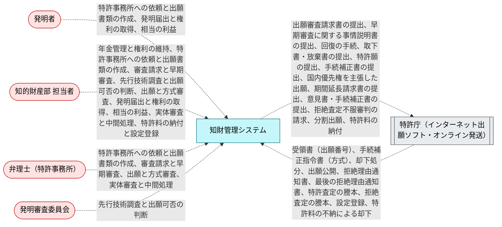

## 3. 要求

要求を目的ごとにまとめる。「BUC」はその要求が動機付ける業務で、[5. ユーザージャーニー](#5-ユーザージャーニー) にその業務フローがある。次の図は目的、要求、BUC のつながりである。「やらないこと」の枠にある要求は [4. やらないこと](#4-やらないこと) に載せている。

```mermaid
%% rdra-ish diagram=requirement scope=whole model=samples/patent-ops
%% kinds: requirement goal buc
%% omitted: actor nfr quality constraint business flow usecase event system entity
flowchart LR
  requirement__ReqAnswerWithinTerm[/"拒絶理由通知には応答期間内に、必要なら延長して応答する"\]:::requirement
  requirement__ReqExamRequestWithinThreeYears[/"審査請求の要否を出願から3年以内に決めて請求する"\]:::requirement
  requirement__ReqFairReward[/"相当の利益を基準で決め、通知し、意見を聴いて支払う"\]:::requirement
  requirement__ReqFirstFeesWithin30Days[/"特許査定から30日以内に第1〜3年分の特許料を納付する"\]:::requirement
  requirement__ReqFormalityWithinTerm[/"手続補正指令には指定期間内に手続補正書を出す"\]:::requirement
  requirement__ReqInventorReviewedDraft[/"発明者が確認した出願書類だけを出願する"\]:::requirement
  requirement__ReqNoMissedAnnuity[/"年金を納付漏れなく、維持の要否を調べてから納付する"\]:::requirement
  requirement__ReqRightsFromTheStart[/"職務発明の特許を受ける権利を発生した時から会社が持つ"\]:::requirement
  requirement__ReqSearchBeforeDecision[/"先行技術を調べてから出願可否を決める"\]:::requirement
  goal__LeanPortfolio[/"費用を価値のある発明と権利に絞る<br/>維持要否の調査を経ずに納付した年金の件数: 年30件 → 年0件"/]:::goal
  %% desc goal__LeanPortfolio: 審査請求料と年金は件数と請求項の数で増える。出願、審査請求、権利の維持を調べてから決めないと、使わない権利に費用を払い続ける。
  goal__NoLostRights[/"期限の徒過で権利を失わない<br/>期限の徒過による取下げ擬制・却下・消滅の件数: 年2件 → 年0件"/]:::goal
  %% desc goal__NoLostRights: 審査請求、手続補正、拒絶理由通知への応答、特許料の納付には期限があり、過ぎると出願は取り下げたものとみなされ、却下され、特許権は消滅する。
  goal__PromptFiling[/"発明を早く確実に出願につなげる<br/>発明届出の受付から出願までの日数の中央値: 150日 → 90日"/]:::goal
  %% desc goal__PromptFiling: 届出から出願までが長いと、他社に先に出願され、発明者の届出の意欲も下がる。
  buc__BucAnnuity["年金管理と権利の維持"]:::buc
  %% desc buc__BucAnnuity: 設定登録の後、第4年以後の特許料（年金）を前年以前に納付する。知的財産部は登録後3年目・6年目などに維持の要否を調べ、維持しない権利は納付をやめる。納付期限を過ぎても6月以内なら同額の割増特許料とともに追納でき、追納しなければ特許権は期限の経過の時に遡って消滅する。故意でなければ回復できる。特許権は放棄でき、出願から20年で満了する。
  buc__BucApplicationDrafting["特許事務所への依頼と出願書類の作成"]:::buc
  %% desc buc__BucApplicationDrafting: 出願と決まった発明について特許事務所に明細書の作成を依頼し、納品された出願書類（願書・明細書・特許請求の範囲・要約書・図面）を発明者と知的財産部が確かめ、修正を依頼し、承認する。発明者の確認を経ない書類は承認しない（`InventorChecked`）。
  buc__BucExaminationRequest["審査請求と早期審査"]:::buc
  %% desc buc__BucExaminationRequest: 出願は審査請求がなければ審査されない。知的財産部は期限の前に審査請求の要否を決め、弁理士が出願から3年以内に請求する。請求がなければ出願は取り下げたものとみなされ、故意でなければ回復できる。審査請求をした出願は早期審査を申し出られる。出願は係属している間、取り下げ・放棄できる。
  buc__BucFilingDecision["先行技術調査と出願可否の判断"]:::buc
  %% desc buc__BucFilingDecision: 受け付けた発明について先行技術を調べ、発明審査委員会が出願する、ノウハウとして秘匿する、出願しないのいずれかに決める。会社が特許を受ける権利を取得していない発明は出願と決めない（`RightsAcquired`）。決定は発明者に知らせる。
  buc__BucFilingFormality["出願と方式審査"]:::buc
  %% desc buc__BucFilingFormality: 承認された出願書類を弁理士がインターネット出願ソフトで出願し、受領書の出願番号と出願日を記録する。方式の不備には手続補正指令書が届き、発送日から2月以内に手続補正書を出さなければ出願は却下される。出願から1年6月で出願公開される。先の出願から1年以内なら国内優先権を主張でき、先の出願は1年4月で取り下げたものとみなされる。
  buc__BucInventionDisclosure["発明届出と権利の取得"]:::buc
  %% desc buc__BucInventionDisclosure: 発明者が発明届出書を出し、知的財産部が付番して記載を確かめ、不備があれば差し戻す。職務発明は職務発明規程により特許を受ける権利が発生した時から会社に帰属し、職務発明に当たらない発明は個別の譲渡で取得する（`EmployeeInvention`・`NonEmployeeInvention`）。
  buc__BucInventorReward["相当の利益"]:::buc
  %% desc buc__BucInventorReward: 職務発明について会社が特許を受ける権利を取得したとき、発明者は相当の利益を受ける。会社は職務発明規程の基準で額を決め、発明者に通知し、意見を聴いてから支払う。基準は協議・開示・意見の聴取の状況を考えて不合理であってはならない。支払の時期（出願時・登録時・実施時）はモデルの想定。
  buc__BucOfficeAction["実体審査と中間処理"]:::buc
  %% desc buc__BucOfficeAction: 審査官は拒絶理由を見つけなければ特許査定をし、見つければ拒絶理由通知で意見書を出す機会を与える。弁理士が知的財産部の方針で意見書・補正書を作って応答期間（国内居住者は発送日から60日）内に出し、期間内の請求で2か月、期間経過後2か月以内の請求でも2か月延長できる（両方はできない、`exclusive`）。最後の拒絶理由通知への補正は請求項の削除・減縮・誤記の訂正・釈明に限る（`FirstNoticeOnly`）。拒絶査定には謄本の送達から3月以内に審判を請求できる（審判の中身は対象外）。分割出願は補正できる時期・特許査定から30日・最初の拒絶査定から3月にできる。
  buc__BucRegistration["特許料の納付と設定登録"]:::buc
  %% desc buc__BucRegistration: 特許査定の謄本の送達から30日以内（請求で30日延長できる）に第1〜3年分の特許料を一時に納付すると、特許権の設定の登録がされ、特許権が発生する。納付しなければ設定登録されず、手続は却下される（`FirstFeesPaid`・`FirstFeesUnpaid`）。
  subgraph group_out_of_scope["やらないこと"]
    requirement__ReqNoAppealContents[/"審判・審決取消訴訟の中身は対象外とする"\]:::requirement
    requirement__ReqNoDesignTrademark[/"意匠・商標・実用新案は対象外とする"\]:::requirement
    requirement__ReqNoForeignFiling[/"外国出願・PCT 国際出願は対象外とする"\]:::requirement
  end
  goal__LeanPortfolio --> requirement__ReqExamRequestWithinThreeYears
  %% derived goal__LeanPortfolio -> requirement__ReqExamRequestWithinThreeYears via requirement__ReqExamRequestWithinThreeYears
  goal__LeanPortfolio --> requirement__ReqNoMissedAnnuity
  %% derived goal__LeanPortfolio -> requirement__ReqNoMissedAnnuity via requirement__ReqNoMissedAnnuity
  goal__LeanPortfolio --> requirement__ReqSearchBeforeDecision
  %% derived goal__LeanPortfolio -> requirement__ReqSearchBeforeDecision via requirement__ReqSearchBeforeDecision
  goal__NoLostRights --> requirement__ReqAnswerWithinTerm
  %% derived goal__NoLostRights -> requirement__ReqAnswerWithinTerm via requirement__ReqAnswerWithinTerm
  goal__NoLostRights --> requirement__ReqExamRequestWithinThreeYears
  %% derived goal__NoLostRights -> requirement__ReqExamRequestWithinThreeYears via requirement__ReqExamRequestWithinThreeYears
  goal__NoLostRights --> requirement__ReqFirstFeesWithin30Days
  %% derived goal__NoLostRights -> requirement__ReqFirstFeesWithin30Days via requirement__ReqFirstFeesWithin30Days
  goal__NoLostRights --> requirement__ReqFormalityWithinTerm
  %% derived goal__NoLostRights -> requirement__ReqFormalityWithinTerm via requirement__ReqFormalityWithinTerm
  goal__NoLostRights --> requirement__ReqNoMissedAnnuity
  %% derived goal__NoLostRights -> requirement__ReqNoMissedAnnuity via requirement__ReqNoMissedAnnuity
  goal__PromptFiling --> requirement__ReqFairReward
  %% derived goal__PromptFiling -> requirement__ReqFairReward via requirement__ReqFairReward
  goal__PromptFiling --> requirement__ReqInventorReviewedDraft
  %% derived goal__PromptFiling -> requirement__ReqInventorReviewedDraft via requirement__ReqInventorReviewedDraft
  goal__PromptFiling --> requirement__ReqRightsFromTheStart
  %% derived goal__PromptFiling -> requirement__ReqRightsFromTheStart via requirement__ReqRightsFromTheStart
  goal__PromptFiling --> requirement__ReqSearchBeforeDecision
  %% derived goal__PromptFiling -> requirement__ReqSearchBeforeDecision via requirement__ReqSearchBeforeDecision
  requirement__ReqAnswerWithinTerm --> buc__BucOfficeAction
  requirement__ReqExamRequestWithinThreeYears --> buc__BucExaminationRequest
  requirement__ReqFairReward --> buc__BucInventorReward
  requirement__ReqFirstFeesWithin30Days --> buc__BucRegistration
  requirement__ReqFormalityWithinTerm --> buc__BucFilingFormality
  requirement__ReqInventorReviewedDraft --> buc__BucApplicationDrafting
  requirement__ReqNoAppealContents -.-> buc__BucOfficeAction
  requirement__ReqNoDesignTrademark -.-> buc__BucAnnuity
  requirement__ReqNoForeignFiling -.-> buc__BucInventionDisclosure
  requirement__ReqNoMissedAnnuity --> buc__BucAnnuity
  requirement__ReqRightsFromTheStart --> buc__BucInventionDisclosure
  requirement__ReqSearchBeforeDecision --> buc__BucFilingDecision
  classDef requirement fill:#fff3bf,stroke:#e67700,color:#000;
  classDef goal fill:#fff3bf,stroke:#e67700,color:#000;
  classDef buc fill:#d3f9d8,stroke:#2b8a3e,color:#000;
```

### 費用を価値のある発明と権利に絞る

| ID | 要求 | 優先度 | 関係者 | 目的 | 受け入れ条件 | 出典 | BUC |
|---|---|---|---|---|---|---|---|
| `ReqExamRequestWithinThreeYears` | 審査請求の要否を出願から3年以内に決めて請求する | must | 知的財産部 | 費用を価値のある発明と権利に絞る、期限の徒過で権利を失わない | 出願ごとに審査請求期限が管理され、期限の前に要否が決まり、請求する出願は期限内に請求される。 | その日から三年以内に (egov-tokkyohou-334AC0000000121.txt:680); 取り下げたものとみなす (egov-tokkyohou-334AC0000000121.txt:686) | 審査請求と早期審査 |
| `ReqNoMissedAnnuity` | 年金を納付漏れなく、維持の要否を調べてから納付する | must | 知的財産部 | 費用を価値のある発明と権利に絞る、期限の徒過で権利を失わない | 特許権ごとに次の年の納付期限が管理され、維持する権利は期限までに納付される。期限を過ぎた権利は追納期限まで追われ、追納には割増特許料を加える。 | 知財部では、支払い漏れがおきないよう管理する必要がある (keiyakuwatch-chizaibu-gyomu.md:136); 前年以前に納付 (egov-tokkyohou-334AC0000000121.txt:1470); 登録後３年目及び６年目に調査実施 (niigata-u-2023-hatsumei-flowchart.txt:207-208) | 年金管理と権利の維持 |
| `ReqSearchBeforeDecision` | 先行技術を調べてから出願可否を決める | must | 発明審査委員会 | 費用を価値のある発明と権利に絞る、発明を早く確実に出願につなげる | 出願・秘匿・不出願の決定は、先行技術調査の結果が出た届出についてだけ行う。 | 先行技術調査依頼 (niigata-u-2023-hatsumei-flowchart.txt:129); 特許性、技術性、市場性調査 (chuo-u-hatsumei-flow.txt:95) | 先行技術調査と出願可否の判断 |

### 期限の徒過で権利を失わない

| ID | 要求 | 優先度 | 関係者 | 目的 | 受け入れ条件 | 出典 | BUC |
|---|---|---|---|---|---|---|---|
| `ReqAnswerWithinTerm` | 拒絶理由通知には応答期間内に、必要なら延長して応答する | must | 弁理士、知的財産部 | 期限の徒過で権利を失わない | 拒絶理由通知ごとに応答期限が管理され、期間内の延長と期間経過後の延長は合わせて一度までで、最後の拒絶理由通知への補正は限定した範囲に収まる。 | 相当の期間を指定して、意見書を提出する機会 (egov-tokkyohou-334AC0000000121.txt:731); 国内居住者：６０日 (jpo-2016-kyozetu-entyou-zu01.txt:59); 期間延長 (jpo-tetuzuki-02-19-kyozetsu-outou.txt:56-57, :64-67, :72-73) | 実体審査と中間処理 |
| `ReqExamRequestWithinThreeYears` | 審査請求の要否を出願から3年以内に決めて請求する | must | 知的財産部 | 費用を価値のある発明と権利に絞る、期限の徒過で権利を失わない | 出願ごとに審査請求期限が管理され、期限の前に要否が決まり、請求する出願は期限内に請求される。 | その日から三年以内に (egov-tokkyohou-334AC0000000121.txt:680); 取り下げたものとみなす (egov-tokkyohou-334AC0000000121.txt:686) | 審査請求と早期審査 |
| `ReqFirstFeesWithin30Days` | 特許査定から30日以内に第1〜3年分の特許料を納付する | must | 知的財産部 | 期限の徒過で権利を失わない | 特許査定を受けた出願ごとに納付期限が管理され、期限（延長した場合はその期限）までに第1〜3年分が納付される。未納の出願は設定登録されない。 | 三十日以内に一時に納付しなければならない (egov-tokkyohou-334AC0000000121.txt:1468); 特許権の設定の登録をする (egov-tokkyohou-334AC0000000121.txt:823) | 特許料の納付と設定登録 |
| `ReqFormalityWithinTerm` | 手続補正指令には指定期間内に手続補正書を出す | must | 弁理士、知的財産部 | 期限の徒過で権利を失わない | 手続補正指令書を受けた出願は、発送日から2月の期限が管理され、期限内に手続補正書が出される。 | 指令書発送日の日から２月以内に (jpo-tetuzuki-02-20-kyakka-hoseishirei.txt:337); この手続補正書の提出がないときは、この出願を却下 (jpo-tetuzuki-02-20-kyakka-hoseishirei.txt:338) | 出願と方式審査 |
| `ReqNoMissedAnnuity` | 年金を納付漏れなく、維持の要否を調べてから納付する | must | 知的財産部 | 費用を価値のある発明と権利に絞る、期限の徒過で権利を失わない | 特許権ごとに次の年の納付期限が管理され、維持する権利は期限までに納付される。期限を過ぎた権利は追納期限まで追われ、追納には割増特許料を加える。 | 知財部では、支払い漏れがおきないよう管理する必要がある (keiyakuwatch-chizaibu-gyomu.md:136); 前年以前に納付 (egov-tokkyohou-334AC0000000121.txt:1470); 登録後３年目及び６年目に調査実施 (niigata-u-2023-hatsumei-flowchart.txt:207-208) | 年金管理と権利の維持 |

### 発明を早く確実に出願につなげる

| ID | 要求 | 優先度 | 関係者 | 目的 | 受け入れ条件 | 出典 | BUC |
|---|---|---|---|---|---|---|---|
| `ReqFairReward` | 相当の利益を基準で決め、通知し、意見を聴いて支払う | must | 発明者、知的財産部 | 発明を早く確実に出願につなげる | 職務発明ごとに相当の利益が決まり、発明者に通知され、意見の申出には回答してから支払われる。 | 相当の利益 (egov-tokkyohou-334AC0000000121.txt:382); 協議の状況…開示の状況…意見の聴取の状況 (egov-tokkyohou-334AC0000000121.txt:384); 協議・開示・意見の聴取の定義 (jlt-shokumu-hatsumei-shishin.md:39, :41, :43) | 相当の利益 |
| `ReqInventorReviewedDraft` | 発明者が確認した出願書類だけを出願する | must | 知的財産部、発明者 | 発明を早く確実に出願につなげる | 出願書類は発明者の確認の後にだけ承認でき、修正を依頼した案は発明者がもう一度確かめる。 | 発明者とも連携して、出願書類の内容をしっかりチェック (keiyakuwatch-chizaibu-gyomu.md:152); 明細書作成内容確認 (niigata-u-2023-hatsumei-flowchart.txt:226) | 特許事務所への依頼と出願書類の作成 |
| `ReqRightsFromTheStart` | 職務発明の特許を受ける権利を発生した時から会社が持つ | must | 知的財産部 | 発明を早く確実に出願につなげる | 受け付けた届出は職務発明か否かを判定し、職務発明は規程により、それ以外は譲渡によって会社が権利を取得してから出願を決める。 | その発生した時から当該使用者等に帰属する (egov-tokkyohou-334AC0000000121.txt:380); 発明の届出 (jpo-2015-shokumu-cyusyou-pamphlet.txt:78) | 発明届出と権利の取得 |
| `ReqSearchBeforeDecision` | 先行技術を調べてから出願可否を決める | must | 発明審査委員会 | 費用を価値のある発明と権利に絞る、発明を早く確実に出願につなげる | 出願・秘匿・不出願の決定は、先行技術調査の結果が出た届出についてだけ行う。 | 先行技術調査依頼 (niigata-u-2023-hatsumei-flowchart.txt:129); 特許性、技術性、市場性調査 (chuo-u-hatsumei-flow.txt:95) | 先行技術調査と出願可否の判断 |

## 4. やらないこと

| ID | 内容 | 理由 |
|---|---|---|
| `ReqNoAppealContents` | 審判・審決取消訴訟の中身は対象外とする | 拒絶査定不服審判は請求の期限（謄本の送達から3月）と請求の事実だけを扱う。前置審査、審判での拒絶理由、審決、審決取消訴訟、無効審判は手続も担当（審判部・裁判所・訴訟代理人）も別で、調査もしていない。 |
| `ReqNoDesignTrademark` | 意匠・商標・実用新案は対象外とする | 特許だけを扱う。意匠・商標・実用新案は出願・審査・登録料の期限と料金の体系が別で（商標の更新など）、調査もしていない。 |
| `ReqNoForeignFiling` | 外国出願・PCT 国際出願は対象外とする | 国内の特許庁への手続だけを扱う。パリ条約の優先権、PCT の国際段階・国内移行、各国の代理人とのやり取りは期限と手続の体系が別で、調査もしていない。 |

## 5. ユーザージャーニー

次の図は業務の流れである。業務ごとに BUC をまとめ、ある BUC から次の BUC への引き渡しを、引き渡すイベントのラベルで示す。

```mermaid
%% rdra-ish diagram=business scope=whole model=samples/patent-ops
%% kinds: business buc
%% omitted: actor requirement flow step timer medium permission usecase screen event api entity condition
flowchart LR
  subgraph business__InventionManagement["発明の管理"]
    %% desc business__InventionManagement: 発明届出の受付、職務発明の判定、出願可否の判断、相当の利益の手続。
    buc__BucFilingDecision["先行技術調査と出願可否の判断"]:::buc
    %% desc buc__BucFilingDecision: 受け付けた発明について先行技術を調べ、発明審査委員会が出願する、ノウハウとして秘匿する、出願しないのいずれかに決める。会社が特許を受ける権利を取得していない発明は出願と決めない（`RightsAcquired`）。決定は発明者に知らせる。
    buc__BucInventionDisclosure["発明届出と権利の取得"]:::buc
    %% desc buc__BucInventionDisclosure: 発明者が発明届出書を出し、知的財産部が付番して記載を確かめ、不備があれば差し戻す。職務発明は職務発明規程により特許を受ける権利が発生した時から会社に帰属し、職務発明に当たらない発明は個別の譲渡で取得する（`EmployeeInvention`・`NonEmployeeInvention`）。
    buc__BucInventorReward["相当の利益"]:::buc
    %% desc buc__BucInventorReward: 職務発明について会社が特許を受ける権利を取得したとき、発明者は相当の利益を受ける。会社は職務発明規程の基準で額を決め、発明者に通知し、意見を聴いてから支払う。基準は協議・開示・意見の聴取の状況を考えて不合理であってはならない。支払の時期（出願時・登録時・実施時）はモデルの想定。
  end
  subgraph business__Prosecution["権利化"]
    %% desc business__Prosecution: 特許事務所への依頼、出願、方式審査、審査請求、拒絶理由通知への応答（中間処理）。
    buc__BucApplicationDrafting["特許事務所への依頼と出願書類の作成"]:::buc
    %% desc buc__BucApplicationDrafting: 出願と決まった発明について特許事務所に明細書の作成を依頼し、納品された出願書類（願書・明細書・特許請求の範囲・要約書・図面）を発明者と知的財産部が確かめ、修正を依頼し、承認する。発明者の確認を経ない書類は承認しない（`InventorChecked`）。
    buc__BucExaminationRequest["審査請求と早期審査"]:::buc
    %% desc buc__BucExaminationRequest: 出願は審査請求がなければ審査されない。知的財産部は期限の前に審査請求の要否を決め、弁理士が出願から3年以内に請求する。請求がなければ出願は取り下げたものとみなされ、故意でなければ回復できる。審査請求をした出願は早期審査を申し出られる。出願は係属している間、取り下げ・放棄できる。
    buc__BucFilingFormality["出願と方式審査"]:::buc
    %% desc buc__BucFilingFormality: 承認された出願書類を弁理士がインターネット出願ソフトで出願し、受領書の出願番号と出願日を記録する。方式の不備には手続補正指令書が届き、発送日から2月以内に手続補正書を出さなければ出願は却下される。出願から1年6月で出願公開される。先の出願から1年以内なら国内優先権を主張でき、先の出願は1年4月で取り下げたものとみなされる。
    buc__BucOfficeAction["実体審査と中間処理"]:::buc
    %% desc buc__BucOfficeAction: 審査官は拒絶理由を見つけなければ特許査定をし、見つければ拒絶理由通知で意見書を出す機会を与える。弁理士が知的財産部の方針で意見書・補正書を作って応答期間（国内居住者は発送日から60日）内に出し、期間内の請求で2か月、期間経過後2か月以内の請求でも2か月延長できる（両方はできない、`exclusive`）。最後の拒絶理由通知への補正は請求項の削除・減縮・誤記の訂正・釈明に限る（`FirstNoticeOnly`）。拒絶査定には謄本の送達から3月以内に審判を請求できる（審判の中身は対象外）。分割出願は補正できる時期・特許査定から30日・最初の拒絶査定から3月にできる。
  end
  subgraph business__RightsMaintenance["権利の維持"]
    %% desc business__RightsMaintenance: 特許料の納付と設定登録、年金の管理、消滅と回復。
    buc__BucAnnuity["年金管理と権利の維持"]:::buc
    %% desc buc__BucAnnuity: 設定登録の後、第4年以後の特許料（年金）を前年以前に納付する。知的財産部は登録後3年目・6年目などに維持の要否を調べ、維持しない権利は納付をやめる。納付期限を過ぎても6月以内なら同額の割増特許料とともに追納でき、追納しなければ特許権は期限の経過の時に遡って消滅する。故意でなければ回復できる。特許権は放棄でき、出願から20年で満了する。
    buc__BucRegistration["特許料の納付と設定登録"]:::buc
    %% desc buc__BucRegistration: 特許査定の謄本の送達から30日以内（請求で30日延長できる）に第1〜3年分の特許料を一時に納付すると、特許権の設定の登録がされ、特許権が発生する。納付しなければ設定登録されず、手続は却下される（`FirstFeesPaid`・`FirstFeesUnpaid`）。
  end
  buc__BucApplicationDrafting -->|出願書類の承認| buc__BucFilingFormality
  %% derived buc__BucApplicationDrafting -> buc__BucFilingFormality via event__EvDraftApproved
  buc__BucFilingDecision -->|出願の決定| buc__BucApplicationDrafting
  %% derived buc__BucFilingDecision -> buc__BucApplicationDrafting via event__EvFilingDecided
  buc__BucFilingFormality -->|特許願の提出| buc__BucInventorReward
  %% derived buc__BucFilingFormality -> buc__BucInventorReward via event__EvApplicationFiled
  classDef business fill:#d3f9d8,stroke:#2b8a3e,color:#000;
  classDef buc fill:#d3f9d8,stroke:#2b8a3e,color:#000;
```

この後の節は BUC ごとの業務フローである。手順、分岐、例外と、各手順を担う UC を示す。

### 発明届出と権利の取得

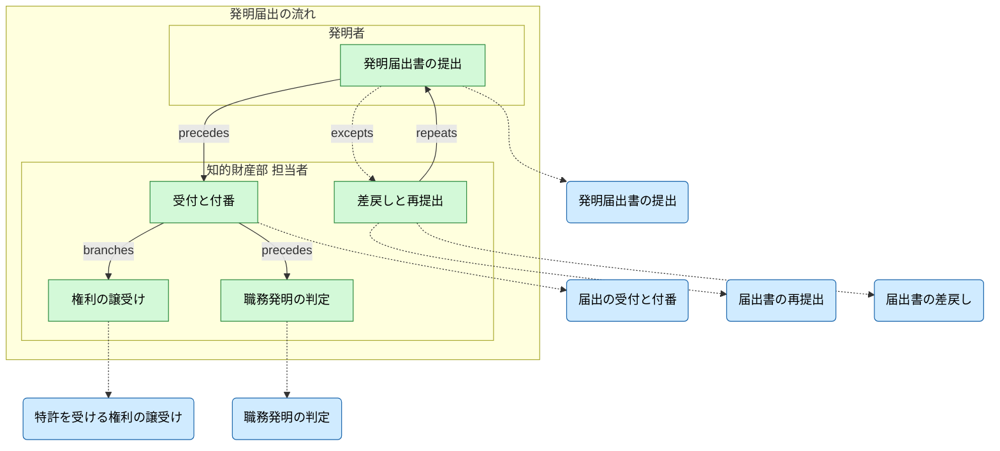

### 先行技術調査と出願可否の判断

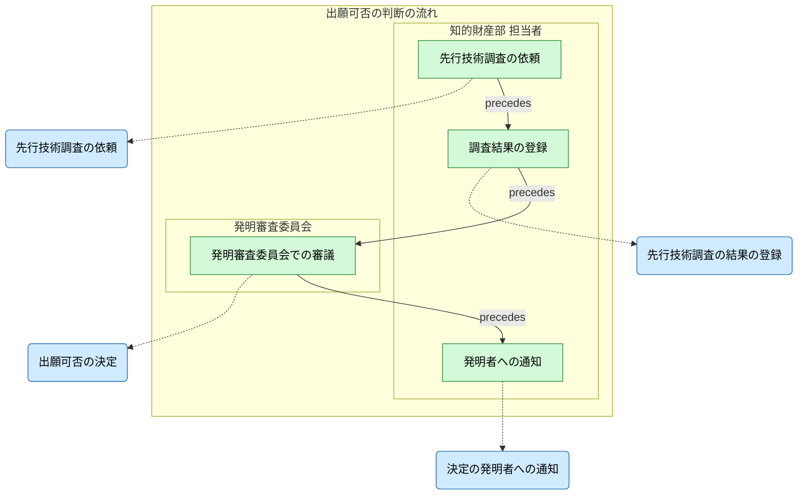

### 特許事務所への依頼と出願書類の作成

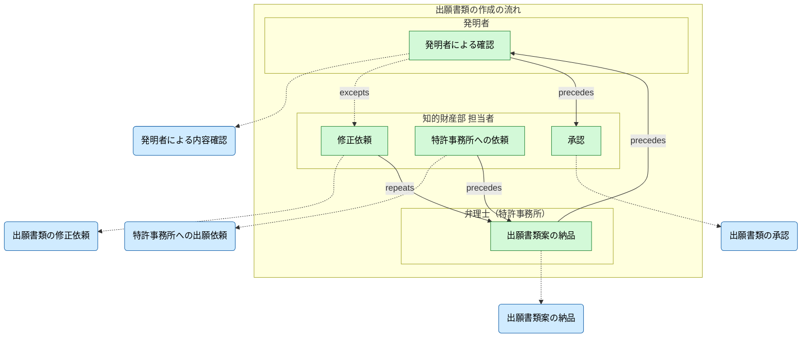

### 出願と方式審査

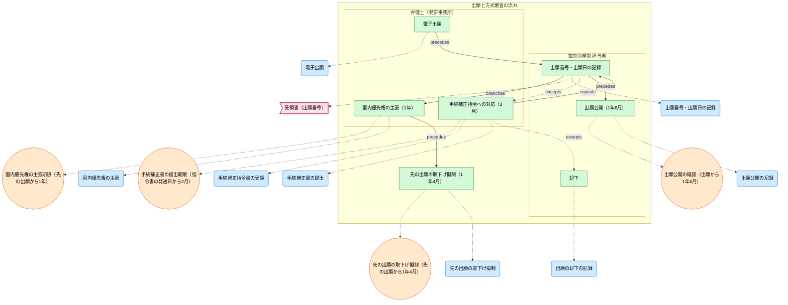

### 審査請求と早期審査

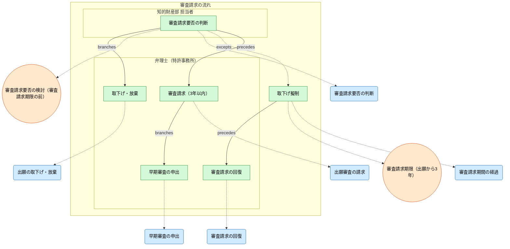

### 実体審査と中間処理

```mermaid
%% rdra-ish diagram=flow scope=buc:BucOfficeAction model=samples/patent-ops
%% kinds: flow step lane timer usecase
%% omitted: buc
flowchart TD
  subgraph flow__OfficeActionFlow["実体審査と中間処理の流れ"]
    subgraph lane__OfficeActionFlow__IpStaff["知的財産部 担当者"]
      %% lane lane__OfficeActionFlow__IpStaff: actor__IpStaff
      step__GrantStep["特許査定"]:::step
      step__PolicyStep["応答方針の指示"]:::step
      step__RejectionStep["拒絶査定（審判請求は3月以内）"]:::step
    end
    subgraph lane__OfficeActionFlow__PatentAttorney["弁理士（特許事務所）"]
      %% lane lane__OfficeActionFlow__PatentAttorney: actor__PatentAttorney
      step__DivisionStep["分割出願"]:::step
      step__DraftingStep["意見書・補正書案の作成"]:::step
      step__ExtensionStep["応答期間の延長（2か月）"]:::step
      step__FinalNoticeStep["最後の拒絶理由通知"]:::step
      step__LateExtensionStep["期間経過後の延長（2か月）"]:::step
      step__NoticeStep["拒絶理由通知の受領（60日）"]:::step
      step__ResponseStep["意見書・補正書の提出"]:::step
    end
  end
  timer__AppealDeadline(("拒絶査定不服審判の請求期限（謄本の送達から3月）")):::timer
  timer__LateExtensionDeadline(("期間経過後の延長請求の期限（応答期間の経過から2か月）")):::timer
  timer__ResponseDeadline(("拒絶理由通知の応答期限（発送日から60日、延長で2か月）")):::timer
  usecase__CloseOfficeActionDocket("中間処理案件の終了"):::usecase
  %% desc usecase__CloseOfficeActionDocket: 査定・取下げで出願の審査が終わった後、応答済の拒絶理由通知の案件を閉じる。
  usecase__DraftLimitedResponse("限定した補正による応答案の作成"):::usecase
  %% desc usecase__DraftLimitedResponse: 請求項の削除・減縮・誤記の訂正・釈明に限った補正（または意見書だけ）の案を作る。最後の拒絶理由通知にはこの案だけが使える。
  usecase__DraftResponse("意見書・補正書案の作成"):::usecase
  %% desc usecase__DraftResponse: 最初の拒絶理由通知に対し、弁理士が意見書と、必要なら限定のない補正書の案を作る。
  usecase__ExpireResponseTerm("応答期間の経過"):::usecase
  %% desc usecase__ExpireResponseTerm: 応答のないまま応答期間が過ぎたことを記録する。その後2か月は期間経過後の延長を請求できる。
  usecase__FileDivisionalApplication("分割出願"):::usecase
  %% desc usecase__FileDivisionalApplication: 補正できる時期、特許査定の謄本から30日、最初の拒絶査定の謄本から3月の間に、出願の一部を新たな出願にする。
  usecase__FileResponse("意見書・補正書の提出"):::usecase
  %% desc usecase__FileResponse: 知的財産部が確かめた案を弁理士が特許庁に出す。
  usecase__FinalizeRejection("拒絶査定の確定"):::usecase
  %% desc usecase__FinalizeRejection: 審判請求がないまま3月が過ぎ、拒絶査定が確定したことを記録する。
  usecase__InstructResponse("応答方針の指示"):::usecase
  %% desc usecase__InstructResponse: 知的財産部が発明者と相談し、弁理士に応答の方針を伝える（参照のみ）。
  usecase__LapseResponse("応答なしでの期間満了"):::usecase
  %% desc usecase__LapseResponse: 期間経過後の延長も請求できなくなったことを記録する。
  usecase__ReceiveDecisionOfRejection("拒絶査定の受領"):::usecase
  %% desc usecase__ReceiveDecisionOfRejection: 拒絶査定の謄本を受け取る。審判請求の期限（3月）が始まる。
  usecase__ReceiveDecisionToGrant("特許査定の受領"):::usecase
  %% desc usecase__ReceiveDecisionToGrant: 特許査定の謄本を受け取る。特許料の納付期限（30日）が始まる。
  usecase__ReceiveFinalOfficeAction("最後の拒絶理由通知の受領"):::usecase
  %% desc usecase__ReceiveFinalOfficeAction: 応答の後に最後の拒絶理由通知書を受け取り、補正の範囲が限られた応答期間を始める。
  usecase__ReceiveOfficeAction("拒絶理由通知の受領"):::usecase
  %% desc usecase__ReceiveOfficeAction: 拒絶理由通知書を受け取り、応答期間の管理を始める。
  usecase__RequestAppeal("拒絶査定不服審判の請求"):::usecase
  %% desc usecase__RequestAppeal: 審判を請求する。審判の中身はこのモデルの対象外で、出願はここで審判に引き渡される。
  usecase__RequestLateExtension("期間経過後の延長請求"):::usecase
  %% desc usecase__RequestLateExtension: 応答期間の経過後2か月以内に延長を請求し、2か月の応答期間を得る。
  usecase__RequestTermExtension("応答期間の延長請求"):::usecase
  %% desc usecase__RequestTermExtension: 応答期間内に期間延長請求書を出し、2か月延長する。
  step__DivisionStep -.-> usecase__FileDivisionalApplication
  step__DraftingStep -.-> usecase__DraftLimitedResponse
  step__DraftingStep -.-> usecase__DraftResponse
  step__DraftingStep -.->|excepts| step__LateExtensionStep
  step__DraftingStep -->|precedes| step__ResponseStep
  step__ExtensionStep -.-> usecase__RequestTermExtension
  step__ExtensionStep -->|repeats| step__DraftingStep
  step__FinalNoticeStep -.-> usecase__ReceiveFinalOfficeAction
  step__FinalNoticeStep -->|repeats| step__PolicyStep
  step__GrantStep -.-> usecase__CloseOfficeActionDocket
  step__GrantStep -.-> usecase__ReceiveDecisionToGrant
  step__LateExtensionStep -.-> timer__LateExtensionDeadline
  step__LateExtensionStep -.-> usecase__ExpireResponseTerm
  step__LateExtensionStep -.-> usecase__LapseResponse
  step__LateExtensionStep -.-> usecase__RequestLateExtension
  step__LateExtensionStep -->|repeats| step__DraftingStep
  step__NoticeStep -.-> usecase__ReceiveOfficeAction
  step__NoticeStep -->|precedes| step__PolicyStep
  step__PolicyStep -->|branches| step__DivisionStep
  step__PolicyStep -->|branches| step__ExtensionStep
  step__PolicyStep -.-> usecase__InstructResponse
  step__PolicyStep -->|precedes| step__DraftingStep
  step__RejectionStep -.-> timer__AppealDeadline
  step__RejectionStep -.-> usecase__FinalizeRejection
  step__RejectionStep -.-> usecase__ReceiveDecisionOfRejection
  step__RejectionStep -.-> usecase__RequestAppeal
  step__ResponseStep -->|branches| step__FinalNoticeStep
  step__ResponseStep -.-> timer__ResponseDeadline
  step__ResponseStep -.-> usecase__FileResponse
  step__ResponseStep -.->|excepts| step__RejectionStep
  step__ResponseStep -->|precedes| step__GrantStep
  classDef flow fill:#d3f9d8,stroke:#2b8a3e,color:#000;
  classDef step fill:#d3f9d8,stroke:#2b8a3e,color:#000;
  classDef lane fill:#d3f9d8,stroke:#2b8a3e,color:#000;
  classDef timer fill:#ffe8cc,stroke:#d9480f,color:#000;
  classDef usecase fill:#d0ebff,stroke:#1864ab,color:#000;
```

### 特許料の納付と設定登録

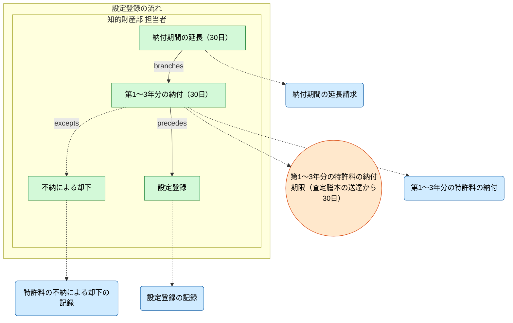

### 年金管理と権利の維持

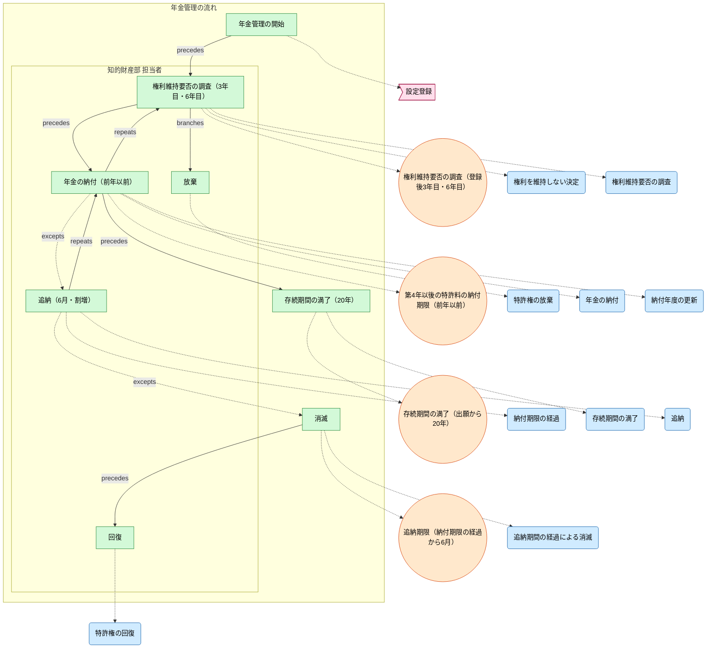

### 相当の利益

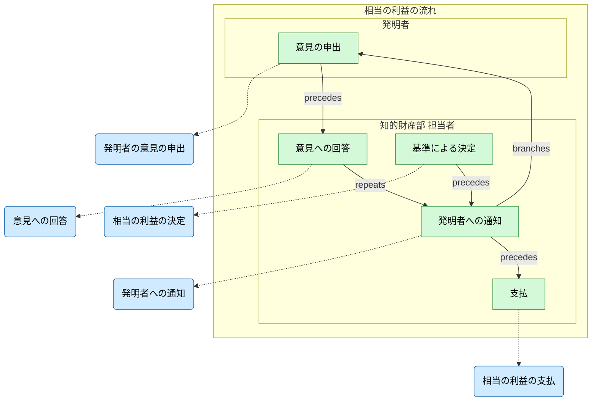

## 6. ビジネスルール（受け入れ条件）

`list --kind rule --format markdown` の出力である。各行が、システムが守る業務規則で、受け入れ試験の条件になる。

| kind | label | entities | rule | applies_to | site |
| --- | --- | --- | --- | --- | --- |
| condition | 特許権が存続している | Patent | Patent.status == 存続中 | DecideToLetLapse | samples/patent-ops/buc/buc_annuity.rdra:84 |
| condition | 存続中で、維持すると決めた権利の次の年が未納 | Patent | Patent.status == 存続中, Patent.maintain == true, Patent.next_year_paid == false | PayAnnuity | samples/patent-ops/buc/buc_annuity.rdra:99 |
| condition | 存続中で、次の年が納付済 | Patent | Patent.status == 存続中, Patent.next_year_paid == true | RollOverAnnuityYear | samples/patent-ops/buc/buc_annuity.rdra:108 |
| condition | 次の年が未納 | Patent | Patent.status == 存続中, Patent.next_year_paid == false | EnterGracePeriod | samples/patent-ops/buc/buc_annuity.rdra:117 |
| condition | 維持すると決めた権利である | Patent | Patent.status == 追納期間中, Patent.maintain == true | PayLateAnnuity | samples/patent-ops/buc/buc_annuity.rdra:129 |
| invariant | 追納期間内に特許料を納めた特許権は消滅しない | Patent | when Patent.status == 消滅（特許料の不納） then Patent.next_year_paid == false |  | samples/patent-ops/buc/buc_annuity.rdra:137 |
| condition | 出願と決まった発明である | InventionDisclosure | InventionDisclosure.status == 出願決定 | RequestDrafting | samples/patent-ops/buc/buc_application_drafting.rdra:64 |
| condition | 案が納品されている | DraftingOrder | DraftingOrder.status == 原稿受領 | ConfirmDraftByInventor | samples/patent-ops/buc/buc_application_drafting.rdra:78 |
| condition | 発明者が内容を確認している | DraftingOrder | DraftingOrder.status == 原稿受領, DraftingOrder.inventor_checked == true | ApproveDraft | samples/patent-ops/buc/buc_application_drafting.rdra:92 |
| forbidden | 発明者が内容を確認していない出願書類は承認しない | DraftingOrder | DraftingOrder.status == 出願承認済 AND DraftingOrder.inventor_checked == false |  | samples/patent-ops/buc/buc_application_drafting.rdra:96 |
| condition | 審査請求をした出願である | PatentApplication | PatentApplication.status == 審査請求済（審査中）, PatentApplication.exam_requested_at == present | RequestAcceleratedExamination | samples/patent-ops/buc/buc_examination_request.rdra:79 |
| invariant | 審査請求のない出願は審査されない | PatentApplication | when PatentApplication.exam_requested_at == null then PatentApplication.status not in (granted, rejected, rejection_final, appealed, registered) |  | samples/patent-ops/buc/buc_examination_request.rdra:104 |
| forbidden | 審査請求をしていない出願は早期審査の対象にならない | PatentApplication | PatentApplication.accelerated == true AND PatentApplication.exam_requested_at == null |  | samples/patent-ops/buc/buc_examination_request.rdra:107 |
| condition | 会社が特許を受ける権利を取得している | InventionDisclosure | InventionDisclosure.right_acquired == true | DecideFiling | samples/patent-ops/buc/buc_filing_decision.rdra:68 |
| forbidden | 会社が特許を受ける権利を取得していない発明は出願を決めない | InventionDisclosure | InventionDisclosure.status == 出願決定 AND InventionDisclosure.right_acquired == false |  | samples/patent-ops/buc/buc_filing_decision.rdra:70 |
| condition | 出願が係属している | PatentApplication | PatentApplication.status not in (却下, 取下げ・放棄, 取下げ擬制（審査請求なし）, 取下げ擬制（国内優先権の基礎）, 設定登録済) | RecordPublication | samples/patent-ops/buc/buc_filing_formality.rdra:132 |
| condition | 先の出願が係属し、査定を受けていない | PatentApplication | PatentApplication.status in (出願済（方式審査）, 手続補正指令への対応中, 審査請求済（審査中）) | ClaimDomesticPriority | samples/patent-ops/buc/buc_filing_formality.rdra:147 |
| condition | 国内優先権の基礎とされ、まだ係属している出願である | PatentApplication | PatentApplication.priority_base == true, PatentApplication.status not in (特許査定, 拒絶査定の確定, 設定登録済, 却下, 取下げ擬制（審査請求なし）, 取下げ擬制（国内優先権の基礎）, 取下げ・放棄) | DeemPriorityBaseWithdrawn | samples/patent-ops/buc/buc_filing_formality.rdra:165 |
| condition | 職務発明である | InventionDisclosure | InventionDisclosure.category == 職務発明 | JudgeEmployeeInvention | samples/patent-ops/buc/buc_invention_disclosure.rdra:83 |
| condition | 職務発明に当たらない | InventionDisclosure | InventionDisclosure.category == 職務発明に当たらない発明 | AcquireRightsByAssignment | samples/patent-ops/buc/buc_invention_disclosure.rdra:94 |
| condition | 職務発明である | InventionDisclosure | InventionDisclosure.category == 職務発明 | DecideReward | samples/patent-ops/buc/buc_inventor_reward.rdra:55 |
| condition | 出願が審査中である | PatentApplication | PatentApplication.status == 審査請求済（審査中） | ReceiveOfficeAction | samples/patent-ops/buc/buc_office_action.rdra:132 |
| condition | 最初の拒絶理由通知である | OfficeAction | OfficeAction.status == 応答期間中, OfficeAction.kind == 最初 | DraftResponse | samples/patent-ops/buc/buc_office_action.rdra:148 |
| condition | 応答期間内で、まだ延長していない | OfficeAction | OfficeAction.status == 応答期間中, OfficeAction.extended == false, OfficeAction.late_extended == false | RequestTermExtension | samples/patent-ops/buc/buc_office_action.rdra:164 |
| condition | 期間内に延長していない | OfficeAction | OfficeAction.status == 期間経過（延長請求可）, OfficeAction.extended == false | RequestLateExtension | samples/patent-ops/buc/buc_office_action.rdra:182 |
| forbidden | 最後の拒絶理由通知への補正は、削除・減縮・誤記の訂正・釈明に限る | OfficeAction | OfficeAction.kind == 最後 AND OfficeAction.amendment == 限定のない補正 |  | samples/patent-ops/buc/buc_office_action.rdra:213 |
| exclusive | 期間内に延長した応答期間は、経過後に重ねて延長できない | OfficeAction | at most one of: OfficeAction.extended == true, OfficeAction.late_extended == true |  | samples/patent-ops/buc/buc_office_action.rdra:215 |
| condition | 出願の審査が終わっている | PatentApplication | PatentApplication.status not in (出願済（方式審査）, 手続補正指令への対応中, 審査請求済（審査中）) | CloseOfficeActionDocket | samples/patent-ops/buc/buc_office_action.rdra:256 |
| condition | 分割できる時期である | PatentApplication | PatentApplication.status in (出願済（方式審査）, 審査請求済（審査中）, 特許査定, 拒絶査定) | FileDivisionalApplication | samples/patent-ops/buc/buc_office_action.rdra:269 |
| condition | 特許査定を受けた出願である | PatentApplication | PatentApplication.status == 特許査定 | FeePaymentApi | samples/patent-ops/buc/buc_registration.rdra:64 |
| condition | 納付期間をまだ延長していない | PatentApplication | PatentApplication.status == 特許査定, PatentApplication.fee_period_extended == false | RequestFeePaymentExtension | samples/patent-ops/buc/buc_registration.rdra:73 |
| condition | 第1〜3年分の特許料を納付している | PatentApplication | PatentApplication.status == 特許査定, PatentApplication.first_fees_paid == true | RecordRegistration | samples/patent-ops/buc/buc_registration.rdra:86 |
| invariant | 特許料（第1〜3年分）を納付していない出願は設定登録されない | PatentApplication | when PatentApplication.status == 設定登録済 then PatentApplication.first_fees_paid == true |  | samples/patent-ops/buc/buc_registration.rdra:90 |
| condition | 第1〜3年分の特許料を納付していない | PatentApplication | PatentApplication.status == 特許査定, PatentApplication.first_fees_paid == false | RecordRegistrationDismissal | samples/patent-ops/buc/buc_registration.rdra:102 |
| invariant | 発明者に通知していない相当の利益は支払わない | InventorReward | when InventorReward.status == 支払済 then InventorReward.notified_at == present |  | samples/patent-ops/shared/entities.rdra:224 |
| invariant | 追納には特許料と同額の割増特許料を加える | Patent | when Patent.last_payment == 追納 then Patent.surcharge == present |  | samples/patent-ops/shared/entities.rdra:227 |
| forbidden | 期限内の納付には割増特許料を付けない | Patent | Patent.last_payment == 期限内の納付 AND Patent.surcharge == present |  | samples/patent-ops/shared/entities.rdra:228 |

## 7. 非機能要件

| id | label | metric | target | window | slo | availability | resilience | audit | logging | retention | privacy | description |
| --- | --- | --- | --- | --- | --- | --- | --- | --- | --- | --- | --- | --- |
| DeadlineReminderLead | 期限の事前通知 | reminder_lead_days | >=30 | 30d | 100% |  | retryable |  |  |  |  |  |

| id | label | metric | target | window | slo | availability | resilience | audit | logging | retention | privacy | description |
| --- | --- | --- | --- | --- | --- | --- | --- | --- | --- | --- | --- | --- |
| DocketAuditTrail | 期限管理の監査証跡 |  |  |  |  |  |  | enabled |  | 25y |  |  |
| InventionConfidentiality | 出願前の発明の秘密保持 |  |  |  |  |  |  |  | structured | 20y | restricted |  |
